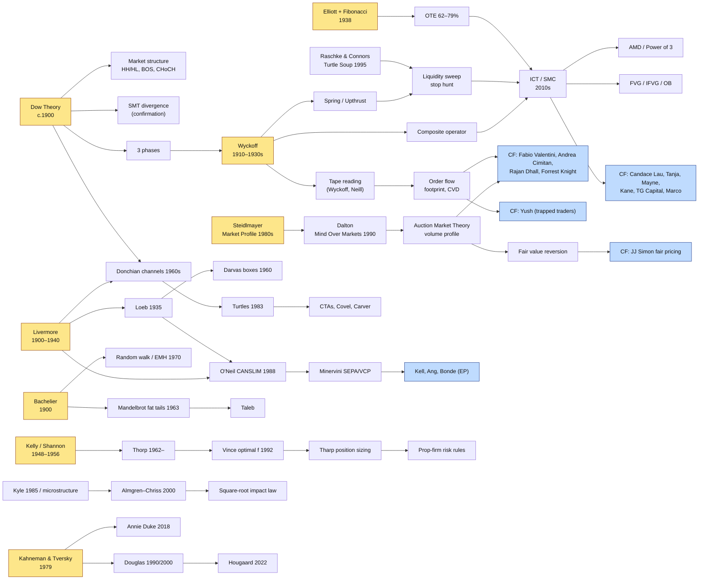

# Partition 08_synthesis


<!-- ===== FILE: trading-intelligence/08_synthesis/consensus-and-conflicts.md ===== -->

---
id: synthesis_consensus_conflicts
type: synthesis
title: Consensus & Conflicts across sources
partition: 08_synthesis
layer: L8
related: [synthesis_unified_framework, synthesis_idea_lineage]
status: synthesized
---

# Where the sources agree, and where they genuinely disagree

## Near-universal consensus (every partition says it)

| Principle | Voices |
|---|---|
| **Cut losses short; risk small and fixed per trade** | Livermore, Loeb, O'Neil (7–8%), Turtles (1%/N), Hite (1%), Fabio (~0.25%), BabyPips Senior, Tharp |
| **Location before trigger: trade at meaningful levels only** | Dalton (value edges), ICT (PD arrays), Brandt (pattern boundaries), Forrest Knight (auction levels), BabyPips G1 |
| **Context/regime decides which setup is valid** | Dalton (balance/imbalance), Fabio (two models), TG Capital (EMA stack gate), Clement Ang (when to be aggressive), Weinstein (stages) |
| **Losing streaks are normal; think in distributions** | Douglas, Silfrain (20 in a row), Seykota, Thorp, Duke |
| **Preparation, backtesting and journaling outweigh live screen time** | Silfrain, Umar Ashraf, Steenbarger, Brandt's trade diary |
| **The big money is in a few big moves** | Livermore, trend followers, Minervini, TG Capital's 1:20 targets |

## Genuine conflicts (pick a side consciously)

| Tension | Side A | Side B | Resolution |
|---|---|---|---|
| **Diversify vs concentrate** | Trend followers, Dalio (15+ uncorrelated streams) | Druckenmiller, Soros ("bet the ranch" on conviction) | Concentration requires skill at *timing conviction*; default to diversification until your journal proves that skill |
| **Trend vs mean reversion** | Turtles, Minervini, momentum | AMT POC reversion, JJ Simon, range traders | Both are right in different regimes. The regime filter is the real edge ([[concept_market_regimes]]) |
| **Indicators vs naked charts** | BabyPips Elementary–Middle School, Wilder, Bollinger | Tori Trades, Fabio ("no lagging oscillators"), Brooks | Indicators are summaries of price/volume. Use them as filters and gates (TG's EMA stack), not as triggers |
| **Anticipation vs confirmation entries** | Limit orders at zones (Yush: early entries, smaller size) | Wait for the signal candle close (Forrest Knight), MSS (Candace Lau) | Trade-off between price and win rate; measure both in the journal |
| **Discretionary vs systematic** | CF guests, Brandt, Brooks | Simons, Carver, López de Prado | Hybrid via meta-labeling: a discretionary setup plus a systematic filter and sizing ([[concept_machine_learning_finance]]) |
| **Markets are efficient vs exploitable** | Fama, Malkiel | Lo, Asness, every trader here | Adaptive markets: edges exist, decay, and must be re-validated |
| **Trade the news vs avoid it** | Tanja (AMD during news), JJ Simon (news resets fair price) | Prop-firm guidance (slippage, spreads) | Depends on execution infrastructure and rules |
| **High R:R vs high win rate** | TG Capital (1:20), trend followers (30–40% WR) | Scalpers (60–80% WR, <1R) | Only expectancy after costs matters ([[concept_expectancy]]) |

## Claims that do NOT survive scrutiny

| Claim | Problem | Note |
|---|---|---|
| "90% win rate at 1:20+ R:R" | Implies +17.9R per trade; an independent re-test found ~20% WR | `strategy_tg_capital_trident` |
| "Smart money is hunting *your* stop" | Stops are liquidity in aggregate; nobody targets an individual retail stop | [[concept_liquidity]] |
| "Fib levels are where price must turn" | Weak standalone evidence; useful as a location filter | [[concept_fibonacci]] |
| Self-reported payout totals ($1.2M–$1.8M+) | Unaudited, vary by source, prop-specific | `strategy_jj_simon_fair_pricing` |


<!-- ===== FILE: trading-intelligence/08_synthesis/idea-lineage.md ===== -->

---
id: synthesis_idea_lineage
type: synthesis
title: Idea Lineage Map — where every modern trading idea comes from
partition: 08_synthesis
layer: L8
related: [synthesis_unified_framework, concept_wyckoff_method, concept_dow_theory, concept_auction_market_theory, concept_smart_money_concepts, concept_kelly_criterion_optimal_f, concept_trend_following, concept_growth_momentum_canslim]
status: synthesized
---

# Idea Lineage Map

**Most "new" strategies on YouTube are re-expressions of 6–8 ideas that are
50–120 years old.** Knowing the lineage tells you (a) the original, fuller
source to study and (b) which claims are genuinely new.



## The eight root ideas

| Root | Original source | Modern descendants (this KB) |
|---|---|---|
| **Trends are defined by swings and need confirmation** | Dow (WSJ, c.1900); Rhea 1932 | Market structure, BOS/CHoCH, SMT divergence, trend following |
| **Large operators accumulate, manipulate, and distribute** | Wyckoff (1910–1930s) | Liquidity sweeps, AMD/Power of 3, "smart money", order blocks |
| **The market is a two-sided auction seeking value** | Steidlmayer (CBOT, 1980s); Dalton 1990 | Volume profile, POC reversion, Fabio's AMT, fair-pricing theory |
| **Read aggression on the tape** | Wyckoff 1910; Neill 1931 | Footprint, delta/CVD, absorption, trapped traders |
| **Buy strength at pivots; cut losses fast; pyramid winners** | Livermore; Loeb; Darvas | CANSLIM, SEPA/VCP, episodic pivots, Donchian, Turtles |
| **Price changes are random-ish, with fat tails** | Bachelier 1900; Mandelbrot 1963 | EMH debate, adaptive markets, Taleb, risk of ruin |
| **Bet in proportion to edge to maximise growth** | Kelly 1956; Thorp | Optimal f, position sizing, R-multiples, prop-firm risk rules |
| **Humans misjudge probabilities and losses** | Kahneman & Tversky 1979 | Douglas, Steenbarger, Duke, Tendler, Hougaard |

## What is genuinely newer

- **Time-of-day precision** (kill zones, 10 AM 4H anchor). Larry Williams and
  Toby Crabel pioneered it; ICT systematised the vocabulary.
- **Cheap order-flow tooling** (footprints, heatmaps) democratised what pit
  traders read by ear.
- **Prop-firm economics** reshaped risk rules (trailing drawdowns,
  consistency rules) and created a large population of NQ/ES scalpers.
  That is most of the Chart Fanatics guest roster.
- **Formal backtest-overfitting statistics** (deflated Sharpe, PBO, 2014+).


<!-- ===== FILE: trading-intelligence/08_synthesis/pre-trade-checklist.md ===== -->

---
id: synthesis_pre_trade_checklist
type: synthesis
title: Master Pre-Trade Checklist (synthesised from all partitions)
partition: 08_synthesis
layer: L5
related: [synthesis_unified_framework, concept_trading_plan, concept_trade_execution, concept_position_sizing]
status: synthesized
---

# Master Pre-Trade Checklist

Score each line 0/1. Below 7/10, no trade.

1. **Edge:** This setup is in my journal with ≥ 30 logged instances and
   positive expectancy after costs. ([[concept_expectancy]])
2. **Regime:** The current state (balance/imbalance, trend/range, vol
   percentile) matches the setup's valid regime. ([[concept_market_regimes]])
3. **Session:** We are inside my defined liquidity window; no
   high-impact news within my blackout. ([[concept_trading_sessions_killzones]], [[concept_news_trading]])
4. **HTF bias:** The higher timeframe agrees, or I am explicitly trading a
   counter-trend reversal setup with its own rules. ([[concept_multi_timeframe_analysis]])
5. **Location:** Price is at a pre-marked level: value edge / POC / liquidity
   pool / OB / FVG / S&R. ([[concept_volume_profile]], [[concept_liquidity]])
6. **Trigger:** The confirmation defined in my plan has *completed* (candle
   closed, MSS printed, absorption seen). ([[concept_trade_execution]])
7. **Invalidation:** My stop is where the idea is wrong, not an arbitrary
   number. ([[concept_trade_management]])
8. **Target & R:R:** The target is a real level (opposing liquidity, other
   side of value) with R:R ≥ plan minimum. ([[concept_risk_reward_r_multiples]])
9. **Size:** Size = (equity × risk%) / stop. Total open heat and correlation
   are within limits. Daily loss limit not hit. ([[concept_position_sizing]], [[concept_correlation_portfolio_risk]])
10. **State of mind:** Not revenge, not FOMO, not tilted. I accept this
    trade's loss in advance. ([[concept_trading_psychology]], [[concept_probabilistic_thinking]])

Post-trade: log setup tag, grade, regime, session, MAE/MFE, adherence, and
emotion. ([[concept_trading_journal_review]])


<!-- ===== FILE: trading-intelligence/08_synthesis/unified-framework.md ===== -->

---
id: synthesis_unified_framework
type: synthesis
title: The Unified Trading Intelligence Framework (analysis → execution)
partition: 08_synthesis
layer: L8
related: [framework_ontology, synthesis_idea_lineage, synthesis_consensus_conflicts, synthesis_pre_trade_checklist, channel_chart_fanatics, course_babypips_school_of_pipsology]
uses: [concept_edge, concept_market_regimes, concept_auction_market_theory, concept_liquidity, concept_market_structure, concept_trade_execution, concept_position_sizing, concept_trading_psychology, concept_overfitting_validation]
status: synthesized
---

# The Unified Trading Intelligence Framework

All the sources in this knowledge base (Chart Fanatics guests, BabyPips, the
top-100 books, the legends, and the mathematics) collapse into **one
pipeline**. Each stage has a question, the tools that answer it, the sources
that teach it best, and the failure it prevents.

```
 ┌─────────────── ANALYSIS ───────────────┐   ┌────────────── EXECUTION ──────────────┐
 L0 Edge? → L1 Mechanics → L2 Context → L3 Lens → L4 Setup → L5 Trigger → L6 Size → L7 Discipline → L8 Review
     ▲                                                                                              │
     └──────────────────────────────── feedback: is the edge still real? ◄──────────────────────────┘
```

## Stage by stage

### L0 — Is there an edge at all?
- **Question:** Why should this pattern pay? Who is on the other side, and why?
- **Tools:** expectancy algebra, fat-tail awareness, adaptive-markets mindset.
- **Best sources:** Thorp (*Beat the Dealer*, *A Man for All Markets*);
  Taleb; Lo (*Adaptive Markets*); math track A.
- **Prevents:** trading noise; believing marketing win rates.
- Notes: [[concept_edge]], [[concept_probability_fat_tails]], [[concept_random_walk_efficient_markets]].

### L1 — How do orders become prices here?
- **Question:** What is the instrument's microstructure (central book? real
  volume? session liquidity?)
- **Tools:** order book, auction logic, liquidity pools, order flow.
- **Best sources:** Harris; Steidlmayer/Dalton; Wyckoff tape reading;
  Fabio Valentini / Yush (CF); BabyPips Preschool–Kindergarten for FX basics.
- **Prevents:** misreading why levels hold or break.
- Notes: [[concept_market_microstructure]], [[concept_auction_market_theory]], [[concept_liquidity]], [[concept_order_flow]].

### L2 — What state is the market in?
- **Question:** Balanced or imbalanced? Trending or ranging? High or low
  vol? Which session?
- **Tools:** AMT day types, structure (HH/HL), ATR percentile, EMA alignment,
  session clock.
- **Best sources:** Dalton; Dow/Rhea; Al Brooks; TG Capital's EMA-stack gate;
  Fabio's two models.
- **Prevents:** running a mean-reversion setup in a trend (and vice versa),
  the most common cause of a strategy "stopping working".
- Notes: [[concept_market_regimes]], [[concept_market_structure]], [[concept_trading_sessions_killzones]], [[concept_multi_timeframe_analysis]].

### L3 — Which lens reads it best?
Pick **one primary lens** and at most two confirmations:

| Lens | Best for | Teachers |
|---|---|---|
| AMT / volume profile / order flow | Futures intraday | Steidlmayer, Dalton, Fabio, Forrest Knight, Yush |
| SMC / ICT (liquidity, FVG, OB, AMD) | FX and index futures intraday | ICT; CF guests Candace Lau, Tanja, Mayne, Kane, TG Capital, Marco |
| Classical TA / price action | Swing, any market | Edwards & Magee, Brandt, Brooks, Nison, BabyPips Elementary–High School |
| Growth-stock momentum | US equities swing/position | Livermore → Darvas → O'Neil → Minervini → Kell, Bonde, Ang |
| Trend following (systematic) | Diversified futures | Donchian, Dennis, Seykota, Covel, Carver |
| Macro / fundamentals / sentiment | FX, rates, multi-week | Soros, Druckenmiller, Dalio, BabyPips Freshman–Sophomore |

### L4 — What is the exact setup?
The recurring archetypes across all sources (see `synthesis_consensus_conflicts`):
1. **Liquidity sweep → reversal** ([[concept_liquidity_sweep_reversal]])
2. **Trend pullback to value/structure** ([[concept_trend_following]], [[concept_premium_discount_ote]])
3. **Compression → breakout with acceptance** ([[concept_breakout_trading]])
4. **Reversion to fair value** (POC/VWAP/fair price) ([[concept_mean_reversion]])
5. **Catalyst repricing** ([[concept_episodic_pivot]], [[concept_news_trading]])

### L5 — When exactly, and how?
- **Direction → Location → Aggression** (Fabio): context, level, trigger.
- Confirmation styles: candle close (Forrest Knight), structure shift
  (Candace Lau), breaker (Mayne), order-flow absorption (Yush), FVG retrace
  (TG Capital).
- Account for costs and slippage. For size, respect impact (Almgren–Chriss,
  square-root law).
- Notes: [[concept_trade_execution]], [[concept_trade_management]], [[concept_optimal_execution_market_impact]].

### L6 — How much?
- Fixed-fractional 0.25–1% per trade (Fabio ~0.25%); volatility-normalised
  units (Turtles); fractional Kelly as the theoretical ceiling.
- Daily, weekly, and drawdown circuit breakers (BabyPips Senior, prop rules,
  JJ Simon's 3-loss stop).
- Notes: [[concept_position_sizing]], [[concept_kelly_criterion_optimal_f]], [[concept_risk_of_ruin_drawdown]], [[concept_correlation_portfolio_risk]].

### L7 — Will I follow it?
- Think in probabilities (Douglas); lose well (Hougaard); plan for 20 losses
  in a row (Silfrain); stages you can't skip (Umar Ashraf).
- Notes: [[concept_trading_psychology]], [[concept_probabilistic_thinking]], [[concept_trading_plan]].

### L8 — Is it still working?
- Journal per setup, regime, and session; compare live vs backtest; deflate
  Sharpe for the number of trials; walk-forward.
- Notes: [[concept_trading_journal_review]], [[concept_backtesting]], [[concept_overfitting_validation]], [[concept_performance_metrics]].

## The one-sentence version

> **Trade a structurally motivated edge (L0–L1), only in the regime where it
> exists (L2), through one lens (L3) and one setup (L4), triggered at a
> location with confirmation (L5), sized to survive the worst streak (L6),
> executed without hesitation (L7), and audited relentlessly (L8).**
