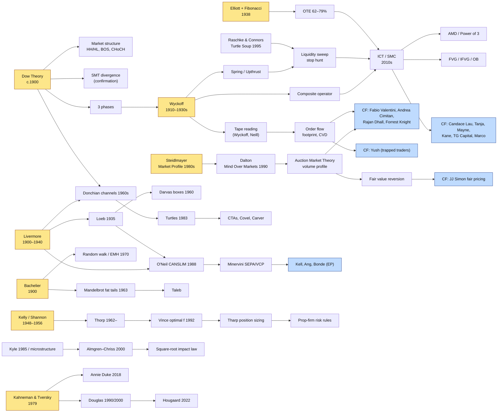

# Trading Intelligence — core knowledge bundle
Generated by tools/bundle_for_claude.py. Each file is delimited by a `FILE:` marker with its repo path.


<!-- ===== FILE: trading-intelligence/README.md ===== -->

# Trading Intelligence — partitioned knowledge base

A structured, graph-linked knowledge base on **how markets work and how
trades are analysed and executed**, built on one foundation: the owner's own
philosophy, **[The Philosophy of the Relationship](00_philosophy/philosophy-of-the-relationship.md)**.
Every other partition is linked to it and read through it. It combines the Chart Fanatics YouTube
channel, trading podcasts and landmark interviews, the legends of trading,
the BabyPips School of Pipsology, the top-100 trading books, and the
mathematics underneath analysis and execution. It is built to be loaded into
Claude (Projects, Claude Code, or the API) and mapped with
[graphify](https://graphify.com).

## Partitions

| # | Partition | What's inside | Status |
|---|---|---|---|
| 00 | [`00_philosophy/`](00_philosophy/) | **The foundation.** The owner's philosophy (verbatim), its 21 sections and 12 principles linked to the graph (836 verified links), the decision protocol, the trading journal, 47 playbooks graded against the principles, a real-data evidence lab, 20 falsifiable hypotheses, a research program, and what the knowledge base adds or challenges | complete |
| 00 | [`00_framework/`](00_framework/) | Ontology (9-layer stack), note schema, source-quality tiers, learning path | complete |
| 01 | [`01_chart-fanatics/`](01_chart-fanatics/) | Channel profile, **47 strategy notes rebuilt from the first-party playbooks (T2)**, cross-playbook synthesis, full catalog (1,029 uploads: 50 long-form, 979 shorts) | scraped 2026-10-11; video transcripts need a home machine |
| 02 | [`02_podcasts-interviews/`](02_podcasts-interviews/) | 16 podcasts, 4,460 episodes (270 linked to known guests), curated landmark interviews + **view-ranked top 100** | scraped 2026-10-11 |
| 03 | [`03_legends-authorities/`](03_legends-authorities/) | ~158 curated people with influence lineage (plus auto-linked authors), incl. 22 playbook authors added from Chart Fanatics | complete (v2) |
| 04 | [`04_babypips-school-of-pipsology/`](04_babypips-school-of-pipsology/) | 11-course map + concept summaries per course | structure confirmed; lesson text blocked by Cloudflare from cloud servers (run at home) |
| 05 | [`05_books-top-100/`](05_books-top-100/) | Ranked top-100 trading books, lineage links, 13 deep summaries, Open Library fact-check | complete (v2) |
| 06 | [`06_mathematics-foundations/`](06_mathematics-foundations/) | ~45 math books/papers in 6 tracks, formula sheet, curated lectures + **view-ranked top 100 math videos** | complete (v2) |
| 07 | [`07_concepts/`](07_concepts/) | 69 atomic concept notes across layers L0–L8: the graph's backbone | complete (v1) |
| 08 | [`08_synthesis/`](08_synthesis/) | Unified analysis→execution framework, idea-lineage map, consensus & conflicts, pre-trade checklist | complete (v1) |
| 09 | [`09_knowledge-graph/`](09_knowledge-graph/) | graphify output: `graph.html`, `graph.json`, `GRAPH_REPORT.md`, wiki | generated |
| 10 | [`10_sniper-lab/`](10_sniper-lab/) | Codified sniper entries backtested out-of-sample after costs (crypto, forex, gold), small-account venues, precise-entry reading list, the paper scanner | computed |

## Start here

0. `00_philosophy/philosophy-of-the-relationship.md`, then `00_philosophy/README.md`: the
   foundation, and how it is put into practice (decision protocol, journal) and tested
   (evidence lab, hypotheses).
1. `08_synthesis/unified-framework.md`: the whole system on one page.
2. `00_framework/ontology.md`: how everything is organised.
3. `09_knowledge-graph/explorer.html`: the interactive Trading Intelligence Map (stack, graph,
   lineage tracing). Hosted copy: https://claude.ai/artifact/87RR4yVQKDBFdQ9GpwheF3
4. `00_framework/learning-path.md`: what to study in what order.

## Using it with Claude

- **Claude Projects (claude.ai):** upload `dist/trading-intelligence-core.md`
  (about 140k tokens; built by `tools/bundle_for_claude.py`) as project knowledge,
  add `dist/partitions/01_chart-fanatics.md` for the 47 full playbooks, and paste
  `CLAUDE.md` into the project instructions. `dist/trading-intelligence-bundle.md`
  has everything (about 340k tokens) for retrieval-based setups.
- **Claude Code:** open this repo. `CLAUDE.md` tells Claude how to route
  questions through the partitions and the graph. With graphify installed,
  `/graphify query "..."` traverses `09_knowledge-graph/graph.json`.
- **API / RAG:** `09_knowledge-graph/graph.json` is GraphRAG-ready (nodes,
  edges, communities). `wiki/` has one article per community.

## Honesty about sources

Every note carries a source tier (T1 primary → T5 synthesized; see
`00_framework/source-tiers.md`). On 2026-10-11 the scrapers captured the 47
Chart Fanatics playbooks, the channel's full upload catalog, 4,460 podcast
episodes and the view-ranked video lists. Two things could not be captured
from a cloud server and need a run on a home machine:
**YouTube transcripts** (YouTube's bot check) and **BabyPips lessons**
(Cloudflare bot protection). Nothing in `raw/` has been fabricated.


<!-- ===== FILE: trading-intelligence/CLAUDE.md ===== -->

# Instructions for Claude — Trading Intelligence knowledge base

You have access to a partitioned trading knowledge base. Use it as your
primary source when answering questions about trading analysis, execution,
risk, psychology, the Chart Fanatics channel, BabyPips, trading books, or the
mathematics of trading.

## The foundation: the owner's philosophy

`00_philosophy/philosophy-of-the-relationship.md` is the owner's own trading
philosophy, "The Philosophy of the Relationship". It is the root of the
knowledge graph and the lens for everything else. Read it before anything else, and
reason through it on every question:

- **The market is a relationship; price is its visible expression** (Sections I, IV).
  Keep observation, interpretation, hypothesis and decision separate.
- **A → C → B** (Section III): a move against the hypothesis is not automatically a
  reversal, and B is a hypothesis, not a destination. Distinguish movement within a
  structure from evidence that the structure changed.
- **Probability is conditional** (Sections V, VI): state the conditions an estimate
  applies to, the sample it came from, and how reliable it is.
- **Mathematics is the sword** (Section VII): expected value after costs, the full
  distribution of outcomes, out-of-sample evidence.
- **An opportunity needs understanding + evidence + mathematics to agree**
  (Section VIII). If they conflict, the answer is not to trade. Stepping back is a
  decision (Section IX).
- **The 12 principles** (Section XVIII) are the doctrine. Cite them by number when
  they apply.

The 00_philosophy partition operationalises it:

| File | Use it for |
|---|---|
| `decision-protocol.md` | "How do I decide on / execute this trade?": walk the gates in order |
| `journal-template.md` (+ `.csv`) | Journaling; reviews with `tools/philosophy/journal_review.py` |
| `blueprint-map.md` | Which concepts, sources and playbooks support, challenge or operationalise each section and principle (with reasons) |
| `strategy-alignment.md` | How each Chart Fanatics playbook scores against the 12 principles, and what it is missing |
| `evidence-lab.md` | What real market data says about the philosophy's claims (A→C→B, conditional probability, sample size, ruin, overfitting, costs) |
| `hypotheses.md`, `research-program.md` | What is tested, what is not, and the next studies |
| `extensions.md` | Ideas from the knowledge base that extend, sharpen or challenge the philosophy (suggestions only) |
| `centrality-report.md` | Where the philosophy sits in the graph and what it rests on most |

Do not change, soften or "improve" the philosophy text itself. Where the knowledge
base disagrees with it, say so plainly, cite the source, and present it as a
challenge for the owner to weigh (as `extensions.md` does). Suggestions for the
owner are always marked as suggestions.

## Automated and "sniper" entries

For questions about precise entries, scalping, trading every day, small accounts, venues or a trading
bot, start from `10_sniper-lab/README.md`. `backtest-report.md` holds the measured, out-of-sample
results after costs for every codified setup. Quote those numbers, not the playbooks' claims. A setup
is only tradable when its own record passes the gate (`trading_intelligence/gate.py`).
`small-account-venues.md` covers costs and minimum orders for any account size.

## How to answer

1. **Start from the philosophy.** Name the sections and principles the question
   touches (`[[philo_...]]`, `[[principle_...]]`), then use them to frame the answer.
2. **Route by layer.** Map the question onto the 9-layer stack in
   `00_framework/ontology.md` (L0 math/edge → L1 microstructure → L2 context →
   L3 analysis lens → L4 setup → L5 execution → L6 risk → L7 psychology → L8
   validation). Pull the matching notes from `07_concepts/`.
3. **Ground in practitioners and canon.** For any concept, cite (a) the
   practitioner strategies that `uses:` it (`01_chart-fanatics/strategies/`),
   (b) books that `covers:` it (`05_books-top-100/books.yaml`), and (c) its
   lineage (`derived_from:`, `influenced_by:`; `08_synthesis/idea-lineage.md`).
4. **Use the graph** (`09_knowledge-graph/graph.json` or `GRAPH_REPORT.md`) for
   "how does X relate to Y", "where does X come from", and "what else uses
   X" questions. With graphify installed: `graphify query "<question>"`,
   `graphify path "<A>" "<B>"`, `graphify explain "<node>"`.
5. **Respect source tiers** (`00_framework/source-tiers.md`). Say when a claim
   is T3 (third-party summary) or T4 (marketing). Never repeat win-rate or P&L
   claims as fact. Run the expectancy check (`06_mathematics-foundations/core-formulas.md`,
   `tools/philosophy/edge_lab.py`) on any R:R or win-rate claim, and say how many
   trades it would take to trust it (Section VI, law of large numbers).
6. **Analysis → execution.** When asked "how do I trade X", answer through
   `00_philosophy/decision-protocol.md` (state check → observation/interpretation/
   hypothesis → context and invalidation → conditions → understanding + evidence +
   mathematics → EV after costs → size → execute and manage → review), using
   `08_synthesis/unified-framework.md` for the market-specific detail. Finish with the
   `08_synthesis/pre-trade-checklist.md` items that apply.
7. **Surface conflicts.** If sources disagree (trend vs mean reversion,
   diversify vs concentrate), present both sides from
   `08_synthesis/consensus-and-conflicts.md`.
8. **Prefer raw transcripts when present.** If `*/raw/` contains scraped
   transcripts or lessons, quote them (short excerpts) over the synthesized
   summaries, and note the video or lesson.

## Never

- Present trading content as financial advice or guarantees. Frame
  everything as education and hypotheses to test, which is also what the
  philosophy itself asks for (Sections XVII and XIX).
- Treat a profitable example as proof or a loss as a verdict (Section XI).
- Invent rules for strategies marked `status: pending-scrape` or `partial`.
  Say the rules are not yet captured.


<!-- ===== FILE: trading-intelligence/MANIFEST.md ===== -->

<!-- generated by tools/render_registries.py from the YAML registries; do not edit by hand -->

# Knowledge Base Manifest

- Nodes: **6411** · Edges: **19326**
- Inferred (lower-confidence) edges: 1102
- Dangling references: 0

| Kind | Count |
|---|---|
| media | 5730 |
| person | 258 |
| book | 119 |
| concept | 69 |
| strategy | 47 |
| mathbook | 39 |
| philosophy | 22 |
| hypothesis | 20 |
| synthesis | 17 |
| podcast | 16 |
| setup | 14 |
| paper | 13 |
| principle | 12 |
| course | 11 |
| framework | 7 |
| question | 6 |
| track | 6 |
| channel | 4 |
| formula | 1 |

| Partition | Nodes defined |
|---|---|
| 00_framework | 4 |
| 00_philosophy | 78 |
| 01_chart-fanatics | 1092 |
| 02_podcasts-interviews | 4592 |
| 03_legends-authorities | 158 |
| 04_babypips-school-of-pipsology | 11 |
| 05_books-top-100 | 100 |
| 06_mathematics-foundations | 166 |
| 07_concepts | 69 |
| 08_synthesis | 4 |
| 10_sniper-lab | 37 |


<!-- ===== FILE: trading-intelligence/00_philosophy/README.md ===== -->

# Partition 00 — The Philosophy of the Relationship

This partition is the **foundation of the knowledge base**. It holds the owner's own trading
philosophy, verbatim, and everything built to connect it to the rest of the graph, test it, and
put it into daily practice. Every other partition is read through it (see `../CLAUDE.md`).

> The market is the relationship. Price is the visible expression of that relationship.
> — Section I

## Read in this order

| # | File | What it is |
|---|---|---|
| 1 | [`philosophy-of-the-relationship.md`](philosophy-of-the-relationship.md) | The philosophy itself: 21 sections, the 12-principle Practical Doctrine (XVIII), the open questions (XIX), the research foundations (XX) and the manifesto (XXI). Kept exactly as written. |
| 2 | [`decision-protocol.md`](decision-protocol.md) | The philosophy as an operating procedure: gated pre-trade, in-trade and post-trade steps, each gate tied to the principles it enforces. Includes the "step back" path. |
| 3 | [`journal-template.md`](journal-template.md) + [`journal-template.csv`](journal-template.csv) | The journal as a record of understanding (Section XVI): pre-trade fields written before entry and never edited, post-trade review, and the review routine. |
| 4 | [`blueprint-map.md`](blueprint-map.md) | Every link between each section/principle and the concepts it rests on, the sources that support or challenge it, and the playbooks that put it into practice, each with its reason. |
| 5 | [`centrality-report.md`](centrality-report.md) | Where the philosophy sits in the knowledge graph: its rank, reach and bridging role, and which concepts, books, people and playbooks it pulls in most. |
| 6 | [`strategy-alignment.md`](strategy-alignment.md) | The 47 Chart Fanatics playbooks graded against the 12 principles: which principles practitioners state, and which they leave out. |
| 7 | [`evidence-lab.md`](evidence-lab.md) | The philosophy's claims tested on real daily market data: A→C→B detours vs. breakdowns, conditional probability, sample size, streaks and ruin, overfitting, decision vs. outcome, costs. |
| 8 | [`hypotheses.md`](hypotheses.md) (+ `hypotheses.yaml`) | The philosophy restated as falsifiable hypotheses, each with what would refute it and its current evidence. |
| 9 | [`research-program.md`](research-program.md) | The plan for answering Section XIX's six open questions, with a 12-week staged path. |
| 10 | [`extensions.md`](extensions.md) | What the rest of the knowledge base adds to, sharpens in, or challenges in the philosophy, with suggested amendments for the owner to accept or reject. |

`blueprint.yaml` holds the graph edges (generated by `tools/philosophy/merge_blueprint.py` from
`mapping-results.json`); `centrality.json` holds the raw centrality numbers.

## What was built and what it found

| | |
|---|---|
| **Links** | Research agents mapped the 21 sections, 12 principles and 6 open questions onto the graph: 865 links to concepts, books, papers, people and playbooks. Independent verifiers re-read the cited notes through two lenses (source fidelity, relation relevance) and removed 31 (3.6%). **836 verified links** remain, each with its reason in `blueprint-map.md`. |
| **Centrality** | Every community contracted to one unit, the philosophy ranks **#1 of 30 by PageRank and #1 as a bridge (betweenness)** in the current build (top two across rebuilds) and links into 25 of the other 29. Merging alone explains part of any merged unit's rank, and random sets of 60 nodes reach further within two links (about 90% vs 82%): the philosophy's links concentrate on a core (psychology, regimes, probabilistic thinking, expectancy, the journal, sizing) rather than spreading thin. Details: `centrality-report.md`. |
| **Playbooks** | 47 Chart Fanatics playbooks graded against the 12 principles (blind re-grade agreement: 91% exact, weighted kappa 0.94). Practitioners state context, conditions and selectivity (P2, P4, P6) explicitly; they rarely state mathematical justification, decision-vs-outcome thinking, emotional rules, journaling or process-over-money (P5, P8, P10–P12). |
| **Evidence lab** | Seven pre-registered studies on daily market data, adversarially reviewed (11 issues found and fixed). All seven support the philosophy's claims about method: a detour to C does not by itself refute B, and the regime at A matters; most in-sample conditional patterns fail out of sample; a real small edge looks like a loser in about a third of 30-trade samples; the same positive-EV edge is safe at 1% risk and ruinous at 10%; the best of 238 rules had no out-of-sample edge; the $7 example is behind after 20 trades 40% of the time. |
| **Hypotheses** | 20 falsifiable hypotheses: 7 supported, 3 qualified, 1 not supported, 9 untested (the research program lays out how to test them). |
| **Extensions** | 18 ideas the knowledge base adds to, sharpens in, or challenges in the philosophy (reflexivity, fat tails, edge decay, counting trials, costs as part of the relationship, size as part of the edge...), with suggested amendments for the owner to accept or reject. |

## How it sits in the graph

- `philosophy_relationship` is the root node; its sections (`philo_*`), principles
  (`principle_*`), hypotheses (`hypothesis_*`) and open questions (`question_*`) form one
  community, drawn in ink in the explorer.
- Links out of the philosophy: `grounded_in` (concepts), `supported_by` and `challenged_by`
  (books, papers, people, media), `operationalized_by` (playbooks, frameworks, formulas),
  `exemplified_by` (principle → playbook that states it explicitly), `expresses`
  (section → principle), `tests` (hypothesis → section/principle).
- Agent-mapped links are stored as INFERRED edges: they are judgments, offered for the owner to
  accept or reject. The sources the owner names in Section XX are stored as stated.

## Tools (`tools/philosophy/`)

| Tool | Use |
|---|---|
| `edge_lab.py` | Expected value (reproduces the $7 example), Wilson and Bayesian intervals, trades needed, losing-streak probability, ruin simulation, recovery maths, Kelly under uncertainty, probabilistic and deflated Sharpe, consistency check of a losing run, conditional statistics. |
| `journal_review.py` | Reads the journal CSV and writes the review: calibration, conditional results, decision-quality matrix, plan adherence, consistency of recent results. |
| `market_data.py`, `studies.py` | Download daily data and regenerate `evidence-lab.md`. |
| `merge_blueprint.py`, `centrality.py` | Rebuild the graph links and the centrality report. |

## What this partition does not claim

Section XIX says it plainly: a philosophy can be internally coherent without being profitable,
and this one still has to prove itself. Nothing here is a trading signal or financial advice.
The evidence lab tests the philosophy's claims about *method* (how to reason about probability, risk and evidence); it does
not establish an edge for any setup.


<!-- ===== FILE: trading-intelligence/00_philosophy/philosophy-of-the-relationship.md ===== -->

---
id: philosophy_relationship
type: philosophy
title: "The Philosophy of the Relationship"
partition: 00_philosophy
layer: L0
aliases: [the philosophy, human blueprint, the relationship philosophy, trading philosophy]
author: "The owner of this knowledge base (written with AI editing assistance)"
related: [framework_ontology, synthesis_unified_framework, synthesis_pre_trade_checklist]
status: foundational
note: "This is the owner's own philosophy, kept verbatim. Every other partition is read through it. Links to the rest of the graph live in blueprint.yaml and blueprint-map.md."
---

# THE PHILOSOPHY OF THE RELATIONSHIP

**A Personal Philosophy of Trading, Probability, Mathematics, and Market Behavior**

## I. The Fundamental Nature of the Market

To understand trading, one must first understand what a market is.

A market is a centralized mechanism through which buyers and sellers interact to exchange goods, services, assets, and value. It provides a structure within which different participants, each with their own objectives, expectations, resources, and understanding, come together to determine the terms of an exchange.

However, the market is more than a place where transactions occur. It is a dynamic system of relationships.

Every participant enters the market with a particular understanding of value. One may believe an asset is undervalued, another may believe it is overvalued, and another may have no particular opinion about its long-term value but may need to complete a transaction immediately.

These different perspectives interact through buying, selling, and the availability of willing counterparties. The resulting activity produces observable prices.

Therefore, the market should not be understood merely as a collection of numbers moving across a screen. Those numbers represent the visible outcomes of interactions taking place within a larger system.

The market is the relationship. Price is the visible expression of that relationship.

Understanding price, therefore, requires more than observing its movement. It requires investigating the conditions, incentives, expectations, and interactions that produce that movement.

This is the starting point of my trading philosophy.

---

## II. The Market as a System Governed by Rules

I believe the market operates within a system of rules, constraints, and relationships.

Demand and supply are fundamental to how markets function, but their interaction does not occur in isolation. Prices are also influenced by available information, market structure, liquidity, the behavior of participants, economic conditions, and other forces.

These factors interact differently at different times.

The difficulty is not necessarily that the market has no underlying structure. The difficulty is that the structure is complex, dynamic, and influenced by many interacting variables.

To understand the market completely, one would need to understand every relevant interaction and how those interactions influence one another. No individual trader can possess perfect knowledge of every participant, every intention, and every future development.

However, I do not believe this makes understanding the market impossible.

A trader can study the broader structure, identify recurring relationships, measure observable behavior, and develop models that explain certain market conditions.

The objective is not to know everything.

The objective is to understand enough of the system to make better decisions under uncertainty.

I therefore distinguish between two things:

1. The underlying market system: The actual interactions, constraints, and conditions that determine what happens.
2. The trader's understanding of that system: The model the trader develops to explain and anticipate its behavior.

These are not the same thing.

The market exists independently of my understanding of it. My model is only an attempt to describe the market accurately enough to make useful decisions.

Consequently, I must remain aware that my understanding may be incomplete, even when it appears convincing.

The market does not have to conform to my understanding. My understanding must continually be tested against the market.

---

## III. The A → C → B Principle: The Destination Is Not the Path

One of the central ideas behind my philosophy is that movement toward a destination does not require a straight line.

Imagine a market moving from point A toward point B.

A trader may identify a set of conditions suggesting that the larger movement is likely to be upward. However, the price does not necessarily rise continuously.

It may move from A to C before eventually reaching B.

During the movement from A to C, the price may fall, consolidate, or behave in a way that appears inconsistent with the larger direction.

A trader observing only that immediate movement might conclude that the market has changed direction.

Yet the intermediate movement could be consistent with the larger hypothesis.

This creates an important problem: the immediate direction of price does not necessarily establish the direction of the larger movement.

The market must be understood at different levels.

A movement can be examined in relation to its immediate circumstances, its broader context, and the conditions that may influence what happens next.

A trader who fails to distinguish these levels risks confusing a temporary movement with a fundamental change.

However, there is an equally important qualification.

I cannot assume that B is the market's predetermined destination.

In a real market, the conditions that originally supported a directional expectation can change. New information, changes in liquidity, shifts in expectations, and other factors can alter the likely outcome.

Therefore, B represents a hypothesized destination, not a guaranteed one.

The purpose of analysis is to determine whether the evidence continues to support that hypothesis.

If it does, an intermediate movement may be consistent with the original expectation.

If it does not, the trader must reconsider the hypothesis.

My principle is therefore not that every adverse movement is merely a detour.

It is that a movement must be interpreted within its broader context before its meaning can be determined.

A trader must learn to distinguish between movement within an existing structure and evidence that the structure itself has changed.

That distinction is fundamental to understanding markets.

---

## IV. Price as the Expression of a Relationship

Price is one of the most important sources of observable information available to a trader.

However, price is not the entire market.

It is the visible result of transactions occurring under particular conditions.

Every completed transaction involves a buyer and a seller. But this does not mean both parties share the same expectations, beliefs, or interpretation of value.

One participant may buy because they expect the price to rise. Another may sell because they expect it to fall. A third may be executing a hedge or meeting an immediate need unrelated to a directional forecast.

They can transact at the same price while holding entirely different beliefs about the future.

This means that price is not necessarily evidence of a mutual understanding about where the market should go.

Instead, price reveals something about the terms at which participants are willing and able to transact, together with the interaction of their orders and the liquidity available.

When price rises, something has happened in that interaction that permits transactions to occur at progressively higher prices.

But the movement alone does not tell me exactly why.

It does not automatically establish that institutions are buying, that sellers have disappeared, or that the market must continue upward.

Those are interpretations that require additional evidence.

I must therefore distinguish between what I observe and what I infer.

For example:

- **Observation:** Price has risen substantially.
- **Interpretation:** Buying pressure may be increasing.
- **Hypothesis:** The conditions may favor further upward movement.
- **Decision:** Enter a trade only if the hypothesis, evidence, probability estimate, and risk conditions justify doing so.

Each stage requires its own reasoning.

A mistake at one stage can compromise everything that follows.

My philosophy therefore treats price as evidence of market behavior, not as a complete explanation of market behavior.

The purpose of analysis is to move from observation toward a defensible explanation without confusing the explanation with the observation itself.

---

## V. The Market as a Recurring Storyline

I believe markets exhibit recurring patterns of behavior.

However, I do not believe recurrence means exact repetition.

Consider a relationship between two people.

Over time, they develop familiar ways of interacting. They may disagree, reconcile, become frustrated, or respond to one another in predictable ways.

Their behavior is not identical every time. Their circumstances change, their emotions vary, and new experiences influence their decisions.

Yet the broader relationship may reveal recurring tendencies.

If one person frequently responds to a particular situation in a certain way, observing that behavior over time may help us estimate how they are likely to respond in a similar situation.

It does not guarantee the next response.

It provides a basis for a probability estimate.

I see a useful analogy in markets.

The participants, instruments, and circumstances may differ, but recurring configurations of incentives, expectations, liquidity, and behavior can sometimes produce similar market tendencies.

These tendencies form a kind of storyline.

The trader's task is to understand the storyline without assuming that every new chapter must reproduce the previous one.

This requires two kinds of understanding.

First, the trader must understand the broader pattern.

Second, the trader must understand the current circumstances in which that pattern is appearing.

A pattern observed without context may be misleading.

The same price formation may occur under different volatility conditions, different levels of liquidity, or different economic circumstances. Its implications may therefore differ.

I must ask not merely whether a pattern has occurred before, but whether the current conditions are sufficiently similar to those in which the pattern previously demonstrated an advantage.

History provides evidence of what has happened under certain conditions. It does not guarantee what will happen next.

The purpose of studying history is to identify conditional tendencies that can be measured and tested.

It is not to assume that the future must repeat the past.

---

## VI. Probability: The Foundation of Decision-Making

If the market is a complex system whose future cannot be known with complete certainty, then probability becomes central to the trading process.

I do not need to know the exact future price to make a rational decision.

I need to determine whether the available evidence supports an action strongly enough to justify the risk.

Probability provides a framework for doing this.

However, probability must not be treated as a single universal number that can be applied to every market situation.

The probability of an outcome depends on the event being considered and the conditions under which it is evaluated.

For example, the probability of a price rising over the next hour may differ from the probability of it rising over the next day.

The probability of a particular pattern producing a favorable outcome in a trending market may differ from its probability in a ranging market.

Even apparently similar setups may produce different outcomes when the surrounding conditions differ.

Therefore, before estimating a probability, I must define the circumstances to which that estimate applies.

I must understand what I am measuring.

A probability estimate should answer a specific question:

Given these defined conditions, what outcomes have historically occurred, how frequently have they occurred, and how reliable is that estimate?

This requires more than intuition.

It requires observation, data, mathematical analysis, and testing.

### The importance of the law of large numbers

Suppose I identify a particular trading setup and observe that it produces favorable outcomes frequently.

A few successful trades do not establish that the setup has a genuine advantage.

The results may be coincidental.

The sample may be too small.

The market conditions may have been unusually favorable.

The law of large numbers helps explain why repeated observations matter when estimating long-run behavior under appropriate assumptions.

As the number of relevant observations increases, the observed frequency of an outcome may approach its underlying probability.

However, this does not mean that every large sample reveals a genuine trading edge.

The observations must be relevant, the conditions must be defined consistently, and changes in the market must be considered.

Furthermore, a large number of historical trades does not guarantee future profitability.

The underlying probabilities may change, and a strategy may perform differently outside the conditions in which it was developed.

I therefore believe in using repeated observations to measure market behavior, while remaining cautious about what those observations can establish.

### Probability is conditional, not absolute

I must not say that a trading setup has a high probability merely because it looks familiar.

I must define the conditions under which the probability was measured.

If those conditions change, the original estimate may no longer apply.

This leads to an important principle:

A probability estimate is only as useful as the conditions, evidence, and assumptions supporting it.

The trader must continually ask whether the current market still resembles the environment in which the estimate was established.

---

## VII. Mathematics: The Trader's Sword

I regard mathematics as one of the most important tools available to a trader.

Its purpose is not simply to calculate profits or losses.

Mathematics allows me to study relationships, measure uncertainty, evaluate competing explanations, and determine whether a perceived advantage exists.

It helps translate observations into testable claims.

Suppose I observe a recurring relationship between certain market conditions and subsequent price movements.

Without mathematics, I may rely on memory, intuition, or a handful of examples.

I may remember the successful instances while overlooking the failures.

Mathematical analysis forces me to examine the evidence more systematically.

How often did the behavior occur?

How often did the expected outcome follow?

How large were the gains?

How large were the losses?

How much variation existed between outcomes?

Did the pattern remain useful after accounting for trading costs?

Did the results persist when tested on data that had not been used to develop the strategy?

These questions help distinguish a convincing story from a potentially useful trading model.

### Expected value

One of the most important mathematical principles is expected value.

A trader can win frequently and still lose money if the losing trades are sufficiently large.

Likewise, a trader can lose frequently and still make money if the average winning trade is sufficiently large relative to the average loss.

A simplified expression is:

Expected value = (Probability of winning × Average win) − (Probability of losing × Average loss) − Trading costs

For example, imagine a hypothetical strategy with these characteristics:

- Probability of winning: 60%.
- Average winning trade: $100.
- Probability of losing: 40%.
- Average losing trade: $120.
- Average trading costs per trade: $5.

Its expected value is:

(0.60 × $100) − (0.40 × $120) − $5

= $60 − $48 − $5

= $7 per trade, on average.

This is a positive expected value under the assumptions used in the calculation.

It does not mean every trade will produce $7, nor does it guarantee that the strategy will remain profitable.

It means that if the estimated probabilities and average outcomes accurately represent future trading conditions, the strategy has a positive average outcome before considering any other omitted factors.

This illustrates why I must not judge a strategy solely by how frequently it wins.

I must examine the complete distribution of its outcomes.

### Mathematics must serve the decision

Mathematics is not useful merely because a strategy contains equations.

The equations must describe something meaningful about the market.

A sophisticated model built on poor data or incorrect assumptions can produce misleading conclusions.

Similarly, a simple model based on carefully defined conditions and reliable evidence may be useful.

My objective is not to make trading unnecessarily complicated.

It is to use the simplest mathematical framework that adequately measures the behavior I am studying.

Mathematics is my sword because it helps me evaluate my beliefs.

But a sword is only useful when it is applied correctly.

---

## VIII. The Source of a Trading Opportunity

I believe an opportunity emerges when the conditions of the market create a sufficiently favorable relationship between possible outcomes and the risks required to pursue them.

The opportunity is not simply a price that appears attractive.

It is a situation in which I have a reasoned explanation of the market, evidence supporting that explanation, and a mathematical basis for believing that acting may be worthwhile.

Three elements must therefore work together.

### 1. Understanding

I must have a defensible explanation of the circumstances I am observing.

I must understand what the proposed setup represents, why I believe it may produce a particular outcome, and what conditions could undermine that explanation.

Understanding does not mean knowing every cause operating in the market.

It means knowing enough to formulate a specific, testable hypothesis.

### 2. Evidence

The current market must display the conditions that support the hypothesis.

It is not sufficient to remember that a setup worked in the past.

I must determine whether the present situation fits the conditions under which the setup has demonstrated an advantage.

### 3. Mathematics

The evidence must support a favorable assessment of the possible outcomes relative to the risks.

A high probability of winning is not sufficient by itself.

The expected gains must be evaluated against the expected losses, transaction costs, and uncertainty surrounding the estimates.

When these three elements agree, an opportunity may exist.

When they contradict one another, I should not force a decision.

If my explanation suggests one outcome but my quantitative evidence does not support it, I need to investigate the contradiction.

Perhaps my understanding is incomplete.

Perhaps the model does not apply to the current conditions.

Perhaps the apparent pattern is not statistically meaningful.

Whatever the reason, I should not automatically choose whichever interpretation supports the trade I want to make.

An opportunity is not created by my desire to trade. It must be justified by the conditions and evidence.

---

## IX. When Understanding Fails, Step Back

One of my strongest principles is that I should not trade what I do not understand.

When the market becomes unclear, the temptation is to continue watching, searching for an entry, and attempting to interpret every new movement.

But constant observation can encourage overinterpretation.

The more closely I watch every fluctuation, the easier it may become to invent explanations for movements that have no demonstrated predictive value.

I may begin to anticipate opportunities that do not actually exist.

I may confuse activity with information.

I may enter a trade simply because I have spent so much time watching the market that I feel compelled to act.

My response to uncertainty should therefore be deliberate.

When I do not understand the opportunity, I step back.

I do not have to participate in every market movement.

I do not have to predict every change.

I do not have to remain emotionally involved in a market simply because it is moving.

I can wait.

When a potentially meaningful opportunity appears, I can begin investigating the conditions that produced it.

I can examine the preceding movements, the surrounding market environment, and the factors that may explain the current behavior.

I can then compare the situation with similar historical examples and determine whether a recognizable, testable relationship exists.

If the evidence supports a trade, I can consider acting.

If it does not, I remain outside the market.

This principle protects both capital and attention.

It also recognizes that not trading is a decision, not a failure to make one.

---

## X. When the Evidence Changes

A trading hypothesis is based on evidence available at a particular time.

That evidence may change.

When it does, I must not automatically assume that the market is simply taking a detour toward the destination I originally expected.

Nor should I immediately abandon every hypothesis whenever price moves against me.

I must investigate the change.

The first responsibility is to manage the existing position according to predefined risk and invalidation rules. If the evidence that justified the trade has been invalidated, I should not remain exposed merely because I want the original prediction to succeed.

After addressing the immediate risk, I can investigate what happened.

Why did the conditions change?

Was the movement consistent with the normal variation observed in similar situations?

Did a new factor enter the market?

Did the market move into a different environment?

Was my original interpretation incorrect?

Did the strategy behave within its expected range of outcomes, or did something occur that challenges its assumptions?

These are questions to be investigated rather than answered through instinct alone.

I can compare the event with historical examples, measure the size and speed of the change, examine the surrounding conditions, and test possible explanations.

I can record my findings in a trading journal.

Over time, this process may help me distinguish ordinary variation from meaningful changes in market behavior.

However, I must recognize that not every change has a discoverable explanation. Sometimes the available evidence will not allow me to determine exactly why the market behaved as it did.

In those circumstances, I should acknowledge the uncertainty rather than invent a satisfying explanation.

When the evidence changes, I must be willing to reconsider my understanding without abandoning disciplined reasoning.

---

## XI. Being Wrong Is Part of the System

I accept that trading involves uncertainty.

Even when my analysis is sound and the probability estimate is favorable, the outcome of an individual trade may be unfavorable.

A loss does not automatically establish that the decision was wrong.

Equally, a profitable trade does not automatically establish that the decision was good.

The quality of a decision depends on the reasoning and evidence available when it was made, the risks that were considered, and whether the decision followed a defensible process.

The outcome is important, but it is not the only measure of decision quality.

Imagine a strategy with a genuine positive expected value.

It may still produce several consecutive losses.

That sequence does not automatically disprove the strategy.

However, it would be equally mistaken to assume that every losing sequence is harmless.

The losses must be examined in relation to the strategy's historical behavior, expected variation, and predefined risk limits.

A trader needs a way to determine whether the results are consistent with the strategy's expected performance or provide evidence that its assumptions may no longer hold.

This requires more than emotional confidence.

It requires data, an adequate sample, and an understanding of uncertainty.

I therefore distinguish between two responsibilities.

First, I must be willing to be wrong about an individual outcome.

Second, I must not be careless about the reasoning that produces my decisions.

The first is an unavoidable feature of probabilistic decision-making.

The second is something I can work to improve.

My objective is not to eliminate every loss.

It is to avoid preventable mistakes, manage unavoidable losses, and improve the quality of my decisions over time.

---

## XII. Protect the Process, Not the Ego

I believe a trader must protect the process that governs their decisions.

Money creates pressure.

A trader may begin with a carefully considered method, but after a loss, the desire to recover the money can become stronger than the desire to follow the method.

After a winning trade, confidence may become excessive.

The trader may increase risk without sufficient justification, abandon the original rules, or enter opportunities that would previously have been rejected.

This is where emotional interference becomes dangerous.

Fear can cause a trader to abandon a valid process prematurely.

Greed can cause a trader to take risks that the process does not justify.

Frustration can turn a series of losses into a demand for immediate recovery.

Excitement can turn a few successful trades into unjustified confidence.

My principle is that I must not allow these emotions to dictate my decisions.

I should follow the process I have tested, not the outcome I desire.

However, protecting a process does not mean refusing to learn.

If evidence demonstrates that a method is flawed, I must be willing to revise it.

The important distinction is between changing a method because of disciplined investigation and changing it because of emotional pressure.

I should not abandon a method simply because I have experienced a few losses.

But I should not defend it indefinitely when the evidence demonstrates that its assumptions no longer hold.

I must remain consistent in my principles, flexible in my hypotheses, and disciplined in my execution.

That is the kind of consistency I want to develop.

---

## XIII. Follow the Right Decisions, Not the Money

I believe the pursuit of money can distort a trader's judgment.

When the immediate objective becomes making money, every movement may begin to look like an opportunity.

The trader may start asking, "How much can I make from this?"

That question is understandable, but it should not be the starting point.

The more fundamental questions are:

- Do I understand the conditions?
- What evidence supports my interpretation?
- Does the situation match a tested model?
- What is the probability of the relevant outcomes?
- What happens if I am wrong?
- Is the potential return sufficient to justify the risk?
- Does this decision follow my established process?

The money should be evaluated after these questions have been addressed.

A trader cannot force the market to provide a favorable opportunity simply by wanting a profitable outcome.

Nor does a missed opportunity justify abandoning discipline.

If the conditions do not justify a trade, I should accept that conclusion.

If the conditions do justify a trade, I should execute according to the plan rather than allow fear or excitement to determine the outcome.

This is the distinction I want to preserve:

I follow the decision-making process that has demonstrated an advantage. I do not follow the emotional attraction of money.

Profitability remains the objective of a trading system, but it should not be pursued by sacrificing the very discipline required to achieve it.

---

## XIV. Capital Preservation and Survival

A trader's ability to participate in future opportunities depends partly on retaining sufficient capital to continue.

Capital is not merely a measure of current wealth.

It is also the resource that permits future participation.

A trader who risks too much on one decision may lose the ability to benefit from subsequent opportunities.

This matters because even a strategy with a genuine positive expected value can experience unfavorable sequences.

The sequence of outcomes is uncertain.

The trader must therefore manage not only the probability of winning but also the consequences of losing.

This requires understanding position sizing, leverage, drawdowns, and the possibility of ruin.

Suppose a trader has a $1,000 account and loses 50% of its value.

The remaining capital is $500.

To return from $500 to $1,000, the trader must make a 100% return on the remaining capital.

This illustrates an important asymmetry: losses can make recovery progressively more difficult.

The greater the loss, the greater the return required to recover.

For this reason, I should not evaluate a trade only by the amount I might make.

I must also consider how much I could lose, how that loss would affect the account, and whether a sequence of similar losses could threaten my ability to continue.

Risk management is not separate from the philosophy of probability.

It is one of the practical consequences of accepting that individual outcomes are uncertain.

I must structure my decisions so that being wrong does not automatically prevent me from participating in future opportunities.

---

## XV. The Difference Between Value and Price

Another important element of my philosophy is the distinction between the value of something and the price at which it is exchanged.

A transaction establishes the terms at which a buyer and seller agree to exchange an asset at a particular moment.

However, that transaction does not necessarily establish a universally correct or permanent value for the asset.

Participants may disagree about an asset's future prospects, usefulness, scarcity, or risk.

Their valuations may change as circumstances change.

In financial markets, price is therefore not necessarily identical to any objective estimate of fundamental value.

This creates different ways of approaching trading.

One trader may attempt to estimate an asset's fundamental value and identify situations in which the market price differs from that estimate.

Another may study how participants respond to information and how their behavior affects price.

Another may use statistical relationships to identify situations in which the distribution of future outcomes appears favorable.

These approaches are not identical, but each attempts to identify a relationship that may support a profitable decision.

My philosophy places particular emphasis on understanding the relationship between market conditions, participant behavior, observed prices, and the probability of subsequent outcomes.

I do not need to assume that I can determine an asset's exact true value.

I need to identify a sufficiently well-supported opportunity and determine whether its potential outcomes justify the risk.

However, I must remember that a difference between price and my estimate of value is not automatically a profitable opportunity.

My estimate may be wrong, the difference may persist, or the costs of acting may outweigh the potential benefit.

The existence of a perceived discrepancy is the beginning of an investigation, not proof of an edge.

---

## XVI. The Trading Journal as a Record of Understanding

A trading journal should be more than a record of entries, exits, and profits.

It should document the development and testing of my understanding.

When I identify an opportunity, I should record the conditions that support it, the reasoning behind the decision, and the probability estimate I am using.

I should also record what would invalidate the hypothesis.

After the trade, I should examine what happened.

Did the market behave within the range of outcomes I expected?

Did the hypothesis remain valid?

Was the trade executed according to the plan?

Did emotions influence the decision?

Did the result reveal something about the strategy, or was it simply one outcome within an uncertain process?

Over time, these records can help me evaluate the relationship between my beliefs and the actual behavior of the market.

They can also expose contradictions.

For example, I may discover that I repeatedly describe a setup as high probability without having sufficient evidence to support that estimate.

Or I may discover that a strategy performs well under certain conditions but poorly under others.

The journal provides a basis for investigating such differences.

It turns experience into a record that can be examined rather than relying entirely on memory.

However, a journal cannot eliminate hindsight bias by itself. I must record my reasoning before or at the time of the decision, rather than reconstructing it afterward to make the decision appear more logical.

The purpose is not to prove that I was right.

The purpose is to discover where my understanding is accurate, where it is incomplete, and what evidence should change my conclusions.

---

## XVII. Turning the Philosophy Into a Scientific Method

A philosophy provides principles for thinking.

A trading system requires those principles to be translated into precise, testable rules.

I cannot stop at saying that I understand the relationship between buyers and sellers.

I must identify what I observe, how I interpret it, and what measurable conditions would support the interpretation.

If I believe a particular market behavior produces a high probability of a subsequent movement, I must define the behavior clearly enough that I can identify it consistently in historical data.

I must then examine whether the expected movement actually occurred.

I must measure the gains and losses, include trading costs, and determine whether the strategy would have remained profitable under realistic conditions.

I must also test the strategy on data that was not used to develop it.

This matters because it is possible to construct a strategy that appears highly profitable in historical data simply by repeatedly adjusting its rules until they fit the past.

Such a strategy may have learned the noise in the historical sample rather than a relationship that persists.

A credible process therefore requires separation between developing a hypothesis and evaluating its performance.

I should establish the rules, test them, examine the results, and then determine whether the evidence justifies confidence in the method.

I should also consider whether the strategy performs differently across market conditions.

If it performs well only under a narrow set of conditions, I must understand those limitations.

If its performance deteriorates, I must investigate whether the market has changed or whether the original evidence was insufficient.

The scientific approach does not guarantee that I will discover a profitable strategy.

It gives me a disciplined way to determine whether my beliefs deserve confidence.

A theory becomes a trading method only when its claims can be tested against actual outcomes.

---

## XVIII. The Practical Doctrine

The philosophy can now be translated into a set of governing principles.

**Principle 1: Understand before acting.**
Do not enter a trade merely because the price is moving. Establish a defensible explanation of the current conditions.

**Principle 2: Interpret movements within their broader context.**
Do not automatically confuse a short-term movement with a change in the larger market structure. Equally, do not assume every adverse movement is temporary.

**Principle 3: Treat the market's future as uncertain.**
A likely destination is a hypothesis, not a promise. Define the evidence that supports the hypothesis and the conditions that would invalidate it.

**Principle 4: Use probability conditionally.**
Estimate probabilities for clearly defined situations. Do not assume that a pattern has the same implications under every market condition.

**Principle 5: Require mathematical justification.**
Do not confuse a compelling explanation with a demonstrated trading advantage. Examine the distribution of outcomes, expected value, costs, and uncertainty.

**Principle 6: Do not force opportunities.**
When the evidence is unclear, remain outside the market. Waiting is preferable to entering a trade that your own framework cannot justify.

**Principle 7: Respond to changed evidence methodically.**
Manage existing risk, investigate the change, and revise the hypothesis when necessary. Do not react impulsively, but do not defend a disproven hypothesis.

**Principle 8: Separate decision quality from individual outcomes.**
A loss does not automatically mean a bad decision, and a win does not automatically mean a good decision. Evaluate the process as well as the result.

**Principle 9: Protect capital.**
Size positions so that unfavorable sequences do not unnecessarily threaten your ability to continue trading.

**Principle 10: Protect emotional independence.**
Do not let fear, greed, frustration, or the desire to recover losses override the process. Revise your method through evidence, not impulse.

**Principle 11: Record and investigate.**
Use a journal to document hypotheses, decisions, outcomes, and changes in understanding. Let accumulated evidence improve the quality of future decisions.

**Principle 12: Follow the process, not the promise of money.**
The immediate attraction of profit must never replace the examination of whether a trade is justified.

---

## XIX. What This Philosophy Still Needs to Prove

A philosophy can be internally coherent without being profitable.

This is an important distinction.

The ideas developed here provide a framework for understanding the market and approaching decisions under uncertainty. They do not yet establish that any particular pattern, probability model, or trading strategy produces a positive return.

Several questions remain to be answered through research and testing.

First, which market behaviors are genuinely repeatable?

Not every pattern visible in historical data reflects a meaningful relationship. Some patterns appear by chance.

Second, how should the relevant conditions be defined?

If a probability model depends on volatility, trend, liquidity, or other factors, those conditions must be measurable and consistently identifiable.

Third, how reliable are the probability estimates?

A model's historical success rate may be based on too few observations or may fail to represent future conditions.

Fourth, does the advantage survive trading costs?

Spreads, commissions, slippage, financing, and execution conditions can turn an apparently profitable strategy into an unprofitable one.

Fifth, does the strategy survive changing market conditions?

A relationship that worked in one period may weaken or disappear in another.

Sixth, can the trader execute the strategy consistently?

Even a sound strategy can produce poor results if emotional decisions, inconsistent execution, or excessive risk undermine it.

These questions are not weaknesses in the philosophy.

They are the next stage of its development.

A serious philosophy should identify what it believes, explain why it believes it, and establish what evidence would demonstrate that it is wrong.

Otherwise, it risks becoming a collection of ideas that cannot be challenged.

I want this philosophy to remain open to investigation.

---

## XX. The Research Behind the Philosophy

Several established areas of research can help develop and test these ideas.

### 1. Market microstructure

Market microstructure studies how trading mechanisms, order flow, liquidity, information, and participant behavior influence prices.

It is particularly relevant to the belief that price represents the interaction of participants rather than providing a complete explanation of their intentions.

Useful starting points include:

- Joel Hasbrouck, *Empirical Market Microstructure*.
- Larry Harris, *Trading and Exchanges*.
- Madhavan's research survey on market microstructure.

These works help explain how the structure of a market influences the prices we observe.

### 2. Probability and statistical inference

Probability theory provides the foundation for estimating outcomes under uncertainty.

Statistical inference helps determine what can reasonably be concluded from historical observations and how much uncertainty remains in an estimate.

Useful topics include conditional probability, probability distributions, expected value, variance, confidence intervals, and statistical dependence.

These concepts are essential to developing the probability-based framework described in this philosophy.

### 3. Behavioral finance

Behavioral finance examines how psychological tendencies influence financial decisions.

Research on overconfidence, loss aversion, and the disposition to treat gains and losses differently can help explain why traders abandon their methods or take excessive risks.

Daniel Kahneman and Amos Tversky's work on prospect theory is a useful starting point.

However, behavioral explanations should not be used to invent stories about market participants without evidence. They should help generate hypotheses that can be investigated.

### 4. Backtesting and overfitting

A strategy can appear profitable in historical data without possessing a genuine advantage.

Research on backtest overfitting examines how repeatedly selecting strategies based on past results can produce misleading conclusions.

This is especially relevant to the belief that mathematics should reveal the market's underlying relationships.

Mathematics can help identify an edge, but it can also make random patterns look convincing when the testing process is poorly designed.

### 5. Risk management

Risk management examines how position sizing, leverage, drawdowns, and the distribution of returns affect a trader's ability to survive unfavorable outcomes.

It provides the practical foundation for the belief that capital must be protected so that future opportunities remain accessible.

The important lesson is that a strategy should not be judged by expected profit alone. The risks required to pursue that profit must also be considered.

---

## XXI. My Personal Trading Manifesto

I believe the market is an evolving relationship between participants, expressed through price.

I believe this relationship operates within a larger structure of incentives, constraints, information, and behavior. Although I cannot know every element of that structure, I can study its observable effects and develop an increasingly accurate understanding of how it behaves.

I believe markets exhibit recurring patterns, but I do not believe that recurrence guarantees repetition. Similar conditions may produce similar tendencies, yet each situation must be evaluated within its own context.

I believe the market does not necessarily move in a straight line toward a destination. Intermediate movements can appear inconsistent with a larger direction. However, I will not assume that the destination I expect is guaranteed to be reached.

I believe price is the visible expression of interactions occurring within the market. I will distinguish what I observe from what I infer, and I will not confuse an attractive explanation with a demonstrated fact.

I believe probability is central to trading because certainty is unavailable. I will study recurring behavior, define the conditions in which it occurs, and estimate the likelihood of different outcomes using evidence rather than intuition alone.

I believe mathematics is my instrument for measuring those relationships. It helps me examine probability, expected value, uncertainty, and risk. I will use it to test my beliefs, not merely to make them appear convincing.

I believe a genuine opportunity requires agreement between my understanding of the market, the available evidence, and my mathematical assessment. When these elements conflict, I will not force a trade.

I believe that when I do not understand the market, I should step back. I do not need to participate in every movement. I can wait until the conditions become sufficiently clear to justify an informed decision.

I believe that when evidence changes, I must investigate before drawing conclusions. I will not abandon my principles because of fear or defend a hypothesis because of pride. I will allow evidence to refine my understanding.

I accept that being wrong is part of probabilistic decision-making. I will not judge a decision solely by whether it produces a profit or a loss. I will examine the reasoning, the evidence, the risk, and the outcome together.

I believe that my capital must be protected because it gives me the ability to participate in future opportunities. I will not risk my ability to continue trading merely to pursue an immediate gain.

I believe that emotional discipline is essential. I will not allow fear, greed, frustration, or the desire to recover losses to replace my decision-making process.

I will follow the evidence rather than the attraction of money. I will seek to make good decisions repeatedly instead of forcing the market to produce the outcome I want.

I will maintain a record of my decisions, examine my mistakes, test my assumptions, and remain willing to change my understanding when the evidence demands it.

My objective is not to know the future with certainty. My objective is to understand the conditions well enough to make decisions in which the probability, the potential reward, and the risk justify the action.

I will remain disciplined in my process, humble in my understanding, rigorous in my mathematics, and patient in my execution.

I will not confuse confidence with knowledge, repetition with certainty, or profit with proof.

I will seek an edge, test it, protect it through disciplined execution, and continually examine whether it remains valid.

I will not attempt to control the market. I will attempt to understand it well enough to know when to act, when to wait, and when I am wrong.

That is the foundation of my trading philosophy.

That is The Philosophy of the Relationship.


<!-- ===== FILE: trading-intelligence/00_philosophy/decision-protocol.md ===== -->

---
id: framework_decision_protocol
type: framework
title: "Decision Protocol — the Philosophy of the Relationship as an operating procedure"
partition: 00_philosophy
layer: L5
related: [philosophy_relationship, philo_practical_doctrine, philo_source_of_opportunity, philo_step_back, philo_evidence_changes, philo_capital_preservation, synthesis_unified_framework, synthesis_pre_trade_checklist, framework_trading_journal]
uses: [concept_expectancy, concept_position_sizing, concept_risk_reward_r_multiples, concept_trade_management, concept_trading_plan, concept_trading_psychology, concept_market_regimes, concept_multi_timeframe_analysis]
status: synthesized
---

# Decision Protocol

> **Education, not financial advice.** This protocol turns the owner's
> philosophy ([[philosophy_relationship]]) into a working procedure. Every
> number in it is either a formula, a default for the owner to set, or a
> clearly labelled hypothetical. None of it describes the real win rate or
> P&L of any strategy.

The philosophy states *what to believe*. This document states *what to do,
in what order, and what to write down*. A trade candidate passes through
nine gates (0 to 8). Each gate asks one question, names the principle of
Section XVIII ([[philo_practical_doctrine]]) it enforces, and points to the
knowledge-base concepts that supply its tools. Every answer is written into
the journal ([[framework_trading_journal]]) before the order is sent.

The manifesto ends with the aim of understanding the market "well enough
to know when to act, when to wait, and when I am wrong" (Section XXI,
[[philo_manifesto]]). The protocol gives each of the three a written form:
`take` after Gate 6, `skip` or `wait` on the Step-back path, and the
invalidation condition fixed in Gate 2 before entry.

## How the protocol works

Three rules hold the gates together.

1. **A gate is a question with a written answer.** If the answer cannot be
   written in plain words, the gate has failed. A feeling of confidence is
   not an answer.
2. **A failed gate is a decision, not a deduction.** The master checklist
   ([[synthesis_pre_trade_checklist]]) lets a trade through at 7/10. This
   protocol is stricter, because the philosophy is: when understanding,
   evidence and mathematics disagree, the trade is not forced
   ([[principle_06_do_not_force]]). A failed gate sends the candidate down
   the **Step-back path** with a recorded `skip` or `wait`.
3. **Pre-trade answers are frozen.** They are written before entry,
   timestamped (`decided_at`), and never edited afterwards. Section XVI
   ([[philo_journal]]) explains why: reasoning reconstructed after the
   result is hindsight dressed up as analysis.

```
            ┌────────────────────────── any gate fails ──────────────────────────┐
            │                                                                     ▼
 Gate 0 → Gate 1 → Gate 2 → Gate 3 → Gate 4 → Gate 5 → Gate 6 ──► ENTRY ──► Gate 7 ──► Gate 8
 state    ladder   context  conditions three   maths    size          execute /    review
                   & level             elements                       evidence
                                                                      changed
            STEP BACK (skip / wait) ── written as a journal row ── reviewed in Gate 8 too
```

### Map of the gates

| Gate | The question | Principles enforced | Philosophy | Layer | Journal fields written |
|---|---|---|---|---|---|
| 0 State check | Am I in a state to decide at all? | [[principle_10_emotional_independence]], [[principle_12_process_not_money]] | XII, XIII | L7 | `emotional_state_pre` |
| 1 Ladder | What do I see, what do I infer, what do I claim? | [[principle_01_understand_before_acting]], [[principle_03_future_is_uncertain]], [[principle_05_mathematical_justification]] | IV, I | L1/L3 | `observation`, `interpretation`, `hypothesis` |
| 2 Context & level | Which level is the claim about, and where is it wrong? | [[principle_02_context_before_movement]], [[principle_03_future_is_uncertain]] | III, II | L2 | `timeframe`, `invalidation`, `planned_stop`, `planned_target` |
| 3 Conditions | Does today match the measured conditions of a defined setup? | [[principle_04_conditional_probability]] | V, VI | L2/L4 | `setup_id`, `regime_tag`, `session`, `evidence_for`, `evidence_against` |
| 4 Three elements | Do understanding, evidence and mathematics agree? | [[principle_01_understand_before_acting]], [[principle_05_mathematical_justification]], [[principle_06_do_not_force]] | VIII, XV | L4 | `understanding_score`, `evidence_score`, `math_score` |
| 5 Mathematics | Is the expected value positive after costs, given the estimate's uncertainty? | [[principle_05_mathematical_justification]], [[principle_04_conditional_probability]] | VII, VI | L0/L6 | `est_win_prob`, `est_avg_win_r`, `est_avg_loss_r`, `est_cost_r`, `est_ev_r` |
| 6 Size | Can I be wrong, repeatedly, and still continue? | [[principle_09_protect_capital]], [[principle_10_emotional_independence]] | XIV | L6 | `decision`, `planned_entry`, `risk_pct`, `position_size` |
| 7 Execute | Am I following the plan, and what do I do when the evidence changes? | [[principle_07_respond_methodically]], [[principle_02_context_before_movement]], [[principle_12_process_not_money]], [[principle_09_protect_capital]] | X, XIII | L5 | `executed_per_plan`, `exit_reason`, `mae_r`, `mfe_r`, `emotional_state_during` |
| 8 Review | Was the decision good, separately from the result? What changes? | [[principle_08_decision_quality_not_outcome]], [[principle_11_record_and_investigate]] | XI, XVI, XVII | L8 | `result_r`, `cost_r`, `outcome_within_expected`, `lesson`, `hypothesis_update`, `reviewed_at` |
| Step back | Not trading is a decision | [[principle_06_do_not_force]], [[principle_01_understand_before_acting]], [[principle_10_emotional_independence]] | IX, XIII | L7 | `decision` = `skip` or `wait` |

The layers are those of the knowledge base's stack ([[framework_ontology]]);
the gates follow the analysis-to-execution order of
[[synthesis_unified_framework]].

---

## Gate 0 — State check

**Enforces:** [[principle_10_emotional_independence]],
[[principle_12_process_not_money]] · **Philosophy:** XII
([[philo_protect_process]]), XIII ([[philo_decisions_not_money]]) ·
**Concepts:** [[concept_trading_psychology]], [[concept_probabilistic_thinking]],
[[concept_trading_plan]], [[concept_risk_of_ruin_drawdown]]

Section XII names the four emotions that hijack a method: fear, greed,
frustration and excitement. It also describes two moments of particular
pressure: just after a loss (the urge to recover) and just after a win
(confidence that outruns the evidence). Gate 0 runs before any chart work,
and again before each new candidate.

**Ask, and answer in writing:**

1. Am I trying to win back a loss, or to "make the day" a certain amount?
2. Am I looking at the market because a setup may appear, or because I feel
   I must be doing something?
3. Is anything carried over from a previous session (a loss, an argument, a
   missed move)?
4. Have I slept, eaten, and am I free of distraction for the session window?
5. How much of today's and this week's loss limit is already used (Gate 6)?
6. If the next trade loses a full 1R, will I accept that calmly, in advance?

**Classify the state** and write it in `emotional_state_pre` (vocabulary in
the journal template):

| State | Tags | What follows |
|---|---|---|
| Green | `calm`, `focused` | Proceed to Gate 1. |
| Amber | `tired`, `distracted`, `anxious`, `carryover` | Either step back, or trade at half the Gate 6 risk. Write which, and why, before Gate 1. |
| Red | `frustrated`, `overconfident`, `fomo`, `revenge` | Step back. No new candidate until a reset is done and the state is re-checked. |

**After-loss rules** (Section XII: the desire to recover money becomes
stronger than the desire to follow the method):

- The next trade is sized by Gate 6 exactly as any other trade. A smaller
  account produces a smaller position automatically. Size is never
  increased to recover.
- Take a fixed pause before the next evaluation (default: 15 minutes
  intraday, the next session for swing trades). Re-run Gate 0 afterwards.
- A loss carries no information about the next trade. The next candidate
  must justify itself through the gates on its own.
- After the plan's number of consecutive losses in a session (default 3),
  the session is over for that setup. After the daily or weekly loss
  limit, the session or week is over for every setup.
- If the thought "I need to get this back" appears, the state is red.

**After-win rules** (Section XII: after a win the trader may raise risk,
abandon rules, or take trades that would previously have been rejected):

- `risk_pct` never changes because of recent P&L. Base risk changes only at
  the monthly review, from evidence (Gate 6.2).
- Profits are equity, not "house money". They are sized identically.
- Before the next candidate, ask: *would I have taken this trade before the
  win?* If the honest answer is no, it is a skip.
- Whether to stop after a large win is a question for the journal, not for
  the moment: the monthly review can compare trades taken just after a win
  with the rest. If they are measurably worse, add a post-win stop to the
  plan.

**Practitioner echoes (T2, paraphrased).** Jared Tendler's playbook
([[strategy_jared_tendler_psychology]]) treats emotional carryover from
earlier sessions as a risk in itself, and prescribes a mid-session reset
(name the emotion, move, refocus, then allow at most one small trade or a
15-minute break) whose limit, once broken, ends the session. Mark Douglas
([[book_trading_in_the_zone]]) asks the trader to accept a trade's risk
fully before entering it. Umar Ashraf's development framework
([[strategy_umar_ashraf_5_stage]]) singles out ego and revenge trading as
the hazard of the developing stage.

---

## Gate 1 — Observation → interpretation → hypothesis → decision

**Enforces:** [[principle_01_understand_before_acting]],
[[principle_03_future_is_uncertain]], [[principle_05_mathematical_justification]]
· **Philosophy:** IV ([[philo_price_expression]]), I
([[philo_market_is_relationship]]) · **Concepts:**
[[concept_market_microstructure]], [[concept_auction_market_theory]],
[[concept_order_flow]], [[concept_price_action]]

Section IV separates four stages of reasoning and warns that an error at one
stage spoils everything after it. Price shows the terms on which
participants were willing and able to trade; it does not show their reasons.
So each rung is written **separately**, in its own journal field.

| Rung | What it is | Test it must pass | Typical error |
|---|---|---|---|
| **Observation** (`observation`) | What is on the screen, measured. | Another trader could verify it from the chart alone. It contains numbers (levels, sizes, times) and no motives. | Writing a motive as a fact: "institutions are buying", "smart money trapped sellers". Words that name a motive belong on the next rung. |
| **Interpretation** (`interpretation`) | What the observation *may* mean about the relationship between buyers and sellers. | It is phrased as possibility ("may", "suggests") and names at least one **alternative** interpretation. | One story, stated with certainty. |
| **Hypothesis** (`hypothesis`) | A testable claim about what happens next. | It names the level (timeframe) it is about, the destination B, the time horizon, and it is specific enough to be proved wrong. | "It should go up." No level, no horizon, no way to be wrong. |
| **Decision** (`decision`) | `take`, `skip` or `wait`. | Written last, after Gates 2 to 6. | Deciding first and then filling the rungs to fit. |

The owner's own example in Section IV is the template: price has risen
substantially (observation); buying pressure *may* be increasing
(interpretation); conditions *may* favour further upside (hypothesis); enter
only if the hypothesis, the evidence, the probability estimate and the risk
justify it (decision).

**Gate 1 fails** when the observation cannot be stated without a motive,
when no alternative interpretation can be named, or when the hypothesis
cannot be phrased so that it could be wrong. Fail → Step back
(Section IX: do not trade what you do not understand).

---

## Gate 2 — Context and level (A → C → B)

**Enforces:** [[principle_02_context_before_movement]],
[[principle_03_future_is_uncertain]] · **Philosophy:** III
([[philo_acb_principle]]), II ([[philo_market_system_of_rules]]) ·
**Concepts:** [[concept_multi_timeframe_analysis]], [[concept_market_structure]],
[[concept_market_regimes]], [[concept_volatility]],
[[concept_support_resistance]], [[concept_trade_management]]

Section III makes two claims that pull in opposite directions, and this gate
holds both. A path from A to B may pass through an adverse leg C that is
fully consistent with the larger hypothesis. But B is a *hypothesized*
destination, not a promised one; not every adverse move is a detour. The
only way to tell the two apart in real time is to define, **before entry**,
what each would look like.

**Answer five questions in writing:**

1. **Which level is the hypothesis about?** Name the timeframe on which B is
   defined (for example the 1-hour structure), and the timeframe used for
   the trigger. Record both in `timeframe` (for example `1h/5m`). A 5-minute
   signal does not get to invalidate a 1-hour hypothesis, and a 1-hour
   hypothesis does not excuse ignoring a 1-hour invalidation.
2. **Where is B, and by when?** A price level plus a time horizon. The
   horizon comes from the setup's record of time-to-target where one
   exists. B is written in `planned_target` and cannot be moved further
   away during the trade unless the plan already contains a trailing rule.
3. **What does C, movement within structure, look like?** Define the normal
   adverse range in measured units. Best: from the setup's record, the
   adverse excursion (MAE) that winning trades usually show (for example
   their 80th percentile). Before a record exists: a provisional band in
   ATR multiples ([[concept_volatility]]).
4. **What counts as structural change?** Write the specific signals that
   would mean the structure itself has changed, not just wobbled.
5. **What is the invalidation condition?** Written in `invalidation`. It has
   up to three parts: a **price** condition (a close, not a wick, beyond a
   named level on the hypothesis timeframe), a **structure or condition**
   test (for example, the regime flips), and a **time** condition (B not
   reached by the horizon means the hypothesis is stale).

| Movement within structure (C) | Evidence the structure changed |
|---|---|
| Adverse move inside the measured MAE band | Close beyond the invalidation level on the hypothesis timeframe |
| No acceptance beyond the key level (price returns quickly) | Acceptance: time and volume build beyond the level ([[concept_auction_market_theory]]) |
| The reason for the hypothesis is still observable | The reason is gone: the condition set of Gate 3 no longer holds |
| Speed and size inside the setup's recorded range | Speed or size far outside the recorded range, or a new factor (unscheduled news, [[concept_news_trading]]) |

**The stop goes where the hypothesis is wrong**, not where the loss starts
to hurt (master checklist item 7). If the honest stop is so far away that
Gate 6 produces a position too small to be worth the costs, the candidate
fails. The stop is never tightened to make the size work.

**Gate 2 fails** when the level of the hypothesis cannot be named, or when
the invalidation cannot be written as a checkable condition. Fail → Step
back.

---

## Gate 3 — Conditions

**Enforces:** [[principle_04_conditional_probability]] · **Philosophy:** VI
([[philo_conditional_probability]]), V ([[philo_recurring_storyline]]) ·
**Concepts:** [[concept_market_regimes]], [[concept_volatility]],
[[concept_trading_sessions_killzones]], [[concept_news_trading]],
[[concept_multi_timeframe_analysis]], [[concept_edge]] · **Open questions:**
[[question_define_conditions]], [[question_repeatable_behaviors]]

Section VI says a probability is only meaningful for a defined situation,
and Section V says a pattern seen before matters only if today's conditions
are sufficiently similar to those in which it showed an advantage. So a
trade is never taken on "a setup that looks familiar". It is taken on a
**setup card**: a written definition whose conditions are measurable, with a
record attached.

```
setup_id:        sweep-reversal-v1            (version suffix is mandatory)
claim:           what recurring relationship this setup bets on, and why
required conditions (each one measurable, with a threshold):
  C1 regime:     e.g. 1h ATR percentile < 60 over the last 60 sessions
  C2 session:    e.g. ny_am, and no scheduled tier-1 release within ±30 min
  C3 location:   e.g. trade through the prior-day low by ≤ 0.5 × ATR(14, 5m)
  C4 trigger:    e.g. a 5m close back inside within 3 bars
  C5 room:       e.g. ≥ 2R to the next opposing level
exclusions:      situations where the setup is explicitly off
record:          n, period, source (out-of-sample / forward / live),
                 win rate, avg win R, avg loss R, avg cost R, sd of R
valid for:       the regimes and sessions the record actually covers
history:         dated versions; what changed and on what evidence
```

**The gate:** list each required condition, the value measured today, and
match / no match. Write the matches in `evidence_for`, and everything that
argues against the trade (including near-misses and recent failures at the
same level) in `evidence_against`. Tag the regime (`regime_tag`) and session
(`session`).

**Rules:**

- If **any required condition is absent**, the setup's probability estimate
  does not apply to today. `evidence_score` = 0, and the candidate is a
  `skip`. A situation that matches no defined setup is not a trade. It may
  be a research note (Step-back path).
- If all conditions are present but one sits on its threshold, or
  `evidence_against` holds an unresolved item, `evidence_score` = 1 (Gate 4
  will make it a `wait`).
- Before moving on, answer the closing question of Section VI: *does
  today's market still resemble the environment in which this estimate was
  measured?* If the record covers only low-volatility sessions and today is
  not one, the answer is no.

---

## Gate 4 — The three-element test

**Enforces:** [[principle_01_understand_before_acting]],
[[principle_05_mathematical_justification]], [[principle_06_do_not_force]] ·
**Philosophy:** VIII ([[philo_source_of_opportunity]]), XV
([[philo_value_vs_price]]) · **Concepts:** [[concept_edge]],
[[concept_expectancy]], [[concept_probabilistic_thinking]]

Section VIII defines an opportunity as the agreement of three things: a
defensible explanation (understanding), present-day conditions that support
it (evidence), and a favourable assessment of outcomes against risks
(mathematics). The gate scores each from 0 to 2.

| Score | Understanding (`understanding_score`) | Evidence (`evidence_score`) | Mathematics (`math_score`) |
|---|---|---|---|
| **2** | Gates 1 and 2 are clean: the ladder is written, the hypothesis names level, destination, horizon and invalidation, and I can say why it should work and what would undermine it. | Every required condition of the setup card is present and measured today; nothing unresolved in `evidence_against`. | The setup's condition-matched record has n ≥ 30 out-of-sample, forward or live trades, and its expectancy after costs stays positive one standard error below the estimate (Gate 5.4). |
| **1** | An explanation exists but has a gap: the level is ambiguous, or I cannot say what would undermine it. | All required conditions present, but one is borderline, or an argument against is unresolved. | The point estimate after costs is positive, but n < 30 or the conservative estimate is ≤ 0. Worth testing, not trading. |
| **0** | No explanation beyond "it is moving", or the explanation cannot be proved wrong. | A required condition is absent, or no defined setup applies. | No record, expectancy ≤ 0 after costs, or the only numbers are in-sample or claimed by someone else (T4, [[framework_source_tiers]]). |

**Decision rule:**

- **2 / 2 / 2** → continue to Gate 5.
- **Any 0** → `skip`.
- **Otherwise** (a 1 somewhere, no 0) → `wait`. The contradiction is
  investigated, not overruled.

**Investigating a contradiction.** Section VIII lists the possibilities when
the explanation points one way and the numbers another: the understanding
is incomplete, the model does not apply to these conditions, or the pattern
is not statistically meaningful. Write which one you think it is in
`evidence_against`. If it resolves before the trigger window closes, write a
**new** journal row with a new `decided_at`; never edit the `wait` row. If it
does not resolve, the `wait` becomes a skip at the end of the window.

The one thing never allowed: settling the contradiction in favour of the
trade you want. In the owner's words, "An opportunity is not created by my
desire to trade."

**A gap between price and value is not evidence on its own.** Section XV
([[philo_value_vs_price]]) calls a perceived discrepancy between price and an
estimate of value "the beginning of an investigation, not proof of an
edge": the estimate may be wrong, the gap may persist, and the costs may
outweigh the benefit. So "price is far from value" can raise a candidate,
but it earns an `evidence_score` above 0 only through a setup card whose
conditions define that gap, and a `math_score` above 0 only if the card's
record shows the gap paying after costs (Gates 3 and 5; H19 in
`hypotheses.md` tests the claim).

---

## Gate 5 — Mathematics

**Enforces:** [[principle_05_mathematical_justification]],
[[principle_04_conditional_probability]] · **Philosophy:** VII
([[philo_mathematics_sword]]), VI ([[philo_conditional_probability]]) ·
**Concepts:** [[concept_expectancy]], [[concept_risk_reward_r_multiples]],
[[concept_probabilistic_thinking]], [[concept_performance_metrics]],
[[concept_overfitting_validation]], [[concept_backtesting]] · **Formulas:**
[[formula_sheet]] · **Open questions:** [[question_estimate_reliability]],
[[question_survives_costs]]

Gate 4 asked whether the *setup* has a measured edge. Gate 5 asks whether
*this trade*, at this entry, stop, target and cost, keeps it. Gate 5 can
lower `math_score` to 0; it can never raise it.

### 5.1 Expected value in R

Work in R, where **1R is the amount at risk between entry and stop**
(Van Tharp's convention, [[book_trade_your_way_financial_freedom]]). R makes
trades of different sizes and instruments comparable. Section VII's formula
becomes:

```
E[R] = p · W  −  (1 − p) · L  −  C

p  = est_win_prob     probability of a win, as a decimal (0–1)
W  = est_avg_win_r    average winning trade, in R, before costs
L  = est_avg_loss_r   average losing trade, in R, as a positive number
                      (≈ 1.0 if stops are respected; above 1.0 with slippage)
C  = est_cost_r       average round-trip cost (spread + commission +
                      slippage), in R
E[R] = est_ev_r
```

Break-even win rate after costs: `p_BE = (L + C) / (W + L)`.

### 5.2 The owner's $7 example, converted to R

Section VII's hypothetical strategy: 60% wins averaging $100, 40% losses
averaging $120, $5 cost per trade, expected value $7. Taking **1R = the $120
average loss**:

| Input | Dollars | In R (÷ $120) |
|---|---|---|
| p (win probability) | 0.60 | 0.60 |
| W (average win) | $100 | 0.833R |
| L (average loss) | $120 | 1.000R |
| C (cost per trade) | $5 | 0.042R |
| **E** = 0.60 × 0.833 − 0.40 × 1.000 − 0.042 | **$7.00** | **+0.058R** |

The same $7, read differently: if the trader *planned* to risk $100 and
losses averaged $120 because of slippage or moved stops, then 1R = $100,
W = 1.0R, L = 1.2R, C = 0.05R and E = +0.07R. The dollars are identical, but
an average loss above 1R is itself a finding: stops are slipping or being
moved, and the journal should show where.

Break-even after costs is p_BE = (1 + 0.042) / (0.833 + 1) = **56.8%**
(54.5% before costs). The estimated 60% clears it by about **3 percentage
points**. That margin is the whole edge, and the next section shows how
little evidence a small sample gives about it.

### 5.3 The uncertainty of the estimate

Section VI insists on asking how reliable an estimate is; Section XIX lists
it as an open question ([[question_estimate_reliability]]). Two standard
errors (from [[formula_sheet]]) answer it:

```
SE(p̂)     = √( p̂ (1 − p̂) / n )            uncertainty of the win rate
SE(E[R])  = sd(R) / √n                      uncertainty of the expectancy
t         ≈ √n · mean(R) / sd(R)            (Van Tharp's SQN is this statistic)
n needed  ≈ (z · sd(R) / E[R])²             trades needed for E to sit z SEs above 0
```

For the $7 example, sd(R) ≈ (W + L) · √(p(1 − p)) = 1.833 × 0.49 ≈ 0.90R.

| Trades (n) | SE of win rate | Win rate, ±2 SE | SE of E[R] | t |
|---|---|---|---|---|
| 30 | 8.9 pts | 42% – 78% | 0.164R | 0.36 |
| 100 | 4.9 pts | 50% – 70% | 0.090R | 0.65 |
| 300 | 2.8 pts | 54% – 66% | 0.052R | 1.12 |
| 1,000 | 1.5 pts | 57% – 63% | 0.028R | 2.05 |

After 100 trades, the honest statement about this strategy is "somewhere
between losing and winning". It needs about **240 trades** for its
expectancy to sit one standard error above zero, and about **950** for two.
A thin edge needs a large sample; this is Section VI's law of large numbers
turned into a number. By contrast, the knowledge base's trend-follower
illustration in [[concept_expectancy]] (35% wins, 3R average win, +0.40R)
has sd ≈ 1.9R and needs only about 90 trades for two standard errors.

### 5.4 Minimum sample and the conservative estimate

Defaults (the owner may tighten them in the trading plan):

1. **Only relevant records count.** Same setup version, conditions matching
   the card, and data **not used to design the rules**: out-of-sample
   backtest, forward (paper) test, or live. In-sample results do not count
   (Section XVII; [[concept_overfitting_validation]]).
2. **Floor: n ≥ 30.** Below it there is no estimate, only an anecdote
   (`math_score` ≤ 1). The master checklist uses the same floor.
3. **Conservative test: mean R − 1 × SE > 0 after costs** for
   `math_score` = 2. This rule scales itself: a large edge passes quickly,
   a thin edge needs hundreds of trades.
4. **Full risk needs mean R − 2 × SE > 0** (Gate 6.2). Between one and two
   standard errors the setup is traded at half risk.

### 5.5 Where the inputs come from

`est_win_prob`, `est_avg_win_r`, `est_avg_loss_r` and `est_cost_r` come from
the setup card's condition-matched record, updated at the monthly review.
They never come from memory, from how the chart "looks", or from a video's
headline claims (T4 in [[framework_source_tiers]]; see the sanity check in
[[concept_risk_reward_r_multiples]]).

### 5.6 Trade-level check

- **Target room:** the planned target in R is `(planned_target −
  planned_entry) / (planned_entry − planned_stop)` (sign reversed for
  shorts). If it is below the setup's average win, lower W to it.
- **Cost in R for this trade:** `cost in price units ÷ stop distance in
  price units`. A tight stop inflates cost in R: one point of friction is
  0.10R on a 10-point stop and 0.025R on a 40-point stop
  ([[concept_trade_execution]], [[concept_scalping]]).
- **Write `est_ev_r`.** It must be > 0 after costs (or above the plan's
  minimum, if the plan sets one). If it is not, `math_score` drops to 0 and
  the candidate is a `skip`.

---

## Gate 6 — Size

**Enforces:** [[principle_09_protect_capital]],
[[principle_10_emotional_independence]] · **Philosophy:** XIV
([[philo_capital_preservation]]) · **Concepts:** [[concept_position_sizing]],
[[concept_risk_of_ruin_drawdown]], [[concept_kelly_criterion_optimal_f]],
[[concept_correlation_portfolio_risk]], [[concept_leverage_margin]],
[[concept_prop_firm_risk_rules]]

Section XIV treats capital as the means of taking future opportunities, and
risk management as a direct consequence of accepting that individual
outcomes are uncertain. Gate 6 sizes the trade so that being wrong, several
times in a row, does not end the game.

### 6.1 Fixed-fractional risk

```
position_size = (equity × risk_pct / 100) / (stop_distance × point_value)
```

Round **down** to a whole unit. Then record the risk actually taken
(`risk_pct` after rounding). Risk is set by stop × size, never by the
leverage the broker allows ([[concept_leverage_margin]]).

### 6.2 Evidence-scaled risk

The plan sets one **base risk** (the knowledge base records 0.25–1% per
trade as the usual discretionary range in [[concept_position_sizing]]).
The evidence decides how much of it is used:

| Evidence (Gate 5.4) | Risk used |
|---|---|
| mean R − 2 SE > 0 | base risk |
| mean R − 1 SE > 0, but mean R − 2 SE ≤ 0 | half base risk |
| otherwise | no live trade (paper / forward test only) |
| Gate 0 state amber | half of the above, or step back |

Base risk changes only at the monthly review, and only on evidence. It is
never raised in-session.

### 6.3 Limits (circuit breakers)

The numbers below are **example defaults**. Write your own in the trading
plan ([[concept_trading_plan]]) before trading, not during a session.

| Limit | Example default | When hit |
|---|---|---|
| Risk per trade | base risk × evidence factor | n/a |
| Daily loss | 2–3R (range used in [[concept_risk_of_ruin_drawdown]]) | Session over. Journal, no more trades. |
| Weekly loss | 5R | Week over. Review before the next week. |
| Consecutive losses, same setup, same session | 3 | That setup is off for the session. |
| Drawdown from peak equity | −10% → halve base risk; −20% → stop live trading, return to paper and review | Restore only through the monthly review. |
| Open risk ("heat") | ≤ 2% of equity in total; correlated positions count as one idea | No new position until heat falls. |

Practitioner echo (T2): JJ Simon's playbook
([[strategy_jj_simon_fair_pricing]]) stops reversion trades for the session
after three consecutive failures, on the reasoning that the market may be
trending and establishing a new fair value. That is a regime switch written
as a loss limit.

### 6.4 The recovery asymmetry

The owner's example in Section XIV: a $1,000 account that loses 50% must
then make **100%** on the remaining $500 to get back. In general:

```
gain needed to recover = 1 / (1 − drawdown) − 1
damage from k losses in a row at risk f = 1 − (1 − f)^k
```

| Drawdown | Gain needed to recover |
|---|---|
| 10% | 11.1% |
| 20% | 25.0% |
| 30% | 42.9% |
| 50% | 100% |
| 75% | 300% |

| Risk per trade | After 10 losses in a row | After 20 losses in a row | Gain needed to recover from 20 |
|---|---|---|---|
| 0.25% | −2.5% | −4.9% | +5.1% |
| 0.5% | −4.9% | −9.5% | +10.5% |
| 1% | −9.6% | −18.2% | +22.3% |
| 2% | −18.3% | −33.2% | +49.8% |

Long losing runs are normal even for sound strategies (Gate 8.3). Size so
that the worst run you should expect is uncomfortable but survivable.
(Marci Silfrain's advice to plan for the next 20 trades to be losers is
recorded in her playbook note as coming from a podcast recap, T3:
[[strategy_marci_silfrain_measured_move]].)

### 6.5 Kelly: an upper bound, never a target

The Kelly fraction ([[paper_kelly_1956]], [[concept_kelly_criterion_optimal_f]])
is the bet size that maximises long-run growth *when p and the payoff are
known exactly*. In trading they are estimates, so Kelly is used only as a
ceiling.

```
b  = (W − C) / (L + C)        net payoff ratio
f* = p − (1 − p) / b          Kelly fraction of equity at risk
```

For the $7 example: b = (0.833 − 0.042) / (1 + 0.042) = 0.76, so
f* = 0.60 − 0.40 / 0.76 ≈ **7.4%** of equity per trade. Now move p down by
one standard error of a 50-trade sample (to 53%): f* = **−8.7%**, which says
do not bet at all. One standard error of estimation noise turns "risk 7%"
into "risk nothing". That is why the rule is:

```
risk_pct ≤ min( base risk × evidence factor ,  ¼ × Kelly computed from the conservative p )
```

The knowledge base's sizing notes give ¼ to ½ Kelly as the practical range
and warn that betting above twice Kelly destroys growth even with an edge.
In practice the fixed-fractional base risk is almost always the binding
limit; Kelly's job here is to catch the case where a thin or uncertain edge
cannot support even that.

**Gate 6 output:** final `decision` (`take` only if Gates 0–6 all pass),
`planned_entry`, `risk_pct`, `position_size`. Save the journal row now. The
order is placed after the row exists.

---

## Gate 7 — Execute per plan; when the evidence changes

**Enforces:** [[principle_07_respond_methodically]],
[[principle_02_context_before_movement]], [[principle_12_process_not_money]],
[[principle_09_protect_capital]] · **Philosophy:** X
([[philo_evidence_changes]]), XIII ([[philo_decisions_not_money]]) ·
**Concepts:** [[concept_trade_execution]], [[concept_trade_management]],
[[concept_volatility]], [[concept_news_trading]]

Section XIII: when the conditions justify a trade, execute the plan rather
than letting fear or excitement decide. Section X: when the evidence
changes, manage the risk first and investigate second.

### 7.1 Before and at entry

- The journal row (pre-trade fields) is saved and timestamped.
- Enter only when the trigger defined on the setup card has **completed**
  (a closed candle, not a forming one; master checklist item 6).
- The hard stop goes in with the entry order. A mental stop is not a stop.

### 7.2 In-trade rules

| Allowed | Not allowed |
|---|---|
| Exit at the stop, the target, the invalidation condition or the time stop | Widening the stop |
| Reduce risk by a management rule written in the plan **before** the trade (breakeven or partial rule) | Adding to a losing position |
| Exit early when the procedure below says the reason for the trade is gone | Moving B further away without a pre-written trailing rule |
| Do nothing while price moves inside the measured C-band | Re-entering right after a stop-out without a new row through all gates |

### 7.3 The "evidence changed" procedure

**Step 1: manage risk first.** Work down the list and stop at the first yes.

1. **Is the written invalidation condition met?** → Exit. No debate
   (`exit_reason` = `invalidation` or `stop`).
2. **Is the reason for the trade gone even though the stop is not hit** (a
   Gate 3 condition no longer holds: regime flip, unscheduled news, the
   level accepted against you)? → The estimate behind the trade no longer
   applies (Section VI). Exit, or reduce to the plan's minimum if the plan
   says so (`exit_reason` = `evidence_changed`).
3. **Is the move inside the measured C-band, with the reason intact?** →
   Hold. Do nothing. Note it.
4. **Unsure which of these applies?** → The stop already caps the loss. You
   may reduce or exit; you may never widen or add.

Section X is explicit that neither reflex is acceptable: assuming the market
is "simply taking a detour", and dropping every hypothesis the moment price
moves against you.

**Step 2: investigate**, once the position is flat or its risk is reduced.
Answer the owner's questions from Section X, in the `lesson` field:

1. Why did the conditions change?
2. Was the move consistent with normal variation in similar situations
   (compare with the setup's MAE record)?
3. Did a new factor enter the market?
4. Has the market moved into a different environment (regime)?
5. Was my original interpretation wrong?
6. Did the strategy behave within its expected range of outcomes, or did
   something happen that challenges its assumptions?

Measure the size and speed of the change and compare it with historical
examples rather than answering from instinct.

**Step 3: accept uncertainty.** "Unexplained" is a legitimate answer.
Section X says to acknowledge uncertainty rather than invent a satisfying
explanation.

**Step 4: record.** `exit_reason`, `mae_r`, `mfe_r`,
`emotional_state_during`, and whether the plan was followed
(`executed_per_plan`).

---

## Gate 8 — Post-trade review

**Enforces:** [[principle_08_decision_quality_not_outcome]],
[[principle_11_record_and_investigate]] · **Philosophy:** XI
([[philo_being_wrong]]), XVI ([[philo_journal]]), XVII
([[philo_scientific_method]]) · **Concepts:**
[[concept_trading_journal_review]], [[concept_probabilistic_thinking]],
[[concept_performance_metrics]], [[concept_overfitting_validation]]

Section XI: a loss does not prove the decision was wrong, and a win does not
prove it was right. The review grades the two separately, on the same day
for intraday trades. Skips and waits are reviewed too.

### 8.1 Fill the post-trade fields

`executed_per_plan`, `exit_reason`, `result_r` (net of costs), `cost_r`,
`mae_r`, `mfe_r`, `emotional_state_during`, `outcome_within_expected`,
`lesson`, `hypothesis_update`, `reviewed_at`. Definitions are in the journal
template ([[framework_trading_journal]]).

### 8.2 Decision quality versus outcome

**The decision was good** if all of these are true: the pre-trade fields
were complete before entry; each gate's answer was honest (the scores can be
defended from the written fields); size followed Gate 6; the trade was
executed and exited according to the plan.

| | Outcome favourable | Outcome unfavourable |
|---|---|---|
| **Good decision** | *Earned.* Repeat the process. Do not let it raise confidence beyond the evidence. | *Variance.* Accept it. Check that it sits inside the expected range. No rule change. |
| **Poor decision** | *Lucky.* Treat it as a mistake. It is the most dangerous cell, because it rewards breaking the process (Section XII's "excitement"). | *Earned loss.* Find the gate that was skipped or bent, and fix the process. |

Annie Duke's name for judging a decision by its result is "resulting"
([[book_thinking_in_bets]], [[concept_probabilistic_thinking]]). This table
is the antidote.

### 8.3 Is a losing run within expected variation?

Section XI asks for a way to tell whether a run of losses fits the
strategy's expected behaviour or shows that its assumptions no longer hold.
A rule of thumb for the longest losing run to expect in N trades with win
rate p (q = 1 − p):

```
expected longest losing run ≈ ln(N · p) / ln(1 / q)
```

| Win rate | 100 trades | 500 trades |
|---|---|---|
| 60% | ≈ 4.5 | ≈ 6.2 |
| 48% | ≈ 5.9 | ≈ 8.4 |
| 40% | ≈ 7.2 | ≈ 10.4 |

A run inside this range is not, by itself, evidence against the setup. A run
well beyond it, or a drawdown beyond what a Monte Carlo reshuffle of the
setup's R-record produces in, say, 95% of paths
([[concept_risk_of_ruin_drawdown]], [[concept_backtesting]]), is evidence.
It triggers a review of the setup and a drop to half risk, not an emotional
rewrite of the rules.

### 8.4 What one trade is allowed to change

Almost nothing. Section XII separates changing a method through disciplined
investigation from changing it under emotional pressure. A single trade may
produce an `observe` or a `propose` entry in `hypothesis_update`. Only the
monthly review, with an adequate sample, may `revise` a setup card (see the
journal template's feedback loop). The one exception is risk *reduction*: a
limit can be tightened at once. A limit is never loosened mid-week.

---

## The Step-back path

**Enforces:** [[principle_06_do_not_force]],
[[principle_01_understand_before_acting]],
[[principle_10_emotional_independence]] · **Philosophy:** IX
([[philo_step_back]]), XIII ([[philo_decisions_not_money]]) · **Concepts:**
[[concept_trading_psychology]], [[concept_market_regimes]],
[[concept_trading_plan]]

The owner's line is that "not trading is a decision, not a failure to make
one." The protocol treats it that way: a step back is a journal row with
`decision` = `skip` or `wait`, its own reasoning, and its own review.

- **`skip`**: the candidate failed a gate. It is closed. If the situation
  later changes, that is a new candidate and a new row.
- **`wait`**: the candidate is coherent but something is unresolved (a score
  of 1). Investigate within the trigger window, then write a new row, or let
  it lapse into a skip.

### When to stand aside

| Trigger | Source |
|---|---|
| Gate 0 is red, or amber and you chose not to trade | XII |
| You cannot write the observation → hypothesis ladder in plain words | IV, IX |
| The level of the hypothesis or its invalidation cannot be stated | III |
| `regime_tag` is `unclear`, or no defined setup's conditions match | VI |
| Any three-element score is 0 | VIII |
| Expected value after costs ≤ 0, or the sample is too small | VII |
| A loss limit or the consecutive-loss stop is hit | XIV |
| The evidence changed and the investigation is unresolved: stand aside in that instrument for the session | X |
| Unscheduled news or a structural break: the old estimates no longer apply | VI |
| **Over-watching:** you have watched for a long stretch, have no valid setup, and notice yourself narrating every tick or "pre-loading" an entry | IX |

On over-watching, Section IX is specific: constant observation invites
explanations for movements that have no demonstrated predictive value, and
the time spent watching starts to feel like a reason to act. The response is
mechanical: close the chart for a fixed period (the plan sets it), then
re-run Gate 0.

### What to do while standing aside

Section IX describes an investigation mode, not idleness:

1. Look at the moves that preceded the current behaviour and at the wider
   environment.
2. Compare the situation with similar historical examples.
3. Ask whether a recognisable, **testable** relationship exists. If it
   might, write it as a draft setup card and test it on data (paper or
   backtest journal), not with money.

### Returning

Return when Gate 0 is green and a defined setup's conditions are present.
A move you missed is not a reason to return: Section XIII says a missed
opportunity does not justify abandoning discipline. A missed move is never
chased.

---

## Where this sits in the knowledge base

| Protocol | Unified framework stage ([[synthesis_unified_framework]]) | Master checklist item ([[synthesis_pre_trade_checklist]]) |
|---|---|---|
| Gate 0 | L7 Will I follow it? | 10 State of mind |
| Gate 1 | L1 Mechanics, L3 Lens | (not in the checklist: the ladder is the philosophy's addition) |
| Gate 2 | L2 Context | 4 HTF bias, 7 Invalidation |
| Gate 3 | L2 Context, L4 Setup | 2 Regime, 3 Session, 5 Location, 6 Trigger |
| Gate 4 | L0 Edge, L4 Setup | (the agreement rule is the philosophy's addition) |
| Gate 5 | L0 Edge, L6 How much | 1 Edge, 8 Target & R:R |
| Gate 6 | L6 How much | 9 Size |
| Gate 7 | L5 When and how | 6 Trigger, 7 Invalidation |
| Gate 8 | L8 Is it still working? | Post-trade log |

Two additions come from the philosophy rather than from the existing
checklist: the separate rungs of Gate 1 (Section IV) and the requirement
that understanding, evidence and mathematics *agree* (Section VIII). The
`skip` and `wait` decisions also become records rather than absences.

---

## Worked example (hypothetical)

> **Everything in this section is hypothetical.** The instrument, prices,
> setup record and outcome are invented to show the mechanics. They are not
> a backtest, a recommendation, or a claim about any real strategy. The same
> trade is the `take` example row in `journal-template.csv`.

**Account and plan.** Equity $50,000. Base risk 0.5% per trade. Daily loss
limit 3R; weekly 5R; three consecutive losses per setup per session.
Instrument: a hypothetical index micro future ("HYPO-IDX-micro"), $2 per
point, estimated round-trip cost $2 per contract.

**Setup card `EXAMPLE-sweep-reversal-v1` (hypothetical).** Claim under test:
when price runs the stops below an obvious prior-day low during an intact
uptrend and fails to gain acceptance below it, it may rotate back toward the
session's value ([[concept_liquidity_sweep_reversal]], [[concept_liquidity]]).
Conditions C1–C5 as in the Gate 3 template. Record: n = 120 condition-matched
trades (80 out-of-sample backtest, 40 forward paper), win rate 0.48, average
win 1.90R, average loss 1.05R, average cost 0.06R.

**Gate 0.** One −1R loss yesterday, slept normally, no carryover noticed.
Daily loss used: 0R; week: −1R of −5R. State: `calm`. Proceed.

**Gate 1.**
- *Observation:* at 09:36 ET price traded 6 points below the prior-day low
  (18,239) to 18,233, then closed back above it on the second 5-minute bar.
  5-minute volume on the drop was 1.8× its 20-bar average.
- *Interpretation:* sell stops below the prior-day low may have been
  triggered and met by buyers. Alternative: a breakdown that has not yet
  extended.
- *Hypothesis:* on the 1-hour uptrend, the sweep is a C-leg within
  structure; price may rotate to the session VWAP at 18,286 before 11:00 ET.

**Gate 2.** Level: 1-hour structure, 5-minute trigger (`1h/5m`). B = 18,286
by 11:00 ET. Normal C-band: the record's winners show adverse excursion up
to 0.8R at the 80th percentile. Structural change: a 5-minute close below
the sweep low. Invalidation: 5-minute close below 18,233 (hard stop 18,232),
or no VWAP by 11:00 ET (time stop).

**Gate 3.** C1 regime: 1-hour ATR percentile 38 (< 60) ✓. C2 session:
`ny_am`, the 08:30 release is more than 30 minutes past ✓. C3 sweep depth:
6 points against ATR(14, 5m) of 15 = 0.4 ATR (≤ 0.5) ✓. C4 reclaim on bar 2
(≤ 3) ✓. C5 room: 36 points to VWAP against an 18-point stop = 2.0R (≥ 2R)
✓, but exactly at the threshold, so it goes in `evidence_against` along with
"the prior-day low was tested twice last week". Regime tag `trend_low_vol`.

**Gate 4.** Understanding 2, evidence 2 (the borderline room is at, not
below, the threshold and is noted), mathematics 2 (n = 120 ≥ 30; see Gate 5).

**Gate 5.**
- E[R] = 0.48 × 1.90 − 0.52 × 1.05 − 0.06 = **+0.31R** (`est_ev_r`).
- Break-even after costs: (1.05 + 0.06) / (1.90 + 1.05) = 37.6%. The 48%
  estimate clears it by about 10 points; even the conservative win rate
  (48% − 4.6 points = 43.4%) clears it.
- sd(R) ≈ 2.95 × √(0.48 × 0.52) ≈ 1.47R; SE = 1.47 / √120 ≈ 0.13R.
  mean − 1 SE = +0.17R; mean − 2 SE = +0.04R; t ≈ 2.3.
- This trade: target 2.0R ≥ the 1.90R average win, so W stays 1.90.
  Cost: 6 contracts × $2 = $12 against 1R = $216, i.e. 0.056R, in line with
  the 0.06R estimate.

**Gate 6.**
- Evidence factor: mean − 2 SE > 0, so full base risk (0.5%).
- Size = ($50,000 × 0.005) / (18 points × $2) = $250 / $36 = 6.94 → **6
  contracts**. Actual risk 6 × 18 × $2 = $216 = **0.43%** (`risk_pct`).
- Kelly ceiling: b = (1.90 − 0.06) / (1.05 + 0.06) = 1.66; f* = 0.48 −
  0.52 / 1.66 = 16.6%; from the conservative 43.4%, f* = 9.3%, and a
  quarter of that is 2.3%. Not binding: 0.43% is far below it.
- Heat: no other open positions. Decision: **take**. Row saved 09:47 ET.

**Gate 7.** Entry 18,250. Price first dips to 18,238 (0.67R adverse, inside
the 0.8R C-band): step 3, hold. It then rallies to 18,271.5 (+1.19R) by
10:24. At 10:31 an unscheduled headline hits; price falls 40 points in two
minutes (about 2.7 × the 5-minute ATR, outside the setup's recorded range).
The hard stop at 18,232 fills at 18,230. Result: 20 points × 6 × $2 = $240
plus $12 costs = $252 = **−1.17R** net. MAE 1.11R, MFE 1.19R.

Investigation, after flat: (1) the conditions changed because of the
headline; (2) the speed was outside normal variation for this setup; (3) a
new factor entered; (4) the environment changed: the 1-hour ATR percentile
reached 85 for the rest of the session, so C1 no longer held and the setup
was off for the day; (5) whether the reading of the sweep was wrong cannot
be told, because the headline swamped the auction, so this is recorded as
unexplained by the setup; (6) the loss of 1.17R sits inside the plan's
slippage allowance of 1.25R, so the outcome was within the expected range.

**Gate 8.** Good decision (all gates passed honestly, executed and exited per
plan), unfavourable outcome: the *variance* cell. `executed_per_plan` = y,
`exit_reason` = stop, `outcome_within_expected` = y. Lesson: the process
held, the loss came from an unscheduled headline, slippage was 0.11R and
within the allowance. Gate 0's after-loss pause was taken. Hypothesis
update: `observe` — tag trades hit by unscheduled headlines (`news_shock`)
so the monthly review can measure their effect; no rule change from one
trade.

A second hypothetical row in the CSV shows the Step-back path: a breakout
candidate two days later that is skipped because a required condition
(compression) is absent and its record is only 18 paper trades.

---

## One-page checklist

*Print this. Every box is a written answer, not a feeling. Any unticked box
→ STEP BACK (`skip` or `wait`, written in the journal).*

**Gate 0 · State** ([[principle_10_emotional_independence]])
- [ ] Not trying to recover a loss or hit a money target; not trading from boredom
- [ ] No carryover; rested; free of distraction · state tag written
- [ ] Daily / weekly loss limits and consecutive-loss stop not hit
- [ ] After a loss: pause taken, size unchanged · After a win: "would I have taken this before?"

**Gate 1 · Ladder** ([[principle_01_understand_before_acting]])
- [ ] Observation: measured, verifiable, no motives
- [ ] Interpretation: "may", plus at least one alternative
- [ ] Hypothesis: level, destination B, horizon; can be proved wrong

**Gate 2 · Context & level** ([[principle_02_context_before_movement]], [[principle_03_future_is_uncertain]])
- [ ] Hypothesis timeframe / trigger timeframe named
- [ ] C-band (normal adverse move) defined in measured units
- [ ] Structural-change signals written
- [ ] Invalidation written before entry: price (close) + condition + time
- [ ] Stop sits where the hypothesis is wrong, not where it hurts

**Gate 3 · Conditions** ([[principle_04_conditional_probability]])
- [ ] A versioned setup card applies
- [ ] Every required condition measured today and matched
- [ ] Evidence against written; today resembles the record's environment

**Gate 4 · Three elements** ([[principle_06_do_not_force]])
- [ ] Understanding 2 · Evidence 2 · Mathematics 2 (any 0 = skip; any 1 = wait)

**Gate 5 · Mathematics** ([[principle_05_mathematical_justification]])
- [ ] E[R] = p·W − (1−p)·L − C > 0 after costs, from condition-matched out-of-sample records
- [ ] n ≥ 30 and mean R − 1 SE > 0
- [ ] This trade's target room and cost in R checked

**Gate 6 · Size** ([[principle_09_protect_capital]])
- [ ] size = equity × risk% / (stop × point value), rounded down
- [ ] Risk = base × evidence factor (× ½ if amber); ≤ ¼ Kelly from conservative p
- [ ] Heat and correlation within limits
- [ ] Journal row saved and timestamped **before** the order

**Gate 7 · Execute** ([[principle_07_respond_methodically]])
- [ ] Trigger completed; hard stop placed with entry
- [ ] Never widen, never add to a loser, never move B
- [ ] Evidence changed → risk first (invalidated? reason gone? inside C-band?) → then investigate the six questions → "unexplained" is allowed

**Gate 8 · Review** ([[principle_08_decision_quality_not_outcome]], [[principle_11_record_and_investigate]])
- [ ] Post-trade fields filled the same day; pre-trade fields untouched
- [ ] Decision graded separately from outcome (earned / variance / lucky / earned loss)
- [ ] Losing run compared with expected variation
- [ ] One trade → observe or propose only; revisions wait for the monthly review

**Step back** ([[principle_06_do_not_force]]) — not trading is a decision: write the row.


<!-- ===== FILE: trading-intelligence/00_philosophy/journal-template.md ===== -->

---
id: framework_trading_journal
type: framework
title: "Trading Journal — a record of understanding"
partition: 00_philosophy
layer: L8
related: [philosophy_relationship, philo_journal, principle_11_record_and_investigate, framework_decision_protocol, concept_trading_journal_review]
uses: [concept_expectancy, concept_risk_reward_r_multiples, concept_performance_metrics, concept_overfitting_validation, concept_market_regimes, concept_trading_psychology]
status: synthesized
---

# Trading Journal — a record of understanding

> **Education, not financial advice.** The two example rows in
> `journal-template.csv` are hypothetical. Their prices, estimates and
> results are invented to show how the fields are filled.

Section XVI of the philosophy ([[philo_journal]]) asks for a journal that
records the *development and testing of understanding*, not just entries,
exits and profits. This template puts that into practice. It is the record
side of the Decision Protocol ([[framework_decision_protocol]]): each gate of
the protocol writes into named columns here, and the reviews read them back.

**Files**

| File | What it is |
|---|---|
| `journal-template.md` | This guide: why each field exists, the rules, the review routine |
| `journal-template.csv` | The header row (39 columns, fixed order) and two `EXAMPLE-` rows |
| `decision-protocol.md` | The gates that fill the pre-trade columns |
| `tools/philosophy/journal_review.py` | The weekly and monthly review script (reads these exact columns) |

**One row is one decision, not one trade.** Takes, skips and waits all get a
row. Section IX ([[philo_step_back]]) says that not trading is a decision; a
journal that records only trades hides half of the decisions and all of the
discipline.

---

## Why the journal exists

Section XVI gives the journal five jobs. Each column below serves at least
one of them.

1. **Record the reasoning at the time of the decision:** the conditions,
   the reasoning, the probability estimate, and what would invalidate the
   hypothesis.
2. **Examine what happened afterwards:** did the market stay inside the
   expected range, did the hypothesis hold, was the plan followed, did
   emotion interfere, was the result informative or just one draw from an
   uncertain process?
3. **Expose contradictions.** The owner's own example: describing a setup as
   high probability without the evidence to back it. Another: a strategy
   that works in some conditions and fails in others.
4. **Replace memory with a record.** Section VII warns that memory keeps the
   winners and drops the failures.
5. **Discover, not vindicate.** In the owner's words, "The purpose is not to
   prove that I was right."

---

## The two rules that keep it honest

### Rule 1: pre-trade fields are written before entry and never edited

Section XVI is plain that a journal does not remove hindsight bias by
itself; the reasoning has to be recorded before or at the decision, not
rebuilt afterwards so that it looks more logical. So:

- Columns 1–28 (`trade_id` to `emotional_state_pre`) are the **pre-trade
  fields**. They are complete, and the row is saved, *before* the order is
  sent. `decided_at` is that moment.
- After `decided_at`, the pre-trade fields are **frozen**. Never edit them,
  not even to fix an obvious mistake. Write corrections in `lesson` as
  `correction: ...`.
- Make the freeze checkable. Keep the file append-only and save a
  timestamped copy, or commit it to a private git repository, right after
  each decision. Then any later edit shows up as a difference.
- If a position was opened before the pre-trade fields were written, the
  row is still filled in, but `executed_per_plan` = `n` whatever the result.
  An unrecorded decision is a process breach.
- A `wait` that later becomes a `take` gets a **new row** with a new
  `decided_at`. The `wait` row stays as it was.
- The same goes for an impulse entry. If you open a position after
  recording `skip` or `wait`, that is a new decision. Write a new row with
  `decision` = `take`, the scores as you would honestly give them at that
  moment, and `executed_per_plan` = `n`. The review then counts it as a
  trade taken outside the process, which is what it was. The original row
  stays untouched.

### Rule 2: every decision gets a row, and records never mix

- Live decisions go in the live journal. Forward (paper) tests and backtests
  go in **separate files with the same 39 columns**. Mixing them would blend
  real execution with hypothetical execution. Keeping them apart follows
  Section XVII ([[philo_scientific_method]]), which separates developing a
  method from evaluating it and asks for results under realistic
  conditions. In backtest files the emotional columns are `na`.
- Copy the template, then delete the two `EXAMPLE-` rows from the working
  file. The `EXAMPLE-` prefix in `setup_id` marks them so that they can
  also be filtered out.

---

## Format conventions

- **CSV:** UTF-8, comma-separated, the header row exactly as in the
  template. A field that contains a comma, a quote or a line break is
  wrapped in double quotes (spreadsheets do this on export). Inside a
  field, separate list items with `;`.
- **Timestamps:** ISO 8601 with the UTC offset, for example
  `2026-10-05T09:47:00-04:00`.
- **R values** are decimals. **1R** is the amount at risk between the
  planned entry and the planned stop (Van Tharp's convention,
  [[concept_risk_reward_r_multiples]]).
  - `est_avg_loss_r`, `est_cost_r`, `cost_r`, `mae_r` and `mfe_r` are
    **positive magnitudes**.
  - `result_r` and `est_ev_r` are **signed** (a loss is negative).
  - `result_r` is **net of all costs**. Its gross value is
    `result_r + cost_r`.
- **Probabilities** are decimals from 0 to 1 (`0.48`, not `48%`).
- **`risk_pct`** is in percent units: `0.5` means 0.5% of equity.
- **Scores** are integers 0, 1 or 2.
- **Categorical values** are lowercase and exact: `decision` = `take` |
  `skip` | `wait`; `executed_per_plan` = `y` | `n` | `na`;
  `outcome_within_expected` = `y` | `n` | `na`.
- **Not applicable:** leave numeric fields empty; write `na` in categorical
  fields.
- **Expected value:** `est_ev_r = est_win_prob × est_avg_win_r − (1 −
  est_win_prob) × est_avg_loss_r − est_cost_r`, rounded to two decimals.
  This is Section VII's formula in R ([[concept_expectancy]]).

---

## Field reference (39 columns, in this order)

Phase **pre** = written before entry and frozen at `decided_at`.
Phase **post** = written at review.

| # | Column | Phase | Format / allowed values | What to write | Why it exists |
|---|---|---|---|---|---|
| 1 | `trade_id` | pre | text, unique | One id per decision, e.g. `2026-10-05-01`. Skips and waits get ids too. Name screenshots after it. | XVI: a record that can be examined and cross-referenced instead of remembered. |
| 2 | `decided_at` | pre | ISO 8601 + offset | The moment the pre-trade fields were complete, before any order. | XVI: proves the reasoning came before the result (hindsight bias). |
| 3 | `instrument` | pre | text | Symbol and contract. | I, II: each market has its own participants and mechanics; estimates do not transfer automatically. |
| 4 | `timeframe` | pre | `hypothesis_tf/trigger_tf`, e.g. `1h/5m` | The level the hypothesis is about, then the trigger chart. | III: a move means different things at different levels. Protocol Gate 2. |
| 5 | `setup_id` | pre | versioned id from the setup card, e.g. `sweep-reversal-v1`; `EXAMPLE-` reserved | The defined setup whose conditions and record apply. | VI: a probability exists only for a defined situation. XVII: versions keep development apart from evaluation. Gate 3. |
| 6 | `regime_tag` | pre | vocabulary below | The market state, measured. | VI: the same pattern has different odds in trending and ranging markets. V: context changes a pattern's meaning. |
| 7 | `session` | pre | vocabulary below | When the decision was made. | VI: conditions include time of day ([[concept_trading_sessions_killzones]]). |
| 8 | `observation` | pre | text | What is on the chart, in numbers. No motives. | IV: separate what is observed from what is inferred. Gate 1. |
| 9 | `interpretation` | pre | text | What it *may* mean, plus at least one alternative. | IV: price shows the terms of trade, not the reasons. Gate 1. |
| 10 | `hypothesis` | pre | text | A claim that can be wrong: level, destination B, horizon. | III, IV; [[principle_03_future_is_uncertain]]: B is a hypothesis, not a promise. Gate 1. |
| 11 | `invalidation` | pre | text: price + condition + time | What would prove the hypothesis wrong, written before entry. | XVI asks for exactly this. III: separates the C-leg from structural change. Gate 2. |
| 12 | `evidence_for` | pre | `;`-separated list | Each matched condition, with the value measured today. | VIII: evidence is one of the three elements. Gate 3. |
| 13 | `evidence_against` | pre | `;`-separated list | Unmatched or borderline conditions, recent failures, the contradiction being investigated. | II: my model may be incomplete. VIII: contradictions are investigated, not overruled. XVI: exposes contradictions. |
| 14 | `understanding_score` | pre | 0 / 1 / 2 | Rubric in Gate 4 of the protocol. | VIII: a defensible, testable explanation. |
| 15 | `evidence_score` | pre | 0 / 1 / 2 | Rubric in Gate 4. | VIII: today's market shows the conditions. |
| 16 | `math_score` | pre | 0 / 1 / 2 | Rubric in Gate 4; Gate 5 may lower it to 0. | VIII, VII: a favourable assessment of outcomes against risks. |
| 17 | `est_win_prob` | pre | decimal 0–1 | From the setup card's condition-matched record, never from feel. | VI; XVI: "the probability estimate I am using". Lets the review test calibration. |
| 18 | `est_avg_win_r` | pre | decimal ≥ 0 | Average win in R from the record, capped at this trade's target room. | VII: the size of wins matters as much as their frequency. |
| 19 | `est_avg_loss_r` | pre | decimal ≥ 0 | Average loss in R from the record (≈ 1.0, more with slippage). | VII: a strategy can win often and still lose money. |
| 20 | `est_cost_r` | pre | decimal ≥ 0 | Expected round-trip cost (spread + commission + slippage) ÷ 1R. | VII: costs belong in the formula. XIX: [[question_survives_costs]]. |
| 21 | `est_ev_r` | pre | signed decimal | The formula above. | VII: expected value is the test. Gate 5. |
| 22 | `decision` | pre | `take` / `skip` / `wait` | `take` only if all three scores are 2 and `est_ev_r` > 0. | IX: not trading is a decision. VIII: no agreement, no trade. |
| 23 | `planned_entry` | pre | price | Planned entry (also recorded for skips, so they can be studied). | XIII: execute the plan rather than the mood. |
| 24 | `planned_stop` | pre | price | Where the hypothesis is wrong. Defines 1R. | III, XIV: being wrong must be survivable. |
| 25 | `planned_target` | pre | price | Destination B. | III: B written down cannot quietly move. |
| 26 | `risk_pct` | pre | percent units, e.g. `0.43`; empty if no position | Risk actually taken after rounding the size down. | XIV: capital preservation. Gate 6. |
| 27 | `position_size` | pre | units / contracts / lots; empty if no position | `equity × risk% / (stop distance × point value)`, rounded down. | XIV; [[concept_position_sizing]]. |
| 28 | `emotional_state_pre` | pre | tags (vocabulary below), `;`-separated | The Gate 0 state. | XII: fear, greed, frustration and excitement override methods. Gate 0. |
| 29 | `executed_per_plan` | post | `y` / `n` / `na` | `y`: the position was entered, managed and exited by the plan. `n`: any deviation (late or early entry, moved stop, discretionary exit, entry before the row was written, an impulse entry recorded as a new `take` row). `na`: no position, as decided (`skip`, `wait`). | XVI: "Was the trade executed according to the plan?" XIX: [[question_consistent_execution]]. |
| 30 | `exit_reason` | post | vocabulary below | Why the position closed. | X: invalidation, changed evidence and normal variation are different events. Gate 7. |
| 31 | `result_r` | post | signed decimal, net of costs; empty on a `take` with no fill | On a `take`: the realised result in R. On a `skip` or `wait`: optional counterfactual (see the feedback loop); usually left empty. | XI: the outcome is recorded, then judged separately from the decision. |
| 32 | `cost_r` | post | decimal ≥ 0; empty if no position | Realised costs in R (already included in `result_r`). | XIX: does the edge survive costs? Compared with `est_cost_r`. |
| 33 | `mae_r` | post | decimal ≥ 0; empty if no position | Maximum adverse excursion from entry, in R. | III, X: measures the normal C-band, so "normal variation" becomes a number. |
| 34 | `mfe_r` | post | decimal ≥ 0; empty if no position | Maximum favourable excursion from entry, in R. | X, VII: whether targets are realistic and how much was given back. |
| 35 | `emotional_state_during` | post | tags, `;`-separated; `na` if no position | The state during the trade. | XVI: "Did emotions influence the decision?" |
| 36 | `outcome_within_expected` | post | `y` / `n` / `na` | `y` if the result and path (MAE, MFE, loss size, time) fell inside the range the setup's record and plan anticipated. `n` triggers the Section X investigation. `na` without a position. | XVI: "Did the market behave within the range of outcomes I expected?" XI: variance versus a broken assumption. |
| 37 | `lesson` | post | text | What the decision taught about the *process*, the answers to the Section X questions when evidence changed, and any `correction:`. | X, XVI: record findings; say "unexplained" when that is the truth. |
| 38 | `hypothesis_update` | post | `none` or `observe:` / `propose:` / `revise:` / `retire:` + text | What this row implies for the setup card (see the feedback loop below). | XII: change through investigation, not pressure. XVII: tested change. |
| 39 | `reviewed_at` | post | ISO 8601 + offset | When the post-trade fields were completed. | XVI: closes the record. Must be later than `decided_at`. |

### Recommended vocabularies

| Column | Values |
|---|---|
| `regime_tag` | `trend_low_vol`, `trend_high_vol`, `range_low_vol`, `range_high_vol` (the 2×2 of [[concept_market_regimes]]), `event` (a release or headline dominates), `unclear` (→ step back) |
| `session` | `asia`, `london`, `ny_am`, `ny_pm`, `overnight`, `daily` (decisions made on the daily close) |
| `emotional_state_pre`, `emotional_state_during` | green: `calm`, `focused` · amber: `tired`, `distracted`, `anxious`, `carryover` · red: `frustrated`, `overconfident`, `fomo`, `revenge` |
| `exit_reason` | `target`, `stop`, `invalidation` (a condition-based exit before the stop), `time_stop`, `evidence_changed` (Gate 7 step 2), `management` (a pre-written breakeven, partial or trailing rule), `discretionary` (outside the plan, so `executed_per_plan` = `n`), `na` (no position) |
| `hypothesis_update` | `none`, `observe: ...`, `propose: ...`, `revise: ...`, `retire: ...` |

Extend a vocabulary when needed, but never rename a value once it is in
use, or the reviews can no longer group the rows.

### Checks every row should pass

1. `est_ev_r` matches the formula to within 0.01.
2. `decision` = `take` only if all three scores are 2 and `est_ev_r` > 0.
3. Any score of 0 means `decision` = `skip`.
4. On a `take` row, `result_r`, `cost_r`, `mae_r` and `mfe_r` are filled
   only if the order filled. A `take` that never filled keeps them empty,
   with `exit_reason` = `na`.
5. A `skip` or `wait` row never carries a real position. Its
   `executed_per_plan` and `exit_reason` are `na`, and `cost_r`, `mae_r`,
   `mfe_r`, `risk_pct` and `position_size` stay empty. A `result_r` there
   is read as a counterfactual and kept out of every statistic.
6. `reviewed_at` is later than `decided_at`.
7. `risk_pct` never exceeds the plan's maximum.

---

## The review routine

Run the review script on the working file (not on the template):

```
python3 tools/philosophy/journal_review.py <csv>
```

for example `python3 tools/philosophy/journal_review.py journal-2026.csv`.
The script reads exactly these 39 columns and writes a markdown review. Add
`--out <path>` to write it somewhere private rather than to the default
location inside the knowledge base. It counts only `take` rows with a
`result_r` as trades, treats a `result_r` on a `skip` or `wait` row as a
counterfactual, and marks any group with fewer than 30 trades as an
anecdote. Whatever it prints, each review must answer the questions below.
Anything it does not compute can be worked out by hand with the formulas
given here and in the Decision Protocol.

### After every session (5–10 minutes)

- Fill the post-trade fields of every row from the session, skips and waits
  included. Do not touch the pre-trade fields.
- Grade each decision separately from its outcome (protocol Gate 8.2).
- Treat the journal as a cool-down: what you felt, when focus slipped, and
  one *if–then* plan for tomorrow. (Jared Tendler's playbook,
  [[strategy_jared_tendler_psychology]], T2, frames post-session journaling
  this way.)

### Weekly

Run the script, then answer:

1. **Process.** What share of positions has `executed_per_plan` = `y`? For
   each `n`, which gate was skipped or bent? How many `take` rows had
   failing scores (impulse entries)?
2. **State.** Do the red and amber states in `emotional_state_pre` line up
   with the `n` rows or the worst results? Are trades taken just after a
   loss, or just after a win, different from the rest?
3. **Decisions.** How many takes, skips and waits? A week with many sound
   skips is a good week of process.
4. **Surprises.** Every row with `outcome_within_expected` = `n` gets the
   Section X questions answered in `lesson`, if that has not been done.
5. **Costs.** Is `cost_r` drifting above `est_cost_r`?
6. **Limits.** Were any loss limits hit, and were they respected?

**Allowed weekly actions:** tighten a limit, write `observe:` and `propose:`
entries, put a setup on hold. **Not allowed:** raising risk or changing a
setup's rules. Those wait for the monthly review and its larger sample
(Section XII: no changes from a few losses or a few wins).

### Monthly

Run the script, then work **per `setup_id`, split by `regime_tag`** (and by
`session` where the sample allows):

1. **Sample.** n live rows with a position; the forward and backtest files
   alongside, never merged.
2. **Realised statistics.** Win rate, average win R, average loss R, mean
   `result_r`, its standard deviation, `SE = sd / √n`, mean − 1 SE, mean −
   2 SE, and `t ≈ √n · mean / sd` ([[concept_performance_metrics]]).
3. **Calibration.** Mean `est_ev_r` against mean `result_r`; `est_win_prob`
   against the realised win rate. Estimates that run consistently above
   reality are the contradiction Section XVI warns about: calling a setup
   high probability without evidence.
4. **Costs.** Mean `cost_r` against mean `est_cost_r`. Is the mean result
   still positive net of costs?
5. **Path.** The MAE distribution of winners (this updates the Gate 2
   C-band); the MFE of losers (are targets realistic, is too much given
   back?); average loss above 1R (slippage or moved stops).
6. **Streaks and drawdown.** Compare the longest losing run and the deepest
   drawdown with what the setup's win rate and R-record predict
   (`ln(N·p) / ln(1/q)`, or a Monte Carlo reshuffle,
   [[concept_risk_of_ruin_drawdown]]). Section XI: neither dismiss a bad run
   nor panic over a normal one.
7. **Decision versus outcome.** Count the four cells (earned, variance,
   lucky, earned loss). A growing "lucky" count is a warning even in a
   profitable month.
8. **Strengths.** Review what went well as carefully as the mistakes. The
   knowledge base's journal note credits Brett Steenbarger with this
   approach ([[concept_trading_journal_review]]).
9. **The six open questions**, per setup (table below).

**Monthly actions:** update each setup card's estimates (these become the
`est_*` inputs for next month's trades); set the Gate 6 evidence factor;
decide the pending `propose:` entries, which become `revise:`, `retire:` or
"needs more data".

---

## How journal evidence feeds back into the hypotheses

The `hypothesis_update` column is the channel through which the market
corrects the model. Section II states the principle: the market need not
fit my understanding; my understanding has to keep being tested against
the market.

```
 decision row ──► post-trade review ──► hypothesis_update (observe / propose)
       ▲                                              │
       │                                              ▼
 Gate 5 est_* inputs ◄── setup card (conditions, ◄── monthly review
 for the next trade       estimates, version)        (revise / retire, on evidence)
```

### The update ladder

| Value | Who may write it | Meaning | Effect |
|---|---|---|---|
| `none` | any row | Nothing new about the setup. | None. |
| `observe: ...` | any row | A pattern worth watching. Name the tag or column that will track it. | A tag or note, nothing more. |
| `propose: ...` | any row, or the weekly review | A specific, testable change, plus the evidence that would accept or reject it. | Queued for the monthly review. |
| `revise: ...` | **monthly review only** | A change to the setup card's conditions, rules or estimates, justified by the sample. | New version (`-v2`); its sample starts from zero. |
| `retire: ...` | **monthly review only** | The evidence shows the setup's assumptions no longer hold. | Setup off; card archived with the reason. |

### Rules for changing a hypothesis

- **One trade can never revise a setup.** At most it can `observe` or
  `propose`. Section XII separates disciplined investigation from emotional
  pressure, and a single outcome is the purest form of pressure.
- **A revision creates a new version.** Section XVII warns that adjusting
  rules until they fit past results learns the noise. If v1's trades kept
  counting toward v2, development and evaluation would be mixed. v2 starts
  its own sample, is tested forward (paper, then small size) on data that
  did not suggest the change, and earns its `math_score` from scratch
  ([[concept_overfitting_validation]]).
- **Estimates update; conditions change rarely.** Refreshing `est_*` from a
  larger sample is routine. Changing *what the setup is* is a revision.
- **Retiring is allowed.** Section XII also says a method should not be
  defended indefinitely once the evidence shows its assumptions no longer
  hold. `retire:` is how the journal says so.
- **Skips feed back too.** Skips that repeatedly cite the same missing
  condition may point to a different setup worth defining and testing (the
  `EXAMPLE-` skip row shows this).
- **Counterfactuals are research, not grades.** You may record in a skip's
  `result_r` what the planned trade would have returned, measured
  mechanically from its planned entry, stop and target. The review script
  keeps these apart from real results. Use them only at the monthly review,
  to ask whether a filter is too strict or too loose
  ([[question_define_conditions]]). Never use them to grade the skip: a
  skip is judged by its reasons, and Section XIII says a missed opportunity
  does not justify abandoning discipline.

### Which columns answer the six open questions

Section XIX ([[philo_open_questions]]) lists what the philosophy still has
to prove. Each monthly review answers them, per setup, from the journal:

| Open question | Columns and statistics that answer it |
|---|---|
| [[question_repeatable_behaviors]] | `result_r` by `setup_id`: mean − 2 SE > 0 on live and forward rows; stability month to month |
| [[question_define_conditions]] | `regime_tag`, `session`, `evidence_score`, `evidence_against`: do the results change across the splits, and did borderline conditions behave differently? |
| [[question_estimate_reliability]] | `est_win_prob` against the realised win rate; `est_ev_r` against `result_r`; the SE of each estimate |
| [[question_survives_costs]] | `cost_r` against `est_cost_r`; mean `result_r` (already net) |
| [[question_survives_regime_change]] | `result_r` by `regime_tag` and by month; decay in mean R; rows tagged `event` or `unclear` |
| [[question_consistent_execution]] | `executed_per_plan`, `exit_reason` = `discretionary`, `emotional_state_pre` and `emotional_state_during` against results |

---

## The example rows in `journal-template.csv`

Both rows are hypothetical and marked `EXAMPLE-` in `setup_id`.

1. **`EX-2026-10-05-01`: take** (`EXAMPLE-sweep-reversal-v1`). The worked
   example of the Decision Protocol: every gate passes, the trade is sized
   at 0.43% after rounding down, an unscheduled headline pushes price
   through the stop, and the result is −1.17R net. The review grades it a
   good decision with an unfavourable outcome, the outcome as within the
   expected range, and the hypothesis update as `observe:` only.
2. **`EX-2026-10-07-01`: skip** (`EXAMPLE-compression-breakout-v1`). A
   breakout that looks convincing on the chart. A required condition is
   absent (the setup is defined for compression, and volatility is high), so
   `evidence_score` = 0. The provisional record is 18 paper trades, so the
   positive `est_ev_r` of 0.35R sits inside its own uncertainty. The row
   records `skip`, leaves the position and result fields empty, sets
   `executed_per_plan` = `na`, and proposes testing the idea as a separate
   setup.


<!-- ===== FILE: trading-intelligence/00_philosophy/centrality-report.md ===== -->

---
id: synthesis_philosophy_centrality
type: synthesis
title: "Centrality — where the Philosophy of the Relationship sits in the graph"
partition: 00_philosophy
layer: L0
related: [philosophy_relationship, synthesis_blueprint_map, synthesis_strategy_alignment]
status: computed
---

# Centrality — where the Philosophy of the Relationship sits in the graph

> Generated by `python3 tools/philosophy/centrality.py` from the graph view (`09_knowledge-graph/graph.json`). Re-run after `tools/build_graph.py`.

## Headline

The measured graph (the explorer's graph view without the 00_philosophy working documents) has **1,182 nodes**, **5,796 edges** and **35 communities**; **60** of those nodes are the philosophy (the root, 21 sections, 12 principles, the open questions and the hypotheses). The 00_philosophy working documents (this report, the blueprint map, the alignment matrix, the lab, the protocol) are left out of the measurement: they describe the philosophy, and counting their links would inflate it.

Treated as **one unit** (all philosophy nodes contracted into a single node):

| Measure | Value |
|---|---|
| PageRank rank | **#1** of 1,123 |
| Betweenness rank (bridging) | **#1** |
| Closeness rank among the 150 best-connected nodes | **#1** |
| Direct links to the rest of the graph | 208 |
| Reach within 1 / 2 / 3 links | 18.5% / 84.4% / 99.8% of the graph |
| Communities touched directly | 27 of 34 |

The root note alone (`philosophy_relationship`): degree 69, PageRank rank #34, betweenness rank #51.

How to read this: PageRank asks "how much of the graph's linking flows into this node"; betweenness asks "how many shortest paths between other ideas pass through it". **Caveat:** contracting dozens of nodes into one adds up their links, so a merged unit outranks single nodes almost automatically. The two fair comparisons below control for that.

## Fair comparison 1: every community as one unit

All 35 communities contracted to one node each, the philosophy among them. Links between units are weighted by how many edges join them.

The philosophy ranks **#1 of 35 by PageRank**, **#1 by betweenness** and **#24 by participation** (participation 0.875: its 1141 outside links reach 27 of the other 34 communities).

| Rank (PageRank) | Community | Nodes | Outside links | Communities linked | Participation | Betweenness rank |
|---|---|---|---|---|---|---|
| 1 | **The Philosophy of the Relationship** | 60 | 1141 | 27 | 0.875 | 1 |
| 2 | Trade Management / Chart Fanatics | 39 | 682 | 29 | 0.876 | 2 |
| 3 | Journal, Review & Metrics | 47 | 595 | 29 | 0.792 | 7 |
| 4 | Smart Money / ICT & Liquidity | 68 | 517 | 24 | 0.895 | 11 |
| 5 | Backtesting, ML & Edge Validation | 69 | 491 | 29 | 0.866 | 4 |
| 6 | Classical Charting & Patterns | 58 | 357 | 29 | 0.904 | 6 |
| 7 | Efficient Markets Debate | 53 | 307 | 31 | 0.868 | 3 |
| 8 | Position Sizing & Risk | 27 | 276 | 31 | 0.933 | 5 |
| 9 | Multi-Timeframe Analysis | 37 | 270 | 26 | 0.923 | 18 |
| 10 | Prop-Firm Evaluations & Risk Rules | 37 | 204 | 26 | 0.934 | 10 |
| 11 | Auction Market Theory & Order Flow | 41 | 209 | 25 | 0.9 | 16 |
| 12 | Psychology, Plan & Discipline | 49 | 193 | 27 | 0.922 | 12 |

## Fair comparison 2: random sets of the same size

200 random sets of 60 nodes from the rest of the graph, each contracted into one node. Median PageRank rank of the merged random set: **#1** (best #1; rank #1 in 99% of trials). Median reach within 2 links: **90.1%** (95th percentile 92.6%), against **84.4%** for the philosophy.

So part of the philosophy's headline rank comes from merging alone; the part that does not is what the comparison with the random sets and with the other communities shows.

## The most central nodes when the philosophy counts as one

| # | Node | PageRank |
|---|---|---|
| 1 | THE PHILOSOPHY (all philosophy nodes as one) | 0.01853 |
| 2 | Chart Fanatics | 0.01616 |
| 3 | Trading Psychology & Discipline | 0.01273 |
| 4 | Trend Following | 0.01151 |
| 5 | Position Sizing | 0.00981 |
| 6 | Reading List | 0.00822 |
| 7 | Prop-Firm Evaluations & Risk Rules | 0.00817 |
| 8 | Risk of Ruin & Drawdown Math | 0.00792 |
| 9 | Order Flow | 0.00754 |
| 10 | Edge | 0.00736 |
| 11 | Support & Resistance | 0.00727 |
| 12 | Backtesting | 0.00718 |

## Communities the philosophy touches

Number of direct links from philosophy nodes into each community.

| Community | Links |
|---|---|
| Journal, Review & Metrics | 27 |
| Trade Management / Chart Fanatics | 27 |
| Efficient Markets Debate | 20 |
| Smart Money / ICT & Liquidity | 19 |
| Backtesting, ML & Edge Validation | 19 |
| Microstructure & Optimal Execution | 17 |
| Classical Charting & Patterns | 10 |
| Position Sizing & Risk | 10 |
| Auction Market Theory & Order Flow | 9 |
| Multi-Timeframe Analysis | 7 |
| Trend Following & the Turtles | 6 |
| Probability, Expectancy & Fat Tails | 5 |
| Kelly, Sizing & Money Management | 5 |
| Psychology, Plan & Discipline | 4 |
| Probability & Statistics | 4 |
| Reflexivity | 3 |
| Macro, Fundamentals & Reflexivity | 3 |
| Breakout Trading / Mean Reversion | 3 |
| Edge | 2 |
| Prop-Firm Evaluations & Risk Rules | 1 |
| Growth-Stock Momentum (CANSLIM→VCP→EP) | 1 |
| Top Traders Unplugged | 1 |
| Correlation & Portfolio Risk | 1 |
| Stochastic Calculus, Options & Derivatives | 1 |
| Leverage, Margin, Pips & Lots | 1 |
| Risk, Sizing & Portfolio Mathematics | 1 |
| Trading Podcasts | 1 |

## What the philosophy pulls in most (personalised PageRank)

A random walk that keeps restarting from the philosophy: these are the nodes it visits most. This is the part of the knowledge base the philosophy is built on.

**Concepts:** Trading Psychology & Discipline (`concept_trading_psychology`), Expectancy (`concept_expectancy`), Market Regimes (`concept_market_regimes`), Probabilistic Thinking (`concept_probabilistic_thinking`), Trading Journal & Performance Review (`concept_trading_journal_review`), Position Sizing (`concept_position_sizing`), Overfitting & Edge Validation (`concept_overfitting_validation`), Backtesting (`concept_backtesting`)

**Practitioner playbooks:** Matteo Conti (`strategy_matteo_conti_institutional`), Naoufel Taief (`strategy_naoufel_taief_algorithmic`), Gala Trades (`strategy_gala_trades_price_action`), JJ Simon (`strategy_jj_simon_fair_pricing`), Umar Ashraf (`strategy_umar_ashraf_5_stage`), Pavel (`strategy_pavel_first_principles`), Fabio Valentini (`strategy_fabio_valentini_amt_order_flow`), Jeff Holden (`strategy_jeff_holden_momentum_model`)

**Books:** Trading in the Zone (`book_trading_in_the_zone`), Fooled by Randomness (`book_fooled_by_randomness`), Adaptive Markets (`book_adaptive_markets`), Thinking in Bets (`book_thinking_in_bets`), Evidence-Based Technical Analysis (`book_evidence_based_ta`), The Alchemy of Finance (`book_alchemy_of_finance`), Trade Your Way to Financial Freedom (`book_trade_your_way_financial_freedom`), Mind Over Markets (`book_mind_over_markets`)

**Mathematics books:** Statistical Consequences of Fat Tails (`mathbook_statistical_consequences_fat_tails`), All of Statistics (`mathbook_all_of_statistics`), Time Series Analysis (`mathbook_hamilton_time_series`), An Introduction to Probability Theory and Its Applications (`mathbook_feller_probability`), Probability Theory: The Logic of Science (`mathbook_jaynes_probability_logic`), The Econometrics of Financial Markets (`mathbook_campbell_lo_mackinlay`), Trades, Quotes and Prices (`mathbook_bouchaud_trades_quotes_prices`), Empirical Market Microstructure (`mathbook_hasbrouck_empirical_microstructure`)

**Papers:** The Deflated Sharpe Ratio (`paper_deflated_sharpe_2014`), Prospect Theory: An Analysis of Decision under Risk (`paper_kahneman_tversky_1979`), The Probability of Backtest Overfitting (`paper_bailey_pbo_2017`), Optimal Execution of Portfolio Transactions (`paper_almgren_chriss_2000`), Continuous Auctions and Insider Trading (`paper_kyle_1985`), Market Microstructure: A Survey (`paper_madhavan_2000`), Does Academic Research Destroy Stock Return Predictability? (`paper_mclean_pontiff_2016`), A New Interpretation of Information Rate (`paper_kelly_1956`)

**People:** Ed Seykota (`person_ed_seykota`), Karl Popper (`person_karl_popper`), Ray Dalio (`person_ray_dalio`), Nassim Nicholas Taleb (`person_nassim_taleb`), Edward O. Thorp (`person_ed_thorp`), Mark Douglas (`person_mark_douglas`), Mark Minervini (`person_mark_minervini`), Larry Hite (`person_larry_hite`)

**Synthesis notes:** Reading List (`synthesis_sniper_reading_list`), Sniper Entries (`synthesis_sniper_entries`), Chart Fanatics (`synthesis_cf_playbook_patterns`), The Unified Trading Intelligence Framework (`synthesis_unified_framework`), Master Pre-Trade Checklist (`synthesis_pre_trade_checklist`), Trading a $20 Account (`synthesis_small_account_venues`), Consensus & Conflicts across sources (`synthesis_consensus_conflicts`), Sniper Lab (`synthesis_sniper_backtests`)

**Frameworks:** Partition 06 (`framework_math_foundations`), Source Quality Tiers (`framework_source_tiers`), Trading Intelligence Ontology (`framework_ontology`), Learning Path through the partitions (`framework_learning_path`), Note & Registry Schema (`framework_note_schema`)

## Bridge concepts

Concepts linked to several philosophy nodes AND used by many playbooks: the places where the philosophy meets practice.

| Concept | Philosophy links | Playbooks using it |
|---|---|---|
| Market Regimes (`concept_market_regimes`) | 25 | 13 |
| Position Sizing (`concept_position_sizing`) | 9 | 24 |
| Trade Management (`concept_trade_management`) | 7 | 28 |
| Trading Psychology & Discipline (`concept_trading_psychology`) | 18 | 10 |
| Risk:Reward & R-Multiples (`concept_risk_reward_r_multiples`) | 8 | 21 |
| Multi-Timeframe Analysis (`concept_multi_timeframe_analysis`) | 6 | 26 |
| Market Structure (`concept_market_structure`) | 8 | 18 |
| Trading Journal & Performance Review (`concept_trading_journal_review`) | 20 | 7 |
| Expectancy (`concept_expectancy`) | 25 | 5 |
| Volatility (`concept_volatility`) | 9 | 13 |
| Trading Plan (`concept_trading_plan`) | 18 | 6 |
| Liquidity (`concept_liquidity`) | 5 | 19 |
| Backtesting (`concept_backtesting`) | 15 | 6 |
| Market Microstructure (`concept_market_microstructure`) | 8 | 10 |
| Performance Metrics (`concept_performance_metrics`) | 13 | 6 |

## Each section's home in the graph

For every philosophy node, the community that holds most of its non-philosophy neighbours (share of its links) and how many communities it reaches.

| Node | Home community | Share | Communities reached |
|---|---|---|---|
| III. The A → C → B principle: the destination is not the path (`philo_acb_principle`) | Classical Charting & Patterns | 27% | 10 |
| XI. Being wrong is part of the system (`philo_being_wrong`) | Journal, Review & Metrics | 48% | 8 |
| XIV. Capital preservation and survival (`philo_capital_preservation`) | Position Sizing & Risk | 27% | 15 |
| VI. Probability as the foundation of decisions; the law of large numbers; probability is conditional (`philo_conditional_probability`) | Backtesting, ML & Edge Validation | 27% | 11 |
| XIII. Follow the right decisions, not the money (`philo_decisions_not_money`) | Journal, Review & Metrics | 62% | 5 |
| X. When the evidence changes (`philo_evidence_changes`) | Journal, Review & Metrics | 28% | 9 |
| XVI. The trading journal as a record of understanding (`philo_journal`) | Journal, Review & Metrics | 68% | 6 |
| XXI. My personal trading manifesto (`philo_manifesto`) | Journal, Review & Metrics | 57% | 8 |
| I. The market is a relationship; price is its visible expression (`philo_market_is_relationship`) | Trade Management / Chart Fanatics | 28% | 8 |
| II. The market as a system governed by rules (`philo_market_system_of_rules`) | Efficient Markets Debate | 25% | 9 |
| VII. Mathematics, the trader's sword (`philo_mathematics_sword`) | Backtesting, ML & Edge Validation | 43% | 8 |
| XIX. What this philosophy still needs to prove (`philo_open_questions`) | Backtesting, ML & Edge Validation | 36% | 7 |
| XVIII. The practical doctrine (`philo_practical_doctrine`) | Journal, Review & Metrics | 45% | 8 |
| IV. Price as the expression of a relationship (`philo_price_expression`) | Auction Market Theory & Order Flow | 24% | 7 |
| XII. Protect the process, not the ego (`philo_protect_process`) | Journal, Review & Metrics | 55% | 8 |
| V. The market as a recurring storyline (`philo_recurring_storyline`) | Efficient Markets Debate | 32% | 10 |
| XX. The research behind the philosophy (`philo_research_foundations`) | Microstructure & Optimal Execution | 28% | 12 |
| XVII. Turning the philosophy into a scientific method (`philo_scientific_method`) | Backtesting, ML & Edge Validation | 62% | 6 |
| VIII. The source of a trading opportunity: understanding + evidence + mathematics (`philo_source_of_opportunity`) | Journal, Review & Metrics | 27% | 9 |
| IX. When understanding fails, step back (`philo_step_back`) | Journal, Review & Metrics | 40% | 9 |
| XV. The difference between value and price (`philo_value_vs_price`) | Efficient Markets Debate | 26% | 9 |
| The Philosophy of the Relationship (`philosophy_relationship`) | Journal, Review & Metrics | 42% | 10 |
| Principle 1: Understand before acting (`principle_01_understand_before_acting`) | Trade Management / Chart Fanatics | 46% | 11 |
| Principle 2: Interpret movements within their broader context (`principle_02_context_before_movement`) | Trade Management / Chart Fanatics | 43% | 11 |
| Principle 3: Treat the market's future as uncertain (`principle_03_future_is_uncertain`) | Trade Management / Chart Fanatics | 40% | 10 |
| Principle 4: Use probability conditionally (`principle_04_conditional_probability`) | Trade Management / Chart Fanatics | 38% | 9 |
| Principle 5: Require mathematical justification (`principle_05_mathematical_justification`) | Backtesting, ML & Edge Validation | 46% | 8 |
| Principle 6: Do not force opportunities (`principle_06_do_not_force`) | Trade Management / Chart Fanatics | 43% | 8 |
| Principle 7: Respond to changed evidence methodically (`principle_07_respond_methodically`) | Trade Management / Chart Fanatics | 43% | 9 |
| Principle 8: Separate decision quality from individual outcomes (`principle_08_decision_quality_not_outcome`) | Journal, Review & Metrics | 46% | 9 |
| Principle 9: Protect capital (`principle_09_protect_capital`) | Position Sizing & Risk | 20% | 15 |
| Principle 10: Protect emotional independence (`principle_10_emotional_independence`) | Journal, Review & Metrics | 50% | 6 |
| Principle 11: Record and investigate (`principle_11_record_and_investigate`) | Journal, Review & Metrics | 48% | 7 |
| Principle 12: Follow the process, not the promise of money (`principle_12_process_not_money`) | Journal, Review & Metrics | 57% | 6 |

## Philosophy nodes ranked

| Node | Kind | Degree | PageRank rank | Betweenness rank |
|---|---|---|---|---|
| The Philosophy of the Relationship (`philosophy_relationship`) | philosophy | 69 | #34 | #51 |
| Principle 4: Use probability conditionally (`principle_04_conditional_probability`) | principle | 66 | #39 | #66 |
| Principle 6: Do not force opportunities (`principle_06_do_not_force`) | principle | 59 | #51 | #143 |
| Principle 3: Treat the market's future as uncertain (`principle_03_future_is_uncertain`) | principle | 57 | #52 | #87 |
| Principle 2: Interpret movements within their broader context (`principle_02_context_before_movement`) | principle | 56 | #53 | #113 |
| Principle 7: Respond to changed evidence methodically (`principle_07_respond_methodically`) | principle | 53 | #57 | #142 |
| Principle 1: Understand before acting (`principle_01_understand_before_acting`) | principle | 46 | #64 | #88 |
| Principle 9: Protect capital (`principle_09_protect_capital`) | principle | 39 | #68 | #73 |
| Principle 5: Require mathematical justification (`principle_05_mathematical_justification`) | principle | 38 | #80 | #205 |
| VI. Probability as the foundation of decisions; the law of large numbers; probability is conditional (`philo_conditional_probability`) | philosophy | 32 | #87 | #84 |
| VII. Mathematics, the trader's sword (`philo_mathematics_sword`) | philosophy | 33 | #88 | #159 |
| XVII. Turning the philosophy into a scientific method (`philo_scientific_method`) | philosophy | 32 | #92 | #225 |
| XVIII. The practical doctrine (`philo_practical_doctrine`) | philosophy | 35 | #93 | #194 |
| XX. The research behind the philosophy (`philo_research_foundations`) | philosophy | 27 | #95 | #68 |
| XIV. Capital preservation and survival (`philo_capital_preservation`) | philosophy | 29 | #98 | #100 |
| Which market behaviours are genuinely repeatable? (`question_repeatable_behaviors`) | question | 29 | #100 | #128 |
| Principle 11: Record and investigate (`principle_11_record_and_investigate`) | principle | 32 | #102 | #219 |
| Principle 8: Separate decision quality from individual outcomes (`principle_08_decision_quality_not_outcome`) | principle | 31 | #104 | #190 |
| XIX. What this philosophy still needs to prove (`philo_open_questions`) | philosophy | 29 | #105 | #127 |
| III. The A → C → B principle: the destination is not the path (`philo_acb_principle`) | philosophy | 29 | #112 | #102 |
| VIII. The source of a trading opportunity: understanding + evidence + mathematics (`philo_source_of_opportunity`) | philosophy | 28 | #117 | #193 |
| X. When the evidence changes (`philo_evidence_changes`) | philosophy | 29 | #118 | #198 |
| Principle 10: Protect emotional independence (`principle_10_emotional_independence`) | principle | 29 | #119 | #218 |
| XV. The difference between value and price (`philo_value_vs_price`) | philosophy | 26 | #121 | #138 |
| Does the advantage survive trading costs? (`question_survives_costs`) | question | 22 | #122 | #74 |
| How should the relevant conditions be defined and measured? (`question_define_conditions`) | question | 26 | #124 | #192 |
| Can the trader execute the strategy consistently? (`question_consistent_execution`) | question | 27 | #128 | #236 |
| XI. Being wrong is part of the system (`philo_being_wrong`) | philosophy | 27 | #131 | #211 |
| Does the strategy survive changing market conditions? (`question_survives_regime_change`) | question | 25 | #132 | #201 |
| IV. Price as the expression of a relationship (`philo_price_expression`) | philosophy | 25 | #133 | #230 |
| XII. Protect the process, not the ego (`philo_protect_process`) | philosophy | 26 | #134 | #223 |
| V. The market as a recurring storyline (`philo_recurring_storyline`) | philosophy | 25 | #136 | #139 |
| XVI. The trading journal as a record of understanding (`philo_journal`) | philosophy | 26 | #137 | #221 |
| II. The market as a system governed by rules (`philo_market_system_of_rules`) | philosophy | 24 | #139 | #136 |
| How reliable are the probability estimates? (`question_estimate_reliability`) | question | 22 | #152 | #259 |
| IX. When understanding fails, step back (`philo_step_back`) | philosophy | 23 | #154 | #199 |
| Principle 12: Follow the process, not the promise of money (`principle_12_process_not_money`) | principle | 24 | #158 | #294 |
| I. The market is a relationship; price is its visible expression (`philo_market_is_relationship`) | philosophy | 20 | #167 | #117 |
| XXI. My personal trading manifesto (`philo_manifesto`) | philosophy | 20 | #174 | #202 |
| XIII. Follow the right decisions, not the money (`philo_decisions_not_money`) | philosophy | 20 | #188 | #392 |

## Method notes

- The graph view leaves out YouTube shorts and podcast episodes with no known guest (see `09_knowledge-graph/BUILD_REPORT.md`).
- Betweenness is estimated from 600 sampled sources (seed 7); ranks near the top are stable, deep ranks are approximate.
- The philosophy's links come from `00_philosophy/blueprint.yaml` (mapped by agents, rationale for every link in `blueprint-map.md`) and from wikilinks in the 00_philosophy notes. Its centrality therefore measures how much of the existing knowledge base the philosophy was found to rest on, support or challenge; it is not evidence that the philosophy is profitable (see `evidence-lab.md` and `hypotheses.md` for that).


<!-- ===== FILE: trading-intelligence/00_philosophy/strategy-alignment.md ===== -->

---
id: synthesis_strategy_alignment
type: synthesis
title: "Strategy Alignment — 47 Chart Fanatics playbooks graded against the 12 principles"
partition: 00_philosophy
layer: L8
related: [philosophy_relationship, philo_practical_doctrine, synthesis_blueprint_map, synthesis_cf_playbook_patterns]
status: synthesized
---

# Strategy Alignment

> Each of the 47 first-party playbooks in `01_chart-fanatics/strategies/` graded against the 12 principles of [[philo_practical_doctrine]]: **2** = stated explicitly as a rule or practice, **1** = partial or implied, **0** = absent from the playbook. Grades describe what the written playbook says, not how the trader actually trades. Generated by `tools/philosophy/merge_blueprint.py` from agent grading with quoted evidence.

## Coverage by principle

| # | Principle | Explicit (2) | Partial (1) | Absent (0) | Mean |
|---|---|---|---|---|---|
| P1 | Understand before acting (`principle_01_understand_before_acting`) | 22 | 20 | 5 | 1.36 |
| P2 | Interpret movements within their broader context (`principle_02_context_before_movement`) | 36 | 9 | 2 | 1.72 |
| P3 | Treat the market's future as uncertain (`principle_03_future_is_uncertain`) | 33 | 12 | 2 | 1.66 |
| P4 | Use probability conditionally (`principle_04_conditional_probability`) | 38 | 8 | 1 | 1.79 |
| P5 | Require mathematical justification (`principle_05_mathematical_justification`) | 5 | 20 | 22 | 0.64 |
| P6 | Do not force opportunities (`principle_06_do_not_force`) | 39 | 6 | 2 | 1.79 |
| P7 | Respond to changed evidence methodically (`principle_07_respond_methodically`) | 31 | 8 | 8 | 1.49 |
| P8 | Separate decision quality from individual outcomes (`principle_08_decision_quality_not_outcome`) | 7 | 14 | 26 | 0.60 |
| P9 | Protect capital (`principle_09_protect_capital`) | 12 | 24 | 11 | 1.02 |
| P10 | Protect emotional independence (`principle_10_emotional_independence`) | 6 | 11 | 30 | 0.49 |
| P11 | Record and investigate (`principle_11_record_and_investigate`) | 6 | 9 | 32 | 0.45 |
| P12 | Follow the process, not the promise of money (`principle_12_process_not_money`) | 5 | 5 | 37 | 0.32 |

**Most often stated:** Use probability conditionally, Do not force opportunities, Interpret movements within their broader context.  
**Most often missing:** Follow the process, not the promise of money, Record and investigate, Protect emotional independence.

What this means for the owner: the playbooks are strongest on interpret movements within their broader context (P2, 1.72), treat the market's future as uncertain (P3, 1.66), use probability conditionally (P4, 1.79), do not force opportunities (P6, 1.79), and weakest on require mathematical justification (P5, 0.64), separate decision quality from individual outcomes (P8, 0.60), protect emotional independence (P10, 0.49), record and investigate (P11, 0.45), follow the process, not the promise of money (P12, 0.32). The weak side is the part of the philosophy that is about evidence and the trader's own process rather than the setup, and it is what the [[framework_decision_protocol]], the [[framework_trading_journal]] and the [[synthesis_evidence_lab]] add.

## Matrix

| Playbook | P1 | P2 | P3 | P4 | P5 | P6 | P7 | P8 | P9 | P10 | P11 | P12 | Total /24 |
|---|---|---|---|---|---|---|---|---|---|---|---|---|---|
| Gala Trades (`strategy_gala_trades_price_action`) | 1 | 2 | 2 | 2 | 1 | 2 | 2 | 2 | 1 | 2 | 2 | 2 | **21** |
| Jeff Holden (`strategy_jeff_holden_momentum_model`) | 1 | 1 | 2 | 2 | 1 | 2 | 2 | 2 | 2 | 1 | 2 | 1 | **19** |
| Matteo Conti (`strategy_matteo_conti_institutional`) | 2 | 1 | 2 | 2 | 2 | 1 | 2 | 2 | 2 | 0 | 2 | 1 | **19** |
| Steven Dux (`strategy_steven_dux_small_cap_short`) | 2 | 2 | 2 | 2 | 2 | 2 | 2 | 1 | 2 | 0 | 1 | 0 | **18** |
| JJ Simon (`strategy_jj_simon_fair_pricing`) | 2 | 2 | 1 | 2 | 2 | 2 | 2 | 0 | 2 | 0 | 1 | 1 | **17** |
| Naoufel Taief (`strategy_naoufel_taief_algorithmic`) | 0 | 1 | 2 | 1 | 2 | 1 | 2 | 2 | 2 | 1 | 1 | 2 | **17** |
| Umar Ashraf (`strategy_umar_ashraf_5_stage`) | 0 | 1 | 1 | 1 | 1 | 2 | 1 | 2 | 2 | 2 | 2 | 2 | **17** |
| Dhesi (`strategy_dhesi_liquidity_inversion`) | 1 | 2 | 2 | 2 | 0 | 2 | 2 | 1 | 2 | 1 | 0 | 1 | **16** |
| Fabio Valentini (`strategy_fabio_valentini_amt_order_flow`) | 2 | 2 | 2 | 2 | 1 | 2 | 2 | 1 | 2 | 0 | 0 | 0 | **16** |
| Fredy Sarmiento (`strategy_fredy_sarmiento_options_flow`) | 2 | 2 | 2 | 2 | 0 | 2 | 2 | 1 | 1 | 2 | 0 | 0 | **16** |
| Ariel Hernandez (`strategy_ariel_hernandez_real_simple`) | 1 | 2 | 2 | 2 | 0 | 2 | 2 | 1 | 2 | 1 | 0 | 0 | **15** |
| Candace Lau (`strategy_candace_lau_nq_sweep_reversal`) | 1 | 2 | 2 | 2 | 1 | 2 | 2 | 0 | 2 | 0 | 1 | 0 | **15** |
| Clement Ang (`strategy_clement_ang_price_cycle`) | 1 | 2 | 2 | 2 | 1 | 2 | 2 | 1 | 1 | 1 | 0 | 0 | **15** |
| Kris Verma (`strategy_kris_verma_shorting`) | 2 | 2 | 1 | 2 | 1 | 2 | 2 | 1 | 1 | 0 | 0 | 1 | **15** |
| Ted Zhang (`strategy_ted_zhang_stage_analysis`) | 1 | 2 | 2 | 2 | 0 | 2 | 2 | 1 | 2 | 1 | 0 | 0 | **15** |
| Tori Trades (`strategy_tori_trendline_4h`) | 0 | 2 | 2 | 2 | 0 | 2 | 2 | 2 | 1 | 0 | 2 | 0 | **15** |
| Abraham Perez (`strategy_abraham_perez_ict_orderflow`) | 2 | 2 | 2 | 2 | 1 | 2 | 2 | 0 | 1 | 0 | 0 | 0 | **14** |
| Brando Elite (`strategy_brando_options_swing`) | 1 | 2 | 0 | 2 | 1 | 2 | 0 | 1 | 1 | 2 | 0 | 2 | **14** |
| Jay Awtani (`strategy_jay_awtani_market_dna`) | 2 | 2 | 2 | 2 | 1 | 2 | 2 | 0 | 0 | 0 | 1 | 0 | **14** |
| Kyle Williams (`strategy_kyle_williams_first_red_day`) | 2 | 1 | 2 | 2 | 0 | 2 | 2 | 0 | 1 | 1 | 1 | 0 | **14** |
| Lance Breitstein (`strategy_lance_breitstein_mean_reversion`) | 2 | 2 | 2 | 2 | 1 | 2 | 2 | 0 | 1 | 0 | 0 | 0 | **14** |
| Marios Stamatoudis (`strategy_marios_stamatoudis_parabolic_short`) | 2 | 2 | 2 | 2 | 1 | 2 | 2 | 0 | 1 | 0 | 0 | 0 | **14** |
| Traveling Trader (`strategy_traveling_trader_universal`) | 2 | 2 | 2 | 2 | 0 | 2 | 2 | 0 | 0 | 2 | 0 | 0 | **14** |
| Trader Yush (`strategy_yush_order_flow`) | 2 | 2 | 2 | 2 | 0 | 2 | 2 | 1 | 1 | 0 | 0 | 0 | **14** |
| NBB Trader (`strategy_nbb_trader_po3_ote_adr`) | 1 | 2 | 2 | 2 | 1 | 2 | 2 | 0 | 1 | 0 | 0 | 0 | **13** |
| Pavel (`strategy_pavel_first_principles`) | 2 | 2 | 1 | 2 | 2 | 0 | 1 | 1 | 1 | 0 | 1 | 0 | **13** |
| Pradeep Bonde (`strategy_pradeep_bonde_episodic_pivot`) | 2 | 2 | 2 | 1 | 1 | 1 | 2 | 0 | 1 | 1 | 0 | 0 | **13** |
| Alex Temiz (`strategy_alex_temiz_first_red_day`) | 2 | 1 | 2 | 2 | 0 | 2 | 2 | 0 | 1 | 0 | 0 | 0 | **12** |
| Andrea Cimitan (`strategy_andrea_cimitan_amt`) | 2 | 2 | 2 | 2 | 0 | 2 | 2 | 0 | 0 | 0 | 0 | 0 | **12** |
| Anthony Crudele (`strategy_anthony_crudele_futures_trend`) | 1 | 2 | 2 | 2 | 0 | 2 | 2 | 0 | 1 | 0 | 0 | 0 | **12** |
| Jared Tendler (`strategy_jared_tendler_psychology`) | 1 | 0 | 0 | 0 | 1 | 2 | 1 | 1 | 0 | 2 | 2 | 2 | **12** |
| Marco Trades (`strategy_marco_trades_liquidity_grab`) | 2 | 2 | 2 | 2 | 0 | 2 | 2 | 0 | 0 | 0 | 0 | 0 | **12** |
| Tanja Trades (`strategy_tanja_amd_futures`) | 1 | 2 | 1 | 2 | 0 | 2 | 1 | 0 | 2 | 1 | 0 | 0 | **12** |
| Vincent Desiano (`strategy_vincent_desiano_break_retest`) | 1 | 2 | 2 | 2 | 0 | 2 | 2 | 0 | 1 | 0 | 0 | 0 | **12** |
| Ali Crooks (`strategy_ali_crooks_trendline_pocket`) | 1 | 2 | 1 | 2 | 1 | 2 | 0 | 0 | 1 | 0 | 1 | 0 | **11** |
| Marci Silfrain (`strategy_marci_silfrain_measured_move`) | 1 | 1 | 2 | 2 | 0 | 2 | 1 | 2 | 0 | 0 | 0 | 0 | **11** |
| Okala (`strategy_okala_80_20_nasdaq`) | 0 | 2 | 1 | 2 | 1 | 2 | 2 | 0 | 1 | 0 | 0 | 0 | **11** |
| Rajan Dhall (`strategy_rajan_dhall_auction`) | 1 | 2 | 1 | 2 | 1 | 2 | 0 | 1 | 0 | 1 | 0 | 0 | **11** |
| TG Capital (`strategy_tg_capital_trident`) | 0 | 2 | 1 | 2 | 1 | 2 | 1 | 0 | 1 | 1 | 0 | 0 | **11** |
| Trader Mayne (`strategy_trader_mayne_structure_ote`) | 1 | 2 | 2 | 2 | 1 | 2 | 0 | 0 | 1 | 0 | 0 | 0 | **11** |
| Carmine Rosato (`strategy_carmine_rosato_lvn`) | 2 | 0 | 2 | 1 | 0 | 2 | 1 | 1 | 1 | 0 | 0 | 0 | **10** |
| Forrest Knight (`strategy_forrest_knight_volume_profile`) | 2 | 2 | 2 | 2 | 0 | 2 | 0 | 0 | 0 | 0 | 0 | 0 | **10** |
| JadeCap (`strategy_jadecap_liquidity_volatility`) | 1 | 2 | 2 | 1 | 0 | 2 | 1 | 0 | 0 | 0 | 1 | 0 | **10** |
| Dylan O’Neil (`strategy_dylan_oneil_vix_futures`) | 2 | 2 | 1 | 2 | 0 | 1 | 0 | 0 | 1 | 0 | 0 | 0 | **9** |
| Trader Kane (`strategy_trader_kane_lab_model`) | 1 | 2 | 2 | 1 | 0 | 1 | 2 | 0 | 0 | 0 | 0 | 0 | **9** |
| Carmine Rosato (`strategy_carmine_rosato_orderflow_masterclass`) | 2 | 1 | 1 | 1 | 0 | 1 | 0 | 0 | 0 | 0 | 0 | 0 | **6** |
| Usman Ashraf (`strategy_usman_ashraf_options`) | 1 | 1 | 1 | 1 | 0 | 0 | 0 | 0 | 1 | 0 | 0 | 0 | **5** |

## Most aligned playbooks

- **Gala Trades** (`strategy_gala_trades_price_action`, 21/24) — The fullest practitioner match to the philosophy: pre-market hypotheses, strict selectivity, rule-based management, a journal that grades process not P&L, and hidden running P&L. Only the mechanism and the statistics are thin.
- **Jeff Holden** (`strategy_jeff_holden_momentum_model`, 19/24) — A review-and-improvement loop that matches the philosophy's record, investigate and decision-quality principles almost exactly, adding grade-based risk budgeting. It is light on market mechanism and has no statistics.
- **Matteo Conti** (`strategy_matteo_conti_institutional`, 19/24) — The closest playbook to the philosophy's scientific method (Section XVII): mechanism, conditional testing, expectancy and monitoring are all explicit.
- **Steven Dux** (`strategy_steven_dux_small_cap_short`, 18/24) — The most evidence-driven discretionary playbook; it embodies principles 1-7 and 9 but omits the psychological layer.
- **JJ Simon** (`strategy_jj_simon_fair_pricing`, 17/24) — The most quantitatively validated playbook here: backtested pass rates, a ~50-backtest sample and a stop-the-reversions rule. Its evaluation stops come from account maths rather than chart invalidation, and it has no emotional or outcome-separation rules.
- **Naoufel Taief** (`strategy_naoufel_taief_algorithmic`, 17/24) — Strong on mathematics, capital and methodical response, but data-mining without a causal story directly contradicts Principle 1's demand for understanding.
- **Umar Ashraf** (`strategy_umar_ashraf_5_stage`, 17/24) — Covers the self-governance half of the doctrine (Principles 6, 8-12) almost perfectly, and leaves the market-analysis half to the trader.
- **Dhesi** (`strategy_dhesi_liquidity_inversion`, 16/24) — Reactive and selective, with structural stops, a two-loss daily stop and constant dollar risk, so it covers much of the philosophy's risk side. It has no statistics or journal, and its process framing is limited.

## Least aligned playbooks

- **Usman Ashraf** (`strategy_usman_ashraf_options`, 5/24) — biggest gap: No decision process at all: no entry, exit or selectivity (P6, P7).
- **Carmine Rosato** (`strategy_carmine_rosato_orderflow_masterclass`, 6/24) — biggest gap: No exit or management rules and no stop for one of the two setups; risk and sizing are entirely absent.
- **Dylan O’Neil** (`strategy_dylan_oneil_vix_futures`, 9/24) — biggest gap: No explicit stop, exit or management rule; invalidation is only implied.
- **Trader Kane** (`strategy_trader_kane_lab_model`, 9/24) — biggest gap: No capital protection or evidence (P5, P9).
- **Carmine Rosato** (`strategy_carmine_rosato_lvn`, 10/24) — biggest gap: No higher-timeframe, session or regime context required, and no evidence base.
- **Forrest Knight** (`strategy_forrest_knight_volume_profile`, 10/24) — biggest gap: Nothing after entry: no management, sizing or loss limits, and no review or emotional rules.
- **JadeCap** (`strategy_jadecap_liquidity_volatility`, 10/24) — biggest gap: Risk per trade, sizing, R:R and loss limits are all unspecified.
- **Ali Crooks** (`strategy_ali_crooks_trendline_pocket`, 11/24) — biggest gap: Hands-off management by design (no response to changed evidence) and a stop set at half the target distance rather than at an invalidation point.

## Grading reliability

A second agent re-graded 12 playbooks (every fourth, blind to the first grades). Agreement over 144 principle grades: **91% exact**, **100% within one point**, quadratic-weighted kappa **0.94** (0.6-0.8 is usually read as substantial agreement, above 0.8 as almost perfect). Principles with the lowest agreement are the ones whose rubric is most open to judgment:

| Principle | Exact agreement |
|---|---|
| P1 Understand before acting | 100% |
| P2 Interpret movements within their broader context | 75% |
| P3 Treat the market's future as uncertain | 100% |
| P4 Use probability conditionally | 92% |
| P5 Require mathematical justification | 75% |
| P6 Do not force opportunities | 92% |
| P7 Respond to changed evidence methodically | 92% |
| P8 Separate decision quality from individual outcomes | 83% |
| P9 Protect capital | 92% |
| P10 Protect emotional independence | 92% |
| P11 Record and investigate | 100% |
| P12 Follow the process, not the promise of money | 100% |

## Evidence

The grade-by-grade evidence for every playbook (the rule or statement each score rests on) is in [`strategy-alignment-evidence.md`](strategy-alignment-evidence.md).


<!-- ===== FILE: trading-intelligence/00_philosophy/evidence-lab.md ===== -->

---
id: synthesis_evidence_lab
type: synthesis
title: "Evidence Lab — testing the Philosophy of the Relationship on real market data"
partition: 00_philosophy
layer: L8
related: [philosophy_relationship, philo_conditional_probability, philo_acb_principle, philo_capital_preservation, philo_scientific_method, philo_being_wrong, philo_open_questions]
uses: [concept_expectancy, concept_probabilistic_thinking, concept_market_regimes, concept_overfitting_validation, concept_risk_of_ruin_drawdown, concept_backtesting, concept_volatility]
status: computed
---

# Evidence Lab — testing the Philosophy of the Relationship on real market data

> **Education, not financial advice. Not a trading signal.** Every number on this page was computed by `tools/philosophy/studies.py` from public daily data, under the definitions stated here, and comes with its uncertainty. None of it is the win rate or P&L of a real strategy, account or trader. The hypothetical strategies in S3, S4 and S6 are labelled as such.

The philosophy ([[philosophy_relationship]]) asks to be tested. Section XVII ([[philo_scientific_method]]) says a theory becomes a method only when its claims meet actual outcomes, and Section XIX ([[philo_open_questions]]) lists what it still has to prove. This page takes seven of its claims to real market data (and, where the claim is about mathematics rather than markets, to exact calculation and simulation), with the rules fixed in advance and an out-of-sample period kept apart. It is layer L8 of the ontology ([[framework_ontology]]): review and validation. The functions used are in `tools/philosophy/edge_lab.py`; the formulas are in [[formula_sheet]].

## How to re-run

```bash
python3 tools/philosophy/market_data.py           # download and cache the daily bars (once)
python3 tools/philosophy/studies.py               # run S1-S7, rewrite this page and figures/
python3 tools/philosophy/studies.py --refresh     # re-download the data first
```

Data are cached in `tools/philosophy/data/` (git-ignored). Seeds are fixed: the same cache gives the same page. This run took 13 s.

## Data and caveats

Daily bars from the public Yahoo Finance chart API, cut at the pre-registered end date. Columns: rows dropped by the loader for a missing price or a non-positive price, duplicate dates (the last bar is kept), isolated bad prints dropped by the studies (see the deviations), and bars kept but suspicious (a high equal to the low, or a high/low inside the open-close range, which the studies widen to the open and close).

| symbol | first | last | rows used | dropped: missing | dropped: ≤ 0 | duplicate dates | dropped: bad prints | flat bars | inconsistent bars | studies |
| --- | ---: | ---: | ---: | ---: | ---: | ---: | ---: | ---: | ---: | ---: |
| `^GSPC` | 1970-01-02 | 2026-09-30 | 14,308 | 0 | 0 | 0 | 0 | 19 | 0 | S1, S2, S5 |
| `^NDX` | 1985-10-01 | 2026-09-30 | 10,329 | 0 | 0 | 0 | 0 | 1 | 0 | S1, S2 |
| `CL=F` | 2000-08-23 | 2026-09-30 | 6,552 | 80 | 2 | 0 | 0 | 0 | 7 | S1 |
| `GC=F` | 2000-08-30 | 2026-09-30 | 6,546 | 83 | 0 | 0 | 0 | 979 | 441 | S1, S2 |
| `EURUSD=X` | 2003-12-01 | 2026-09-30 | 5,919 | 34 | 0 | 0 | 5 | 14 | 128 | S1, S2 |

- **Yahoo data quality.** Free daily data has gaps and errors. 33% of `GC=F` bars up to 2007 have no intraday range at all (open = high = low = close; 3% from 2008), so ATR and intraday excursions there come from close-to-close moves only and are understated; the same days feed S1's null, which keeps the comparison like for like but makes the gold in-sample rows a close-only test. `EURUSD=X` bars are a 24-hour quote, not an exchange print, with occasional bad highs/lows. Bad prints dropped by the studies: `EURUSD=X`: 5 bars (2008-01-08, 2008-02-08, 2008-09-08, 2008-10-08, 2008-12-08), closes 6%–15% away from their neighbours.
- **Futures roll gaps.** `GC=F` and `CL=F` are front-month continuous series with no back-adjustment: each roll can add a jump that no position earned, which inflates ATR and the path excursions in S1 (only S1 uses `CL=F`; S2 uses `GC=F`, where the jump lands in a 5-day return). They are not corrected; S1 reports a sensitivity run without the two futures series. `CL=F`'s negative settlement of April 2020 and the next day are dropped by the loader (a non-positive price has no return), so the following bar's range and return span three sessions.
- **Index levels.** `^GSPC` and `^NDX` are index levels: they have no survivorship bias of their own (the index is what it was), but they are not tradable instruments, and they exclude dividends, so long-side returns are understated (by roughly the dividend yield).
- **Execution.** Signals and entries use the same close (a market-on-close assumption), which is optimistic. Costs are flat assumptions. No interest is earned when flat.
- **Dependence.** Daily entries with multi-day outcomes overlap. S1 and S2 use every day and report block-bootstrap CIs (non-overlapping calendar blocks resampled with replacement). S3's empirical cell and S7 use non-overlapping trades. S5 uses daily returns.
- **Look-ahead.** Every condition at day t uses bars up to and including t, and outcomes start at t+1; in-sample outcome windows end by 2012-12-31, and every selection (S5's best rule, S7's best cell) uses in-sample data only. Two disclosed exceptions, neither of which reaches the out-of-sample tests: S2's volatility tercile cut-offs are fitted on the whole in-sample period, so the *in-sample* tercile of a day uses later in-sample data (the out-of-sample classification uses the frozen in-sample cut-offs, so it is real-time); and the bad-print filter looks at the next bar, as a cleaning step for data errors. S1's memoryless null is built from the same period's days; it is a yardstick, not a rule anyone could have traded.

## Pre-registration

The block below is copied from the top of `studies.py`. It was written before any study was run and is the full set of rules and parameters. The verdict rules are in the code next to each study and were also fixed in advance; the prose around the numbers was written after.

```python
# --- PARAMS (pre-registered: fixed before any result was computed) ---
PARAMS = {
    "data_end": "2026-09-30",            # last bar used (complete months only)
    "is_end": "2012-12-31",              # in-sample: every bar up to this date
    "oos_start": "2013-01-01",           # out-of-sample: every bar from this date
    "purge": "an in-sample observation counts only if its whole outcome window ends by is_end",
    "bars": "high = max(open, high, close), low = min(open, low, close); nothing else changed",
    "atr_len": 14,                       # Wilder ATR (exponential, alpha = 1/14) of true range
    "sma_fast": 50,
    "sma_slow": 200,
    "trend_rule": "uptrend at t: close > SMA200 and SMA50 > SMA200 (data up to t); else 'other'",
    "seed": 20261011,
    "n_boot": 2000,                      # block-bootstrap replicates
    "ci": 0.95,
    "S1": {
        "symbols": ["^GSPC", "^NDX", "GC=F", "EURUSD=X", "CL=F"],
        "entries": "every day t with SMA200 and ATR14 defined; A = close[t]",
        "target_atr": 3.0,               # B = A + 3 * ATR14[t]
        "horizon": 60,                   # bars t+1 .. t+60
        "depths_atr": [0.5, 1.0, 1.5, 2.0, 3.0],  # C_k = A - k * ATR14[t]
        "event": "C_k touched before B: first bar with low <= C_k comes no later than first bar with high >= B",
        "tie_rule": "C_k and B on the same bar: adverse move first, and that bar does not count as reaching B",
        "block_calendar_days": 182,      # dependence: non-overlapping calendar blocks, all symbols together
        "null_paths": 20000,             # memoryless null per symbol x regime x period
        "null_model": "i.i.d. resampled days (close, high, low change / previous ATR) from the same symbol, "
                      "period and previous-day regime; same B, C_k and tie rule",
        "structural_change_rule": "depth k behaves like structural change in a regime if the 95% CI of "
                                  "P(B | C_k) lies entirely below the null value in BOTH IS and OOS",
    },
    "S2": {
        "symbols": ["^GSPC", "^NDX", "EURUSD=X", "GC=F"],
        "horizon": 5,                    # outcome: log(close[t+5] / close[t])
        "vol_window": 20,                # realised vol of daily log returns t-19..t
        "vol_terciles": "per symbol, 1/3 and 2/3 quantiles of in-sample realised vol",
        "pattern": "3 consecutive lower closes: close[t] < close[t-1] < close[t-2] < close[t-3]",
        "block_calendar_days": 91,
        "found_rule": "IS 95% CI of (cell - unconditional) excludes 0",
        "held_rule": "held: same sign OOS and OOS CI excludes 0; weakened: same sign, CI includes 0; "
                     "vanished: opposite sign, CI includes 0; reversed: opposite sign, CI excludes 0",
    },
    "S3": {
        "p_win": 0.55, "reward_risk": 1.0, "cost_r": 0.05,
        "n_trades": [10, 30, 100, 300, 1000],
        "n_samples": 100000,
        "looks_like_loser": "observed expectancy after costs <= 0",
        "looks_like_star": "observed win rate >= 0.70",
        "empirical_cell": "the S7 cell (best S2 cell chosen in-sample), non-overlapping 5-day trades",
    },
    "S4": {
        "strategies": [[0.35, 2.5], [0.50, 1.5], [0.60, 1.0]],   # [p_win, reward:risk]
        "cost_r": 0.05,
        "risk_per_trade": [0.005, 0.01, 0.02, 0.05, 0.10],
        "n_trades": 250, "n_paths": 10000, "ruin_drawdown": 0.50,
        "streaks": [6, 10],
        "recovery_losses": [0.10, 0.20, 0.30, 0.50, 0.75, 0.90],
    },
    "S5": {
        "symbol": "^GSPC",
        "cost_bp_per_side": 1.0,
        "position": "decided at close t from closes up to t; earns close-to-close return t -> t+1; flat earns 0",
        "ma_cross_fast": [5, 10, 15, 20, 25, 30, 40, 50, 60, 80, 100],
        "ma_cross_slow": [50, 75, 100, 125, 150, 200, 250, 300],
        "price_vs_ma": [10, 20, 50, 100, 150, 200, 250, 300],
        "momentum_lookback": [10, 20, 40, 60, 90, 120, 180, 250],
        "donchian_entry": [10, 20, 40, 55, 80, 100, 150, 200, 250],   # close > max of prior N closes
        "donchian_exit": [5, 10, 20, 40, 60],                         # close < min of prior M closes (M < N)
        "modes": ["long/flat", "long/short"],   # Donchian: long/flat with exit M; long/short stop-and-reverse on N
        "selection": "highest in-sample annualised Sharpe (252 days), net of costs",
        "n_shuffles": 20,                # in-sample daily returns permuted: no signal left
        "warmup_bars": 301,
    },
    "S6": {
        "p_win": 0.60, "win": 100.0, "loss": 120.0, "cost": 5.0,
        "twin_p_win": 0.55,
        "n_trades": [1, 10, 20, 50, 100, 500],
        "n_sims": 100000,
    },
    "S7": {
        "selection": "largest in-sample mean 5-day log return among the non-baseline S2 cells "
                     "(all symbols) with at least 150 in-sample observations",
        "min_is_obs": 150,
        "trades": "long, enter at close t when the cell holds, exit at close t+5, no overlapping trades",
        "costs_bp_per_side": [0, 1, 2, 5, 10],
    },
    "figures_dpi": 110,
}
# --- end PARAMS ---
```

**Deviations from the pre-registration**, made after results were seen:

- Data (added in review): isolated bad prints are dropped before any study runs (`market_data.bad_print_mask`: a bar whose whole range sits more than 5 robust daily sds beyond BOTH neighbours' ranges; the bars removed are listed under *Data and caveats*). Kept, they inflated the ATR and realised volatility of the affected market for weeks, moved the first touches of B and C in S1, and put large outliers into S2's 5-day returns. Every number on this page was recomputed after the change.
- S2: a cell whose observations fall in fewer than 10 distinct bootstrap blocks in either period is reported as 'too few to judge' instead of being classified. Added after the first run, where a cell with 4 out-of-sample observations (all in one or two blocks) received a 95% CI under 6 points wide and a 'reversed' label: with so few blocks the block bootstrap cannot see the uncertainty. The cut-off of 10 blocks was set once, from that reasoning, and not tuned; S7's candidate rule is unchanged.

## S1 — A → C → B: is an adverse move a detour or a breakdown?

**Claim tested.** Section III ([[philo_acb_principle]]) says price may travel from A to C, against the hypothesis, before reaching B; the intermediate move *may* be consistent with the larger hypothesis, yet B is only a hypothesis and not every adverse move is a detour. Principles 2 and 3 ([[principle_02_context_before_movement]], [[principle_03_future_is_uncertain]]) turn this into practice: read a move in its context, and treat the destination as uncertain. Testable form: (a) touching C should lower, not erase, the chance of reaching B; (b) the context at A (here, the trend regime) should shape the curve; and the question the study must answer, (c): at what depth, if any, does the adverse move carry information of its own, i.e. behave like a change in structure rather than a detour?

**Design.** Every trading day t is an entry A = close[t]. B = A + 3 × ATR14[t] (Wilder's ATR, [[person_welles_wilder]]; [[concept_volatility]]); horizon 60 trading days. C_k = A − k × ATR14[t] for k = 0.5, 1, 1.5, 2, 3. The conditional probability is the one a trader can use in real time: *given that price has touched C_k before touching B, how often was B still reached within the original horizon?* If C_k and B fall on the same daily bar, the adverse move is assumed to come first and that bar does not count as reaching B (conservative against the claim). Regime at A ([[concept_market_regimes]]): *uptrend* = close > SMA200 and SMA50 > SMA200, otherwise *other*. Uncertainty: entries overlap heavily, so 95% CIs come from a block bootstrap that resamples 182-day calendar blocks of all five markets together (preserving the overlap and the cross-market correlation).

**The yardstick.** P(B) falls with depth for pure geometry: from C_k the target is (3 + k) ATR away and less time is left. So a falling curve alone says nothing about a change in structure. Each curve is compared with a *memoryless null*: 60-day paths built from the same market's own days (close, high and low changes divided by the prior ATR), drawn at random from the same period and regime. The null keeps each market's drift, volatility and fat tails but has no memory, so in it an adverse move carries no information about what follows. Observed below the null = the detour carried bad news beyond geometry (breakdown-like); at the null = geometry only; above = adverse moves were followed by more recovery than chance (detour-like).

**Data.** Entries per market and period (the IS window ends 60 trading days before 2013 so no in-sample outcome uses 2013 data):

| market | period | entries | n | share in uptrend |
| --- | ---: | ---: | ---: | ---: |
| `^GSPC` | IS | 1970-10-14 → 2012-10-02 | 10,592 | 63% |
| `^GSPC` | OOS | 2013-01-02 → 2026-07-07 | 3,397 | 79% |
| `^NDX` | IS | 1986-07-16 → 2012-10-02 | 6,613 | 65% |
| `^NDX` | OOS | 2013-01-02 → 2026-07-07 | 3,397 | 79% |
| `GC=F` | IS | 2001-06-18 → 2012-10-02 | 2,830 | 81% |
| `GC=F` | OOS | 2013-01-02 → 2026-07-07 | 3,397 | 55% |
| `EURUSD=X` | IS | 2004-09-03 → 2012-10-05 | 2,082 | 54% |
| `EURUSD=X` | OOS | 2013-01-01 → 2026-07-08 | 3,518 | 40% |
| `CL=F` | IS | 2001-06-11 → 2012-10-02 | 2,838 | 61% |
| `CL=F` | OOS | 2013-01-02 → 2026-07-07 | 3,395 | 41% |

**In-sample, five markets pooled** (uptrend n = 16,154; other n = 8,801). *Touched* = share of entries whose path touched C_k before B. P(B | C_k) with 95% block-bootstrap CI, the memoryless null, and the comparison.

| depth | up: touched | up: P(B) [95% CI] | up: null | up: vs null | other: touched | other: P(B) [95% CI] | other: null | other: vs null |
| --- | ---: | ---: | ---: | ---: | ---: | ---: | ---: | ---: |
| unconditional | — | 69.8% [65.3, 73.9] | 71.0% |  | — | 61.2% [53.8, 68.7] | 64.5% |  |
| C at −0.5 ATR | 79.9% | 62.2% [57.2, 66.9] | 63.9% | at null | 81.6% | 52.6% [45.0, 60.6] | 57.2% | at null |
| C at −1 ATR | 68.8% | 56.3% [50.9, 61.4] | 57.6% | at null | 70.9% | 46.0% [38.6, 54.1] | 50.0% | at null |
| C at −1.5 ATR | 60.0% | 50.2% [44.5, 55.7] | 50.9% | at null | 62.5% | 39.4% [32.2, 47.6] | 43.1% | at null |
| C at −2 ATR | 52.1% | 43.7% [38.1, 49.3] | 44.0% | at null | 55.4% | 33.5% [26.5, 41.5] | 36.1% | at null |
| C at −3 ATR | 39.3% | 31.9% [26.6, 37.3] | 31.1% | at null | 42.6% | 23.5% [17.7, 30.8] | 23.4% | at null |

**Out-of-sample, five markets pooled** (uptrend n = 10,011; other n = 7,093). *Touched* = share of entries whose path touched C_k before B. P(B | C_k) with 95% block-bootstrap CI, the memoryless null, and the comparison.

| depth | up: touched | up: P(B) [95% CI] | up: null | up: vs null | other: touched | other: P(B) [95% CI] | other: null | other: vs null |
| --- | ---: | ---: | ---: | ---: | ---: | ---: | ---: | ---: |
| unconditional | — | 69.3% [64.7, 73.7] | 69.6% |  | — | 57.4% [50.5, 64.9] | 59.6% |  |
| C at −0.5 ATR | 80.2% | 61.9% [56.9, 66.8] | 62.2% | at null | 83.2% | 48.8% [42.0, 56.6] | 52.0% | at null |
| C at −1 ATR | 69.3% | 56.1% [51.1, 61.3] | 56.1% | at null | 71.3% | 40.7% [34.1, 48.4] | 45.5% | at null |
| C at −1.5 ATR | 60.4% | 50.6% [45.5, 55.9] | 49.5% | at null | 62.1% | 33.1% [26.7, 40.8] | 38.6% | at null |
| C at −2 ATR | 52.5% | 44.9% [39.9, 50.2] | 42.6% | at null | 55.4% | 27.0% [21.1, 34.2] | 31.9% | at null |
| C at −3 ATR | 40.7% | 36.2% [30.7, 41.8] | 29.8% | above null | 43.7% | 17.6% [12.5, 24.3] | 20.3% | at null |


**The hindsight trap (exclusive bins).** The same entries cut by the *deepest* excursion reached before B (for paths that never reach B, the deepest point of the whole window). Read this way, detours look almost harmless until 2 ATR, but the reading is circular: a path that never reaches B has 60 days to sink, so it almost always lands in the deepest bin, and the shallow bins are left with the winners. The deepest point is known only afterwards. The real-time tables above are the ones a decision can use; this one shows how hindsight flatters a hypothesis.

| deepest excursion before B | IS uptrend | IS other | OOS uptrend | OOS other |
| --- | ---: | ---: | ---: | ---: |
| 0–0.5 ATR | 100% (n 3,253) | 99% (n 1,623) | 99% (n 1,979) | 99% (n 1,192) |
| 0.5–1 ATR | 99% (n 1,779) | 97% (n 940) | 98% (n 1,098) | 97% (n 841) |
| 1–1.5 ATR | 98% (n 1,435) | 95% (n 736) | 94% (n 889) | 92% (n 655) |
| 1.5–2 ATR | 93% (n 1,274) | 86% (n 630) | 88% (n 792) | 84% (n 476) |
| 2–3 ATR | 80% (n 2,063) | 67% (n 1,125) | 75% (n 1,175) | 62% (n 826) |
| ≥ 3 ATR | 32% (n 6,350) | 23% (n 3,747) | 36% (n 4,078) | 18% (n 3,103) |

**Per market (both regimes together).**

| market | period | P(B) [95% CI] | P(B \| C at −1 ATR) [95% CI] | P(B \| C at −2 ATR) [95% CI] |
| --- | ---: | ---: | ---: | ---: |
| `^GSPC` | IS | 64.4% [58.8, 69.7] | 50.5% [44.2, 56.7] (n 7,543) | 38.0% [31.7, 44.4] (n 5,778) |
| `^GSPC` | OOS | 78.3% [70.5, 86.0] | 68.0% [58.5, 78.0] (n 2,272) | 59.5% [49.0, 71.4] (n 1,719) |
| `^NDX` | IS | 68.5% [61.4, 75.0] | 55.1% [47.0, 63.1] (n 4,620) | 43.3% [34.9, 52.0] (n 3,607) |
| `^NDX` | OOS | 79.8% [71.4, 86.7] | 70.0% [59.2, 79.7] (n 2,281) | 59.5% [47.7, 71.0] (n 1,646) |
| `GC=F` | IS | 77.8% [70.5, 84.1] | 64.2% [55.2, 72.9] (n 1,757) | 51.7% [42.4, 61.6] (n 1,293) |
| `GC=F` | OOS | 63.1% [55.5, 71.0] | 47.1% [39.6, 55.3] (n 2,346) | 32.8% [25.8, 40.7] (n 1,781) |
| `EURUSD=X` | IS | 58.8% [45.0, 71.8] | 42.4% [30.1, 56.2] (n 1,456) | 28.0% [18.5, 40.8] (n 1,130) |
| `EURUSD=X` | OOS | 45.2% [35.9, 54.5] | 27.9% [20.1, 36.8] (n 2,655) | 15.9% [10.4, 23.2] (n 2,116) |
| `CL=F` | IS | 66.4% [58.5, 74.7] | 52.2% [43.6, 62.3] (n 1,984) | 38.3% [30.2, 48.2] (n 1,477) |
| `CL=F` | OOS | 56.0% [47.2, 64.7] | 39.3% [31.2, 48.2] (n 2,440) | 25.6% [18.6, 33.3] (n 1,920) |

Same-bar ties (C_k and B on one bar), all depths and markets: 49; they were resolved against the claim as stated above.

**Verdict: Supports** (pre-registered rule: in the *uptrend* regime no tested depth (up to 3 ATR) fell below the memoryless null in both periods; in the *other* regime no tested depth (up to 3 ATR) fell below the memoryless null in both periods). An adverse move weakens the hypothesis without settling it. Out-of-sample, a 1-ATR detour took P(B) from 69.3% to 56.1% in uptrends and from 57.4% to 40.7% otherwise; even after a 3-ATR detour, B was still reached 36.2% of the time in uptrends (17.6% otherwise). **No depth behaved like structural change** in either regime: up to 3 ATR, the observed curve never sat clearly below (in both periods) what a memoryless market with the same drift and volatility produces. The decline of P(B) with depth is, within the precision of these data, geometry: farther to go and less time to get there. The regime at A shifts the whole curve: at every depth and in both periods the uptrend point estimate sits above the other-regime one, out-of-sample by 12 points [+3, +20] unconditionally and 19 points [+10, +26] at 3 ATR (95% CIs of the difference, same block resamples; the interval excludes zero at 12 of 12 period-depth points). The memoryless nulls differ by 10 and 10 points at the same two places, so unconditionally 84% of the gap is what the different drift and volatility of the two regimes' days produce, but at 3 ATR only 51%; the remainder comes from uptrend paths running above their null after deep detours and other-regime paths running below theirs, which is suggestive only (see the next sentences). Softer signals, mostly inside the CIs: observed minus null ranged from -5 to 0 points in-sample and from -6 to -3 out-of-sample in the *other* regime, and from 0 to +6 for out-of-sample uptrends; single-period CIs clear of the null: above at OOS uptrend at 3 ATR. That is 1 of 20 period × regime × depth comparisons, about the 1 a 95% interval would give by chance alone, so it is not read as a finding. Sensitivity (added in review): without the two futures series (GC=F, CL=F), whose ATR and paths include unadjusted roll gaps, the pre-registered rule gives *supports*, with 2 of 20 single-period CIs clear of the null (above at OOS uptrend at 2 ATR, OOS uptrend at 3 ATR). For Section III this means the distinction between a detour and a breakdown cannot be read from the size of the adverse move alone; the depth of a detour, on its own, carried no information beyond geometry here. Whether richer context can tell the two apart, as Principle 2 asks, is not something this test of one trend filter can settle.

**What this does NOT show.** It does not show that B = A + 3 ATR is a sensible target, or that buying every day is a strategy (most entries are not trades anyone would take). It uses daily bars, so the order of events within a day is unknown. It conditions on one context variable (trend); the philosophy's *structure* is richer than a moving-average test, and a richer context might find the breakdown signal that depth alone does not carry. The memoryless null removes volatility clustering: after a sharp fall volatility usually rises, so real paths, measured in ATR at entry, swing wider in both directions than the null's. The null is also held in one regime for all 60 days, and its value is treated as fixed: its own estimation error (it is built from the same finite sample of days) is not in the CIs, so single-period 'above' or 'below' calls are, if anything, too easy to get. The block bootstrap uses 182-day blocks for 60-trading-day outcomes (about 87 calendar days), so neighbouring blocks still share some outcome windows, and the out-of-sample period holds only 28 blocks (85 in-sample): the CIs are approximate. It says nothing about the short side.

## S2 — Recurrence is conditional

**Claim tested.** Sections V and VI ([[philo_recurring_storyline]], [[philo_conditional_probability]]) and Principle 4 ([[principle_04_conditional_probability]]): a recurring tendency is a conditional probability, not a law. The same pattern can mean different things in different conditions, and an estimate holds only while conditions resemble those it was measured in. Testable form: conditional cells should differ from the unconditional baseline, and some of the differences found on one period should fail on the next.

**Design.** Outcome: 5-day forward log return from the close of day t; P(up) = share of positive outcomes. Conditions at t (data up to t only): trend regime (as in S1) × realised-vol tercile (20-day realised volatility; tercile cut-offs estimated per market on in-sample data only, then frozen), and one simple recurring pattern, three consecutive lower closes (*3-down*), alone and inside each of the six contexts. Each cell is compared with the baseline (all days) of the same market and period. Overlapping 5-day windows are handled with a block bootstrap over 91-day calendar blocks; the cell-minus-baseline difference is bootstrapped jointly. A difference is *found* in-sample when its 95% CI excludes zero; out-of-sample it *held* (same sign, CI excludes zero), *weakened* (same sign, CI includes zero), *vanished* (opposite sign, CI includes zero) or *reversed* (opposite sign, CI excludes zero). A cell whose observations fall in fewer than 10 bootstrap blocks in either period is marked *too few to judge* (see the deviation note above) and left out of the scorecard and the chart.

**Data.**

| market | in-sample | IS days | out-of-sample | OOS days | vol tercile cut-offs (annualised) |
| --- | ---: | ---: | ---: | ---: | ---: |
| `^GSPC` | 1970-10-14 → 2012-12-21 | 10,647 | 2013-01-02 → 2026-09-23 | 3,452 | 10.8% / 15.5% |
| `^NDX` | 1986-07-16 → 2012-12-21 | 6,668 | 2013-01-02 → 2026-09-23 | 3,452 | 16.6% / 24.8% |
| `EURUSD=X` | 2004-09-03 → 2012-12-24 | 2,137 | 2013-01-01 → 2026-09-23 | 3,573 | 8.2% / 10.7% |
| `GC=F` | 2001-06-18 → 2012-12-21 | 2,885 | 2013-01-02 → 2026-09-23 | 3,452 | 14.0% / 18.7% |

**`^GSPC`.** Baseline in-sample: P(up) 55.4% [53.5, 57.3], mean +13 bp [+3, +23]. Out-of-sample: P(up) 60.7% [58.0, 63.5], mean +24 bp [+12, +37]. Cells show the difference from that baseline.

| cell | IS n | IS ΔP(up), pp | IS Δmean, bp | OOS n | OOS ΔP(up), pp | OOS Δmean, bp | P(up): fate | mean: fate |
| --- | ---: | ---: | ---: | ---: | ---: | ---: | ---: | ---: |
| uptrend · low vol | 2,813 | +2.6 [-0.5, +5.6] | +5 [-7, +18] | 1,372 | -3.4 [-7.6, +0.2] | -17 [-33, -3] | not found IS | not found IS (sig. OOS) |
| uptrend · mid vol | 2,475 | -1.3 [-4.4, +1.7] | -3 [-17, +13] | 903 | +3.5 [-1.8, +8.4] | +4 [-16, +23] | not found IS | not found IS |
| uptrend · high vol | 1,478 | +1.2 [-2.5, +4.8] | +8 [-16, +30] | 449 | +3.5 [-3.8, +11.2] | +20 [-17, +52] | not found IS | not found IS |
| other · low vol | 736 | -4.3 [-10.3, +1.8] | -11 [-34, +18] | 42 | -5.9 [-12.4, +40.1] | +1 [-20, +121] | too few to judge | too few to judge |
| other · mid vol | 1,074 | +1.6 [-3.6, +6.9] | +7 [-17, +31] | 100 | +8.3 [-4.4, +24.9] | +69 [+4, +165] | not found IS | not found IS (sig. OOS) |
| other · high vol | 2,071 | -2.1 [-5.8, +1.5] | -9 [-37, +17] | 586 | -1.1 [-6.5, +5.5] | +7 [-23, +43] | not found IS | not found IS |
| 3-down (no context) | 1,172 | +1.6 [-1.6, +4.9] | +27 [+9, +44] | 283 | +4.7 [-0.8, +10.4] | +35 [+7, +62] | not found IS | held |
| 3-down · uptrend · low vol | 255 | +1.5 [-5.5, +8.9] | +13 [-12, +39] | 103 | +5.4 [-5.1, +15.1] | +21 [-8, +54] | not found IS | not found IS |
| 3-down · uptrend · mid vol | 227 | +2.8 [-5.8, +11.1] | +17 [-31, +58] | 57 | +9.5 [-6.7, +22.2] | +30 [-30, +84] | not found IS | not found IS |
| 3-down · uptrend · high vol | 145 | +4.6 [-6.5, +15.3] | +47 [-43, +118] | 32 | -1.3 [-21.6, +17.4] | +37 [-65, +111] | too few to judge | too few to judge |
| 3-down · other · low vol | 119 | -15.1 [-23.8, -4.4] | -49 [-85, -7] | 4 | +14.3 [+11.4, +16.9] | +104 [+92, +116] | too few to judge | too few to judge |
| 3-down · other · mid vol | 169 | +3.2 [-7.1, +13.7] | +32 [-11, +73] | 16 | +1.8 [-25.5, +30.2] | +65 [-68, +204] | not found IS | not found IS |
| 3-down · other · high vol | 257 | +5.7 [-1.3, +13.4] | +72 [+13, +131] | 71 | +2.7 [-10.9, +15.0] | +50 [-53, +123] | not found IS | weakened |

**`^NDX`.** Baseline in-sample: P(up) 56.3% [54.0, 58.6], mean +22 bp [+1, +42]. Out-of-sample: P(up) 60.2% [57.5, 63.1], mean +35 bp [+18, +51]. Cells show the difference from that baseline.

| cell | IS n | IS ΔP(up), pp | IS Δmean, bp | OOS n | OOS ΔP(up), pp | OOS Δmean, bp | P(up): fate | mean: fate |
| --- | ---: | ---: | ---: | ---: | ---: | ---: | ---: | ---: |
| uptrend · low vol | 1,694 | -0.4 [-4.8, +3.5] | -19 [-45, +5] | 1,709 | 0.0 [-2.6, +2.6] | -7 [-23, +9] | not found IS | not found IS |
| uptrend · mid vol | 1,622 | +0.9 [-2.4, +4.4] | +7 [-22, +33] | 796 | +1.7 [-3.7, +7.2] | +6 [-24, +36] | not found IS | not found IS |
| uptrend · high vol | 995 | +2.4 [-2.7, +7.3] | +35 [-22, +84] | 238 | -3.1 [-14.2, +7.0] | +22 [-59, +90] | not found IS | not found IS |
| other · low vol | 529 | +5.0 [-2.9, +12.8] | +43 [+7, +82] | 109 | -2.4 [-14.7, +12.5] | +5 [-53, +61] | too few to judge | too few to judge |
| other · mid vol | 600 | +3.0 [-4.3, +10.6] | +32 [-16, +86] | 163 | +15.2 [+4.3, +24.2] | +97 [+23, +155] | not found IS (sig. OOS) | not found IS (sig. OOS) |
| other · high vol | 1,228 | -6.3 [-10.5, -1.9] | -45 [-95, +6] | 437 | -6.5 [-11.3, +0.2] | -33 [-73, +27] | weakened | not found IS |
| 3-down (no context) | 669 | +4.7 [+0.7, +8.8] | +42 [+3, +81] | 257 | +1.3 [-5.1, +7.7] | +14 [-29, +55] | weakened | weakened |
| 3-down · uptrend · low vol | 154 | +1.5 [-7.8, +10.2] | -23 [-92, +42] | 105 | +3.6 [-7.7, +14.9] | +8 [-40, +58] | not found IS | not found IS |
| 3-down · uptrend · mid vol | 162 | +8.5 [+0.7, +16.6] | +48 [-27, +109] | 66 | +0.4 [-11.9, +13.6] | +4 [-80, +78] | weakened | not found IS |
| 3-down · uptrend · high vol | 64 | +4.7 [-5.8, +16.1] | +98 [-36, +228] | 13 | +1.3 [-14.5, +39.5] | +114 [+8, +393] | too few to judge | too few to judge |
| 3-down · other · low vol | 71 | +0.1 [-15.1, +17.8] | +0.5 [-65, +78] | 11 | +3.4 [-39.3, +41.9] | +33 [-111, +360] | too few to judge | too few to judge |
| 3-down · other · mid vol | 75 | +2.4 [-9.1, +14.8] | +29 [-32, +98] | 16 | +2.3 [-41.0, +27.1] | +21 [-341, +227] | too few to judge | too few to judge |
| 3-down · other · high vol | 143 | +7.4 [-2.0, +18.5] | +107 [-27, +253] | 46 | -3.7 [-19.3, +10.3] | +8 [-229, +157] | too few to judge | too few to judge |

**`EURUSD=X`.** Baseline in-sample: P(up) 52.7% [48.8, 56.8], mean +2 bp [-12, +16]. Out-of-sample: P(up) 48.4% [45.3, 51.5], mean -2 bp [-9, +5]. Cells show the difference from that baseline.

| cell | IS n | IS ΔP(up), pp | IS Δmean, bp | OOS n | OOS ΔP(up), pp | OOS Δmean, bp | P(up): fate | mean: fate |
| --- | ---: | ---: | ---: | ---: | ---: | ---: | ---: | ---: |
| uptrend · low vol | 541 | +9.6 [+4.1, +16.5] | +23 [+7, +43] | 1,148 | +0.1 [-4.4, +3.8] | +0.3 [-10, +9] | weakened | weakened |
| uptrend · mid vol | 323 | +1.8 [-6.1, +10.2] | -3 [-28, +22] | 226 | +7.8 [-5.6, +20.1] | +18 [-9, +48] | not found IS | not found IS |
| uptrend · high vol | 290 | -3.7 [-8.9, +1.7] | -20 [-47, +0.2] | 33 | -30.2 [-49.1, +3.2] | -35 [-65, +17] | too few to judge | too few to judge |
| other · low vol | 172 | -2.1 [-17.2, +12.5] | +2 [-42, +39] | 1,434 | -1.7 [-5.1, +1.8] | -2 [-9, +6] | not found IS | not found IS |
| other · mid vol | 389 | -8.2 [-16.4, +2.0] | -10 [-34, +21] | 423 | +0.1 [-7.3, +8.6] | -10 [-32, +15] | not found IS | not found IS |
| other · high vol | 422 | -2.7 [-9.9, +5.4] | -4 [-43, +30] | 309 | +5.0 [-4.2, +15.9] | +11 [-15, +40] | not found IS | not found IS |
| 3-down (no context) | 245 | +2.4 [-2.8, +7.9] | +6 [-14, +23] | 429 | +1.7 [-3.2, +6.9] | +11 [-0.5, +23] | not found IS | not found IS |
| 3-down · uptrend · low vol | 49 | +12.6 [-0.5, +28.1] | +25 [-0.2, +60] | 123 | +0.4 [-11.0, +12.1] | +8 [-12, +29] | not found IS | not found IS |
| 3-down · uptrend · mid vol | 44 | +8.7 [+1.2, +20.4] | +24 [-4, +64] | 18 | +12.7 [-25.7, +50.7] | +43 [-21, +145] | too few to judge | too few to judge |
| 3-down · uptrend · high vol | 23 | -13.6 [-33.7, +8.5] | -53 [-168, +48] | 1 | -48.4 [-51.5, -45.3] | -62 [-70, -55] | too few to judge | too few to judge |
| 3-down · other · low vol | 23 | -13.6 [-43.7, +19.7] | -24 [-77, +36] | 201 | -1.1 [-9.5, +7.9] | -1 [-20, +18] | too few to judge | too few to judge |
| 3-down · other · mid vol | 51 | +2.2 [-20.3, +19.6] | +17 [-24, +47] | 49 | -9.6 [-29.9, +8.3] | -18 [-63, +22] | not found IS | not found IS |
| 3-down · other · high vol | 55 | +1.9 [-16.4, +16.5] | -1 [-86, +75] | 37 | +32.7 [+16.5, +45.4] | +109 [+49, +153] | not found IS (sig. OOS) | not found IS (sig. OOS) |

**`GC=F`.** Baseline in-sample: P(up) 57.3% [53.5, 60.8], mean +31 bp [+12, +50]. Out-of-sample: P(up) 54.5% [51.2, 57.8], mean +14 bp [-3, +32]. Cells show the difference from that baseline.

| cell | IS n | IS ΔP(up), pp | IS Δmean, bp | OOS n | OOS ΔP(up), pp | OOS Δmean, bp | P(up): fate | mean: fate |
| --- | ---: | ---: | ---: | ---: | ---: | ---: | ---: | ---: |
| uptrend · low vol | 824 | +0.4 [-5.3, +5.8] | +10 [-17, +35] | 962 | +0.3 [-4.3, +5.3] | +12 [-10, +37] | not found IS | not found IS |
| uptrend · mid vol | 825 | +6.0 [+0.6, +12.3] | +20 [-7, +50] | 470 | +0.6 [-4.6, +6.3] | +7 [-21, +38] | weakened | not found IS |
| uptrend · high vol | 689 | -8.6 [-14.8, -3.0] | -50 [-85, -20] | 438 | -0.7 [-7.7, +6.5] | -4 [-47, +55] | weakened | weakened |
| other · low vol | 138 | +10.1 [-9.5, +23.7] | +27 [-62, +101] | 771 | -3.3 [-9.8, +3.2] | -23 [-52, +8] | not found IS | not found IS |
| other · mid vol | 136 | +0.1 [-9.9, +14.2] | +8 [-36, +63] | 501 | +3.1 [-2.5, +9.1] | +10 [-22, +39] | not found IS | not found IS |
| other · high vol | 273 | -2.7 [-12.4, +7.8] | +16 [-82, +105] | 310 | +2.2 [-4.0, +11.4] | +0.4 [-33, +48] | not found IS | not found IS |
| 3-down (no context) | 226 | +1.6 [-5.8, +9.1] | +11 [-43, +67] | 343 | -1.2 [-6.2, +3.8] | -13 [-38, +11] | not found IS | not found IS |
| 3-down · uptrend · low vol | 31 | +13.7 [-1.3, +28.3] | +51 [-1, +104] | 79 | -1.4 [-14.8, +11.3] | +6 [-39, +59] | not found IS | not found IS |
| 3-down · uptrend · mid vol | 55 | +0.9 [-17.5, +19.4] | +28 [-59, +112] | 34 | +1.3 [-19.1, +26.8] | +59 [-31, +180] | not found IS | not found IS |
| 3-down · uptrend · high vol | 62 | -2.4 [-15.5, +10.0] | +38 [-57, +139] | 38 | -1.9 [-12.9, +12.4] | -43 [-135, +44] | not found IS | not found IS |
| 3-down · other · low vol | 16 | -1.0 [-23.7, +42.4] | +12 [-110, +224] | 101 | -3.1 [-12.6, +6.6] | -50 [-101, +0.0] | too few to judge | too few to judge |
| 3-down · other · mid vol | 16 | +17.7 [-11.9, +44.0] | +17 [-105, +144] | 60 | +0.5 [-14.7, +15.5] | -7 [-57, +40] | too few to judge | too few to judge |
| 3-down · other · high vol | 46 | -5.1 [-22.8, +22.5] | -73 [-276, +235] | 31 | +0.3 [-22.3, +20.8] | +3 [-113, +129] | too few to judge | too few to judge |

**Scorecard.** 52 cells per metric (13 × 4 markets); 15 were too few to judge, the rest are counted below.

| metric | cells judged | found IS | held | weakened | vanished | reversed | appeared only OOS |
| --- | ---: | ---: | ---: | ---: | ---: | ---: | ---: |
| P(up) | 37 | 6 | 0 | 6 | 0 | 0 | 2 |
| mean 5-day return | 37 | 5 | 1 | 4 | 0 | 0 | 4 |

With 37 cells per metric, about 1.9 would clear a 95% interval by chance alone even if no condition mattered (and as many again out-of-sample); the cells also overlap (the 3-down cells are subsets of the context cells), so they are not independent tests. In-sample, 6 (P(up)) and 5 (mean) cleared it.


**Verdict: Supports** (pre-registered rule: some in-sample differences held and some did not). The support is mostly for the cautious half of Sections V–VI. Across both metrics, 11 of 74 judged cells differed from their baseline in-sample, where about 4 would by chance; if the 74 tests were independent, 11 or more would happen by chance with probability 0.0011, but they are not (nested cells, and two strongly correlated metrics on the same cells), so the true chance is larger and the excess is suggestive, not established. 1 held out-of-sample and 10 weakened, vanished or reversed. Held (mean): `^GSPC` 3-down (no context). Held (P(up)): none. A single held cell out of 74 tests is itself weak evidence. The unconditional baselines also differed between periods (P(up), in-sample → out-of-sample, with a 95% CI of the change: `^GSPC` 55.4% → 60.7% (+5.3 points [+1.9, +8.7]); `^NDX` 56.3% → 60.2% (+3.9 points [+0.2, +7.5]); `EURUSD=X` 52.7% → 48.4% (-4.3 points [-9.5, +0.7]); `GC=F` 57.3% → 54.5% (-2.7 points [-7.5, +2.2])); for `^GSPC`, `^NDX` the change is beyond sampling noise, so even the 'unconditional' probability was conditional on the period, while for the others it is within noise. Conditioning can matter, but with these simple conditions most apparent differences were within noise, and a difference that looked real on one period usually did not survive to the next: a conditional estimate has to be re-earned, not assumed.

**What this does NOT show.** These are statistical tendencies of index, gold and EUR/USD closes, not setups. A cell that held is not a trading edge: S7 shows what costs do to the best one. Two periods are a thin test of persistence; a cell can hold across 2013–2026 and still fail later. The regime and volatility definitions are one simple choice among many; other definitions would give other cells. The in-sample volatility terciles are cut on the whole in-sample period, so the in-sample classification of a day uses later in-sample data (a fitted, not a real-time, split); only the out-of-sample classification is real-time. No p-value or interval here is corrected for the number of cells scanned. Equity index levels exclude dividends.

## S3 — The law of large numbers: what a sample can and cannot establish

**Claim tested.** Section VI ([[philo_conditional_probability]], *the importance of the law of large numbers*): a few successful trades do not establish an advantage, and observed frequencies approach the underlying probability only as relevant observations accumulate. Open question 3 ([[question_estimate_reliability]]) asks how reliable the estimates are. See also [[concept_probabilistic_thinking]] and [[concept_expectancy]].

**Design.** A hypothetical strategy with a real but small edge: win rate 55%, payoff 1:1, cost 0.05R per trade, so the true expectancy is +0.050R per trade (breakeven win rate 52.5%). For each sample size, 100,000 independent samples are simulated (seeded binomial draws); the exact binomial probability is shown next to each simulated share as a check. *Looks like a loser* = observed expectancy ≤ 0 after costs; *looks like a star* = observed win rate ≥ 70%.

**Results (hypothetical, simulated).**

| trades | median win rate | 95% of samples: win rate | 95% of samples: expectancy | looks like a loser: sim (exact) | looks like a star: sim (exact) |
| --- | ---: | ---: | ---: | ---: | ---: |
| 10 | 60.0% | 20.0% – 80.0% | -0.65R – +0.55R | 49.6% (49.6%) | 26.67% (26.60%) |
| 30 | 56.7% | 36.7% – 73.3% | -0.32R – +0.42R | 35.3% (35.5%) | 6.93% (6.94%) |
| 100 | 55.0% | 45.0% – 65.0% | -0.15R – +0.25R | 30.7% (30.7%) | 0.15% (0.15%) |
| 300 | 55.0% | 49.3% – 60.7% | -0.06R – +0.16R | 19.1% (19.2%) | 0 of 100,000 (<0.01%) |
| 1000 | 55.0% | 51.9% – 58.1% | -0.01R – +0.11R | 6.0% (6.0%) | 0 of 100,000 (<0.01%) |

`trades_needed` for the true parameters: per-trade expectancy +0.050R with sd 0.995R, so a 95% interval on expectancy excludes zero on an average sample only after about **1,522 trades**, and with 80% power after about **3,109 trades**; pinning the win rate to ±5 points takes about 381 trades.


**One empirical cell.** The cell chosen in S7 (`^GSPC` · 3-down · other · high vol), as non-overlapping 5-day long trades so that the trades are close to independent, checked with `wilson_interval`, `beta_posterior` (uniform prior) and `expectancy_from_results` from `edge_lab.py`. A *win* is a positive 5-day return before costs.

| period | trades | wins | win rate | Wilson 95% CI | Beta posterior mean [95% CrI] | P(true win rate > 50%) | mean bp [95% CI] | trades for 80% power |
| --- | ---: | ---: | ---: | ---: | ---: | ---: | ---: | ---: |
| IS | 145 | 87 | 60.0% | [51.9, 67.6] | 59.9% [51.9, 67.6] | 99.2% | +72 [+4, +139] | 263 |
| OOS | 37 | 18 | 48.6% | [33.4, 64.1] | 48.7% [33.4, 64.2] | 43.6% | -25 [-168, +117] | ∞ (mean ≤ 0) |

The in-sample row is also the *best of 32 cells*, so its numbers carry selection bias on top of sampling error: the interval describes sampling noise only, not the luck of being picked. Even so, an interval of [51.9, 67.6] on 145 trades is the honest size of what the sample knows.

**Verdict: Supports.** With a genuine edge of +0.05R, 35.5% of 30-trade samples and 30.7% of 100-trade samples still look like losing strategies, and about 3,109 trades are needed before the evidence reliably separates the edge from zero.

**What this does NOT show.** The simulated trades are independent and identically distributed; real trades are not (regimes change, S2), which makes the real problem harder, not easier. The empirical row describes one cell of one study, not a strategy anyone trades.

## S4 — Capital preservation: streaks, drawdowns and ruin

**Claim tested.** Section XIV ([[philo_capital_preservation]]) and Principle 9 ([[principle_09_protect_capital]]): even a strategy with a genuine positive expectancy meets unfavourable sequences, losses are asymmetric, and sizing must keep a bad sequence from ending participation. See [[concept_risk_of_ruin_drawdown]], [[concept_position_sizing]], [[concept_kelly_criterion_optimal_f]].

**Design.** Three hypothetical positive-EV strategies after a 0.05R cost per trade, each run at five fixed-fractional risk levels: 250 trades × 10,000 seeded paths (`simulate_equity`), compounding on current equity. Streak probabilities are exact (Markov chain, `prob_losing_streak`). *Ruin* here = a peak-to-trough drawdown of 50% or more at any point.

**The strategies.**

| strategy | EV per trade | full Kelly fraction | P(6+ loss streak in 250) | P(10+ loss streak in 250) |
| --- | ---: | ---: | ---: | ---: |
| p = 0.35, 2.5R | +0.175R | 6.8% | >99.9% | 70.0% |
| p = 0.50, 1.5R | +0.200R | 13.1% | 86.8% | 11.2% |
| p = 0.60, 1R | +0.150R | 15.0% | 45.9% | 1.5% |

**Results (hypothetical, simulated).**

| strategy | risk per trade | median max DD | 95th pct max DD | P(DD ≥ 50%) | median final equity (start 1.00) | P(end below start) |
| --- | ---: | ---: | ---: | ---: | ---: | ---: |
| p = 0.35, 2.5R | 0.5% | 8.3% | 15.0% | 0 of 10,000 | 1.22 | 5.8% |
| p = 0.35, 2.5R | 1.0% | 16.0% | 28.3% | 1 of 10,000 | 1.47 | 5.3% |
| p = 0.35, 2.5R | 2.0% | 29.9% | 49.2% | 4.5% | 2.16 | 7.2% |
| p = 0.35, 2.5R | 5.0% | 62.1% | 84.6% | 83.6% | 3.54 | 14.5% |
| p = 0.35, 2.5R | 10.0% | 89.8% | 98.9% | 9,997 of 10,000 | 2.67 | 35.2% |
| p = 0.50, 1.5R | 0.5% | 5.3% | 9.4% | 0 of 10,000 | 1.28 | 0.6% |
| p = 0.50, 1.5R | 1.0% | 10.5% | 17.9% | 0 of 10,000 | 1.62 | 0.7% |
| p = 0.50, 1.5R | 2.0% | 20.2% | 33.6% | 0.1% | 2.51 | 1.0% |
| p = 0.50, 1.5R | 5.0% | 45.1% | 66.4% | 33.3% | 7.45 | 2.1% |
| p = 0.50, 1.5R | 10.0% | 73.4% | 92.0% | 98.0% | 21.31 | 5.9% |
| p = 0.60, 1R | 0.5% | 4.4% | 7.8% | 0 of 10,000 | 1.20 | 0.8% |
| p = 0.60, 1R | 1.0% | 8.7% | 15.3% | 0 of 10,000 | 1.44 | 0.9% |
| p = 0.60, 1R | 2.0% | 16.8% | 29.0% | 1 of 10,000 | 2.02 | 1.3% |
| p = 0.60, 1R | 5.0% | 38.6% | 59.3% | 16.5% | 4.80 | 2.1% |
| p = 0.60, 1R | 10.0% | 66.0% | 87.0% | 91.4% | 12.43 | 5.5% |

**The asymmetry of losses** (`recovery_required`): the gain needed to get back to the start.

| loss | gain required |
| --- | ---: |
| 10% | 11.1% |
| 20% | 25.0% |
| 30% | 42.9% |
| 50% | 100.0% |
| 75% | 300.0% |
| 90% | 900.0% |


**Verdict: Supports.** The same edge (p = 0.35, 2.5R, EV +0.175R) reached a 50% drawdown in 1 of 10,000 simulated paths at 1% risk per trade and in 9,997 of 10,000 at 10%. A positive expectancy does not protect an account from its own bet size. The median hides the path: for p = 0.35, 2.5R (full Kelly 6.8%), going from 5% to 10% risk lowered the median final equity from 3.54 to 2.67: past Kelly, more risk is worse even for the typical path; for p = 0.50, 1.5R (Kelly 13.1%) the median kept rising to 21.31 at 10% while P(DD ≥ 50%) reached 98.0%; for p = 0.60, 1R (Kelly 15.0%) the median kept rising to 12.43 at 10% while P(DD ≥ 50%) reached 91.4%. The simulation cannot measure how a person trades through a 50% drawdown; Principle 9's point is that the process should never have to find out.

**What this does NOT show.** The win rates and payoffs are assumed known and constant; in practice they are estimates (S3), which argues for sizing below these levels. Trades are independent here; correlated losses (several positions in one regime) make streaks and drawdowns worse. No real account or strategy is described.

## S5 — Overfitting: the best of many rules

**Claim tested.** Section XVII ([[philo_scientific_method]]) warns that rules adjusted until they fit the past can learn the noise of the sample; Section XX.4 ([[philo_research_foundations]]) points to the research on backtest overfitting; Principle 5 ([[principle_05_mathematical_justification]]) asks for mathematical justification, not a convincing backtest. See [[concept_overfitting_validation]], [[concept_backtesting]], [[paper_deflated_sharpe_2014]] ([[person_marcos_lopez_de_prado]]).

**Design.** `^GSPC` daily closes. 238 rule variants ([[concept_moving_averages]], [[concept_trend_following]], [[concept_breakout_trading]]): SMA crossovers, close vs SMA, time-series momentum and Donchian breakouts, each long/flat and long/short. Position decided at the close from data up to that close, held to the next close; 1 bp per side on every change of position; flat earns nothing. In-sample 1971-03-11 → 2012-12-31 (10,550 days), out-of-sample 2013-01-02 → 2026-09-30 (3,457 days). The winner is the highest in-sample Sharpe. Its Deflated Sharpe Ratio uses the number of variants tried and the variance of their Sharpe ratios. The whole search is then repeated on 20 copies of the in-sample series whose daily returns were randomly permuted: same returns, same drift, nearly the same buy-and-hold Sharpe, no serial structure for any rule to find.

**Results.**

| quantity | value |
| --- | ---: |
| variants searched | 238 |
| in-sample winner | close vs SMA 250, long/flat |
| winner: in-sample Sharpe | 0.63 |
| winner: out-of-sample Sharpe | 0.80 |
| winner: out-of-sample rank | 15 of 238 |
| buy and hold: in-sample / out-of-sample Sharpe | 0.46 / 0.81 |
| median variant: in-sample / out-of-sample Sharpe | 0.34 / 0.41 |
| share of variants beating buy and hold out-of-sample | 4.2% |
| Spearman rank correlation, IS vs OOS Sharpe | 0.82 |
| winner: skew / kurtosis of daily returns (IS) | -0.34 / 8.79 |
| winner: PSR vs 0 (no deflation) | 1.000 |
| expected best Sharpe of the variants by luck alone (SR0, annualised) | 0.51 |
| winner: Deflated Sharpe Ratio | 0.781 |

Top five in-sample variants:

| variant | IS Sharpe | OOS Sharpe |
| --- | ---: | ---: |
| close vs SMA 250, long/flat | 0.63 | 0.80 |
| SMA 30/300 cross, long/flat | 0.60 | 0.63 |
| SMA 60/200 cross, long/flat | 0.60 | 0.64 |
| SMA 15/250 cross, long/flat | 0.60 | 0.67 |
| SMA 15/300 cross, long/flat | 0.60 | 0.71 |

**The same search on 20 no-signal copies.**

| quantity | value |
| --- | ---: |
| best in-sample Sharpe: mean [min, max] | 0.52 [0.43, 0.72] |
| buy and hold Sharpe on the shuffled copies (mean) | 0.46 |
| median variant Sharpe (mean over copies) | 0.23 |
| copies whose best rule beats the real winner's in-sample Sharpe | 2 of 20 |
| permutation p-value of the real winner | 0.143 |
| Deflated Sharpe of the shuffled winners: median [min, max] | 0.703 [0.215, 0.969] |


**Verdict: Supports.** Pre-registered triggers met: its Deflated Sharpe Ratio is below 0.95; the best rule on no-signal copies matched or beat it in 2 of 20 copies (permutation p = 0.14 ≥ 0.05). The winner, close vs SMA 250, long/flat, did not collapse: in-sample Sharpe 0.63, out-of-sample 0.80. But what the search was selecting for, an advantage over simply holding, did not carry over: 0.18 Sharpe over buy and hold in-sample, -0.01 out-of-sample, and only 4.2% of all variants beat buy and hold out-of-sample. On series with no signal at all, the best of 238 rules reached a mean in-sample Sharpe of 0.52 against 0.46 for holding, an advantage of up to 0.25 produced by selection alone; the real winner's in-sample advantage (0.18) sits inside that range. The high IS-OOS rank correlation (0.82) is consistent with the rules differing persistently in *how much* market exposure they carry rather than in timing skill (exposure itself was not measured here).

**What this does NOT show.** It does not show that trend rules never work: one market, one family of rules and one split are tested. The variants are highly correlated, so the effective number of independent trials is smaller than the count, which makes the deflation conservative. The index excludes dividends (understating every long position) and flat periods earn no interest (understating the long/flat rules); the two biases partly offset. The DSR assumes skill-less trials centre on zero Sharpe; with a drifting index, long-biased rules do not, so the shuffled winners' DSR also measures the drift, not timing skill.

## S6 — Decision quality is not the outcome

**Claim tested.** Section XI ([[philo_being_wrong]]): a loss does not prove the decision wrong and a profit does not prove it right. Section XIII ([[philo_decisions_not_money]]): follow the process that has shown an advantage, not the money. Principle 8 ([[principle_08_decision_quality_not_outcome]]). The numbers are the philosophy's own $7 example from Section VII ([[philo_mathematics_sword]]).

**Design.** Exact binomial probabilities (checked against 100,000 seeded simulations) for the Section VII strategy: win rate 60%, average win $100, average loss $120, cost $5 per trade, EV +7 $/trade; and a negative-EV twin with the same payoffs and a 55% win rate (EV -4 $/trade).

**Results (hypothetical).** Exact, with the simulation in brackets.

| trades | +EV strategy (EV +$7): P(behind) | −EV twin (EV −$4): P(ahead) |
| --- | ---: | ---: |
| 1 | 40.0% (39.9%) | 55.0% (54.9%) |
| 10 | 36.7% (37.0%) | 50.4% (50.2%) |
| 20 | 40.4% (40.4%) | 41.4% (41.7%) |
| 50 | 33.0% (33.2%) | 39.0% (39.0%) |
| 100 | 23.7% (23.6%) | 38.3% (38.3%) |
| 500 | 7.9% (8.0%) | 19.7% (19.9%) |

The +EV strategy loses any single trade with probability 40%. Its chance of being behind first dips below 5% at 616 trades and stays below from **663 trades**; the −EV twin's chance of being ahead first dips below 5% at 1,973 trades and stays below from **2,060 trades**. (The zigzag in the chart is real: the total moves in whole trades, so the break-even number of wins jumps as n grows.)


**Verdict: Supports.** After 20 trades the sound strategy is behind 40% of the time and the unsound one is ahead 41% of the time. Over the horizon most traders judge themselves on, the result says little about the decision.

**What this does NOT show.** The probabilities assume the win rate and payoffs are known and stable, which is exactly what a real trader does not know (S3). The point is narrower: even when the edge is known, short-run results are a weak verdict.

## S7 — Does the edge survive costs?

**Claim tested.** Open question 4 ([[question_survives_costs]]) and Principle 5 ([[principle_05_mathematical_justification]]): spreads, commissions and slippage can turn an apparent advantage into a loss; question 5 ([[question_survives_regime_change]]) asks whether it survives a change of period. See [[concept_expectancy]].

**Design.** The cell was chosen on in-sample data only: largest in-sample mean 5-day log return among the non-baseline S2 cells (all symbols) with at least 150 in-sample observations. Chosen: **`^GSPC` · 3-down · other · high vol** (in-sample mean +85 bp over 257 overlapping days; 32 candidate cells). Trades: long, enter at close t when the cell holds, exit at close t+5, no overlapping trades. Expectancy per trade is net of the cost per side paid twice; 95% CIs are Student-t on the non-overlapping trades.

**Results.** In-sample 145 trades, out-of-sample 37 trades.

| cost per side (bp) | IS expectancy, bp [95% CI] | IS win rate | OOS expectancy, bp [95% CI] | OOS win rate |
| --- | ---: | ---: | ---: | ---: |
| 0 | +72 [+4, +139] | 60.0% | -25 [-168, +117] | 48.6% |
| 1 | +70 [+2, +137] | 60.0% | -27 [-170, +115] | 48.6% |
| 2 | +68 [-0.3, +135] | 60.0% | -29 [-172, +113] | 45.9% |
| 5 | +62 [-6, +129] | 58.6% | -35 [-178, +107] | 45.9% |
| 10 | +52 [-16, +119] | 58.6% | -45 [-188, +97] | 45.9% |

Break-even cost per side: **35.8 bp in-sample, none (the gross expectancy is already ≤ 0) out-of-sample**. For comparison, a 5-day long trade taken on every eligible day (non-overlapping) averaged +16 bp [+6, +26] in-sample and +27 bp [+10, +44] out-of-sample before costs: that part of any long cell's return is the market's drift, not the condition.


**Two averages of one cell.** In S2 the cell's out-of-sample mean was +74 bp over 71 overlapping days; the 37 non-overlapping trades a trader could actually take averaged -25 bp. Signals in this cell come in clusters (sell-offs), and a one-position-at-a-time rule takes the first signal of each cluster and skips the rest: out-of-sample the 34 skipped signal days averaged +197 bp (simple return). In-sample the cell mean was +85 bp, the trades +72 bp and the skipped days +123 bp. A conditional frequency and a tradable expectancy are different objects.

**Verdict: Supports.** The cell chosen as best in-sample (+72 bp per trade gross, break-even 35.8 bp per side) earned -25 bp per trade out-of-sample before costs and -29 bp [-172, +113] at 2 bp per side; break-even out-of-sample: none (the gross expectancy is already ≤ 0). Here the out-of-sample period, not the costs, removed the apparent edge; costs only deepened the loss. With 37 trades the interval is wide either way: the evidence cannot say the cell is bad, only that it never earned the confidence its in-sample numbers suggested. Scope of the verdict: the pre-registered rule counts an out-of-sample loss before costs as support, but this cell does not test the narrower claim that costs turn a real advantage into a loss; what it shows is the decay from the selection period to the next (question 5). Its in-sample numbers are also the best of 32 candidate cells, so they are biased upward by the selection itself (S5's lesson), on top of sampling error.

**What this does NOT show.** The costs are flat assumptions, not measured spreads or slippage, and an index cannot be traded directly (futures or ETFs add their own costs and tracking). The trades are long only, so the result mixes the condition with the market's drift. The Student-t intervals treat the non-overlapping trades as independent; trades taken in the same sell-off are not fully independent, so the true intervals are somewhat wider. Nothing here is a recommendation to trade the cell.

## Summary

| study | section | verdict | one-line finding |
| --- | --- | --- | --- |
| S1 | III; P2–P3 | supports | OOS, a 1-ATR detour cut P(B) from 69% to 56% (uptrend) and 57% to 41% (other); no depth up to 3 ATR beat a memoryless null as a breakdown signal (also without the futures: supports); the regime at A shifted the whole curve (OOS gap 12 points unconditionally, 10 of them reproduced by the memoryless null). |
| S2 | V, VI; P4 | supports | 11 of 74 conditional cells differed in-sample (≈4 expected by chance, before allowing for dependence); 1 held OOS, 10 weakened, vanished or reversed. |
| S3 | VI (LLN); Q3 | supports | A true +0.05R edge looks like a loser in 35.5% of 30-trade samples; ≈3,109 trades needed for 80% power. |
| S4 | XIV; P9 | supports | Same +EV edge (p = 0.35, 2.5R): a 50% drawdown in 1 of 10,000 simulated paths at 1% risk vs 9,997 of 10,000 at 10%; a 50% loss needs +100%. |
| S5 | XVII, XX.4; P5 | supports | Best of 238 rules: Sharpe 0.63 IS → 0.80 OOS, but its edge over buy and hold went 0.18 → -0.01; DSR 0.78; no-signal winners averaged 0.52 vs 0.46 for holding. |
| S6 | XI, XIII; P8 | supports | After 20 trades the +$7 strategy is behind 40% of the time; the −$4 twin is ahead 41%. |
| S7 | XIX Q4; P5 | supports | Best IS cell (^GSPC · 3-down · other · high vol): +72 bp/trade IS → -25 bp OOS before costs; break-even OOS: none (the gross expectancy is already ≤ 0); the edge fell away before costs, so costs themselves were not the test. |

*Supports* = the data behave as the section says; *qualifies* = they agree in part, or only under conditions the section does not state; *contradicts* = they behave otherwise. Verdict rules were fixed in advance (see the code). S3, S4 and S6 are mathematics about hypothetical strategies; S1, S2, S5 and S7 use market data.

**What the lab as a whole does not show.** That any strategy is profitable. The studies test the philosophy's claims about evidence and method; they leave open questions 1, 2, 5 and 6 ([[question_repeatable_behaviors]], [[question_define_conditions]], [[question_survives_regime_change]], [[question_consistent_execution]]) mostly open, with two periods and a handful of markets as the only evidence on persistence. Not a trading signal.


<!-- ===== FILE: trading-intelligence/00_philosophy/hypotheses.md ===== -->

---
id: synthesis_philosophy_hypotheses
type: synthesis
title: "The Philosophy as Falsifiable Hypotheses"
partition: 00_philosophy
layer: L8
related: [philosophy_relationship, philo_open_questions, philo_scientific_method, synthesis_evidence_lab, synthesis_research_program]
status: synthesized
---

# The Philosophy as Falsifiable Hypotheses

> **Education, not financial advice. Not a trading signal.** Each entry below is a claim to be
> tested. A "supported" status means the data behaved as the claim says under the stated
> definitions. It does not mean any strategy is profitable, and none of the numbers is the win
> rate or P&L of a real account, trader or strategy.

The owner closes Section XIX ([[philo_open_questions]]) by asking that the philosophy say what it
believes, why it believes it, "and establish what evidence would demonstrate that it is wrong."
Section XVII ([[philo_scientific_method]]) asks that a theory meet actual outcomes before it is
treated as a method. This page does that for twenty claims drawn from the philosophy
([[philosophy_relationship]]). Each claim is restated precisely enough to be refuted. Each has an
observation that would refute it, written down before the result was read. And each has its
current evidence: the evidence lab ([[synthesis_evidence_lab]]) where a study has run, or "not yet
tested" where none has. The machine-readable registry is `hypotheses.yaml`, and the plan for the
untested claims is the research program ([[synthesis_research_program]]).

## How to read this page

**What an entry contains.** The claim. The sections and principles it comes from (`tests` in the
registry). What would refute it. The evidence so far, and a status. The layer is the knowledge
base's 9-layer stack ([[framework_ontology]]). Registry ids are shown in `code` so each entry can
be found in `hypotheses.yaml`.

**Statuses.**

| Status | Meaning |
|---|---|
| supported | A study tested the claim, and the data behaved as the claim states. |
| qualified | A study tested it, and the data agreed only in part, or only under conditions the claim does not state. |
| not-supported | A study tested it, and the refuting observation written in advance occurred. |
| untested | No study has tested it yet. The registry's `test_design` says how one would. |

A "study" is a pre-registered evidence-lab study published in `evidence-lab.md`, or, for the
journal hypotheses, a monthly journal review that meets the sample stated in the entry. Every
status other than "untested" on this page comes from the lab's studies S1–S7.

**What a status grades.** A status grades the operational statement on this page, not the
philosophy as a whole. The philosophy mostly speaks in careful conditionals: B is a hypothesis,
probability is conditional, a pattern *may* recur. Testing it means choosing one concrete version
of each idea: a target of 3 ATR, a trend filter built on two moving averages, a 5-day horizon.
Another reasonable version could come out differently. H2 is the clearest case. It is
not-supported, but it does not refute Section III, because Section III never claims that the size
of an adverse move decides its meaning.

**Whose claim each entry is.** Not every entry restates something the owner wrote. H1, H3, H5–H7,
H9–H13, H17 and H19 restate claims or warnings in the philosophy's own text. H2 is a stronger
reading that the philosophy does not make. H8 and H16 turn open question 3 and Section XVI's
warning about hindsight into claims about this trader's records. H14, H15, H18 and H20 test rules
and tools that this knowledge base built on top of the philosophy: the protocol's definition of a
good decision, its step-back gates, its exit vocabulary, and `edge_lab.py`'s consistency check. H4
is this knowledge base's proposal for the question H2 leaves open. A refutation of one of these
built entries counts first against the knowledge base's operational version, and only then, as a
suggestion for the owner to weigh, against the philosophy.

**Four kinds of claim.**

- *Market claims* (H1–H6, H9–H11, H19) are about how prices behaved. Only data can settle them.
- *Mathematical claims* (H7, H12, H13) follow from their assumptions. The lab computed how large
  the effects are. What could fail is an assumption, such as independent trades or known
  parameters, and the lab argues that real conditions make each problem worse, not better.
- *Journal claims* (H8, H14–H18) are about the trader. They can only be tested on the owner's own
  records, kept as the trading journal requires ([[framework_trading_journal]]) and gathered
  through the decision protocol ([[framework_decision_protocol]]).
- *A method claim* (H20) is about whether one of the tools behaves as intended.

All numbers are copied from `evidence-lab.md` as regenerated on 2026-10-12. Data run to
2026-09-30. The in-sample period ends on 2012-12-31 and the out-of-sample period starts on
2013-01-01.

---

## A → C → B: detours and breakdowns (Section III)

Section III ([[philo_acb_principle]]) holds two ideas in tension. Price may move against a
hypothesis on the way to B. And yet B is, in the owner's words, "a hypothesized destination, not
a guaranteed one." Principles 2 and 3 ([[principle_02_context_before_movement]],
[[principle_03_future_is_uncertain]]) turn this into practice: read the move in its context, and
treat the destination as uncertain. Four claims separate what the evidence lab could test from
what it could not.

### H1. An adverse move weakens the hypothesis without settling it

`hypothesis_acb_detour_not_verdict` · **supported** · L2 · tests [[philo_acb_principle]],
[[principle_02_context_before_movement]], [[principle_03_future_is_uncertain]]

- **Claim.** Take a long hypothesis from A toward B = A + 3 ATR within 60 daily bars. If price
  first touches an adverse level C, between 0.5 and 3 ATR below A, the chance of still reaching B
  falls, but it stays well above zero in both trend regimes and both periods.
- **Refuted if.** At some depth up to 3 ATR, the 95% interval for P(B | C) lies entirely below
  5%, so the adverse move would settle the question. Or touching C does not lower P(B) at all, so
  the adverse move would cost nothing.
- **Evidence (S1).** Out of sample, a 1-ATR detour cut P(B) from 69.3% to 56.1% in uptrends and
  from 57.4% to 40.7% otherwise. After a 3-ATR detour, B was still reached 36.2% [30.7, 41.8] of
  the time in uptrends and 17.6% [12.5, 24.3] in the other regime.
- **Why supported.** Neither refuting observation occurred, at any depth or in either period.

### H2. A deep enough adverse move signals a breakdown

`hypothesis_depth_signals_breakdown` · **not-supported** · L2 · tests [[philo_acb_principle]],
[[principle_02_context_before_movement]], [[principle_07_respond_methodically]] · helps answer
[[question_define_conditions]]

- **Claim.** Past some depth, an adverse move carries information of its own. P(B | C) falls
  below what a *memoryless* market produces: a market with the same drift, volatility and regime,
  but no memory. That would make depth a usable breakdown signal.
- **Refuted if** (S1's pre-registered rule). No depth up to 3 ATR has an interval entirely below
  the memoryless null in both periods, in either regime.
- **Evidence (S1).** That is what happened, with and without the two futures series. The only
  single-period interval clear of the null was the out-of-sample uptrend at 3 ATR, and it sat
  *above* the null. That is 1 of 20 comparisons, about what chance alone produces.
- **What it means.** P(B) falls with depth for geometric reasons alone: from C the target is
  farther away and less time is left. On these data, depth added nothing beyond that geometry.
  Measuring depth is the simplest way of turning the owner's caution, that not every adverse
  movement is merely a detour, into a rule, and it failed here. So telling a breakdown from a
  detour needs something other than the size of the move, which is what Principle 2 asks for. H4
  is the next candidate.

### H3. The context at A shapes the whole detour curve

`hypothesis_context_at_a_shapes_path` · **qualified** · L2 · tests [[philo_acb_principle]],
[[philo_recurring_storyline]], [[principle_02_context_before_movement]],
[[principle_04_conditional_probability]] · helps answer [[question_define_conditions]]

- **Claim.** The trend regime at A ([[concept_market_regimes]]) shifts P(B | C) at every depth,
  by more than the two regimes' different drift and volatility would produce on their own.
- **Refuted if.** Out of sample, the uptrend-minus-other gap has an interval that includes zero
  at most depths. Or, once each regime is measured against its own memoryless null, the gap is
  zero within its interval at every depth.
- **Evidence (S1).** Out of sample, the uptrend curve sat above the other curve by 12 points
  [+3, +20] unconditionally and by 19 points [+10, +26] at 3 ATR. The interval excluded zero at
  12 of 12 period-depth points. But the two memoryless nulls differ by about 10 points at both
  places. So 84% of the unconditional gap, and 51% of the 3-ATR gap, is drift and volatility
  alone.
- **Why qualified.** Context clearly matters. Most of its effect, though, is the plain difference
  between the days in an uptrend and the other days, not information about structure. The residual
  at depth is suggestive, and the lab did not test it formally.

### H4. A break of structure, not depth, separates breakdowns from detours

`hypothesis_structure_break_marks_breakdown` · **untested** · L2 · tests [[philo_acb_principle]],
[[philo_market_system_of_rules]], [[philo_evidence_changes]],
[[principle_02_context_before_movement]], [[principle_07_respond_methodically]] · helps answer
[[question_define_conditions]], [[question_repeatable_behaviors]]

- **Claim.** Take the paths that touch C before B. Those on which a defined structural
  invalidation came first reach B less often than the memoryless null. The invalidation here is a
  daily close below the last confirmed swing low before A ([[concept_market_structure]],
  [[concept_support_resistance]]). Paths whose structure stayed intact reach B at least as often
  as the null.
- **Refuted if.** Out of sample, the broken-structure paths are never below the null, or the
  intact-minus-broken difference includes zero at every depth. Structure would then add nothing to
  depth.
- **Evidence.** Not yet tested. This is the question S1 left open. The design is study S8 in the
  research program.

---

## Conditional probability and recurrence (Sections V, VI)

Section VI ([[philo_conditional_probability]]) asks for a probability that names its conditions.
Section V ([[philo_recurring_storyline]]) adds that recurrence is not repetition. Principle 4
([[principle_04_conditional_probability]]) is the rule that follows from both.

### H5. Defined conditions change the odds

`hypothesis_conditioning_changes_odds` · **qualified** · L2 · tests
[[philo_conditional_probability]], [[philo_recurring_storyline]],
[[principle_04_conditional_probability]] · helps answer [[question_define_conditions]],
[[question_repeatable_behaviors]]

- **Claim.** Conditioning on trend regime, realised-volatility tercile and one simple recurring
  pattern (three lower closes) moves the 5-day outcome away from the unconditional baseline in
  more cells than chance would.
- **Refuted if.** The number of in-sample "found" cells is no larger than a null without
  conditional structure produces.
- **Evidence (S2).** 11 of 74 judged cells differed in-sample, where about 4 would by chance.
  Eleven or more would happen with probability 0.0011 if the tests were independent. They are not
  independent: cells are nested, and the two metrics are correlated. 15 of 52 cells per metric
  had too few blocks to judge.
- **Why qualified.** The excess over chance is suggestive, not established. The test that would
  settle it, a permutation null that respects the nesting, has not been run.

### H6. A conditional tendency has to be re-earned in each period

`hypothesis_conditional_tendencies_decay` · **supported** · L8 · tests
[[philo_recurring_storyline]], [[philo_conditional_probability]],
[[principle_04_conditional_probability]], [[principle_03_future_is_uncertain]] · helps answer
[[question_survives_regime_change]], [[question_repeatable_behaviors]]

- **Claim.** Most conditional differences found in one period do not hold in the next. Fewer
  than half of the in-sample "found" cells keep their sign, with an interval excluding zero, out
  of sample.
- **Refuted if.** Half or more of them hold.
- **Evidence (S2).** Of the 11 found cells, 1 held: `^GSPC` after three down closes, mean 5-day
  return. The other 10 weakened, and none reversed. Even the unconditional baselines moved
  between periods. `^GSPC` P(up) went from 55.4% to 60.7% (+5.3 points [+1.9, +8.7]) and `^NDX`
  rose by +3.9 points [+0.2, +7.5]. For `EURUSD=X` and `GC=F` the change was within noise.
- **Why supported.** The data fit Section V's distinction between recurrence and repetition. A
  tendency measured in one period is a starting estimate for the next, not a law. One held cell out
  of 74 tests is itself weak evidence that anything recurs.

---

## Evidence, samples and selection (Sections VI, VII, XVII, XIX)

Section VI's law-of-large-numbers passage, Section VII's mathematics
([[philo_mathematics_sword]]) and Section XVII's warning about rules fitted to the past turn into
five claims about what a record can establish. Principle 5
([[principle_05_mathematical_justification]]) is the common thread.

### H7. A few dozen trades cannot confirm a thin edge

`hypothesis_small_samples_cannot_confirm` · **supported** · L0 · tests
[[philo_conditional_probability]], [[philo_mathematics_sword]],
[[principle_04_conditional_probability]], [[principle_05_mathematical_justification]] · helps
answer [[question_estimate_reliability]], [[question_repeatable_behaviors]]

- **Claim.** Take a real but thin edge: a 55% win rate, 1:1 payoff and 0.05R cost, for a true
  expectancy of +0.05R. Roughly a third of samples of 30 to 100 independent trades still show a
  non-positive expectancy, and only thousands of trades separate the edge from zero.
- **Refuted if.** The exact share of losing-looking samples is under 10%, or fewer than 1,000
  trades give 80% power. Empirically, it would also be refuted if real records converged faster
  than the independent-trade calculation assumes.
- **Evidence (S3).** 35.3% (exact 35.5%) of 30-trade samples and 30.7% of 100-trade samples looked
  like losing strategies. An interval that excludes zero needs about 1,522 trades on an average
  sample, and 3,109 for 80% power. The one empirical cell won 60.0% of 145 in-sample trades, with a
  Wilson interval of [51.9, 67.6]. Out of sample it won 48.6% of 37 trades.
- **Note.** This is mathematics about a hypothetical strategy ([[concept_expectancy]],
  [[concept_probabilistic_thinking]]). The same calculation for any setup is
  `python3 tools/philosophy/edge_lab.py sample --p <p> --rr <b> --cost <c>`.

### H8. My recorded probability estimates are calibrated

`hypothesis_estimates_are_calibrated` · **untested** · L8 · tests [[philo_journal]],
[[philo_conditional_probability]], [[principle_11_record_and_investigate]],
[[principle_04_conditional_probability]] · helps answer [[question_estimate_reliability]]

- **Claim.** The estimates frozen in the journal before each trade match what happened.
  `est_win_prob` agrees with the realised win rate bin by bin, and `est_ev_r` shows no systematic
  optimism against `result_r`.
- **Refuted if.** Over at least 100 closed trades, the mean of `est_ev_r − result_r` is more than
  two standard errors above zero. Or the realised win rate falls below the estimate's interval in
  two or more bins of 30 or more trades each. That is the contradiction Section XVI
  ([[philo_journal]]) predicts a journal may expose: calling a setup high probability without
  the evidence.
- **Evidence.** Not yet tested. `journal_review.py` already computes the calibration table.

### H9. Costs decide whether a selected short-horizon edge is worth trading

`hypothesis_edge_survives_costs` · **qualified** · L1 · tests [[philo_mathematics_sword]],
[[philo_scientific_method]], [[principle_05_mathematical_justification]] · helps answer
[[question_survives_costs]]

- **Claim.** Take a short-horizon edge chosen on in-sample daily data. Its out-of-sample
  break-even cost per side is below a realistic cost for the instrument, so it does not survive
  costs, even when it looked robust to them in-sample.
- **Refuted if.** At a cost assumption fixed before the run, the selected edge's out-of-sample
  net expectancy has mean − 1 SE > 0.
- **Evidence (S7).** The best in-sample cell (`^GSPC` · 3-down · other · high vol) had an
  in-sample break-even of 35.8 bp per side, far above the 1–10 bp tested. Out of sample its gross
  expectancy was already −25 bp per trade [−168, +117], so there was no break-even at all. Costs
  only deepened the loss, to −29 bp at 2 bp per side.
- **Why qualified.** The claim's conclusion held, but not for the claim's reason. The change of
  period, not the costs, removed the edge, so the specific question of whether costs turn a real
  edge into a loss was never exercised. Testing it needs an edge that is still positive before
  costs out of sample ([[concept_trade_execution]], [[concept_market_microstructure]]).

### H10. What wins in-sample loses most of its edge out of sample

`hypothesis_in_sample_winner_decays` · **supported** · L8 · tests [[philo_scientific_method]],
[[philo_recurring_storyline]], [[principle_05_mathematical_justification]],
[[principle_03_future_is_uncertain]] · helps answer [[question_survives_regime_change]],
[[question_repeatable_behaviors]]

- **Claim.** An advantage chosen as the best of many candidates in-sample is smaller out of
  sample. Its excess over the benchmark shrinks.
- **Refuted if.** Selections made in-sample keep, on average, at least their in-sample excess.
- **Evidence (S5, S7).** The S5 winner's Sharpe advantage over buy and hold went from 0.18 to
  −0.01. Its absolute Sharpe rose with the market, from 0.63 to 0.80, so the rule did not collapse;
  only its advantage over simply holding disappeared. The S7 cell went from +72 bp per trade to
  −25 bp before costs, while a 5-day long trade on every eligible day earned +27 bp.
- **Limit.** Each study is one split of one or two markets. The program replaces the single split
  with rolling windows.

### H11. Searching many rules manufactures an apparent edge

`hypothesis_search_manufactures_edges` · **supported** · L8 · tests [[philo_scientific_method]],
[[philo_research_foundations]], [[principle_05_mathematical_justification]] · helps answer
[[question_repeatable_behaviors]]

- **Claim.** On data with no exploitable structure, the best of a few hundred variants still
  beats buy and hold in-sample. An in-sample winner therefore counts as evidence only if it
  beats what the same search finds on no-signal data ([[concept_overfitting_validation]],
  [[paper_deflated_sharpe_2014]]).
- **Refuted if.** On permuted copies of the data, the best variant does no better than holding.
- **Evidence (S5).** On 20 no-signal copies, the best of 238 rules averaged a Sharpe of 0.52
  against 0.46 for holding, an advantage of up to 0.25 from selection alone. The real winner's
  advantage of 0.18 sat inside that range. Its deflated Sharpe was 0.78 and the permutation
  p-value 0.14.
- **Limit.** Twenty permutations is a small number. The deflated Sharpe treats 238 correlated
  variants as independent trials, which makes it conservative.

---

## Risk and survival (Section XIV)

### H12. Bet size, not the edge, decides survival

`hypothesis_ruin_set_by_size` · **supported** · L6 · tests [[philo_capital_preservation]],
[[principle_09_protect_capital]] · helps answer [[question_consistent_execution]]

- **Claim.** Hold a positive-expectancy edge fixed. The chance of a 50% drawdown within 250
  trades rises from near zero at 1% risk per trade to near certainty at 10%. Beyond full Kelly,
  more risk lowers even the median outcome ([[concept_risk_of_ruin_drawdown]],
  [[concept_kelly_criterion_optimal_f]]).
- **Refuted if.** The ruin probability does not rise with risk, or the median keeps rising past
  full Kelly.
- **Evidence (S4).** The same edge (p = 0.35 at 2.5R, EV +0.175R) hit a 50% drawdown in 1 of
  10,000 simulated paths at 1% risk, and in 9,997 of 10,000 at 10%. Past its Kelly fraction of
  6.8%, the median final equity fell from 3.54 at 5% risk to 2.67 at 10%. The owner's own
  arithmetic in Section XIV holds as well: a 50% loss needs +100% to recover.
- **Note.** This is mathematics with known, constant parameters. Real estimates are uncertain
  (H7), which argues for sizing below these levels, not above them.

---

## Decisions, outcomes and the trader (Sections IX–XIII, XVI)

These claims concern the decision-maker more than the market. Section XI ([[philo_being_wrong]])
and Section XIII ([[philo_decisions_not_money]]) separate a decision from its result. Section IX
([[philo_step_back]]) treats waiting as a decision. Section XII ([[philo_protect_process]]) names
the emotions that bend a method. Section XVI ([[philo_journal]]) admits that a journal "cannot
eliminate hindsight bias by itself." All but H13 must be tested on the owner's own journal.

### H13. Short-run results are a weak verdict on a decision

`hypothesis_outcomes_misjudge_decisions` · **supported** · L8 · tests [[philo_being_wrong]],
[[philo_decisions_not_money]], [[philo_mathematics_sword]],
[[principle_08_decision_quality_not_outcome]], [[principle_12_process_not_money]] · helps answer
[[question_estimate_reliability]]

- **Claim.** Over 20 to 100 trades, the sign of the running P&L poorly separates the +$7 strategy
  of Section VII from a −$4 twin with the same payoffs. One is behind, or the other ahead, more
  than 20% of the time at every horizon up to 100 trades.
- **Refuted if.** Either probability is below 10% after 20 trades.
- **Evidence (S6).** After 20 trades the +$7 strategy is behind 40.4% of the time, and the −$4
  twin is ahead 41.4%. The two chances stay below 5% only from 663 and 2,060 trades respectively.
  For this page, the 20% bound was also checked at every horizon from 1 to 100 trades with the
  same exact binomial; the lowest values were 23.1% and 30.3%.

### H14. Good decisions earn more over a large sample, though not trade by trade

`hypothesis_good_decisions_earn_more` · **untested** · L8 · tests [[philo_being_wrong]],
[[philo_source_of_opportunity]], [[principle_08_decision_quality_not_outcome]],
[[principle_11_record_and_investigate]] · helps answer [[question_consistent_execution]],
[[question_repeatable_behaviors]]

- **Claim.** Positions graded good decisions earn a higher mean net R than positions graded poor
  decisions, once each group is large enough. A good decision means all three gate scores at 2,
  size within the rules and execution per plan. The grade is set from the frozen pre-trade fields,
  never from the result.
- **Refuted if.** With at least 50 positions per group, the interval for the difference (good
  minus poor) lies at or below zero. An interval that still includes zero means "not yet shown":
  detecting a 0.3R difference needs about 175 positions per group.
- **Evidence.** Not yet tested. This is the journal's version of H13. If decisions graded good
  do not earn more over a large sample, the protocol's definition of a good decision is wrong.

### H15. Stepping back leaves fewer, better-justified trades

`hypothesis_step_back_selects_better_trades` · **untested** · L7 · tests [[philo_step_back]],
[[philo_source_of_opportunity]], [[principle_06_do_not_force]],
[[principle_01_understand_before_acting]] · helps answer [[question_consistent_execution]],
[[question_define_conditions]]

- **Claim.** Candidates set aside because a gate failed would have earned less than the trades
  taken. Here a gate failure means any score below 2, an unclear regime, or over-watching. The
  counterfactual result is measured mechanically from the planned entry, stop and target. So
  standing aside raises the expectancy per trade while cutting the number of trades.
- **Refuted if.** With at least 50 counterfactual skips and 100 takes, the takes' advantage has
  an interval whose upper bound is below +0.1R. The filter would then be removing trades no worse
  than the ones it keeps.
- **Evidence.** Not yet tested. The journal template allows mechanical counterfactuals for
  research only, never for grading a skip. A daily-data proxy that skips mixed-signal days is
  also in the program.

### H16. The frozen journal record removes hindsight from the review

`hypothesis_journal_reduces_hindsight` · **untested** · L8 · tests [[philo_journal]],
[[philo_being_wrong]], [[principle_11_record_and_investigate]],
[[principle_08_decision_quality_not_outcome]] · helps answer [[question_estimate_reliability]],
[[question_consistent_execution]]

- **Claim.** Asked to recall a past decision after seeing its outcome, I remember a higher win
  probability after wins and a lower one after losses than I actually wrote down. Reviewing from
  the frozen record removes that shift.
- **Refuted if.** Over at least 60 recalled decisions, the outcome-dependent shift has an
  interval that includes zero with an upper bound below 3 points. Memory would then not be bent
  by outcomes, and the frozen record would add rigour but remove no bias.
- **Evidence.** Not yet tested. It needs a short recall exercise at the weekly review, kept
  outside the journal.

### H17. A loss degrades the next decision

`hypothesis_losses_impair_next_decision` · **untested** · L7 · tests [[philo_protect_process]],
[[philo_decisions_not_money]], [[principle_10_emotional_independence]],
[[principle_12_process_not_money]] · helps answer [[question_consistent_execution]]

- **Claim.** Decisions taken right after a loss, or in an amber or red state, follow the plan less
  often and earn less than decisions after a win or a scratch in a green state. This holds even
  with the protocol's post-loss pause. Section XII describes this pressure: after a loss, the urge
  to recover can outgrow the commitment to the method.
- **Refuted if.** With at least 50 post-loss decisions and 50 others, plan adherence differs by
  less than 5 points, and the result difference lies within ±0.1R. If so, either the pause works
  or the effect is absent for this trader.
- **Evidence.** Not yet tested. `journal_review.py` already splits results after a win from
  results after a loss and groups them by emotion colour. Prospect theory
  ([[paper_kahneman_tversky_1979]]) is the behavioural prior.

### H18. Pre-defined exits prevent riding losers and cutting winners

`hypothesis_predefined_exits_curb_disposition` · **untested** · L5 · tests
[[philo_evidence_changes]], [[philo_protect_process]], [[principle_07_respond_methodically]],
[[principle_10_emotional_independence]] · helps answer [[question_consistent_execution]]

- **Claim.** Exits outside the plan show the disposition pattern described by Shefrin and Statman
  ([[paper_shefrin_statman_1985]]): winners closed before target more often than losers closed
  before stop, and losses running past −1R. Exits by stop, invalidation, evidence change, time
  stop or pre-written management show neither pattern. Section X ([[philo_evidence_changes]])
  says to manage the risk first and investigate second. This is the measurable version.
- **Refuted if.** With at least 30 discretionary exits, the early-exit rates of winners and
  losers differ by less than 10 points, and discretionary losses are no worse than rule-based ones.
- **Evidence.** Not yet tested.

---

## Value and price (Section XV)

### H19. A gap between price and value is not an edge by itself

`hypothesis_value_gap_not_edge` · **untested** · L3 · tests [[philo_value_vs_price]],
[[philo_price_expression]], [[principle_05_mathematical_justification]],
[[principle_04_conditional_probability]] · helps answer [[question_repeatable_behaviors]],
[[question_survives_costs]], [[question_define_conditions]]

- **Claim.** On daily bars, a close far from a defined value estimate does not by itself give a
  positive expectancy after costs out of sample. Far means more than 2 ATR. The estimate is a
  20-day volume-weighted price, or the 200-day average where volume is missing
  ([[concept_vwap]], [[concept_mean_reversion]], [[concept_auction_market_theory]]). Any reversion
  toward value shows up only under stated conditions. Section XV ends on this point: "The existence
  of a perceived discrepancy is the beginning of an investigation, not proof of an edge."
- **Refuted if.** The unconditional gap trade earns mean − 2 SE > 0 net of costs, out of sample,
  in at least three of four markets: the gap alone would then be an edge. Also refuted if
  conditioning on regime does no better than not conditioning.
- **Evidence.** Not yet tested. This is study S9 in the program. A statistical value estimate is
  a narrow stand-in for the valuations Section XV has in mind. A fundamental version needs
  valuation data that the cache does not hold.

---

## The method's own instruments (Sections X, XI)

### H20. The losing-run check tells ordinary variance from a broken edge

`hypothesis_losing_run_check_calibrated` · **untested** · L8 · tests [[philo_being_wrong]],
[[philo_evidence_changes]], [[principle_07_respond_methodically]],
[[principle_08_decision_quality_not_outcome]] · helps answer
[[question_survives_regime_change]], [[question_estimate_reliability]]

- **Claim.** Section XI asks for a way to tell whether a losing run is ordinary variation or a
  sign that the strategy's assumptions no longer hold. `consistency_check` in `edge_lab.py` is
  that way. The claim is that it raises a flag on no more than 10% of 40-trade runs drawn from the
  strategy itself, and on at least half of the runs from a version whose win rate has fallen from
  55% to 40%.
- **Refuted if.** The false-alarm rate in seeded simulation is above 10% (or above 2% for the
  "inconsistent" verdict), or the detection rate is below 50%.
- **Evidence.** Not yet tested. The "unusual" verdict uses the smallest raw p-value of several
  tests, so its false-alarm rate should exceed 5%. Whether it stays under 10% is the open question.
  The simulation needs no market data and can run first.

---

## Summary

| hypothesis | status | evidence |
|---|---|---|
| H1 An adverse move weakens the hypothesis without settling it (`hypothesis_acb_detour_not_verdict`) | supported | S1: OOS, a 1-ATR detour cut P(B) from 69.3% to 56.1% (uptrend) and 57.4% to 40.7% (other); after 3 ATR still 36.2% / 17.6% |
| H2 A deep enough adverse move signals a breakdown (`hypothesis_depth_signals_breakdown`) | not-supported | S1: no depth up to 3 ATR below the memoryless null in both periods, either regime, with or without futures |
| H3 The context at A shapes the whole detour curve (`hypothesis_context_at_a_shapes_path`) | qualified | S1: OOS gap +12 points [+3, +20], +19 at 3 ATR; 84% and 51% of it reproduced by the nulls |
| H4 A break of structure, not depth, separates breakdowns from detours (`hypothesis_structure_break_marks_breakdown`) | untested | not yet tested (proposed S8) |
| H5 Defined conditions change the odds (`hypothesis_conditioning_changes_odds`) | qualified | S2: 11 of 74 cells differed in-sample vs about 4 by chance; tests not independent |
| H6 A conditional tendency has to be re-earned in each period (`hypothesis_conditional_tendencies_decay`) | supported | S2: 1 of 11 found cells held OOS, 10 weakened; `^GSPC` and `^NDX` baselines moved beyond noise |
| H7 A few dozen trades cannot confirm a thin edge (`hypothesis_small_samples_cannot_confirm`) | supported | S3: a +0.05R edge looks like a loser in 35.3% (exact 35.5%) of 30-trade samples; 3,109 trades for 80% power |
| H8 My recorded probability estimates are calibrated (`hypothesis_estimates_are_calibrated`) | untested | not yet tested (journal) |
| H9 Costs decide whether a selected short-horizon edge is worth trading (`hypothesis_edge_survives_costs`) | qualified | S7: IS break-even 35.8 bp/side; OOS gross already −25 bp, so costs were not the deciding factor |
| H10 What wins in-sample loses most of its edge out of sample (`hypothesis_in_sample_winner_decays`) | supported | S5: edge over buy and hold 0.18 → −0.01; S7: +72 → −25 bp per trade |
| H11 Searching many rules manufactures an apparent edge (`hypothesis_search_manufactures_edges`) | supported | S5: no-signal best 0.52 vs 0.46 holding; DSR 0.78; permutation p = 0.14 |
| H12 Bet size, not the edge, decides survival (`hypothesis_ruin_set_by_size`) | supported | S4: 50% drawdown in 1 of 10,000 paths at 1% risk vs 9,997 of 10,000 at 10% |
| H13 Short-run results are a weak verdict on a decision (`hypothesis_outcomes_misjudge_decisions`) | supported | S6: after 20 trades the +$7 strategy is behind 40.4%, the −$4 twin ahead 41.4% |
| H14 Good decisions earn more over a large sample (`hypothesis_good_decisions_earn_more`) | untested | not yet tested (journal) |
| H15 Stepping back leaves fewer, better-justified trades (`hypothesis_step_back_selects_better_trades`) | untested | not yet tested (journal; daily-data proxy proposed) |
| H16 The frozen journal record removes hindsight from the review (`hypothesis_journal_reduces_hindsight`) | untested | not yet tested (recall protocol) |
| H17 A loss degrades the next decision (`hypothesis_losses_impair_next_decision`) | untested | not yet tested (journal) |
| H18 Pre-defined exits prevent riding losers and cutting winners (`hypothesis_predefined_exits_curb_disposition`) | untested | not yet tested (journal) |
| H19 A gap between price and value is not an edge by itself (`hypothesis_value_gap_not_edge`) | untested | not yet tested (proposed S9) |
| H20 The losing-run check tells ordinary variance from a broken edge (`hypothesis_losing_run_check_calibrated`) | untested | not yet tested (simulation) |

**Count:** 7 supported, 3 qualified, 1 not-supported, 9 untested.

### Which hypotheses bear on which open question

| Open question (Section XIX) | Hypotheses |
|---|---|
| [[question_repeatable_behaviors]] | H4, H5, H6, H7, H10, H11, H14, H19 |
| [[question_define_conditions]] | H2, H3, H4, H5, H15, H19 |
| [[question_estimate_reliability]] | H7, H8, H13, H16, H20 |
| [[question_survives_costs]] | H9, H19 |
| [[question_survives_regime_change]] | H6, H10, H20 |
| [[question_consistent_execution]] | H12, H14, H15, H16, H17, H18 |

## How a status changes

1. **A new study is pre-registered first.** Its parameters, its verdict rule and the refuting
   observation are fixed in code before the first run, as in the evidence lab. Anything changed
   after seeing results is logged as a deviation.
2. **Out-of-sample data are used once.** An out-of-sample period that has guided a change is no
   longer out of sample for that change.
3. **Journal hypotheses wait for their sample.** Below the minimum stated in each entry, a journal
   result is an anecdote and the status stays "untested". The protocol's rule holds here too: one
   trade can never revise anything.
4. **A refuted hypothesis stays in the registry.** Its status becomes not-supported, and the
   evidence says what happened. If the philosophy's wording seems to be at stake, the case is
   raised with the owner as a suggestion. The philosophy text is never edited.

## What this page does not show

That any strategy is profitable, or that the philosophy is. The supported hypotheses concern
method: how evidence, samples, selection and size behave. That is what Section XIX means when it
separates internal coherence from proof of profitability. The market claims rest on two periods,
a handful of daily series and one simple version of each idea. Half the registry is untested, and
most of that half can only be tested by the owner's own journal.


<!-- ===== FILE: trading-intelligence/00_philosophy/research-program.md ===== -->

---
id: synthesis_research_program
type: synthesis
title: "Research Program — what the philosophy still needs to prove"
partition: 00_philosophy
layer: L8
related: [philosophy_relationship, philo_open_questions, philo_research_foundations, synthesis_philosophy_hypotheses, synthesis_evidence_lab, framework_trading_journal]
status: synthesized
---

# Research Program — what the philosophy still needs to prove

> **Education, not financial advice. Not a trading signal.** This is a plan for testing ideas.
> Nothing here recommends trading any instrument, setup or size. Every example number is either
> copied from the evidence lab or computed by `tools/philosophy/edge_lab.py` from hypothetical
> inputs, and is labelled as such.

Section XIX ([[philo_open_questions]]) separates a philosophy that is internally coherent from one
that is shown to work, and asks six questions that only research and testing can answer. The
owner calls these questions "the next stage of its development." Section XX
([[philo_research_foundations]]) names the fields to draw on: microstructure, probability and
inference, behavioural finance, backtest overfitting, and risk management.

This page turns the six questions into a research program. For each question it gives:

- what the evidence lab ([[synthesis_evidence_lab]]) has already answered;
- which of the twenty hypotheses ([[synthesis_philosophy_hypotheses]]) bear on it;
- the next studies, with the commands to run them;
- the data each study needs;
- success and failure criteria, fixed now, before any of these studies is run;
- a reading list.

The page ends with a 12-week plan. It runs from the philosophy to one method that has been
tested on history, run forward under the decision protocol ([[framework_decision_protocol]]) and
recorded in the trading journal ([[framework_trading_journal]]).

---

## Ground rules for every study

These are the evidence lab's own rules, applied to everything that follows.

1. **Pre-register.** Fix the parameters, the verdict rule and the refuting observation in code
   before the first run (a `PARAMS` block, as at the top of `studies.py`). Log anything changed
   after seeing a result as a deviation, with the reason.
2. **Keep development and evaluation apart.** Daily-data studies reuse the lab's split: in-sample
   up to 2012-12-31, out-of-sample from 2013-01-01, with outcome windows purged at the boundary.
   The 2013–2026 period has already been looked at, by the lab and by anyone who watched those
   markets. So bars after 2026-09-30, and the forward journal, are the only data nobody has seen.
   Treat them as the final holdout.
3. **Count every try.** Report the number of variants tested. Correct a pre-registered family of
   tests with the Holm method. Give any rule search a deflated Sharpe ratio
   ([[paper_deflated_sharpe_2014]]) and a permutation test.
4. **Fix costs before the run.** Use at least two cost levels, one of them pessimistic. In the
   journal, use the measured `cost_r`, never an assumption.
5. **Respect dependence.** Use non-overlapping trades, or a block bootstrap, for every interval.
6. **Statuses change only by rule.** A hypothesis moves from "untested" only after a
   pre-registered study, or a journal review that meets its stated sample. The rules are in
   `hypotheses.md`.
7. **The journal stays honest.** Live, forward (paper) and backtest rows go in separate files.
   Pre-trade fields are frozen at `decided_at`. One trade never revises a setup.

## Tools: what exists and what is proposed

| Command | State | Use |
|---|---|---|
| `python3 tools/philosophy/market_data.py [SYMBOLS] [--refresh]` | exists | Download and cache daily bars (git-ignored cache). The current cache holds `^GSPC`, `^NDX`, `GC=F`, `CL=F`, `EURUSD=X`, `ES=F`, `NQ=F`, `^VIX` and `BTC-USD`. |
| `python3 tools/philosophy/studies.py [--refresh]` | exists | Run S1–S7 and regenerate `evidence-lab.md` and `figures/`. |
| `python3 tools/philosophy/edge_lab.py {ev,breakeven,wilson,streak,ruin,sample,kelly,recover}` | exists | Expected value, intervals, sample plans, streaks, ruin, Kelly under uncertainty, recovery. |
| `python3 tools/philosophy/journal_review.py JOURNAL.csv --out PRIVATE.md [--window N] [--min-ref N] [--gate-min N]` | exists | Calibration, conditional results, decision-quality matrix, plan adherence, after-win and after-loss results, emotion bands, consistency of recent results. |
| `python3 -m pytest -q tools/philosophy/tests` | exists | The toolkit's test suite. Run it before trusting any new result. |
| Studies S8–S15 below | **proposed** | To be added to `studies.py`, each with its own pre-registered `PARAMS` entry, and run by the existing `studies.py` command. None of them exists yet. |

Always pass `--out` to a private path when reviewing a real journal. The default output path is
inside the knowledge base.

### Proposed studies

| Study | What it tests | Hypotheses | Data |
|---|---|---|---|
| S8 Structure break versus depth | Whether a pre-defined break of swing structure tells breakdowns from detours, where depth did not | H4 | Cached daily bars (S1 markets, plus `ES=F` and `NQ=F`) |
| S9 Value gap | Whether a large gap from a defined value estimate is an edge on its own, or only conditionally | H19 | Daily bars with volume (`^GSPC`, `^NDX`, `ES=F`, `NQ=F`); SMA proxy for `GC=F` |
| S10 Rolling persistence | S2 cells and S5 rules re-selected and re-evaluated in rolling windows (select on 10 years, evaluate on the next 3, step 1 year) | H6, H10 | Cached daily bars |
| S11 Consistency-check calibration | False-alarm and detection rates of `consistency_check` | H20 | None (simulation) |
| S12 Search robustness | S5 with 1,000 permutations, a Reality Check bootstrap ([[paper_white_2000]]) and the probability of backtest overfitting ([[paper_bailey_pbo_2017]]) | H11 | `^GSPC`, `ES=F` |
| S13 Unclear-regime proxy | Whether skipping mixed-signal days (trend filters disagree) raises expectancy per trade | H15 | Cached daily bars |
| S14 Costs on a surviving edge | S7's cost grid applied to an edge that is still positive out of sample before costs, on a tradable series | H9 | `ES=F`, `NQ=F` (roll-aware returns), journal `cost_r` |
| S15 Conditioning, done properly | A block-permutation null for the number of "found" S2 cells, and a direct test of whether one pattern behaves differently across contexts | H5 | S2 markets; `^VIX` as a pre-registered extra condition |

---

## Question 1 — [[question_repeatable_behaviors]]

*Which market behaviours are genuinely repeatable?*

**What the lab already answered.** So far, no behaviour has been shown to repeat in a form anyone
could trade. Of 11 conditional cells found in-sample, one held out of sample (S2: `^GSPC` after
three lower closes, mean 5-day return). That is a statistical tendency, not a setup, and one cell
in 74 tests is weak evidence. The best of 238 trend rules kept its Sharpe ratio but lost its
advantage over buy and hold (S5: 0.18 to −0.01). The best conditional cell lost its edge before
costs (S7: +72 to −25 bp per trade). The lab also showed how much a search can manufacture on its
own: on no-signal data, the best of 238 rules beat holding by up to 0.25 Sharpe (S5).

**Hypotheses.** H4, H5, H6, H7, H10, H11, H14, H19.

**Next studies.**

1. **S10.** Re-test the one held cell and every S2 cell in rolling windows, on the original
   markets and on `ES=F` and `NQ=F`, which did not help find them.
2. **S12.** Rerun S5's search with 1,000 permutations, a Reality Check and the probability of
   backtest overfitting.
3. **S8 and S9.** Two new candidate behaviours, each pre-registered with at most two variants.
4. **J2 and J3** (journal). The owner's own setup, judged on forward and live rows only.

```bash
python3 tools/philosophy/market_data.py ES=F NQ=F      # make sure the extra series are cached
python3 tools/philosophy/studies.py                    # after S8-S10 and S12 are added
python3 -m pytest -q tools/philosophy/tests
```

**Data needed.** The cached daily bars. `ES=F` and `NQ=F` are continuous front-month series
without back-adjustment, so S10 and S14 must handle the roll jumps (drop the roll day, or build
roll-aware returns). The lab's caveat on `GC=F` and `CL=F` applies here too.

**Decided in advance.**

- *Success.* A behaviour counts as repeatable only if all four of these hold:
  1. its rule was written before the test;
  2. its effect has the same sign in at least 70% of the rolling evaluation windows;
  3. its pooled out-of-sample interval excludes zero after Holm correction across the family;
  4. it holds in at least one market that played no part in finding it.

  For a tradable setup, add the protocol's evidence rule (Gate 5.4): mean R − 2 SE > 0 after
  costs on forward and live records, with n ≥ 30.
- *Failure.* The behaviour is recorded as not repeatable if the same sign appears in 50% of
  windows or fewer, or the pooled interval includes zero. If the held S2 cell fails S10, H6's
  conclusion extends to the only cell that had survived.

**Reading.**

- [[book_evidence_based_ta]]: the scientific method and data-snooping corrections applied to
  chart rules.
- [[book_non_random_walk]]: what statistical tests of return predictability can and cannot show.
- [[mathbook_campbell_lo_mackinlay]]: the econometrics behind the same tests.
- [[paper_white_2000]]: a bootstrap test for the best of many models.
- [[paper_harvey_liu_zhu_2016]]: why a discovery found among many tests needs a higher bar than
  the usual t of 2.
- [[paper_mclean_pontiff_2016]]: evidence that published return predictors weaken out of sample
  and after publication.
- [[book_encyclopedia_chart_patterns]]: one practitioner's way of counting pattern outcomes. Read
  it for the counting method, not for its percentages.
- [[book_random_walk_down_wall_street]]: the null hypothesis, stated by its advocate.

---

## Question 2 — [[question_define_conditions]]

*How should the relevant conditions be defined and measured?*

**What the lab already answered.**

- A simple trend filter shifted the whole detour curve. Most of that shift came from the regimes'
  different drift and volatility, not from anything specific to structure (S1, H3).
- The depth of an adverse move, on its own, carried no breakdown information (S1, H2).
- Conditions built from trend and volatility moved the odds in more cells than chance would, but
  most differences were within noise (S2, H5).
- Every added condition splits the sample. Fifteen of 52 S2 cells per metric had too few
  independent blocks to judge. Conditions defined too finely run out of data before they run out
  of meaning.

**Hypotheses.** H2, H3, H4, H5, H15, H19.

**Next studies.**

1. **S8.** Structure as a condition, with the swing rule fixed in advance and confirmed only with
   past bars.
2. **S15.** A permutation null that respects the nesting of cells, a direct test of whether one
   pattern behaves differently across the six contexts, and `^VIX` as one pre-registered
   alternative to realised volatility.
3. **S13.** Mixed-signal days as a mechanical version of "unclear".
4. **J8** (journal). A labelling-agreement check: once a month, re-label the `regime_tag` of 50
   random past rows without looking at the original labels, then compare.

**Data needed.**

- Cached daily bars, and `^VIX`.
- For session-level conditions (the journal's `session` column and kill-zone ideas,
  [[concept_trading_sessions_killzones]]): intraday bars, which the cache does not hold. Those
  conditions stay journal-only until intraday data are added.
- Journal columns `regime_tag`, `session`, `evidence_score` and `evidence_against`.

**Decided in advance.** A condition is accepted only if it is:

1. computable from data available at decision time by a written rule;
2. reproducible: two runs label the same days identically, and a discretionary tag reaches at
   least 80% agreement in J8;
3. informative: out of sample, the conditional estimate differs from the baseline with a
   Holm-adjusted interval that excludes zero;
4. adequately sampled: at least 10 bootstrap blocks, or 30 trades, per cell.

*Failure.* A condition that fails test 3 in two separate studies is removed from the setup cards.
A discretionary tag with less than 60% agreement is rewritten as a rule, or dropped.

**Reading.**

- [[mathbook_hamilton_time_series]]: regime-switching models, a formal version of "conditions".
- [[mathbook_tsay_financial_time_series]]: volatility models and how to measure volatility.
- [[book_systematic_trading]]: writing conditions as rules, and the cost of adding too many.
- [[mathbook_isl]]: the bias–variance trade-off, and cross-validation for choosing how many
  conditions to use.
- [[book_advances_financial_ml]]: labelling events and purging overlap between training and test
  data.
- [[book_art_science_technical_analysis]]: chart conditions defined so that they can be counted.
- [[paper_lo_adaptive_markets_2004]]: why the relevant conditions themselves can change.

---

## Question 3 — [[question_estimate_reliability]]

*How reliable are the probability estimates?*

**What the lab already answered.** For thin edges, an estimate from a realistic personal sample is
not reliable enough to tell an edge from zero.

- A true +0.05R edge looks like a loser in 35.3% of simulated 30-trade samples (35.5% exact), and
  separating it from zero with 80% power takes about 3,109 trades (S3, H7).
- The lab's one empirical cell won 60.0% of 145 trades in-sample, with a Wilson interval of
  [51.9, 67.6]. Out of sample it won 48.6% of 37 trades.
- Even with the parameters known exactly, the +$7 strategy of Section VII is behind after 20
  trades 40.4% of the time (S6, H13).

The decision protocol already acts on this. Its floor is n ≥ 30, and its sizing rule uses mean −
1 SE and mean − 2 SE, so a thin edge has to earn its sample (Gates 5.4 and 6.2).

**Hypotheses.** H7, H8, H13, H16, H20.

**Next studies.**

1. **S11.** The false-alarm and detection rates of `consistency_check`. It needs no data, so it
   can run first, and it can run today with the existing API:

   ```python
   # run from the repository root; seeds fixed; nothing here is a trading result
   import sys; sys.path.insert(0, "tools/philosophy")
   import numpy as np
   from edge_lab import consistency_check, VERDICT_WITHIN, VERDICT_INCONSISTENT
   rng = np.random.default_rng(20261012)
   def run(p, n, cost=0.05):                      # 1:1 payoff, cost in R
       return np.where(rng.random(n) < p, 1.0, -1.0) - cost
   ref = run(0.55, 300)                           # reference record for the drawdown bootstrap
   ref_mean, ref_sd = 0.55 * 2 - 1 - 0.05, 2 * (0.55 * 0.45) ** 0.5
   def rates(p, runs=10_000, n=40):
       v = [consistency_check(run(p, n), 0.55, ref_mean, ref_sd, ref_results=ref,
                              n_boot=2000, seed=i).verdict for i in range(runs)]
       return {"flagged": np.mean([x != VERDICT_WITHIN for x in v]),
               "inconsistent": np.mean([x == VERDICT_INCONSISTENT for x in v])}
   print("false alarms:", rates(0.55)); print("detection:", rates(0.40))
   ```

2. **J1** (journal). Calibration of `est_win_prob` and `est_ev_r` against outcomes (H8), run
   with `journal_review.py`.
3. **J4** (journal). The weekly recall exercise for hindsight (H16).
4. **At every monthly review**, for each setup card, write down how many trades the current
   estimate would need. The examples below use hypothetical inputs:

   ```bash
   python3 tools/philosophy/edge_lab.py sample --p 0.45 --rr 2 --cost 0.05
   #   +0.300R, sd 1.492R: 96 trades on an average sample, 195 for 80% power
   python3 tools/philosophy/edge_lab.py wilson --wins 18 --n 30 --threshold 0.5
   #   18/30: Wilson 95% CI 42.3%-75.4%; P(p > 0.5) = 0.859 under a uniform prior
   python3 tools/philosophy/edge_lab.py kelly --p 0.45 --rr 2 --cost 0.05 --wins 45 --n 100 --quantile 0.05
   #   plug-in Kelly 0.1465; conservative (5% quantile) 0.0305; half of that 0.0153
   ```

**Data needed.** None for S11. For J1 and J4: at least 100 closed take rows with frozen
estimates, and 30 per probability bin before that bin is read.

**Decided in advance.**

- *Success.*
  - J1: mean(`est_ev_r` − `result_r`) within ±2 SE of zero over 100 or more trades, and no more
    than one bin of 30 or more trades outside its Wilson interval.
  - S11: no more than 10% of runs flagged at 40 trades (no more than 2% "inconsistent"), and at
    least 50% detection of a fall in win rate from 55% to 40%.
  - J4: a hindsight shift whose interval includes zero with an upper bound below 3 points.
- *Failure.*
  - J1 optimistic: replace each setup card's `est_win_prob` with the 5% posterior quantile until
    calibration recovers. This is the conservative input that `kelly_under_uncertainty` already
    uses.
  - S11 over-alarms: pre-register a multiplicity-adjusted "unusual" rule, then rerun.
  - J4 shows a shift: keep the frozen-record rule (it is the remedy), and add the recall exercise
    to the monthly review.

**Reading.**

- [[mathbook_all_of_statistics]]: confidence intervals, the bootstrap and testing, in one place.
- [[mathbook_casella_berger]]: the theory of estimators and of how uncertain they are.
- [[mathbook_blitzstein_intro_probability]]: conditional probability and the binomial at the
  level this program needs.
- [[mathbook_jaynes_probability_logic]]: probability as updating beliefs on evidence, the logic
  behind the Beta posterior.
- [[mathbook_feller_probability]]: runs and streaks, the mathematics of a losing run.
- [[mathbook_statistical_consequences_fat_tails]]: why fat tails make sample averages converge
  more slowly.
- [[book_fooled_by_randomness]]: the same problem told through traders' careers.
- [[book_thinking_in_bets]]: judging a decision by its quality rather than its result.

---

## Question 4 — [[question_survives_costs]]

*Does the advantage survive trading costs?*

**What the lab already answered.** Not yet, in the sense the question intends.

- S7's best in-sample cell could have absorbed 35.8 bp per side in-sample, far more than the 1–10
  bp tested. Out of sample it had no gross edge left, so costs only deepened a loss that the
  change of period had already produced (H9, qualified).
- The lab's costs were flat assumptions, applied to index levels that cannot be traded directly.

**Hypotheses.** H9, H19.

**Next studies.**

1. **S14.** Apply S7's cost grid to an edge that is still positive out of sample before costs.
   Candidates: the S5 winner re-run on `ES=F` and `NQ=F`, or the 12-week setup's backtest. Use
   roll-aware returns and two pre-set cost levels.
2. **J7** (journal). Cost drift: mean `cost_r` against mean `est_cost_r` each month, using the
   journal review's cost-drift line.
3. **Every setup card.** Express cost in R for the planned stop. The same price cost weighs more
   on a tight stop (Gate 5.6).

```bash
python3 tools/philosophy/edge_lab.py breakeven --rr 2 --cost 0.05     # 35.00% break-even at 2:1 and 0.05R
python3 tools/philosophy/edge_lab.py ev --p 0.6 --win 100 --loss 120 --cost 5   # the owner's +$7 example
python3 tools/philosophy/journal_review.py JOURNAL.csv --out PRIVATE.md
```

**Data needed.**

- Continuous futures series (`ES=F`, `NQ=F`) with the roll dates identified.
- Measured fills from the journal (`cost_r`, slippage noted in `lesson`).
- Spread and commission data are not in the cache. Until they are, record the cost assumption on
  each setup card and test it against the journal.

**Decided in advance.**

- *Success.* Out-of-sample net expectancy at the pre-set realistic cost has mean − 1 SE > 0, and
  the break-even cost is at least twice that realistic cost, as a margin for error. In the
  journal: mean `cost_r` at or below `est_cost_r` plus 1 SE, and mean net `result_r` − 2 SE > 0.
- *Failure.* A break-even cost below the realistic cost means the edge cannot be traded at that
  horizon. Retire it, or move to a longer holding period, which counts as a new setup version. If
  measured costs run more than 1 SE above estimate for two months in a row, raise `est_cost_r`
  and re-score Gate 5.

**Reading.**

- [[book_trading_and_exchanges]]: where spreads, impact and slippage come from.
- [[mathbook_hasbrouck_empirical_microstructure]]: how to measure trading costs from data.
- [[paper_madhavan_2000]]: the survey of microstructure that Section XX itself names.
- [[paper_almgren_chriss_2000]]: the trade-off between market impact and timing risk when
  executing.
- [[mathbook_kissell_optimal_trading]]: transaction-cost analysis in practice.
- [[mathbook_johnson_algorithmic_dma]]: order types and execution algorithms.
- [[mathbook_bouchaud_trades_quotes_prices]]: how price impact scales with size.
- [[paper_barber_odean_2000]]: evidence that the most active individual investors earned lower
  net returns.

---

## Question 5 — [[question_survives_regime_change]]

*Does the strategy survive changing market conditions?*

**What the lab already answered.** Across one split, relationships found in the earlier period
mostly did not carry into the later one at their earlier strength.

- 1 of 11 found cells held out of sample, and even the unconditional baselines of `^GSPC` and
  `^NDX` moved beyond noise (S2, H6).
- The S5 winner's advantage over holding fell to zero (0.18 to −0.01 Sharpe), and the S7 cell's
  point estimate turned negative (+72 to −25 bp per trade before costs, with a wide out-of-sample
  interval) (H10).

Two periods are a thin test. Persistence has to be measured as a distribution, not inferred from
a single split.

**Hypotheses.** H6, H10, H20.

**Next studies.**

1. **S10.** Rolling selection and evaluation. Report, for each candidate, the share of windows in
   which it kept its sign and the median share of its in-sample excess that it kept.
2. **S11.** Know how often the live check will raise false alarms before relying on it (see
   Question 3).
3. **J5** (journal). Each month, compare `result_r` by `regime_tag` and by month, and run the
   consistency check per setup. Both are built into `journal_review.py`, whose `--window` sets
   the number of recent trades compared.

```bash
python3 tools/philosophy/journal_review.py JOURNAL.csv --out PRIVATE.md --window 20 --min-ref 30
```

**Data needed.** Cached daily bars for S10. For J5, the journal, with enough months to compare
regimes, and a setup reference record of at least 30 trades from out-of-sample or forward data.

**Decided in advance.**

- *Success.* In S10, a candidate keeps its sign in at least 70% of windows and keeps at least
  half of its in-sample excess in the median window.
- *Failure.* A median kept share at or below zero confirms H10 for that candidate, and it is
  retired.
- *In the journal.* An "inconsistent" verdict means half risk and a review (protocol 8.3). Two
  monthly reviews in a row that end "inconsistent" mean `retire:`, by the journal's update
  ladder.

**Reading.**

- [[paper_lo_adaptive_markets_2004]] and [[book_adaptive_markets]]: market efficiency as
  something that varies over time and between environments.
- [[paper_mclean_pontiff_2016]]: how return predictors decay once they are known.
- [[paper_bailey_pbo_2017]]: measuring how likely a backtest is to be overfit.
- [[paper_deflated_sharpe_2014]]: correcting a Sharpe ratio for selection and non-normality.
- [[mathbook_ml_asset_managers]]: how to design out-of-sample tests.
- [[mathbook_hamilton_time_series]]: models in which the regime itself changes.
- [[book_mastering_market_cycle]]: a practitioner's account of how conditions rotate.
- [[book_expected_returns]]: long-run evidence on which premia persisted, and when they did not.

---

## Question 6 — [[question_consistent_execution]]

*Can the trader execute the strategy consistently?*

**What the lab already answered.** Nothing about this trader. Only the journal can answer this
question. The lab did establish two facts the answer depends on.

- Excessive size alone can ruin a positive-expectancy edge: a 50% drawdown in 1 of 10,000 paths
  at 1% risk, against 9,997 of 10,000 at 10% (S4, H12).
- Short-run P&L is too noisy to grade execution by (S6, H13). Consistency has to be judged on
  process fields such as `executed_per_plan`, `exit_reason` and the gate scores, not on results.

**Hypotheses.** H12, H14, H15, H16, H17, H18.

**Next studies** (journal, live and forward rows, at least three months):

1. **J2.** Decision quality against results, using the four cells (H14).
2. **J3.** Counterfactuals of skipped candidates against takes (H15). S13 is its daily-data proxy.
3. **J5.** Decisions after a loss, and by emotion colour, against the rest (H17).
4. **J6.** Discretionary against rule-based exits, and the disposition pattern (H18).
5. **J4.** Weekly recall of past decisions (H16).

```bash
python3 tools/philosophy/journal_review.py JOURNAL.csv --out PRIVATE.md
python3 tools/philosophy/edge_lab.py streak --p-loss 0.55 --streak 8 --trades 100
#   hypothetical: P(at least one run of 8+ losses in 100 trades at a 45% win rate) = 0.3068
```

**Data needed.** The journal's 39 columns, filled as the template requires, including skips and
waits. Paper rows test the protocol's mechanics but carry little emotional load, so J5 counts live
rows only.

**Decided in advance.** These thresholds are this program's choices, set now.

- *Success.* `executed_per_plan` = `y` on at least 90% of positions. No takes with failing
  scores in a month. Plan adherence after a loss within 5 points of the overall rate. Over a
  large sample, positions graded good decisions earn more than those graded poor (H14).
- *Failure.* Adherence below 80% for two months means the method cannot be executed as written
  by this trader. Simplify the plan, or trade less often, before any further judgement of the
  edge. A worse result after losses means the post-loss pause gets longer, and the effect is
  measured again.

**Reading.**

- [[paper_kahneman_tversky_1979]]: prospect theory, Section XX's starting point; losses weigh
  more than gains.
- [[paper_shefrin_statman_1985]]: the disposition to sell winners early and hold losers.
- [[paper_barber_odean_2000]]: overtrading and what it costs individual investors.
- [[book_thinking_fast_slow]]: heuristics, overconfidence and hindsight.
- [[book_trading_in_the_zone]]: accepting risk before the trade, and thinking in probabilities.
- [[book_mental_game_of_trading]]: tilt, fear and greed treated as problems to fix.
- [[book_daily_trading_coach]]: self-coaching built on the journal.
- [[book_psychology_of_trading_steenbarger]]: how a trader's state affects decisions.
- [[book_hour_between_dog_wolf]]: the physiology of risk-taking under stress.
- [[book_best_loser_wins]]: training the behaviour of losing well.

---

## The 12-week plan: from the philosophy to one tested, journaled method

**The goal.** By week 12, have one setup that:

- is defined by written rules;
- has been tested on history with a pre-registered split and costs;
- has been run forward under the decision protocol, with every decision journaled;
- has been reviewed against its own hypotheses.

**What the goal is not.** It is not proof of an edge. Section VI's arithmetic sets the limit. A
setup with an average 0.3R edge and an sd of 1.5R needs about 96 trades before its interval
excludes zero even on an average sample (`edge_lab.py sample --p 0.45 --rr 2 --cost 0.05`).
Twelve weeks will rarely deliver that many forward trades. The plan builds the instrument and
produces the first honest reading. Ending at week 12 with "not yet shown", or "retire", is a
successful outcome of the method.

**Choosing the setup.** Pick one candidate. Write it from the philosophy:

- a hypothesis about a relationship (Gate 1);
- the level at which it applies, and its invalidation (Gate 2, A → C → B);
- conditions that can be measured (Gate 3).

The 47 practitioner playbooks in `01_chart-fanatics/strategies/` are a source of candidates. Their
own claims are T2 at best ([[framework_source_tiers]]), so none is evidence. Choose the instrument
and timeframe so that the backtest shows at least 30 candidate decisions (takes plus skips)
expected between weeks 5 and 11. If it shows fewer, change the timeframe now, not later.

| Week | Stage | Work | Commands | Deliverable | Gate to the next stage |
|---|---|---|---|---|---|
| 1 | Instruments | Run the test suite. Add S11 to `studies.py` with its own pre-registered `PARAMS` entry (the snippet under Question 3 is its core), then regenerate the lab, to learn the consistency check's false-alarm rate before relying on it. Create the working journal from `journal-template.csv`. Write the trading-plan limits of Gate 6.3. | `python3 -m pytest -q tools/philosophy/tests`; `python3 tools/philosophy/studies.py` | Journal file; plan limits; S11 in `evidence-lab.md` | Tests pass; H20's status updated from the regenerated lab under the status rules |
| 2 | Setup card v1 | Write the setup card: observation, interpretation, hypothesis, invalidation, conditions, target and exit rules, all mechanical. Pre-register its backtest in a `PARAMS` block: at most 3 variants, two cost levels, the 2012/2013 split, and the refuting observation. | `edge_lab.py breakeven` and `sample` for the planned payoff | Setup card v1; pre-registration | Two independent codings of the rules give identical signals on a test month |
| 3 | In-sample test | Backtest the variants on in-sample data only. Pick one variant by the pre-registered rule, then compute its deflated Sharpe ratio across the variants tried. Check the signal frequency against the 30-decision target. | A backtest script for the card (to be written), built on `edge_lab` (`expectancy_from_results`, `conditional_stats`, `deflated_sharpe_ratio`) | In-sample report | In-sample mean R − 1 SE > 0 after costs; otherwise revise the card (v2) or drop it |
| 4 | Out-of-sample test | Run the chosen variant once on 2013–2026, with costs, regime splits, streak and drawdown statistics. Run S8 if the card's invalidation relies on structure (it informs Gate 2). | `edge_lab.py ruin` with the out-of-sample p and payoff; `wilson` on the out-of-sample record | Out-of-sample report; setup card estimates (`est_*`) taken from the out-of-sample record, never the in-sample one | Mean R − 1 SE > 0 out of sample after costs (Gate 5.4) to continue at full program pace; otherwise forward-test as a research card only, or retire |
| 5–7 | Forward test | Every candidate goes through Gates 0–8, and every decision (take, skip, wait) gets a journal row with frozen pre-trade fields. Paper only. Session reviews; weekly `journal_review.py`; weekly recall exercise (J4). Allowed: `observe:` and `propose:`. Not allowed: rule changes. | `journal_review.py JOURNAL.csv --out PRIVATE.md` | Forward journal; weekly reviews | Hygiene checks pass (EV formula, no impulse takes, skips without positions) |
| 8 | Monthly review 1 | Per setup and regime: realised statistics, mean − 1 SE and − 2 SE, calibration (J1), costs (J7), decision-quality cells (J2), adherence and emotion bands (J5, J6), the six open questions. Decide the pending `propose:` entries. Start S10 and S9 in parallel (research only, not the card). | `journal_review.py`; `edge_lab.py sample` with the updated estimates | Monthly review; updated card estimates | Adherence of at least 90%; no hygiene failures; any `revise:` creates v2, and its sample restarts from zero |
| 9–11 | Forward test continues | As weeks 5–7. If the owner chooses to trade live, Gate 6.2 sets the size from the evidence: no live trade unless mean R − 1 SE > 0 on out-of-sample and forward records, half risk between 1 and 2 SE. Live rows go in their own file. Live trading is not one of this plan's success criteria. | As weeks 5–7; `consistency_check` through the review's consistency section | Forward (and any live) journal | No limit breaches; any "inconsistent" verdict handled by protocol 8.3 |
| 12 | Final review | Monthly review 2. Pool out-of-sample and forward evidence (kept apart from live), compute the conservative estimates, and decide: continue, revise (v2 with a fresh sample), or retire. Update `hypotheses.yaml` only where a hypothesis met its stated sample; most journal hypotheses (H14–H18) will still read "untested", and that should be said plainly. Write a one-page method record: rules, out-of-sample result, forward record, calibration, adherence, open questions. | `journal_review.py`; `edge_lab.py wilson`, `sample`, `kelly --wins --n` | The tested, journaled method record; registry updates; next quarter's studies | The record states what the evidence supports, what it does not, and how many more trades each open claim needs |

**Stop rules that hold throughout.**

- A Gate 6.3 limit is never loosened mid-week.
- A drawdown of 10% from peak halves the base risk; 20% returns everything to paper. These are the
  protocol's example defaults, and they apply only if live trading was chosen.
- One trade never changes the setup card.
- If the forward record and the out-of-sample record disagree by more than 2 SE, the card goes on
  hold and the difference is investigated (Section X), not explained away.

## What this program does not promise

It does not promise a profitable strategy. The philosophy itself refuses that promise in Section
XIX, and Section XVII says the scientific approach guarantees only a disciplined way of deciding
whether beliefs deserve confidence. The success of the program is measured by whether each open
question gets an answer that can be checked, including the answer "no".


<!-- ===== FILE: trading-intelligence/00_philosophy/extensions.md ===== -->

---
id: synthesis_philosophy_extensions
type: synthesis
title: "Beyond the Philosophy — what the knowledge base adds, sharpens and challenges"
partition: 00_philosophy
layer: L0
related: [philosophy_relationship, synthesis_blueprint_map, synthesis_philosophy_hypotheses]
status: synthesized
---

# Beyond the Philosophy

> **Education, not financial advice. Not a trading signal.** No number on this page is the win
> rate or P&L of a real account, trader or strategy. Playbook rules are paraphrased from
> first-party Chart Fanatics pages (T2); any performance figure from them is self-reported (T4).
> Worked numbers marked *illustrative* are arithmetic on hypothetical inputs.

The owner asked the knowledge base to show "more than I can even know or tell". This page
collects what the rest of the knowledge base knows that [[philosophy_relationship]] does not yet
say. That includes the ideas that push against it. The philosophy text is unchanged. Every
amendment below is a suggestion written in the owner's voice, for the owner to accept, reword or
reject.

**How the list was built.** Mapping agents read the philosophy and the partitions and proposed 24
candidates. Each one was checked against the concept notes, playbooks, book entries and formulas
it cites. Near-duplicates were merged: three Kelly candidates became one, and so did the pairs on
Monte Carlo bands, edge decay, counting trials, fat tails, emotion, and reflexivity/invalidation.
Two areas the candidates missed were added as their own entries: base rates and calibration, and
costs and market impact. Adverse selection, the correlation of trades, variance drag, the time
average versus the ensemble average, over-watching, and the role of position management were
folded into the entries where they belong. The result is 18 entries.

**Key.**
- **EXTENDS**: the knowledge base covers ground the philosophy does not.
- **SHARPENS**: it makes one of the philosophy's claims more precise, measurable or testable.
- **CHALLENGES**: it offers evidence or an argument against a claim as the philosophy states it.

Section and principle links follow [[synthesis_blueprint_map]]. Several of the claims below are
already set up as falsifiable hypotheses in [[synthesis_philosophy_hypotheses]].

## At a glance

| # | Extension | Relation | Touches most |
|---|---|---|---|
| 1 | [Name the counterparty](#1-name-the-counterparty) | SHARPENS | VIII, I, P1 |
| 2 | [Shared models are part of the market, and stops are one of them](#2-shared-models-are-part-of-the-market-and-stops-are-one-of-them) | CHALLENGES | II, I, X, P3, P7 |
| 3 | [Observed interaction: a rung between price and inference](#3-observed-interaction-a-rung-between-price-and-inference) | EXTENDS | IV, I, P1 |
| 4 | [Value is what the auction accepts](#4-value-is-what-the-auction-accepts) | SHARPENS | XV, IV |
| 5 | [Every edge is perishable](#5-every-edge-is-perishable) | EXTENDS | V, VI, XXI, Q1, Q5 |
| 6 | [Fat tails slow the law of large numbers](#6-fat-tails-slow-the-law-of-large-numbers) | CHALLENGES | VI, VII, P3, P9, Q3 |
| 7 | [Count every trial, then deflate the winner](#7-count-every-trial-then-deflate-the-winner) | SHARPENS | VI, XVII, XX, P4, Q1, Q3 |
| 8 | [Start from a sceptical base rate, then score your calibration](#8-start-from-a-sceptical-base-rate-then-score-your-calibration) | SHARPENS | VI, XVI, P4, Q3 |
| 9 | [A ready vocabulary of measurable conditions](#9-a-ready-vocabulary-of-measurable-conditions) | EXTENDS | V, P2, P4, Q2 |
| 10 | [Edges that need no story](#10-edges-that-need-no-story) | CHALLENGES | III, VIII, P1 |
| 11 | [Costs are set by the relationship, not a constant](#11-costs-are-set-by-the-relationship-not-a-constant) | SHARPENS | VII, VIII, P5, Q4 |
| 12 | [Expected value is not growth: size is part of the edge](#12-expected-value-is-not-growth-size-is-part-of-the-edge) | SHARPENS | VII, XIV, P5, P9 |
| 13 | [Graded conviction instead of trade / no trade](#13-graded-conviction-instead-of-trade--no-trade) | EXTENDS | VIII, XIV, P6, P9 |
| 14 | [Correlation: of positions, of strategies, of trades](#14-correlation-of-positions-of-strategies-of-trades) | EXTENDS | XIV, VI, P9 |
| 15 | [Record the trade's path, not only its verdict](#15-record-the-trades-path-not-only-its-verdict) | EXTENDS | XVI, VII, P5, P11 |
| 16 | [Expected-range bands: normal variance or a broken edge](#16-expected-range-bands-normal-variance-or-a-broken-edge) | EXTENDS | X, XI, XVII, P7, P8, Q5 |
| 17 | [Emotion is a state to measure, with structural stops](#17-emotion-is-a-state-to-measure-with-structural-stops) | CHALLENGES | XII, IX, P10, Q6 |
| 18 | [Stepping back has a cost: define it in advance and log it](#18-stepping-back-has-a-cost-define-it-in-advance-and-log-it) | CHALLENGES | IX, P6, Q6 |

---

## A. The market and the relationship (Sections I, II, IV, XV)

### 1. Name the counterparty

**Relation:** SHARPENS · **Touches:** [[philo_source_of_opportunity]] (VIII), [[philo_market_is_relationship]] (I), [[principle_01_understand_before_acting]]

**The idea.** Section VIII asks for "a defensible explanation" and says what it must cover: what the
setup represents, why it may produce the outcome, and what could undermine it, specific enough to
form a testable hypothesis. The knowledge base offers one further test: say who is on the other side
of the trade, and why they are willing to be there. Section I already notes that people trade for
different reasons. Some have a view, some are hedging, and some simply need to transact now. The
edge note turns that into a checklist of causes: forced liquidation, hedging flow, clustered stops,
a behavioural bias, a risk premium, or a lag in information. If a counterparty and its motive can be
named, the understanding leg of Section VIII can be checked rather than just believed.

The test also has a darker side. Microstructure theory says that market makers widen the spread
to protect themselves from better-informed traders. A resting limit order fills most reliably on
exactly the trades that keep running through it. Harris stresses the zero-sum nature of short-term
trading once costs are counted. So if no one can be named who willingly pays the trader, the sensible
default is that the trader may be the one paying, either for someone else's information or for
immediacy. Naming the cause brings a further benefit, as Matteo Conti's framework notes: the trader
can tell when the cause has stopped operating.

**Where the knowledge base carries it**
- [[concept_edge]]: an edge is made of a cause (someone is on the other side for a structural reason), a detector, an execution path and a survival layer.
- [[synthesis_unified_framework]]: layer L0 opens with the question of who is on the other side, and why.
- [[book_trading_and_exchanges]]: who trades and why (informed, liquidity-providing, utilitarian and parasitic traders), the adverse-selection part of the spread, and the zero-sum nature of short-term trading once costs are counted.
- [[concept_market_microstructure]], [[mathbook_ohara_microstructure_theory]]: Glosten-Milgrom (the spread pays for adverse selection) and Kyle (informed flow hides in noise).
- [[concept_trade_execution]]: anticipatory limit orders at a zone suffer adverse selection.
- [[strategy_matteo_conti_institutional]]: every model is tied to a cause, such as early-session order imbalance or institutional VWAP execution, and knowing the cause shows when it stops applying.

**Suggested amendment** *(for the owner to accept, reword or reject)*
> "Before I call an explanation defensible, I will name who is likely to be on the other side of
> my trade and why they are willing to be there. If I cannot, I will assume that I may be the one
> paying for someone else's information or urgency."

### 2. Shared models are part of the market, and stops are one of them

**Relation:** CHALLENGES · **Touches:** [[philo_market_system_of_rules]] (II), [[philo_market_is_relationship]] (I), [[philo_evidence_changes]] (X), [[principle_03_future_is_uncertain]], [[principle_07_respond_methodically]]

**The idea.** Section II says that "the market exists independently of my understanding of it."
For one small trader's private model, that holds, and it is a sound rule of humility. Soros, building
on Popper's fallibilism, argues something stronger about the crowd. Participants' biased
perceptions change the fundamentals they are trying to price, and the changed fundamentals then
feed back into perception. That loop produces boom and bust.

The knowledge base shows the same loop at the scale of a single session. Models that many traders
share become orders. Stops pile up beyond obvious swing highs and lows, equal highs and lows,
session extremes and round numbers. Stops are dormant market orders, so a triggered cluster
cascades. Crowded positioning is future supply or demand. The model the crowd uses is therefore
part of the system the philosophy studies.

The knowledge base is careful on one point. Nobody hunts an individual retail stop. Stops matter
as liquidity in aggregate, and Andrea Cimitan calls stop runs liquidity events rather than
deliberate hunting.

This matters most for Section X. A predefined invalidation placed at the most obvious level sits
where everyone else's invalidation sits. Price can run it on the way to B, which is an A → C → B
detour produced by order flow. Sweep-reversal playbooks respond in a consistent way. They wait for
the failure to be confirmed, put the stop beyond the sweep extreme, and cut size rather than
tighten the stop when the dollar risk is too large. The knowledge base has no data on how often
structural stops are swept before the target is reached, so this remains a hypothesis to measure.

**Where the knowledge base carries it**
- [[concept_reflexivity]], [[book_alchemy_of_finance]], [[media_soros_ceu_lectures]], [[person_karl_popper]]: perceptions change fundamentals; fallibilism as method.
- [[concept_liquidity]]: where stops cluster, why a large participant needs them to fill, and the warning that a pool can be a target rather than a reversal point.
- [[concept_market_sentiment]]: positioning creates fuel; crowded longs are future sellers.
- [[concept_liquidity_sweep_reversal]], [[strategy_candace_lau_nq_sweep_reversal]], [[strategy_dhesi_liquidity_inversion]]: wait for the failure to be confirmed; stop beyond the sweep extreme; change size, not the stop.
- [[strategy_andrea_cimitan_amt]], [[synthesis_consensus_conflicts]]: stop runs are liquidity events; the "smart money is hunting your stop" claim does not survive scrutiny.

**Suggested amendment**
> "My private model does not move the market, but models that many traders share do. Where the
> crowd places its stops and how it is positioned are part of the system I study. Before I set my
> invalidation, I will ask where everyone else's sits, and I will put mine where my hypothesis is
> wrong, not where the obvious level is."

### 3. Observed interaction: a rung between price and inference

**Relation:** EXTENDS · **Touches:** [[philo_price_expression]] (IV), [[philo_market_is_relationship]] (I), [[principle_01_understand_before_acting]]

**The idea.** Section IV's ladder runs from observation ("price has risen substantially") straight
to interpretation ("buying pressure may be increasing"). In markets with a central order book and
real volume, the knowledge base supplies quantities that observe the interaction itself rather than
only its result:

- which side was aggressive (time and sales, footprint);
- net aggression (delta, cumulative delta);
- whether aggression moved price or was absorbed, which is Wyckoff's "effort versus result";
- price impact per unit of order flow (Kyle's lambda).

Andrea Cimitan and Carmine Rosato both reduce the read to one question: when one side pushes, does
price follow (acceptance) or stall (absorption)? Their view is that urgency moves price, not a
larger number of buyers.

This adds a rung, *observed interaction*, between observation and interpretation. It makes some
interpretations testable. "Buyers were aggressive and price did not rise" is a record, not a guess.
It does not reveal intent. Section IV's caution stands: the trader still sees what happened, not
why.

**Limits.** These reads work on centralised futures, not on spot FX, which has no consolidated
volume. The knowledge base holds no tick or order-book data, so none of these reads has been
tested here.

**Where the knowledge base carries it**
- [[concept_order_flow]]: instruments (tape, DOM, footprint, delta, CVD) and core reads (absorption, exhaustion, trapped traders).
- [[concept_wyckoff_method]]: effort versus result is the ancestor of absorption.
- [[paper_kyle_1985]], [[concept_market_microstructure]]: price impact per unit of net order flow.
- [[mathbook_bouchaud_trades_quotes_prices]], [[mathbook_hasbrouck_empirical_microstructure]]: order-book dynamics, price discovery and the information carried by trades.
- [[strategy_andrea_cimitan_amt]], [[strategy_carmine_rosato_orderflow_masterclass]]: accepted versus absorbed aggression, and reading price's response to delta rather than delta alone.

**Suggested amendment**
> "Where the market reports who traded aggressively and whether price responded, I will record that
> as its own step, observed interaction, between what price did and what I infer about
> participants. Intent remains an inference."

### 4. Value is what the auction accepts

**Relation:** SHARPENS · **Touches:** [[philo_value_vs_price]] (XV), [[philo_price_expression]] (IV)

**The idea.** Section XV separates price from "my estimate of value" but never says how value is
measured. The knowledge base uses the word in three working senses and has no note that reconciles
them. Naming them gives Section XV operational content.

1. **Auction value.** This is where trade is accepted over time and volume: the value area and the
   point of control. Value can migrate. Time and volume at a new price mean acceptance; a fast
   excursion on thin volume means rejection. This separates a new value from a failed probe.
2. **Event-defined fair price.** JJ Simon anchors fair price to the event now driving the market,
   such as the session open or the price just before scheduled news. After unexpected news he lets
   the next consolidation become the new fair price. After repeated failed reversions he drops the
   old one: value has moved.
3. **Anchored or fundamental value.** Lance Breitstein scores a stretched move as more likely to
   revert when no fundamental change explains it. He treats a quantifiable anchor, such as a bond
   at maturity or cash flows, as making reversion more reliable.

Pedersen explains the persistence Section XV warns about ("the difference may persist"). Gaps
survive because closing them costs money and capital is limited: the limits to arbitrage. A gap
is therefore an opportunity only if one can say why others have not already closed it.

**Where the knowledge base carries it**
- [[concept_auction_market_theory]], [[book_mind_over_markets]], [[concept_volume_profile]]: balance and imbalance, acceptance and rejection, value area and POC.
- [[concept_vwap]]: VWAP as both an execution benchmark and a session fair value.
- [[strategy_jj_simon_fair_pricing]]: event-defined fair price, reset after news, dropped once value has moved.
- [[strategy_lance_breitstein_mean_reversion]]: no-fundamental-change scoring and value anchors.
- [[book_efficiently_inefficient]]: inefficiencies exist because of costs and limits to arbitrage.

**Suggested amendment**
> "When I speak of value, I will say which kind I mean: where the auction is accepting trade, the
> price set by the event now driving the market, or an estimate anchored in cash flows. I will treat
> a gap between price and value as tradable only after asking what stops others from closing it."

---

## B. Probability and evidence (Sections V, VI, XVII, XIX)

### 5. Every edge is perishable

**Relation:** EXTENDS · **Touches:** [[philo_recurring_storyline]] (V), [[philo_conditional_probability]] (VI), [[philo_manifesto]] (XXI), [[question_repeatable_behaviors]], [[question_survives_regime_change]]

**The idea.** Sections V, VI and XIX allow that "a relationship that worked in one period may
weaken or disappear in another." The knowledge base goes further and treats decay as the default
case. It also supplies a mechanism. Its working model of market efficiency is Lo's adaptive
markets view: efficiency varies with the mix of participants, so edges appear, attract capital,
get crowded, and decay.

Pavel's playbook gives two practical consequences. Edges in very liquid markets on very low
timeframes face the most professional competition and decay fastest. A small trader should
therefore prefer less contested markets and horizons, and research never stops. The knowledge
base also stresses selection. A strategy presented in public is the survivor of an invisible
selection process, so it may already be crowded.

The knowledge base's own pre-registered study points the same way (`evidence-lab.md`, study S2). Of
the 11 conditional cells on daily index, gold and EUR/USD data that differed in-sample, only one
held its difference out of sample; the other ten weakened (their out-of-sample intervals included
zero), and none vanished or reversed. The knowledge base has no data on how fast an edge decays
after it is published, so that remains an open question rather than a finding.

The philosophy already asks for re-checking. Its manifesto (Section XXI) commits to "continually
examine whether it remains valid". What it lacks is a schedule for re-validation and a rule for
retiring a strategy.

**Where the knowledge base carries it**
- [[book_adaptive_markets]], [[person_andrew_lo]], [[concept_random_walk_efficient_markets]]: efficiency is ecological; edges appear, crowd and decay; assume most patterns are noise.
- [[concept_edge]]: edges decay as they are crowded; monitor them through the journal.
- [[strategy_pavel_first_principles]]: choose the playground before the setup; lower-timeframe edges decay fastest; keep researching.
- [[concept_trading_journal_review]]: a monthly or quarterly check for edge decay against backtest expectations.
- [[concept_time_series_statistics]]: structural breaks; prefer rolling or walk-forward estimates.
- [[synthesis_consensus_conflicts]]: resolves the efficient-versus-exploitable conflict with the adaptive view that edges exist, decay and need re-validating.

**Suggested amendment**
> "I will treat every edge as perishable. Each one gets a stated cause, a scheduled re-validation
> and a retirement rule, written down before I trade it. I will prefer markets and horizons where
> fewer professionals compete for the same behaviour."

### 6. Fat tails slow the law of large numbers

**Relation:** CHALLENGES · **Touches:** [[philo_conditional_probability]] (VI), [[philo_mathematics_sword]] (VII), [[principle_03_future_is_uncertain]], [[principle_09_protect_capital]], [[question_estimate_reliability]]

**The idea.** Section VI relies on the law of large numbers "under appropriate assumptions." The
fat-tail sources say those assumptions often fail in markets. Return distributions have power-law
tails, and their variance may be unstable. Under such tails, sample means and variances converge
slowly, and a historical Sharpe ratio can rest on a handful of observations. Even under the
friendliest assumption, independent trades, the knowledge base's simulation (`evidence-lab.md`,
study S3) shows how slow learning is. A genuine edge of +0.05R looked like a losing strategy in
about a third of 30-trade samples, and roughly 3,000 trades were needed before the evidence
reliably separated it from zero. Fat tails and regime changes make that harder, not easier.

Two more consequences reach Section VII's expected-value formula, which uses averages.

- **Hidden tail risk.** A high-win-rate, negatively skewed strategy can look excellent for months
  before one loss reveals its true average. The expectancy note's blow-up-prone mean reverter is
  the illustration.
- **Stops are not guarantees.** A stop becomes a market order when triggered, so gaps and fast
  markets fill it beyond the planned price. The loss that defines risk in Section XIV is a floor,
  not a ceiling.

The pre-trade checklist's minimum of 30 logged instances is therefore a reason to start looking,
not a reason to trust.

**Where the knowledge base carries it**
- [[concept_probability_fat_tails]], [[mathbook_statistical_consequences_fat_tails]]: sample statistics converge slowly; size for the tail, not the average; a win rate is a posterior belief.
- [[book_misbehavior_of_markets]], [[mathbook_mandelbrot_fractals_scaling]], [[person_benoit_mandelbrot]]: fractal, fat-tailed prices; Gaussian finance understates risk.
- [[book_black_swan]]: rare, high-impact events dominate outcomes and are underestimated.
- [[concept_performance_metrics]]: on a short sample, a very high Sharpe is more likely luck or hidden tail risk; negative skew with a high Sharpe is the short-volatility signature.
- [[concept_trade_management]], [[concept_trade_execution]]: stops slip in gaps and fast markets.
- [[synthesis_pre_trade_checklist]]: the 30-instance gate, read here as a minimum, not a proof.

**Suggested amendment**
> "I will not assume that my sample's average loss is the loss I face. For every record I will look
> at the skew and the largest losses, size for a gap through my stop rather than a clean fill, and
> widen my uncertainty whenever a few trades carry most of the result."

### 7. Count every trial, then deflate the winner

**Relation:** SHARPENS · **Touches:** [[philo_conditional_probability]] (VI), [[philo_scientific_method]] (XVII), [[philo_research_foundations]] (XX.4), [[principle_04_conditional_probability]], [[question_repeatable_behaviors]], [[question_estimate_reliability]]

**The idea.** Section XVII warns against "repeatedly adjusting its rules until they fit the past."
The knowledge base makes the warning quantitative. If N strategies with no skill are tried, the
best of them is expected to show a Sharpe ratio that grows roughly like √(2 ln N). The evidence
for any winner must therefore be discounted by the number of attempts behind it. That is what the
deflated Sharpe ratio, the probability of backtest overfitting, and the data-snooping-robust tests
in Aronson do.

Principle 4 creates a hidden tension here. The more finely the conditions are defined, the more
cells are tested. Three trend states, three volatility bands and two sessions already make 18
cells, and slicing a journal by setup, session and regime is the same multiple testing. In the
knowledge base's own study, 11 of 74 conditional cells differed in-sample where chance alone would
produce about 4, and only one of the 11 held out of sample (`evidence-lab.md`, S2). The systematic playbooks build the
discount into their method:

- generate many candidates and then try to break them;
- freeze the rules before the out-of-sample test;
- prefer few rules, because every extra condition is another way to overfit.

None of this works unless the number of trials is recorded, and the philosophy does not yet ask for
that.

**Where the knowledge base carries it**
- [[concept_overfitting_validation]], [[formula_sheet]]: the expected best Sharpe of N trials with no skill; DSR; PBO; walk-forward; parameter plateaus.
- [[paper_deflated_sharpe_2014]], [[person_marcos_lopez_de_prado]], [[book_advances_financial_ml]]: correcting the Sharpe ratio for the number of trials, skew and kurtosis.
- [[book_evidence_based_ta]], [[mathbook_all_of_statistics]]: data-snooping corrections and multiple testing.
- [[strategy_naoufel_taief_algorithmic]]: thousands of generated strategies are reduced to a few dozen by tests designed to break them.
- [[strategy_matteo_conti_institutional]]: develop in-sample, freeze, then test on unseen data.
- In this repository, `tools/philosophy/edge_lab.py` already provides `expected_max_sharpe` and `deflated_sharpe_ratio`.

**Suggested amendment**
> "I will keep a research log of every condition and variant I test, including the ones I discard.
> I will judge the best of them against what chance alone would produce from that many tries."

### 8. Start from a sceptical base rate, then score your calibration

**Relation:** SHARPENS · **Touches:** [[philo_conditional_probability]] (VI), [[philo_journal]] (XVI), [[principle_04_conditional_probability]], [[question_estimate_reliability]]

**The idea.** Section VI frames a probability estimate as a question: given these conditions, what
happened, how often, and how reliably? The knowledge base adds two disciplines that the philosophy
does not name.

The first is a prior. The knowledge base's working view is that most candidate patterns are noise,
and Aronson's tests found that most technical rules fail rigorous testing. A new pattern should
therefore start near "no edge", and the evidence must move it from there. Bayesian updating is the
formal version. A win rate is a posterior that widens or narrows with the sample, not a constant to
read off a backtest. At 50 trades and a 50% observed rate, one standard error is about 7 points, so
a 95% interval spans roughly 36% to 64%.

The second is calibration. Section XVI already asks the trader to record the probability estimate
behind each trade. Those records make a check possible that the philosophy does not yet request: did
the trades labelled about 70% win about 70% of the time? The mapping of the knowledge base found no
calibration tool (a reliability table or Brier score) among its notes. This partition now supplies
one: `tools/philosophy/journal_review.py` prints a calibration table and a Brier score from the
journal's frozen `est_win_prob`, and the hypotheses page sets the check up as a test (H8).

**Where the knowledge base carries it**
- [[concept_probabilistic_thinking]]: Bayesian updating of the edge estimate; a 30-trade win rate has a wide interval.
- [[concept_probability_fat_tails]], [[mathbook_jaynes_probability_logic]], [[person_et_jaynes]]: probability as extended logic; a win rate is a posterior belief.
- [[concept_random_walk_efficient_markets]], [[book_evidence_based_ta]]: assume most patterns are noise and demand evidence.
- [[formula_sheet]]: the standard error of an estimated win rate.
- [[book_thinking_in_bets]]: express beliefs as probabilities and judge the process, not the result.
- In this repository, `edge_lab.py` provides `wilson_interval` and `beta_posterior`.

**Suggested amendment**
> "I will start every new pattern from the assumption that it is probably noise and let the evidence
> move me. Every so often I will check whether the probabilities I wrote down came true about as
> often as I said they would."

### 9. A ready vocabulary of measurable conditions

**Relation:** EXTENDS · **Touches:** [[philo_recurring_storyline]] (V), [[principle_02_context_before_movement]], [[principle_04_conditional_probability]], [[question_define_conditions]]

**The idea.** The philosophy asks for conditions that are "measurable and consistently
identifiable" (open question 2). It names candidate factors (volatility, trend, liquidity) but no
measures or thresholds for them. The knowledge base already has a working list:

- **Regime grid.** Trend versus range, crossed with low versus high volatility. The same setup can
  have opposite expectancy in different cells.
- **Auction state.** Balance versus imbalance, value migration, day type, initial balance.
- **Structure.** Clean higher highs and higher lows versus overlapping swings.
- **Statistics.** ADX, the Hurst exponent, the variance ratio, Kaufman's efficiency ratio,
  realised-volatility or ATR percentile, and formal regime-switching models.
- **Practitioner gates.** Moving-average alignment, as in TG Capital's stacked-EMA gate. Anthony
  Crudele's daily Bollinger Bands at 3 standard deviations, which sort the market into
  consolidation, expansion or mean reversion. Fabio Valentini's two models, one for out of balance
  and one for back in balance.
- **Session and time of day,** and order-flow persistence from one session to the next (Andrea
  Cimitan; T2, untested).

Two warnings come with the list. Each added detector multiplies the number of trials (entry 7).
And the knowledge base fixes no standard set or thresholds, so the owner has to choose a small set
and freeze the definitions before looking at results.

**Where the knowledge base carries it**
- [[concept_market_regimes]]: the 2×2 grid and its detectors.
- [[concept_time_series_statistics]], [[concept_volatility]], [[formula_sheet]]: Hurst, variance ratio, volatility clustering, ATR.
- [[concept_auction_market_theory]], [[book_mind_over_markets]]: balance, imbalance and day types.
- [[mathbook_hamilton_time_series]]: regime-switching models.
- [[strategy_anthony_crudele_futures_trend]]: the daily Bollinger environment sets the posture before any setup.
- [[strategy_andrea_cimitan_amt]]: order-flow autocorrelation as a bias input.

**Suggested amendment**
> "My default conditions will be a short, fixed list: trend versus range, volatility percentile,
> balance versus imbalance, and session. Each will be defined by a number before I look at
> results, so that 'similar conditions' means the same thing every time."

### 10. Edges that need no story

**Relation:** CHALLENGES · **Touches:** [[principle_01_understand_before_acting]], [[philo_source_of_opportunity]] (VIII), [[philo_acb_principle]] (III)

**The idea.** Principle 1 says: "Do not enter a trade merely because the price is moving." Trend
following does exactly that. It buys the break of an N-day high, names no destination, and leaves
when a trailing rule says so. Its returns come from a few large trends that pay for many small
losses. The knowledge base calls time-series momentum one of the best-supported anomalies,
documented across a century of futures data, with lumpy and sometimes crowded returns.

The risk-premium sources explain returns of this kind in a different way. They see them as
compensation for bearing risk, or as the result of costs and limits to arbitrage, not as a reading
of the current relationship between participants.

Seen this way, trend following goes further than Section III. It agrees that B is only a hypothesis,
and it then does without B altogether: the exit rule, not a forecast, ends the trade. That
challenges the philosophy's account of understanding. Section VIII asks for "a defensible
explanation of the circumstances I am observing." A trend follower can give a defensible
explanation of why a *class* of movement pays on average without explaining this one. Unless the
philosophy allows that second kind of understanding, it rules out one of the most tested families
of strategy in the knowledge base.

**Where the knowledge base carries it**
- [[concept_trend_following]], [[book_trend_following_covel]]: price-based entries, rule-based exits, positive skew, few large winners.
- [[concept_random_walk_efficient_markets]]: time-series momentum and trend premia as the counter-evidence to the weak-form EMH.
- [[book_expected_returns]]: momentum alongside value, carry and volatility as risk premia.
- [[book_efficiently_inefficient]]: strategies exist because of costs and limits to arbitrage.
- [[person_cliff_asness]], [[media_fwm_cliff_asness]]: value and momentum factor research, and time-series momentum.

**Suggested amendment**
> "Understanding can also mean a tested reason why a class of movement pays on average, such as a
> risk premium or slow adjustment. A rule that enters because price is moving can satisfy
> Principle 1, provided that reason and its evidence are written down."

---

## C. Mathematics, costs and size (Sections VII, VIII, XIV)

### 11. Costs are set by the relationship, not a constant

**Relation:** SHARPENS · **Touches:** [[philo_mathematics_sword]] (VII), [[philo_source_of_opportunity]] (VIII), [[principle_05_mathematical_justification]], [[question_survives_costs]]

**The idea.** In its worked example, Section VII subtracts trading costs as one flat figure ($5 a
trade), although Section XIX lists spreads, commissions, slippage, financing and execution
conditions. The knowledge base treats cost as one more expression of the relationship, so it varies
with the conditions the trader is in:

- The spread is the price of immediacy, and it widens in fast markets and around news.
- A stop becomes a market order in a book that is often thinning, which is why slippage is worst
  on the trades that hurt.
- Impact grows with size relative to volume: roughly with its square root, so doubling size raises
  impact by about 41%.
- Anticipatory limit orders save the spread but suffer adverse selection.
- Trading frequency multiplies both the edge and the costs. Measured per unit of time, expectancy
  favours small, frequent edges only until costs are counted.

Pavel uses the ratio of cost to expected move as a first test of a market. In his illustrative
example (T4), round-trip costs of about 0.2% take half of a 0.4% edge per trade but only about 13%
of a 1.5% edge. Because Harris treats short-term trading as zero-sum once costs are counted, costs
often decide the question outright. The knowledge base has no measured cost data per
instrument or session, so the owner would have to collect it, starting with the journal's
slippage field.

**Where the knowledge base carries it**
- [[concept_optimal_execution_market_impact]], [[mathbook_bouchaud_trades_quotes_prices]], [[paper_almgren_chriss_2000]]: temporary and permanent impact, the square-root law, and cost against risk in execution.
- [[concept_market_microstructure]], [[book_trading_and_exchanges]]: the spread as the cost of immediacy; transaction-cost measurement.
- [[concept_trade_execution]]: order types, stop slippage in gaps, and the costs to log.
- [[strategy_pavel_first_principles]]: expectancy against costs as a test of the playground.
- [[concept_expectancy]], [[formula_sheet]]: expectancy per unit time; cost = half the spread + commission + slippage.

**Suggested amendment**
> "I will estimate costs for the conditions I actually trade in, including fast markets, news,
> stop fills and my own size, rather than as one average figure. I will prefer edges whose expected
> move is large next to those costs."

### 12. Expected value is not growth: size is part of the edge

**Relation:** SHARPENS · **Touches:** [[philo_mathematics_sword]] (VII), [[philo_capital_preservation]] (XIV), [[principle_05_mathematical_justification]], [[principle_09_protect_capital]]

**The idea.** Section VII's expected value is an average over many trades, as if many separate
accounts each took one. A real account takes them one after another and compounds. What it earns
over time is the growth rate of capital, roughly μ − σ²/2. The σ²/2 term, known as volatility or
variance drag, depends on how much is risked. This is the difference between the ensemble average
and the time average: a positive average across many accounts does not guarantee growth along the
one path a trader actually lives.

Kelly's result makes the difference concrete. A growth-maximising bet fraction exists, and betting
more than about twice that fraction gives negative long-run growth, even with an edge. Section
XIV's asymmetry, where a 50% loss needs a 100% gain, is the same mathematics viewed from the
losing side. Sections VII and XIV are therefore two halves of one result: positive EV is necessary,
and it is enough only at a suitable size.

*Illustrative, our arithmetic.* Take Section VII's own hypothetical strategy with costs folded into
each outcome: win $95, lose $125, 60% wins, still +$7 a trade. Treat each trade as a repeated bet
and assume the estimates are exact. The growth-maximising choice is then to lose about 7% of the
account on a losing trade. At about 15%, expected long-run growth falls to zero. Above that, the
account is expected to shrink even though every trade still has +$7 expected value. Half the Kelly
fraction keeps about three-quarters of the growth.

The estimates are never exact, and Kelly over-bets whenever the edge is overstated. That is why the
knowledge base recommends a quarter to a half of Kelly and shading down further for small samples
and fat tails. One more definition matters: in a prop account, the bankroll is the trailing
drawdown limit, not the nominal account size. The knowledge base's simulation of a single +EV edge
(`evidence-lab.md`, S4) shows the stakes. At 1% risk, a 50% drawdown was close to impossible. At
10% risk, it was close to certain.

**Where the knowledge base carries it**
- [[concept_kelly_criterion_optimal_f]], [[paper_kelly_1956]], [[mathbook_kelly_capital_growth]], [[book_fortunes_formula]]: maximising expected log wealth; more than 2× Kelly gives negative growth; fractional Kelly.
- [[concept_stochastic_processes]], [[formula_sheet]]: g ≈ μ − σ²/2; f* = p − q/b; g* = SR²/2.
- [[book_mathematics_of_money_management]]: leverage drives both growth and ruin.
- [[concept_risk_of_ruin_drawdown]]: recovery arithmetic and streak damage, 1 − (1 − f)^k.
- [[concept_prop_firm_risk_rules]]: treat the drawdown limit as the bankroll.
- Further listening: the knowledge base's [[podcast_econtalk]] feed lists an episode on risk, ruin and ergodicity (show notes only).
- In this repository, `edge_lab.py` provides `kelly_fraction` and `kelly_under_uncertainty`, which sizes from a pessimistic quantile of the win-rate estimate.

**Suggested amendment**
> "A positive expected value justifies a trade only at a size where my capital is still expected to
> grow. I will choose my risk fraction from the growth rate, discounted for how uncertain my
> estimates are, and never above the point where the same edge would shrink the account."

### 13. Graded conviction instead of trade / no trade

**Relation:** EXTENDS · **Touches:** [[philo_source_of_opportunity]] (VIII), [[philo_capital_preservation]] (XIV), [[principle_06_do_not_force]], [[principle_09_protect_capital]]

**The idea.** Section VIII treats the agreement of its three elements as the condition under which
"an opportunity may exist", and their contradiction as a reason not to force a decision. Several
sources instead size the position by how strong the evidence is.

- **Jeff Holden (SMB)** allocates the daily stop by grade: up to 80% for A+, 30% for A, 15% for B,
  5% for C. He calls a C trade with A+ risk "hope with leverage."
- **Candace Lau and Lance Breitstein** size by the number and quality of confluences. Breitstein
  trades a single-candle panic entry at smaller size because its risk is less well defined.
- **Naoufel Taief** may raise exposure when independent strategies built on different logic point
  the same way.
- **Meta-labeling** makes this systematic: a secondary model sizes a discretionary signal by its
  estimated probability of success.
- **Kelly** gives the theory: bet size should rise with edge.

Together these would turn Principles 5, 6 and 9 from yes-or-no rules into graded ones. Unclear
evidence still means no trade. Partial agreement could mean a small trade.

There is a catch. The playbooks that grade trades leave the grading criteria unspecified. Jared
Tendler lists promoting average setups to A+ as one of the warning signs of tilt. A grade is only
as good as its written criteria and its track record.

**Where the knowledge base carries it**
- [[strategy_jeff_holden_momentum_model]]: grade the trade before sizing it.
- [[strategy_candace_lau_nq_sweep_reversal]], [[strategy_lance_breitstein_mean_reversion]]: size scaled to setup quality.
- [[strategy_naoufel_taief_algorithmic]]: ensemble agreement as a reason to scale.
- [[concept_machine_learning_finance]], [[concept_position_sizing]]: meta-labeled sizing in proportion to estimated probability.
- [[concept_kelly_criterion_optimal_f]]: bet size proportional to edge.
- [[strategy_jared_tendler_psychology]]: inflated grades as a warning sign.

**Suggested amendment**
> "When understanding, evidence and mathematics agree only partly, I may act at reduced size rather
> than choose between all or nothing. The grade must come from criteria I wrote before entry, and
> my journal must show that higher grades really did perform better."

### 14. Correlation: of positions, of strategies, of trades

**Relation:** EXTENDS · **Touches:** [[philo_capital_preservation]] (XIV), [[philo_conditional_probability]] (VI), [[principle_09_protect_capital]]

**The idea.** The philosophy reasons about one strategy's sequence of trades. The knowledge base
adds three layers of correlation.

- **Positions.** Five correlated positions at 1% each are one 5% bet. Diversification bottoms out
  at the average correlation, not at the number of positions. In a crisis, correlations move
  toward one, which is LTCM's lesson about leverage, correlation and liquidity. The Turtles capped
  units per market, per correlated group and per direction. The knowledge base suggests a cap on
  total open risk, or "portfolio heat."
- **Strategies.** Matteo Conti suggests three or four uncorrelated strategies for a retail trader,
  such as momentum alongside mean reversion. Pavel combines less-correlated edges and rebalances
  between them. Dalio argues that many uncorrelated return streams reduce risk far more than they
  reduce return. Grinold and Kahn's "breadth" counts independent bets, not trades.
- **Trades.** The law of large numbers in Section VI needs observations that are roughly
  independent. Volatility clusters, holding periods overlap, and losing runs bunch inside regimes.
  The effective sample is therefore smaller than the trade count, which is why the knowledge base's
  own studies use non-overlapping trades and block resampling.

**Where the knowledge base carries it**
- [[concept_correlation_portfolio_risk]], [[mathbook_markowitz_portfolio_selection]]: portfolio variance, correlation limits, portfolio heat, stress correlations.
- [[concept_position_sizing]]: correlated positions add up to one bet.
- [[mathbook_grinold_kahn_active_pm]]: information ratio ≈ skill × √breadth.
- [[person_ray_dalio]], [[strategy_matteo_conti_institutional]], [[strategy_pavel_first_principles]]: portfolios of uncorrelated strategies.
- [[book_when_genius_failed]], [[book_way_of_the_turtle]]: correlation and liquidity overwhelming models; limits per correlated group.
- [[concept_time_series_statistics]]: volatility clustering (autocorrelated squared returns).

**Suggested amendment**
> "I will measure risk across everything I hold, not trade by trade. I will cap my total open risk
> and treat correlated positions as one bet. When I count observations, I will count independent
> ones, not overlapping or clustered trades."

---

## D. Process, review and the trader (Sections IX to XII, XVI)

### 15. Record the trade's path, not only its verdict

**Relation:** EXTENDS · **Touches:** [[philo_journal]] (XVI), [[philo_mathematics_sword]] (VII), [[principle_05_mathematical_justification]], [[principle_11_record_and_investigate]]

**The idea.** Section VII asks for "the complete distribution of its outcomes," as if the average
win and average loss belonged to the setup. The knowledge base shows that they are largely
produced by management rules.

- Moving the stop to breakeven early turns losers into scratches, but it also cuts winners that
  retest.
- Scaling out smooths equity but lowers the average R. Pyramiding concentrates size in the trades
  that are already working.
- A time stop adds a third way for a trade to end. Triple-barrier labelling defines each outcome by
  which barrier is hit first.
- Planned R:R is a hypothesis. Realised R depends on how often the target comes before the stop.
- Even the meaning of "a win" varies. Dhesi counts a runner stopped at breakeven as a successful
  trade, so win rates from different sources are often not comparable.

The unit to test is therefore setup plus management. Candace Lau's playbook makes this explicit:
choose the profit-taking method in advance, then test which one works. That test needs each trade's
maximum adverse and favourable excursion (MAE and MFE). This partition's journal template already
records them (`mae_r`, `mfe_r`) and marks pre-written management exits (`exit_reason` =
`management`); individual management actions still go only in `lesson`.

Section XVI uses the journal mainly to expose contradictions. Two review habits in the knowledge
base would widen it. Steenbarger reviews what one does well as rigorously as the mistakes. Jeff
Holden works on one recurring mistake at a time, finds its root cause with the five whys, and fixes
risk mistakes before exit mistakes.

**Where the knowledge base carries it**
- [[concept_trade_management]]: breakeven, scaling, trailing and time stops, and their effect on the win/loss distribution.
- [[concept_risk_reward_r_multiples]], [[concept_trading_journal_review]]: planned versus realised R; MAE and MFE to tune stops and targets; the review cadence.
- [[concept_machine_learning_finance]]: triple-barrier labels that match how a trade actually resolves.
- [[strategy_candace_lau_nq_sweep_reversal]], [[strategy_dhesi_liquidity_inversion]]: profit-taking decided in advance; a partial plus a runner, and what counts as success.
- [[book_daily_trading_coach]], [[person_brett_steenbarger]]: build on strengths.
- [[strategy_jeff_holden_momentum_model]]: the one-mistake root-cause loop, risk mistakes first.

**Suggested amendment**
> "My journal will record how each trade travelled: its largest adverse and favourable moves and
> every management action. That way I test a setup together with the way I manage it. I will
> review what I do well as carefully as my mistakes."

### 16. Expected-range bands: normal variance or a broken edge

**Relation:** EXTENDS · **Touches:** [[philo_evidence_changes]] (X), [[philo_being_wrong]] (XI), [[philo_scientific_method]] (XVII), [[principle_07_respond_methodically]], [[principle_08_decision_quality_not_outcome]], [[question_survives_regime_change]]

**The idea.** Sections X and XI ask whether results fall "within its expected range of outcomes"
and say that a trader "needs a way to determine" this, but give no procedure. Two systematic
playbooks supply one.

1. **Build the bands.** Resample the strategy's own trade list. Shuffling the order shows how much
   drawdown and losing streaks depend on sequence. Drawing with replacement gives distributions of
   drawdown, the longest losing streak and the chance of a given loss. Naoufel Taief ranks these
   Monte Carlo drawdowns above the single backtest drawdown for setting expectations.
2. **Monitor against them.** Matteo Conti compares live results with the bands. A breach triggers a
   review; it is not automatic proof that the strategy is broken.
3. **Bench, do not delete.** When drawdown nears its expected maximum, or underperformance lasts,
   cut size sharply or move the strategy back to simulation. Keep it on file, and promote a
   replacement from an incubation pool running on new data.

JJ Simon's three-loss rule is a session-scale version: three failed reversions in a row suggest
that value has moved. Both systematic playbooks leave the key thresholds open, namely which
percentile counts as a breach and what happens after a review. Resampling single trades also
assumes they are interchangeable. If losses cluster by regime (entry 14), the bands come out too
narrow, and resampling blocks of consecutive trades is the safer variant. Lo's point (entry 5) is
the reason the bands themselves need re-estimating as the market adapts.

**Where the knowledge base carries it**
- [[strategy_matteo_conti_institutional]]: shuffle and resampling Monte Carlo; live monitoring against simulated ranges; a breach means review.
- [[strategy_naoufel_taief_algorithmic]]: Monte Carlo drawdown as the expected maximum; bench, incubate, replace.
- [[concept_risk_of_ruin_drawdown]], [[concept_backtesting]]: losing streaks are normal; estimate ruin by resampling the R-multiple distribution.
- [[strategy_jj_simon_fair_pricing]]: the three-loss rule for reversion trades.
- [[book_adaptive_markets]]: why yesterday's bands may not describe tomorrow.
- In this repository, `edge_lab.py`'s `consistency_check` already tests recent results against reference behaviour, including a bootstrap percentile for drawdown.

**Suggested amendment**
> "Before I trade a strategy live, I will write down its expected range of drawdowns and losing
> streaks, taken from resampling its own record. A breach will mean cutting size and investigating,
> not concluding that the strategy has failed. I will keep benched strategies on file rather than
> delete them."

### 17. Emotion is a state to measure, with structural stops

**Relation:** CHALLENGES · **Touches:** [[philo_protect_process]] (XII), [[philo_step_back]] (IX), [[principle_10_emotional_independence]], [[question_consistent_execution]]

**The idea.** Section XII and Principle 10 treat fear, greed, frustration and excitement as
interference to keep out of decisions. The psychology sources in the knowledge base challenge that
framing in four ways.

- **Emotion is energy, not only noise.** Tendler's inverted U aims for the middle. Too little
  emotion makes a trader flat and hesitant; too much shuts down thinking progressively.
- **It can be measured.** Warning signs fall into triggers, thoughts, physical cues and perception
  shifts, and they can be logged for a few weeks to build a map. Frustration left over from
  yesterday counts as risk carried into today, even when one feels fine. Tendler weighs the
  emotional expected value of the next trade, which is poor when one's state is poor, so a reset
  with a limit comes first, and breaking that limit ends the session.
- **It is a size signal.** Umar Ashraf reads being overwhelmed by emotion as a sign that size is
  too large.
- **It is partly physiology.** Coates links cycles of testosterone and cortisol to swings in risk
  appetite, which no resolution fully overrides.

The practical answer is structural. Check state before the session. Use behavioural stops set in
advance, such as Dhesi's two losses ending the day and prop-firm daily loss limits. Cut size when
emotion runs high. These carry the discipline that willpower alone cannot.

**Limits.** All of this is practitioner heuristics, from first-party playbooks (T2) and
practitioner books, not tested evidence. The knowledge base has no data linking emotion tags to
outcomes; H17 in the hypotheses page sets up that test on the journal.

**Where the knowledge base carries it**
- [[strategy_jared_tendler_psychology]], [[book_mental_game_of_trading]]: the zone map, warning signs, carryover, emotional expected value, the reset with a hard limit.
- [[strategy_umar_ashraf_5_stage]]: if emotions take over, you are trading too big; size grows stage by stage.
- [[strategy_dhesi_liquidity_inversion]], [[concept_prop_firm_risk_rules]]: two losses end the day; daily loss limits force a stop rule.
- [[book_hour_between_dog_wolf]]: trader physiology drives risk-taking cycles.
- [[concept_trading_psychology]]: guardrails such as a mandatory break after N losses and size reduction after a drawdown.

**Suggested amendment**
> "I will treat my emotional state as an input to measure, not only a force to resist. I will check
> it before each session, cut size when emotion runs high, and follow session stop rules that I set
> while calm."

### 18. Stepping back has a cost: define it in advance and log it

**Relation:** CHALLENGES · **Touches:** [[philo_step_back]] (IX), [[principle_06_do_not_force]], [[question_consistent_execution]]

**The idea.** Section IX says "not trading is a decision," and the knowledge base agrees. It adds
that the decision has a cost, and the cost can be large.

- Curtis Faith reports that most Turtles who failed did so by not taking every signal, which
  destroyed the distribution their edge depended on. Trend payoffs come from a few outliers, so
  skipping the wrong few can erase the edge.
- The probabilistic-thinking note says that skipping valid setups after losses destroys the sample.
- Pavel argues that waiting for confirmation gives up part of the edge. The knowledge base lists
  anticipation versus confirmation as a genuine, unresolved trade-off between price and win rate,
  to be measured rather than assumed.

The knowledge base also offers a structural cure for the over-watching that Section IX warns about.
Fix the windows in advance and ignore price outside them. Marco Trades watches only the chosen
session, and no setup inside it means no trade. Candace Lau and the kill-zone playbooks trade set
hours.

The challenge to Section IX is about timing. A decision to step back made in the moment, on a
feeling that things are "unclear," works as an untested discretionary filter whose cost no one ever
sees. This partition's journal template now gives every skip and wait its own row, and allows a
mechanical counterfactual `result_r` for research (never for grading the skip), so the cost can be
measured; H15 in the hypotheses page sets up the test. What remains unmeasurable is a step back
taken on a feeling that was never written down as a condition.

**Where the knowledge base carries it**
- [[book_way_of_the_turtle]], [[concept_trend_following]]: failed Turtles skipped signals; a few outlier trends carry the results.
- [[concept_probabilistic_thinking]]: execute every valid setup; skipping destroys the sample.
- [[strategy_pavel_first_principles]], [[concept_trade_execution]], [[synthesis_consensus_conflicts]]: the cost of confirmation, and anticipation versus confirmation as an open conflict.
- [[strategy_marco_trades_liquidity_grab]], [[concept_trading_sessions_killzones]]: fixed watching windows.
- [[concept_market_regimes]]: detectors that could make "unclear" a written condition.

**Suggested amendment**
> "I will define in advance what makes conditions unclear, and I will watch only the windows my
> method uses. I will log each valid setup I skip, with what happened afterwards, so that I know
> what stepping back costs as well as what it saves."

---

## Proposed additions to the Practical Doctrine

> **Suggestions only.** These are candidate principles drawn from the entries above, written for
> the owner to accept, reword or reject. They are not part of the philosophy unless the owner adds
> them.

- **Principle 13 (suggested): Name the other side.** Before calling an explanation defensible,
  state who is likely to be on the other side of the trade and why. If no one can be named, assume
  you may be paying for someone else's information. *(entry 1)*
- **Principle 14 (suggested): Know where the crowd's stops sit.** Shared models act on the market.
  Put invalidation where the hypothesis is wrong, not where the obvious level is, and adjust size
  rather than the stop. *(entry 2)*
- **Principle 15 (suggested): Count every attempt.** Record every condition and variant tested,
  and judge the best of them against what chance would produce from that many tries. *(entries 7, 9)*
- **Principle 16 (suggested): Start sceptical, and score your own probabilities.** Begin each new
  pattern near "no edge", update with evidence, and check that your recorded probabilities are
  calibrated. *(entry 8)*
- **Principle 17 (suggested): Treat every edge as perishable.** Give each edge a cause, a
  re-validation schedule and a retirement rule; bench rather than delete. *(entries 5, 16)*
- **Principle 18 (suggested): Know the expected range before trading live.** Write down the
  resampled bands for drawdowns and losing streaks. A breach means cut size and investigate.
  *(entry 16)*
- **Principle 19 (suggested): Size for growth and for the tail.** Choose the risk fraction from the
  growth rate, the uncertainty in the estimate and the worst plausible loss, including a gap
  through the stop, never from the average trade. *(entries 6, 12, 13)*
- **Principle 20 (suggested): Measure risk across everything held.** Cap total open risk, and treat
  correlated positions as one bet. *(entry 14)*
- **Principle 21 (suggested): Price costs as the market charges them.** Estimate costs for the
  conditions and size actually traded, not as one average. *(entry 11)*
- **Principle 22 (suggested): Test the setup together with its management.** Average win and loss
  come from the exit rules, so record each trade's path. *(entry 15)*
- **Principle 23 (suggested): Define "unclear" before the session, and count what waiting costs.**
  Watch fixed windows and log skipped setups with their outcomes. *(entry 18)*
- **Principle 24 (suggested): Let structure carry discipline.** Use state checks, session stops and
  size limits set while calm, and read emotional overload as a sign that size is too large.
  *(entry 17)*

## What this page does not do

- It does not change, soften or reinterpret the philosophy. Where the knowledge base disagrees,
  the disagreement is stated and attributed for the owner to weigh.
- It does not test anything. Test designs and current verdicts are in
  [[synthesis_philosophy_hypotheses]], `research-program.md` and `evidence-lab.md`.
- It does not claim any strategy is profitable. Practitioner rules cited here are T2 paraphrases
  with self-reported (T4) performance, and the order-flow and psychology claims are untested in
  this knowledge base.


<!-- ===== FILE: trading-intelligence/00_framework/learning-path.md ===== -->

---
id: framework_learning_path
type: framework
title: Learning Path through the partitions
partition: 00_framework
layer: L0
related: [framework_ontology, course_babypips_school_of_pipsology, channel_chart_fanatics, framework_math_foundations, synthesis_unified_framework]
status: synthesized
---

# Learning Path

A sequenced route through the knowledge base. Each phase pairs a **retail
foundation** (BabyPips), a **professional practice** layer (Chart Fanatics
guests), the **canonical books**, and the **mathematics**, so understanding
builds from the ground up.

| Phase | Goal | BabyPips | Concepts (07) | Practitioners (01/03) | Books (05) | Math (06) |
|---|---|---|---|---|---|---|
| **1. Mechanics** (L1) | Know what you are trading | Preschool, Kindergarten | microstructure, leverage/margin, sessions | — | *Trading and Exchanges* | Track A basics: expectancy, variance |
| **2. Reading charts** (L2–L3) | Structure, levels, candles | Elementary, Middle School | market structure, S/R, candlesticks, chart patterns, MAs | Tori Trades, Marci Silfrain | Murphy; Edwards & Magee; Nison | Track C: autocorrelation, volatility |
| **3. Why levels work** (L1–L3) | Auction, liquidity, order flow | Summer School (divergence) | AMT, volume profile, liquidity, order flow, Wyckoff, SMC | Fabio Valentini, Forrest Knight, Yush, Candace Lau, Marco | *Markets and Market Logic*; *Mind Over Markets*; *Studies in Tape Reading*; Weis | Track D: microstructure, impact |
| **4. Setups** (L4) | One playbook, written precisely | High School | sweep reversal, trend pullback, breakout, mean reversion, EP | TG Capital, Mayne, Tanja, JJ Simon, Bonde | Raschke & Connors; Brooks; O'Neil; Minervini | — |
| **5. Execution** (L5) | Trigger, management, costs | High School (MTF) | trade execution, trade management, optimal execution | Fabio (Direction-Location-Aggression), Kane (breakeven) | Harris; Carter | Almgren–Chriss, square-root law |
| **6. Risk** (L6) | Survive and compound | Senior | position sizing, R, expectancy, Kelly, ruin, correlation, prop rules | Silfrain ("20 in a row"), JJ Simon (3-loss stop) | Tharp; Vince; Thorp; *Way of the Turtle* | Track E |
| **7. Psychology** (L7) | Execute the plan | Junior, Senior | psychology, probabilistic thinking, trading plan | Umar Ashraf (5 stages) | Douglas; Hougaard; Steenbarger; Kahneman | Bayesian updating |
| **8. Validation** (L8) | Prove and monitor the edge | — | journal, backtesting, overfitting, metrics | Gianluca Bruni (statistical models) | Aronson; López de Prado; Carver | Track F |
| **9. Macro & context** (L3) | Bigger picture | Freshman, Sophomore | macro, intermarket, sentiment, news, carry, reflexivity | Andy Krieger | Soros; Dalio; Murphy *Intermarket*; Marks | — |

**Capstone:** write your own playbook using `08_synthesis/pre-trade-checklist.md`,
backtest ≥ 100 instances, then forward-test at minimum size.


<!-- ===== FILE: trading-intelligence/00_framework/note-schema.md ===== -->

---
id: framework_note_schema
type: framework
title: Note & Registry Schema
partition: 00_framework
layer: L0
related: [framework_ontology]
---

# Note & Registry Schema

The knowledge graph is compiled from two kinds of files by
`tools/build_graph.py`. Keep to this schema so new material (including scraper
output) slots into the graph automatically.

## 1. Markdown notes (YAML frontmatter)

```yaml
---
id: concept_liquidity          # REQUIRED. lowercase [a-z0-9_]. Globally unique.
type: concept                  # REQUIRED. see ontology node types
title: Liquidity               # REQUIRED. human label
partition: 07_concepts         # folder it lives in
layer: L1                      # L0..L8 (ontology layer)
aliases: [liquidity pool, resting orders]
tags: [ict, smc, order-flow]
# ---- relations: any key below is a list of target ids ----
related: [concept_market_structure]
derived_from: [concept_wyckoff_method]
influenced_by: []
uses: []
covers: []
teaches: []
featured_in: []
part_of: []
contrasts_with: []
validates: []
challenges: []
# ---- provenance ----
sources:
  - {title: "Chart Fanatics liquidity playbook", url: "https://www.chartfanatics.com/playbook/liquidity-playbook", tier: T2}
status: synthesized            # synthesized | scraped | pending-scrape | verified
---
```

Inline wikilinks such as `[[concept_fair_value_gap]]` in the body also become
`related` edges.

## 2. YAML registries

Registries hold many small entities (books, people, podcasts, media). Each
entry uses the same keys as frontmatter (`id`, `type`, `title`, relation
lists, `sources`) plus type-specific fields:

| Registry | Extra fields |
|---|---|
| `people.yaml` | `name`, `role`, `era`, `known_for` |
| `books.yaml`, `math-books.yaml` | `author_ids`, `year`, `category`, `key_idea`, `rank` |
| `podcasts.yaml` | `hosts`, `focus`, `url`, `rss` (when known) |
| `landmark-media.yaml`, `lectures.yaml` | `speaker_ids`, `year`, `format`, `url`, `verification` |

## 3. Scraper output

Scrapers write markdown into each partition's `raw/` folder with frontmatter:

```yaml
---
id: media_cf_<youtube_id>
type: media
title: "<video title>"
partition: 01_chart-fanatics
source_url: https://www.youtube.com/watch?v=<id>
captured_at: 2026-10-11T00:00:00Z
author: Chart Fanatics
featured_in: [channel_chart_fanatics]
status: scraped
view_count: 123456
upload_date: 20250101
---
<transcript text>
```

`raw/` is git-ignored by default (full third-party text stays on your machine)
but is still read by `build_graph.py` and `bundle_for_claude.py` locally.

## ID prefixes

`concept_` · `strategy_` · `person_` · `book_` · `mathbook_` · `podcast_` ·
`media_` · `course_` · `lesson_` · `channel_` · `formula_` · `framework_` ·
`synthesis_` · `layer_`


<!-- ===== FILE: trading-intelligence/00_framework/ontology.md ===== -->

---
id: framework_ontology
type: framework
title: Trading Intelligence Ontology (the 9-layer stack)
partition: 00_framework
layer: L0
related: [framework_note_schema, framework_source_tiers, framework_learning_path, synthesis_unified_framework]
---

# Trading Intelligence Ontology

Every note in this knowledge base sits on one **layer** of a single stack that
runs from *why markets move* to *how a trade is executed and reviewed*. The
layers are ordered: each one depends on the ones beneath it. A strategy (L4)
without a sizing rule (L6) is incomplete. An entry trigger (L5) without
context (L2) is a coin flip.

| Layer | Name | Question it answers | Example concept ids |
|---|---|---|---|
| **L0** | Mathematical foundations | What is randomness, edge, and growth? | `concept_probability_fat_tails`, `concept_stochastic_processes`, `concept_time_series_statistics` |
| **L1** | Market mechanics & microstructure | How do orders become prices? | `concept_market_microstructure`, `concept_auction_market_theory`, `concept_liquidity` |
| **L2** | Market structure & context | What state is the market in right now? | `concept_market_structure`, `concept_market_regimes`, `concept_trading_sessions_killzones`, `concept_multi_timeframe_analysis` |
| **L3** | Analysis methods | Which lens reads that state? | `concept_smart_money_concepts`, `concept_volume_profile`, `concept_order_flow`, `concept_wyckoff_method`, `concept_fundamental_macro_analysis` |
| **L4** | Setups & strategy archetypes | What repeatable pattern do I trade? | `concept_liquidity_sweep_reversal`, `concept_trend_following`, `concept_mean_reversion`, `concept_breakout_trading` |
| **L5** | Execution | Exactly when and how do I get in and out? | `concept_trade_execution`, `concept_trade_management`, `concept_optimal_execution_market_impact` |
| **L6** | Risk & money management | How much do I risk, and can I survive? | `concept_position_sizing`, `concept_expectancy`, `concept_kelly_criterion_optimal_f`, `concept_risk_of_ruin_drawdown` |
| **L7** | Psychology & discipline | Will I actually follow the plan? | `concept_trading_psychology`, `concept_probabilistic_thinking`, `concept_trading_plan` |
| **L8** | Review & edge validation | Is the edge real, and is it decaying? | `concept_backtesting`, `concept_overfitting_validation`, `concept_performance_metrics`, `concept_trading_journal_review` |

## Node types

| `type` | What it is | Lives in |
|---|---|---|
| `concept` | An idea, mechanism, or principle (atomic, reusable) | `07_concepts/` |
| `strategy` | A named, rule-based playbook from a specific trader | `01_chart-fanatics/strategies/` |
| `person` | Trader, author, researcher, or host | `03_legends-authorities/people.yaml` |
| `book` | Book (trading or mathematics) | `05_books-top-100/books.yaml`, `06_mathematics-foundations/math-books.yaml` |
| `podcast` | A show (feed) | `02_podcasts-interviews/podcasts.yaml` |
| `media` | A specific episode, talk, lecture, documentary, or video | `02_podcasts-interviews/landmark-media.yaml`, `06_mathematics-foundations/lectures.yaml` |
| `course` | A structured curriculum or course module | `04_babypips-school-of-pipsology/` |
| `channel` | A YouTube channel or education brand | `01_chart-fanatics/` |
| `formula` | A quantitative rule with an equation | `06_mathematics-foundations/core-formulas.md` |
| `framework` / `synthesis` | Meta notes that organise everything else | `00_framework/`, `08_synthesis/` |

## Edge types (relations)

Relations are directional (`source → target`), stored in frontmatter and in
the YAML registries, and preserved in the knowledge graph.

| Relation | Meaning | Example |
|---|---|---|
| `related` | Conceptually adjacent; no lineage implied | liquidity ↔ market structure |
| `derived_from` | The idea descends from an earlier idea or person | ICT AMD → Wyckoff method |
| `influenced_by` | Person-to-person intellectual lineage | Minervini → O'Neil → Livermore |
| `uses` | A strategy or method relies on a concept or tool | Fabio's model → volume profile, CVD |
| `teaches` / `authored` | A person or source teaches or wrote something | Mark Douglas → *Trading in the Zone* |
| `covers` | A book, course, or media item covers a concept | BabyPips Grade 8 → pivot points |
| `featured_in` | A person appears in a channel or episode | Fabio Valentini → Chart Fanatics |
| `hosted_by` | A show is hosted by a person | Chart Fanatics → Riz Iqbal |
| `part_of` | Membership in a larger unit | Grade 3 → Elementary course |
| `contrasts_with` | A real disagreement between ideas | trend following ↔ mean reversion |
| `validates` / `challenges` | Evidence for or against a claim | independent backtest → TG Capital claim |

## Design rules

1. **Atomic concepts.** One idea per concept note. Strategies *compose*
   concepts; they never redefine them.
2. **Lineage over lists.** Every concept states where it came from
   (`derived_from`), so the graph can answer "where did this idea originate?"
3. **Evidence is tiered.** Every factual claim carries a source tier (see
   `framework_source_tiers`). Marketing claims stay labelled as marketing.
4. **Analysis → Execution is the spine.** The synthesis in
   `08_synthesis/unified-framework.md` walks L0 → L8 as one pipeline.


<!-- ===== FILE: trading-intelligence/00_framework/source-tiers.md ===== -->

---
id: framework_source_tiers
type: framework
title: Source Quality Tiers
partition: 00_framework
layer: L8
related: [framework_ontology, concept_overfitting_validation]
---

# Source Quality Tiers

Trading content is full of survivorship bias and marketing. Every claim in this
knowledge base is tagged with the tier of its best source, and Claude should
weigh claims by tier when answering.

| Tier | Definition | Examples | How to use |
|---|---|---|---|
| **T1 — Primary / peer-reviewed / audited** | Original books, academic papers, exchange documentation, audited competition results | Kelly (1956), Almgren & Chriss (2000), Schwager's interviews, Robbins World Cup published results | Treat as ground truth for *what was said or proven*. |
| **T2 — First-party practitioner material** | The trader's own video, course, or playbook; the channel's own strategy page | Chart Fanatics episode or strategy page, Chart Academy masterclass, BabyPips lessons | Accurate about *the method*. Performance claims are still self-reported. |
| **T3 — Third-party summaries** | Journaling-platform playbooks, transcript sites, blog breakdowns, AI summaries | TradeZella playbooks, transcript aggregators, PickMyTrade blog posts | Useful for structure. Verify the rules against T2 before trading them. |
| **T4 — Marketing & social claims** | Titles, thumbnails, tweets, "90% win rate" claims | Video titles, X or TikTok promos | **Never** treat as evidence. Record it only as "claimed". |
| **T5 — Synthesized** | Claude's own synthesis from established domain knowledge | Concept notes, lineage map, unified framework | A starting map. Upgrade it by attaching T1/T2 sources as scrapes land. |

## Rules of evidence

- **Win-rate claims require a sample size and an R:R.** A 90% win rate at
  1:20 R:R is mathematically implausible for a discretionary system. An
  independent re-test of one such claim found about a 20% win rate, but with
  large winners (see `strategy_tg_capital_trident`).
- **Self-reported P&L is T4** unless it is audited or competition-verified.
- **Backtests are evidence of a hypothesis, not of an edge,** until they are
  checked out-of-sample (see `concept_overfitting_validation`).
- When sources conflict, record both and link them with `contrasts_with`.


<!-- ===== FILE: trading-intelligence/01_chart-fanatics/README.md ===== -->

---
id: channel_chart_fanatics
type: channel
title: Chart Fanatics (YouTube channel)
partition: 01_chart-fanatics
layer: L4
aliases: [Chart Fanatics, chartfanatics, CF]
hosted_by: [person_riz_iqbal]
related: [channel_chart_fanatics_live, channel_chart_academy, podcast_words_of_rizdom, synthesis_cf_playbook_patterns, concept_smart_money_concepts, concept_auction_market_theory, concept_order_flow, concept_liquidity_sweep_reversal]
sources:
  - {title: "Chart Fanatics official site", url: "https://www.chartfanatics.com/", tier: T2}
  - {title: "Chart Fanatics — Trading Strategies & Playbooks", url: "https://www.chartfanatics.com/strategies", tier: T2}
  - {title: "Chart Fanatics YouTube", url: "https://www.youtube.com/@chart-fanatics", tier: T2}
  - {title: "OutlierKit channel analysis (third-party)", url: "https://outlierkit.com/channel/chart-fanatics", tier: T3}
  - {title: "Riz Iqbal on X", url: "https://x.com/Wordsof_Rizdom/status/1925902141010452612", tier: T4}
status: "playbooks captured (T2, 2026-10-11); video transcripts pending a home-machine scrape"
---

# Partition 01 — Chart Fanatics

> **Scrape status (2026-10-11):** all 47 written playbooks were captured from
> `chartfanatics.com/strategies` (T2) into `raw/playbooks/`, and every strategy
> note was rewritten from them. The full upload catalog was also listed:
> 1,029 uploads, made up of 50 long-form masterclasses (about 85 hours) and 979
> shorts, with view counts (`catalog.scraped.yaml`). Video transcripts are still
> pending. YouTube's bot check blocks per-video pages and transcripts from cloud
> servers, so `tools/scrapers/youtube_channel.py` must run on a home machine
> (it supports `--cookies-from-browser`).

## Channel profile

| Field | Value | Tier |
|---|---|---|
| Format | Weekly long-form **strategy masterclasses** with guest traders; whiteboard breakdowns, live trading, Q&A | T2 |
| Positioning | "Taught by verified, consistently profitable traders"; only features traders with verified results | T2 (self-described) |
| Host | **Riz Iqbal**, also host of the *Words of Rizdom* trading podcast | T4→T2 |
| Subscribers | ~473K (third-party snapshot, date unknown) | T3 |
| Average video length | ~1h41m (third-party) | T3 |
| Topic clusters | Day trading & futures strategy masterclasses; elite guest interviews & case studies; prop-firm strategies; live-trading proof | T3 |
| Sister channel | **Chart Fanatics Live**, live-streams from guest traders (e.g., NY session with MarcoTrades) | T2 |
| Education arm | **Chart Academy**: practice, learning paths, tools (e.g., Fabio Valentini's free 5-lesson order-flow masterclass, ~1.4h) | T2 |
| Most-viewed video | "Trading LIVE with the #1 Scalper in the WORLD (EXTREME Accuracy)" with Fabio Valentini, ~3.7M views | T3 |

## What the channel teaches

The 47 first-party playbooks are analysed side by side in
[`playbook-synthesis.md`](playbook-synthesis.md). They fall into eight
families:

- ICT/SMC liquidity models (11)
- auction-market / volume-profile / order-flow models (8)
- classical price action and trend (8)
- stock momentum exhaustion and short selling (6)
- growth stocks, episodic pivots and stage analysis (4)
- options and volatility (4)
- systematic and research frameworks (3)
- psychology and trader development (3)

The typical playbook marks a level in advance and waits for a sweep,
absorption or a candle close to confirm. It puts the stop beyond the
structure that proves the idea wrong (36 of 47) and targets the next liquidity
or a return to value.

**Most-used concepts** (by `uses:` across the current notes; the generated
[`concept-frequency.md`](concept-frequency.md) is recomputed from the
strategy notes on every build): **trade management** (28), **support &
resistance** (27), **multi-timeframe analysis** (26), **position sizing**
(24), **risk:reward / R multiples** (21), **liquidity** (19), then **market
structure** and **sessions & kill zones** (18 each).

**Dominant market:** US index futures. 22 playbooks name them and NQ alone
appears in 19. Most of these are timed around the New York open: 20 playbooks
anchor to 9:30 ET or its first two hours. US stocks come second: 20 trade
shares, split between small-cap shorts and growth-stock longs. FX is a
minority (3 playbooks are built on it, and 2 order-flow traders exclude spot
FX). Options are the main vehicle in 3.

Risk rules are the weak spot. Only 4 playbooks state a per-trade % risk, none
states a weekly limit, and the 5 win-rate claims come without sample sizes
(all self-reported, T4).

## Files

- `video-catalog.md`: known videos and episodes (seed list; the scraper
  replaces it with the full catalog).
- `strategies/`: one note per guest playbook, linked to concepts.
- `ecosystem.md`: Chart Fanatics Live, Chart Academy, Words of Rizdom.
- `raw/`: scraper output (transcripts), git-ignored.

## How to read this channel critically

1. Separate **method** (T2: usually well explained) from **performance
   claims** (T4: titles like "90% win rate", "$500K+").
2. Prefer audited results: Robbins World Cup (Fabio Valentini top-3, futures
   division), US Investing Championship (Clement Ang).
3. Re-test the rules: see `strategy_tg_capital_trident` for a case where an
   independent re-test contradicts the headline but still finds an edge.


<!-- ===== FILE: trading-intelligence/01_chart-fanatics/catalog.yaml ===== -->

```yaml
# Chart Fanatics catalog — seed list assembled from web search (2026-10-11).
# The YouTube scraper (tools/scrapers/youtube_channel.py) writes the full catalog
# to raw/ and catalog.scraped.yaml; this file stays as the curated seed.
# verification: confirmed = title+channel seen in a primary or first-party listing
#               third-party = seen only on an aggregator / summary site
#               announced  = seen in a host's social post announcing the episode

channels:
  - id: channel_chart_fanatics_live
    type: channel
    title: Chart Fanatics Live (YouTube)
    url: https://www.youtube.com/@chartfanaticslive
    related: [channel_chart_fanatics]
    sources:
      - {title: "Chart Fanatics Live — YouTube", url: "https://www.youtube.com/@chartfanaticslive", tier: T2}
  - id: channel_chart_academy
    type: channel
    title: Chart Academy (education platform)
    url: https://www.chartacademy.com
    related: [channel_chart_fanatics]
    sources:
      - {title: "Chart Academy — Fabio Valentini", url: "https://www.chartacademy.com/instructors/fabio-valentini", tier: T2}

media:
  - id: media_cf_fabio_live_scalper
    type: media
    title: "Trading LIVE with the #1 Scalper in the WORLD (EXTREME Accuracy)"
    youtube_id: tvERE-Beu2U
    url: https://www.youtube.com/watch?v=tvERE-Beu2U
    speaker_ids: [person_fabio_valentini]
    featured_in: [channel_chart_fanatics]
    covers: [strategy_fabio_valentini_amt_order_flow, concept_auction_market_theory, concept_order_flow, concept_scalping]
    views_approx: 4700000
    verification: confirmed
    sources:
      - {title: "videohighlight summary", url: "https://videohighlight.com/v/tvERE-Beu2U", tier: T3}
  - id: media_cf_liquidity_trap
    type: media
    title: "STEAL This EASY Liquidity TRAP Trading Strategy - $500K+ (PERFECT Sniper Entries)"
    youtube_id: DAnXM7C16h0
    url: https://www.youtube.com/watch?v=DAnXM7C16h0
    featured_in: [channel_chart_fanatics]
    covers: [concept_liquidity, concept_liquidity_sweep_reversal, concept_multi_timeframe_analysis]
    views_approx: 1300000
    verification: confirmed
    sources:
      - {title: "InfoCaptor transcript summary", url: "https://my.infocaptor.com/hub/summaries/chart-fanatics/steal-this-easy-liquidity-trap-trading-strategy-$500k+-perfect-sniper-entries-DAnXM7C16h0", tier: T3}
      - {title: "GitHub — youtube-liquidity-trap-analysis", url: "https://github.com/zitiao236-dev/youtube-liquidity-trap-analysis", tier: T3}
  - id: media_cf_marci_silfrain
    type: media
    title: "Marci Silfrain — Chart Fanatics strategy episode (World #2 futures trader)"
    youtube_id: AVVM-FyewLg
    url: https://www.youtube.com/watch?v=AVVM-FyewLg
    speaker_ids: [person_marci_silfrain]
    featured_in: [channel_chart_fanatics]
    covers: [strategy_marci_silfrain_measured_move]
    views_approx: 1100000
    verification: confirmed
    sources:
      - {title: "OutlierKit outlier videos", url: "https://outlierkit.com/channel/chart-fanatics", tier: T3}
  - id: media_cf_tg_capital
    type: media
    title: "STEAL This INSANE Simple 90% Win Rate Trading Strategy (1:20+ RR) - TG Capital"
    youtube_id: ADnslyKOwFE
    url: https://www.youtube.com/watch?v=ADnslyKOwFE
    speaker_ids: [person_tg_capital]
    featured_in: [channel_chart_fanatics]
    covers: [strategy_tg_capital_trident]
    verification: third-party
    sources:
      - {title: "TakeProfit reverse-engineering post", url: "https://takeprofit.com/posts/reverse-engineering-a-public-1-20-rr-strategy-chart-fanatics-tg-capital-51", tier: T3}
  - id: media_cf_live_marcotrades_ny
    type: media
    title: "Chart Fanatics Live Trading: New York Session With MarcoTrades"
    youtube_id: -8KwnNEPuzU
    url: https://www.youtube.com/watch?v=-8KwnNEPuzU
    speaker_ids: [person_marco_trades]
    featured_in: [channel_chart_fanatics_live]
    covers: [strategy_marco_trades_liquidity_grab]
    verification: confirmed
    sources:
      - {title: "YouTube", url: "https://www.youtube.com/watch?v=-8KwnNEPuzU", tier: T2}
  - id: media_cf_fabio_carmine_orderflow
    type: media
    title: "Order-flow traders Fabio Valentini & Carmine Rosato (Chart Fanatics episode)"
    speaker_ids: [person_fabio_valentini, person_carmine_rosato]
    featured_in: [channel_chart_fanatics]
    covers: [concept_order_flow]
    verification: third-party
  - id: media_cf_rajan_dhall
    type: media
    title: "Rajan Dhall — A+ Simple Trading Strategy & Market Auction Theory (May 2025)"
    speaker_ids: [person_rajan_dhall]
    featured_in: [channel_chart_fanatics]
    covers: [strategy_rajan_dhall_auction]
    year: 2025
    verification: announced
    sources:
      - {title: "Riz Iqbal on X", url: "https://x.com/Wordsof_Rizdom/status/1925902141010452612", tier: T4}
  - id: media_cf_gianluca_bruni
    type: media
    title: "Gianluca Bruni (2x World Trading Champion) — building statistical models around your strategy; prop-firm mastery"
    speaker_ids: [person_gianluca_bruni]
    featured_in: [channel_chart_fanatics]
    covers: [concept_backtesting, concept_position_sizing, concept_prop_firm_risk_rules]
    verification: announced
    sources:
      - {title: "Riz Iqbal on X", url: "https://x.com/Wordsofrizdom/status/2093722771998032076", tier: T4}
  - id: media_cf_andy_krieger
    type: media
    title: "Andy Krieger — the $300 Million Trade"
    speaker_ids: [person_andy_krieger]
    featured_in: [channel_chart_fanatics]
    covers: [concept_fundamental_macro_analysis, concept_position_sizing, concept_options_greeks]
    verification: third-party
  - id: media_cf_trader_kane
    type: media
    title: "Trader Kane ($2M+) — episode"
    speaker_ids: [person_trader_kane]
    featured_in: [channel_chart_fanatics]
    covers: [strategy_trader_kane_lab_model]
    verification: third-party
  - id: media_cf_ted_zhang
    type: media
    title: "Ted Zhang — managing $25 million at a young age (Nov 2025)"
    speaker_ids: [person_ted_zhang]
    featured_in: [channel_chart_fanatics, podcast_words_of_rizdom]
    year: 2025
    verification: third-party
  - id: media_cf_first_systematic_trader
    type: media
    title: "First systematic trader on Chart Fanatics & Words of Rizdom (Oct 2025)"
    featured_in: [channel_chart_fanatics, podcast_words_of_rizdom]
    covers: [concept_backtesting, concept_trend_following]
    year: 2025
    verification: announced
    sources:
      - {title: "Riz Iqbal on X", url: "https://x.com/Wordsof_Rizdom/status/1978571268598140966", tier: T4}
  - id: media_wor_50m_trader
    type: media
    title: "BEST Trading Podcast: From Losing To Consistent Profitable Trader Managing $50 Million"
    youtube_id: j2KsCD2tlcE
    url: https://www.youtube.com/watch?v=j2KsCD2tlcE
    featured_in: [podcast_words_of_rizdom]
    covers: [concept_trading_psychology]
    verification: third-party
  - id: media_wor_marci_world_2
    type: media
    title: "The World's #2 Trader | Futures Trading World Champion Marci Silfrain (Words of Rizdom)"
    speaker_ids: [person_marci_silfrain]
    featured_in: [podcast_words_of_rizdom]
    covers: [strategy_marci_silfrain_measured_move, concept_trading_psychology]
    verification: third-party
    sources:
      - {title: "Recapio digest", url: "https://recapio.com/digest/the-world-s-2-trader-futures-trading-world-champion-marci-silfrain-by-words-of-rizdom", tier: T3}
  - id: media_wor_trading_psychologist
    type: media
    title: "Trading Psychologist: Here's How I MAKE Traders Profitable Long Term (Words of Rizdom)"
    featured_in: [podcast_words_of_rizdom]
    covers: [concept_trading_psychology]
    verification: confirmed
    sources:
      - {title: "Spotify for Creators", url: "https://creators.spotify.com/pod/profile/wordsofrizdom/episodes/Trading-Psychologist-Heres-How-I-MAKE-Traders-Profitable-Long-Term-e2vb2bq", tier: T2}
```


<!-- ===== FILE: trading-intelligence/01_chart-fanatics/ecosystem.md ===== -->

---
id: synthesis_chart_fanatics_ecosystem
type: synthesis
title: Chart Fanatics ecosystem (Live, Chart Academy, Words of Rizdom)
partition: 01_chart-fanatics
layer: L4
related: [channel_chart_fanatics, channel_chart_fanatics_live, channel_chart_academy, podcast_words_of_rizdom]
status: synthesized
---

# The Chart Fanatics Ecosystem

| Property | Role | Evidence |
|---|---|---|
| **Chart Fanatics** (YouTube, `@chart-fanatics`) | Flagship weekly strategy masterclasses | chartfanatics.com (T2) |
| **Chart Fanatics Live** (YouTube, `@chartfanaticslive`) | "Dedicated channel for live-streaming from the best traders in the world" | YouTube channel description (T2) |
| **chartfanatics.com/strategies** | Free written playbooks per guest | T2 |
| **Chart Academy** (chartacademy.com) | Courses, practice tools, instructor masterclasses (e.g., Fabio Valentini) | T2 |
| **Words of Rizdom** podcast (Riz Iqbal) | Long-form trader interviews; ~191 episodes since Nov 2022 per an aggregator; "only interviews verified traders" | T3 |
| **Social:** X `@chartfanatics`, Instagram, TikTok `@chartfanatics` | Clips and promos; large P&L claims here are **T4** | T4 |

## Guest roster known so far (from search)

Fabio Valentini · Carmine Rosato · Marci Silfrain · TG Capital · Marco Trades ·
Candace Lau · JJ Simon · Tanja Trades · Trader Mayne · Umar Ashraf · Tori
Trades · Brando Elite · Trader Yush · Forrest Knight · Trader Kane · Pradeep
Bonde · Andrea Cimitan · Rajan Dhall · Andy Krieger · Gianluca Bruni · Ted
Zhang · Clement Ang · Matteo Conti · Fredy Sarmiento · "Pavel" (Trading First
Principles).

See `03_legends-authorities/people.yaml` for each person's node.


<!-- ===== FILE: trading-intelligence/01_chart-fanatics/playbook-synthesis.md ===== -->

---
id: synthesis_cf_playbook_patterns
type: synthesis
title: "Chart Fanatics — Cross-Playbook Patterns (47 first-party playbooks)"
partition: 01_chart-fanatics
layer: L4
related: [channel_chart_fanatics, synthesis_unified_framework, synthesis_consensus_conflicts]
uses: [concept_trade_management, concept_support_resistance, concept_multi_timeframe_analysis, concept_position_sizing, concept_risk_reward_r_multiples, concept_liquidity, concept_market_structure, concept_trading_sessions_killzones, concept_mean_reversion, concept_liquidity_sweep_reversal, concept_breakout_trading, concept_volatility, concept_market_regimes]
status: synthesized
---

# Chart Fanatics — cross-playbook patterns (47 first-party playbooks)

**In one paragraph.** The 47 playbooks fall into eight families. The two largest are
ICT/SMC liquidity models (11) and auction-market / order-flow models (8).
Together with the intraday price-action models, they make the channel mainly a
**US index futures, New York open** school: 22 playbooks name US index
futures (18 build their rules or examples on them), NQ is named in 19, and
20 anchor their timing to the 9:30 ET cash open or its first two hours. A typical playbook marks a level in advance, waits
for price to reach it, and asks for confirmation before entering. That
confirmation is a sweep then a reversal, order-flow absorption or aggression, or
a candle close. The stop sits beyond the structure that would prove the idea
wrong (36 of 47), and the target is the next pool of liquidity or a return to
value. On risk, the playbooks are thin. Only 4 give a per-trade risk as a % of
the account, and none gives a weekly limit. Only 5 report a win rate, and none
of those comes with a sample size. Where both a win rate and an R:R are stated,
the claims range from plausible (+0.2R to +0.7R per trade) to arithmetically
implausible (+3.8R to +17.9R).

## 1. Method

- **What was analysed.** All 47 strategy notes in [`strategies/`](strategies/),
  covering 46 traders (Carmine Rosato has two pages). Every note carries
  `status: verified-t2` and was rewritten on 2026-10-11 from the trader's own
  playbook page on chartfanatics.com/strategies. Those pages are captured locally
  in `raw/playbooks/`, which is git-ignored.
- **Source tiers.** The rules in each playbook are **T2**: the trader's own
  published method. Every performance figure is **self-reported and labelled
  T4**. That covers win rates, achieved R multiples, P&L, payouts and account
  returns. Material carried over from the earlier notes, such as independent
  backtests and competition results, stays **T3** and is marked where it
  appears. Across the 47 notes the cited sources are 56 T2, 19 T3 and 2 T4.
- **How the counts were made.** Concept counts come from a script over each
  note's `uses:` and `derived_from:` frontmatter: 496 `uses` links, about 10.6
  per note. The other dimensions were coded by reading each note's *Built for*,
  *Rules*, *Risk management*, *Evidence & claims* and *What the playbook leaves
  unspecified* sections: markets, timeframes, sessions, entry triggers, stops,
  targets, risk rules and claims. A keyword pass over the same sections served as
  a cross-check. Single-label tables (family, horizon, trigger, stop, target)
  sum to 47. Multi-label counts (markets, timeframes, sessions) do not.
- **Caveat.** The performance numbers are self-reported, mostly come from
  hand-picked winning examples, and never include a sample size or test period.
  Read §8 as a list of claims to test. This note is educational analysis, not
  trading advice.

## 2. Strategy families

| Family | n | Strategies | Shared mechanics |
|---|---|---|---|
| **ICT / SMC liquidity models** | 11 | [[strategy_abraham_perez_ict_orderflow]], [[strategy_candace_lau_nq_sweep_reversal]], [[strategy_dhesi_liquidity_inversion]], [[strategy_jadecap_liquidity_volatility]], [[strategy_marco_trades_liquidity_grab]], [[strategy_nbb_trader_po3_ote_adr]], [[strategy_tanja_amd_futures]], [[strategy_tg_capital_trident]], [[strategy_trader_kane_lab_model]], [[strategy_trader_mayne_structure_ote]], [[strategy_traveling_trader_universal]] | Mark resting liquidity in advance: prior-day and session highs and lows, equal highs and lows, opening gaps. Wait for a sweep (the "manipulation" leg in the AMD/PO3 framing of 4 of them). Confirm with displacement plus an FVG, inverted FVG, breaker or structure shift. Enter on the retrace, stop beyond the swept extreme, target the opposite liquidity. Strict clock windows (London 2–5 AM ET, New York 9:30–11:30, 10:00 AM). SMT divergence between NQ and ES appears as optional confluence. |
| **Auction market theory / volume profile / order flow** | 8 | [[strategy_andrea_cimitan_amt]], [[strategy_carmine_rosato_lvn]], [[strategy_carmine_rosato_orderflow_masterclass]], [[strategy_fabio_valentini_amt_order_flow]], [[strategy_forrest_knight_volume_profile]], [[strategy_jay_awtani_market_dna]], [[strategy_rajan_dhall_auction]], [[strategy_yush_order_flow]] | Markets alternate between balance and imbalance. The volume profile supplies location: value area, POC, LVNs and volume edges. The trigger is aggression versus absorption at that location, read on the footprint, DOM, heatmap, tape or big prints. Targets are a return to value (POC, value edge) or the next node. These playbooks prefer centralised-volume markets: 7 of the 8 are intraday index futures or stocks. [[strategy_abraham_perez_ict_orderflow]] borrows this layer (Bookmap confirmation is required). |
| **Classical price action, levels & trend** | 8 | [[strategy_ali_crooks_trendline_pocket]], [[strategy_anthony_crudele_futures_trend]], [[strategy_gala_trades_price_action]], [[strategy_jj_simon_fair_pricing]], [[strategy_marci_silfrain_measured_move]], [[strategy_okala_80_20_nasdaq]], [[strategy_tori_trendline_4h]], [[strategy_vincent_desiano_break_retest]] | Hand-drawn levels, trendlines, moving averages or Bollinger environments. Confirmation is a candle close at the level: break-and-retest, bounce, rejection, or a close through a line. Targets are a fixed R or a projected move. Two NQ intraday variants use fixed point stops (JJ Simon, Okala). The swing variants (Ali, Anthony, Marci, Tori) trade daily or 4H trends. |
| **Stock momentum exhaustion & short selling** | 6 | [[strategy_alex_temiz_first_red_day]], [[strategy_kris_verma_shorting]], [[strategy_kyle_williams_first_red_day]], [[strategy_lance_breitstein_mean_reversion]], [[strategy_marios_stamatoudis_parabolic_short]], [[strategy_steven_dux_small_cap_short]] | Qualify an abnormal run with numbers (2–3+ green days; 80–100%+ for Kyle Williams, ~300% for Dux, 200/100/50% by market cap for Stamatoudis). Never short the front side. Wait for proof of failure: a break of the prior close, a VWAP loss, a lower high or a momentum shift. Stops go at the high of day, the run high or the consolidation high. Targets are an expected % fade or VWAP. Attempt caps (Kyle Williams, Marios Stamatoudis) and borrow, halt and squeeze risks recur. Lance Breitstein is the two-sided capitulation version. |
| **Growth stocks, episodic pivots & stage analysis** | 4 | [[strategy_ariel_hernandez_real_simple]], [[strategy_clement_ang_price_cycle]], [[strategy_pradeep_bonde_episodic_pivot]], [[strategy_ted_zhang_stage_analysis]] | Daily and weekly charts. Trend is defined by moving averages (10/20-day EMAs, 10–40-week SMAs). Entries come from catalyst gaps (EPs) and volume-confirmed base breakouts, with tight structural stops (low of day, prior day's low). Partials go into strength and the rest trails on a moving average. Relative strength plus market and group alignment act as filters. |
| **Options & volatility** | 4 | [[strategy_brando_options_swing]], [[strategy_dylan_oneil_vix_futures]], [[strategy_fredy_sarmiento_options_flow]], [[strategy_usman_ashraf_options]] | Options serve either as the vehicle (premium as the maximum loss, size for zero) or as information (gamma and open-interest walls as futures levels; VIX put-demand pressure as confirmation for ES). The calendar matters: FOMC, CPI, OPEX and IV crush. [[strategy_anthony_crudele_futures_trend]] also uses options on futures as its main vehicle. |
| **Systematic / algorithmic & research frameworks** | 3 | [[strategy_matteo_conti_institutional]], [[strategy_naoufel_taief_algorithmic]], [[strategy_pavel_first_principles]] | Start from a hypothesis with an economic reason, turn it into objective rules, backtest, then run out-of-sample and Monte Carlo tests. Run a portfolio of uncorrelated strategies. Keep rules few to limit overfitting, and check the expected move against costs. |
| **Psychology & trader development** | 3 | [[strategy_jared_tendler_psychology]], [[strategy_jeff_holden_momentum_model]], [[strategy_umar_ashraf_5_stage]] | Journaling as the core loop. Build one baseline playbook before adding more. Size by grade or by development stage. Behavioural stop rules (a reset limit; risk mistakes fixed before exit mistakes). |

**Concept footprint (from `uses:`).** The most-used concepts are
[[concept_trade_management]] (28), [[concept_support_resistance]] (27),
[[concept_multi_timeframe_analysis]] (26), [[concept_position_sizing]] (24),
[[concept_risk_reward_r_multiples]] (21), [[concept_liquidity]] (19),
[[concept_market_structure]] (18), [[concept_trading_sessions_killzones]] (18),
[[concept_mean_reversion]] (16), [[concept_liquidity_sweep_reversal]] (14),
[[concept_breakout_trading]] (14), [[concept_volatility]] (13) and
[[concept_market_regimes]] (13). The most common lineage roots in
`derived_from:` are [[concept_smart_money_concepts]] (9),
[[concept_auction_market_theory]] (8) and [[concept_mean_reversion]] (7). No
playbook `uses` carry trade, Elliott wave, Kelly/optimal f, pivot points,
reflexivity, stochastic processes or time-series statistics.
[[concept_wyckoff_method]] appears only as lineage, in 2 notes.

## 3. Markets & instruments

| Market | Notes naming it | Built around it (rules or worked examples) | Notes |
|---|---|---|---|
| **US index futures** (NQ, ES, S&P/Nasdaq/Russell) | 22 | 18 | 20 name the contract; in 4 (Jay Awtani, Matteo Conti, Naoufel Taief, TG Capital) they are listed but the worked examples use other markets. Carmine Rosato's two pages use index-style prices without naming one. **NQ is named in 19**, ES/S&P futures in 12. Four designs are NQ-specific: [[strategy_abraham_perez_ict_orderflow]], [[strategy_candace_lau_nq_sweep_reversal]], [[strategy_jj_simon_fair_pricing]], [[strategy_okala_80_20_nasdaq]]. |
| Futures of any kind | 32 | — | Includes header-only listings (e.g. [[strategy_steven_dux_small_cap_short]] lists futures but gives no futures rules). |
| **Single stocks (shares)** | 20 | 14 | US small caps are the core universe in 3 ([[strategy_kris_verma_shorting]], [[strategy_kyle_williams_first_red_day]], [[strategy_steven_dux_small_cap_short]]) and are included in 4 more. Growth leaders are the core universe in 4 (§2). |
| **Options** | 11 | 4 | The main vehicle in [[strategy_brando_options_swing]] (SPX), [[strategy_gala_trades_price_action]] (single-stock, short-dated) and [[strategy_usman_ashraf_options]] (education). Options on futures in [[strategy_anthony_crudele_futures_trend]]. [[strategy_fredy_sarmiento_options_flow]] uses options positioning only as a map for futures trades. |
| **FX** | 11 | 3 | Built on FX: [[strategy_ali_crooks_trendline_pocket]], [[strategy_nbb_trader_po3_ote_adr]], [[strategy_tg_capital_trident]]. Two pages explicitly **exclude** spot FX because its volume is not centralised: [[strategy_forrest_knight_volume_profile]], [[strategy_jay_awtani_market_dna]]. |
| Crypto | 10 | 1 | Usually listed as compatible. Only [[strategy_trader_mayne_structure_ote]]'s examples (BTC, SOL) are crypto. |
| Gold | 1 | 1 | [[strategy_tg_capital_trident]], which has a gold-specific close-based stop. Marci Silfrain's gold use is a T3 third-party application. |
| Other commodities (crude, platinum, metals) | 6 | 1 | Only [[strategy_tori_trendline_4h]] works examples (platinum, crude). [[strategy_matteo_conti_institutional]] suggests crude as a market to test. |
| ETFs traded | 4 | 3 | QQQ, SPY, and generic ETFs in stage analysis. |
| VIX futures | 1 | 1 | [[strategy_dylan_oneil_vix_futures]] |
| No market (frameworks) | 2 | — | [[strategy_jared_tendler_psychology]], [[strategy_umar_ashraf_5_stage]] |

**Reading.** US index futures, NQ above all, are the centre of gravity. US
equities come second, split between small-cap shorts and growth-stock longs. FX
is a minority (3 playbooks built on it), and two order-flow traders reject spot
FX on data grounds.

## 4. Timeframes and sessions

**Holding horizon (single label):**

| Horizon | n | Strategies |
|---|---|---|
| Intraday only (scalping / day trading) | 24 | All 6 exhaustion/short playbooks; 7 of 8 AMT/order-flow; 5 ICT models; JJ Simon, Okala, Gala, Vincent; Fredy; Jeff Holden |
| Intraday or swing | 7 | Dhesi, Dylan O'Neil, Forrest Knight, JadeCap, Matteo Conti, Pradeep Bonde, Traveling Trader |
| Swing / position | 11 | Ali Crooks, Anthony Crudele, Ariel Hernandez, Brando, Clement Ang, Marci Silfrain, NBB Trader, Ted Zhang, TG Capital, Tori Trades, Trader Mayne |
| Systematic (automated) | 1 | Naoufel Taief |
| Frameworks without a holding period | 4 | Jared Tendler, Pavel, Umar Ashraf, Usman Ashraf |

NBB Trader and TG Capital are labelled swing, but their entries must happen
inside intraday kill-zone windows.

**Chart timeframes named (multi-label):** Daily 25 · 5-minute 12 · 1-hour 11 ·
4-hour 9 · Weekly 8 · 15-minute 7 · 1-minute 6 · 30-minute 6 · 3-minute or
200-second 3 · seconds charts 2 · 2-minute 1 · 10-minute 1 · Monthly 1. Seventeen
notes name **no chart timeframe**. Of those, 11 are trading methods, mostly
order-flow reads (both Carmine pages, Fabio, Fredy, Jay, Kris, Yush) plus
Jeff Holden, Naoufel, Pradeep and Vincent. Three are any-timeframe methods
(Dylan, Marci, Traveling Trader) and three are non-trading frameworks. The
typical pair is a daily (sometimes 4H/1H) bias with execution on 1–5 minute
charts. That fits [[concept_multi_timeframe_analysis]] being the third most-used
concept.

**Where the entry is taken (single label):** seconds to 1-minute 6 · 2–5 minute
8 · 15–30 minute 2 · 1H–4H 3 · daily or higher 5 · order-flow tools with no chart
named 8 · intraday chart unnamed 8 · any timeframe 3 · not applicable 4.

**Sessions and time windows:**

- **20** playbooks are anchored to the **US cash open (9:30 ET) or its first one
  to two hours**. **11** state explicit clock windows.
- **6** key on **about 10:00 AM ET**: Dhesi's 10:00 four-hour candle, Trader
  Kane's 10:00 manipulation, Kris Verma's 10:00 check, Steven Dux's 10:00–11:00
  trigger, Matteo Conti's 9:30–10:00 opening range, and Tanja's 9:50–10:10 macro
  window.
- **6** avoid lunch and the afternoon, or close by midday: JadeCap, JJ Simon,
  Kris Verma, Okala, Trader Kane, Rajan Dhall.
- **4** use **London** as an entry window: Candace Lau (2:00–5:00 AM ET), NBB
  Trader (London Open 2–5 AM NY time, plus NY Open 7–10 AM and London Close
  10 AM–12 PM), TG Capital (3:00–6:30 AM NY time), and Fabio Valentini's
  mean-reversion model. Abraham Perez prefers **Asia** and New York, and rates
  London least attractive.
- Other common windows: New York 9:30–11:00 (JJ Simon) or 9:30–11:30 (JadeCap,
  Steven Dux). Kris Verma uses 4:00–10:00 AM, with the edge fading after noon.
  Matteo Conti's overnight study runs from 4:00 PM to 9:30 AM.
- **20** trading methods state **no** session window. These are mostly the swing,
  stock-exhaustion and growth playbooks. Their timing comes from catalysts or the
  daily bar instead.

## 5. Entry-trigger families

| Trigger family (primary) | n | Examples |
|---|---|---|
| **Sweep / stop-run, then reversal confirmation** (structure shift, FVG inversion, breaker, SMT, reclaim) | 9 | Candace Lau's IFVG after a London sweep; Dhesi's FVG inversion within 2–3 candles; NBB Trader's breaker + displacement, then a 0.50–0.79 retrace; Trader Kane's SMT + inversion break at 10:00; Marco Trades buying below a respected low |
| **Candle confirmation at a pre-marked level** (break-retest, bounce, rejection, signal candle) | 8 | Gala Trades' 5-minute breaking retest; Vincent Desiano's battle-zone retest; Rajan Dhall's rejection candle at the auction zone; Forrest Knight's high-volume wick at a volume edge; Okala's Fork or H at 20/80 prices; TG Capital's FVG + doji + confirmation candle; Fredy Sarmiento's rejection or reclaim at a gamma level; Traveling Trader's retrace after displacement |
| **Order-flow confirmation at a level** (absorption, aggression, big prints, tape) | 6 | Fabio Valentini's big prints at an LVN; Andrea Cimitan's failed auction plus control shift; Carmine Rosato's absorption at an LVN and stop-run reclaim; Jay Awtani's aggression overwhelming a passive wall; Trader Yush's trapped traders at an AOI |
| **Exhaustion short on an extended stock** | 5 | Alex Temiz and Kyle Williams on the break below the prior close; Marios Stamatoudis on a failed VWAP reclaim; Kris Verma shorting pops once a gap fades below the open; Steven Dux shorting the consolidation breakdown at 10:00–11:00 |
| **Base, gap or catalyst breakout** | 4 | Ariel Hernandez's first-5-minute ORB on EP days; Pradeep Bonde's market-on-open Day-1 EP; Clement Ang's 5-minute break of base resistance; Ted Zhang's Stage 2 breakout |
| **Trend pullback or trendline trigger** | 3 | Ali Crooks' 21 EMA pullback in the trendline-break pocket; Tori Trades' Action Line bounce or close-through; Marci Silfrain's Little RZY pullback |
| **Reversion to a defined mean or fair value after a turn** | 3 | Lance Breitstein's prior-bar break toward the 20-period MA; JJ Simon's displacement candle or BOS back toward fair price; Anthony Crudele's daily close below the 30% Beacon line toward 50% |
| **Systematic rule signals** | 3 | Matteo Conti's ORB close and VWAP cross; Pavel's 2× volatility expansion and 100-day high; Naoufel Taief's generated rules |
| **Filter or confirmation only (no full trigger)** | 2 | Dylan O'Neil's VIX-at-previous-day-high confirmation; Brando's level + catalyst + multi-day hold |
| **No entry model** | 4 | Jared Tendler, Umar Ashraf, Usman Ashraf, Jeff Holden (chart examples illustrate the review loop) |

Cross-cutting counts (multi-label):

- **18** name a sweep, stop run or failed breakout as an ingredient. That is the 9
  above plus Carmine Rosato (order flow), Trader Yush, Forrest Knight, Traveling
  Trader, Andrea Cimitan, Ariel Hernandez (undercut & rally), Fabio Valentini
  (mean-reversion model), Fredy Sarmiento (overshoot and reclaim) and Dylan
  O'Neil (unconfirmed breakdown).
- **13** require a **candle close** before entry. A wick or touch is not enough.
- **9** `use` [[concept_order_flow]]. Abraham Perez makes it mandatory inside an
  ICT model. Gala Trades treats Bookmap as optional.
- **13** explicitly forbid chasing. If price does not come back to the level,
  there is no trade.

## 6. Stop placement and target logic

**Stop placement (primary method):**

| Method | n | Examples |
|---|---|---|
| Beyond the level, zone, swing or setup candle that defines the trade | 16 | Beyond the LVN or aggressive print + 1–2 ticks (Fabio); beyond the DNA zone (Jay); beyond the signal-candle wick (Forrest); beyond the retest wick (Gala, Vincent); beyond the rejection candle (Rajan); below the FVG candle (TG Capital); 30–50 NQ ticks beyond an options level (Fredy) |
| Beyond the swept or manipulation extreme | 10 | Swept high or low (Abraham, Marco, JadeCap, Mayne); SMT extreme (Kane); manipulation spike (Tanja); protected high (Dhesi); fib 1.0 at the manipulation swing (NBB); flush low (Carmine Rosato) |
| Day or range reference (LOD/HOD, prior-day low, opening range, prior close) | 7 | Opening-range or Day-1 low (Pradeep, Ariel); HOD + $0.10–0.20 on shorts (Clement); high of day or run high (Kyle, Marios); a reclaim of the prior close (Alex); ORB range low (Matteo) |
| Close-based invalidation through a line or level | 3 | Daily close back above a Beacon level (Anthony); close through the trendline (Marci); close through the Safety Line (Tori) |
| Fixed distance, percentage or geometry | 5 | 10 NQ points (Okala); 25/37.5/50/75 points by account type (JJ Simon); a wide fixed % (Kris Verma); %/ATR/indicator stops (Naoufel); half the target distance (Ali, a fixed 2R) |
| Premium as the risk (no hard stop) | 2 | Size for zero (Brando); premium or level stop (Usman) |
| None given | 4 | Dylan O'Neil, Pavel (exits only by time, MA or mean), Jared Tendler, Umar Ashraf |

So **36 of 47** tie the stop to chart structure (the first four rows). Several
add that size should change rather than the stop: Dhesi, Candace (MNQ
fallback), Steven Dux (stop first, size second) and Anthony (switch to options
when the stop is too wide).

**Target logic (primary method):**

| Method | n | Examples |
|---|---|---|
| Opposing liquidity or the next level | 12 | Session or prior-day high/low and equal highs/lows (Candace, Dhesi, JadeCap, Marco, Tanja, Abraham); HTF external liquidity (Mayne); the next volume shelf (Forrest); the next options level (Fredy); HOD or the next zone (Carmine LVN); the prior intraday low (Vincent) |
| Fixed R, points or geometry | 7 | 2R (Ali); ≥2:1 (Rajan); ≥3:1 (Jay); 1.5–2R (Gala); +15 points then breakeven (Okala); fib 0.0 (NBB); mandatory system targets (Naoufel) |
| Return to value, mean or fair price | 7 | POC (Fabio); fair value (Andrea); fair price (JJ Simon); 20-period MA (Lance); 50% of the dealing range (Kane); 50% Beacon (Anthony); range midpoint and then the opposite value edge (Yush) |
| Trail or let it run (no fixed target) | 8 | Trail under daily lows (Pradeep); 10/20-day MA (Ariel); rising weekly MAs (Ted); the Safety Line (Tori); daily trend (TG); 9 EMA (Jeff); 5×–10× aim with no exit rule (Brando); partials into the flush plus a runner (Alex) |
| Projected move or expected % | 6 | Measured move (Marci); ≥−10% day for small caps (Kyle); 10–40% expected drop (Marios); 30–40% downside (Kris); 24–26% average fade (Steven Dux); 2× ADR and 8–10 ATR above the 50-day (Clement) |
| Time exits | 2 | Matteo Conti (3:30 PM, 60 days, 9:30 AM); Pavel (N-day exits) |
| None given | 5 | Carmine Rosato (order-flow masterclass), Dylan O'Neil, and the three non-trading frameworks |

**Management:** 19 take partial profits by rule, and 2 more allow them
optionally. 12 move the stop to breakeven, 2 more say only "reduce risk". 5
state an explicit minimum R:R (Candace 1:2, Ali 2R, Rajan 2:1, Mayne 2:1, Jay
3:1).

## 7. Stated risk rules

This table lists only rules the notes state. Everything else is "not specified in
the playbook".

| Trader | Risk per trade | Daily and other limits |
|---|---|---|
| Ariel Hernandez ([[strategy_ariel_hernandez_real_simple]]) | **0.5–1% of total equity**, sized from the stop distance | Exposure added only as trades and the market confirm |
| Fabio Valentini ([[strategy_fabio_valentini_amt_order_flow]]) | **0.25–0.5% of the account** | Never widen the stop; break-even early on strong CVD |
| Naoufel Taief ([[strategy_naoufel_taief_algorithmic]]) | Average loss **≤ about 0.5% of the capital allocated to each strategy** (about 0.025–0.125% of the account, derived) | 5–25% of the account per strategy; bench a strategy when its drawdown nears the Monte Carlo maximum |
| Matteo Conti ([[strategy_matteo_conti_institutional]]) | One fixed contract while developing. Live: fixed money at risk with volatility targeting. Earnings-drift model: **1–2% of the portfolio per stock** | Monte Carlo ranges trigger a review; 3–4 uncorrelated strategies |
| Jeff Holden ([[strategy_jeff_holden_momentum_model]]) | A share of the daily stop by grade: A+ ≤80%, A ≤30%, B ≤15%, C ≤5% | The daily stop is the budget; its size is not stated |
| Candace Lau ([[strategy_candace_lau_nq_sweep_reversal]]) | From the structural stop (about 20–25 NQ points in London, 30–40 in New York); MNQ when dollar risk is too high | Daily loss limit as $ or %. Example: about $3,000 on a ~$160k prop account (≈1.9%), given as an example only. Minimum 1:2 |
| Dhesi ([[strategy_dhesi_liquidity_inversion]]) | Constant dollar risk; cut contracts when the stop is 40–50 NQ points | **Two losses end the day**; a win then a loss allows a third attempt; no averaging |
| Tanja Trades ([[strategy_tanja_amd_futures]]) | Base not stated; smaller before major news and during accumulation | **Two trades per session; two losses end the day** |
| JJ Simon ([[strategy_jj_simon_fair_pricing]]) | Fixed 25/37.5/50/75-point stops, with contracts scaled inversely | Three-Loss Rule: three failed reversions end reversions for the session |
| Gala Trades ([[strategy_gala_trades_price_action]]) | A maximum dollar loss set before the order | About 2–3 trades a day; at most 2 attempts per setup; flat by the close |
| Trader Yush ([[strategy_yush_order_flow]]) | Defined before entry; smaller on aggressive entries | About 2–3 trades a day; never add to losers |
| Okala ([[strategy_okala_80_20_nasdaq]]) | Fixed 10 NQ points | Skip any setup needing a wider stop |
| Steven Dux ([[strategy_steven_dux_small_cap_short]]) | Stop first, then size down to an acceptable risk | Bounce shorts under 10% of the float and 1% of volume; first red days start at ¼ size |
| Clement Ang ([[strategy_clement_ang_price_cycle]]) | Not stated | About 3 attempts per ticker at most; no new positions into earnings without a cushion |
| Kyle Williams ([[strategy_kyle_williams_first_red_day]]) | Scaled by setup grade | 3–5 attempts at most on parabolic shorts; no new positions late in the day |
| Marios Stamatoudis ([[strategy_marios_stamatoudis_parabolic_short]]) | Not stated | 2 attempts at most; add only once the stop is at break-even; no overnight holds |
| TG Capital ([[strategy_tg_capital_trident]]) | Not stated | Trading limited to a 3.5-hour window; needs a balance-based prop drawdown |
| Brando Elite ([[strategy_brando_options_swing]]) | The whole premium is the risk ("size for zero") | No stop |
| Anthony Crudele ([[strategy_anthony_crudele_futures_trend]]) | Managed in dollars; smaller counter-trend; OTM options when the correct stop is too wide | — |
| Carmine Rosato ([[strategy_carmine_rosato_lvn]]) | Fixed dollar risk per trade (amount not stated) | — |
| Dylan O'Neil ([[strategy_dylan_oneil_vix_futures]]) | Not stated | No duplicate exposure across ES, NQ and VIX |
| Jared Tendler ([[strategy_jared_tendler_psychology]]) | No financial rule | A mid-session reset limit; breaking it ends the session |
| Umar Ashraf ([[strategy_umar_ashraf_5_stage]]) | Staged: extremely low in Stage 1, full size only in Stage 5 | — |

**Totals.**

- **4 of 47** give a per-trade risk as a % of capital (Ariel, Fabio, Naoufel,
  Matteo).
- **1** gives a daily dollar or % loss limit, and only as an example (Candace).
- **8** use loss-count, trade-count, time or behavioural daily caps.
- **5** cap re-attempts per ticker or setup.
- **0** give a weekly limit.
- Two more patterns are common: **12** size from the stop distance (constant
  dollar risk), and **12** scale size with setup quality, grade or
  conditions (for example smaller before news or against the trend).

## 8. Performance claims (T4)

Every figure in this section is self-reported (T4) unless marked T3. The
expectancy check is E = p × RR − (1 − p), in R, before costs.

| Trader | Claim | Expectancy check |
|---|---|---|
| Ali Crooks ([[strategy_ali_crooks_trendline_pocket]]) | About **58% win rate at a fixed 2:1**, from personal tracking; no sample size or period | E = 0.58 × 2 − 0.42 = **+0.74R**. Break-even is 33.3% |
| Naoufel Taief ([[strategy_naoufel_taief_algorithmic]]) | Breakout systems are typically about **40% win rate at about 2:1** (design inputs) | E = **+0.20R**. A thin margin over the 33% break-even |
| Clement Ang ([[strategy_clement_ang_price_cycle]]) | About **30% win rate**; the Affirm example moved ~20% on ~4% risk (≈5R) | Positive only if the average winner is **above 2.33R**, so the runners must carry the edge |
| JJ Simon ([[strategy_jj_simon_fair_pricing]]) | Prop payouts of $1.2M–1.8M+ (T4, from the earlier note's sources; none on the page). Third-party NQ backtest: 52% win rate and PF 1.66 after filtering (T3). A conflicting third-party figure: 20% at up to 1:4 (T3) | **+0.30R** at 52% and 1.5R; **0.00R** at 20% and 4R. The tiers and sources do not agree |
| Brando Elite ([[strategy_brando_options_swing]]) | **80% win rate** when level and catalyst align; aims for 5×–10×; one SPX call trade was said to return "seven figures" | If both held: **+3.8R to +7.8R**, which is implausible. Only a few setups a year, so the sample is tiny |
| TG Capital ([[strategy_tg_capital_trident]]) | About **90% win rate** with all rules followed; open profit swings such as +10R back to +5R; a video title claims 1:20+ | 0.9 × 20 − 0.1 = **+17.9R**, which is implausible. An independent EA re-test (T3) found about a 20% win rate, which needs an average win above 4R |
| Fabio Valentini ([[strategy_fabio_valentini_amt_order_flow]]) | Normal trades return **1:2.5 to 1:5**; the market is in balance about 70% of the time. Top-3 in the Robbins World Cup (T3) | No win rate. Break-even is 28.6% at 2.5R and 16.7% at 5R |
| Steven Dux ([[strategy_steven_dux_small_cap_short]]) | Gap-up shorts: average risk about 7%, average fade about 24–26% (described as 1:3.5–1:4) | 24–26 ÷ 7 = **3.4–3.7R** by arithmetic. Break-even is about 20–22%. No win rate given |
| Jay Awtani ([[strategy_jay_awtani_market_dna]]) | Most setups offer **4–5:1+** | No win rate. Break-even is 25% at the 3:1 minimum and 17–20% at 4–5:1 |
| NBB Trader ([[strategy_nbb_trader_po3_ote_adr]]) | The page lists ≈1.63R, 2.38R and 3.75R for entries at 50%, 62% and 70.5% | The geometry gives **1.00R, 1.63R and 2.39R** (and 3.76R at 0.79). Each listed figure belongs to the next deeper level |
| Okala ([[strategy_okala_80_20_nasdaq]]) | A built-in +15 points against a 10-point stop | 1.5R on the first scale, so break-even is 40% if everything exits there |
| Gala Trades ([[strategy_gala_trades_price_action]]) | Tesla call: about $2,400 at risk, closed for a little over $5,000 | ≈ **2.1R** on one trade; no win rate |
| Dylan O'Neil ([[strategy_dylan_oneil_vix_futures]]) | One long-VIX trade made **6R** | One trade; no stop, target or win rate given |
| Lance Breitstein ([[strategy_lance_breitstein_mean_reversion]]) | OCLR long: entry ≈ $7.25, stop ≈ $7.00, exit ≈ $7.57 | ≈ **1.3R** (derived); one trade |
| Alex Temiz ([[strategy_alex_temiz_first_red_day]]) | SMCI short: about **$50,000** on a ~$30 per share drop | No size or risk given, so no R can be computed |
| Candace Lau, Tanja Trades, Dhesi | About 40–50 NQ points in about 9 minutes (Candace); about 100 NQ points within minutes on CPI (Tanja); a 50-point idea becoming 200 points (Dhesi) | Point moves on single trades or trade designs; no win rate |
| Pradeep Bonde, Marios Stamatoudis, Kyle Williams, Ted Zhang | Stock moves: SMCI +189% in 28 days and ROOT +358% (Pradeep); SMCI −23–24% in a day (Marios); BYND +1,400% before the short (Kyle); a rare-earth ETF +25–30% (Ted) | These are moves in the stock, not the trader's P&L. Only winners are shown |
| Kris Verma ([[strategy_kris_verma_shorting]]) | A data-backed edge; a higher win rate in exchange for larger single losses; 30–40% downside targets | No statistics. Profit factor would have to be measured directly because of tail losses |
| Marci Silfrain, Trader Kane | A 320% competition return (T3) and an episode billed "$2M+" (T4), both from the earlier notes | Not on the playbook pages |

**Pattern.** **27 of 47** pages make no quantitative performance claim at all.
Only **5** pages state a win rate (Ali, Brando, Clement, TG Capital, Naoufel),
and none gives a sample size or period. The two highest win-rate claims (80%,
90%) come paired with the largest R targets (5×–20×), which is the combination
that fails the expectancy check. The one independent re-test on file (TG
Capital, T3) points the opposite way: a low win rate with large winners.

## 9. Consensus and genuine disagreements

**Consensus across the playbooks:**

| Principle | Evidence (counts from §§2–7) |
|---|---|
| **Location before trigger.** Trade only at levels marked in advance; skip the middle | [[concept_support_resistance]] in 27, [[concept_liquidity]] in 19. Explicit no-trade middles or zones: Anthony (range middle), Forrest (inside low-volume zones), Yush (mid-range), Fredy (between levels), Vincent (No Trade Zone) |
| **Confirmation over anticipation.** The sweep, the absorption, the trendline break or the first impulse is not the entry | 13 require a candle close; 18 build on a sweep or failed breakout and still wait for a reaction; 13 forbid chasing |
| **The stop goes where the idea is wrong**, and size adjusts to fit it | 36 structural stops; 12 size from the stop distance |
| **Time of day matters** | 18 `use` [[concept_trading_sessions_killzones]]; 20 anchor to the US open; 6 avoid midday |
| **Top-down context** | [[concept_multi_timeframe_analysis]] in 26; daily is the most-named chart (25) |
| **Size by quality, and cap attempts** | 12 scale size by quality, grade or conditions; 5 attempt caps; 8 daily loss or trade-count caps |
| **Bank part, protect the rest** | 19 take partials; 12 move to breakeven |
| **Regime decides the model** | [[concept_market_regimes]] in 13. Examples: Fabio's balance vs imbalance, Yush's range vs trend, Anthony's three Bollinger environments, Ted's four stages, TG Capital's EMA-stack gate |

**Genuine disagreements:**

| Question | One side | Other side |
|---|---|---|
| **Where should the stop go?** | Structure only, never comfort: Traveling Trader, Steven Dux, Jeff Holden, Dhesi | Fixed distances chosen from testing or to survive noise: JJ Simon (points by account type), Okala (10 points), Kris Verma (wide fixed %, never at the pre-market high). No hard stop at all: Brando (premium), TG Capital on gold (close filter) |
| **Win rate or payoff?** | A high win rate with larger losses accepted: Kris Verma, Kyle Williams; 80–90% claims from Brando and TG Capital | A low win rate with big winners: Clement Ang (~30%), Fabio (1:2.5–1:5), Naoufel (~40% at 2:1), and TG Capital's own T3 re-test (~20%) |
| **Manage or leave alone?** | Hands-off: Ali's fixed 2R with no trailing; Fabio's full exit at the POC | Scale and protect: Dhesi (50% plus breakeven), Gala (half), Vincent (25–50%), Okala, Clement (thirds). Breakeven timing also splits. Kane moves early and accepts many scratches. Marco never moves to breakeven before a partial. Candace tightens behind new structure rather than going straight to breakeven |
| **Is the ICT toolkit useful?** | Built on FVGs, order blocks and breakers: Candace, Dhesi, NBB, Mayne, TG Capital | Marco Trades calls BOS, order blocks and FVGs retail habits and trades raw highs, lows and time only |
| **Why do sweeps happen?** | Deliberate manipulation by a market maker (the AMD/PO3 framing in NBB, Tanja, Kane, Candace) | Mechanical liquidity events: triggered stops are market orders that cascade, so this is not intentional hunting (Andrea Cimitan) |
| **Is spot FX tradable with these tools?** | FX is the home market for Ali, NBB and TG Capital, and Pavel favours FX for long-term momentum and mean reversion | Forrest Knight and Jay Awtani exclude spot FX: its volume and depth are not centralised |
| **Indicators?** | Required tools: Anthony (Bollinger 20/3 plus a proprietary tool), TG Capital (EMA stack plus a proprietary indicator), Ted (four weekly SMAs), Clement (10/20 EMAs), Ali (21 EMA) | Price only: Marco, Okala, Tori. Jay says indicators only reflect what already happened. Pavel says a tool is not an edge |
| **Fix a bias or react?** | Set the bias before the day and trade one direction only: NBB (weekly/daily), Rajan (the prior daily candle), TG Capital (200 EMA) | Stay reactive until price reaches the area: Dhesi, Trader Yush |
| **Is news a requirement or a hazard?** | A catalyst is required: Brando, Jay, Pradeep. Tanja treats no-news days as low probability | Lance prefers extremes *without* a fundamental change. Fredy avoids OPEX, triple-witching and VIX-expiry days. Tanja herself avoids the day *before* CPI, FOMC or NFP |
| **Trade the breakout?** | Buy the break: Ariel, Pradeep, Clement, Ted; Matteo's ORB (the long side worked better) | Fabio says most breakouts inside balance fail. Andrea takes a breakout only with acceptance. Vincent never trades the break itself, only the retest |
| **Which session?** | London: Candace, NBB, TG Capital, Fabio's mean-reversion model | Abraham rates London least attractive; Fabio avoids the London open for trend trades |
| **When does psychology matter?** | Early and always: Jared Tendler (most discipline problems are emotional); Brando (mindset first) | Umar Ashraf: psychology is overrated early, and emotional overload means the size is too big |
| **Discretion or rules?** | Fully systematic with no overrides: Naoufel; objective, coded rules: Matteo | Most discretionary pages admit their patterns need judgment or are clearer in hindsight (Mayne, Tori, Marci, Okala) |

## 10. What the playbooks collectively leave unspecified

- **Sample sizes and test periods.** None of the 5 on-page win rates comes with a
  sample size, date range or instrument list.
  - Matteo Conti and Naoufel Taief describe in-sample and out-of-sample splits
    and Monte Carlo testing. Neither gives a data length, a Monte Carlo
    percentile or pass/fail thresholds.
  - Steven Dux says each setup has a known approximate win rate and frequency,
    but gives none. Kris Verma, Tori Trades and TG Capital refer to data or years
    of backtesting without showing any.
  - The only numeric sample guidance in the corpus is JJ Simon's suggestion of
    about 50 evaluation backtests.
- **Costs.** Only Pavel puts a number on costs: 0.2% round-trip against a
  0.4% or 1.5% expected move. Matteo Conti and Naoufel Taief leave slippage and
  commission assumptions open. Seven stock playbooks flag borrow, locate, SSR or
  halt handling as missing: Alex, Clement, Kyle, Lance, Marios, Pradeep, Steven.
- **Account risk.**
  - 43 give no per-trade % of capital.
  - 46 give no daily dollar or % loss limit; Candace's is an example only.
  - None gives a weekly limit.
  - Portfolio heat and the maximum number of open positions are missing from
    the multi-position stock playbooks (Ariel, Clement, Pradeep, Ted).
- **Objective thresholds.** All 47 gap lists include at least one discretionary
  term left undefined. The most common are:
  - "displacement" (Abraham, Candace, Dhesi, NBB, Tanja, Traveling Trader);
  - "absorption" or "aggression", meaning lot size, delta or print size
    (Andrea, both Carmine pages, Fabio, Jay, Yush);
  - balanced versus imbalanced (Fabio, Yush);
  - "extended" or "large" moves (JJ, Lance, Marios, Kris);
  - a "clean" or "significant" level or structure (Gala, Vincent, Mayne,
    Ted).
- **Exit management.** Most notes leave open the partial size, the trailing
  method, the runner's exit and time stops. Only Ali's fixed, hands-off 2R defines
  the exit completely. The other fixed-geometry designs (NBB, Okala, JJ Simon's
  evaluation model) still leave the partial size or the runner open.
- **Session hours.** 15 gap lists flag missing session hours, cut-off times or
  Asia/London definitions.
- **Mirror cases.** Several pages show only one side:
  - no long example: JadeCap, NBB Trader;
  - only the downside rules: Dylan O'Neil;
  - only the bearish mean-reversion trigger: Anthony Crudele;
  - short-side details missing: TG Capital, Ted Zhang.
- **Internal inconsistencies found on the pages:**
  - TG Capital: the FVG window opens before the kill zone, and the long
    confirmation rule reads inverted.
  - NBB Trader: the R table is off by one level, and the "ADR" in the title is
    never defined.
  - Okala: "four components", but five are listed.
  - Kris Verma: a window that starts at 4:00 AM, yet no pre-market entries.
  - Tanja: two different timeframes given for displacement.
  - Alex Temiz: the setup is defined by a red close but triggered intraday.
  - Trader Mayne: "OTE" in the title, but no OTE fib levels in the rules.
  - Dhesi and Steven Dux: forex or futures in the header, with no rules for
    them.
  - Ali Crooks: 21 MA and 21 EMA both used.
  - Gala Trades: a chart-level stop, but a percentage-of-premium stop is also
    mentioned.

**Implication for this knowledge base.** Treat the playbooks as well-specified
on *location* and *trigger* and under-specified on *risk*, *exits* and
*evidence*. Before relying on any of them, fill those gaps from the risk and
validation layers: [[concept_position_sizing]], [[concept_risk_of_ruin_drawdown]],
[[concept_expectancy]], [[concept_backtesting]] and
[[concept_overfitting_validation]].


<!-- ===== FILE: trading-intelligence/01_chart-fanatics/video-title-links.yaml ===== -->

```yaml
# Chart Fanatics videos linked to concepts and playbooks from their TITLES (transcripts are not
# available from the cloud). Each link was proposed by one reader and kept only if an independent
# skeptic, reading the same title, could not refute it: 310 proposed, 245 kept (2026-10-20).
# Links are INFERRED (trailing '?'); the reason quotes the title words that justify each one.
# Curated file: re-running the catalog scraper does not touch it. When transcripts arrive, the
# scraper's own tagging adds content links on top.
video_title_links:
- id: media_cf_0juaispfqje
  covers:
  - concept_liquidity?
  link_reason: '"How To AVOID Getting Swept Out" refers to liquidity sweeps of stops.'
- id: media_cf_0m7eqqj4rta
  covers:
  - concept_auction_market_theory?
  link_reason: '"How To Trade The Market Auction" names auction market theory.'
- id: media_cf_0p1zichzzc8
  covers:
  - concept_trade_execution?
  link_reason: '"MOST Traders Enter TOO Early" is about entry timing/confirmation.'
- id: media_cf_1anqlvizao8
  covers:
  - concept_trade_execution?
  link_reason: '"WHY Confirmation Matters MORE Than BIAS" is about waiting for confirmation before entering.'
- id: media_cf_1fzsup8mony
  covers:
  - concept_price_action?
  link_reason: '"Price Is All That MATTERS" states the price-action (naked chart) view.'
- id: media_cf_1h108qwrpom
  covers:
  - concept_multi_timeframe_analysis?
  link_reason: '"Higher Time Frames Are The WAY" names the higher timeframes (HTF), part of multi-timeframe analysis.'
- id: media_cf_1stdgr87mqq
  covers:
  - strategy_ted_zhang_stage_analysis?
  link_reason: '"Managing Over $30M Using Stage Analysis" names Ted Zhang''s distinctive Stage Analysis method.'
- id: media_cf_1x4tohhptjw
  covers:
  - concept_order_flow?
  link_reason: '"The ONE Trading Indicator That Exposes ALL Market Orders" describes an order-flow tool (footprint/delta) that shows market orders.'
- id: media_cf_2_6ivzjtbgy
  covers:
  - concept_risk_reward_r_multiples?
  - concept_trade_execution?
  link_reason: '"The Entry TRICK That Can TRANSFORM Your RR" names entry technique and RR (risk:reward).'
- id: media_cf_2venfw7lea8
  covers:
  - concept_trade_execution?
  link_reason: '"How 7 Figure Traders Time Entries" is about entry timing and triggers.'
- id: media_cf_35cyqdz_ej8
  covers:
  - concept_scalping?
  link_reason: '"1-Minute Market Maker Trading Strategy" names a 1-minute scalping approach.'
- id: media_cf_3_9nf2ulfyg
  covers:
  - concept_liquidity?
  link_reason: '"2 Liquidity Points Is ALL You NEED" names liquidity points directly.'
- id: media_cf_3et_vvqbcee
  covers:
  - concept_trade_execution?
  link_reason: Title names a "Simple Entry Trading Technique", which is about entries (trade execution).
- id: media_cf_3w6f_nlggvk
  covers:
  - concept_edge?
  link_reason: '"How To BUILD An Edge" names building a trading edge.'
- id: media_cf_48b7etwqqra
  covers:
  - concept_trade_execution?
  link_reason: '"The Confirmation Traders NEED To WAIT FOR" refers to waiting for a confirmation entry.'
- id: media_cf_4bgkllwgpvo
  covers:
  - concept_volatility?
  - concept_market_sentiment?
  link_reason: '"Wall Street''s EXACT Formula To Measure FEAR" refers to the VIX fear gauge, which covers both volatility and market sentiment.'
- id: media_cf_4ec7p3plxcs
  covers:
  - concept_fundamental_macro_analysis?
  link_reason: '"as markets price Iran risk" is about markets pricing geopolitical and macro risk.'
- id: media_cf_4sgqkgb010m
  covers:
  - concept_options_greeks?
  link_reason: Title says "Options Trading Strategy", which names options.
- id: media_cf_4tpy07kqvuu
  covers:
  - concept_order_flow?
  link_reason: '"How Trap Buyers Get Caught" names trapped traders, an order-flow concept.'
- id: media_cf_59_a2svzfwy
  covers:
  - concept_risk_reward_r_multiples?
  link_reason: '"PRINTS High RR Trades" names RR (risk:reward).'
- id: media_cf_5_ffuf378jw
  covers:
  - concept_trade_management?
  link_reason: '"Get Stopped Out BEFORE The Move" is about stop-loss placement and stops being hunted before the real move.'
- id: media_cf_5ama76mguf8
  covers:
  - concept_breakout_trading?
  - concept_trade_execution?
  link_reason: '"How PRO Traders Enter Trendline Breaks" is about entries (execution) on breaks.'
- id: media_cf_5dxdg8l75zw
  covers:
  - concept_probabilistic_thinking?
  link_reason: '"One BAD Trade Can Teach You The WRONG Lesson" is about judging by outcome rather than process (resulting).'
- id: media_cf_5vwy54lt3k8
  covers:
  - concept_order_flow?
  link_reason: '"WHY Orderflow Trading Is The BEST" names order flow directly.'
- id: media_cf_5xgp0iiwj0w
  covers:
  - concept_trade_management?
  link_reason: '"WHY Taking PROFIT Early WINS" is about take-profit decisions, a trade management topic.'
- id: media_cf_5zzhh7id3nu
  covers:
  - concept_breakout_trading?
  link_reason: '"Why Breakdowns Trap Retail Traders" is about false breakdowns/breakouts.'
- id: media_cf_6bdv__yuq0s
  covers:
  - concept_options_greeks?
  link_reason: '"Options Trading for Beginners ... FREE Course" names options and matches Usman Ashraf''s "Options Fundamentals for Beginners" playbook.'
- id: media_cf_6jynzcxzlfs
  covers:
  - concept_trade_execution?
  link_reason: '"Most Traders Enter TOO Early" is about entry timing and confirmation.'
- id: media_cf_747acils69o
  covers:
  - concept_risk_reward_r_multiples?
  link_reason: '"Catch 9R Trades" names an R-multiple outcome.'
- id: media_cf_7nssobxtgg0
  covers:
  - concept_liquidity?
  link_reason: '"Your Stop Loss Is EXACTLY Where They Want It" refers to resting stops being targeted as liquidity.'
- id: media_cf_7q7_ei1xqoi
  covers:
  - concept_trading_sessions_killzones?
  link_reason: '"DON''T Trade Pre Market" is about which market hours/session to trade.'
- id: media_cf_7wrkfjwpntu
  covers:
  - concept_scalping?
  link_reason: '"How To Profitably Scalp Trade" names scalping.'
- id: media_cf_8cmxz5rqiui
  covers:
  - concept_liquidity?
  link_reason: '"The Liquidity Model EVERY Trader SHOULD Understand" names liquidity explicitly.'
- id: media_cf_8hxt9wq_ud0
  covers:
  - strategy_jared_tendler_psychology?
  link_reason: '"Master The Mental Game of Trading" is Jared Tendler''s signature method and book title, and his playbook is the Mental Game playbook.'
- id: media_cf_8omtuiixr0u
  covers:
  - concept_trade_management?
  link_reason: '"MOST Traders GUESS Their Exits... PROS Plan Them" is about planning exits (trade management) ahead of time (trading plan).'
- id: media_cf_8wn8pfzvoge
  covers:
  - concept_edge?
  link_reason: '"Actually Having An Edge" names trading edge.'
- id: media_cf_9e9abbupwka
  covers:
  - concept_risk_reward_r_multiples?
  link_reason: '"The 1:10 RR Model" names a risk:reward ratio.'
- id: media_cf_9vzecobh38m
  covers:
  - concept_liquidity_sweep_reversal?
  link_reason: '"The BEST Entries Happen BELOW The LOWS" describes buying after lows are swept, i.e. a liquidity sweep / stop-hunt reversal.'
- id: media_cf_9zxqnk2lbwe
  covers:
  - concept_breakout_trading?
  - concept_support_resistance?
  - strategy_vincent_desiano_break_retest?
  link_reason: '"Break & Retest Trading Masterclass with Scarface Trades" names the break-and-retest method and Scarface Trades, Vincent Desiano''s handle.'
- id: media_cf__6kwbvurm3k
  covers:
  - concept_risk_reward_r_multiples?
  link_reason: '"The 1:12 RR Setup" names a risk:reward ratio.'
- id: media_cf__axxol2jvhw
  covers:
  - concept_trade_execution?
  link_reason: '"THIS Confirmation SIGNAL" refers to confirmation entries.'
- id: media_cf__n1tggewlbk
  covers:
  - concept_trade_execution?
  link_reason: '"ELITE Execution Strategy" names trade execution.'
- id: media_cf__n6uqhszdqi
  covers:
  - concept_trade_management?
  link_reason: '"RUIN A Winning Trade" is about mismanaging an open winner, i.e. trade management.'
- id: media_cf__nrsoaiyqhm
  covers:
  - concept_chart_patterns?
  link_reason: '"Make MILLIONS Using THIS Chart Pattern" names a chart pattern.'
- id: media_cf__o03cnliblo
  covers:
  - concept_auction_market_theory?
  link_reason: '"Use Simple Market Averages to Trade the Auction" names moving averages and auction market theory.'
- id: media_cf__o8_gjvsvo4
  covers:
  - concept_trade_execution?
  link_reason: Title is about a specific "Entry That Trading Institutions LOVE", which is an entry and execution topic.
- id: media_cf__vrj_tvq7mw
  covers:
  - concept_trade_management?
  link_reason: '"Before Placing Your TP" names take-profit placement, a trade management topic.'
- id: media_cf__xeenvtizoq
  covers:
  - concept_trading_psychology?
  link_reason: '"The MORE You Trade The WORSE You Become" is about overtrading, a discipline and psychology issue.'
- id: media_cf_a9_5n3rllve
  covers:
  - concept_risk_reward_r_multiples?
  link_reason: '"THIS High RR Strategy" names high risk:reward.'
- id: media_cf_aaq3iqha3uq
  covers:
  - concept_edge?
  link_reason: '"THIS Is The REAL Edge In Trading" names trading edge.'
- id: media_cf_adknlqoghki
  covers:
  - concept_trade_execution?
  link_reason: Title says "His Secret Entry Trick", which is about entry execution.
- id: media_cf_adx8px7ymew
  covers:
  - concept_news_trading?
  link_reason: '"Trade This Simple Method Next Time There''s News" is explicitly about news trading.'
- id: media_cf_agt_cwfawuk
  covers:
  - concept_trade_execution?
  link_reason: Title says "REVEALS His Entry Method", which is about entry execution.
- id: media_cf_ajdwq8dmcx0
  covers:
  - concept_trading_psychology?
  link_reason: '"MOST Traders Chase But Professionals Wait" is about FOMO versus patience and discipline.'
- id: media_cf_aohcksurxbw
  covers:
  - concept_amd_power_of_three?
  link_reason: '"The AMD ICT Trading Strategy" names AMD (accumulation, manipulation, distribution / Power of Three).'
- id: media_cf_aqt6ognyh90
  covers:
  - concept_trading_sessions_killzones?
  link_reason: '"Why Price Reverses After The Open" is about time-of-day behavior at the session open.'
- id: media_cf_asyfr4eoogm
  covers:
  - concept_liquidity?
  link_reason: '"Liquidity Cheat Code" names liquidity.'
- id: media_cf_azqrkca24vk
  covers:
  - concept_market_regimes?
  link_reason: '"Trades CHOP" refers to trading a choppy / ranging market regime.'
- id: media_cf_b3btthhknlg
  covers:
  - concept_trading_sessions_killzones?
  link_reason: '"They Trade At The WRONG Time" is about the time of day you trade.'
- id: media_cf_b4ggj6stzws
  covers:
  - concept_liquidity?
  link_reason: '"The Market ISN''T Hunting Your STOP LOSS" is about stop hunts, which is the stop-pool liquidity concept.'
- id: media_cf_bb7y5cyqaxu
  covers:
  - concept_trend_following?
  link_reason: '"Momentum Traders Stay on the RIGHT Side of the Move" is about trading with the trend or momentum.'
- id: media_cf_bchjnasgmms
  covers:
  - concept_trading_sessions_killzones?
  link_reason: '"The BEST Time To Trade The Market" is about the time of day you trade.'
- id: media_cf_bkt6svtxmo0
  covers:
  - concept_liquidity?
  link_reason: '"The Liquidity Concept MOST Traders Are MISSING" names liquidity explicitly.'
- id: media_cf_bkziqdled6u
  covers:
  - concept_trade_execution?
  link_reason: '"The Entry Strategy That Made MILLIONS" names an entry strategy (trade execution).'
- id: media_cf_bu4kshfqyyw
  covers:
  - concept_trade_execution?
  link_reason: '"Overcomplicate Their Entries" names entries as the topic.'
- id: media_cf_bx48xu2je_a
  covers:
  - concept_risk_reward_r_multiples?
  link_reason: Title says "1:7 Risk To Reward Trade", which names risk:reward.
- id: media_cf_by6e_ml__ac
  covers:
  - concept_trade_execution?
  link_reason: '"WAIT For The Breakout To CONFIRM" refers to confirmation entries.'
- id: media_cf_c0_6abzp_fm
  covers:
  - concept_trading_plan?
  link_reason: '"Your Trading Day Starts BEFORE The Open" describes a pre-market routine, part of the trading plan.'
- id: media_cf_c7ukk66uc4o
  covers:
  - concept_chart_patterns?
  link_reason: '"THIS Chart Pattern Will FIX Your Trading" names chart patterns directly.'
- id: media_cf_cajaizmkfrs
  covers:
  - concept_risk_reward_r_multiples?
  link_reason: '"Hit 9R Trades CONSISTENTLY" names an R-multiple (9R).'
- id: media_cf_cmkoaopbcl4
  covers:
  - concept_chart_patterns?
  link_reason: '"Pattern Trading Is A SCAM" names pattern trading (classical chart patterns).'
- id: media_cf_cpgtza0xeza
  covers:
  - concept_trade_execution?
  link_reason: Title says "His Secret Entry Formula", which is about entry execution.
- id: media_cf_crhidoppcza
  covers:
  - concept_trend_following?
  - concept_trade_execution?
  link_reason: '"The ONLY Smart Way To Enter A Trend" names entering a trend (trend following plus entry execution).'
- id: media_cf_crxpxxpcnns
  covers:
  - concept_news_trading?
  link_reason: '"The SECRET To Trading News" names news trading directly.'
- id: media_cf_csy2wy5_jq4
  covers:
  - concept_mean_reversion?
  link_reason: '"Counter Trend Traders Blow Accounts" names counter-trend (fade) trading and blowing accounts (ruin).'
- id: media_cf_cxgxkvgs23c
  covers:
  - concept_liquidity?
  link_reason: '"Trade The DRAW On Liquidity" names liquidity as the price target.'
- id: media_cf_cybgqa_nuzm
  covers:
  - concept_market_regimes?
  link_reason: '"SURVIVE Choppy Markets" is about trading choppy, ranging market conditions.'
- id: media_cf_dc4jc2icrxe
  covers:
  - concept_trade_management?
  link_reason: '"MOST Traders Get Stopped Out" is about stop-loss placement.'
- id: media_cf_dprhxqeu8ag
  covers:
  - concept_performance_metrics?
  link_reason: '"Transform Your WR" names win rate, a performance metric.'
- id: media_cf_dquhz6vadow
  covers:
  - concept_trade_execution?
  link_reason: '"How To Get The BEST Trade Entries" is explicitly about entry execution.'
- id: media_cf_dw45qcwdvrc
  covers:
  - concept_trading_psychology?
  link_reason: '"Adapt THIS Mindset" names trader mindset/psychology.'
- id: media_cf_ectrllyvhxu
  covers:
  - concept_mean_reversion?
  link_reason: '"Gap Up Short Trading Strategy" means shorting a gap up, which is a fade, the vocabulary''s alias for mean reversion.'
- id: media_cf_ed6mombvmti
  covers:
  - concept_trading_psychology?
  link_reason: Title says "Never Reach The Zone", the 'trading in the zone' mental state, which is psychology.
- id: media_cf_edifm5qithe
  covers:
  - concept_trading_sessions_killzones?
  link_reason: '"Trade This Specific Time Everyday" is about a time-of-day edge (sessions / kill zones).'
- id: media_cf_ejkc8rt8seo
  covers:
  - concept_options_greeks?
  link_reason: Title says "MASTER Option Trading", which names options.
- id: media_cf_eociqkoecq4
  covers:
  - concept_liquidity?
  link_reason: '"How Liquidity WORKS" names liquidity.'
- id: media_cf_epndnpic4ns
  covers:
  - concept_order_flow?
  link_reason: '"EVERY Trader NEEDS Orderflow" names order flow directly.'
- id: media_cf_expywhqt86m
  covers:
  - concept_chart_patterns?
  link_reason: '"THIS Chart Pattern Makes MILLIONS" names a chart pattern.'
- id: media_cf_ez_l7zovyrw
  covers:
  - concept_trend_following?
  link_reason: '"Master The TREND Trading Futures" names trend trading.'
- id: media_cf_f1w2ftazr8i
  covers:
  - concept_trade_execution?
  link_reason: '"THIS Entry Strategy" names trade entries/execution.'
- id: media_cf_f41dpj6xllm
  covers:
  - concept_trend_following?
  link_reason: '"STOP Fighting The Trend" names trading with the trend.'
- id: media_cf_fcnqwcrghnc
  covers:
  - concept_trade_execution?
  link_reason: '"SIMPLE Pullback Entry" names an entry technique.'
- id: media_cf_fj1lnrzxgto
  covers:
  - concept_multi_timeframe_analysis?
  link_reason: '"How To CORRECTLY Use The Lower Timeframes" names the lower timeframes (LTF), part of multi-timeframe analysis.'
- id: media_cf_fubsxzvk_de
  covers:
  - strategy_clement_ang_price_cycle?
  link_reason: '"Clement placing ... in the US Investing Championships" names Clement (Ang), the author of the Price Cycle playbook.'
- id: media_cf_fwddqdm_zru
  covers:
  - concept_trading_plan?
  link_reason: '"The BEST Traders ADAPT Their Plan" names the trading plan.'
- id: media_cf_fyowzx1xjxw
  covers:
  - concept_trade_management?
  link_reason: '"How PROS Manage Winners" names trade management.'
- id: media_cf_gg9cq9ig02q
  covers:
  - concept_trading_sessions_killzones?
  link_reason: '"STOP Trading At The WRONG Time Of Day" is about the time-of-day / session edge.'
- id: media_cf_gjz_k2v2ide
  covers:
  - concept_trade_execution?
  link_reason: '"The Confirmation MOST Traders MISS" is about the entry confirmation trigger, part of trade execution.'
- id: media_cf_glkjxyocrqu
  covers:
  - concept_trade_management?
  link_reason: '"How To Scale In WITHOUT Increasing RISK" names scaling in (trade management) while keeping risk fixed (position sizing).'
- id: media_cf_gwhgtpqn7su
  covers:
  - concept_trade_execution?
  link_reason: Title names a "Simple Trade Entry Model", which is about entries (trade execution).
- id: media_cf_h1j5x7ecx6a
  covers:
  - concept_risk_of_ruin_drawdown?
  link_reason: '"Geometric Losses KILL Accounts" refers to drawdown recovery math, where losses compound and destroy accounts.'
- id: media_cf_h_mo02_ujke
  covers:
  - concept_news_trading?
  link_reason: '"How To Trade Around Trump News" is explicitly about news trading.'
- id: media_cf_hdzguzekc_8
  covers:
  - concept_edge?
  link_reason: '"Develop The ULTIMATE EDGE" names developing a trading edge.'
- id: media_cf_hepul_nkllo
  covers:
  - concept_trade_execution?
  link_reason: '"Get The BEST Short Entries" names entries as the topic.'
- id: media_cf_hns3dllzgqu
  covers:
  - concept_trading_psychology?
  link_reason: '"The Mental Shift That Separates Winning Traders" is about trading mindset.'
- id: media_cf_hqjbgkutr80
  covers:
  - concept_trade_management?
  link_reason: '"MOST Traders Scale Out WRONG" names scaling out, a trade-management technique.'
- id: media_cf_hvfu_pyhrnm
  covers:
  - concept_liquidity?
  link_reason: '"THIS Liquidity Strategy" names liquidity.'
- id: media_cf_hvyf6frvcca
  covers:
  - concept_order_flow?
  link_reason: '"His EXACT OrderFlow Strategy" names order flow.'
- id: media_cf_i2fs7iz4k6w
  covers:
  - concept_scalping?
  link_reason: Title says "If You Scalp", which names scalping.
- id: media_cf_ibrq6sdl8co
  covers:
  - concept_support_resistance?
  link_reason: '"Draw Levels WRONG" refers to drawing support/resistance levels.'
- id: media_cf_igzvt0obpzs
  covers:
  - concept_trade_management?
  link_reason: '"WHY You Should Exit Traders EARLY" is about exits and taking profit.'
- id: media_cf_ij_7cfraxkc
  covers:
  - concept_liquidity?
  link_reason: '"The Liquidity TRAP Most Traders FALL For" names liquidity.'
- id: media_cf_ijknyfdyrpc
  covers:
  - concept_support_resistance?
  link_reason: '"THESE Levels Made Him MILLIONS" refers to price levels, meaning key support and resistance levels.'
- id: media_cf_ivhamax7koe
  covers:
  - concept_trade_execution?
  link_reason: '"MOST Traders Enter TOO EARLY" is about entry timing, which is trade execution.'
- id: media_cf_ivtlj_nffsa
  covers:
  - concept_liquidity_sweep_reversal?
  link_reason: '"Buy BELOW The Lows, NOT Above Them" describes buying a sweep of the lows (stop-hunt reversal).'
- id: media_cf_j5t2cyg8ngo
  covers:
  - concept_liquidity?
  - concept_trade_execution?
  link_reason: '"Think Liquidity Is The Entry" names liquidity and contrasts it with the entry, which is a trade-execution topic.'
- id: media_cf_j_vkw1ogpv0
  covers:
  - concept_liquidity?
  link_reason: '"START Trading Liquidity" names liquidity directly.'
- id: media_cf_jcmj9s2fcyq
  covers:
  - concept_scalping?
  link_reason: '"The 15 Second Chart" names a sub-minute chart, which is scalping.'
- id: media_cf_jcnfooonfys
  covers:
  - concept_order_flow?
  link_reason: '"Orderflow Is The ONLY Way To Be PROFITABLE" names order flow (one-word spelling).'
- id: media_cf_je7ymbsg1ne
  covers:
  - concept_smart_money_concepts?
  link_reason: '"THIS Market Maker Model" names the ICT Market Maker Model, which is a Smart Money Concepts model.'
- id: media_cf_jjgxgtwjzi4
  covers:
  - concept_market_regimes?
  link_reason: '"Where MOST Traders Get CHOPPED Up" refers to choppy/ranging market conditions.'
- id: media_cf_jlugbuokkiy
  covers:
  - concept_liquidity?
  link_reason: '"The ONLY Liquidity Video" names liquidity.'
- id: media_cf_jugpel_o3ik
  covers:
  - concept_trading_psychology?
  link_reason: Title says "Profitable Trading Isn't Luck, It's Psychology".
- id: media_cf_jz7ybunqzlq
  covers:
  - concept_trade_execution?
  link_reason: Title says "REVEALS His ENTRY METHOD", which is about entry execution.
- id: media_cf_k32abuyakxg
  covers:
  - concept_trade_execution?
  link_reason: '"How To Catch Sniper Entires [entries]" is explicitly about entry execution.'
- id: media_cf_k_ndswfdjsg
  covers:
  - concept_trading_psychology?
  link_reason: '"HOW To FIX Your Emotions" names emotions, which is trading psychology.'
- id: media_cf_kakeey6rwio
  covers:
  - concept_trade_execution?
  link_reason: Title says "Get PERFECT Trade Entires" (Entries), which is about entry execution.
- id: media_cf_kheq5g55dq4
  covers:
  - concept_scalping?
  link_reason: '"The 1-Minute Strategy" names a 1-minute scalping approach.'
- id: media_cf_kkbjrcexwts
  covers:
  - concept_trade_execution?
  link_reason: Title says "The Perfect Entry Technique In Trading", which is about entry execution.
- id: media_cf_kkttckr_3ew
  covers:
  - concept_order_flow?
  link_reason: '"ICT & Orderflow Futures Trading Strategy" names order flow, and the ICT plus order flow pairing is the method of Abraham Perez''s ICT & Order Flow playbook.'
- id: media_cf_kneiufggah0
  covers:
  - concept_trade_management?
  link_reason: '"SHOULDN''T Be In A Trade For Longer Than 15 Minutes" is about how long to hold a trade, which is trade management.'
- id: media_cf_ksjf5vxfwfi
  covers:
  - concept_liquidity?
  link_reason: '"Market Makers AREN''T Hunting You" addresses the stop-hunt idea, which belongs to the liquidity (stop pools, stop hunt) concept.'
- id: media_cf_lgsdgyvzrkk
  covers:
  - concept_liquidity?
  link_reason: Title names a "Simple Liquidity Trading Strategy".
- id: media_cf_lii2orgcr4s
  covers:
  - concept_trade_execution?
  link_reason: '"Most Traders Wait For Confirmation... he''s ALREADY In" is about when to enter, confirmation entry versus early entry.'
- id: media_cf_liquidity_trap
  covers:
  - concept_liquidity?
  link_reason: '"Liquidity TRAP Trading Strategy" names liquidity as the topic.'
- id: media_cf_mencbj_kkb4
  covers:
  - concept_wyckoff_method?
  link_reason: '"HOW To SPOT Accumulation vs Distribution" names the Wyckoff accumulation and distribution phases.'
- id: media_cf_mfufchfag1m
  covers:
  - concept_risk_reward_r_multiples?
  link_reason: '"RR That Makes MILLIONS" names RR (risk:reward).'
- id: media_cf_mj1finozo2a
  covers:
  - concept_trading_psychology?
  link_reason: Title is about "No Emotion" traders failing, so it is about emotions and psychology.
- id: media_cf_mkgzdipkcxg
  covers:
  - concept_expectancy?
  link_reason: '"You DON''T Need A HIGH Win Rate To Make Money" is the classic expectancy point that win rate alone does not decide profitability.'
- id: media_cf_mmi8qgxnm_c
  covers:
  - concept_probabilistic_thinking?
  link_reason: '"EVERY Trader MUST Understand Variance" names the spread of outcomes, a probabilistic-thinking topic.'
- id: media_cf_mmixobv0f4w
  covers:
  - concept_candlestick_patterns?
  link_reason: '"How MILLIONAIRE Traders Read Candles" is about candlestick reading.'
- id: media_cf_mrt24iaspgy
  covers:
  - concept_trade_management?
  link_reason: Title says "HOW To Manage Your Trade The RIGHT Way", which is trade management.
- id: media_cf_nbahz5ipqcc
  covers:
  - concept_order_flow?
  link_reason: '"Aggressive Buyers" is order-flow language for market buy orders lifting the offer.'
- id: media_cf_nevm0kk3wmy
  covers:
  - concept_liquidity?
  link_reason: '"Liquidity EXPLAINED in 30 Seconds" names liquidity directly.'
- id: media_cf_ngchsfcl3te
  covers:
  - concept_trade_management?
  link_reason: '"How EXPERTS Add To Positions" is about scaling in and pyramiding, part of trade management.'
- id: media_cf_nkky8oakbfe
  covers:
  - concept_candlestick_patterns?
  link_reason: '"THESE Candles Can Make You MILLIONS" names candlesticks as the topic.'
- id: media_cf_nlynh6xhxfi
  covers:
  - concept_market_microstructure?
  link_reason: '"How Smart Money Hides Their Orders" is about hidden orders in the order book (microstructure).'
- id: media_cf_nmhywubr2xc
  covers:
  - concept_liquidity?
  link_reason: '"7 Figure Liquidity HACK" names liquidity as the topic.'
- id: media_cf_nmwki_bqui4
  covers:
  - concept_trade_execution?
  link_reason: '"Most Traders MISS This Entry" names entries as the topic.'
- id: media_cf_npkpg7fwkp4
  covers:
  - concept_trade_execution?
  link_reason: '"Most Traders MISS The BEST Entries" is about trade entries/execution.'
- id: media_cf_nsfelk1kvxk
  covers:
  - concept_trend_following?
  link_reason: '"Trade WITH The Trend" names trend following.'
- id: media_cf_nsyz8srwjzc
  covers:
  - concept_liquidity?
  link_reason: '"The Liquidity TRAP" names liquidity explicitly.'
- id: media_cf_o_tnadk9e5g
  covers:
  - concept_liquidity?
  link_reason: '"THIS Liquidity Strategy" names liquidity as the topic.'
- id: media_cf_oauhio8woz8
  covers:
  - concept_liquidity?
  link_reason: '"Market Makers AREN''T Hunting You" is about the idea of stop hunting, which falls under liquidity and stop pools.'
- id: media_cf_obsljovj780
  covers:
  - concept_trade_execution?
  link_reason: '"Get SNIPER Accurate Trading Entries" is explicitly about entry execution.'
- id: media_cf_ohg4oqfnv3g
  covers:
  - concept_trade_management?
  link_reason: '"Why Your SL Always Gets HIT" names the stop loss (SL).'
- id: media_cf_oj756ggwmzi
  covers:
  - concept_trade_management?
  link_reason: '"Manage Your Trades Like A Pro Trader" names trade management.'
- id: media_cf_onbgsi30vay
  covers:
  - concept_trade_execution?
  link_reason: '"Use This Simple CONFIRMATION to Win More Trades" refers to confirmation entries (trade execution).'
- id: media_cf_owbomehkhju
  covers:
  - concept_edge?
  link_reason: '"Retail Traders CAN Have An Edge" names trading edge directly.'
- id: media_cf_ox9l20blsn4
  covers:
  - concept_market_sentiment?
  link_reason: '"Trade AGAINST The Crowd" describes contrarian positioning against crowd sentiment.'
- id: media_cf_pclngwdlcrc
  covers:
  - concept_auction_market_theory?
  link_reason: '"Trade Value Shifts" names value migration, a core Auction Market Theory idea (balance, imbalance, value).'
- id: media_cf_phztaycy2es
  covers:
  - concept_trading_psychology?
  link_reason: '"Psychology ISN''T Your Trading PROBLEM" names trading psychology as the topic.'
- id: media_cf_pjpg2w52n5i
  covers:
  - concept_edge?
  link_reason: '"THIS Is What A REAL Edge Is" names trading edge.'
- id: media_cf_pk_kjwracke
  covers:
  - concept_trade_execution?
  link_reason: '"THIS One Candle CONFIRMS Breakouts" names a candle used as a confirmation signal.'
- id: media_cf_pmoo_zf45ta
  covers:
  - concept_trading_psychology?
  link_reason: '"Don''t Panic When Price Moves Against Them" is about emotional control.'
- id: media_cf_pskvelr0siq
  covers:
  - concept_liquidity?
  link_reason: '"SIMPLE Liquidity Strategy" names liquidity.'
- id: media_cf_pxvp6_knwpw
  covers:
  - concept_trade_management?
  link_reason: '"CUT The Trade When The Idea BREAKS" is about exiting a trade on invalidation, which is trade management (stops/exits).'
- id: media_cf_pzmra1plrda
  covers:
  - concept_market_regimes?
  link_reason: '"Get Chopped Up In Ranges" is about ranging market regimes.'
- id: media_cf_pznzl_4_pto
  covers:
  - concept_trade_execution?
  link_reason: '"The Entry Price MOST Traders Get WRONG" is about entry execution.'
- id: media_cf_q2al3tmmhdc
  covers:
  - concept_wyckoff_method?
  link_reason: '"How PROS Spot Accumulation vs Distribution" names the Wyckoff accumulation and distribution phases.'
- id: media_cf_q9e2ot6axqi
  covers:
  - concept_edge?
  link_reason: '"Reveals The TRUE EDGE" names the trading-edge concept.'
- id: media_cf_q_ax7ujqf6w
  covers:
  - concept_candlestick_patterns?
  link_reason: '"THIS Candle Pattern" names a candlestick pattern directly.'
- id: media_cf_qceck78bho0
  covers:
  - concept_price_action?
  link_reason: '"Trading Price ONLY Is NOT Enough" is about the limits of pure price action trading.'
- id: media_cf_qfuqplcztue
  covers:
  - concept_risk_reward_r_multiples?
  link_reason: '"The 1:10 Trade Management Strategy" names a 1:10 risk:reward ratio.'
- id: media_cf_qicrckwhfj4
  covers:
  - strategy_marco_trades_liquidity_grab?
  link_reason: '"Chart Fanatics x MARCO" names Marco (Marco Trades), the author of the Liquidity Grab playbook.'
- id: media_cf_qrrcfedmjym
  covers:
  - concept_liquidity?
  link_reason: '"Your Stop Loss Is EXACTLY Where Institutions Want It" refers to stop pools that institutions target, i.e. liquidity.'
- id: media_cf_quvb04xk48k
  covers:
  - concept_options_greeks?
  link_reason: Title says "Understand The GREEKS", which names the options Greeks.
- id: media_cf_r4pld_yye68
  covers:
  - concept_trading_psychology?
  link_reason: '"EVERY Trader NEEDS This Mindset" clearly points to trading psychology.'
- id: media_cf_rfve7mnr__e
  covers:
  - concept_order_flow?
  link_reason: '"The A+ Orderflow Setup EXPLAINED" names order flow explicitly.'
- id: media_cf_roobfoes3co
  covers:
  - concept_market_regimes?
  link_reason: '"Get DESTROYED In Ranges" names ranging markets, a market-regime topic.'
- id: media_cf_rsketshswjk
  covers:
  - concept_trade_management?
  link_reason: '"AVOID Getting Stopped Out INSTANTLY" is about stop-loss placement, part of trade management.'
- id: media_cf_rtwdlnbw4ai
  covers:
  - concept_prop_firm_risk_rules?
  link_reason: '"The Prop Game" refers to prop-firm trading.'
- id: media_cf_rvndlg_jg5i
  covers:
  - concept_trade_execution?
  link_reason: '"Where & When To Enter" names the entry location and timing (trade execution).'
- id: media_cf_rxrnaywcmgu
  covers:
  - concept_trend_following?
  link_reason: '"MOST Trend Traders Are Getting TRAPPED" names trend traders, meaning trend following.'
- id: media_cf_sar8z2go3ki
  covers:
  - concept_options_greeks?
  link_reason: Title says "MASTER Options Trading", which names options.
- id: media_cf_smsqqtbxjc0
  covers:
  - concept_breakout_trading?
  - concept_support_resistance?
  link_reason: '"Break And Retest Trading Strategy" names a breakout followed by a level retest, which is Vincent Desiano''s Break & Retest playbook.'
- id: media_cf_snexzy6ye8i
  covers:
  - concept_market_regimes?
  link_reason: '"LOSE Money In CHOPPY Markets" names choppy (ranging) market conditions, a market-regime topic.'
- id: media_cf_t5md7lktbg8
  covers:
  - concept_trade_execution?
  link_reason: '"Broke Down His ELITE Entry Model" names an entry model.'
- id: media_cf_t_djsnbmv00
  covers:
  - concept_liquidity?
  link_reason: '"The ONE Liquidity Trading Pattern" names liquidity as the topic.'
- id: media_cf_t_fhifmihdo
  covers:
  - concept_trade_management?
  link_reason: '"REMOVE Risk As SOON As You Can" is about moving the stop to breakeven or de-risking, part of trade management.'
- id: media_cf_tg_capital
  covers:
  - concept_risk_reward_r_multiples?
  link_reason: '"(1:20+ RR)" names a risk:reward ratio.'
- id: media_cf_tm0puu_lbze
  covers:
  - concept_options_greeks?
  link_reason: '"WHAT Options Traders REALLY Care About" names options trading.'
- id: media_cf_tos9dypi_ew
  covers:
  - strategy_tori_trendline_4h?
  link_reason: '"Using Tori Trade''s Simple Trading Strategy" names the playbook author, Tori Trades.'
- id: media_cf_twmnp8svqmi
  covers:
  - concept_options_greeks?
  link_reason: '"This Will Save Your Options Trading" names options trading.'
- id: media_cf_tyftskksaby
  covers:
  - concept_news_trading?
  link_reason: '"Trading Trump''s Tweets" names trading on news events.'
- id: media_cf_tyhtetarss4
  covers:
  - strategy_naoufel_taief_algorithmic?
  link_reason: '"Master ALGO Trading ... (NO Coding)" names the distinctive method of Naoufel Taief''s No-Code Algorithmic Strategy playbook.'
- id: media_cf_u8v_uhrefpo
  covers:
  - concept_support_resistance?
  link_reason: '"You''re Drawing Zones WRONG" refers to drawing support/resistance zones.'
- id: media_cf_ubt_0gbpp9m
  covers:
  - concept_liquidity?
  link_reason: '"BEST Liquidity Trap Trader" names liquidity explicitly.'
- id: media_cf_ued4nwuutzu
  covers:
  - strategy_okala_80_20_nasdaq?
  link_reason: '"The 80/20 Reversal" names the distinctive method of Okala''s 80/20 Nasdaq strategy (reactions at 20 and 80 price endings).'
- id: media_cf_uf7zswzp3by
  covers:
  - concept_market_structure?
  link_reason: '"Read Trend Structure" refers to swing/market structure.'
- id: media_cf_uhkrrqo1gqm
  covers:
  - concept_order_flow?
  link_reason: '"Trading using OrderFlow (Full Masterclass)" names order flow and matches Carmine Rosato''s "Order Flow Masterclass" playbook.'
- id: media_cf_ukj1ytgfdd8
  covers:
  - concept_liquidity?
  link_reason: '"Liquidity Traders Get THIS Wrong" names liquidity.'
- id: media_cf_uotw_smkezo
  covers:
  - concept_trade_management?
  link_reason: '"Risk Management RULE That PROTECTS Winning Trades" refers to protecting open winners with stops, breakeven or trailing.'
- id: media_cf_uub_mmgqmey
  covers:
  - concept_trade_execution?
  link_reason: '"THIS Entry Strategy" names entries as the topic.'
- id: media_cf_uxqvyunjju0
  covers:
  - concept_liquidity?
  link_reason: Title says "Master Trading Liquidity In ONLY 3 Steps", which names liquidity.
- id: media_cf_vj6eefqc4re
  covers:
  - concept_overfitting_validation?
  link_reason: '"HOW To VALIDATE Your Strategy" names strategy and edge validation, which is done by backtesting.'
- id: media_cf_vnl_ejwwtwy
  covers:
  - concept_liquidity?
  link_reason: '"Liquidity Traders Get This Wrong" names liquidity.'
- id: media_cf_vo5izoukgr4
  covers:
  - concept_multi_timeframe_analysis?
  link_reason: '"Trading using ONLY 2 Timeframes" is about multi-timeframe analysis.'
- id: media_cf_vp7hhpcciii
  covers:
  - concept_support_resistance?
  link_reason: '"STOP Waiting For PERFECT Levels" is about price levels, i.e. support/resistance.'
- id: media_cf_w57faelgdso
  covers:
  - concept_candlestick_patterns?
  link_reason: '"How MILLIONAIRE Traders Read Candles" is about candlestick reading.'
- id: media_cf_w5jggy0_jfm
  covers:
  - concept_order_flow?
  link_reason: '"Orderflow Trader Makes $3000 LIVE Trading" names order flow. The keyword matcher missed the one-word spelling.'
- id: media_cf_wbjxfbvsl84
  covers:
  - concept_trading_plan?
  link_reason: '"Mechanical Trading WILL Make You PROFITABLE" refers to trading by fixed, pre-written rules.'
- id: media_cf_wind72rumrg
  covers:
  - concept_trading_sessions_killzones?
  link_reason: '"The REAL Market Opening Time Traders Need To KNOW" is about market hours and session timing.'
- id: media_cf_wuccj1vr1iu
  covers:
  - concept_risk_reward_r_multiples?
  link_reason: '"Turns 1:2 INTO 1:10" names risk:reward ratios / R-multiples.'
- id: media_cf_x_z4crmfqns
  covers:
  - concept_trade_execution?
  link_reason: '"Where Smart Traders Enter (Not At Highs)" is about entry location.'
- id: media_cf_xeatqqgxz9m
  covers:
  - concept_order_flow?
  link_reason: '"The BEST Trades Start With TRAPPED Traders" names trapped traders, which is an order-flow idea and Trader Yush''s distinctive trapped-buyers-and-sellers method.'
- id: media_cf_xggjn4t3shy
  covers:
  - concept_trade_execution?
  link_reason: Title says "Perfect Trading Entries Using This ICT Strategy", which is about entry execution.
- id: media_cf_xlurcy5cho8
  covers:
  - concept_liquidity?
  link_reason: '"The TRUTH About Liquidity" names liquidity.'
- id: media_cf_xveo_1vc0h0
  covers:
  - concept_trade_execution?
  link_reason: '"How To CATCH The BEST Entries" is about entry execution.'
- id: media_cf_xvu8egafojg
  covers:
  - concept_auction_market_theory?
  link_reason: '"Value Areas Are Where The MOST Moneys MADE" names value areas, a core auction market theory / market profile idea of value.'
- id: media_cf_xvx_fgw5jey
  covers:
  - concept_overfitting_validation?
  link_reason: '"Your Backtest Means NOTHING Until It SURVIVES A Monte Carlo Test" is about robustness and edge validation of a backtest.'
- id: media_cf_xwktkny6cck
  covers:
  - concept_support_resistance?
  link_reason: '"Identifying Key Trading Levels" names key levels (support/resistance).'
- id: media_cf_xychcvw8a3y
  covers:
  - concept_trade_execution?
  link_reason: '"Broke Down His ELITE Entry Model" names an entry model.'
- id: media_cf_ycfpfmharma
  covers:
  - concept_trading_psychology?
  link_reason: '"Pro Traders DON''T Chase Big Moves" is about FOMO and discipline.'
- id: media_cf_ypm9oocqk_o
  covers:
  - concept_trading_plan?
  link_reason: '"How Pros Plan Trades BEFORE The Open" names pre-market trade planning.'
- id: media_cf_ywvgecj01ew
  covers:
  - concept_trading_psychology?
  link_reason: '"Traders MUST Adapt To THIS Mindset" names mindset, which is trading psychology.'
- id: media_cf_yxqm8bzl2rk
  covers:
  - concept_trading_psychology?
  link_reason: Title says "The Emotional TRAP That Blows Up Accounts", which names emotions (psychology) and blowing up accounts (ruin).
- id: media_cf_z1kguqyi9xo
  covers:
  - concept_market_regimes?
  link_reason: '"How A MILLIONAIRE Trader Trades CHOP" names choppy, ranging market conditions.'
- id: media_cf_z22me9yttjm
  covers:
  - concept_options_greeks?
  link_reason: Title says "SIMPLE Options Trading Strategy", which names options.
- id: media_cf_z5p35acclik
  covers:
  - concept_position_sizing?
  link_reason: '"WHY Trading SMALLER Can Actually Make You MORE Money" names smaller position size.'
- id: media_cf_z_tasf5wzms
  covers:
  - concept_trade_execution?
  link_reason: Title says "Waiting For Candle Closes Is KILLING Your Trades", which is about waiting for confirmation before entering.
- id: media_cf_zbt7jqqzixg
  covers:
  - concept_trade_management?
  link_reason: '"HOW To MANAGE Trades Like A PROFESSIONAL" names trade management directly.'
- id: media_cf_zeqiir_l8ey
  covers:
  - concept_liquidity?
  link_reason: '"Make MILLIONS Leveraging Liquidity" names liquidity directly.'
- id: media_cf_zhup_b6dbla
  covers:
  - concept_trading_sessions_killzones?
  link_reason: '"MAKE MONEY At Market Open" is about trading a specific session time, the open.'
- id: media_cf_zpveeycakto
  covers:
  - concept_trading_psychology?
  link_reason: Title says "How To Master Your Mind", which is trading psychology.
- id: media_cf_zyymg7pbnrc
  covers:
  - concept_market_regimes?
  link_reason: '"AVOID Getting CHOPPED By Markets" refers to choppy, ranging market conditions, which is the trend-vs-range regime topic.'
- id: media_cf_zzsj16qbgf4
  covers:
  - concept_trading_psychology?
  link_reason: '"STOPS Traders From OVERTRADING" names overtrading, a discipline problem.'
```


<!-- ===== FILE: trading-intelligence/02_podcasts-interviews/README.md ===== -->

# Partition 02 — Podcasts & Landmark Interviews

| File | What |
|---|---|
| `podcasts.yaml` → `podcast-directory.md` | 16 shows: hosts, focus, rank signals from directories (FeedSpot, MillionPodcasts, CastFox) |
| `landmark-media.yaml` → `landmark-media.md` | Curated seed of landmark interviews, talks, documentaries and episodes, with verification flags, **plus the scraped view-ranked top 100** |
| `landmark-media.scraped.yaml` | The top 100 trading interviews & podcast videos by YouTube views (scraped 2026-10-11) |
| `podcast-episodes.scraped.yaml` | 4,460 episodes from 15 shows (RSS), tagged with concepts and guests |
| `raw/` | Episode show notes, one file per episode (git-ignored) |

**Scrape status (2026-10-11):** RSS catalogs captured for 15 of 16 shows
(SteadyTrade's feed was not found). 270 episodes are linked to a known guest
(show hosts and repeated sponsor/advert lines are ignored when tagging), e.g.
Tom Basso, Jerry Parker, Ray Dalio, Al Brooks, Mark Minervini, Jared Tendler.
The view-ranked top 100 comes from `tools/scrapers/youtube_top_search.py`. It
drops audiobook/summary re-uploads and weak title matches, keeps at most 4 per
query for diversity, and ranks by views. Transcripts of the videos are not
captured: YouTube blocks transcript requests from cloud servers, so run the
scraper with `--transcripts` on a home machine.

**Most consistently top-ranked shows:** Chat With Traders and Top Traders
Unplugged (FeedSpot 2026 top-2). Then Flirting with Models (quant), MacroVoices
(macro), and Words of Rizdom (the Chart Fanatics sister podcast).


<!-- ===== FILE: trading-intelligence/02_podcasts-interviews/podcasts.yaml ===== -->

```yaml
# Podcast directory. `itunes_search_term` lets tools/scrapers/podcasts_rss.py discover the
# RSS feed via the iTunes Search API (no hard-coded feed URLs that may rot).
# rank_signal: where independent directories place the show (see sources).

podcasts:
  - id: podcast_chat_with_traders
    title: Chat With Traders
    hosts: [person_tessa_dao, person_ian_cox]
    founded_by: [person_aaron_fifield]
    focus: "Weekly interviews with active traders: day traders, prop, systematic, discretionary. War stories over theory."
    url: https://chatwithtraders.com
    itunes_search_term: "Chat With Traders"
    rank_signal: "FeedSpot 2026: top-2 trading podcast; MillionPodcasts: #4 day-trading podcast"
    covers: [concept_trading_psychology, concept_scalping, concept_edge]
    sources:
      - {title: "FeedSpot — 100 Best Trading Podcasts 2026", url: "https://podcast.feedspot.com/trading_podcasts/", tier: T3}
      - {title: "MillionPodcasts — Best Day Trading Podcasts", url: "https://www.millionpodcasts.com/day-trading-podcasts/", tier: T3}
  - id: podcast_top_traders_unplugged
    title: Top Traders Unplugged
    hosts: [person_niels_kaastrup_larsen]
    focus: "Trend following, CTAs, and systematic macro; the Systematic Investor roundtable series (with Robert Carver and others)."
    url: https://www.toptradersunplugged.com
    itunes_search_term: "Top Traders Unplugged"
    rank_signal: "FeedSpot 2026: top-2 trading podcast; MillionPodcasts: #10 trading podcast"
    covers: [concept_trend_following, concept_position_sizing, concept_correlation_portfolio_risk]
    sources:
      - {title: "FeedSpot — 100 Best Trading Podcasts 2026", url: "https://podcast.feedspot.com/trading_podcasts/", tier: T3}
  - id: podcast_words_of_rizdom
    title: Words of Rizdom
    hosts: [person_riz_iqbal]
    focus: "Long-form interviews with verified profitable traders; sister show to Chart Fanatics."
    itunes_search_term: "Words of Rizdom"
    rank_signal: "~191 episodes since Nov 2022 (aggregator); grew without famous guests"
    related: [channel_chart_fanatics]
    covers: [concept_trading_psychology, concept_prop_firm_risk_rules]
    sources:
      - {title: "Pod Engine — Words of Rizdom", url: "https://www.podengine.ai/podcasts/words-of-rizdom-1780241706", tier: T3}
      - {title: "Listen Notes — Words of Rizdom", url: "https://www.listennotes.com/podcasts/words-of-rizdom-trading-podcast-riz-iqbal-SOIUJces2DG/", tier: T3}
  - id: podcast_trend_following_covel
    title: Trend Following with Michael Covel
    hosts: [person_michael_covel]
    focus: "1,000+ episodes on trend following; guests include Ed Seykota, Larry Hite, Jerry Parker, Tom Basso, Ewan Kirk, Campbell Harvey, Lasse Pedersen."
    url: https://www.trendfollowing.com/trend-following-legends-podcast/
    itunes_search_term: "Michael Covel Trend Following"
    covers: [concept_trend_following]
    sources:
      - {title: "Trend Following Legends podcast page", url: "https://www.trendfollowing.com/trend-following-legends-podcast/", tier: T2}
  - id: podcast_flirting_with_models
    title: Flirting with Models
    hosts: [person_corey_hoffstein]
    focus: "Quant practitioners on research, design, and management of systematic strategies (Cliff Asness, Adam Butler, ...)."
    itunes_search_term: "Flirting with Models"
    covers: [concept_trend_following, concept_overfitting_validation, concept_machine_learning_finance]
    sources:
      - {title: "QuantT — best quant finance podcasts 2026", url: "https://www.quantt.co.uk/resources/best-quant-finance-podcasts-2026", tier: T3}
  - id: podcast_better_system_trader
    title: Better System Trader
    focus: "Systematic and algorithmic trading interviews; system development and validation."
    itunes_search_term: "Better System Trader"
    covers: [concept_backtesting, concept_overfitting_validation]
  - id: podcast_macro_voices
    title: MacroVoices
    hosts: [person_erik_townsend]
    focus: "Global macro: rates, commodities, energy, central banks."
    itunes_search_term: "MacroVoices"
    covers: [concept_fundamental_macro_analysis, concept_intermarket_analysis]
    sources:
      - {title: "The Robust Trader — Top Trading Podcasts", url: "https://therobusttrader.com/trading-podcasts/", tier: T3}
  - id: podcast_odd_lots
    title: Odd Lots (Bloomberg)
    hosts: [person_joe_weisenthal, person_tracy_alloway]
    focus: "Markets and economics deep dives, frequently on market plumbing and microstructure."
    itunes_search_term: "Odd Lots Bloomberg"
    covers: [concept_market_microstructure, concept_fundamental_macro_analysis]
    sources:
      - {title: "CastFox — Best Investing Podcasts (Odd Lots #10)", url: "https://www.castfox.net/best-podcasts/investing", tier: T3}
  - id: podcast_desire_to_trade
    title: Desire To Trade
    focus: "Trader interviews and strategy breakdowns, with YouTube video versions."
    itunes_search_term: "Desire To Trade"
    covers: [concept_scalping, concept_trading_plan]
  - id: podcast_steadytrade
    title: SteadyTrade
    focus: "Day-trading education; small-cap momentum."
    itunes_search_term: "SteadyTrade podcast"
    covers: [concept_episodic_pivot, concept_scalping]
  - id: podcast_day_trading_show
    title: The Day Trading Show
    focus: "Day-trading interviews with companion videos."
    itunes_search_term: "The Day Trading Show Austin Silver"
    covers: [concept_scalping]
  - id: podcast_invest_like_the_best
    title: Invest Like the Best
    hosts: [person_patrick_oshaughnessy]
    focus: "Long-form interviews with investors and traders (e.g., Paul Tudor Jones on his 50-year career)."
    itunes_search_term: "Invest Like the Best"
    covers: [concept_fundamental_macro_analysis]
  - id: podcast_the_investors_podcast
    title: We Study Billionaires (The Investor's Podcast)
    focus: "Investor interviews and book studies (e.g., TIP128 with Edward Thorp on Kelly sizing)."
    itunes_search_term: "We Study Billionaires Investor's Podcast"
    covers: [concept_kelly_criterion_optimal_f]
  - id: podcast_econtalk
    title: EconTalk
    hosts: [person_russ_roberts]
    focus: "Economics conversations; many episodes with Nassim Taleb on risk and uncertainty."
    itunes_search_term: "EconTalk"
    covers: [concept_probability_fat_tails, concept_random_walk_efficient_markets]
  - id: podcast_real_vision
    title: Real Vision
    focus: "Macro and markets interviews with institutional investors and traders."
    itunes_search_term: "Real Vision Podcast"
    covers: [concept_fundamental_macro_analysis, concept_market_regimes]
  - id: podcast_traderlion
    title: TraderLion Podcast
    focus: "US growth-stock traders and Investing Championship winners (CANSLIM lineage)."
    itunes_search_term: "TraderLion"
    covers: [concept_growth_momentum_canslim, concept_episodic_pivot]

channels:
  - id: channel_ict_youtube
    type: channel
    title: The Inner Circle Trader (YouTube)
    hosted_by: [person_michael_huddleston]
    covers: [concept_smart_money_concepts]
```


<!-- ===== FILE: trading-intelligence/03_legends-authorities/README.md ===== -->

# Partition 03 — Legends & Authorities

`people.yaml` → `people-directory.md`: ~135 curated people (speculators,
technicians, trend followers, macro legends, quants, microstructure
researchers, psychologists, educators, hosts, and Chart Fanatics guests).
Book co-authors not listed here are auto-linked into the graph.

## The lineage chains worth knowing

- **Momentum line:** Livermore → Loeb → Darvas → O'Neil → Minervini → Kell
  (→ Clement Ang, Pradeep Bonde in the same school)
- **Trend-following line:** Donchian → Dennis & Eckhardt (Turtles) → Parker,
  Faith → Covel; Seykota → Marcus → Kovner
- **Macro line:** Popper → Soros → Druckenmiller; Tullis → Paul Tudor Jones;
  Markowitz → Sharpe; Dalio
- **Auction line:** Steidlmayer → Dalton → (Fabio Valentini, Andrea Cimitan,
  Forrest Knight, Rajan Dhall)
- **Wyckoff / SMC line:** Livermore → Wyckoff → Weis; Wyckoff → (ICT) →
  Candace Lau, Tanja Trades, Trader Mayne, Trader Kane, TG Capital, Marco Trades
- **Sizing line:** Shannon → Kelly → Thorp → Vince → Tharp
- **Randomness line:** Bachelier → Mandelbrot → Fama; Mandelbrot + Popper → Taleb
- **Psychology line:** Kahneman → Duke; Douglas → Hougaard; Steenbarger, Tendler

Lines marked inferred in the YAML (a `?` suffix) are plausible but not
explicitly documented. They render with † in the directory and as INFERRED
edges in the graph.


<!-- ===== FILE: trading-intelligence/04_babypips-school-of-pipsology/README.md ===== -->

---
id: course_babypips_school_of_pipsology
type: course
title: BabyPips — School of Pipsology (course map)
partition: 04_babypips-school-of-pipsology
layer: L0
aliases: [BabyPips, School of Pipsology, babypips forex course]
related: [concept_leverage_margin, concept_support_resistance, concept_fundamental_macro_analysis, concept_position_sizing]
sources:
  - {title: "School of Pipsology — Babypips.com", url: "https://www.babypips.com/learn/forex", tier: T2}
  - {title: "Summer School — School of Pipsology", url: "https://www.babypips.com/learn/forex/summer-school", tier: T2}
  - {title: "Undergraduate - Senior — School of Pipsology", url: "https://www.babypips.com/learn/forex/undergraduate-senior", tier: T2}
  - {title: "Elementary — School of Pipsology", url: "https://www.babypips.com/learn/forex/elementary", tier: T2}
  - {title: "Finance Magnates — babypips.com updates its forex school", url: "https://www.financemagnates.com/forex/analysis/babypips-com-updates-its-forex-school/", tier: T3}
status: partial — structure from web search; lesson text pending scrape
---

# Partition 04 — BabyPips School of Pipsology

> **Scrape status (2026-10-11):** babypips.com sits behind Cloudflare bot
> protection that answers every automated request (even `robots.txt`) with
> HTTP 403 from cloud servers. The crawler deliberately does not try to get
> around that. To capture the lessons, run `tools/scrapers/babypips_course.py`
> on your own computer (pass `--cookies` with your own login for premium
> lessons). The course **structure** below comes from search results of the
> official pages, and each course note is a concept-level summary written for
> this knowledge base, not BabyPips' text.

## Course map (current layout: 11 courses)

| # | Course | Grades / modules | Access | Concept hubs | Structure confidence |
|---|---|---|---|---|---|
| 1 | **Preschool** | Intro to the forex market | Free | [[concept_market_microstructure]], [[concept_leverage_margin]] | confirmed |
| 2 | **Kindergarten** | Choosing a broker; how to analyse currency markets | Free | [[concept_leverage_margin]] | confirmed |
| 3 | **Elementary** | G1 Support & Resistance · G2 Japanese Candlesticks · G3 Fibonacci · G4 Moving Averages · G5 Popular Chart Indicators | Free | [[concept_support_resistance]], [[concept_candlestick_patterns]], [[concept_fibonacci]], [[concept_moving_averages]], [[concept_oscillators_momentum]] | confirmed |
| 4 | **Middle School** | G6 Oscillators & Momentum · G7 Important Chart Patterns · G8 Pivot Points | Free | [[concept_oscillators_momentum]], [[concept_chart_patterns]], [[concept_pivot_points]] | confirmed |
| 5 | **Summer School** | Heikin Ashi · Elliott Wave Theory · Harmonic Price Patterns · Trading Divergences | Free/mixed | [[concept_elliott_wave]], [[concept_divergence]], [[concept_candlestick_patterns]] | confirmed |
| 6 | **High School** | Price Action (G9) · Trading Breakouts (and fakeouts) · Multiple Time Frame Analysis | Premium | [[concept_price_action]], [[concept_breakout_trading]], [[concept_multi_timeframe_analysis]] | confirmed |
| 7 | **Undergraduate Freshman** | Macro fundamentals behind currency moves | Premium | [[concept_fundamental_macro_analysis]] | confirmed |
| 8 | **Undergraduate Sophomore** | Market sentiment/COT · Trading the news · Carry trade · USD index · Intermarket correlations · Using equities to trade FX | Premium | [[concept_market_sentiment]], [[concept_news_trading]], [[concept_carry_trade]], [[concept_intermarket_analysis]] | inferred (older outline + third-party) |
| 9 | **Undergraduate Junior** | Developing a trading plan · Which type of trader are you · Trading journal | Premium | [[concept_trading_plan]], [[concept_trading_journal_review]] | inferred |
| 10 | **Undergraduate Senior** | Risk Management · Trading With Leverage · Position Sizing · Stop Loss Placement · Scaling In and Out · Currency Correlations · (risk budgets & circuit breakers; drawdown math) | Premium | [[concept_risk_of_ruin_drawdown]], [[concept_position_sizing]], [[concept_trade_management]], [[concept_correlation_portfolio_risk]], [[concept_trading_psychology]] | confirmed |
| 11 | **Graduation / advanced** | (not confirmed by search; third-party reviews mention levels up to "Doctorate") | — | — | unconfirmed |

Historical note: the 2006 ebook edition used a 14-grade layout (Preschool
"Types of Trading", Kindergarten "Types of Charts" … 12th Grade "Market Hours"
… 14th Grade "Plan Your Trade and Trade Your Plan"). Market hours now sit
earlier in the curriculum. See [[concept_trading_sessions_killzones]].

## How BabyPips maps onto the 9-layer stack

```
Preschool/Kindergarten ─► L1 mechanics (pips, lots, leverage, sessions, brokers)
Elementary/Middle/Summer ─► L2–L3 technical toolset
High School ─────────────► L3–L5 price action, breakouts, MTF
Freshman/Sophomore ──────► L3 fundamentals, sentiment, intermarket, carry
Junior ──────────────────► L7 trading plan & trader type
Senior ──────────────────► L6 risk & money management, L7 psychology
```

**Gap vs Chart Fanatics:** BabyPips gives the *retail TA canon* and FX
fundamentals. It covers little on **auction market theory, order flow,
liquidity sweeps/SMC, or futures microstructure**, which dominate Chart
Fanatics. Use BabyPips for L0–L3 literacy and L6 risk basics, and Chart
Fanatics plus the books for the professional L3–L5 layer.


<!-- ===== FILE: trading-intelligence/04_babypips-school-of-pipsology/courses/01-preschool.md ===== -->

---
id: course_babypips_preschool
type: course
title: "BabyPips Course 1 — Preschool: what forex is"
partition: 04_babypips-school-of-pipsology
layer: L1
part_of: [course_babypips_school_of_pipsology]
covers: [concept_market_microstructure, concept_leverage_margin, concept_trading_sessions_killzones]
status: synthesized
---

# Preschool — the forex market

**Learning outcomes (concept-level summary):**

- FX is the exchange of one currency for another. It is **decentralised
  (OTC)**, runs 24 hours on weekdays, and is the largest market by turnover.
  See [[concept_market_microstructure]].
- **Currency pairs:** base/quote; majors (EUR/USD, USD/JPY, GBP/USD, USD/CHF,
  AUD/USD, USD/CAD, NZD/USD), crosses, exotics.
- **Bid/ask, spread, pip, lot, leverage, margin**: the arithmetic of a
  position ([[concept_leverage_margin]]).
- **Who trades:** central banks, commercial banks, institutions, corporates,
  retail via brokers. Liquidity concentrates in the London and New York
  sessions ([[concept_trading_sessions_killzones]]).
- **Ways to trade:** spot, futures (CME currency futures), options, and CFDs.

**Bridge to professional practice:** retail spot FX has no consolidated
volume. Futures traders (6E, 6B…) can use real volume and order flow
([[concept_order_flow]]).


<!-- ===== FILE: trading-intelligence/04_babypips-school-of-pipsology/courses/02-kindergarten.md ===== -->

---
id: course_babypips_kindergarten
type: course
title: "BabyPips Course 2 — Kindergarten: brokers & types of analysis"
partition: 04_babypips-school-of-pipsology
layer: L1
part_of: [course_babypips_school_of_pipsology]
covers: [concept_leverage_margin, concept_fundamental_macro_analysis, concept_market_sentiment, concept_candlestick_patterns]
status: synthesized
---

# Kindergarten — brokers and the three types of analysis

- **Choosing a broker:** regulation, execution model (dealing desk vs
  ECN/STP), spreads/commissions, margin rules. Execution quality matters
  ([[concept_trade_execution]]).
- **Three lenses:** **technical** (price/volume history), **fundamental**
  (macro, rates, [[concept_fundamental_macro_analysis]]) and **sentiment**
  (positioning, [[concept_market_sentiment]]). Professionals combine all three
  with a primary lens.
- **Chart types:** line, bar (OHLC), candlestick ([[concept_candlestick_patterns]]).
- **Demo trading** as practice. Its limits: no slippage and no emotional cost
  ([[concept_trading_psychology]]).


<!-- ===== FILE: trading-intelligence/04_babypips-school-of-pipsology/courses/03-elementary.md ===== -->

---
id: course_babypips_elementary
type: course
title: "BabyPips Course 3 — Elementary (Grades 1–5): the core technical toolkit"
partition: 04_babypips-school-of-pipsology
layer: L3
part_of: [course_babypips_school_of_pipsology]
covers: [concept_support_resistance, concept_trendlines, concept_candlestick_patterns, concept_fibonacci, concept_moving_averages, concept_bollinger_bands, concept_oscillators_momentum]
sources:
  - {title: "Elementary — School of Pipsology", url: "https://www.babypips.com/learn/forex/elementary", tier: T2}
status: synthesized
---

# Elementary — Grades 1–5

| Grade | Topic | Key takeaways | Concept note |
|---|---|---|---|
| **1** | Support & Resistance levels | S/R as zones; role reversal; trendlines and channels; trade the bounce or the break | [[concept_support_resistance]], [[concept_trendlines]] |
| **2** | Japanese Candlesticks | Body and wick anatomy; single, dual, and triple-candle patterns; context matters | [[concept_candlestick_patterns]] |
| **3** | Fibonacci | Retracements (38.2/50/61.8) and extensions; confluence with S/R; stops beyond the next level | [[concept_fibonacci]] |
| **4** | Moving Averages | SMA vs EMA; crossovers; dynamic S/R; lag trade-off | [[concept_moving_averages]] |
| **5** | Popular Chart Indicators | Bollinger Bands, MACD, Parabolic SAR, Stochastic, RSI, ADX, Ichimoku Kinko Hyo; combine trend and momentum tools | [[concept_bollinger_bands]], [[concept_oscillators_momentum]] |

**Professional upgrade path:** Grade 1 S/R becomes auction-based levels
(POC, VAH/VAL, prior-day H/L) in [[concept_volume_profile]] and liquidity
pools in [[concept_liquidity]]. Grade 3 Fibonacci becomes ICT's OTE in
[[concept_premium_discount_ote]].


<!-- ===== FILE: trading-intelligence/04_babypips-school-of-pipsology/courses/04-middle-school.md ===== -->

---
id: course_babypips_middle_school
type: course
title: "BabyPips Course 4 — Middle School (Grades 6–8): momentum, patterns, pivots"
partition: 04_babypips-school-of-pipsology
layer: L3
part_of: [course_babypips_school_of_pipsology]
covers: [concept_oscillators_momentum, concept_chart_patterns, concept_pivot_points, concept_breakout_trading, concept_mean_reversion]
status: synthesized
---

# Middle School — Grades 6–8

| Grade | Topic | Key takeaways | Concept note |
|---|---|---|---|
| **6** | Oscillators & momentum indicators | Leading (oscillators) vs lagging (trend) indicators; using MACD to confirm trend; avoid oscillator signals against strong trends | [[concept_oscillators_momentum]] |
| **7** | Important chart patterns | Double tops/bottoms, head & shoulders, wedges, rectangles, triangles; measured targets | [[concept_chart_patterns]] |
| **8** | Pivot points | Calculate pivots (P, R1–R3, S1–S3); range trading vs breakouts at pivots | [[concept_pivot_points]] |

**Upgrade path:** double tops/bottoms = equal highs/lows = **liquidity**. The
failed pattern is often the better trade ([[concept_liquidity_sweep_reversal]]).


<!-- ===== FILE: trading-intelligence/04_babypips-school-of-pipsology/courses/05-summer-school.md ===== -->

---
id: course_babypips_summer_school
type: course
title: "BabyPips Course 5 — Summer School: Heikin Ashi, Elliott, harmonics, divergence"
partition: 04_babypips-school-of-pipsology
layer: L3
part_of: [course_babypips_school_of_pipsology]
covers: [concept_candlestick_patterns, concept_elliott_wave, concept_fibonacci, concept_divergence]
sources:
  - {title: "Summer School — School of Pipsology", url: "https://www.babypips.com/learn/forex/summer-school", tier: T2}
status: synthesized
---

# Summer School — advanced chart reading

| Module | Key takeaways | Concept note |
|---|---|---|
| **Heikin Ashi** | Averaged candles that smooth trend reading. Not real prices, so never use them for backtest fills. | [[concept_candlestick_patterns]] |
| **Elliott Wave Theory** | 5-wave impulse, 3-wave correction, wave rules, and Fibonacci relationships | [[concept_elliott_wave]] |
| **Harmonic price patterns** | ABCD, Gartley, Butterfly, Crab, Bat: Fibonacci-ratio swing geometry with defined invalidation | [[concept_fibonacci]] |
| **Trading divergences** | Regular (reversal) vs hidden (continuation) divergence | [[concept_divergence]] |

**Evidence note:** harmonic and wave methods are highly parameterised.
Validate them with out-of-sample testing ([[concept_overfitting_validation]]).


<!-- ===== FILE: trading-intelligence/04_babypips-school-of-pipsology/courses/06-high-school.md ===== -->

---
id: course_babypips_high_school
type: course
title: "BabyPips Course 6 — High School: price action, breakouts, multiple time frames"
partition: 04_babypips-school-of-pipsology
layer: L4
part_of: [course_babypips_school_of_pipsology]
covers: [concept_price_action, concept_breakout_trading, concept_multi_timeframe_analysis, concept_market_structure]
status: synthesized
---

# High School (premium) — price action, breakouts, MTF

- **Price action trading (Grade 9):** reading raw candles, structure, and
  levels with few indicators ([[concept_price_action]],
  [[concept_market_structure]]).
- **Trading breakouts (and fakeouts):** volatility compression → expansion;
  continuation vs failed breakouts ([[concept_breakout_trading]]).
- **Multiple time frame analysis:** HTF bias, setup TF, trigger TF; choose the
  combination that matches your style ([[concept_multi_timeframe_analysis]]).

**Upgrade path:** the fakeout chapter is the doorway to the
[[concept_liquidity_sweep_reversal]] playbooks that dominate Chart Fanatics.


<!-- ===== FILE: trading-intelligence/04_babypips-school-of-pipsology/courses/07-undergraduate-freshman.md ===== -->

---
id: course_babypips_freshman
type: course
title: "BabyPips Course 7 — Undergraduate Freshman: macro fundamentals behind currency moves"
partition: 04_babypips-school-of-pipsology
layer: L3
part_of: [course_babypips_school_of_pipsology]
covers: [concept_fundamental_macro_analysis, concept_news_trading, concept_carry_trade]
status: synthesized
---

# Undergraduate Freshman (premium) — fundamentals

- **Interest rates rule FX:** relative policy-rate expectations, central-bank
  guidance, QE/QT ([[concept_fundamental_macro_analysis]]).
- **Economic indicators:** GDP, CPI/PCE, employment (NFP), PMIs, retail
  sales, trade balance. Markets trade the **surprise vs consensus**
  ([[concept_news_trading]]).
- **Monetary vs fiscal policy;** capital flows; risk-on/off and safe havens.
- **Interest-rate differentials** as the basis of [[concept_carry_trade]].


<!-- ===== FILE: trading-intelligence/04_babypips-school-of-pipsology/courses/08-undergraduate-sophomore.md ===== -->

---
id: course_babypips_sophomore
type: course
title: "BabyPips Course 8 — Undergraduate Sophomore: sentiment, news, carry, intermarket"
partition: 04_babypips-school-of-pipsology
layer: L3
part_of: [course_babypips_school_of_pipsology]
covers: [concept_market_sentiment, concept_news_trading, concept_carry_trade, concept_intermarket_analysis]
status: synthesized — structure inferred
---

# Undergraduate Sophomore (premium) — beyond the chart

*(Module list inferred from the older outline and third-party listings;
confirm on scrape.)*

| Module | Key takeaways | Concept |
|---|---|---|
| Market sentiment & COT report | Positioning extremes as contrarian signals | [[concept_market_sentiment]] |
| Trading the news | Directional vs non-directional approaches; spreads and slippage at release | [[concept_news_trading]] |
| Carry trade | Earn the rate differential; crash risk in risk-off | [[concept_carry_trade]] |
| U.S. Dollar Index | The USD as the common leg of the majors | [[concept_intermarket_analysis]] |
| Intermarket correlations & using equities | Bonds, stocks, commodities, and their FX links | [[concept_intermarket_analysis]] |


<!-- ===== FILE: trading-intelligence/04_babypips-school-of-pipsology/courses/09-undergraduate-junior.md ===== -->

---
id: course_babypips_junior
type: course
title: "BabyPips Course 9 — Undergraduate Junior: trading plan & trader type"
partition: 04_babypips-school-of-pipsology
layer: L7
part_of: [course_babypips_school_of_pipsology]
covers: [concept_trading_plan, concept_trading_journal_review, concept_trading_psychology]
status: synthesized — structure inferred
---

# Undergraduate Junior (premium) — build the plan

- **Which type of trader are you?** Match holding period and style
  (scalper, day, swing, position) to personality, schedule, and capital.
  Schwager's wizards stress *fit* ([[concept_trading_psychology]]).
- **Develop a trading plan:** markets, setups, entry/exit, risk, routine
  ([[concept_trading_plan]]).
- **Keep a journal** and review it ([[concept_trading_journal_review]]).


<!-- ===== FILE: trading-intelligence/04_babypips-school-of-pipsology/courses/10-undergraduate-senior.md ===== -->

---
id: course_babypips_senior
type: course
title: "BabyPips Course 10 — Undergraduate Senior: risk management"
partition: 04_babypips-school-of-pipsology
layer: L6
part_of: [course_babypips_school_of_pipsology]
covers: [concept_risk_of_ruin_drawdown, concept_leverage_margin, concept_position_sizing, concept_trade_management, concept_correlation_portfolio_risk, concept_trading_psychology, concept_prop_firm_risk_rules]
sources:
  - {title: "Undergraduate - Senior — School of Pipsology", url: "https://www.babypips.com/learn/forex/undergraduate-senior", tier: T2}
  - {title: "BabyPips — The Risk Management Plan Most Prop Traders Are Missing", url: "https://www.babypips.com/learn/forex/risk-management-plan-prop-traders", tier: T2}
status: synthesized
---

# Undergraduate Senior (premium) — risk

The course warns that **most new traders lose all their money**, and frames
risk as the antidote.

| Module | Key takeaways | Concept |
|---|---|---|
| Risk management | **Drawdown math** (losses need larger gains to recover); risk budgets per trade, per idea, per day; circuit breakers | [[concept_risk_of_ruin_drawdown]] |
| Trading with leverage | Effective vs maximum leverage | [[concept_leverage_margin]] |
| Position sizing | `(Account × Risk%) ÷ (Stop × pip value)`, applied consistently | [[concept_position_sizing]] |
| Stop-loss placement | Structural, volatility, time, and percentage stops | [[concept_trade_management]] |
| Scaling in and out | Adding to winners vs averaging losers | [[concept_trade_management]] |
| Currency correlations | Correlated positions compound risk invisibly | [[concept_correlation_portfolio_risk]] |
| Psychology (revenge trading) | No size-up to win it back; stop after N losses in a day | [[concept_trading_psychology]] |

BabyPips has extended this with prop-firm risk guides
([[concept_prop_firm_risk_rules]]).


<!-- ===== FILE: trading-intelligence/05_books-top-100/README.md ===== -->

# Partition 05 — Top 100 Trading Books

| File | What |
|---|---|
| `books.yaml` → `top-100-trading-books.md` | Ranked list with author, year, category, one-line key idea, book-to-book lineage (`derived_from`), people featured, and the concepts each book covers |
| `summaries/` | Deep summaries of 13 foundational books, written in our own words and linked to concepts |

**Ranking method:** editorial (Claude, T5). Weighted by recurrence across
major best-of lists, citation by Market Wizards interviewees, and how many
later ideas descend from the book in the lineage graph. It is not a sales
ranking.

**Categories:** classics · interviews · technical_analysis · price_action ·
auction_market_theory · growth_momentum · trend_following · psychology ·
risk_money_management · randomness_risk · macro · microstructure_execution ·
options_volatility · quant_algorithmic · forex.

Mathematics texts live in `06_mathematics-foundations/` (some, such as Hull,
Harris, Vince, López de Prado, and Aronson, appear in both with a `same_as` link).


<!-- ===== FILE: trading-intelligence/05_books-top-100/books-qa-review.md ===== -->

# Book registry fact-check (Open Library, 2026-10-11)

`tools/scrapers/books_enrich.py` looked up every book in `books.yaml` and
`../06_mathematics-foundations/math-books.yaml` on Open Library. Raw flags are in
`books.qa.txt`; enrichment (ISBNs, subjects, covers) is in `books.enriched.yaml`.

**Verdict: no wrong years or authors in the registry. Two edition notes added.**

| Flag type | Count | Review |
|---|---|---|
| YEAR mismatch | 24 | 22 are false alarms: Open Library's `first_publish_year` comes from the record with the most editions, which is often a reprint (e.g. *Market Wizards* 2012 reissue vs 1989 original; *Technical Analysis of Stock Trends* 1992 vs 1948; *The Black Swan* 2005 is a mis-match). Two were real edition nuances and are now annotated: *Trading Systems and Methods* (1978 as *Commodity Trading Systems and Methods*; current title from 1998) and Kathy Lien's book (2005 as *Day Trading the Currency Market*; current title from 2008, so the registry year is now 2008). |
| NOT FOUND | 15 | Search misses for long or subtitle-heavy titles, specialist monographs, and edited volumes. These are not evidence the books are wrong. |

Re-run with `python3 tools/scrapers/books_enrich.py`.


<!-- ===== FILE: trading-intelligence/05_books-top-100/summaries/advances-financial-machine-learning.md ===== -->

---
id: book_advances_financial_ml
type: book
title: "Advances in Financial Machine Learning (López de Prado, 2018) — summary"
partition: 05_books-top-100
layer: L8
status: synthesized
---

# Advances in Financial Machine Learning — summary

See [[concept_machine_learning_finance]] and [[concept_overfitting_validation]].

| Part | Key tools |
|---|---|
| Data analysis | Dollar/volume/imbalance bars; fractional differentiation; CUSUM event sampling |
| Modelling | Triple-barrier labeling; **meta-labeling**; sample weights for overlapping labels; sequential bootstrap |
| Backtesting | Purged and embargoed CV; combinatorial purged CV; dangers of backtesting; synthetic data |
| Useful features | Structural breaks, entropy, microstructural features |
| HPC | Parallelisation recipes |

**Most transferable idea for discretionary traders:** meta-labeling. Keep
your setup as the "primary model" and learn *when to take it and how big*.


<!-- ===== FILE: trading-intelligence/05_books-top-100/summaries/alchemy-of-finance.md ===== -->

---
id: book_alchemy_of_finance
type: book
title: "The Alchemy of Finance (Soros, 1987) — summary"
partition: 05_books-top-100
layer: L3
status: synthesized
---

# The Alchemy of Finance — summary

- **Reflexivity** as a theory of history and markets
  ([[concept_reflexivity]]).
- **Boom-bust model** with case studies: conglomerates, REITs,
  international lending, the "imperial circle" of 1980s US deficits and
  the dollar.
- **The real-time experiment:** a trading diary from 1985–86 in which Soros
  records his hypotheses, positions, and changes of mind. It is rare
  first-person documentation of macro decision-making
  ([[concept_trading_journal_review]]).
- **Fallibility as method:** form a hypothesis, invest on it, look for what
  is wrong ([[concept_probabilistic_thinking]]).


<!-- ===== FILE: trading-intelligence/05_books-top-100/summaries/best-loser-wins.md ===== -->

---
id: book_best_loser_wins
type: book
title: "Best Loser Wins (Hougaard, 2022) — summary"
partition: 05_books-top-100
layer: L7
status: synthesized
---

# Best Loser Wins — summary

- **The edge is behavioural.** Most traders know the rules; few execute them
  because the brain resists doing so ([[concept_trading_psychology]]).
- **Lose well:** take small losses instantly and without drama
  ([[concept_trade_management]]).
- **Add to winners, not losers.** It is uncomfortable by design, and that
  discomfort is why it works ([[concept_trend_following]]).
- **Train the mind like an athlete:** awareness of impulses, deliberate
  practice, and accepting being wrong many times.
- Builds on Douglas's probabilistic mindset ([[concept_probabilistic_thinking]]).


<!-- ===== FILE: trading-intelligence/05_books-top-100/summaries/fooled-by-randomness.md ===== -->

---
id: book_fooled_by_randomness
type: book
title: "Fooled by Randomness (Taleb, 2001) — summary"
partition: 05_books-top-100
layer: L0
status: synthesized
---

# Fooled by Randomness — summary

- **Survivorship bias:** we see the winners of a lottery and call it skill
  ([[concept_overfitting_validation]]).
- **Alternative histories:** judge a decision by the distribution of
  outcomes it could have produced ([[concept_probabilistic_thinking]]).
- **Asymmetry:** frequency of wins vs magnitude. A strategy can win often and
  still be a loser ([[concept_expectancy]]).
- **Rare events** dominate long-run outcomes. Strategies that sell tail risk
  blow up ([[concept_probability_fat_tails]]).
- **Noise vs signal:** looking at P&L too frequently mostly shows noise
  ([[concept_trading_psychology]]).


<!-- ===== FILE: trading-intelligence/05_books-top-100/summaries/how-to-make-money-in-stocks.md ===== -->

---
id: book_how_to_make_money_in_stocks
type: book
title: "How to Make Money in Stocks (O'Neil, 1988) — summary"
partition: 05_books-top-100
layer: L4
status: synthesized
---

# How to Make Money in Stocks — summary

- Built from O'Neil's **study of the biggest winning stocks** and their
  characteristics before their major moves.
- **CANSLIM** criteria ([[concept_growth_momentum_canslim]]).
- **Chart bases:** cup-with-handle, double bottom, flat base; buy at the
  **pivot** on volume ([[concept_breakout_trading]]).
- **Sell rules:** cut every loss at **7–8%** without exception; take many
  gains at 20–25%, but hold the strongest leaders longer
  ([[concept_trade_management]]).
- **M = market direction:** three of four stocks follow the general market.
  Use follow-through days and distribution days to gauge it
  ([[concept_market_regimes]]).


<!-- ===== FILE: trading-intelligence/05_books-top-100/summaries/market-wizards.md ===== -->

---
id: book_market_wizards
type: book
title: "Market Wizards (Schwager, 1989) — synthesis of lessons"
partition: 05_books-top-100
layer: L7
status: synthesized
---

# Market Wizards — what the wizards share

Interviews include Michael Marcus, Bruce Kovner, Richard Dennis, Paul Tudor
Jones, Ed Seykota, Larry Hite, William O'Neil, Marty Schwartz, and Van Tharp.

| Lesson | Who exemplifies it | Concept |
|---|---|---|
| Methods differ wildly; risk control does not | All | [[concept_edge]] |
| Your method must fit your personality | Seykota, Tharp | [[concept_trading_plan]] |
| Never risk more than a small % per trade | Hite, Dennis | [[concept_position_sizing]] |
| Defense first; size down when trading poorly | PTJ | [[concept_risk_of_ruin_drawdown]] |
| Follow the trend; let profits run | Dennis, Seykota | [[concept_trend_following]] |
| Fundamentals tell you *why*, technicals tell you *when* | Kovner, Marcus | [[concept_fundamental_macro_analysis]] |
| Losses are part of the process; emotional discipline is the edge | Schwartz, Seykota | [[concept_trading_psychology]] |
| Mentorship accelerates learning | Marcus (Seykota), Kovner (Marcus), PTJ (Tullis) | — |

**Follow-ups:** *The New Market Wizards* (1992: Druckenmiller, Raschke,
Eckhardt, Basso), *Stock Market Wizards* (2001: Minervini), *Hedge Fund
Market Wizards* (2012: Thorp, Dalio), *Unknown Market Wizards* (2020).


<!-- ===== FILE: trading-intelligence/05_books-top-100/summaries/mind-over-markets.md ===== -->

---
id: book_mind_over_markets
type: book
title: "Mind Over Markets (Dalton, Jones & Dalton, 1990) — summary"
partition: 05_books-top-100
layer: L1
status: synthesized
---

# Mind Over Markets — summary

The canonical applied text for **Market Profile and auction market theory**,
building on Steidlmayer's *Markets and Market Logic* (1986).

- **Market purpose:** facilitate trade. Price advertises, time regulates,
  volume measures acceptance ([[concept_auction_market_theory]]).
- **Timeframes:** distinguish the *day timeframe* trader from the *other
  timeframe* (OTF) participant, the large player whose activity moves value.
- **Day types:** normal, normal variation, trend, double-distribution trend,
  neutral, non-trend. Each implies different tactics
  ([[concept_market_regimes]]).
- **Initiative vs responsive activity** at value extremes
  ([[concept_order_flow]]).
- **Structure tools:** value area, POC, initial balance, range extension,
  excess (tails), poor highs/lows ([[concept_volume_profile]]).
- **Longer-term:** value-area migration reveals trend, while overlapping
  value reveals balance.

**Descendants:** *Markets in Profile* (2007); modern volume-profile and
order-flow trading; the Chart Fanatics AMT guests (Fabio Valentini, Andrea
Cimitan, Rajan Dhall, Forrest Knight).


<!-- ===== FILE: trading-intelligence/05_books-top-100/summaries/reminiscences-of-a-stock-operator.md ===== -->

---
id: book_reminiscences_stock_operator
type: book
title: "Reminiscences of a Stock Operator (Lefèvre, 1923) — summary"
partition: 05_books-top-100
layer: L7
status: synthesized
---

# Reminiscences of a Stock Operator — key lessons

A thinly fictionalised biography of Jesse Livermore ("Larry Livingston").

1. **The market is never wrong; opinions are.** Price is the arbiter
   ([[concept_trend_following]]).
2. **The big money is made by sitting, not by trading.** Livermore made his
   fortunes by being right *and sitting tight* through major moves
   ([[concept_trade_management]]).
3. **Line of least resistance:** trade in the direction the market is already
   moving most easily, once it is confirmed ([[concept_market_structure]]).
4. **Cut losses, never average down** a losing position
   ([[concept_risk_of_ruin_drawdown]]).
5. **Tips and hope are poison.** Livermore lost repeatedly when he traded on
   others' information or out of hope and fear ([[concept_trading_psychology]]).
6. **Bucket shops vs real markets:** his early edge (tape reading in bucket
   shops) failed when execution changed in real exchanges. It is an early
   lesson in microstructure and execution ([[concept_trade_execution]]).
7. **Human nature doesn't change,** so markets repeat
   ([[concept_market_sentiment]]).

**Lineage:** → Wyckoff studied Livermore → Darvas, O'Neil, Minervini cite him
→ trend following.


<!-- ===== FILE: trading-intelligence/05_books-top-100/summaries/technical-analysis-financial-markets.md ===== -->

---
id: book_ta_financial_markets
type: book
title: "Technical Analysis of the Financial Markets (Murphy, 1999) — summary"
partition: 05_books-top-100
layer: L3
status: synthesized
---

# Technical Analysis of the Financial Markets — summary

The CMT-style reference; it largely overlaps BabyPips Elementary to Middle
School, at greater depth.

- **Philosophy:** market action discounts everything; prices move in trends;
  history repeats ([[concept_dow_theory]]).
- **Trend concepts:** S/R, trendlines, channels, retracements
  ([[concept_support_resistance]], [[concept_trendlines]], [[concept_fibonacci]]).
- **Patterns:** reversal and continuation ([[concept_chart_patterns]]).
- **Volume and open interest** in futures.
- **Moving averages and oscillators** ([[concept_moving_averages]],
  [[concept_oscillators_momentum]]).
- **Point & figure, Japanese candlesticks, Elliott, time cycles**
  ([[concept_candlestick_patterns]], [[concept_elliott_wave]]).
- **Intermarket analysis** ([[concept_intermarket_analysis]]).


<!-- ===== FILE: trading-intelligence/05_books-top-100/summaries/trade-your-way-to-financial-freedom.md ===== -->

---
id: book_trade_your_way_financial_freedom
type: book
title: "Trade Your Way to Financial Freedom (Tharp, 1998) — summary"
partition: 05_books-top-100
layer: L6
status: synthesized
---

# Trade Your Way to Financial Freedom — summary

1. **The Holy Grail is you.** Design a system that fits your beliefs and
   objectives ([[concept_trading_plan]]).
2. **R-multiples:** express every trade as a multiple of initial risk
   ([[concept_risk_reward_r_multiples]]).
3. **Expectancy** (mean R) × opportunity = performance
   ([[concept_expectancy]]).
4. **Entries are overrated.** Tharp's random-entry experiments with good
   exits and sizing can still be profitable. Exits and **position sizing**
   drive results ([[concept_position_sizing]]).
5. **Position sizing models** (units per fixed $, equity %, percent risk,
   percent volatility) are tools to reach objectives.
6. Later: **SQN** as a system-quality score ([[concept_performance_metrics]]).


<!-- ===== FILE: trading-intelligence/05_books-top-100/summaries/trading-and-exchanges.md ===== -->

---
id: book_trading_and_exchanges
type: book
title: "Trading and Exchanges (Harris, 2003) — summary"
partition: 05_books-top-100
layer: L1
status: synthesized
---

# Trading and Exchanges — summary

- **Who trades and why:** informed traders, liquidity providers (dealers,
  limit-order traders), utilitarian traders (hedgers, investors), and
  parasitic traders (front-runners, order anticipators)
  ([[concept_market_microstructure]]).
- **Order types and market structures:** quote-driven vs order-driven,
  auctions, brokered markets ([[concept_trade_execution]]).
- **Liquidity:** immediacy, width, depth, resiliency
  ([[concept_liquidity]]).
- **Bid-ask spread components:** order processing, inventory, adverse
  selection.
- **Transaction-cost measurement** and the zero-sum nature of short-term
  trading after costs ([[concept_optimal_execution_market_impact]]).
- **Why it matters for discretionary traders:** it explains *who your
  counterparty is* and why stop clusters, levels, and sessions behave as
  they do.


<!-- ===== FILE: trading-intelligence/05_books-top-100/summaries/trading-in-the-zone.md ===== -->

---
id: book_trading_in_the_zone
type: book
title: "Trading in the Zone (Douglas, 2000) — summary"
partition: 05_books-top-100
layer: L7
status: synthesized
---

# Trading in the Zone — summary

**Thesis:** inconsistency comes from beliefs about risk, not from a lack of
analysis. The trader must operate from a *probabilistic mindset*.

- **Five fundamental truths** (paraphrased in [[concept_probabilistic_thinking]]).
- **Seven principles of consistency:** objectively identify edges;
  predefine risk; completely accept risk; act without hesitation; pay
  yourself as the market makes money available; continually monitor errors;
  never violate these principles.
- **Fear is a misperception of risk.** If the loss is accepted beforehand,
  there is nothing to fear in the moment ([[concept_trading_psychology]]).
- **The 20-trade sample exercise:** execute a defined edge 20 times exactly
  to experience the distribution. It is the psychological counterpart of
  [[concept_expectancy]].

Most frequently cited trading-psychology book among professional traders
(Tradezella).


<!-- ===== FILE: trading-intelligence/05_books-top-100/summaries/way-of-the-turtle.md ===== -->

---
id: book_way_of_the_turtle
type: book
title: "Way of the Turtle (Faith, 2007) — summary"
partition: 05_books-top-100
layer: L4
status: synthesized
---

# Way of the Turtle — summary

**The experiment (1983–84):** Richard Dennis and William Eckhardt recruited
novices, taught them a rule set in two weeks, and funded them. Many became
highly profitable, which settled their bet that trading can be taught.

## The rules in brief

| Component | Rule |
|---|---|
| Markets | Liquid futures: bonds, FX, metals, energy, softs, indices |
| Volatility unit | **N** = 20-day ATR ([[concept_volatility]]) |
| Position size | 1 unit = 1% of equity per 1 N move ([[concept_position_sizing]]) |
| Entry | System 1: 20-day breakout (skip if the last breakout was a winner); System 2: 55-day breakout ([[concept_breakout_trading]]) |
| Pyramiding | Add a unit every ½ N, up to 4 units |
| Stop | 2 N from entry |
| Exit | System 1: 10-day opposite breakout; System 2: 20-day |
| Limits | Max units per market, correlated group, and direction ([[concept_correlation_portfolio_risk]]) |

**Faith's emphasis:** the rules were simple. Most Turtles who failed did so
psychologically, by not taking every signal and so destroying the
distribution ([[concept_trading_psychology]]).


<!-- ===== FILE: trading-intelligence/05_books-top-100/top-100-trading-books.md ===== -->

<!-- generated by tools/render_registries.py from the YAML registries; do not edit by hand -->

# Top 100 Trading Books

Ranking method: see the header of `books.yaml`. Each row links to concept ids in `07_concepts/`; *Builds on* shows the book-to-book lineage.

| # | Title | Author | Year | Category | Key idea | Builds on | Concepts |
|---|---|---|---|---|---|---|---|
| 1 | **Reminiscences of a Stock Operator** | Edwin Lefèvre | 1923 | classics | Fictionalised Livermore: the market is never wrong, cut losses, sit tight in big moves, follow the line of least resistance. |  | `concept_trend_following`, `concept_trading_psychology`, `concept_trade_management`, `concept_market_sentiment` |
| 2 | **Market Wizards** | Jack D. Schwager | 1989 | interviews | Top traders share no single method but universally share risk control, discipline, and a method that fits their personality. |  | `concept_edge`, `concept_trading_psychology`, `concept_risk_of_ruin_drawdown`, `concept_trend_following` |
| 3 | **Trading in the Zone** | Mark Douglas | 2000 | psychology | Consistency comes from thinking in probabilities and fully accepting risk before each trade (the five fundamental truths). | The Disciplined Trader | `concept_probabilistic_thinking`, `concept_trading_psychology`, `concept_edge` |
| 4 | **Technical Analysis of the Financial Markets** | John J. Murphy | 1999 | technical_analysis | The standard reference for chart construction, trend, patterns, indicators, and intermarket principles. | Technical Analysis of Stock Trends, The Dow Theory | `concept_chart_patterns`, `concept_support_resistance`, `concept_moving_averages`, `concept_oscillators_momentum`, `concept_dow_theory`, `concept_intermarket_analysis` |
| 5 | **The New Market Wizards** | Jack D. Schwager | 1992 | interviews | Second round of interviews: macro, systematic, and psychology lessons (Eckhardt, Druckenmiller, Raschke, Basso). | Market Wizards | `concept_edge`, `concept_position_sizing`, `concept_trading_psychology` |
| 6 | **How to Make Money in Stocks** | William J. O'Neil | 1988 | growth_momentum | CANSLIM: buy leading growth stocks breaking out of proper bases in a confirmed uptrend; cut losses at 7–8%. | How to Trade in Stocks, The Battle for Investment Survival | `concept_growth_momentum_canslim`, `concept_breakout_trading`, `concept_trade_management` |
| 7 | **Trade Like a Stock Market Wizard** | Mark Minervini | 2013 | growth_momentum | SEPA: trend template, earnings catalysts, and VCP entries with tight, predefined risk. | How to Make Money in Stocks, Secrets for Profiting in Bull and Bear Markets | `concept_growth_momentum_canslim`, `concept_position_sizing`, `concept_volatility` |
| 8 | **Technical Analysis of Stock Trends** | Robert D. Edwards & John Magee | 1948 | technical_analysis | The original catalogue of chart patterns and trendline/support-resistance analysis. | The Dow Theory | `concept_chart_patterns`, `concept_trendlines`, `concept_support_resistance`, `concept_dow_theory` |
| 9 | **Trade Your Way to Financial Freedom** | Van K. Tharp | 1998 | risk_money_management | Expectancy in R-multiples and position sizing, not entries, drive results; design a system that fits you. |  | `concept_expectancy`, `concept_position_sizing`, `concept_risk_reward_r_multiples`, `concept_trading_plan` |
| 10 | **Fooled by Randomness** | Nassim Nicholas Taleb | 2001 | randomness_risk | Survivorship bias and luck masquerade as skill; judge decisions by their alternative histories. |  | `concept_probability_fat_tails`, `concept_overfitting_validation`, `concept_probabilistic_thinking` |
| 11 | **The Alchemy of Finance** | George Soros | 1987 | macro | Reflexivity: perceptions change fundamentals, producing boom-bust sequences; includes a real-time trading diary. |  | `concept_reflexivity`, `concept_fundamental_macro_analysis`, `concept_market_sentiment` |
| 12 | **Trend Following** | Michael W. Covel | 2004 | trend_following | Price-based trend following with strict risk control is a durable, crisis-resilient strategy. |  | `concept_trend_following`, `concept_position_sizing` |
| 13 | **Way of the Turtle** | Curtis Faith | 2007 | trend_following | The Turtle rules (Donchian breakouts, N-based sizing) and why most people can't follow them. |  | `concept_trend_following`, `concept_position_sizing`, `concept_volatility`, `concept_breakout_trading` |
| 14 | **Japanese Candlestick Charting Techniques** | Steve Nison | 1991 | technical_analysis | Candlestick patterns as readings of crowd psychology, best combined with Western technicals. |  | `concept_candlestick_patterns`, `concept_price_action` |
| 15 | **Mind Over Markets** | James F. Dalton, Eric T. Jones & Robert B. Dalton | 1990 | auction_market_theory | Market Profile and auction market theory: value, day types, balance vs imbalance, and the auction's logic. | Markets and Market Logic | `concept_auction_market_theory`, `concept_volume_profile`, `concept_market_regimes` |
| 16 | **How to Trade in Stocks** | Jesse Livermore | 1940 | classics | Pivotal points, timing, pyramiding, and the Livermore market key. |  | `concept_trend_following`, `concept_breakout_trading`, `concept_trade_management` |
| 17 | **Trading for a Living** | Dr. Alexander Elder | 1993 | technical_analysis | The three Ms (mind, method, money); Triple Screen multi-timeframe system; the 2% and 6% rules. |  | `concept_multi_timeframe_analysis`, `concept_trading_psychology`, `concept_position_sizing`, `concept_oscillators_momentum` |
| 18 | **The Disciplined Trader** | Mark Douglas | 1990 | psychology | Mental frameworks are the bottleneck; traders must restructure beliefs about risk and being wrong. |  | `concept_trading_psychology` |
| 19 | **Best Loser Wins** | Tom Hougaard | 2022 | psychology | Winning traders are the best losers; train behaviour against instinct (add to winners, cut losers instantly). | Trading in the Zone | `concept_trading_psychology`, `concept_trade_management` |
| 20 | **A Man for All Markets** | Edward O. Thorp | 2017 | interviews | From card counting to hedge funds: measurable edge plus Kelly sizing plus risk discipline. | Beat the Dealer | `concept_edge`, `concept_kelly_criterion_optimal_f`, `concept_options_greeks` |
| 21 | **Principles** | Ray Dalio | 2017 | macro | Radical transparency, believability-weighted decisions, and systematising lessons from mistakes. |  | `concept_trading_journal_review`, `concept_correlation_portfolio_risk`, `concept_probabilistic_thinking` |
| 22 | **Reading Price Charts Bar by Bar** | Al Brooks | 2009 | price_action | Every bar tells who controls the market; trade two-legged pullbacks and failed breakouts in context. |  | `concept_price_action`, `concept_breakout_trading`, `concept_market_regimes` |
| 23 | **Street Smarts** | Linda Bradford Raschke & Laurence A. Connors | 1995 | price_action | Short-term setups including Turtle Soup (fading failed breakouts), the Holy Grail, and 80-20s. |  | `concept_liquidity_sweep_reversal`, `concept_breakout_trading`, `concept_mean_reversion` |
| 24 | **Option Volatility & Pricing** | Sheldon Natenberg | 1988 | options_volatility | Volatility is the key input; trade options as volatility positions managed through the Greeks. |  | `concept_options_greeks`, `concept_volatility` |
| 25 | **Trading and Exchanges** | Larry Harris | 2003 | microstructure_execution | Who trades, why, and how market structure, order types, and dealers shape prices and costs. |  | `concept_market_microstructure`, `concept_trade_execution`, `concept_liquidity` |
| 26 | **Evidence-Based Technical Analysis** | David Aronson | 2006 | quant_algorithmic | Apply the scientific method and data-snooping corrections; most TA rules fail rigorous testing. |  | `concept_overfitting_validation`, `concept_backtesting`, `concept_random_walk_efficient_markets` |
| 27 | **The Man Who Solved the Market** | Gregory Zuckerman | 2019 | interviews | How Renaissance Technologies used scientists, data, and small statistical edges at scale. |  | `concept_machine_learning_finance`, `concept_time_series_statistics`, `concept_edge` |
| 28 | **Stock Market Wizards** | Jack D. Schwager | 2001 | interviews | Equity-focused wizards; common thread of risk control and adaptability. | Market Wizards | `concept_growth_momentum_canslim`, `concept_edge` |
| 29 | **Hedge Fund Market Wizards** | Jack D. Schwager | 2012 | interviews | Hedge-fund managers on process, risk, and adaptation; Schwager's 40 lessons. | Market Wizards | `concept_correlation_portfolio_risk`, `concept_edge`, `concept_risk_of_ruin_drawdown` |
| 30 | **Unknown Market Wizards** | Jack D. Schwager | 2020 | interviews | Individual traders with extraordinary audited records; edge comes in many forms. | Market Wizards | `concept_edge`, `concept_trading_psychology` |
| 31 | **Diary of a Professional Commodity Trader** | Peter L. Brandt | 2011 | technical_analysis | Classical charting run as a business: trade logs, risk rules, and why most signals fail. | Technical Analysis of Stock Trends | `concept_chart_patterns`, `concept_risk_reward_r_multiples`, `concept_trading_journal_review` |
| 32 | **Secrets for Profiting in Bull and Bear Markets** | Stan Weinstein | 1988 | growth_momentum | Stage analysis with the 30-week MA: buy Stage 2 breakouts, avoid Stage 4. |  | `concept_growth_momentum_canslim`, `concept_moving_averages`, `concept_market_regimes` |
| 33 | **How I Made $2,000,000 in the Stock Market** | Nicolas Darvas | 1960 | classics | Box theory: buy breakouts of price boxes in stocks with rising earnings; use stop-loss orders. | The Battle for Investment Survival | `concept_breakout_trading`, `concept_growth_momentum_canslim` |
| 34 | **The Psychology of Trading** | Brett N. Steenbarger | 2003 | psychology | Brief-therapy techniques applied to trading: change patterns through structured self-observation. |  | `concept_trading_psychology`, `concept_trading_journal_review` |
| 35 | **The Mathematics of Money Management** | Ralph Vince | 1992 | risk_money_management | Optimal f and the geometry of position sizing; leverage drives both growth and ruin. |  | `concept_kelly_criterion_optimal_f`, `concept_position_sizing`, `concept_risk_of_ruin_drawdown` |
| 36 | **Long-Term Secrets to Short-Term Trading** | Larry Williams | 1999 | price_action | Short-term swings, volatility breakouts, and day-of-week/time patterns from a champion trader. |  | `concept_trading_sessions_killzones`, `concept_volatility`, `concept_breakout_trading` |
| 37 | **Markets in Profile** | James F. Dalton | 2007 | auction_market_theory | Market Profile meets behavioural finance across timeframes. | Mind Over Markets | `concept_auction_market_theory`, `concept_volume_profile`, `concept_market_sentiment` |
| 38 | **Trades About to Happen** | David H. Weis | 2013 | auction_market_theory | Modern Wyckoff: reading springs, upthrusts, and effort vs result on bar charts and Weis waves. | Studies in Tape Reading | `concept_wyckoff_method`, `concept_liquidity_sweep_reversal` |
| 39 | **Studies in Tape Reading** | Rollo Tape (Richard D. Wyckoff) | 1910 | classics | Reading the tape to infer the intentions of large operators: the root of order-flow analysis. |  | `concept_order_flow`, `concept_wyckoff_method` |
| 40 | **Tape Reading and Market Tactics** | Humphrey B. Neill | 1931 | classics | Volume and price behaviour reveal supply and demand; follow the tape, not opinions. | Studies in Tape Reading | `concept_order_flow`, `concept_market_sentiment` |
| 41 | **The Black Swan** | Nassim Nicholas Taleb | 2007 | randomness_risk | Rare, high-impact events dominate outcomes and are systematically underestimated. | Fooled by Randomness | `concept_probability_fat_tails`, `concept_risk_of_ruin_drawdown` |
| 42 | **The (Mis)Behavior of Markets** | Benoit Mandelbrot & Richard L. Hudson | 2004 | randomness_risk | Prices are fractal and fat-tailed; Gaussian finance underestimates risk. |  | `concept_probability_fat_tails`, `concept_random_walk_efficient_markets`, `concept_volatility` |
| 43 | **Thinking, Fast and Slow** | Daniel Kahneman | 2011 | psychology | System 1/System 2, heuristics and biases, prospect theory and loss aversion. |  | `concept_trading_psychology`, `concept_probabilistic_thinking` |
| 44 | **Thinking in Bets** | Annie Duke | 2018 | psychology | Separate decision quality from outcome; avoid 'resulting'. |  | `concept_probabilistic_thinking`, `concept_trading_journal_review` |
| 45 | **The Mental Game of Trading** | Jared Tendler | 2021 | psychology | Diagnose greed, fear, tilt, confidence, and discipline problems and fix their root flaws. |  | `concept_trading_psychology` |
| 46 | **The Daily Trading Coach** | Brett N. Steenbarger | 2009 | psychology | 101 lessons for becoming your own trading coach. | The Psychology of Trading | `concept_trading_psychology`, `concept_trading_journal_review` |
| 47 | **Encyclopedia of Chart Patterns** | Thomas N. Bulkowski | 2000 | technical_analysis | Statistical performance of dozens of chart patterns: failure rates, average moves, throwbacks. | Technical Analysis of Stock Trends | `concept_chart_patterns`, `concept_backtesting` |
| 48 | **Elliott Wave Principle** | A. J. Frost & Robert R. Prechter Jr. | 1978 | technical_analysis | Markets unfold in 5-3 wave patterns related by Fibonacci ratios. |  | `concept_elliott_wave`, `concept_fibonacci` |
| 49 | **Bollinger on Bollinger Bands** | John Bollinger | 2001 | technical_analysis | Relative definitions of high and low via volatility bands; squeezes and band walks. |  | `concept_bollinger_bands`, `concept_volatility` |
| 50 | **New Concepts in Technical Trading Systems** | J. Welles Wilder Jr. | 1978 | technical_analysis | Introduced RSI, ATR, ADX/DMI, and Parabolic SAR. |  | `concept_oscillators_momentum`, `concept_volatility`, `concept_market_regimes` |
| 51 | **Intermarket Analysis** | John J. Murphy | 2004 | macro | Bonds, stocks, commodities, and currencies move in linked cycles. |  | `concept_intermarket_analysis`, `concept_fundamental_macro_analysis` |
| 52 | **Technical Analysis Explained** | Martin J. Pring | 1980 | technical_analysis | Comprehensive TA with an emphasis on market cycles and momentum. |  | `concept_oscillators_momentum`, `concept_market_regimes`, `concept_chart_patterns` |
| 53 | **The Art and Science of Technical Analysis** | Adam Grimes | 2012 | technical_analysis | Statistically grounded price action: pullbacks, failure tests, and quantified edges. |  | `concept_price_action`, `concept_backtesting`, `concept_market_structure` |
| 54 | **Mastering the Trade** | John F. Carter | 2005 | price_action | Intraday and swing setups including the squeeze; psychology of the retail trader. |  | `concept_bollinger_bands`, `concept_breakout_trading`, `concept_trading_sessions_killzones` |
| 55 | **Think & Trade Like a Champion** | Mark Minervini | 2017 | growth_momentum | Risk management and process for super-performance: progressive exposure, selling rules. | Trade Like a Stock Market Wizard | `concept_position_sizing`, `concept_trade_management`, `concept_growth_momentum_canslim` |
| 56 | **The Complete TurtleTrader** | Michael W. Covel | 2007 | trend_following | History of the Turtle experiment and what happened to the Turtles. | Trend Following | `concept_trend_following` |
| 57 | **Following the Trend** | Andreas F. Clenow | 2012 | trend_following | A complete diversified futures trend-following model with year-by-year analysis. | Way of the Turtle | `concept_trend_following`, `concept_correlation_portfolio_risk` |
| 58 | **Systematic Trading** | Robert Carver | 2015 | quant_algorithmic | A framework for systematic rules, forecast scaling, volatility targeting, and avoiding overfitting. |  | `concept_position_sizing`, `concept_overfitting_validation`, `concept_trend_following`, `concept_volatility` |
| 59 | **Quantitative Trading** | Ernest P. Chan | 2008 | quant_algorithmic | Building and backtesting a retail quant business; Kelly sizing; pitfalls. |  | `concept_backtesting`, `concept_kelly_criterion_optimal_f`, `concept_mean_reversion` |
| 60 | **Algorithmic Trading: Winning Strategies and Their Rationale** | Ernest P. Chan | 2013 | quant_algorithmic | Mean-reversion (cointegration, pairs) and momentum strategies with statistical tests. | Quantitative Trading | `concept_mean_reversion`, `concept_time_series_statistics`, `concept_trend_following` |
| 61 | **Advances in Financial Machine Learning** | Marcos López de Prado | 2018 | quant_algorithmic | Information bars, triple-barrier labels, meta-labeling, purged CV, and backtest-overfitting statistics. |  | `concept_machine_learning_finance`, `concept_overfitting_validation`, `concept_backtesting` |
| 62 | **Inside the Black Box** | Rishi K. Narang | 2009 | quant_algorithmic | Anatomy of a quant strategy: alpha, risk, transaction cost, and portfolio construction models. |  | `concept_optimal_execution_market_impact`, `concept_edge` |
| 63 | **Building Winning Algorithmic Trading Systems** | Kevin J. Davey | 2014 | quant_algorithmic | A champion trader's process for developing, validating, and monitoring systems. |  | `concept_backtesting`, `concept_overfitting_validation` |
| 64 | **Trading Systems and Methods** | Perry J. Kaufman | 1978 | quant_algorithmic | Encyclopedic reference of trading systems, indicators, and testing methods. |  | `concept_trend_following`, `concept_backtesting`, `concept_market_regimes` |
| 65 | **Expected Returns** | Antti Ilmanen | 2011 | quant_algorithmic | A synthesis of risk premia: value, carry, momentum, volatility, and their evidence. |  | `concept_carry_trade`, `concept_trend_following`, `concept_edge` |
| 66 | **Efficiently Inefficient** | Lasse Heje Pedersen | 2015 | quant_algorithmic | Markets are efficiently inefficient: hedge-fund strategies exist because of costs and limits to arbitrage. |  | `concept_random_walk_efficient_markets`, `concept_trend_following`, `concept_carry_trade` |
| 67 | **Options as a Strategic Investment** | Lawrence G. McMillan | 1980 | options_volatility | The comprehensive reference on options strategies and their risks. |  | `concept_options_greeks` |
| 68 | **Dynamic Hedging** | Nassim Nicholas Taleb | 1997 | options_volatility | Practitioner's guide to managing vanilla and exotic option risk; tails and model risk. |  | `concept_options_greeks`, `concept_probability_fat_tails` |
| 69 | **Options, Futures, and Other Derivatives** | John C. Hull | 1989 | options_volatility | Standard textbook on derivatives pricing and hedging. |  | `concept_options_greeks`, `concept_stochastic_processes` |
| 70 | **Day Trading and Swing Trading the Currency Market** | Kathy Lien | 2008 | forex | FX-specific technical and fundamental strategies; session behaviour and macro drivers. |  | `concept_fundamental_macro_analysis`, `concept_trading_sessions_killzones`, `concept_carry_trade`, `concept_news_trading` |
| 71 | **Inside the House of Money** | Steven Drobny | 2006 | macro | Interviews with global macro managers on how they think and size trades. |  | `concept_fundamental_macro_analysis`, `concept_position_sizing` |
| 72 | **More Money Than God** | Sebastian Mallaby | 2010 | interviews | History of hedge funds: Jones, Soros, Robertson, Tudor Jones, Renaissance. |  | `concept_fundamental_macro_analysis`, `concept_reflexivity` |
| 73 | **When Genius Failed** | Roger Lowenstein | 2000 | randomness_risk | LTCM's collapse: leverage, correlation, and liquidity risk overwhelm brilliant models. |  | `concept_risk_of_ruin_drawdown`, `concept_correlation_portfolio_risk`, `concept_probability_fat_tails` |
| 74 | **Big Debt Crises** | Ray Dalio | 2018 | macro | A template for deflationary and inflationary debt crises with case studies. |  | `concept_fundamental_macro_analysis`, `concept_market_regimes` |
| 75 | **The Most Important Thing** | Howard Marks | 2011 | macro | Second-level thinking, risk, cycles, and contrarianism. |  | `concept_market_sentiment`, `concept_market_regimes` |
| 76 | **Mastering the Market Cycle** | Howard Marks | 2018 | macro | Recognise where we are in economic, credit, and psychological cycles. | The Most Important Thing | `concept_market_regimes`, `concept_market_sentiment`, `concept_reflexivity` |
| 77 | **Pit Bull** | Martin Schwartz | 1998 | interviews | A champion trader's memoir: moving averages, preparation, and emotional cost. |  | `concept_moving_averages`, `concept_trading_psychology` |
| 78 | **Trader Vic: Methods of a Wall Street Master** | Victor Sperandeo | 1991 | technical_analysis | Dow Theory made practical; the 1-2-3 trend-change rule; risk-first speculation. | The Dow Theory | `concept_dow_theory`, `concept_market_structure` |
| 79 | **The Battle for Investment Survival** | Gerald M. Loeb | 1935 | classics | Concentrate, cut losses, and treat speculation as a battle requiring constant attention. |  | `concept_trade_management`, `concept_trading_psychology` |
| 80 | **Extraordinary Popular Delusions and the Madness of Crowds** | Charles Mackay | 1841 | classics | Tulip mania, the South Sea Bubble, and crowd manias. |  | `concept_market_sentiment`, `concept_reflexivity` |
| 81 | **The Art of Contrary Thinking** | Humphrey B. Neill | 1954 | classics | When everyone thinks alike, everyone is likely to be wrong. |  | `concept_market_sentiment` |
| 82 | **The Dow Theory** | Robert Rhea | 1932 | classics | Formal statement of Dow's tenets from Dow's and Hamilton's editorials. |  | `concept_dow_theory`, `concept_market_structure`, `concept_trend_following` |
| 83 | **Beat the Dealer** | Edward O. Thorp | 1962 | risk_money_management | Card counting proved a measurable edge exists; bet size proportional to edge. |  | `concept_edge`, `concept_kelly_criterion_optimal_f` |
| 84 | **Fortune's Formula** | William Poundstone | 2005 | risk_money_management | History of the Kelly criterion from Bell Labs to Vegas to Wall Street. |  | `concept_kelly_criterion_optimal_f`, `concept_position_sizing` |
| 85 | **Against the Gods** | Peter L. Bernstein | 1996 | randomness_risk | The history of risk and probability from Pascal to modern finance. |  | `concept_probability_fat_tails`, `concept_probabilistic_thinking` |
| 86 | **A Random Walk Down Wall Street** | Burton G. Malkiel | 1973 | randomness_risk | The case for market efficiency and passive investing. |  | `concept_random_walk_efficient_markets` |
| 87 | **A Non-Random Walk Down Wall Street** | Andrew W. Lo & A. Craig MacKinlay | 1999 | quant_algorithmic | Variance-ratio tests reject the random walk; markets have predictable components. |  | `concept_random_walk_efficient_markets`, `concept_time_series_statistics` |
| 88 | **Adaptive Markets** | Andrew W. Lo | 2017 | randomness_risk | Market efficiency is an evolving, ecological property; edges appear and decay. | A Non-Random Walk Down Wall Street | `concept_random_walk_efficient_markets`, `concept_market_regimes`, `concept_edge` |
| 89 | **The Definitive Guide to Position Sizing** | Van K. Tharp | 2008 | risk_money_management | Position sizing strategies to meet objectives; SQN and R-multiple simulation. | Trade Your Way to Financial Freedom | `concept_position_sizing`, `concept_expectancy`, `concept_risk_of_ruin_drawdown` |
| 90 | **Trading Sardines** | Linda Bradford Raschke | 2019 | interviews | A lifelong trader's memoir of markets, setups, and resilience. |  | `concept_trading_psychology`, `concept_price_action` |
| 91 | **Day Trading with Short Term Price Patterns and Opening Range Breakout** | Toby Crabel | 1990 | price_action | Opening range breakouts and narrow-range (NR4/NR7) volatility contraction patterns. |  | `concept_breakout_trading`, `concept_volatility`, `concept_trading_sessions_killzones` |
| 92 | **Technical Analysis Using Multiple Timeframes** | Brian Shannon | 2008 | technical_analysis | Align timeframes; stages, moving averages, and VWAP for swing and day traders. |  | `concept_multi_timeframe_analysis`, `concept_vwap`, `concept_moving_averages` |
| 93 | **The Zurich Axioms** | Max Gunther | 1985 | classics | Twelve speculator's axioms: always bet meaningfully, take profits early, flee a sinking ship. |  | `concept_trading_psychology`, `concept_trade_management` |
| 94 | **Where Are the Customers' Yachts?** | Fred Schwed Jr. | 1940 | classics | A satire of Wall Street forecasting and incentives. |  | `concept_random_walk_efficient_markets`, `concept_market_sentiment` |
| 95 | **Markets and Market Logic** | J. Peter Steidlmayer & Kevin Koy | 1986 | auction_market_theory | The original Market Profile text: the market as a self-organising auction of price, time, and value. |  | `concept_auction_market_theory`, `concept_volume_profile` |
| 96 | **One Up on Wall Street** | Peter Lynch | 1989 | macro | Invest in what you know; classify growth stories (fast growers, turnarounds, cyclicals). |  | `concept_growth_momentum_canslim`, `concept_fundamental_macro_analysis` |
| 97 | **Antifragile** | Nassim Nicholas Taleb | 2012 | randomness_risk | Seek convex payoffs that gain from volatility; barbell strategies. | The Black Swan | `concept_probability_fat_tails`, `concept_options_greeks` |
| 98 | **The Hour Between Dog and Wolf** | John Coates | 2012 | psychology | Trader physiology: testosterone and cortisol drive risk-taking cycles. |  | `concept_trading_psychology` |
| 99 | **Market Microstructure in Practice** | Charles-Albert Lehalle & Sophie Laruelle (eds.) | 2013 | microstructure_execution | Fragmentation after Reg NMS/MiFID, liquidity dynamics, and execution practice. |  | `concept_market_microstructure`, `concept_optimal_execution_market_impact` |
| 100 | **Flash Boys** | Michael Lewis | 2014 | microstructure_execution | HFT, latency arbitrage, and how market structure can disadvantage slower orders. |  | `concept_market_microstructure`, `concept_optimal_execution_market_impact` |

## By category

| Category | Count | Titles |
|---|---|---|
| technical_analysis | 13 | Technical Analysis of the Financial Markets; Technical Analysis of Stock Trends; Japanese Candlestick Charting Techniques; Trading for a Living; Diary of a Professional Commodity Trader; Encyclopedia of Chart Patterns; Elliott Wave Principle; Bollinger on Bollinger Bands; New Concepts in Technical Trading Systems; Technical Analysis Explained; The Art and Science of Technical Analysis; Trader Vic: Methods of a Wall Street Master; Technical Analysis Using Multiple Timeframes |
| classics | 11 | Reminiscences of a Stock Operator; How to Trade in Stocks; How I Made $2,000,000 in the Stock Market; Studies in Tape Reading; Tape Reading and Market Tactics; The Battle for Investment Survival; Extraordinary Popular Delusions and the Madness of Crowds; The Art of Contrary Thinking; The Dow Theory; The Zurich Axioms; Where Are the Customers' Yachts? |
| quant_algorithmic | 11 | Evidence-Based Technical Analysis; Systematic Trading; Quantitative Trading; Algorithmic Trading: Winning Strategies and Their Rationale; Advances in Financial Machine Learning; Inside the Black Box; Building Winning Algorithmic Trading Systems; Trading Systems and Methods; Expected Returns; Efficiently Inefficient; A Non-Random Walk Down Wall Street |
| interviews | 10 | Market Wizards; The New Market Wizards; A Man for All Markets; The Man Who Solved the Market; Stock Market Wizards; Hedge Fund Market Wizards; Unknown Market Wizards; More Money Than God; Pit Bull; Trading Sardines |
| psychology | 9 | Trading in the Zone; The Disciplined Trader; Best Loser Wins; The Psychology of Trading; Thinking, Fast and Slow; Thinking in Bets; The Mental Game of Trading; The Daily Trading Coach; The Hour Between Dog and Wolf |
| randomness_risk | 8 | Fooled by Randomness; The Black Swan; The (Mis)Behavior of Markets; When Genius Failed; Against the Gods; A Random Walk Down Wall Street; Adaptive Markets; Antifragile |
| macro | 8 | The Alchemy of Finance; Principles; Intermarket Analysis; Inside the House of Money; Big Debt Crises; The Most Important Thing; Mastering the Market Cycle; One Up on Wall Street |
| risk_money_management | 5 | Trade Your Way to Financial Freedom; The Mathematics of Money Management; Beat the Dealer; Fortune's Formula; The Definitive Guide to Position Sizing |
| price_action | 5 | Reading Price Charts Bar by Bar; Street Smarts; Long-Term Secrets to Short-Term Trading; Mastering the Trade; Day Trading with Short Term Price Patterns and Opening Range Breakout |
| growth_momentum | 4 | How to Make Money in Stocks; Trade Like a Stock Market Wizard; Secrets for Profiting in Bull and Bear Markets; Think & Trade Like a Champion |
| trend_following | 4 | Trend Following; Way of the Turtle; The Complete TurtleTrader; Following the Trend |
| auction_market_theory | 4 | Mind Over Markets; Markets in Profile; Trades About to Happen; Markets and Market Logic |
| options_volatility | 4 | Option Volatility & Pricing; Options as a Strategic Investment; Dynamic Hedging; Options, Futures, and Other Derivatives |
| microstructure_execution | 3 | Trading and Exchanges; Market Microstructure in Practice; Flash Boys |
| forex | 1 | Day Trading and Swing Trading the Currency Market |

## Most-covered concepts across the 100 books

| Concept | # books |
|---|---|
| Trading Psychology & Discipline (`concept_trading_psychology`) | 17 |
| Trend Following (`concept_trend_following`) | 13 |
| Edge (positive expectancy, repeatable) (`concept_edge`) | 12 |
| Position Sizing (`concept_position_sizing`) | 12 |
| Market Regimes (trend vs range, high vs low volatility) (`concept_market_regimes`) | 10 |
| Market Sentiment & Positioning (COT, contrarian signals) (`concept_market_sentiment`) | 9 |
| Breakout Trading (and fakeouts) (`concept_breakout_trading`) | 9 |
| Volatility (realized, implied, ATR, regimes) (`concept_volatility`) | 9 |
| Trade Management (stops, targets, breakeven, scaling, trailing) (`concept_trade_management`) | 7 |
| Growth-Stock Momentum (CANSLIM, SEPA, VCP) (`concept_growth_momentum_canslim`) | 7 |
| Probability, Distributions & Fat Tails (`concept_probability_fat_tails`) | 7 |
| Fundamental & Macro Analysis (rates, central banks, growth, inflation) (`concept_fundamental_macro_analysis`) | 7 |
| Backtesting (manual & systematic) (`concept_backtesting`) | 7 |
| Random Walk & Efficient Market Hypothesis (`concept_random_walk_efficient_markets`) | 7 |
| Risk of Ruin & Drawdown Math (`concept_risk_of_ruin_drawdown`) | 6 |
| Probabilistic Thinking (thinking in bets) (`concept_probabilistic_thinking`) | 6 |
| Options & the Greeks (`concept_options_greeks`) | 6 |
| Classical Chart Patterns (`concept_chart_patterns`) | 5 |
| Overfitting & Edge Validation (multiple testing, deflated Sharpe) (`concept_overfitting_validation`) | 5 |
| Kelly Criterion & Optimal f (`concept_kelly_criterion_optimal_f`) | 5 |


<!-- ===== FILE: trading-intelligence/06_mathematics-foundations/README.md ===== -->

---
id: framework_math_foundations
type: framework
title: Partition 06 — Mathematics Foundations of Analysis & Execution
partition: 06_mathematics-foundations
layer: L0
related: [formula_sheet, concept_probability_fat_tails, concept_stochastic_processes, concept_time_series_statistics, concept_optimal_execution_market_impact, concept_kelly_criterion_optimal_f, concept_overfitting_validation]
status: synthesized
---

# Partition 06 — Mathematics Foundations

**Goal:** the smallest body of mathematics that makes every trading idea in
this knowledge base *testable* (analysis) and *executable without ruin*
(execution).

## Contents

| File | What |
|---|---|
| `core-formulas.md` | One-page formula sheet organised by layer |
| `math-books.yaml` | Canon of ~45 books and papers in 6 tracks (A–F), levels 1–3 |
| `lectures.yaml` → `lectures.md` | Courses, talks and episodes on the math: curated seed + the **scraped view-ranked top 100** (`lectures.scraped.yaml`) |

## Six tracks and the order to study them

```
A. Probability & Statistics ─┬─► C. Time Series & Econometrics ─► F. Quant Research, ML & Validation
                             └─► B. Stochastic Calculus & Derivatives
E. Risk, Sizing & Portfolio  (start alongside A: Kelly, ruin, drawdown)
D. Microstructure & Execution (after A + C: order books, impact, optimal execution)
```

| Track | Start with (level 1–2) | Then (level 3) | Why a trader needs it |
|---|---|---|---|
| **A** Probability & statistics | Blitzstein & Hwang; Mosteller; Wasserman | Jaynes; Feller; Taleb *Statistical Consequences of Fat Tails* | Estimate edge with honest error bars; respect fat tails |
| **B** Stochastic calculus | Wilmott; Hull | Shreve I & II; Gatheral | Volatility, options, continuous-time intuition (vol drag, OU) |
| **C** Time series | Ruppert & Matteson; Tsay | Hamilton; Campbell–Lo–MacKinlay | Autocorrelation = the math of patterns; GARCH; cointegration |
| **D** Microstructure & execution | Harris; Johnson | O'Hara; Hasbrouck; Bouchaud et al.; Cartea–Jaimungal–Penalva; Guéant; Almgren–Chriss | Fills, slippage, impact; why liquidity pools exist |
| **E** Risk & sizing | Vince; Tharp (top-100) | Kelly (1956); MacLean–Thorp–Ziemba; Cover & Thomas; Grinold & Kahn; McNeil–Frey–Embrechts | Survive and compound |
| **F** Quant research & validation | ISL; Hilpisch; Jansen | ESL; López de Prado (AFML, MLAM); Bailey & López de Prado (DSR) | Don't fool yourself with backtests |

## Where the math touches discretionary playbooks

| Discretionary idea | Mathematical counterpart |
|---|---|
| "Liquidity sweep" | Stop orders as latent market orders; Kyle/impact models ([[concept_market_microstructure]]) |
| "Fair value / POC reversion" | Ornstein–Uhlenbeck mean reversion, half-life ([[concept_stochastic_processes]]) |
| "Trend/imbalance" | Positive autocorrelation, Hurst > 0.5, time-series momentum ([[concept_time_series_statistics]]) |
| "1:20 R:R at 90% win rate" | Expectancy algebra exposes impossibility ([[concept_expectancy]]) |
| "Plan to lose 20 in a row" | Run-length probabilities and drawdown math ([[concept_risk_of_ruin_drawdown]]) |
| "Only trade the London kill zone" | Conditional distributions by time-of-day ([[concept_trading_sessions_killzones]]) |
| "Risk 0.25% per trade" | Fractional Kelly under estimation error ([[concept_kelly_criterion_optimal_f]]) |


<!-- ===== FILE: trading-intelligence/06_mathematics-foundations/core-formulas.md ===== -->

---
id: formula_sheet
type: formula
title: Core Formulas of Analysis & Execution
partition: 06_mathematics-foundations
layer: L0
related: [concept_expectancy, concept_kelly_criterion_optimal_f, concept_position_sizing, concept_risk_of_ruin_drawdown, concept_volatility, concept_stochastic_processes, concept_optimal_execution_market_impact, concept_performance_metrics, concept_overfitting_validation, concept_options_greeks, concept_market_microstructure]
status: synthesized
---

# Core Formulas of Analysis & Execution

One page of mathematics that every layer of the stack uses. Symbols: `p` win
probability, `q = 1−p`, `b` payoff ratio (avg win ÷ avg loss), `R` risk unit,
`σ` volatility, `μ` drift, `f` fraction of equity at risk.

## L0 — Edge & randomness

| Formula | Meaning | Note |
|---|---|---|
| `E[R] = p·b − q` | Expectancy per trade in R | [[concept_expectancy]] |
| `p_BE = 1/(1+b)` | Breakeven win rate for payoff `b` | [[concept_risk_reward_r_multiples]] |
| `SE(p̂) = √(p̂(1−p̂)/n)` | Standard error of an estimated win rate (n = 50, p̂ = 0.5 → ±7%) | [[concept_probabilistic_thinking]] |
| `t ≈ √n · mean(R)/sd(R)` (= SQN) | Is the edge distinguishable from zero? | [[concept_performance_metrics]] |
| `g ≈ μ − σ²/2` | Geometric (compound) growth vs arithmetic mean: volatility drag | [[concept_stochastic_processes]] |
| `σ_T = σ_1·√T` | Square-root-of-time volatility scaling | [[concept_volatility]] |
| `ATR_t = ATR_{t−1} + (TR_t − ATR_{t−1})/n` | Wilder's smoothing of true range | [[concept_volatility]] |
| `Hurst H`: `E[R/S] ∝ n^H` | H > 0.5 trending, H < 0.5 mean-reverting | [[concept_market_regimes]] |
| `half-life = ln 2 / θ` (OU) | Speed of mean reversion | [[concept_mean_reversion]] |

## L5 — Execution

| Formula | Meaning | Note |
|---|---|---|
| `VWAP = ΣPᵢVᵢ / ΣVᵢ` | Volume-weighted fair price / execution benchmark | [[concept_vwap]] |
| `ΔP ≈ Y·σ_daily·√(Q/V_daily)` | Square-root market-impact law | [[concept_optimal_execution_market_impact]] |
| `x(t) = X·sinh(κ(T−t))/sinh(κT)`, `κ ≈ √(λσ²/η)` | Almgren–Chriss optimal liquidation path | [[concept_optimal_execution_market_impact]] |
| `ΔP = λ·(order flow)` | Kyle's lambda: price impact per unit of net order flow | [[concept_market_microstructure]] |
| `cost = ½·spread + commission + slippage` | Per-trade friction to subtract from edge | [[concept_trade_execution]] |

## L6 — Risk & sizing

| Formula | Meaning | Note |
|---|---|---|
| `size = (Equity × f) / (stop_distance × point_value)` | Fixed-fractional sizing | [[concept_position_sizing]] |
| `units = (Equity × 1%) / (N × $/point)` | Turtle volatility unit (N = 20-day ATR) | [[concept_position_sizing]] |
| `f* = p − q/b` | Kelly fraction (binary) | [[concept_kelly_criterion_optimal_f]] |
| `f* = μ/σ²`, `g* = SR²/2` | Continuous Kelly and its max growth rate | [[concept_kelly_criterion_optimal_f]] |
| `loss after k losers = 1 − (1−f)^k` | Streak damage under fixed fractional risk | [[concept_risk_of_ruin_drawdown]] |
| `recovery = 1/(1−DD) − 1` | Gain needed to recover a drawdown | [[concept_risk_of_ruin_drawdown]] |
| `RoR ≈ (q/p)^U` | Gambler's-ruin approximation with U units | [[concept_risk_of_ruin_drawdown]] |
| `σ_p = √(wᵀΣw)` | Portfolio volatility with correlations | [[concept_correlation_portfolio_risk]] |

## L8 — Validation

| Formula | Meaning | Note |
|---|---|---|
| `Sharpe = (μ−r_f)/σ × √periods` | Risk-adjusted return | [[concept_performance_metrics]] |
| `E[max SR_N] ≈ √(2 ln N)` (null, unit variance) | Expected best Sharpe from N skill-less trials | [[concept_overfitting_validation]] |
| `DSR = Φ( (SR̂ − SR₀)·√(T−1) / √(1 − γ₃SR̂ + (γ₄−1)/4·SR̂²) )` | Deflated Sharpe ratio (Bailey & López de Prado) | [[concept_overfitting_validation]] |
| `PF = Σwins / |Σlosses|` | Profit factor | [[concept_performance_metrics]] |

## Options (for context)

`C = S·N(d₁) − K e^{−rT} N(d₂)` · `Δ = N(d₁)` · `Γ = φ(d₁)/(Sσ√T)` ·
`P&L_hedged ≈ ½ΓS²(σ²_real − σ²_impl)dt` ([[concept_options_greeks]]).


<!-- ===== FILE: trading-intelligence/06_mathematics-foundations/math-books.md ===== -->

<!-- generated by tools/render_registries.py from the YAML registries; do not edit by hand -->

# Mathematics Canon for Analysis & Execution

Levels: 1 = accessible · 2 = undergraduate · 3 = graduate/research.


## Track D — Microstructure & Optimal Execution

| Level | Title | Author | Year | Key idea | Concepts |
|---|---|---|---|---|---|
| 2 | **Optimal Trading Strategies** | Robert Kissell & Morton Glantz | 2003 | Transaction-cost analysis and quantitative execution strategies. | `concept_optimal_execution_market_impact` |
| 2 | **Algorithmic Trading and DMA** | Barry Johnson | 2010 | Execution algorithms (VWAP, TWAP, IS, POV) and order-routing mechanics. | `concept_optimal_execution_market_impact`, `concept_vwap`, `concept_trade_execution` |
| 3 | **Continuous Auctions and Insider Trading (paper, Econometrica)** | Albert S. Kyle | 1985 | Informed trading, noise traders, and price impact lambda. | `concept_market_microstructure`, `concept_optimal_execution_market_impact` |
| 3 | **Market Microstructure Theory** | Maureen O'Hara | 1995 | Inventory and information models (Kyle, Glosten–Milgrom) of price formation. | `concept_market_microstructure`, `concept_liquidity` |
| 3 | **Optimal Execution of Portfolio Transactions (paper, Journal of Risk)** | Robert Almgren & Neil Chriss | 2000 | Mean-variance optimal liquidation trajectory under temporary/permanent impact. | `concept_optimal_execution_market_impact` |
| 3 | **Empirical Market Microstructure** | Joel Hasbrouck | 2007 | Econometrics of trades and quotes: Roll model, price discovery, information shares. | `concept_market_microstructure`, `concept_order_flow` |
| 3 | **Algorithmic and High-Frequency Trading** | Álvaro Cartea, Sebastian Jaimungal & José Penalva | 2015 | Stochastic control for optimal execution, market making, and statistical arbitrage. | `concept_optimal_execution_market_impact`, `concept_market_microstructure` |
| 3 | **The Financial Mathematics of Market Liquidity** | Olivier Guéant | 2016 | From Almgren–Chriss optimal execution to market making, block pricing, and buybacks. | `concept_optimal_execution_market_impact`, `concept_liquidity` |
| 3 | **Trades, Quotes and Prices** | Jean-Philippe Bouchaud, Julius Bonart, Jonathan Donier & Martin Gould | 2018 | Financial markets under the microscope: order-book dynamics and the square-root impact law. | `concept_optimal_execution_market_impact`, `concept_market_microstructure`, `concept_order_flow` |

## Track A — Probability & Statistics

| Level | Title | Author | Year | Key idea | Concepts |
|---|---|---|---|---|---|
| 1 | **Fifty Challenging Problems in Probability with Solutions** | Frederick Mosteller | 1965 | Classic puzzles that build probabilistic intuition (gambler's ruin, waiting times). | `concept_risk_of_ruin_drawdown`, `concept_probabilistic_thinking` |
| 1 | **Introduction to Probability** | Joseph K. Blitzstein & Jessica Hwang | 2014 | Intuition-first probability (Harvard Stat 110 companion): conditioning, expectation, distributions. | `concept_probability_fat_tails`, `concept_expectancy` |
| 2 | **Heard on the Street** | Timothy Falcon Crack | 1995 | Quantitative interview questions in probability and finance. | `concept_probabilistic_thinking` |
| 2 | **All of Statistics** | Larry Wasserman | 2004 | Concise modern statistics: inference, bootstrap, hypothesis testing, multiple testing. | `concept_overfitting_validation`, `concept_backtesting` |
| 2 | **A Practical Guide to Quantitative Finance Interviews** | Xinfeng Zhou | 2008 | Brain teasers, probability, stochastic calculus, and finance problems with solutions. | `concept_probabilistic_thinking`, `concept_stochastic_processes` |
| 3 | **An Introduction to Probability Theory and Its Applications (Vol. I)** | William Feller | 1950 | The classic treatment of random walks, ruin problems, and limit theorems. | `concept_random_walk_efficient_markets`, `concept_risk_of_ruin_drawdown` |
| 3 | **Statistical Inference** | George Casella & Roger L. Berger | 1990 | Rigorous estimation and hypothesis-testing theory. | `concept_overfitting_validation` |
| 3 | **Probability Theory: The Logic of Science** | E. T. Jaynes | 2003 | Probability as extended logic; Bayesian inference and maximum entropy. | `concept_probabilistic_thinking`, `concept_edge` |
| 3 | **Statistical Consequences of Fat Tails** | Nassim Nicholas Taleb | 2020 | Why sample statistics, the LLN, and standard risk metrics fail under fat tails. | `concept_probability_fat_tails`, `concept_performance_metrics` |

## Track F — Quant Research, ML & Validation

| Level | Title | Author | Year | Key idea | Concepts |
|---|---|---|---|---|---|
| 1 | **An Introduction to Statistical Learning** | James, Witten, Hastie & Tibshirani | 2013 | Accessible ML: regression, classification, resampling, regularisation, trees. | `concept_machine_learning_finance`, `concept_overfitting_validation` |
| 1 | **Python for Finance** | Yves Hilpisch | 2014 | Python tooling for financial analytics, simulation, and derivatives. | `concept_backtesting`, `concept_stochastic_processes` |
| 2 | **Finding Alphas** | Igor Tulchinsky et al. | 2015 | WorldQuant's practical guide to designing and testing alpha signals. | `concept_edge`, `concept_overfitting_validation` |
| 2 | **Machine Learning for Asset Managers** | Marcos López de Prado | 2020 | Denoising covariance matrices, clustering, feature importance, and backtest-overfitting tests. | `concept_machine_learning_finance`, `concept_overfitting_validation`, `concept_correlation_portfolio_risk` |
| 2 | **Machine Learning for Algorithmic Trading** | Stefan Jansen | 2020 | End-to-end Python workflow: data, alpha factors, models, backtests. | `concept_machine_learning_finance`, `concept_backtesting` |
| 3 | **The Elements of Statistical Learning** | Hastie, Tibshirani & Friedman | 2001 | The graduate reference for statistical learning; bias-variance and model selection. | `concept_machine_learning_finance`, `concept_overfitting_validation` |
| 3 | **The Deflated Sharpe Ratio (paper, Journal of Portfolio Management)** | David H. Bailey & Marcos López de Prado | 2014 | Correct the Sharpe ratio for selection bias across many trials and non-normal returns. | `concept_overfitting_validation`, `concept_performance_metrics` |

## Track E — Risk, Sizing & Portfolio Mathematics

| Level | Title | Author | Year | Key idea | Concepts |
|---|---|---|---|---|---|
| 2 | **A New Interpretation of Information Rate (paper, Bell System Technical Journal)** | J. L. Kelly Jr. | 1956 | Maximise expected log wealth: the Kelly criterion. | `concept_kelly_criterion_optimal_f` |
| 2 | **Portfolio Selection: Efficient Diversification of Investments** | Harry Markowitz | 1959 | Mean-variance optimisation and the efficient frontier. | `concept_correlation_portfolio_risk` |
| 2 | **Value at Risk** | Philippe Jorion | 1996 | VaR methodologies, backtesting VaR, and stress testing. | `concept_risk_of_ruin_drawdown`, `concept_correlation_portfolio_risk` |
| 3 | **Elements of Information Theory** | Thomas M. Cover & Joy A. Thomas | 1991 | Entropy, gambling and data compression, universal portfolios: the information-theory roots of Kelly. | `concept_kelly_criterion_optimal_f` |
| 3 | **Active Portfolio Management** | Richard C. Grinold & Ronald N. Kahn | 1995 | Fundamental law of active management: IR ≈ IC × √breadth. | `concept_edge`, `concept_performance_metrics`, `concept_position_sizing` |
| 3 | **Fractals and Scaling in Finance** | Benoit B. Mandelbrot | 1997 | Mandelbrot's technical papers on discontinuity, concentration, and scaling. | `concept_probability_fat_tails` |
| 3 | **Convex Optimization** | Stephen Boyd & Lieven Vandenberghe | 2004 | The optimisation toolkit behind portfolio construction and execution scheduling. | `concept_correlation_portfolio_risk`, `concept_optimal_execution_market_impact` |
| 3 | **Quantitative Risk Management** | Alexander J. McNeil, Rüdiger Frey & Paul Embrechts | 2005 | Extreme value theory, copulas, and risk measures (ES/VaR). | `concept_probability_fat_tails`, `concept_correlation_portfolio_risk` |
| 3 | **The Kelly Capital Growth Investment Criterion** | Leonard C. MacLean, Edward O. Thorp & William T. Ziemba (eds.) | 2011 | Collected theory and practice of growth-optimal betting, including fractional Kelly. | `concept_kelly_criterion_optimal_f`, `concept_position_sizing` |

## Track B — Stochastic Calculus & Derivatives

| Level | Title | Author | Year | Key idea | Concepts |
|---|---|---|---|---|---|
| 1 | **Paul Wilmott Introduces Quantitative Finance** | Paul Wilmott | 2001 | Accessible derivation of Black–Scholes and practical quant finance. | `concept_options_greeks`, `concept_stochastic_processes` |
| 3 | **Brownian Motion and Stochastic Calculus** | Ioannis Karatzas & Steven E. Shreve | 1988 | Rigorous graduate reference for stochastic calculus. | `concept_stochastic_processes` |
| 3 | **Arbitrage Theory in Continuous Time** | Tomas Björk | 1998 | Martingale pricing, PDEs, and interest-rate theory with economic intuition. | `concept_stochastic_processes` |
| 3 | **Stochastic Calculus for Finance I & II** | Steven E. Shreve | 2004 | Binomial to continuous-time: Brownian motion, Itô, risk-neutral pricing, change of measure. | `concept_stochastic_processes`, `concept_options_greeks` |
| 3 | **The Volatility Surface** | Jim Gatheral | 2006 | Stochastic and local volatility models; fitting and trading the implied-vol surface. | `concept_volatility`, `concept_options_greeks` |

## Track C — Time Series & Financial Econometrics

| Level | Title | Author | Year | Key idea | Concepts |
|---|---|---|---|---|---|
| 2 | **Analysis of Financial Time Series** | Ruey S. Tsay | 2002 | ARMA, GARCH, high-frequency data, VaR: the practitioner's time-series text. | `concept_time_series_statistics`, `concept_volatility` |
| 2 | **Statistics and Data Analysis for Financial Engineering** | David Ruppert & David S. Matteson | 2015 | Applied statistics in R: returns, heavy tails, copulas, GARCH, regression. | `concept_time_series_statistics`, `concept_probability_fat_tails` |
| 3 | **Time Series Analysis** | James D. Hamilton | 1994 | Definitive graduate text: unit roots, cointegration, regime-switching models. | `concept_time_series_statistics`, `concept_market_regimes` |
| 3 | **The Econometrics of Financial Markets** | John Y. Campbell, Andrew W. Lo & A. Craig MacKinlay | 1997 | Return predictability, event studies, microstructure, and asset-pricing tests. | `concept_random_walk_efficient_markets`, `concept_time_series_statistics`, `concept_market_microstructure` |


<!-- ===== FILE: trading-intelligence/07_concepts/amd-power-of-three.md ===== -->

---
id: concept_amd_power_of_three
type: concept
title: AMD / Power of Three (accumulation, manipulation, distribution)
partition: 07_concepts
layer: L3
aliases: [AMD, power of three, PO3, Judas swing, accumulation manipulation distribution, daily bias]
related: [concept_wyckoff_method, concept_liquidity, concept_trading_sessions_killzones, concept_smart_money_concepts, concept_liquidity_sweep_reversal]
derived_from: [concept_wyckoff_method, concept_dow_theory]
influenced_by: [person_michael_huddleston, person_richard_wyckoff]
sources:
  - {title: "TradeZella — AMD Model (Tanja Trades)", url: "https://www.tradezella.com/strategies/amd-model", tier: T3}
  - {title: "Chart Fanatics — Tanja's AMD Futures Trading Strategy", url: "https://www.chartfanatics.com/strategies/amd-model", tier: T2}
status: synthesized
---

# AMD / Power of Three

**Each candle (daily, 4H, session) is modelled as three phases:**

1. **Accumulation.** A quiet range (e.g., the Asian session) where positions
   build and liquidity forms on both sides.
2. **Manipulation (Judas swing).** A false move out of the range that sweeps
   stops on one side ([[concept_liquidity]]).
3. **Distribution.** The real directional expansion the other way, confirmed
   by a break of structure.

For a bullish daily candle: open → drop below the open (manipulation, which
forms the low/wick) → rally to the high (distribution) → close near the high.
Hence "power of three": open, high/low, close.

## Execution template (Tanja Trades, T2/T3)

- Futures day trading. **Filter out chop by trading only after a liquidity
  sweep and a confirmed displacement.**
- Best during **major news events**, with clear risk rules.
- Sequence: identify the range → wait for the sweep → enter once the new
  direction is confirmed (BOS/displacement) → target the opposing side of the
  range and beyond.

## Lineage (the clearest in this knowledge base)

Dow's three phases of a primary trend (accumulation → public participation →
distribution) → **Wyckoff's** accumulation/distribution schematics with
*spring* and *upthrust* (the manipulation) → ICT's **Power of Three / Judas
swing** → Chart Fanatics guests' AMD models. See [[concept_wyckoff_method]].


<!-- ===== FILE: trading-intelligence/07_concepts/auction-market-theory.md ===== -->

---
id: concept_auction_market_theory
type: concept
title: Auction Market Theory (balance, imbalance, value)
partition: 07_concepts
layer: L1
aliases: [AMT, market auction theory, balance and imbalance, market profile, TPO]
related: [concept_volume_profile, concept_vwap, concept_order_flow, concept_market_regimes, concept_mean_reversion, concept_breakout_trading]
influenced_by: [person_peter_steidlmayer, person_james_dalton]
derived_from: [concept_market_microstructure]
status: synthesized
---

# Auction Market Theory (AMT)

**Origin.** J. Peter Steidlmayer developed **Market Profile** at the Chicago
Board of Trade in the early-to-mid 1980s. He organised price by *time spent
at price* (TPO letters) and showed that markets behave as a continuous
two-sided auction. James Dalton's *Mind Over Markets* (1990) and *Markets in
Profile* (2007) turned it into a trading discipline.

## Axioms

1. **The market's purpose is to facilitate trade.** Price advertises
   opportunity, time regulates it, and volume measures success.
2. **Price moves to find the other side.** It auctions *up* until sellers
   respond, then *down* until buyers respond.
3. **Markets alternate between two states:**
   - **Balance.** Two-sided trade in a range around accepted value.
     Edges: fade the extremes back toward the **Point of Control**
     ([[concept_mean_reversion]]).
   - **Imbalance.** One-sided, directional search for new value. Edges:
     join the move and trade continuation ([[concept_breakout_trading]],
     [[concept_trend_following]]).
4. **Acceptance vs rejection.** Time and volume at a new price mean
   acceptance (value migrates). A fast excursion with little volume means
   rejection (excess).

## Key structures

- **Value Area** (~70% of volume or TPOs), **POC**, **VAH/VAL**, **single
  prints**, **poor highs/lows** (unfinished auctions that tend to be
  revisited), **initial balance** (first hour range), and day types
  (normal, trend, double-distribution, neutral).

## Chart Fanatics lineage

AMT is the most-featured framework among the channel's futures guests:
- **Fabio Valentini** reads balance vs imbalance, then applies *Direction →
  Location → Aggression*, with a trend model and a POC mean-reversion model
  (`strategy_fabio_valentini_amt_order_flow`).
- **Andrea Cimitan**, **Rajan Dhall** (auction theory), and **Forrest Knight**
  (volume-profile edges) all build on the same axioms.

See [[concept_volume_profile]] for the volume-based implementation.


<!-- ===== FILE: trading-intelligence/07_concepts/backtesting.md ===== -->

---
id: concept_backtesting
type: concept
title: Backtesting (manual & systematic)
partition: 07_concepts
layer: L8
aliases: [backtest, manual backtesting, replay, forward test, paper trading, Monte Carlo, walk forward]
related: [concept_overfitting_validation, concept_performance_metrics, concept_edge, concept_machine_learning_finance, concept_trading_journal_review]
status: synthesized
---

# Backtesting

**Testing a rule set on historical data before risking capital.**

## Manual (discretionary) backtesting

- Bar-replay through history, logging every valid setup by the written rules.
- Marci Silfrain spends hours every day **backtesting, sim trading, and
  paper trading**, more time than she spends live.
- Weakness: hindsight bias and lenient rule interpretation. Write the rules
  down first, and log *every* instance, including the ugly ones.

## Systematic backtesting

1. **Clean data:** survivorship-free; adjusted futures (back-adjusted vs
   ratio); realistic sessions.
2. **Realistic costs:** commissions, spread, slippage (especially on stops and
   around news).
3. **No look-ahead:** signals use only information available at the decision
   time. Beware repainting indicators and synthetic Heikin-Ashi fills.
4. **Out-of-sample and walk-forward tests,** plus Monte Carlo resampling of
   trade order for drawdown distributions ([[concept_risk_of_ruin_drawdown]]).

## Examples in this knowledge base

- **TG Capital Trident reconstruction** (TakeProfit): EURUSD M30, ~20% win
  rate, profitable out-of-sample 2023–24. One self-published test.
- **JJ Simon NQ 1-minute backtest video:** ~52% win rate and 1.66 profit
  factor *after filtering and parameter changes* (note the overfitting risk).

See [[concept_overfitting_validation]] before believing any backtest.


<!-- ===== FILE: trading-intelligence/07_concepts/bollinger-bands.md ===== -->

---
id: concept_bollinger_bands
type: concept
title: Bollinger Bands & Volatility Squeezes
partition: 07_concepts
layer: L3
aliases: [Bollinger Bands, BB, squeeze, Keltner channels, band walk, "%b", bandwidth]
related: [concept_volatility, concept_mean_reversion, concept_breakout_trading, concept_trendlines]
influenced_by: [person_john_bollinger]
status: synthesized
---

# Bollinger Bands

John Bollinger (1980s; *Bollinger on Bollinger Bands*, 2001):
**20-period SMA ± 2 standard deviations.** BabyPips Elementary Grade 5.

## Readings

- **Squeeze.** Bandwidth at a multi-month low means volatility compression,
  which precedes expansion ([[concept_volatility]],
  [[concept_breakout_trading]]).
- **Band walk.** In strong trends price "walks" the outer band. That is *not*
  a reversal signal.
- **Mean reversion.** In ranges, tags of the outer band revert toward the
  mid-band ([[concept_mean_reversion]]).
- **%b and bandwidth** quantify position and compression.

## In this knowledge base

Marci Silfrain uses Bollinger Bands as **context** in her measured-move trend
strategy, helping spot continuations versus possible reversals
(`strategy_marci_silfrain_measured_move`).


<!-- ===== FILE: trading-intelligence/07_concepts/breakout-trading.md ===== -->

---
id: concept_breakout_trading
type: concept
title: Breakout Trading (and fakeouts)
partition: 07_concepts
layer: L4
aliases: [breakout, breakouts and fakeouts, opening range breakout, ORB, range expansion, false breakout, fakeout]
related: [concept_trend_following, concept_volatility, concept_chart_patterns, concept_liquidity_sweep_reversal, concept_auction_market_theory, concept_bollinger_bands]
status: synthesized
---

# Breakout Trading

BabyPips High School covers trading breakouts (and **fakeouts**).

## Valid breakout checklist

1. **Compression before expansion:** a tight range, low ATR, a squeeze
   ([[concept_volatility]]).
2. **Participation:** volume or delta expansion, value migrating (AMT
   acceptance).
3. **Close beyond the level**, then hold or retest (role reversal).
4. **Room to run:** no immediate HTF level ahead.

## Variants

- **Donchian / N-day high** (trend following).
- **Opening range breakout** (Crabel): the first 5–30 minutes of a session.
- **Pattern breakouts:** flags, triangles, VCP pivots
  ([[concept_growth_momentum_canslim]]).

## The fakeout problem

Most breakouts in **ranges** fail (Al Brooks). The failure is itself a
setup: a breakout that traps traders and reverses is a
[[concept_liquidity_sweep_reversal]]. Decide in advance which game you play:
breakout continuation (trend regimes) or failed-breakout fade (range regimes).


<!-- ===== FILE: trading-intelligence/07_concepts/candlestick-patterns.md ===== -->

---
id: concept_candlestick_patterns
type: concept
title: Japanese Candlestick Patterns
partition: 07_concepts
layer: L3
aliases: [candlesticks, doji, hammer, shooting star, engulfing, morning star, evening star, harami, marubozu, heikin ashi]
related: [concept_price_action, concept_support_resistance, concept_chart_patterns]
influenced_by: [person_munehisa_homma, person_steve_nison]
status: synthesized
---

# Japanese Candlestick Patterns

Developed in 18th-century Japanese rice markets (attributed to Munehisa
Homma). Steve Nison brought them to the West (*Japanese Candlestick Charting
Techniques*, 1991). BabyPips teaches them in Elementary Grade 2.

## Anatomy

Body = open→close. Wicks/shadows = high and low. Color/fill = direction. A
long wick shows **rejection**, i.e., a failed auction at that extreme
([[concept_auction_market_theory]]).

## Core patterns

| Type | Patterns | Message |
|---|---|---|
| Indecision | Doji, spinning top | Balance; wait |
| Single-bar reversal | Hammer / hanging man, shooting star / inverted hammer | Rejection of an extreme |
| Two-bar | Bullish/bearish engulfing, harami, tweezer tops/bottoms | Momentum shift |
| Three-bar | Morning/evening star, three white soldiers / three black crows | Reversal / continuation |
| Momentum | Marubozu | One-sided control (displacement) |

## Rules

- **Patterns only matter at a level**, in context ([[concept_price_action]]).
- **Confirmation.** Many playbooks require the *next* candle to confirm,
  e.g., TG Capital's Trident needs a doji wick into the FVG midpoint, *then*
  a confirmation candle.
- **Statistics are weak standalone.** Bulkowski's studies show most patterns
  sit only modestly above chance without context.

**Heikin Ashi** (BabyPips Summer School) averages candles to smooth trend
reading. Its prices are synthetic, so never use them for backtest fills.


<!-- ===== FILE: trading-intelligence/07_concepts/carry-trade.md ===== -->

---
id: concept_carry_trade
type: concept
title: Carry Trade
partition: 07_concepts
layer: L4
aliases: [carry trade, interest rate differential, rollover, swap, funding currency]
related: [concept_fundamental_macro_analysis, concept_intermarket_analysis, concept_probability_fat_tails, concept_volatility]
status: synthesized
---

# Carry Trade

BabyPips Sophomore. **Borrow (sell) a low-yielding currency and buy a
high-yielding one**, collecting the interest-rate differential (rollover or
swap) daily.

## Profile

- Steady positive accrual while volatility is low.
- **"Up the stairs, down the elevator":** carry unwinds are violent in
  risk-off shocks (e.g., the 2008 JPY carry unwind). The returns are
  negatively skewed ([[concept_probability_fat_tails]]).
- Works best in **low-vol, risk-on** regimes. Combine it with a trend or
  volatility filter.

## Theory

Uncovered interest parity predicts the high-yielder should depreciate by the
rate gap. Empirically it often doesn't (the *forward premium puzzle*). The
carry return is compensation for crash risk, i.e., a risk premium, which
makes it a textbook example of an edge with a structural cause
([[concept_edge]]).


<!-- ===== FILE: trading-intelligence/07_concepts/chart-patterns.md ===== -->

---
id: concept_chart_patterns
type: concept
title: Classical Chart Patterns
partition: 07_concepts
layer: L3
aliases: [head and shoulders, double top, double bottom, triangles, wedges, flags, pennants, cup and handle, rectangles, gaps]
related: [concept_support_resistance, concept_breakout_trading, concept_trendlines, concept_liquidity, concept_price_action]
influenced_by: [person_robert_d_edwards, person_john_magee, person_thomas_bulkowski, person_peter_brandt]
status: synthesized
---

# Classical Chart Patterns

Codified by Schabacker (1930s) and **Edwards & Magee**, *Technical Analysis
of Stock Trends* (1948). Catalogued statistically by **Thomas Bulkowski**,
*Encyclopedia of Chart Patterns*. BabyPips Middle School Grade 7.

| Family | Patterns | Typical rule |
|---|---|---|
| Reversal | Head & shoulders (and inverse), double/triple tops & bottoms, rounding | Break of neckline; target = pattern height |
| Continuation | Flags, pennants, rectangles, ascending/descending triangles, cup & handle | Breakout in trend direction; measured move |
| Bilateral | Symmetrical triangles, wedges | Trade the break, either side |
| Gaps | Breakaway, runaway, exhaustion | Context-dependent continuation or exhaustion |

## Peter Brandt's discipline (classical charting as a business)

Brandt (*Diary of a Professional Commodity Trader*) trades classical
patterns with strict rules: few patterns qualify, risk is predefined, and
most trades fail, but winners pay for the losers. Expect a ~30–40% win rate
with positive expectancy ([[concept_expectancy]]).

## Modern reinterpretation

Double tops/bottoms = **equal highs/lows = liquidity** ([[concept_liquidity]]).
The "failed pattern" is often the better trade (Brandt: "failed signals are
among the most reliable"). That is the same insight as SMC's sweep-and-reverse.


<!-- ===== FILE: trading-intelligence/07_concepts/correlation-portfolio-risk.md ===== -->

---
id: concept_correlation_portfolio_risk
type: concept
title: Correlation & Portfolio Risk
partition: 07_concepts
layer: L6
aliases: [correlation risk, portfolio heat, currency correlations, diversification, risk parity, VaR]
related: [concept_intermarket_analysis, concept_position_sizing, concept_trend_following, concept_risk_of_ruin_drawdown]
influenced_by: [person_harry_markowitz, person_ray_dalio]
status: synthesized
---

# Correlation & Portfolio Risk

BabyPips Senior covers currency correlations. Correlated positions **compound
your risk invisibly**.

## Core math

Portfolio variance: `σ_p² = Σᵢ Σⱼ wᵢ wⱼ σᵢ σⱼ ρᵢⱼ`. For N equal-risk positions
with average correlation ρ, portfolio vol ≈ `σ·√(ρ + (1 − ρ)/N)`. As N grows,
risk falls only to `σ·√ρ`. **Correlation, not count, limits diversification.**

## Practice

- **Portfolio heat:** the sum of open risk across all positions, capped
  (e.g., 3–6% of equity).
- **Cluster limits:** cap exposure per theme (USD, tech, metals).
- **Stress correlations go to 1** in crises ([[concept_probability_fat_tails]]).

## Lineage

Markowitz (*Portfolio Selection*, 1952) → Sharpe (CAPM) → risk parity
(Dalio's *All Weather*, balance risk not capital) → CTA volatility targeting
([[concept_trend_following]]). Dalio's "Holy Grail": 15+ good, uncorrelated
return streams can cut risk by ~80% without cutting return.


<!-- ===== FILE: trading-intelligence/07_concepts/divergence.md ===== -->

---
id: concept_divergence
type: concept
title: Divergence (regular & hidden)
partition: 07_concepts
layer: L3
aliases: [RSI divergence, MACD divergence, hidden divergence, regular divergence, delta divergence]
related: [concept_oscillators_momentum, concept_smt_divergence, concept_order_flow, concept_mean_reversion]
status: synthesized
---

# Divergence

**Price and a momentum measure disagree.** BabyPips covers trading
divergences in Summer School.

| Type | Price | Indicator | Implies |
|---|---|---|---|
| Regular bullish | Lower low | Higher low | Possible reversal up |
| Regular bearish | Higher high | Lower high | Possible reversal down |
| Hidden bullish | Higher low | Lower low | Trend continuation up |
| Hidden bearish | Lower high | Higher high | Trend continuation down |

## Three flavours of the same idea

1. **Oscillator divergence** (RSI/MACD): momentum fading.
2. **Order-flow divergence** (CVD vs price): aggression fading or being
   absorbed ([[concept_order_flow]]).
3. **Intermarket / SMT divergence:** correlated assets fail to confirm
   ([[concept_smt_divergence]]).

All three say *the push is losing participation*. None says *when* it
reverses, so pair them with a structure trigger ([[concept_market_structure]]).


<!-- ===== FILE: trading-intelligence/07_concepts/dow-theory.md ===== -->

---
id: concept_dow_theory
type: concept
title: Dow Theory
partition: 07_concepts
layer: L2
aliases: [Dow theory, primary trend, secondary reaction, confirmation]
related: [concept_market_structure, concept_trend_following, concept_intermarket_analysis]
influenced_by: [person_charles_dow]
status: synthesized
---

# Dow Theory

Developed from Charles Dow's *Wall Street Journal* editorials (c. 1900–1902).
William Hamilton (*The Stock Market Barometer*, 1922) and Robert Rhea
(*The Dow Theory*, 1932) formalised it. It is the **root of modern technical
analysis**.

## Six tenets

1. **The market discounts everything.**
2. **Three trends:** primary (months–years), secondary (weeks–months), minor
   (days). This is the original [[concept_multi_timeframe_analysis]].
3. **Primary trends have three phases:** accumulation, public participation,
   distribution. This anticipates Wyckoff and ICT's AMD
   ([[concept_wyckoff_method]], [[concept_amd_power_of_three]]).
4. **Averages must confirm each other** (Industrials and Rails/Transports),
   the root of [[concept_intermarket_analysis]] and SMT divergence
   ([[concept_smt_divergence]]).
5. **Volume must confirm the trend.**
6. **A trend persists until a definitive reversal signal.** Defined by
   successive peaks and troughs, it is the origin of
   [[concept_market_structure]] (HH/HL) and the philosophy of
   [[concept_trend_following]].

## Descendants

Market structure (BOS/CHoCH) · SMT divergence (correlated-index
non-confirmation) · Wyckoff phases · Elliott Wave (impulse/correction) ·
trend following.


<!-- ===== FILE: trading-intelligence/07_concepts/edge.md ===== -->

---
id: concept_edge
type: concept
title: Edge (positive expectancy, repeatable)
partition: 07_concepts
layer: L0
aliases: [trading edge, statistical edge, alpha]
related: [concept_expectancy, concept_probabilistic_thinking, concept_backtesting, concept_overfitting_validation, concept_performance_metrics]
derived_from: [concept_probability_fat_tails]
influenced_by: [person_ed_thorp, person_mark_douglas]
status: synthesized
---

# Edge

**Definition.** An edge is a *repeatable* condition under which the expected
value of a trade, after costs, is positive. It is a property of a
**distribution of outcomes**, never of a single trade.

**Formally:** `E = p·W̄ − (1−p)·L̄ − costs > 0`, where `p` is the win rate,
`W̄` the average win and `L̄` the average loss (see [[concept_expectancy]]).

## What edge is made of

1. **A cause.** Someone is on the other side for a structural reason: forced
   liquidation, hedging flow, stop clusters ([[concept_liquidity]]),
   behavioural bias, a risk premium ([[concept_carry_trade]]), or an
   informational lag.
2. **A detector.** A rule that identifies the condition with acceptable false
   positives (the setup, L4).
3. **An execution path.** A way to capture it without costs and slippage
   eating it ([[concept_optimal_execution_market_impact]]).
4. **A survival layer.** Sizing that lets the law of large numbers play out
   ([[concept_position_sizing]], [[concept_risk_of_ruin_drawdown]]).

## Lineage

Thorp framed edge in casino terms first (card counting gives a measurable
advantage) and carried the same logic to markets, sizing it with the Kelly
criterion. Mark Douglas made the psychological corollary famous: *"anything can
happen"* on one trade, while the edge plays out over a series.

## Pitfalls

- **Edge ≠ win rate.** Trend followers win 30–40% of the time and still have
  an edge. Many 80%-win-rate scalpers have none once costs are counted.
- **Edges decay** as they are crowded. Monitor them with
  [[concept_trading_journal_review]].
- A backtest is a *hypothesis* about edge until it survives
  out-of-sample testing ([[concept_overfitting_validation]]).


<!-- ===== FILE: trading-intelligence/07_concepts/elliott-wave.md ===== -->

---
id: concept_elliott_wave
type: concept
title: Elliott Wave Theory
partition: 07_concepts
layer: L3
aliases: [Elliott wave, impulse wave, corrective wave, ABC correction, wave count]
related: [concept_fibonacci, concept_market_structure, concept_dow_theory, concept_market_sentiment]
derived_from: [concept_dow_theory]
influenced_by: [person_ralph_elliott, person_robert_prechter]
status: synthesized
---

# Elliott Wave Theory

Ralph Nelson Elliott (1930s; *The Wave Principle*, 1938). Popularised by
Frost & Prechter, *Elliott Wave Principle* (1978). BabyPips Summer School.

## Structure

- **Impulse:** 5 waves in the trend direction (1-2-3-4-5).
  Rules: wave 2 never retraces beyond the start of wave 1; wave 3 is never the
  shortest; wave 4 does not overlap wave 1's territory (in standard impulses).
- **Correction:** 3 waves against the trend (A-B-C), plus flats, triangles,
  and combinations.
- **Fractal:** waves nest within waves of higher degree.
- **Fibonacci relationships** between wave lengths ([[concept_fibonacci]]).

## Assessment

It is a useful *vocabulary* for trend/correction rhythm, and it gives the
classic "wave 3 is the strongest" intuition behind trading the first pullback
after a structure break. But counts are highly subjective and revisable,
which makes them hard to falsify. Use the rules as invalidation levels, not
as forecasts.


<!-- ===== FILE: trading-intelligence/07_concepts/episodic-pivot.md ===== -->

---
id: concept_episodic_pivot
type: concept
title: Episodic Pivot (EP)
partition: 07_concepts
layer: L4
aliases: [episodic pivot, EP, earnings gap, catalyst gap, neglected stock gap-up]
related: [concept_growth_momentum_canslim, concept_news_trading, concept_breakout_trading, concept_vwap]
derived_from: [concept_growth_momentum_canslim]
influenced_by: [person_pradeep_bonde]
status: synthesized
---

# Episodic Pivot (EP)

Coined and taught by **Pradeep Bonde (Stockbee)**. He has appeared on Words
of Rizdom and Chart Fanatics discussions of what separates profitable
traders. The episode's exact air date is unconfirmed.

## Definition

A **catalyst** (earnings surprise, guidance raise, FDA approval, contract,
regulatory change) causes a **large gap on huge volume** in a stock that the
market had **neglected**. The event forces a repricing. Because institutions
cannot build positions in one day, the move can trend for weeks or months.

## Typical criteria (practitioner heuristics; verify against Bonde's material)

- Gap ≥ ~10% on volume far above average (often 3×+).
- Little prior run-up: the stock was *not* already a momentum leader
  (the "neglect" factor).
- A genuine fundamental change, not a sympathy move.
- Entry on day 1 (opening range high, or holding above the open/AVWAP),
  stop below the day's low ([[concept_vwap]]).

## Why it can work

It is a behavioural and microstructure edge: underreaction to news
(post-earnings announcement drift is a well-documented anomaly) plus slow
institutional accumulation.

**Source note:** the rules above are a synthesis. Specific secondhand claims
(e.g., "Bonde relied on just one strategy") come from social posts and are
T4. Scrape the Chart Fanatics/Words of Rizdom episode to upgrade them.


<!-- ===== FILE: trading-intelligence/07_concepts/expectancy.md ===== -->

---
id: concept_expectancy
type: concept
title: Expectancy (expected value per trade)
partition: 07_concepts
layer: L6
aliases: [expectancy, expected value, EV, SQN, system quality number, profit factor]
related: [concept_edge, concept_risk_reward_r_multiples, concept_position_sizing, concept_performance_metrics, concept_probabilistic_thinking]
influenced_by: [person_van_tharp, person_ed_thorp]
status: synthesized
---

# Expectancy

`E[R] = p·W̄_R − (1 − p)·L̄_R` (in R-multiples)

Example: 40% win rate, average win 2.5R, average loss 1R →
`E = 0.4×2.5 − 0.6×1 = +0.4R per trade`. Over 100 trades at 1% risk that is
roughly +40% before compounding and costs.

## Related statistics

- **Profit factor** = gross profit ÷ gross loss.
- **SQN (Van Tharp)** = `√N · mean(R) / stdev(R)`. It captures expectancy
  *and* consistency. It is essentially a t-statistic of the edge.
- **Expectancy per unit time** = E × trades per period. A small edge traded
  often can beat a large edge traded rarely ([[concept_scalping]]).

## Win rate is not expectancy

| System | Win % | Avg W | Avg L | E (R) |
|---|---|---|---|---|
| Trend follower | 35% | 3.0R | 1R | +0.40 |
| Scalper | 75% | 0.4R | 1R | +0.05 |
| Mean reverter (blowup-prone) | 85% | 0.3R | 2.5R | −0.12 |

The third looks great for months and is a losing system
([[concept_probability_fat_tails]]).

Mark Douglas's insight: once you *think in expectancy*, a single loss carries
no information, so you can execute without fear ([[concept_probabilistic_thinking]]).


<!-- ===== FILE: trading-intelligence/07_concepts/fair-value-gap.md ===== -->

---
id: concept_fair_value_gap
type: concept
title: Fair Value Gap (FVG), Inversion FVG, Imbalance
partition: 07_concepts
layer: L3
aliases: [FVG, fair value gap, imbalance, inefficiency, IFVG, inversion fair value gap, BPR, balanced price range, consequent encroachment]
related: [concept_smart_money_concepts, concept_market_structure, concept_order_blocks_breakers, concept_volume_profile, concept_trade_execution]
derived_from: [concept_chart_patterns]
influenced_by: [person_michael_huddleston]
status: synthesized
---

# Fair Value Gap (FVG)

**Definition (3-candle).** In a bullish FVG, candle 1's high is below
candle 3's low. The middle candle moved so fast that a price range traded
only one-sided. Bearish is the mirror image.

```
bullish FVG = [high(c1), low(c3)]  when low(c3) > high(c1)
```

## Interpretation

- Represents **one-sided, inefficient delivery** (displacement). It is the
  candlestick analogue of a **low-volume node** ([[concept_volume_profile]])
  and of classic **gaps** in Edwards & Magee.
- Price often **revisits** the gap to rebalance before continuing. Entries at
  the gap or its midpoint (**consequent encroachment, 50%**) offer a tight
  stop.
- **Inversion FVG (IFVG).** An FVG that price closes *through* flips polarity.
  A failed bullish gap becomes resistance. Candace Lau and Trader Kane use
  IFVGs as reversal confirmation.
- **Balanced Price Range (BPR).** Overlapping bullish and bearish FVGs.

## Rules of thumb

1. Only FVGs **created by displacement that broke structure** matter.
   Random gaps in chop do not.
2. Context first: in a discount zone in an uptrend, a bullish FVG is a
   candidate entry ([[concept_premium_discount_ote]]).
3. **TG Capital's "Trident":** FVG + a doji wick into its midpoint + a
   confirmation candle, inside the London kill zone with stacked EMAs
   (`strategy_tg_capital_trident`).

## Evidence note

FVG "fills" are common partly by construction: price frequently retraces
into any recent range. Measure the fill rate *and* the post-fill
continuation rate in your market before relying on it.


<!-- ===== FILE: trading-intelligence/07_concepts/fibonacci.md ===== -->

---
id: concept_fibonacci
type: concept
title: Fibonacci Retracements & Extensions
partition: 07_concepts
layer: L3
aliases: [fibonacci, fib, 38.2, 50, 61.8, golden ratio, extensions, 1.272, 1.618]
related: [concept_premium_discount_ote, concept_elliott_wave, concept_support_resistance, concept_trade_management]
influenced_by: [person_ralph_elliott]
status: synthesized
---

# Fibonacci Retracements & Extensions

Ratios from the Fibonacci sequence: **23.6%, 38.2%, 50%** (not Fibonacci,
but universal), **61.8%, 78.6%**, and extensions **127.2%, 161.8%, 261.8%**.
BabyPips Elementary Grade 3.

## Use

- **Retracement.** Draw from swing low to swing high (in an uptrend). Look
  for pullbacks to hold 38.2–61.8% in healthy trends.
- **Extensions.** Profit targets beyond the prior swing.
- **Confluence.** A Fib level coinciding with S/R, an order block, or a
  trendline is the only version worth using.

## Lineage & evidence

Ralph Nelson Elliott tied wave proportions to Fibonacci ratios (1930s) →
mainstream TA → ICT's OTE band (62–79%) ([[concept_premium_discount_ote]]).

**Evidence:** independent studies find little predictive power in Fib levels
*per se*. Their value is mostly **self-reinforcing attention** plus a
**disciplined location filter** that improves R:R. Treat them as zones.


<!-- ===== FILE: trading-intelligence/07_concepts/fundamental-macro-analysis.md ===== -->

---
id: concept_fundamental_macro_analysis
type: concept
title: Fundamental & Macro Analysis (rates, central banks, growth, inflation)
partition: 07_concepts
layer: L3
aliases: [fundamental analysis, macro, interest rates, central banks, monetary policy, inflation, GDP, NFP, CPI, economic machine, debt cycle]
related: [concept_intermarket_analysis, concept_news_trading, concept_carry_trade, concept_market_sentiment, concept_reflexivity, concept_market_regimes]
influenced_by: [person_ray_dalio, person_stanley_druckenmiller, person_george_soros]
status: synthesized
---

# Fundamental & Macro Analysis

BabyPips Undergraduate Freshman covers the macro fundamentals behind currency
moves. For FX, **relative interest-rate expectations** dominate everything
else.

## The macro stack

1. **Monetary policy.** Policy rates, forward guidance, QE/QT. A currency
   appreciates when its central bank is expected to be *more hawkish than
   priced*.
2. **Growth & inflation data.** GDP, PMIs, employment (NFP), CPI/PCE, retail
   sales. Markets trade the *surprise versus consensus*, not the level
   ([[concept_news_trading]]).
3. **Liquidity.** Central-bank balance sheets and credit conditions.
   Druckenmiller: "Earnings don't move the overall market; it's the Federal
   Reserve Board... focus on the central banks and the movement of liquidity."
4. **Debt cycles.** Dalio's *How the Economic Machine Works*: productivity
   growth + short-term debt cycle (~5–8 yrs) + long-term debt cycle (~50–75 yrs).
5. **Positioning & sentiment** ([[concept_market_sentiment]]).

## For short-term technical traders

- Know the calendar. Many Chart Fanatics guests trade *around* news (Tanja's
  AMD model favours major news events; JJ Simon notes that news resets fair
  price), while prop-firm guidance often avoids news because of slippage.
- Macro defines the **regime** inside which technical setups fire
  ([[concept_market_regimes]]).

## Lineage

Classical economics → Keynes (expectations and the "beauty contest") →
Soros (reflexivity) → Druckenmiller (liquidity + concentration) → Dalio
(economic machine, risk parity).


<!-- ===== FILE: trading-intelligence/07_concepts/growth-momentum-canslim.md ===== -->

---
id: concept_growth_momentum_canslim
type: concept
title: Growth-Stock Momentum (CANSLIM, SEPA, VCP)
partition: 07_concepts
layer: L4
aliases: [CANSLIM, SEPA, VCP, volatility contraction pattern, stage analysis, pivot buy point, relative strength, superperformance]
related: [concept_breakout_trading, concept_episodic_pivot, concept_trend_following, concept_moving_averages, concept_position_sizing]
derived_from: [concept_trend_following]
influenced_by: [person_william_oneil, person_mark_minervini, person_nicolas_darvas, person_jesse_livermore, person_stan_weinstein]
status: synthesized
---

# Growth-Stock Momentum (CANSLIM → SEPA → VCP)

## CANSLIM (William O'Neil, *How to Make Money in Stocks*, 1988)

**C**urrent quarterly earnings · **A**nnual earnings growth · **N**ew
product/high · **S**upply & demand (shares, volume) · **L**eader vs laggard
(relative strength) · **I**nstitutional sponsorship · **M**arket direction.
Buy proper bases (cup-with-handle) at the pivot. **Cut every loss at 7–8%.**

## Stage analysis (Stan Weinstein, 1988)

Stage 1 basing → **Stage 2 advancing** (buy) → Stage 3 topping → Stage 4
declining. Uses the 30-week MA.

## SEPA & VCP (Mark Minervini)

- **Trend template:** price above the rising 150/200-day MAs, and above the
  50-day, near 52-week highs, with high RS.
- **Volatility Contraction Pattern:** successive pullbacks contract
  (e.g., 25% → 12% → 6%) with drying volume. Buy the pivot breakout. The
  stop sits just under the last contraction, so risk is tiny relative to
  upside.
- **Risk:** small losses, a high average-gain-to-loss ratio, and progressive
  exposure as the market confirms.

## Lineage

Livermore (pivotal points, pyramiding) → Darvas (box theory, *How I Made
$2,000,000 in the Stock Market*, 1960) → O'Neil (CANSLIM, IBD) → Minervini
(SEPA, US Investing Champion) → Oliver Kell, **Clement Ang** (US Investing
Championship 2024–25; TraderLion community) and **Pradeep Bonde's**
episodic pivots ([[concept_episodic_pivot]]).


<!-- ===== FILE: trading-intelligence/07_concepts/intermarket-analysis.md ===== -->

---
id: concept_intermarket_analysis
type: concept
title: Intermarket Analysis & Correlations
partition: 07_concepts
layer: L3
aliases: [intermarket, correlations, DXY, bonds stocks commodities, currency correlations, risk on risk off]
related: [concept_fundamental_macro_analysis, concept_smt_divergence, concept_correlation_portfolio_risk, concept_dow_theory]
influenced_by: [person_john_murphy]
status: synthesized
---

# Intermarket Analysis

John Murphy, *Intermarket Technical Analysis* (1991) and *Intermarket
Analysis* (2004): **bonds, stocks, commodities, and currencies move in linked
cycles.** BabyPips Sophomore covers the US Dollar Index, intermarket
correlations, and using equities to trade FX.

## Classic relationships (regime-dependent!)

| Relationship | Typical sign | Mechanism |
|---|---|---|
| USD vs commodities (gold, oil) | Negative | Commodity pricing in USD |
| Bonds (prices) vs commodities | Negative | Inflation expectations |
| Stocks vs bonds (prices) | Positive in deflationary regimes, negative in inflationary | Discount rate vs growth |
| AUD, NZD, CAD vs commodities | Positive | Terms of trade |
| JPY, CHF vs risk assets | Negative | Safe-haven / funding currencies ([[concept_carry_trade]]) |
| EURUSD vs GBPUSD | Strongly positive | Shared USD leg, the basis of [[concept_smt_divergence]] |

## Uses

1. **Confirmation / non-confirmation** (Dow's principle).
2. **Hidden risk.** Long EURUSD + long GBPUSD + short USDCHF is one trade, not
   three ([[concept_correlation_portfolio_risk]]).
3. **Lead-lag.** Bonds often turn before stocks; the dollar drives commodities.

Correlations are unstable. Recompute them on rolling windows.


<!-- ===== FILE: trading-intelligence/07_concepts/kelly-criterion-optimal-f.md ===== -->

---
id: concept_kelly_criterion_optimal_f
type: concept
title: Kelly Criterion & Optimal f
partition: 07_concepts
layer: L6
aliases: [Kelly criterion, Kelly formula, fractional Kelly, optimal f, growth optimal portfolio, geometric growth]
related: [concept_position_sizing, concept_risk_of_ruin_drawdown, concept_expectancy, concept_probability_fat_tails, concept_stochastic_processes]
influenced_by: [person_john_kelly, person_claude_shannon, person_ed_thorp, person_ralph_vince]
sources:
  - {title: "Kelly, J. L. (1956). A New Interpretation of Information Rate. Bell System Technical Journal", url: "https://doi.org/10.1002/j.1538-7305.1956.tb03809.x", tier: T1}
status: synthesized
---

# Kelly Criterion & Optimal f

## Kelly (1956)

John L. Kelly Jr. at Bell Labs, building on Shannon's information theory:
the bet fraction that **maximises the expected logarithm of wealth** (the
long-run geometric growth rate).

- **Binary bet** (win `b` per 1 risked with probability `p`, else lose 1):
  `f* = p − (1 − p)/b = (bp − q)/b`
- **Continuous (Gaussian) approximation:** `f* = μ / σ²` (excess return ÷
  variance). The growth rate at f* is `g* = μ²/(2σ²) = SR²/2`.

Example: p = 0.55, b = 1 → f* = 10% of bankroll per bet.

## Properties

- Betting **more than 2× Kelly gives negative growth**, even with an edge.
- **Full Kelly drawdowns are brutal:** a 50% drawdown happens with ~50%
  probability at some point. Hence **fractional Kelly (¼–½)**. Half Kelly
  gives ~75% of the growth for a fraction of the variance.
- Kelly assumes the probabilities are *known*. With estimation error and fat
  tails, overestimating edge leads to over-betting, so shade down
  ([[concept_probability_fat_tails]]).

## Optimal f (Ralph Vince, 1990–2009)

Find the fraction `f` of the **largest historical loss** that maximises
terminal wealth relative (TWR) over the actual trade list. It is an
empirical, trade-list-driven relative of Kelly. Critiques: it is anchored to
the worst *past* loss (the future can be worse) and produces "tremendous
drawdowns". Position-sizing experts, including Van Tharp, rarely recommend it.

## Lineage

Shannon → **Kelly (1956)** → **Ed Thorp** (blackjack 1962, Princeton-Newport
Partners; *Beat the Dealer*, *A Man for All Markets*) → Vince (*The
Mathematics of Money Management*, 1992) → Tharp (position-sizing models) →
MacLean, Thorp & Ziemba (eds.), *The Kelly Capital Growth Investment
Criterion* (2011). Popular history: Poundstone, *Fortune's Formula* (2005).


<!-- ===== FILE: trading-intelligence/07_concepts/leverage-margin.md ===== -->

---
id: concept_leverage_margin
type: concept
title: Leverage, Margin, Pips & Lots
partition: 07_concepts
layer: L1
aliases: [leverage, margin, margin call, pip, pipette, lot, standard lot, mini lot, micro lot, point value, tick value]
related: [concept_position_sizing, concept_risk_of_ruin_drawdown, concept_prop_firm_risk_rules]
part_of: []
status: synthesized
---

# Leverage, Margin, Pips & Lots

**This is the BabyPips Preschool/Kindergarten core, and the root cause of
most blown accounts.**

## Units

- **Pip.** The fourth decimal for most FX pairs (0.0001), the second for JPY
  pairs (0.01). A *pipette* is one tenth of a pip.
- **Lot sizes (FX).** Standard = 100,000 units, mini = 10,000, micro = 1,000.
  For USD-quoted pairs, 1 standard lot ≈ $10 per pip.
- **Futures.** Tick size × tick value. ES = 0.25 pt = $12.50 (so $50/pt).
  NQ = 0.25 pt = $5 ($20/pt). MNQ = $2/pt.

## Leverage vs margin

- **Margin.** The deposit required to open a position, e.g., 2% means 50:1.
- **Leverage.** Notional exposure ÷ equity. *Effective* leverage is what
  matters, not the maximum the broker allows.
- **Margin call / stop-out.** Equity falls below maintenance margin and the
  broker liquidates.

## The rule that ties it together

Leverage does not determine risk. **Stop distance × position size**
determines risk. Choose risk per trade first (e.g., 0.25–1% of equity), then
derive size:

`lots = (equity × risk%) / (stop_pips × pip_value_per_lot)`

See [[concept_position_sizing]]. Fabio Valentini reportedly risks about
0.25% per trade (T3 source), far below the 1–2% retail norm.


<!-- ===== FILE: trading-intelligence/07_concepts/liquidity-sweep-reversal.md ===== -->

---
id: concept_liquidity_sweep_reversal
type: concept
title: Liquidity Sweep Reversal (stop-hunt reversal)
partition: 07_concepts
layer: L4
aliases: [liquidity sweep reversal, stop hunt reversal, liquidity grab, turtle soup, spring, upthrust, failed breakout, Judas swing]
related: [concept_liquidity, concept_market_structure, concept_fair_value_gap, concept_amd_power_of_three, concept_order_flow, concept_breakout_trading, concept_smt_divergence]
derived_from: [concept_wyckoff_method, concept_liquidity]
influenced_by: [person_richard_wyckoff, person_linda_raschke, person_michael_huddleston]
sources:
  - {title: "Chart Fanatics — Liquidity Grab Trading Strategy (Marco Trades)", url: "https://www.chartfanatics.com/playbook/liquidity-playbook", tier: T2}
  - {title: "TradeZella — NQ Liquidity Sweep & Reversal Scalping Strategy (Candace Lau)", url: "https://www.tradezella.com/strategies/nq-liquidity-sweep-reversal-scalping-strategy", tier: T3}
  - {title: "STEAL This EASY Liquidity TRAP Trading Strategy (Chart Fanatics video, transcript summary)", url: "https://my.infocaptor.com/hub/summaries/chart-fanatics/steal-this-easy-liquidity-trap-trading-strategy-$500k+-perfect-sniper-entries-DAnXM7C16h0", tier: T3}
status: synthesized
---

# Liquidity Sweep Reversal

**The single most repeated setup across Chart Fanatics' futures and FX
guests.** Price runs a pool of stops beyond an obvious high or low, fails to
continue, and reverses.

## Generic rule set

1. **Mark liquidity:** swing highs/lows, equal highs/lows, session extremes
   (Asia, London, PDH/PDL) ([[concept_liquidity]]).
2. **Wait for the sweep:** price trades *through* the level, ideally in a
   kill zone and against HTF bias ([[concept_trading_sessions_killzones]]).
3. **Confirm the failure:** displacement back inside, plus a market structure
   shift ([[concept_market_structure]]). Optional: an IFVG
   ([[concept_fair_value_gap]]), SMT divergence ([[concept_smt_divergence]]),
   or order-flow absorption/trapped traders ([[concept_order_flow]]).
4. **Enter:** on the retrace into the FVG/OB created by the displacement, or
   on the LTF break.
5. **Stop:** beyond the sweep extreme. **Target:** the opposing liquidity
   pool. Minimum **1:2 R:R** (Candace Lau).

## Variants in this knowledge base

| Trader | Twist |
|---|---|
| **Marco Trades** (CF playbook, T2) | For buys: wait for price to trade *below a low*, look for confirmation, buy, stop under that low. Sells mirror this at highs. |
| **Candace Lau** (T3) | NQ scalps; HTF context + premium/discount + IFVG + strong displacement with speed |
| **Liquidity TRAP video** (T3) | Whiteboard of spiked liquidity above/below swing points; sell or buy after the sweep |
| **Tanja Trades AMD** | The sweep is the "manipulation" leg ([[concept_amd_power_of_three]]) |
| **Trader Yush** | Order-flow version: trapped buyers/sellers |

## Lineage

Wyckoff **spring/upthrust** (1930s) → Linda Raschke & Larry Connors'
**"Turtle Soup"** (*Street Smarts*, 1995): fading 20-day breakouts that fail,
an explicit stop-hunt reversal named after the Turtles' breakout rule → ICT
liquidity runs and the Judas swing → today's sweep-reversal scalps.


<!-- ===== FILE: trading-intelligence/07_concepts/liquidity.md ===== -->

---
id: concept_liquidity
type: concept
title: Liquidity (resting orders, stop pools, sweeps)
partition: 07_concepts
layer: L1
aliases: [liquidity pool, liquidity sweep, liquidity run, buy-side liquidity, sell-side liquidity, stop hunt, liquidity grab, equal highs, equal lows]
related: [concept_market_microstructure, concept_market_structure, concept_liquidity_sweep_reversal, concept_smart_money_concepts, concept_order_flow, concept_amd_power_of_three]
derived_from: [concept_wyckoff_method, concept_market_microstructure]
influenced_by: [person_michael_huddleston, person_richard_wyckoff]
sources:
  - {title: "Chart Fanatics — Liquidity Grab Trading Strategy (Marco Trades)", url: "https://www.chartfanatics.com/playbook/liquidity-playbook", tier: T2}
  - {title: "TradeZella — NQ Liquidity Sweep & Reversal (Candace Lau)", url: "https://www.tradezella.com/strategies/nq-liquidity-sweep-reversal-scalping-strategy", tier: T3}
status: synthesized
---

# Liquidity

Two meanings that traders often conflate:

1. **Microstructure liquidity.** How much size can trade near the current
   price without moving it (depth, spread, resiliency). See
   [[concept_market_microstructure]].
2. **"Liquidity" in SMC/ICT usage.** *Where resting orders, especially stop
   orders, cluster.* These are the pools that large participants need in
   order to fill size.

## Where liquidity rests (sense 2)

| Pool | Why orders sit there |
|---|---|
| **Above swing highs / below swing lows** | Stops of traders positioned against the move; breakout entry orders |
| **Equal highs / equal lows** ("double tops/bottoms") | Retail traders treat them as strong S/R, so stops stack just beyond |
| **Session extremes** (Asia high/low, London high/low, prior-day high/low, overnight high/low) | Reference levels used by many participants ([[concept_trading_sessions_killzones]]) |
| **Trendline touches** | Stops sit under the "obvious" trendline ([[concept_trendlines]]) |
| **Round numbers** | Order clustering |

**Buy-side liquidity (BSL)** sits above highs (buy stops). **Sell-side
liquidity (SSL)** sits below lows (sell stops).

## The core mechanic

A large seller needs buyers. Triggering the buy stops above a high supplies
those buyers, so the seller can fill while price trades *through* the high
(the **sweep**). If no genuine demand follows, price reverses: a
**liquidity sweep / stop hunt / spring / upthrust**. The important part is
not that price reached the pool, but *what happens after it is taken*
(Candace Lau's framing): displacement and a market-structure shift confirm
the reversal ([[concept_liquidity_sweep_reversal]]).

## Lineage

This is Wyckoff's **spring** and **upthrust** (1930s), re-described by ICT in
the 2010s as liquidity runs ([[concept_wyckoff_method]] →
[[concept_smart_money_concepts]]). Tape readers and order-flow traders
describe the same event as **trapped traders** ([[concept_order_flow]]).

## Pitfalls

- Hindsight bias: every reversal *looks* like a sweep afterwards. Require a
  confirmation rule.
- Liquidity is a **target** as well as a reversal point. In a trending
  market, price often runs a pool and *continues* to the next one.


<!-- ===== FILE: trading-intelligence/07_concepts/machine-learning-finance.md ===== -->

---
id: concept_machine_learning_finance
type: concept
title: Machine Learning in Finance (labels, leakage, meta-labeling)
partition: 07_concepts
layer: L0
aliases: [financial machine learning, triple barrier, meta-labeling, purged cross-validation]
related: [concept_backtesting, concept_overfitting_validation, concept_time_series_statistics, concept_performance_metrics]
influenced_by: [person_marcos_lopez_de_prado]
status: synthesized
---

# Machine Learning in Finance

Financial data has a low signal-to-noise ratio, is non-stationary, and is
autocorrelated. Off-the-shelf ML overfits it badly. The core corrections
come from López de Prado, *Advances in Financial Machine Learning* (2018):

1. **Better bars.** Sample by information (dollar, volume, or tick-imbalance
   bars) instead of time. The returns come out closer to i.i.d.
2. **Triple-barrier labeling.** Label each event by which barrier is hit
   first: profit-take, stop-loss, or time limit. The label then matches how a
   trade actually resolves ([[concept_trade_management]]).
3. **Meta-labeling.** A primary model (it can be a discretionary setup!)
   decides *side*. A secondary ML model decides *whether to take the trade and
   how big*. This is the most practical bridge between a discretionary
   playbook and ML ([[concept_position_sizing]]).
4. **Purged and embargoed K-fold CV.** Remove training samples whose labels
   overlap the test window, to prevent leakage.
5. **Feature importance** (MDI, MDA, SFI) instead of chasing in-sample accuracy.
6. **Deflated Sharpe ratio** and the probability of backtest overfitting
   correct for the number of trials ([[concept_overfitting_validation]]).

## Practitioner warning

Most ML funds fail for process reasons: siloed researchers, backtest
overfitting, and non-stationary features. They rarely fail for model-choice
reasons. Start with a sound economic hypothesis ([[concept_edge]]) and use ML
to *filter and size*, not to discover the whole strategy.


<!-- ===== FILE: trading-intelligence/07_concepts/market-microstructure.md ===== -->

---
id: concept_market_microstructure
type: concept
title: Market Microstructure (order book, bid/ask, order types)
partition: 07_concepts
layer: L1
aliases: [limit order book, LOB, bid-ask spread, DOM, depth of market, market maker]
related: [concept_liquidity, concept_order_flow, concept_auction_market_theory, concept_optimal_execution_market_impact, concept_trade_execution]
influenced_by: [person_larry_harris, person_maureen_ohara, person_albert_kyle, person_jean_philippe_bouchaud]
status: synthesized
---

# Market Microstructure

**How orders become prices.** Every chart pattern is the visible residue of
order-book events.

## The limit order book

- **Limit orders** rest in the book and *provide* liquidity (bid below,
  ask above).
- **Market orders** *consume* liquidity. They cross the spread and execute
  against resting orders.
- **Price moves** only when aggressive orders exhaust the resting liquidity
  at a level, or when liquidity providers pull or reprice their quotes.
- **Spread** = ask − bid. It is the cost of immediacy. It widens in fast
  markets and around news ([[concept_news_trading]]).
- **Stop orders** are dormant market orders. A cluster of stops is a pool of
  latent aggressive flow that can be triggered ([[concept_liquidity]],
  [[concept_liquidity_sweep_reversal]]).

## Canonical models

| Model | Insight |
|---|---|
| **Kyle (1985)** | Informed traders hide in noise flow; price impact λ ∝ σ_value/σ_noise |
| **Glosten-Milgrom (1985)** | Spread compensates market makers for adverse selection by informed traders |
| **Roll (1984)** | Effective spread can be estimated from negative serial covariance of price changes |
| **Square-root impact law** (Bouchaud et al.) | Impact of a metaorder ≈ `Y·σ·√(Q/V)`, roughly independent of market (see [[concept_optimal_execution_market_impact]]) |

## Market-specific notes

- **Spot FX** is decentralized (OTC). There is no consolidated volume, so
  futures volume (6E, 6B…) or tick volume is used as a proxy. BabyPips teaches
  this structure in its early courses.
- **Futures (ES, NQ, CL, GC)** run on a central limit order book with real
  volume and transparent DOM. This is why order-flow and auction traders
  (Fabio Valentini, Yush, Forrest Knight) focus on futures.
- **Equities** are fragmented across many venues. NBBO, dark pools, and
  payment for order flow change the picture (Harris, *Trading and Exchanges*).


<!-- ===== FILE: trading-intelligence/07_concepts/market-regimes.md ===== -->

---
id: concept_market_regimes
type: concept
title: Market Regimes (trend vs range, high vs low volatility)
partition: 07_concepts
layer: L2
aliases: [regime, trending market, ranging market, balance, imbalance, volatility regime, risk-on risk-off]
related: [concept_auction_market_theory, concept_volatility, concept_trend_following, concept_mean_reversion, concept_time_series_statistics, concept_fundamental_macro_analysis]
status: synthesized
---

# Market Regimes

**The most important filter in trading: what *kind* of market is this?** The
same setup has opposite expectancy in different regimes.

## A 2×2 that covers most of it

| | **Low volatility** | **High volatility** |
|---|---|---|
| **Trending / imbalanced** | Grind: pullback entries, trailing stops ([[concept_trend_following]]) | Expansion: breakouts, momentum, wide stops ([[concept_breakout_trading]]) |
| **Ranging / balanced** | Rotation: fade edges to POC/VWAP ([[concept_mean_reversion]]) | Chop: whipsaw; reduce size or stand aside |

## Detectors

- **AMT.** Balance vs imbalance, value migration, day type
  ([[concept_auction_market_theory]]).
- **Structure.** Clean HH/HL vs overlapping swings ([[concept_market_structure]]).
- **Statistics.** ADX, Hurst exponent, variance ratio, efficiency ratio
  (Kaufman), realized-vol percentile ([[concept_time_series_statistics]]).
- **Moving-average alignment.** Stacked, fanning EMAs mean a trend. Tangled
  EMAs mean range. TG Capital's rule: *if the EMAs are crossing or tangled,
  the setup is invalid* (`strategy_tg_capital_trident`).
- **Macro.** Rate-cycle, liquidity and risk-on/off regimes
  ([[concept_fundamental_macro_analysis]]).

## Practitioner notes

- Clement Ang frames system rules around *when he is allowed to be
  aggressive* and which entry styles suit choppy markets (TraderLion Q&A).
  That is regime gating in plain language.
- Fabio Valentini runs **two models**: trend continuation when the market is
  out of balance, mean reversion when breakouts fail back into balance.


<!-- ===== FILE: trading-intelligence/07_concepts/market-sentiment.md ===== -->

---
id: concept_market_sentiment
type: concept
title: Market Sentiment & Positioning (COT, contrarian signals)
partition: 07_concepts
layer: L3
aliases: [sentiment, COT report, commitments of traders, put call ratio, positioning, contrarian, crowd psychology]
related: [concept_fundamental_macro_analysis, concept_reflexivity, concept_options_greeks, concept_trading_psychology]
influenced_by: [person_humphrey_neill, person_charles_mackay]
status: synthesized
---

# Market Sentiment & Positioning

BabyPips Sophomore covers market sentiment and the **Commitments of Traders
(COT)** report.

## Gauges

- **CFTC COT** (weekly): commercials (hedgers), large speculators, small
  traders. Extreme speculator positioning is a contrarian warning.
- **Retail broker sentiment** (% long/short): retail crowding is commonly
  faded.
- **Options:** put/call ratio, skew, VIX term structure, dealer gamma
  ([[concept_options_greeks]]).
- **Surveys** (AAII, fund manager surveys) and **flows** (ETF in/out).

## Principles

- **Contrarian at extremes, trend-following in between.** Humphrey Neill,
  *The Art of Contrary Thinking* (1954): "When everyone thinks alike,
  everyone is likely to be wrong."
- **Crowds and manias:** Mackay, *Extraordinary Popular Delusions and the
  Madness of Crowds* (1841).
- Positioning creates **fuel**: crowded longs are future sellers. This links
  sentiment to liquidity ([[concept_liquidity]]) and to
  [[concept_reflexivity]].


<!-- ===== FILE: trading-intelligence/07_concepts/market-structure.md ===== -->

---
id: concept_market_structure
type: concept
title: Market Structure (swings, BOS, CHoCH / MSS)
partition: 07_concepts
layer: L2
aliases: [higher highs higher lows, break of structure, BOS, change of character, CHoCH, market structure shift, MSS, swing points]
related: [concept_dow_theory, concept_liquidity, concept_smart_money_concepts, concept_multi_timeframe_analysis, concept_trend_following, concept_price_action]
derived_from: [concept_dow_theory]
status: synthesized
---

# Market Structure

**The skeleton of price.** Swing highs and lows define trend, and the way
they break defines change.

## Vocabulary

| Term | Definition |
|---|---|
| **Uptrend** | Higher highs (HH) and higher lows (HL) |
| **Downtrend** | Lower highs (LH) and lower lows (LL) |
| **Range** | Neither: overlapping swings inside boundaries |
| **BOS (break of structure)** | Price breaks the last swing *in the trend's direction*: continuation |
| **CHoCH / MSS (change of character / market structure shift)** | Price breaks the last swing *against* the trend: first sign of reversal |
| **Displacement** | An impulsive, large-range move that breaks structure, often leaving a [[concept_fair_value_gap]] |
| **Internal vs external structure** | Minor swings inside the major (higher-timeframe) swing range |

## Rules that make structure tradable

1. **Define a swing objectively** (e.g., a fractal: a high with N lower highs
   on each side). Otherwise structure is subjective.
2. **Body close vs wick break.** Many playbooks require a candle-body close
   beyond the swing for a valid BOS. A wick-only break is treated as a
   possible sweep ([[concept_liquidity]]).
3. **Timeframe hierarchy.** A 5-minute CHoCH inside a daily uptrend is
   usually a pullback, not a reversal ([[concept_multi_timeframe_analysis]]).

## Lineage

Dow Theory (c. 1900–1930: trends defined by successive peaks and troughs,
confirmation) → Edwards & Magee → modern price action → SMC/ICT's BOS/CHoCH
labels. The idea is a century old; the vocabulary is new.

## Used by

Trader Mayne's Structure + OTE (HTF break → POI → LTF breaker confirmation),
Candace Lau's sweep reversal (needs a structure shift after the sweep), and
JJ Simon's A+/A/B grading (displacement + BOS).


<!-- ===== FILE: trading-intelligence/07_concepts/mean-reversion.md ===== -->

---
id: concept_mean_reversion
type: concept
title: Mean Reversion
partition: 07_concepts
layer: L4
aliases: [mean reversion, fade, reversion to fair value, POC reversion, VWAP reversion, pairs trading, statistical arbitrage]
related: [concept_auction_market_theory, concept_volume_profile, concept_vwap, concept_bollinger_bands, concept_oscillators_momentum, concept_stochastic_processes, concept_market_regimes]
contrasts_with: [concept_trend_following]
status: synthesized
---

# Mean Reversion

**Price deviates from a reference "fair value" and tends to return.** The
reference can be POC, VWAP, a moving average, a pair spread, or JJ Simon's
NY-open fair price.

## Where it is valid

- **Balanced markets** (AMT), ranges, low-vol regimes ([[concept_market_regimes]]).
- **Short horizons** for indices (overreaction).
- **Cointegrated spreads** (pairs/stat-arb), modelled as Ornstein-Uhlenbeck
  ([[concept_stochastic_processes]]); trade when the z-score is beyond ±2.

## Chart Fanatics implementations

| Trader | Reference | Rule highlight |
|---|---|---|
| Fabio Valentini | POC | When breakout attempts fail and price returns to balance, revert to POC (T2/T3) |
| JJ Simon | NY open / pre-open fair price | Reversion unless fundamentals change; **stop reversion trades after three consecutive losses** (T3) |
| Forrest Knight | Volume-profile edges | Edge-to-edge rotation through LVNs (T3) |

## Return profile & danger

High win rate and **negative skew**: many small wins, occasional large loss
when the regime flips to trend. Hard stops and regime filters are mandatory.
Never average down without a predefined max risk ([[concept_risk_of_ruin_drawdown]]).


<!-- ===== FILE: trading-intelligence/07_concepts/moving-averages.md ===== -->

---
id: concept_moving_averages
type: concept
title: Moving Averages (SMA, EMA, stacks, crossovers)
partition: 07_concepts
layer: L3
aliases: [SMA, EMA, moving average crossover, golden cross, death cross, EMA stack, 200-day moving average, 9 21 EMA]
related: [concept_trend_following, concept_market_regimes, concept_vwap, concept_oscillators_momentum]
influenced_by: [person_richard_donchian, person_gerald_appel]
status: synthesized
---

# Moving Averages

BabyPips Elementary Grade 4. A lagging smoother of price that defines trend
and dynamic support.

| Type | Formula | Note |
|---|---|---|
| SMA(n) | mean of last n closes | Equal weights |
| EMA(n) | `EMA_t = α·P_t + (1−α)·EMA_{t−1}`, `α = 2/(n+1)` | Reacts faster |

## Uses

1. **Trend filter.** Price above the 200-day SMA means long-only. This is a
   classic regime rule, documented to reduce drawdowns in equity indices.
2. **Crossovers.** Fast/slow MA cross (Donchian's era onwards). Simple trend
   following is profitable over long histories in futures, at the cost of
   whipsaw in ranges ([[concept_trend_following]]).
3. **EMA stacks.** Alignment of several EMAs as a trend-quality gate.
   **TG Capital** requires the **5, 9, 13 (or 15), and 21 EMAs stacked**; if
   they are tangled or crossing, *no trade* (`strategy_tg_capital_trident`).
4. **Dynamic support.** The 10/21 EMA in strong growth-stock trends
   (Minervini, Kell), and the 20 EMA in Al Brooks' price action.

## Pitfalls

Lag means late entries and exits. Parameter fishing (finding "the best" MA
length) is a classic overfitting trap ([[concept_overfitting_validation]]).


<!-- ===== FILE: trading-intelligence/07_concepts/multi-timeframe-analysis.md ===== -->

---
id: concept_multi_timeframe_analysis
type: concept
title: Multi-Timeframe Analysis (top-down)
partition: 07_concepts
layer: L2
aliases: [MTF, top-down analysis, HTF, LTF, timeframe alignment, fractal markets]
related: [concept_market_structure, concept_support_resistance, concept_trade_execution, concept_premium_discount_ote]
influenced_by: [person_alexander_elder]
status: synthesized
---

# Multi-Timeframe Analysis

**Higher timeframe (HTF) for bias and location; lower timeframe (LTF) for the
trigger and risk.** BabyPips covers this in High School.

## A standard three-tier stack

| Tier | Ratio | Job | Example (day trade NQ) |
|---|---|---|---|
| **Bias** | ×4–6 above the setup TF | Trend direction, key levels, draw on liquidity | Daily / 4H |
| **Setup** | — | Pattern, zone, POI | 15m / 1H |
| **Trigger** | ÷4–6 below | Entry, tight stop | 1m / 5m |

Elder's **Triple Screen** (1986) formalised this. Trade in the direction of
the long-term tide and enter on short-term waves against it.

## Why it works mechanically

- Larger timeframes aggregate more participants and capital. Their levels
  hold more resting liquidity.
- An LTF trigger gives a **smaller stop at the same HTF location**, so the
  R:R multiplies ([[concept_risk_reward_r_multiples]]). This is how
  "1:20 RR" claims arise: a 30m/5m trigger aimed at a daily target.

## In Chart Fanatics playbooks

TG Capital (daily bias and targets, 30m entries), Trader Mayne (HTF structure
break, then LTF breaker confirmation), Candace Lau (HTF context, LTF
execution).

## Pitfall

Too many timeframes produce conflicting signals and paralysis. Fix the
stack in the trading plan ([[concept_trading_plan]]).


<!-- ===== FILE: trading-intelligence/07_concepts/news-trading.md ===== -->

---
id: concept_news_trading
type: concept
title: News & Event Trading
partition: 07_concepts
layer: L3
aliases: [news trading, economic calendar, NFP, CPI, FOMC, earnings, event risk, slippage]
related: [concept_fundamental_macro_analysis, concept_volatility, concept_episodic_pivot, concept_trade_execution, concept_market_microstructure]
status: synthesized
---

# News & Event Trading

BabyPips Sophomore covers trading the news.

## Two approaches

1. **Directional:** trade the *surprise* (actual − consensus) and the
   subsequent repricing. Requires speed, or a post-release structure setup.
2. **Non-directional / volatility:** straddle-like breakouts of the
   pre-release range, or options volatility trades.

## Microstructure reality

- **Spreads widen and liquidity vanishes** seconds before and after major
  releases. Stops slip, sometimes by many pips/points
  ([[concept_market_microstructure]]).
- Prop-firm guidance often restricts trading around high-impact news because
  of these hidden costs.

## In this knowledge base

- **Tanja Trades' AMD model** targets clean moves *during* major news events
  (T3).
- **JJ Simon's fair pricing theory:** news releases **reset** the fair price
  and start continuation trades (T3).
- **Episodic pivots** (Pradeep Bonde) are *equity* news events: earnings or
  catalysts that reprice a neglected stock ([[concept_episodic_pivot]]).


<!-- ===== FILE: trading-intelligence/07_concepts/optimal-execution-market-impact.md ===== -->

---
id: concept_optimal_execution_market_impact
type: concept
title: Optimal Execution & Market Impact (Almgren-Chriss, square-root law)
partition: 07_concepts
layer: L5
aliases: [optimal execution, market impact, Almgren-Chriss, implementation shortfall, square-root law, TWAP, VWAP algorithm, slippage, transaction cost analysis, TCA]
related: [concept_market_microstructure, concept_vwap, concept_trade_execution, concept_stochastic_processes, concept_liquidity]
influenced_by: [person_robert_almgren, person_jean_philippe_bouchaud, person_albert_kyle]
status: synthesized
---

# Optimal Execution & Market Impact

**The mathematics of getting size done.** It is the institutional half of
"execution".

## Almgren & Chriss (2000), "Optimal Execution of Portfolio Transactions"

Liquidate `X` shares over horizon `T`:
- **Temporary impact** (cost of trading fast): `h(v) = ε·sgn(v) + η·v`.
- **Permanent impact** (information leakage): `g(v) = γ·v`.
- **Price risk** while holding inventory: variance `σ²·∫x(t)²dt`.

Minimise `E[cost] + λ·Var[cost]`. The optimal trajectory is
`x(t) = X·sinh(κ(T−t))/sinh(κT)`, with `κ ≈ √(λσ²/η)`.
- λ → 0 (risk-neutral): **linear (TWAP)** schedule.
- λ large: **front-loaded** selling to cut risk.
This yields an *efficient frontier* of execution strategies.

## The square-root impact law (empirical, very robust)

Impact of a metaorder of size `Q`: `ΔP ≈ Y·σ_daily·√(Q / V_daily)`, with `Y ~ O(1)`.
Doubling size raises impact by ~41%, not 100%. It is documented across
equities, futures, FX, and crypto (Bouchaud et al., *Trades, Quotes and
Prices*).

## Algorithms

| Algo | Objective |
|---|---|
| **TWAP** | Even slices over time |
| **VWAP** | Track the volume curve; benchmark = VWAP ([[concept_vwap]]) |
| **POV** | Fixed % of market volume |
| **Implementation shortfall (arrival price)** | Minimise cost vs decision price (Almgren-Chriss) |

## Relevance to discretionary traders

1. Your stop orders are other people's liquidity ([[concept_liquidity]]).
2. Slippage scales with *speed* and *size relative to volume*. Size down in
   thin markets and around news.
3. **Kyle's λ** (impact per unit of order flow) is why informed flow hides,
   and why order-flow traders hunt for large prints ([[concept_order_flow]]).

Further reading: Cartea, Jaimungal & Penalva, *Algorithmic and High-Frequency
Trading* (2015); Guéant, *The Financial Mathematics of Market Liquidity*
(2016); Harris, *Trading and Exchanges* (2003).


<!-- ===== FILE: trading-intelligence/07_concepts/options-greeks.md ===== -->

---
id: concept_options_greeks
type: concept
title: Options & the Greeks
partition: 07_concepts
layer: L0
aliases: [delta, gamma, theta, vega, Black-Scholes, gamma exposure, GEX]
related: [concept_volatility, concept_stochastic_processes, concept_probability_fat_tails, concept_market_sentiment]
influenced_by: [person_fischer_black, person_sheldon_natenberg, person_nassim_taleb]
status: synthesized
---

# Options & the Greeks

**Black-Scholes-Merton (1973)** prices a European option by constructing a
riskless hedge of option and stock. The price depends on volatility, not on
expected return.

`C = S·N(d₁) − K·e^{−rT}·N(d₂)`, with `d₁ = [ln(S/K) + (r + σ²/2)T] / (σ√T)` and `d₂ = d₁ − σ√T`.

| Greek | Sensitivity to | Trader meaning |
|---|---|---|
| **Delta (Δ)** | underlying price | Directional exposure; roughly the probability of finishing in the money |
| **Gamma (Γ)** | change in delta | Convexity. Long gamma gains from movement, short gamma loses. |
| **Theta (Θ)** | time | Daily decay. The price of holding gamma. |
| **Vega (ν)** | implied vol | Exposure to the vol level |
| **Rho (ρ)** | rates | Mostly minor, except for long-dated options |

**Core identity:** for a delta-hedged option, P&L ≈ ½Γ·S²·(σ²_realized − σ²_implied)·dt.
You profit from options when realized vol beats the implied vol you paid.

## Why non-options traders care

- **Dealer gamma positioning** (GEX) changes intraday behaviour. When dealers
  are long gamma they dampen moves, which helps mean reversion. When they are
  short gamma they amplify moves, which helps breakouts. This links to
  [[concept_market_regimes]].
- **Options flow** is a sentiment and positioning input
  ([[concept_market_sentiment]]). Chart Fanatics features options-flow traders
  (see `strategy_brando_options_swing`).
- **Short-vol payoffs** resemble high-win-rate strategies: small frequent
  gains and rare huge losses ([[concept_probability_fat_tails]]).

References: Natenberg, *Option Volatility & Pricing*; Hull, *Options, Futures,
and Other Derivatives*; Taleb, *Dynamic Hedging*.


<!-- ===== FILE: trading-intelligence/07_concepts/order-blocks-breakers.md ===== -->

---
id: concept_order_blocks_breakers
type: concept
title: Order Blocks, Breaker Blocks & Mitigation
partition: 07_concepts
layer: L3
aliases: [order block, OB, breaker, breaker block, mitigation block, supply and demand zone, point of interest, POI]
related: [concept_smart_money_concepts, concept_fair_value_gap, concept_support_resistance, concept_market_structure, concept_liquidity]
derived_from: [concept_support_resistance, concept_wyckoff_method]
influenced_by: [person_michael_huddleston]
sources:
  - {title: "TradeZella — Structure + OTE (Trader Mayne)", url: "https://www.tradezella.com/strategies/structure-ote", tier: T3}
status: synthesized
---

# Order Blocks & Breakers

## Order block (OB)

The **last opposing candle before a displacement that breaks structure**. A
bullish OB is the last down-close candle before a strong up-move that
creates a BOS. The theory: unfilled institutional orders remain there, so
price reacts on return. Classic "supply/demand zone" traders describe the
same base. The ICT label is newer than the idea.

## Breaker block

A **failed order block**. Price sweeps liquidity, then breaks back through
the OB that should have held. The failed bullish OB becomes a **bearish
breaker** (and vice versa). The sequence *sweep → failure → structure
reclaim* is the breaker setup Trader Mayne uses as his lower-timeframe
confirmation.

## Mitigation block

Like a breaker, but without the liquidity sweep (a failure swing that does
not make a new extreme).

## Trader Mayne's Structure + OTE (T3 summary)

1. HTF (daily/weekly) **clean structure break**.
2. Mark the **POI that caused it**: an order block or breaker.
3. Wait for price to return to the POI (ideally in the
   [[concept_premium_discount_ote]] zone).
4. LTF confirmation: a **breaker**, i.e., a failed move that sweeps
   liquidity and reclaims structure.
5. Stop beyond the sweep. Target the HTF liquidity.

## Caveat

Breaker and OB zones work best as **confluence** (with FVG, structure, and
liquidity), not as standalone triggers. Several indicator authors explicitly
warn against using breakers alone.


<!-- ===== FILE: trading-intelligence/07_concepts/order-flow.md ===== -->

---
id: concept_order_flow
type: concept
title: Order Flow (footprint, delta, CVD, absorption, trapped traders)
partition: 07_concepts
layer: L1
aliases: [footprint chart, cumulative volume delta, CVD, delta, absorption, tape reading, DOM, bookmap, imbalance]
related: [concept_market_microstructure, concept_auction_market_theory, concept_volume_profile, concept_liquidity, concept_scalping, concept_trade_execution]
derived_from: [concept_market_microstructure]
influenced_by: [person_richard_wyckoff, person_humphrey_neill, person_peter_steidlmayer]
sources:
  - {title: "TradeZella — Order Flow Strategy (Trader Yush)", url: "https://www.tradezella.com/strategies/order-flow-strategy", tier: T3}
  - {title: "Chart Fanatics — Yush's Strategy: Trading Trapped Buyers & Sellers with Order Flow", url: "https://www.chartfanatics.com/strategies/order-flow-strategy", tier: T2}
  - {title: "Bookmap — key order flow strategies", url: "https://bookmap.com/en/blog/key-order-flow-strategies-breakouts-trends-trapped-traders-and-stop-runs", tier: T3}
status: synthesized
---

# Order Flow

**Order flow = reading who is aggressive, and whether they are succeeding.**
It is the modern, instrumented descendant of tape reading (Wyckoff's
*Studies in Tape Reading*, 1910; Neill's *Tape Reading and Market Tactics*,
1931).

## Instruments

| Tool | What it shows |
|---|---|
| **Time & sales (tape)** | Every print: price, size, aggressor side |
| **DOM / heatmap (e.g., Bookmap)** | Resting limit liquidity, pulls and stacks |
| **Footprint chart** | Bid vs ask volume traded *at each price inside each bar* |
| **Delta** | Ask-volume minus bid-volume per bar (net aggression) |
| **Cumulative volume delta (CVD)** | Running sum of delta. Divergence from price signals weakening aggression. |
| **Imbalances** | Diagonal bid/ask ratios above a threshold (e.g., 300%) |

## Core reads

1. **Absorption.** Heavy aggressive selling into a level while price does
   *not* fall means passive buyers are absorbing. That signals a potential
   reversal or support.
2. **Exhaustion.** Aggression dries up at the extreme of a move.
3. **Initiative vs responsive** activity (AMT language,
   [[concept_auction_market_theory]]).
4. **Trapped traders.** Aggressive buyers late into a move, followed by a
   failure to continue. Their stop-outs then fuel the reversal. This is the
   order-flow description of a [[concept_liquidity_sweep_reversal]].
5. **Large-lot detection.** Yush's framework flags prints of roughly 75+ lots
   on NQ and 200+ on ES, and needs **at least 2 confirmations** (absorption,
   delta, trapped traders) at a pre-marked zone (T3 source).

## Why futures

Order flow requires real, centralized volume. That is why it is applied to
CME futures (NQ, ES, CL, GC) and rarely to spot FX
([[concept_market_microstructure]]).

## Chart Fanatics usage

Fabio Valentini (volume profile + footprint + CVD inside AMT) and Trader Yush
(absorption and trapped traders) are the channel's main order-flow voices.
Fabio co-founded the order-flow platform Deep Charts.


<!-- ===== FILE: trading-intelligence/07_concepts/oscillators-momentum.md ===== -->

---
id: concept_oscillators_momentum
type: concept
title: Oscillators & Momentum Indicators (RSI, MACD, Stochastic, ADX)
partition: 07_concepts
layer: L3
aliases: [RSI, relative strength index, MACD, stochastic, ADX, parabolic SAR, momentum indicators, leading indicators, lagging indicators]
related: [concept_divergence, concept_moving_averages, concept_market_regimes, concept_mean_reversion]
influenced_by: [person_welles_wilder, person_gerald_appel, person_george_lane]
status: synthesized
---

# Oscillators & Momentum Indicators

BabyPips Elementary Grade 5 and Middle School Grade 6 (leading vs lagging,
using MACD to confirm trend).

| Indicator | Creator | Formula idea | Primary use |
|---|---|---|---|
| **RSI(14)** | J. Welles Wilder (1978) | 100 − 100/(1+RS), RS = avg gain/avg loss | Overbought/oversold in ranges; momentum regime (40–80 bull range) |
| **MACD (12,26,9)** | Gerald Appel (late 1970s) | EMA12 − EMA26; signal = EMA9 | Trend momentum, crossovers, divergence |
| **Stochastic** | George Lane (1950s) | Close position within N-period range | Range turns |
| **ADX** | Wilder (1978) | Directional movement strength | Trend vs range filter ([[concept_market_regimes]]) |
| **Parabolic SAR / ATR** | Wilder (1978) | — | Trailing stops, volatility ([[concept_volatility]]) |

## Rules

- **Oscillators are regime-dependent.** "Overbought" in a strong trend stays
  overbought. Use them in ranges or as momentum confirmation, never as
  standalone reversal calls.
- **Leading vs lagging.** Oscillators "lead" but give false signals. Trend
  indicators "lag" but confirm.
- Most elite discretionary traders in this knowledge base (Chart Fanatics
  futures guests, Tori Trades) use few or no oscillators. Order flow, levels,
  and structure carry the information.


<!-- ===== FILE: trading-intelligence/07_concepts/overfitting-validation.md ===== -->

---
id: concept_overfitting_validation
type: concept
title: Overfitting & Edge Validation (multiple testing, deflated Sharpe)
partition: 07_concepts
layer: L8
aliases: [overfitting, curve fitting, data snooping, multiple testing, deflated Sharpe ratio, probability of backtest overfitting, PBO, walk-forward, out-of-sample]
related: [concept_backtesting, concept_machine_learning_finance, concept_performance_metrics, concept_random_walk_efficient_markets, concept_edge]
influenced_by: [person_marcos_lopez_de_prado, person_david_aronson]
status: synthesized
---

# Overfitting & Edge Validation

**If you test enough variations, something will look great by chance.**

## The core problem

With N independent strategy trials of zero true skill, the **expected maximum
Sharpe ratio** grows roughly as `√(2·ln N)`. After testing 100 variants, a
Sharpe ≈ 3 (annualised over a short sample) can be pure noise.

## Defences

| Technique | Idea |
|---|---|
| **Hypothesis first** | An economic or microstructural reason for the edge ([[concept_edge]]) |
| **Out-of-sample holdout** | Never touched during design |
| **Walk-forward** | Re-optimise on rolling windows; evaluate only the forward segments |
| **Parameter robustness** | Performance should form a plateau, not a spike, across parameter values |
| **Deflated Sharpe ratio** (Bailey & López de Prado) | Adjust the Sharpe for the number of trials, skew, and kurtosis |
| **PBO / CSCV** | Combinatorially symmetric cross-validation estimates the probability that the in-sample best underperforms out-of-sample |
| **White's Reality Check / SPA** | Data-snooping-robust tests (used in Aronson's *Evidence-Based Technical Analysis*) |
| **Live forward test at small size** | The final arbiter |

## Applied to YouTube strategies

A strategy presented in a video is the **survivor of an invisible selection
process** (of traders, of strategies, of chart examples). Treat every claim
as T4 until you have run your own out-of-sample test
([[concept_backtesting]]).


<!-- ===== FILE: trading-intelligence/07_concepts/performance-metrics.md ===== -->

---
id: concept_performance_metrics
type: concept
title: Performance Metrics (Sharpe, Sortino, MAR, profit factor)
partition: 07_concepts
layer: L8
aliases: [Sharpe ratio, Sortino ratio, Calmar, MAR, profit factor, win rate, average R, ulcer index, CAGR]
related: [concept_expectancy, concept_overfitting_validation, concept_risk_of_ruin_drawdown, concept_trading_journal_review]
influenced_by: [person_william_sharpe]
status: synthesized
---

# Performance Metrics

| Metric | Formula | Read |
|---|---|---|
| **CAGR** | `(End/Start)^(1/years) − 1` | Growth |
| **Sharpe** | `(R − R_f)/σ` (annualise: × √periods) | Return per unit of total vol; assumes roughly normal returns |
| **Sortino** | `(R − R_f)/σ_downside` | Penalises only downside vol |
| **Max drawdown** | Largest peak-to-trough decline | Pain / survivability |
| **MAR / Calmar** | CAGR / MaxDD | Classic CTA metric |
| **Profit factor** | Gross profit / gross loss | >1.5 is solid for discretionary trading |
| **Expectancy (R)** | `p·W̄ − q·L̄` | Edge per trade ([[concept_expectancy]]) |
| **SQN** | `√N·mean(R)/sd(R)` | Edge consistency |
| **Skew & kurtosis** | 3rd and 4th moments | Hidden tail risk ([[concept_probability_fat_tails]]) |

## Interpretation rules

- A **Sharpe > 3** on a short sample is more likely luck, error, or hidden
  tail risk than genius ([[concept_overfitting_validation]]).
- Compare strategies on **the same risk** (vol-normalised).
- Negative skew plus a high Sharpe is the signature of short-vol and
  martingale-like systems.


<!-- ===== FILE: trading-intelligence/07_concepts/pivot-points.md ===== -->

---
id: concept_pivot_points
type: concept
title: Pivot Points
partition: 07_concepts
layer: L3
aliases: [floor pivots, standard pivots, camarilla, woodie, R1 S1, daily pivot]
related: [concept_support_resistance, concept_trading_sessions_killzones, concept_mean_reversion, concept_breakout_trading]
status: synthesized
---

# Pivot Points

BabyPips Middle School Grade 8: computing pivot points and using them for
**range trading** and **breakouts**.

## Standard (floor) pivots from the prior period's H, L, C

```
P  = (H + L + C) / 3
R1 = 2P − L        S1 = 2P − H
R2 = P + (H − L)   S2 = P − (H − L)
R3 = H + 2(P − L)  S3 = L − 2(H − P)
```

Variants: Woodie, Camarilla, Fibonacci pivots.

## Use

- **Range days:** fade R1/S1 back toward P.
- **Trend days:** a break-and-hold beyond R1/S1 targets R2/S2.
- They work largely because floor traders and algorithms watch the same
  prior-day H/L/C references, which are themselves liquidity levels
  ([[concept_liquidity]]).


<!-- ===== FILE: trading-intelligence/07_concepts/position-sizing.md ===== -->

---
id: concept_position_sizing
type: concept
title: Position Sizing
partition: 07_concepts
layer: L6
aliases: [position sizing, fixed fractional, percent risk, volatility targeting, turtle unit, money management, risk per trade]
related: [concept_kelly_criterion_optimal_f, concept_risk_of_ruin_drawdown, concept_expectancy, concept_volatility, concept_leverage_margin, concept_correlation_portfolio_risk, concept_prop_firm_risk_rules]
influenced_by: [person_van_tharp, person_ralph_vince, person_ed_thorp, person_richard_dennis]
status: synthesized
---

# Position Sizing

**"Position sizing is the part of your system that tells you how much."**
(Van Tharp). It determines whether an edge compounds or ruins you. BabyPips
Senior covers it.

## Models

| Model | Rule | Notes |
|---|---|---|
| **Fixed fractional (% risk)** | `size = equity × f / (stop distance × point value)` | Industry default; f = 0.25–1% for discretionary traders, ~0.5–2% for systematic |
| **Volatility unit (Turtle)** | `units = (equity × 1%) / (N × $ per point)` | Equalises risk across markets ([[concept_volatility]]) |
| **Volatility targeting** | Scale exposure so portfolio vol ≈ target (e.g., 10–20% annual) | Carver, CTAs |
| **Kelly / fractional Kelly** | `f* = p − q/b` (binary bets) | Growth-optimal; use ¼–½ Kelly ([[concept_kelly_criterion_optimal_f]]) |
| **Optimal f (Vince)** | Maximise TWR from the trade list | Aggressive; huge drawdowns |
| **Meta-labeled sizing** | Size ∝ ML-estimated probability of success | ([[concept_machine_learning_finance]]) |

## Rules worth tattooing

1. **Risk is set by stop × size, never by leverage** ([[concept_leverage_margin]]).
2. **Size down in drawdowns and in unfamiliar regimes;** size up only with
   evidence.
3. **Account for correlation:** five correlated positions at 1% each are one
   5% bet ([[concept_correlation_portfolio_risk]]).
4. **Per-trade, per-idea, per-day risk budgets with circuit breakers**
   (BabyPips Senior; prop-firm practice) ([[concept_prop_firm_risk_rules]]).

## In this knowledge base

Fabio Valentini ~0.25% per trade (T3). The Turtles' 1% per N unit. Gianluca
Bruni (Chart Fanatics guest, announced) on building statistical models around
a strategy.


<!-- ===== FILE: trading-intelligence/07_concepts/premium-discount-ote.md ===== -->

---
id: concept_premium_discount_ote
type: concept
title: Premium / Discount & Optimal Trade Entry (OTE)
partition: 07_concepts
layer: L3
aliases: [premium, discount, equilibrium, OTE, optimal trade entry, 62% 70.5% 79% retracement]
related: [concept_fibonacci, concept_smart_money_concepts, concept_order_blocks_breakers, concept_multi_timeframe_analysis, concept_mean_reversion]
derived_from: [concept_fibonacci]
influenced_by: [person_michael_huddleston]
status: synthesized
---

# Premium / Discount & OTE

**Premium/discount.** Take a dealing range (swing low → swing high). Above
50% (*equilibrium*) is **premium**; below is **discount**. Buy in discount,
sell in premium, within the HTF bias. This is value investing logic applied to
a swing.

**OTE (Optimal Trade Entry).** ICT's name for a pullback into the **62%–79%**
retracement band of the impulse leg (sweet spot ≈ 70.5%). It sits inside
discount for longs and premium for shorts.

## Why it can work

- It forces **location discipline**: no chasing after displacement.
- A deep retracement gives a **small stop relative to the target** (the
  impulse extreme and beyond), so it improves R:R
  ([[concept_risk_reward_r_multiples]]).

## Lineage

Fibonacci retracement practice (38.2/50/61.8%), popularised in trading by
Elliott-wave practitioners from the 1930s onward ([[concept_fibonacci]]) →
ICT's OTE band → Trader Mayne's **Structure + OTE** playbook and the
Tradezella "PO3 + OTE + ADR" playbook.

## Caveat

Fibonacci levels have weak standalone statistical support. Treat OTE as a
*location filter* that improves R:R, not as a predictive level.


<!-- ===== FILE: trading-intelligence/07_concepts/price-action.md ===== -->

---
id: concept_price_action
type: concept
title: Price Action Trading (naked charts)
partition: 07_concepts
layer: L3
aliases: [price action, naked trading, bar by bar, pin bar, inside bar, engulfing, two-legged pullback]
related: [concept_candlestick_patterns, concept_market_structure, concept_support_resistance, concept_trendlines, concept_chart_patterns, concept_smart_money_concepts]
influenced_by: [person_al_brooks, person_steve_nison]
status: synthesized
---

# Price Action Trading

**Trading the bars themselves**, with few or no indicators. Structure,
levels, candle behaviour and context carry the information. BabyPips
dedicates a High School grade to it.

## Families

| School | Key ideas |
|---|---|
| **Al Brooks** (*Reading Price Charts Bar by Bar*, Trends/Ranges/Reversals trilogy) | Every bar is a trend or trading-range bar. Signal bars, entry bars, two-legged pullbacks (H2/L2), "always in" direction. Most breakouts fail in ranges and most reversals fail in trends. |
| **Candlestick price action** (Nison) | Pin bars, engulfing bars, inside bars, read at levels |
| **Supply/demand & SMC** | Zones, liquidity, displacement ([[concept_smart_money_concepts]]) |
| **Wyckoff / VSA** | Bars plus volume, effort vs result |

## Universal rules

1. **Location before pattern.** A pin bar in the middle of a range means
   nothing; at HTF support after a sweep it means a lot.
2. **Context decides.** The trend or range state comes first
   ([[concept_market_regimes]]).
3. **Trigger ≠ signal.** Wait for the bar to close, then enter on a break of
   the signal bar (Forrest Knight's "wait for the signal candle to close").

Tori Trades' no-indicator 4H trendline approach and Marci Silfrain's
measured-move method are price-action strategies at heart.


<!-- ===== FILE: trading-intelligence/07_concepts/probabilistic-thinking.md ===== -->

---
id: concept_probabilistic_thinking
type: concept
title: Probabilistic Thinking (thinking in bets)
partition: 07_concepts
layer: L7
aliases: [thinking in probabilities, five fundamental truths, thinking in bets, process over outcome, resulting]
related: [concept_trading_psychology, concept_expectancy, concept_edge, concept_probability_fat_tails, concept_reflexivity]
influenced_by: [person_mark_douglas, person_annie_duke, person_ed_thorp]
status: synthesized
---

# Probabilistic Thinking

**Mark Douglas's five fundamental truths** (*Trading in the Zone*, 2000):

1. Anything can happen.
2. You don't need to know what is going to happen next to make money.
3. There is a random distribution between wins and losses for any given set
   of variables that define an edge.
4. An edge is nothing more than an indication of a higher probability of one
   thing happening over another.
5. Every moment in the market is unique.

## Consequences

- **A single trade's outcome is not feedback on the decision.** Judge the
  process. Annie Duke calls the error **"resulting"** (*Thinking in Bets*).
- Execute every valid setup. Skipping trades after losses destroys the
  sample the edge depends on ([[concept_expectancy]]).
- Express views as **probabilities with sizes**, not certainties. This is
  Thorp's casino mindset and Soros's fallibilism ([[concept_reflexivity]]).

## Bridge to mathematics

Bayesian updating of your edge estimate ([[concept_probability_fat_tails]])
is the formal version of "the market can prove me wrong". Your win-rate
estimate after 30 trades has a wide confidence interval. Respect it.


<!-- ===== FILE: trading-intelligence/07_concepts/probability-fat-tails.md ===== -->

---
id: concept_probability_fat_tails
type: concept
title: Probability, Distributions & Fat Tails
partition: 07_concepts
layer: L0
aliases: [fat tails, kurtosis, black swans, power laws]
related: [concept_random_walk_efficient_markets, concept_volatility, concept_risk_of_ruin_drawdown, concept_kelly_criterion_optimal_f, concept_edge]
influenced_by: [person_benoit_mandelbrot, person_nassim_taleb, person_et_jaynes]
covers: []
status: synthesized
---

# Probability, Distributions & Fat Tails

**Core idea.** Returns are *not* normally distributed. They have fat tails
(excess kurtosis), volatility clustering, and skew. Extreme moves happen orders
of magnitude more often than a Gaussian model predicts.

## Key facts every trader should hold

- **Daily equity-index returns** routinely show 5–10σ days that a normal
  distribution would place once in thousands of years. October 1987 was
  roughly a −20σ day under a Gaussian model.
- **Power laws.** Mandelbrot (1963, cotton prices) showed price changes follow
  stable Paretian or power-law tails. The variance may be unstable or, in the
  extreme, undefined.
- **Sample statistics lie in fat-tailed worlds.** The sample mean and
  variance converge slowly. A strategy's historical Sharpe ratio can be
  dominated by a few observations (Taleb, *Statistical Consequences of Fat
  Tails*).
- **Bayesian updating** (Jaynes) is the right frame for edge estimation.
  Your win rate is a posterior belief, not a constant.

## Trading implications

| Implication | Where it lands |
|---|---|
| Size for the tail, not the average | [[concept_position_sizing]], [[concept_risk_of_ruin_drawdown]] |
| Short-volatility and high-win-rate strategies hide tail risk ("picking up pennies in front of a steamroller") | [[concept_options_greeks]], [[concept_scalping]] |
| Stops do not guarantee max loss (gaps, limit moves) | [[concept_trade_management]] |
| Use full Kelly only with a known distribution; use fractional Kelly in practice | [[concept_kelly_criterion_optimal_f]] |

## Lineage

Bachelier (1900, Gaussian random walk) → Mandelbrot (1963, fat tails) →
Fama (1965, documents leptokurtosis) → Taleb (2001–2020, operational
consequences). See [[concept_random_walk_efficient_markets]].


<!-- ===== FILE: trading-intelligence/07_concepts/prop-firm-risk-rules.md ===== -->

---
id: concept_prop_firm_risk_rules
type: concept
title: Prop-Firm Evaluations & Risk Rules
partition: 07_concepts
layer: L6
aliases: [prop firm, funded account, evaluation, challenge, trailing drawdown, daily loss limit, consistency rule, payouts]
related: [concept_risk_of_ruin_drawdown, concept_position_sizing, concept_scalping, concept_trading_psychology]
sources:
  - {title: "BabyPips — Risk Management: How to Increase Your Odds of Passing Prop Firm Challenges", url: "https://www.babypips.com/learn/forex/prop-firm-risk-management", tier: T2}
status: synthesized
---

# Prop-Firm Evaluations & Risk Rules

Most Chart Fanatics guests are futures prop-firm traders, and payout totals
are a common credential (e.g., JJ Simon's claims of $1.2M–$1.8M in payouts;
the numbers vary by source, so they are T4).

## Typical rules

| Rule | Effect on strategy |
|---|---|
| **Max (trailing) drawdown** | Path-dependence: early losses can end the account. Favours small risk early. |
| **Daily loss limit** | Caps tail days; forces a stop-trading rule |
| **Profit target** | Encourages over-aggression near deadlines |
| **Consistency rule** | No single day can exceed X% of profits |
| **News restrictions** | No trading around high-impact releases ([[concept_news_trading]]) |

## Sizing math for evaluations

Treat the drawdown limit as the **bankroll**. With a $2,500 trailing limit,
risking $250/trade (10% of the buffer) gives a material chance of failure
after a normal losing streak ([[concept_risk_of_ruin_drawdown]]). BabyPips'
prop guidance: apply `(Account × Risk%) ÷ Stop` consistently, budget risk per
trade, per idea, and per day, and stop after a set number of daily losses.

## Caveat

Evaluation success ≠ live edge. Several sources note prop-optimised
strategies behave differently on live accounts (fills, size, psychology).
Umar Ashraf's framework warns: *"The goal is NOT to make money"* early on;
it is to collect data and build process.


<!-- ===== FILE: trading-intelligence/07_concepts/random-walk-efficient-markets.md ===== -->

---
id: concept_random_walk_efficient_markets
type: concept
title: Random Walk & Efficient Market Hypothesis
partition: 07_concepts
layer: L0
aliases: [EMH, random walk hypothesis, adaptive markets]
related: [concept_probability_fat_tails, concept_stochastic_processes, concept_edge, concept_time_series_statistics]
contrasts_with: [concept_trend_following, concept_price_action]
influenced_by: [person_louis_bachelier, person_eugene_fama, person_andrew_lo, person_burton_malkiel]
status: synthesized
---

# Random Walk & the Efficient Market Hypothesis

**Claim.** If prices fully reflect available information, future price changes
are unpredictable. Excess returns then exist only as compensation for risk.

## Three forms (Fama, 1970)

1. **Weak:** past prices are not predictive, so technical analysis cannot earn
   excess returns.
2. **Semi-strong:** public information is priced, so fundamental analysis
   cannot either.
3. **Strong:** even private information is priced.

## The counter-evidence traders rely on

- **Time-series momentum and trend premia** are documented across a century
  of futures data (Hurst, Ooi & Pedersen). This is the empirical basis for
  [[concept_trend_following]].
- **Short-horizon mean reversion** and **post-earnings drift** (the basis for
  [[concept_episodic_pivot]]).
- **Variance-ratio tests** reject the random walk for weekly US equity returns
  (Lo & MacKinlay, *A Non-Random Walk Down Wall Street*).
- **Microstructure frictions** (inventory, order-flow imbalance) create
  predictable, very short-lived dynamics (see [[concept_order_flow]]).

## Synthesis: the Adaptive Markets Hypothesis (Lo)

Markets are efficient *on average*, but efficiency varies with the ecology of
participants. Edges appear, get crowded, and decay. This is the most useful
working model for a discretionary trader: assume most patterns are noise, and
demand evidence ([[concept_backtesting]], [[concept_overfitting_validation]]).


<!-- ===== FILE: trading-intelligence/07_concepts/reflexivity.md ===== -->

---
id: concept_reflexivity
type: concept
title: Reflexivity (Soros)
partition: 07_concepts
layer: L3
aliases: [reflexivity, boom bust, feedback loop, self-reinforcing trends]
related: [concept_market_sentiment, concept_fundamental_macro_analysis, concept_trend_following, concept_probabilistic_thinking]
influenced_by: [person_george_soros, person_karl_popper]
status: synthesized
---

# Reflexivity

George Soros, *The Alchemy of Finance* (1987), building on Karl Popper's
fallibilism.

**Thesis.** Market participants' biased perceptions *change the
fundamentals* they are trying to price, and those changed fundamentals feed
back into perceptions. Prices do not passively reflect reality; they help
create it.

## Boom-bust sequence

1. An unrecognised trend begins.
2. A prevailing bias forms and reinforces the trend (self-reinforcing).
3. The trend is tested, survives, and conviction grows.
4. A **gap** opens between perception and reality.
5. A moment of truth; the trend becomes unsustainable.
6. Reversal and a self-reinforcing collapse.

## Why traders care

- It explains why **trends overshoot** any "fair value"
  ([[concept_trend_following]]).
- It justifies **concentration at inflection points**. Soros and
  Druckenmiller on sterling in 1992: when conviction is high, go for the
  jugular. Druckenmiller recounted that Soros pushed the position from 100%
  to 200% exposure.
- **Fallibilism as risk management:** assume your thesis is flawed, and look
  for the flaw ([[concept_probabilistic_thinking]]).


<!-- ===== FILE: trading-intelligence/07_concepts/risk-of-ruin-drawdown.md ===== -->

---
id: concept_risk_of_ruin_drawdown
type: concept
title: Risk of Ruin & Drawdown Math
partition: 07_concepts
layer: L6
aliases: [risk of ruin, drawdown, max drawdown, recovery math, losing streak, gambler's ruin]
related: [concept_position_sizing, concept_kelly_criterion_optimal_f, concept_probability_fat_tails, concept_prop_firm_risk_rules, concept_trading_psychology]
status: synthesized
---

# Risk of Ruin & Drawdown Math

## Recovery asymmetry

`gain needed to recover = 1/(1 − DD) − 1`

| Drawdown | Gain needed |
|---|---|
| 10% | 11.1% |
| 20% | 25% |
| 30% | 42.9% |
| 50% | 100% |
| 75% | 300% |

## Losing streaks are normal

The probability of at least one run of `k` consecutive losses in `N` trades
is high, even with good systems. At a 40% win rate, a streak of 10+ losses
within 500 trades is likely. Marci Silfrain's advice: **plan to lose on every
trade, and plan to lose the next 20 in a row.**

With fixed fractional risk `f`, a streak of `k` losses costs
`1 − (1 − f)^k`: at 1% × 20 losses ≈ 18%, and at 5% × 20 losses ≈ 64%.

## Risk of ruin (gambler's ruin, simplified)

For a per-trade edge with win probability `p > 0.5` at even odds, and capital
of `U` betting units: `RoR ≈ ((1 − p)/p)^U`. Smaller bets (more units) mean
exponentially lower ruin. That is the formal reason for small fractional
risk. In practice, estimate ruin probability by **Monte Carlo resampling of
your R-multiple distribution** ([[concept_backtesting]]).

## Practical guardrails

- Max daily loss (e.g., 2–3R), weekly loss limit, and hard stop on an equity
  drawdown → reduce size by half ([[concept_prop_firm_risk_rules]]).
- JJ Simon: **stop reversion trades after three consecutive losses** (T3).


<!-- ===== FILE: trading-intelligence/07_concepts/risk-reward-r-multiples.md ===== -->

---
id: concept_risk_reward_r_multiples
type: concept
title: Risk:Reward & R-Multiples
partition: 07_concepts
layer: L6
aliases: [risk reward, R multiple, RR, 1R, reward to risk, breakeven win rate]
related: [concept_expectancy, concept_position_sizing, concept_trade_management, concept_multi_timeframe_analysis]
influenced_by: [person_van_tharp]
status: synthesized
---

# Risk:Reward & R-Multiples

**1R = the amount you risk on a trade** (entry to stop × size). Every outcome
is expressed as a multiple of R (Van Tharp).

## Breakeven win rate

`p_breakeven = 1 / (1 + RR)`

| R:R | Breakeven win rate |
|---|---|
| 1:1 | 50% |
| 1:1.5 | 40% |
| 1:2 | 33.3% |
| 1:3 | 25% |
| 1:5 | 16.7% |
| 1:20 | 4.8% |

## Sanity check on marketing claims

A video titled "90% win rate … (1:20+ RR)" (TG Capital on Chart Fanatics)
implies an expectancy of `0.9×20 − 0.1×1 = +17.9R per trade`. That is
implausible for any real strategy. An independent EA reconstruction tested
on EURUSD M30 found a **~20% win rate** with large winners, still profitable
out-of-sample for 2023–24 (T3, single self-published backtest). **The
strategy may be real; the headline is not** ([[concept_expectancy]]).

## Planned vs realised R

Planned R:R is a hypothesis. Realised R depends on how often the target is
reached before the stop. Track MAE/MFE (max adverse/favourable excursion) in
the journal to tune stops and targets ([[concept_trading_journal_review]]).


<!-- ===== FILE: trading-intelligence/07_concepts/scalping.md ===== -->

---
id: concept_scalping
type: concept
title: Scalping
partition: 07_concepts
layer: L4
aliases: [scalping, scalper, intraday, 1-minute chart, tick chart]
related: [concept_order_flow, concept_market_microstructure, concept_trading_sessions_killzones, concept_trade_execution, concept_probability_fat_tails, concept_prop_firm_risk_rules]
status: synthesized
---

# Scalping

**Holding periods of seconds to minutes, targeting small moves, with many
trades.** It is the style of several Chart Fanatics headliners: Fabio
Valentini, billed as the "#1 scalper in the world", whose live-trading
episode is the channel's most-viewed video (~3.7M views per an aggregator);
Candace Lau (NQ sweep reversals); JJ Simon (NQ 1-minute).

## What makes or breaks scalping

| Factor | Why |
|---|---|
| **Costs** | Commissions and spread are a large fraction of each target. Edge must exceed cost per trade by a margin. |
| **Execution quality** | Slippage on stops; queue position on limits ([[concept_trade_execution]]) |
| **Order flow** | The only "fundamentals" at this horizon ([[concept_order_flow]]) |
| **Time-of-day** | Only trade the liquid windows ([[concept_trading_sessions_killzones]]) |
| **Risk per trade** | Small (Fabio ≈ 0.25%/trade per a T3 source) with daily loss limits |

## Competition evidence

Fabio Valentini placed in the top three of the **Robbins World Cup Trading
Championship** futures division. Sources cite returns from 218% to 500%+ in
a single year depending on the edition, which makes this one of the few
audited data points in this partition (T1/T2, numbers vary by source).

## Warnings

High win rates with small targets can mask negative skew
([[concept_probability_fat_tails]]). Many prop-firm-funded scalpers pass
evaluations and then fail in live markets: prop-firm conditions differ from
live trading ([[concept_prop_firm_risk_rules]]).


<!-- ===== FILE: trading-intelligence/07_concepts/smart-money-concepts.md ===== -->

---
id: concept_smart_money_concepts
type: concept
title: Smart Money Concepts / ICT (umbrella)
partition: 07_concepts
layer: L3
aliases: [SMC, ICT, Inner Circle Trader, smart money, institutional order flow, PD arrays]
related: [concept_liquidity, concept_fair_value_gap, concept_order_blocks_breakers, concept_premium_discount_ote, concept_amd_power_of_three, concept_smt_divergence, concept_market_structure, concept_trading_sessions_killzones]
derived_from: [concept_wyckoff_method, concept_dow_theory, concept_fibonacci, concept_support_resistance]
influenced_by: [person_michael_huddleston, person_richard_wyckoff]
status: synthesized
---

# Smart Money Concepts (SMC) / ICT

**A vocabulary for reading price as the footprint of large participants
seeking liquidity.** It was popularised by Michael J. Huddleston ("The Inner
Circle Trader") through free YouTube mentorships (notably the *2022 ICT
Mentorship* series). Retail educators later repackaged it as "SMC". It is the
dominant framework among Chart Fanatics' futures and FX guests.

## Building blocks (each has its own note)

| Block | Note |
|---|---|
| Liquidity pools (BSL/SSL), sweeps, runs | [[concept_liquidity]] |
| Market structure: BOS, CHoCH/MSS, displacement | [[concept_market_structure]] |
| Fair value gaps, inversion FVGs, BPR | [[concept_fair_value_gap]] |
| Order blocks, breakers, mitigation blocks | [[concept_order_blocks_breakers]] |
| Premium/discount, OTE (62–79% retracement) | [[concept_premium_discount_ote]] |
| Power of Three / AMD, daily bias | [[concept_amd_power_of_three]] |
| Kill zones, session ranges, "macros" | [[concept_trading_sessions_killzones]] |
| SMT divergence (ES vs NQ, EURUSD vs GBPUSD) | [[concept_smt_divergence]] |

## The canonical SMC sequence

1. **HTF bias / draw on liquidity.** Where is price likely to go next
   (an untaken high or low, or an unfilled FVG)?
2. **Wait for a sweep** of opposing liquidity in a kill zone.
3. **Displacement + MSS** confirm the sweep was a turn.
4. **Enter on the retrace** into an FVG, OB, or OTE zone.
5. **Stop** beyond the sweep extreme. **Target** the opposing liquidity pool.

## Honest assessment (lineage & evidence)

- Almost every component has older roots: Wyckoff's springs/upthrusts and
  composite operator, Dow's phases, Fibonacci retracements, classic
  supply/demand and gap theory. ICT's contribution is the *integration*,
  time-of-day emphasis, and precise vocabulary.
- **"Smart money hunts your stops" is a narrative.** The mechanical truth is
  simpler: stop clusters are liquidity, and large orders need liquidity
  ([[concept_market_microstructure]]).
- Rules are often taught discretionarily. Every "mechanical" ICT system
  online is a third-party reconstruction (e.g., the Trader Kane Lab Model
  write-up states that no first-person rulebook exists). Backtest before
  trusting ([[concept_backtesting]]).


<!-- ===== FILE: trading-intelligence/07_concepts/smt-divergence.md ===== -->

---
id: concept_smt_divergence
type: concept
title: SMT Divergence (correlated-market non-confirmation)
partition: 07_concepts
layer: L3
aliases: [SMT, smart money technique, correlation divergence, ES NQ divergence, intermarket divergence]
related: [concept_dow_theory, concept_intermarket_analysis, concept_divergence, concept_liquidity_sweep_reversal, concept_smart_money_concepts]
derived_from: [concept_dow_theory, concept_intermarket_analysis]
influenced_by: [person_michael_huddleston, person_charles_dow]
status: synthesized
---

# SMT Divergence

**Two normally correlated instruments disagree at a swing.** One makes a new
high or low and the other does not. The failure to confirm suggests the move
in the leader is a liquidity grab rather than genuine strength.

| Pair | Typical use |
|---|---|
| **ES vs NQ (vs YM)** | Index futures reversals at the NY open |
| **EURUSD vs GBPUSD** | FX majors at the London open |
| **EURUSD vs DXY** (inverse) | Dollar confirmation |

## Lineage

This is Dow Theory's **confirmation principle** (Industrials and Rails must
confirm each other), applied intraday to highly correlated futures. ICT
renamed it SMT ("smart money technique").

## In practice

Trader Kane's "Lab Model" (T3 reconstruction) executes on **NQ** and uses
**ES as the divergence reference**, combined with IFVGs and premium/discount.
Pair SMT with a sweep and a structure shift. Alone it fires too often in
noisy tape.


<!-- ===== FILE: trading-intelligence/07_concepts/stochastic-processes.md ===== -->

---
id: concept_stochastic_processes
type: concept
title: Stochastic Processes (Brownian motion, Itô, mean-reverting OU)
partition: 07_concepts
layer: L0
aliases: [Brownian motion, geometric Brownian motion, Ornstein-Uhlenbeck, Ito calculus]
related: [concept_random_walk_efficient_markets, concept_options_greeks, concept_volatility, concept_mean_reversion, concept_optimal_execution_market_impact]
influenced_by: [person_louis_bachelier, person_kiyosi_ito, person_steven_shreve]
status: synthesized
---

# Stochastic Processes

The mathematical language for prices that evolve randomly through time.

| Process | SDE | Use in trading |
|---|---|---|
| **Arithmetic Brownian motion** | `dS = μ dt + σ dW` | Bachelier's 1900 model; short-horizon price approximations, the Almgren-Chriss execution model |
| **Geometric Brownian motion** | `dS = μS dt + σS dW` | Black-Scholes-Merton; log-normal prices |
| **Ornstein-Uhlenbeck** | `dX = θ(μ − X) dt + σ dW` | Mean-reverting spreads, pairs trading, the half-life of reversion ([[concept_mean_reversion]]) |
| **Jump-diffusion** | GBM + Poisson jumps | Gap risk, earnings, news shocks ([[concept_news_trading]]) |
| **Stochastic volatility (Heston)** | variance follows its own mean-reverting process | Volatility smile, [[concept_volatility]] |

## Itô's lemma (the one formula to know)

For `f(S,t)`: `df = (∂f/∂t + μS ∂f/∂S + ½σ²S² ∂²f/∂S²) dt + σS ∂f/∂S dW`.
The `½σ²` term is why volatility drags on compounded growth: the geometric
mean return is about `μ − σ²/2`. That is the same mathematics behind
volatility drag in leveraged positions and behind the Kelly growth-rate
formula ([[concept_kelly_criterion_optimal_f]]).

## Practical takeaways

- **Half-life of mean reversion** = `ln(2)/θ`. Estimate it before trading a
  reversion setup.
- **The square-root-of-time rule** (`σ√t`) scales volatility across
  timeframes. It underlies ATR-based stops across
  [[concept_multi_timeframe_analysis]].

Standard references: Shreve, *Stochastic Calculus for Finance I & II*; MIT
18.S096 lectures (see `06_mathematics-foundations`).


<!-- ===== FILE: trading-intelligence/07_concepts/support-resistance.md ===== -->

---
id: concept_support_resistance
type: concept
title: Support & Resistance
partition: 07_concepts
layer: L2
aliases: [support, resistance, key levels, horizontal levels, role reversal, polarity, supply and demand zones]
related: [concept_market_structure, concept_volume_profile, concept_pivot_points, concept_fibonacci, concept_liquidity, concept_order_blocks_breakers]
status: synthesized
---

# Support & Resistance

**A price where a large enough imbalance of resting or responsive orders has
previously stopped price, and may again.** It is BabyPips Elementary Grade 1.

## Where real levels come from

1. **Prior swing highs and lows**, especially multi-touch ones.
2. **High-volume nodes and POC** (acceptance), see [[concept_volume_profile]].
3. **Session and period references**: prior day/week high, low, close; opens
   ([[concept_trading_sessions_killzones]], [[concept_pivot_points]]).
4. **Origin of displacement**: supply/demand zones and order blocks
   ([[concept_order_blocks_breakers]]).
5. **Round numbers** and option strikes with large open interest.

## Principles

- **Zones, not lines.** Use a range, typically sized by ATR.
- **Role reversal (polarity).** Broken resistance becomes support, and vice
  versa. This is the basis of the "break-and-retest" entry.
- **The more a level is tested, the weaker it gets** for continuation-against
  purposes: each test consumes resting orders. Meanwhile stops build beyond
  it, making it a liquidity target ([[concept_liquidity]]).
- **Higher timeframe levels dominate** ([[concept_multi_timeframe_analysis]]).

## Used by

Brando Elite's options swing playbook builds on higher-timeframe levels plus
news catalysts. Forrest Knight trades reactions at auction levels (PDH/PDL,
ONH/ONL).


<!-- ===== FILE: trading-intelligence/07_concepts/time-series-statistics.md ===== -->

---
id: concept_time_series_statistics
type: concept
title: Time-Series Statistics (stationarity, autocorrelation, cointegration)
partition: 07_concepts
layer: L0
aliases: [stationarity, autocorrelation, cointegration, GARCH, ARIMA]
related: [concept_stochastic_processes, concept_volatility, concept_mean_reversion, concept_backtesting, concept_machine_learning_finance]
influenced_by: [person_robert_engle, person_ruey_tsay]
status: synthesized
---

# Time-Series Statistics

**Why it matters.** Almost every "pattern" is a claim about the
autocorrelation structure of returns. You cannot evaluate a pattern without
these tools.

## Toolkit

- **Stationarity.** Prices are non-stationary (unit root). Returns are
  roughly stationary in mean, but not in variance. Test with ADF or KPSS.
- **Autocorrelation (ACF/PACF).** Positive autocorrelation of returns means
  momentum; negative means mean reversion. Daily index returns have near-zero
  autocorrelation. *Squared* returns are strongly autocorrelated: volatility
  clusters.
- **Volatility models.** ARCH (Engle, 1982), GARCH(1,1) (Bollerslev, 1986).
  Forecasting volatility is far easier than forecasting direction, and it
  drives position sizing ([[concept_position_sizing]]).
- **Cointegration** (Engle-Granger, Johansen). Two non-stationary series
  whose linear combination is stationary is the basis of pairs and spread
  trading ([[concept_mean_reversion]]).
- **Hurst exponent / variance ratio.** H > 0.5 means trending, H < 0.5 means
  mean-reverting. Use it as a regime diagnostic ([[concept_market_regimes]]).
- **Structural breaks.** Relationships change. Test for them, and prefer
  rolling or walk-forward estimates ([[concept_overfitting_validation]]).

## Pitfall: fractional differentiation

Integer differencing (returns) makes a series stationary but erases memory.
López de Prado proposes fractional differentiation to keep memory while
achieving stationarity, a useful idea for ML features
([[concept_machine_learning_finance]]).


<!-- ===== FILE: trading-intelligence/07_concepts/trade-execution.md ===== -->

---
id: concept_trade_execution
type: concept
title: Trade Execution (triggers, order types, confirmation)
partition: 07_concepts
layer: L5
aliases: [entry trigger, confirmation entry, limit entry, market entry, stop entry, order types, direction location aggression]
related: [concept_market_microstructure, concept_trade_management, concept_optimal_execution_market_impact, concept_multi_timeframe_analysis, concept_order_flow, concept_trading_plan]
status: synthesized
---

# Trade Execution

**Analysis tells you *where*; execution decides *whether you get filled, at
what price, and with what stop*.**

## Fabio Valentini's three-step model (T2/T3)

1. **Direction:** is the market balanced or imbalanced? Which side is in
   control ([[concept_auction_market_theory]])?
2. **Location:** only act at meaningful levels: value-area edges, POC, LVNs,
   prior-day references ([[concept_volume_profile]]).
3. **Aggression:** enter when order flow shows the expected side becoming
   aggressive (footprint, delta, CVD) ([[concept_order_flow]]).

This is the cleanest general-purpose execution checklist in the knowledge
base: **context → level → trigger**.

## Entry styles

| Style | Order | Pros | Cons |
|---|---|---|---|
| **Anticipatory limit** at the zone | Limit | Best price, tight stop | Fills on trades that run through (adverse selection) |
| **Confirmation** (signal candle close, MSS, breaker) | Stop/market after confirmation | Higher win rate | Worse price, wider stop |
| **Breakout stop-entry** | Buy-stop above level | Catches momentum | Slippage, fakeouts |

Forrest Knight: wait for the **signal candle to close** with a rejecting
wick; don't front-run. Yush: entries are *early*, so size smaller and keep
stops tight.

## Order-type mechanics

Market (certain fill, uncertain price) · Limit (certain price, uncertain
fill) · Stop (becomes market when triggered, so it slips in gaps) ·
Stop-limit (may not fill) · OCO/brackets (automate stop and target).

## Execution costs to log

Spread, commission, slippage vs intended price, and missed fills. These are
the silent killers of scalping edges ([[concept_scalping]]).


<!-- ===== FILE: trading-intelligence/07_concepts/trade-management.md ===== -->

---
id: concept_trade_management
type: concept
title: Trade Management (stops, targets, breakeven, scaling, trailing)
partition: 07_concepts
layer: L5
aliases: [stop loss, take profit, breakeven, scaling in, scaling out, pyramiding, trailing stop, partials, time stop]
related: [concept_trade_execution, concept_risk_reward_r_multiples, concept_position_sizing, concept_volatility, concept_expectancy]
influenced_by: [person_jesse_livermore, person_van_tharp]
status: synthesized
---

# Trade Management

BabyPips Senior covers stop-loss placement and scaling in and out.

## Stops

- **Structural:** beyond the level that invalidates the idea (the sweep
  extreme, the swing low). Preferred in SMC/AMT playbooks.
- **Volatility:** k × ATR ([[concept_volatility]]).
- **Time stop:** exit if the expected move hasn't happened within N bars
  (also one barrier of triple-barrier labelling).
- **Stops are not guarantees.** Gaps and fast markets slip
  ([[concept_probability_fat_tails]]).

## Targets

- The **opposing liquidity pool** or HTF level (SMC).
- The **other side of value / POC** (AMT).
- **Measured move** (patterns, Marci Silfrain).
- **R-multiple** targets (2R, 3R) or a trailing exit (trend following).

## Breakeven

Moving the stop to entry early cuts losers to scratches *and* cuts winners
that retest. Trader Kane's model uses **aggressive breakeven management**
(T3). This changes the win/loss distribution, so measure its net effect in
your journal ([[concept_trading_journal_review]]).

## Scaling

- **Pyramiding into winners** (Livermore; Turtles added units every ½N).
- **Scaling out** (partials) smooths equity but lowers average R.
- Never **average into losers** without a predefined total risk.

## Case: TG Capital (T2/T3)

Minimum target **1:20 R:R** from entry vs stop. Exit early if the EMA stack
breaks or price closes through the stop level. One trade at a time; new FVG
setups are ignored until the position closes.


<!-- ===== FILE: trading-intelligence/07_concepts/trading-journal-review.md ===== -->

---
id: concept_trading_journal_review
type: concept
title: Trading Journal & Performance Review
partition: 07_concepts
layer: L8
aliases: [trading journal, trade log, review, MAE, MFE, playbook review, tradezella]
related: [concept_performance_metrics, concept_trading_plan, concept_trading_psychology, concept_backtesting, concept_expectancy]
influenced_by: [person_brett_steenbarger]
status: synthesized
---

# Trading Journal & Review

**The feedback loop that turns trades into data.** Tools such as TradeZella
host public "playbooks" of many Chart Fanatics guests' strategies.

## Fields that matter

| Field | Why |
|---|---|
| Setup tag / grade (A+, A, B) | Expectancy *per setup* ([[concept_expectancy]]) |
| Planned entry, stop, target; actual fills | Execution slippage ([[concept_trade_execution]]) |
| R result, MAE, MFE | Stop and target optimisation |
| Session / time | Time-of-day edge ([[concept_trading_sessions_killzones]]) |
| Regime label | When the setup works ([[concept_market_regimes]]) |
| Rule adherence (Y/N), emotion tags | Psychology leaks ([[concept_trading_psychology]]) |
| Screenshot before and after | Pattern-recognition training |

## Review cadence

- **Daily:** adherence, mistakes, one lesson.
- **Weekly:** stats by setup and session; cut the worst-performing context.
- **Monthly/quarterly:** edge decay check; compare to backtest expectations
  ([[concept_overfitting_validation]]).

Steenbarger's approach: review what you do *well* as rigorously as your
mistakes, and do more of it.


<!-- ===== FILE: trading-intelligence/07_concepts/trading-plan.md ===== -->

---
id: concept_trading_plan
type: concept
title: Trading Plan (rules written before the trade)
partition: 07_concepts
layer: L7
aliases: [trading plan, playbook, rules, checklist, pre-market routine, plan your trade trade your plan]
related: [concept_trading_psychology, concept_trade_execution, concept_position_sizing, concept_trading_journal_review, concept_multi_timeframe_analysis]
status: synthesized
---

# Trading Plan

BabyPips Junior: develop your own trading plan, decide which type of trader
you are, and "plan your trade and trade your plan".

## Minimum viable plan

1. **Markets & sessions:** what, and when (e.g., NQ, 09:30–11:00 ET).
2. **Regime filter:** when the playbook is ON or OFF ([[concept_market_regimes]]).
3. **Setups:** precise, testable definitions with screenshots (an A+/A/B
   grading like JJ Simon's).
4. **Execution:** trigger, order type, stop, target, management
   ([[concept_trade_execution]], [[concept_trade_management]]).
5. **Risk:** per trade, per day, per week; drawdown actions
   ([[concept_position_sizing]]).
6. **Psychology rules:** max trades, a break after N losses, no revenge trades.
7. **Review loop:** journal fields and a weekly review cadence
   ([[concept_trading_journal_review]]).

## Framework for developing traders (Umar Ashraf, 5 stages; stages 1–2 confirmed)

1. **Novice:** education, paper trading, choose a market and style.
2. **Developing:** data collection and early strategy; avoid ego and revenge
   trades.
3–5. *(Not retrieved. Scrape the Chart Fanatics/Tradezella playbook to
   complete.)*

You cannot skip stages.


<!-- ===== FILE: trading-intelligence/07_concepts/trading-psychology.md ===== -->

---
id: concept_trading_psychology
type: concept
title: Trading Psychology & Discipline
partition: 07_concepts
layer: L7
aliases: [trading psychology, discipline, tilt, revenge trading, FOMO, fear and greed, loss aversion, best loser wins, mental game]
related: [concept_probabilistic_thinking, concept_trading_plan, concept_trading_journal_review, concept_risk_of_ruin_drawdown]
influenced_by: [person_mark_douglas, person_brett_steenbarger, person_tom_hougaard, person_daniel_kahneman, person_jared_tendler]
status: synthesized
---

# Trading Psychology & Discipline

BabyPips Senior covers trading psychology. Every legend in this knowledge
base ranks it at or near the top.

## Behavioural roots (Kahneman & Tversky, prospect theory, 1979)

- **Loss aversion:** losses hurt ~2× as much as equal gains please. So traders
  **cut winners early and hold losers** (the disposition effect), exactly
  backwards.
- **Overconfidence, recency, and confirmation bias** feed over-trading and
  ignoring stops.

## Practitioner frameworks

| Author | Core idea |
|---|---|
| **Mark Douglas** (*The Disciplined Trader*, *Trading in the Zone*) | Think in probabilities. Accept risk fully *before* entry. Five fundamental truths ([[concept_probabilistic_thinking]]). |
| **Brett Steenbarger** (*The Psychology of Trading*, *The Daily Trading Coach*) | Be your own coach; build on strengths; solution-focused self-review |
| **Tom Hougaard** (*Best Loser Wins*) | The winner is the trader who loses best. Train behaviour that is uncomfortable (adding to winners, taking small losses instantly). |
| **Jared Tendler** (*The Mental Game of Trading*) | Map tilt, fear, and greed patterns, then fix the underlying flaw |
| **Ed Seykota** | "Win or lose, everybody gets what they want out of the market." |

## Chart Fanatics & Words of Rizdom voices

- **Marci Silfrain:** spends far more time backtesting, sim, and paper
  trading than live; plans to lose every trade and the next 20 in a row.
- **Umar Ashraf's 5-stage framework:** "Trading is hard", "the goal is NOT
  to make money" at first, you can't skip stages, and avoid ego and revenge
  trades in the developing stage.
- Words of Rizdom also hosts trading psychologists (e.g., "Here's How I MAKE
  Traders Profitable Long Term").

## Operational guardrails

Pre-defined daily loss limit · mandatory break after N losses · pre-market
routine · post-session journal ([[concept_trading_journal_review]]) · size
reduction after a drawdown ([[concept_risk_of_ruin_drawdown]]).


<!-- ===== FILE: trading-intelligence/07_concepts/trading-sessions-killzones.md ===== -->

---
id: concept_trading_sessions_killzones
type: concept
title: Trading Sessions & Kill Zones (time-of-day edge)
partition: 07_concepts
layer: L2
aliases: [market hours, kill zone, killzone, Asian session, London session, New York session, kill zones, London open, NY open, opening range, initial balance, macro times]
related: [concept_liquidity, concept_amd_power_of_three, concept_smart_money_concepts, concept_volatility, concept_news_trading, concept_scalping]
influenced_by: [person_michael_huddleston, person_larry_williams]
status: synthesized
---

# Trading Sessions & Kill Zones

**Volatility and liquidity are not uniform through the day.** Time is a
filter as important as price. BabyPips teaches market hours early because FX
trades 24/5 across overlapping sessions.

## The FX/futures clock (New York time, approximate)

| Window | Character |
|---|---|
| **Asian session** (~19:00–03:00) | Lower range; builds the Asian high/low (often the "accumulation" range) |
| **London open / London kill zone** (~02:00–05:00) | First major expansion; frequently sweeps the Asian range |
| **NY pre-market & US data** (08:30) | News shocks ([[concept_news_trading]]) |
| **NY open / NY AM kill zone** (~09:30–11:00 for indices; 07:00–10:00 FX) | Highest volume overlap with London; main reversals and trends |
| **London close** (~10:00–12:00) | Profit-taking reversals in FX |
| **NY PM / power hour** (15:00–16:00) | Index rebalancing flows |

## How playbooks use time

- **TG Capital (Chart Fanatics):** trades *only* the London kill zone,
  **3:00–6:30 AM NY time**, on the 30-minute chart (T2).
- **Trader Kane, "The Lab Model":** uses the **10:00 AM ET four-hour candle**
  as a timing anchor on NQ (T3 reconstruction).
- **JJ Simon:** treats the NY open/pre-open price as the session's *fair
  price* (`strategy_jj_simon_fair_pricing`).
- **AMT:** the **initial balance** (first hour) frames day type
  ([[concept_auction_market_theory]]).

## Lineage

Larry Williams (day-of-week and time-of-day studies) → Toby Crabel (opening
range breakout, 1990) → ICT kill zones and "macro" windows → session-based
prop-firm scalping. See also [[concept_amd_power_of_three]].


<!-- ===== FILE: trading-intelligence/07_concepts/trend-following.md ===== -->

---
id: concept_trend_following
type: concept
title: Trend Following
partition: 07_concepts
layer: L4
aliases: [trend following, CTA, managed futures, turtle trading, time-series momentum, Donchian breakout]
related: [concept_breakout_trading, concept_moving_averages, concept_market_structure, concept_position_sizing, concept_market_regimes, concept_dow_theory]
contrasts_with: [concept_mean_reversion]
derived_from: [concept_dow_theory]
influenced_by: [person_richard_donchian, person_richard_dennis, person_ed_seykota, person_jesse_livermore, person_michael_covel]
status: synthesized
---

# Trend Following

**Cut losses short, let profits run, and follow price, not predictions.**

## Mechanics

- **Entry:** breakout of an N-day high/low (Donchian channel), MA crossover,
  or a structure break ([[concept_breakout_trading]]).
- **Exit:** a shorter opposite channel, a trailing stop (ATR multiple), or an
  MA cross.
- **Sizing:** volatility-normalised. The Turtle unit: risk ~1% of equity per
  1 N (N = 20-day ATR) ([[concept_position_sizing]]).
- **Diversification:** dozens of uncorrelated futures markets. A few outlier
  trends pay for many small losses.

## Return profile

Win rate ~30–40%, large average win/loss ratio, **positive skew**, long flat
or drawdown periods, and crisis alpha (it often profits in sustained
selloffs). It is the opposite profile of mean reversion and short vol.

## Lineage

Livermore ("the big money is in the big swing", "line of least resistance")
→ Donchian (1960s channel rules, the "father of trend following") →
**Richard Dennis & William Eckhardt's Turtle experiment (1983–84)**: trading
can be taught (Faith, *Way of the Turtle*; Covel, *The Complete TurtleTrader*)
→ Seykota, Parker (Chesapeake), Basso, Hite → modern CTAs. Systematic
descendants: Carver (*Systematic Trading*), Clenow (*Following the Trend*).

## Evidence

Time-series momentum is documented across asset classes over a century of
data. It is one of the best-supported anomalies, but returns are lumpy and
crowded in some periods.


<!-- ===== FILE: trading-intelligence/07_concepts/trendlines.md ===== -->

---
id: concept_trendlines
type: concept
title: Trendlines & Channels
partition: 07_concepts
layer: L2
aliases: [trendline, trend channel, measured move, trendline break]
related: [concept_market_structure, concept_support_resistance, concept_trend_following, concept_liquidity, concept_chart_patterns]
sources:
  - {title: "Chart Fanatics — Tori's Trendline Trading Playbook", url: "https://www.chartfanatics.com/playbook/trendline-strategy", tier: T2}
  - {title: "Chart Fanatics — Measured Move Trend Strategy (Marci Silfrain)", url: "https://www.chartfanatics.com/strategies/measured-move-trend-strategy", tier: T2}
status: synthesized
---

# Trendlines & Channels

A line connecting two or more swing lows (uptrend) or highs (downtrend). It
gives the trend's *rate* and a dynamic support/resistance.

## Construction rules (to reduce subjectivity)

- Use **swing points**, not arbitrary wicks. Pick bodies or wicks and stay
  consistent.
- **Two points draw it, the third touch validates it.**
- **Slope matters.** Very steep lines break quickly (blow-off). Shallow lines
  persist.
- **Channel:** a parallel line through the opposite swings projects targets.

## Two Chart Fanatics trendline playbooks

| Playbook | Core |
|---|---|
| **Tori Trades (T2)** | Swing trading on the **4-hour** chart with trendlines and **no indicators** |
| **Marci Silfrain, Measured Move / "Little RZY" (T2/T3)** | Confirm trend → strong impulse → pullback; draw a trendline across the pullback; enter on the break or rejection; project a **measured move** equal to the prior impulse. Bollinger Bands give context. Third-party write-ups add a filter favouring the first two touches. |

## Caveat

Obvious trendlines collect stops beneath them, so a "trendline break" is
frequently a liquidity grab before continuation ([[concept_liquidity]]). Pair
trendline signals with structure and volume confirmation.


<!-- ===== FILE: trading-intelligence/07_concepts/volatility.md ===== -->

---
id: concept_volatility
type: concept
title: Volatility (realized, implied, ATR, regimes)
partition: 07_concepts
layer: L0
aliases: [ATR, average true range, implied volatility, realized volatility, VIX]
related: [concept_probability_fat_tails, concept_options_greeks, concept_position_sizing, concept_market_regimes, concept_bollinger_bands, concept_time_series_statistics]
influenced_by: [person_welles_wilder, person_sheldon_natenberg]
status: synthesized
---

# Volatility

**Definition.** The dispersion of returns, usually the annualised standard
deviation of log returns. It is the single most useful number in trading.
It sets stop distance, position size, target realism, and options prices.

## Measures

| Measure | Formula / idea | Use |
|---|---|---|
| **Realized (historical) vol** | `σ_annual = stdev(daily log returns) × √252` | Risk budgeting, vol targeting |
| **ATR** (Wilder, 1978) | EMA of true range = max(H−L, \|H−C₋₁\|, \|L−C₋₁\|) | Stop placement and position sizing in price units |
| **Implied vol** | Vol that equates an option model price to the market price | Market's forecast plus a risk premium; VIX for the S&P 500 |
| **Parkinson / Garman-Klass** | Range-based estimators | More efficient than close-to-close |

## Stylised facts

- **Clustering.** High-vol days follow high-vol days (GARCH, see
  [[concept_time_series_statistics]]).
- **Leverage effect.** Equity vol rises when prices fall (negative
  spot-vol correlation).
- **Implied usually exceeds realized.** That gap is the *variance risk
  premium*, the edge behind short-vol strategies (and their tail risk).
- **Vol mean-reverts.** Compression precedes expansion. This is the basis of
  squeeze and breakout setups ([[concept_breakout_trading]],
  [[concept_bollinger_bands]]).

## Execution & risk rules derived from vol

1. **Size inversely to volatility:** `units = (equity × risk%) / (k × ATR × point value)`.
   This is the Turtle "N" unit rule ([[concept_position_sizing]]).
2. **Stops in ATR multiples** adapt to regime. A fixed-pip stop does not.
3. **Expected daily range ≈ ATR.** A target of 3× ADR on an intraday
   scalp is unrealistic.


<!-- ===== FILE: trading-intelligence/07_concepts/volume-profile.md ===== -->

---
id: concept_volume_profile
type: concept
title: Volume Profile (POC, value area, HVN/LVN)
partition: 07_concepts
layer: L1
aliases: [POC, point of control, value area, VAH, VAL, HVN, LVN, high volume node, low volume node]
related: [concept_auction_market_theory, concept_vwap, concept_order_flow, concept_support_resistance, concept_mean_reversion]
derived_from: [concept_auction_market_theory]
influenced_by: [person_peter_steidlmayer, person_james_dalton]
sources:
  - {title: "TradeZella — Volume Profile Strategy (Forrest Knight)", url: "https://www.tradezella.com/strategies/volume-profile-strategy", tier: T3}
status: synthesized
---

# Volume Profile

A horizontal histogram of **volume traded at each price** over a chosen
window: session, composite, or anchored.

## Anatomy

- **POC (Point of Control).** The price with the most volume. It is the
  "fairest" price, and price is magnetically drawn to it in balance.
- **Value Area (VA).** The range holding ~70% of volume, bounded by **VAH**
  and **VAL**.
- **HVN (high-volume node).** Price was accepted there. It acts as
  support/resistance and price slows in it.
- **LVN (low-volume node).** Price was rejected there. Price travels fast
  through it, and it often marks the edge between two distributions.

## Canonical plays

| Play | Logic |
|---|---|
| **Fade the edge back to POC** | In balance, rejection at VAH/VAL targets POC ([[concept_mean_reversion]]) |
| **80% rule** (Dalton/Market Profile lore) | If price opens outside value and re-enters it, holding for two TPO periods, it often traverses to the other side of value |
| **Edge-to-edge through LVN** | Forrest Knight: trade the reaction at the edge of an HVN at key auction levels (PDH/PDL, ONH/ONL), targeting the next node through the low-volume gap. Wait for the **signal candle to close** with a rejecting wick (T3). |
| **Breakout acceptance** | Value migrating beyond prior VAH, with volume building, confirms imbalance ([[concept_breakout_trading]]) |

## Relation to VWAP

VWAP is the *volume-weighted mean* price. POC is the *volume mode*. Both
estimate fair value and both are used as mean-reversion anchors
([[concept_vwap]]).


<!-- ===== FILE: trading-intelligence/07_concepts/vwap.md ===== -->

---
id: concept_vwap
type: concept
title: VWAP (volume-weighted average price) & anchored VWAP
partition: 07_concepts
layer: L1
aliases: [VWAP, anchored VWAP, AVWAP, VWAP bands]
related: [concept_volume_profile, concept_auction_market_theory, concept_mean_reversion, concept_optimal_execution_market_impact, concept_moving_averages]
influenced_by: [person_brian_shannon]
status: synthesized
---

# VWAP

`VWAP_t = Σ(Pᵢ·Vᵢ) / Σ Vᵢ`, accumulated from an anchor (session open by
default).

## Two worlds, one line

1. **Execution benchmark** (institutional). Large orders are judged against
   VWAP. VWAP algorithms slice orders in proportion to the expected volume
   curve ([[concept_optimal_execution_market_impact]]). Institutional
   participation is one reason VWAP behaves as a real level.
2. **Trading level** (discretionary). Price above VWAP means buyers are in
   control on average for the session; below means sellers. Standard-deviation
   bands give mean-reversion extremes.

## Anchored VWAP

Anchor at a meaningful event (earnings gap, swing low, news candle,
[[concept_episodic_pivot]]) to see the average cost basis of everyone who has
traded since. Brian Shannon popularised AVWAP among swing traders.

## Uses in this knowledge base

- Fair-value anchor alongside POC in AMT-based strategies.
- JJ Simon's **Fair Pricing Theory** treats a reference price at the NY open
  as "fair" and trades reversion toward it. That is conceptually the same
  move as VWAP or POC reversion (`strategy_jj_simon_fair_pricing`).


<!-- ===== FILE: trading-intelligence/07_concepts/wyckoff-method.md ===== -->

---
id: concept_wyckoff_method
type: concept
title: Wyckoff Method (accumulation, distribution, composite operator)
partition: 07_concepts
layer: L3
aliases: [Wyckoff, composite man, composite operator, spring, upthrust, UTAD, effort vs result, accumulation schematic, distribution schematic]
related: [concept_amd_power_of_three, concept_liquidity, concept_smart_money_concepts, concept_order_flow, concept_auction_market_theory, concept_market_structure]
derived_from: [concept_dow_theory]
influenced_by: [person_richard_wyckoff]
status: synthesized
---

# Wyckoff Method

Richard D. Wyckoff (1873–1934) studied the operators of his era (Livermore,
Keene, Morgan) and codified their methods. Key works: *Studies in Tape
Reading* (1910, as "Rollo Tape") and his 1930s stock-market course. David
Weis (*Trades About to Happen*) and Tom Williams (VSA) carried it forward.

## Three laws

1. **Supply & demand.** Price rises when demand exceeds supply.
2. **Cause & effect.** The size of the range (cause) projects the size of
   the subsequent trend (effect). This is the origin of point-and-figure
   counts and of "measured move" thinking.
3. **Effort vs result.** Volume (effort) should match price movement
   (result). Divergence signals absorption, the ancestor of order-flow
   absorption ([[concept_order_flow]]).

## The composite operator

Imagine **one large operator** behind the market who accumulates quietly,
marks price up, distributes, then marks down. This is the conceptual ancestor
of "smart money" in SMC/ICT ([[concept_smart_money_concepts]]).

## Schematics (phases A–E)

- **Accumulation:** PS → SC (selling climax) → AR → ST → **Spring** (false
  break below support that sweeps stops) → test → SOS → LPS → markup.
- **Distribution:** PSY → BC (buying climax) → AR → ST → **UTAD / Upthrust**
  (false break above resistance) → SOW → LPSY → markdown.

## Lineage map

`Wyckoff spring/upthrust` = `liquidity sweep / stop hunt` ([[concept_liquidity]])
`Wyckoff accumulation → spring → markup` = `AMD / Power of Three` ([[concept_amd_power_of_three]])
`Composite operator` = `smart money`
`Effort vs result` = `absorption / delta divergence`
`Cause & effect` = `measured move`, range projection


<!-- ===== FILE: trading-intelligence/08_synthesis/consensus-and-conflicts.md ===== -->

---
id: synthesis_consensus_conflicts
type: synthesis
title: Consensus & Conflicts across sources
partition: 08_synthesis
layer: L8
related: [synthesis_unified_framework, synthesis_idea_lineage]
status: synthesized
---

# Where the sources agree, and where they genuinely disagree

## Near-universal consensus (every partition says it)

| Principle | Voices |
|---|---|
| **Cut losses short; risk small and fixed per trade** | Livermore, Loeb, O'Neil (7–8%), Turtles (1%/N), Hite (1%), Fabio (~0.25%), BabyPips Senior, Tharp |
| **Location before trigger: trade at meaningful levels only** | Dalton (value edges), ICT (PD arrays), Brandt (pattern boundaries), Forrest Knight (auction levels), BabyPips G1 |
| **Context/regime decides which setup is valid** | Dalton (balance/imbalance), Fabio (two models), TG Capital (EMA stack gate), Clement Ang (when to be aggressive), Weinstein (stages) |
| **Losing streaks are normal; think in distributions** | Douglas, Silfrain (20 in a row), Seykota, Thorp, Duke |
| **Preparation, backtesting and journaling outweigh live screen time** | Silfrain, Umar Ashraf, Steenbarger, Brandt's trade diary |
| **The big money is in a few big moves** | Livermore, trend followers, Minervini, TG Capital's 1:20 targets |

## Genuine conflicts (pick a side consciously)

| Tension | Side A | Side B | Resolution |
|---|---|---|---|
| **Diversify vs concentrate** | Trend followers, Dalio (15+ uncorrelated streams) | Druckenmiller, Soros ("bet the ranch" on conviction) | Concentration requires skill at *timing conviction*; default to diversification until your journal proves that skill |
| **Trend vs mean reversion** | Turtles, Minervini, momentum | AMT POC reversion, JJ Simon, range traders | Both are right in different regimes. The regime filter is the real edge ([[concept_market_regimes]]) |
| **Indicators vs naked charts** | BabyPips Elementary–Middle School, Wilder, Bollinger | Tori Trades, Fabio ("no lagging oscillators"), Brooks | Indicators are summaries of price/volume. Use them as filters and gates (TG's EMA stack), not as triggers |
| **Anticipation vs confirmation entries** | Limit orders at zones (Yush: early entries, smaller size) | Wait for the signal candle close (Forrest Knight), MSS (Candace Lau) | Trade-off between price and win rate; measure both in the journal |
| **Discretionary vs systematic** | CF guests, Brandt, Brooks | Simons, Carver, López de Prado | Hybrid via meta-labeling: a discretionary setup plus a systematic filter and sizing ([[concept_machine_learning_finance]]) |
| **Markets are efficient vs exploitable** | Fama, Malkiel | Lo, Asness, every trader here | Adaptive markets: edges exist, decay, and must be re-validated |
| **Trade the news vs avoid it** | Tanja (AMD during news), JJ Simon (news resets fair price) | Prop-firm guidance (slippage, spreads) | Depends on execution infrastructure and rules |
| **High R:R vs high win rate** | TG Capital (1:20), trend followers (30–40% WR) | Scalpers (60–80% WR, <1R) | Only expectancy after costs matters ([[concept_expectancy]]) |

## Claims that do NOT survive scrutiny

| Claim | Problem | Note |
|---|---|---|
| "90% win rate at 1:20+ R:R" | Implies +17.9R per trade; an independent re-test found ~20% WR | `strategy_tg_capital_trident` |
| "Smart money is hunting *your* stop" | Stops are liquidity in aggregate; nobody targets an individual retail stop | [[concept_liquidity]] |
| "Fib levels are where price must turn" | Weak standalone evidence; useful as a location filter | [[concept_fibonacci]] |
| Self-reported payout totals ($1.2M–$1.8M+) | Unaudited, vary by source, prop-specific | `strategy_jj_simon_fair_pricing` |


<!-- ===== FILE: trading-intelligence/08_synthesis/idea-lineage.md ===== -->

---
id: synthesis_idea_lineage
type: synthesis
title: Idea Lineage Map — where every modern trading idea comes from
partition: 08_synthesis
layer: L8
related: [synthesis_unified_framework, concept_wyckoff_method, concept_dow_theory, concept_auction_market_theory, concept_smart_money_concepts, concept_kelly_criterion_optimal_f, concept_trend_following, concept_growth_momentum_canslim]
status: synthesized
---

# Idea Lineage Map

**Most "new" strategies on YouTube are re-expressions of 6–8 ideas that are
50–120 years old.** Knowing the lineage tells you (a) the original, fuller
source to study and (b) which claims are genuinely new.



## The eight root ideas

| Root | Original source | Modern descendants (this KB) |
|---|---|---|
| **Trends are defined by swings and need confirmation** | Dow (WSJ, c.1900); Rhea 1932 | Market structure, BOS/CHoCH, SMT divergence, trend following |
| **Large operators accumulate, manipulate, and distribute** | Wyckoff (1910–1930s) | Liquidity sweeps, AMD/Power of 3, "smart money", order blocks |
| **The market is a two-sided auction seeking value** | Steidlmayer (CBOT, 1980s); Dalton 1990 | Volume profile, POC reversion, Fabio's AMT, fair-pricing theory |
| **Read aggression on the tape** | Wyckoff 1910; Neill 1931 | Footprint, delta/CVD, absorption, trapped traders |
| **Buy strength at pivots; cut losses fast; pyramid winners** | Livermore; Loeb; Darvas | CANSLIM, SEPA/VCP, episodic pivots, Donchian, Turtles |
| **Price changes are random-ish, with fat tails** | Bachelier 1900; Mandelbrot 1963 | EMH debate, adaptive markets, Taleb, risk of ruin |
| **Bet in proportion to edge to maximise growth** | Kelly 1956; Thorp | Optimal f, position sizing, R-multiples, prop-firm risk rules |
| **Humans misjudge probabilities and losses** | Kahneman & Tversky 1979 | Douglas, Steenbarger, Duke, Tendler, Hougaard |

## What is genuinely newer

- **Time-of-day precision** (kill zones, 10 AM 4H anchor). Larry Williams and
  Toby Crabel pioneered it; ICT systematised the vocabulary.
- **Cheap order-flow tooling** (footprints, heatmaps) democratised what pit
  traders read by ear.
- **Prop-firm economics** reshaped risk rules (trailing drawdowns,
  consistency rules) and created a large population of NQ/ES scalpers.
  That is most of the Chart Fanatics guest roster.
- **Formal backtest-overfitting statistics** (deflated Sharpe, PBO, 2014+).


<!-- ===== FILE: trading-intelligence/08_synthesis/pre-trade-checklist.md ===== -->

---
id: synthesis_pre_trade_checklist
type: synthesis
title: Master Pre-Trade Checklist (synthesised from all partitions)
partition: 08_synthesis
layer: L5
related: [synthesis_unified_framework, concept_trading_plan, concept_trade_execution, concept_position_sizing]
status: synthesized
---

# Master Pre-Trade Checklist

Score each line 0/1. Below 7/10, no trade.

1. **Edge:** This setup is in my journal with ≥ 30 logged instances and
   positive expectancy after costs. ([[concept_expectancy]])
2. **Regime:** The current state (balance/imbalance, trend/range, vol
   percentile) matches the setup's valid regime. ([[concept_market_regimes]])
3. **Session:** We are inside my defined liquidity window; no
   high-impact news within my blackout. ([[concept_trading_sessions_killzones]], [[concept_news_trading]])
4. **HTF bias:** The higher timeframe agrees, or I am explicitly trading a
   counter-trend reversal setup with its own rules. ([[concept_multi_timeframe_analysis]])
5. **Location:** Price is at a pre-marked level: value edge / POC / liquidity
   pool / OB / FVG / S&R. ([[concept_volume_profile]], [[concept_liquidity]])
6. **Trigger:** The confirmation defined in my plan has *completed* (candle
   closed, MSS printed, absorption seen). ([[concept_trade_execution]])
7. **Invalidation:** My stop is where the idea is wrong, not an arbitrary
   number. ([[concept_trade_management]])
8. **Target & R:R:** The target is a real level (opposing liquidity, other
   side of value) with R:R ≥ plan minimum. ([[concept_risk_reward_r_multiples]])
9. **Size:** Size = (equity × risk%) / stop. Total open heat and correlation
   are within limits. Daily loss limit not hit. ([[concept_position_sizing]], [[concept_correlation_portfolio_risk]])
10. **State of mind:** Not revenge, not FOMO, not tilted. I accept this
    trade's loss in advance. ([[concept_trading_psychology]], [[concept_probabilistic_thinking]])

Post-trade: log setup tag, grade, regime, session, MAE/MFE, adherence, and
emotion. ([[concept_trading_journal_review]])


<!-- ===== FILE: trading-intelligence/08_synthesis/unified-framework.md ===== -->

---
id: synthesis_unified_framework
type: synthesis
title: The Unified Trading Intelligence Framework (analysis → execution)
partition: 08_synthesis
layer: L8
related: [framework_ontology, synthesis_idea_lineage, synthesis_consensus_conflicts, synthesis_pre_trade_checklist, channel_chart_fanatics, course_babypips_school_of_pipsology]
uses: [concept_edge, concept_market_regimes, concept_auction_market_theory, concept_liquidity, concept_market_structure, concept_trade_execution, concept_position_sizing, concept_trading_psychology, concept_overfitting_validation]
status: synthesized
---

# The Unified Trading Intelligence Framework

All the sources in this knowledge base (Chart Fanatics guests, BabyPips, the
top-100 books, the legends, and the mathematics) collapse into **one
pipeline**. Each stage has a question, the tools that answer it, the sources
that teach it best, and the failure it prevents.

```
 ┌─────────────── ANALYSIS ───────────────┐   ┌────────────── EXECUTION ──────────────┐
 L0 Edge? → L1 Mechanics → L2 Context → L3 Lens → L4 Setup → L5 Trigger → L6 Size → L7 Discipline → L8 Review
     ▲                                                                                              │
     └──────────────────────────────── feedback: is the edge still real? ◄──────────────────────────┘
```

## Stage by stage

### L0 — Is there an edge at all?
- **Question:** Why should this pattern pay? Who is on the other side, and why?
- **Tools:** expectancy algebra, fat-tail awareness, adaptive-markets mindset.
- **Best sources:** Thorp (*Beat the Dealer*, *A Man for All Markets*);
  Taleb; Lo (*Adaptive Markets*); math track A.
- **Prevents:** trading noise; believing marketing win rates.
- Notes: [[concept_edge]], [[concept_probability_fat_tails]], [[concept_random_walk_efficient_markets]].

### L1 — How do orders become prices here?
- **Question:** What is the instrument's microstructure (central book? real
  volume? session liquidity?)
- **Tools:** order book, auction logic, liquidity pools, order flow.
- **Best sources:** Harris; Steidlmayer/Dalton; Wyckoff tape reading;
  Fabio Valentini / Yush (CF); BabyPips Preschool–Kindergarten for FX basics.
- **Prevents:** misreading why levels hold or break.
- Notes: [[concept_market_microstructure]], [[concept_auction_market_theory]], [[concept_liquidity]], [[concept_order_flow]].

### L2 — What state is the market in?
- **Question:** Balanced or imbalanced? Trending or ranging? High or low
  vol? Which session?
- **Tools:** AMT day types, structure (HH/HL), ATR percentile, EMA alignment,
  session clock.
- **Best sources:** Dalton; Dow/Rhea; Al Brooks; TG Capital's EMA-stack gate;
  Fabio's two models.
- **Prevents:** running a mean-reversion setup in a trend (and vice versa),
  the most common cause of a strategy "stopping working".
- Notes: [[concept_market_regimes]], [[concept_market_structure]], [[concept_trading_sessions_killzones]], [[concept_multi_timeframe_analysis]].

### L3 — Which lens reads it best?
Pick **one primary lens** and at most two confirmations:

| Lens | Best for | Teachers |
|---|---|---|
| AMT / volume profile / order flow | Futures intraday | Steidlmayer, Dalton, Fabio, Forrest Knight, Yush |
| SMC / ICT (liquidity, FVG, OB, AMD) | FX and index futures intraday | ICT; CF guests Candace Lau, Tanja, Mayne, Kane, TG Capital, Marco |
| Classical TA / price action | Swing, any market | Edwards & Magee, Brandt, Brooks, Nison, BabyPips Elementary–High School |
| Growth-stock momentum | US equities swing/position | Livermore → Darvas → O'Neil → Minervini → Kell, Bonde, Ang |
| Trend following (systematic) | Diversified futures | Donchian, Dennis, Seykota, Covel, Carver |
| Macro / fundamentals / sentiment | FX, rates, multi-week | Soros, Druckenmiller, Dalio, BabyPips Freshman–Sophomore |

### L4 — What is the exact setup?
The recurring archetypes across all sources (see `synthesis_consensus_conflicts`):
1. **Liquidity sweep → reversal** ([[concept_liquidity_sweep_reversal]])
2. **Trend pullback to value/structure** ([[concept_trend_following]], [[concept_premium_discount_ote]])
3. **Compression → breakout with acceptance** ([[concept_breakout_trading]])
4. **Reversion to fair value** (POC/VWAP/fair price) ([[concept_mean_reversion]])
5. **Catalyst repricing** ([[concept_episodic_pivot]], [[concept_news_trading]])

### L5 — When exactly, and how?
- **Direction → Location → Aggression** (Fabio): context, level, trigger.
- Confirmation styles: candle close (Forrest Knight), structure shift
  (Candace Lau), breaker (Mayne), order-flow absorption (Yush), FVG retrace
  (TG Capital).
- Account for costs and slippage. For size, respect impact (Almgren–Chriss,
  square-root law).
- Notes: [[concept_trade_execution]], [[concept_trade_management]], [[concept_optimal_execution_market_impact]].

### L6 — How much?
- Fixed-fractional 0.25–1% per trade (Fabio ~0.25%); volatility-normalised
  units (Turtles); fractional Kelly as the theoretical ceiling.
- Daily, weekly, and drawdown circuit breakers (BabyPips Senior, prop rules,
  JJ Simon's 3-loss stop).
- Notes: [[concept_position_sizing]], [[concept_kelly_criterion_optimal_f]], [[concept_risk_of_ruin_drawdown]], [[concept_correlation_portfolio_risk]].

### L7 — Will I follow it?
- Think in probabilities (Douglas); lose well (Hougaard); plan for 20 losses
  in a row (Silfrain); stages you can't skip (Umar Ashraf).
- Notes: [[concept_trading_psychology]], [[concept_probabilistic_thinking]], [[concept_trading_plan]].

### L8 — Is it still working?
- Journal per setup, regime, and session; compare live vs backtest; deflate
  Sharpe for the number of trials; walk-forward.
- Notes: [[concept_trading_journal_review]], [[concept_backtesting]], [[concept_overfitting_validation]], [[concept_performance_metrics]].

## The one-sentence version

> **Trade a structurally motivated edge (L0–L1), only in the regime where it
> exists (L2), through one lens (L3) and one setup (L4), triggered at a
> location with confirmation (L5), sized to survive the worst streak (L6),
> executed without hesitation (L7), and audited relentlessly (L8).**


<!-- ===== FILE: trading-intelligence/10_sniper-lab/README.md ===== -->

# Partition 10 — Sniper Lab

The owner asked for precise "sniper" entries that trade every day, on a small account (any size),
without waiting for a 60% win rate. This partition answers that question with code and real data.
The answer comes through the philosophy's own test: understanding, evidence and mathematics must
agree before a trade (Section VIII). Expected value after costs, out of sample, is the sword
(Section VII).

> Education and research, not financial advice. Every number here comes from historical data under
> stated assumptions. Nothing here promises a result.

## Read in this order

| # | File | What it is |
|---|---|---|
| 1 | `backtest-report.md` | **The result.** Every codified setup on crypto, forex and gold, 2022–2026. Rules are chosen in-sample and judged out-of-sample, after costs, with multiple testing counted. |
| 2 | `sniper-entries.md` | The 12 entry specs (S1–S12) as exact rules, the playbooks they come from, the published evidence for and against each, and measured frequency and stop sizes. |
| 3 | `small-account-venues.md` | Where a small account can trade: fees, minimum orders, cent accounts, leverage limits, and which venues fit which stop sizes. `venues.yaml` is the same table for the size calculator. |
| 4 | `reading-list.md` | Books on precise entries, short-term systems and validation. `books-sniper.yaml` adds 19 books that are not in the top 100. |
| 5 | `setups.yaml` | Generated. The codified setups as graph nodes, linked to the playbooks and concepts they were coded from, each with its out-of-sample verdict. |

## What the lab found (2026-10-20)

**What ran.** 128 configurations. A configuration is one setup on one timeframe at one cost level,
pooled across its markets:

- **Crypto:** 14 setups × 2 timeframes × 3 fee levels, 84 in all. The three fee levels re-price the
  same trades. Data: BTC and ETH on 5m and 15m, SOL on 5m only. The owner stopped the crypto run there,
  so BNB, XRP and 1h/4h crypto were not run.
- **Forex and gold:** 11 setups × 2 timeframes × 2 account types, 44 in all. Data: EUR/USD, GBP/USD,
  USD/JPY and XAU/USD on 1h and 4h. The other three setups only work intraday and were not run here.
  Intraday forex (5m/15m) needs minute history that throttles cloud servers; run it at home
  (HANDOFF.md).

Allowed regimes and sessions were chosen on 2022–2023. The trades in both a kept regime and a kept
session also had to be positive in-sample. Everything was then judged on 2024 to September 2026. Those
same years were used afterwards to see which configurations pass, which is why the multiple-testing
check matters.

| | Crypto | Forex and gold |
|---|---|---|
| Configurations positive after costs, out of sample | **0 of 84** | 7 of 44 |
| Typical result (median, R per trade) | −0.01 before fees | −0.07 after the spread, before commission |
| Typical cost (median, R per trade) | 0.32 in fees | about 0.10 on a spread-only account and 0.06 on raw spread, spread included |
| Pass Gate 4 inside conditions that held in-sample | none | **1:** VWAP reversion 1h, raw-spread account, +0.25R per trade over 123 trades |

**The one that passes is not proven.** With 128 configurations tried, its deflated-Sharpe probability
of being real is 0.35 (0.95 is the bar). It was positive in each year: 2024 +0.24R, 2025 +0.22R and
2026 +0.29R per trade. Gold and GBP/USD carried it, while USD/JPY was flat. Its 5 best trades are 66% of
the total. On a spread-only or cent account at about 1.3 pips it makes only +0.12R, with a t of 0.8,
and fails. So the record is *provisional*. The scanner paper-trades it through the gate. It hands a
trade to your bot's order code only when the full gate, run on the setup's **forward** trades alone,
also says take. Forward trades are the signals after the lab's data, so they played no part in choosing
the setup. At about 3–4 trades a month, 30 forward trades take many months.

What it means for the owner's question:

- **Precise 5-minute crypto entries do not pay at any fee level found.** The median result before fees
  is about zero, and four setups lose 0.14–0.24R per trade even before fees. Only the EMA pullback with
  a market entry shows a gross edge that held out of sample: +0.035R per trade, against 0.27R of cost
  on the cheapest venue found.
- **The cost in R decides.** It is the round-trip cost divided by the stop distance. Tight stops pay
  for themselves only where the round trip is tiny, as on raw-spread forex accounts. The one survivor
  has tight stops (median 0.11%) and works only at raw-spread cost, about 0.10R per trade.
- **"Trading every day" and "having an edge" pull against each other.** The survivor trades about 3–4
  times a month across four markets. The busiest setups (the EMA pullback, its limit version and the
  Donchian model on 5m crypto) trade about 10 times a day per coin, about 30 a day across three coins.
  They lose the most R per day, because every trade pays the cost. The tight-stop setups lose the most
  per trade.
- **Known limits** (listed at the end of `backtest-report.md`). Targets fill on a touch, and the forex
  spread is modelled. Together they can only flatter results. Forward evidence must come from data
  like the lab's: use `--venue csv` with your broker's own candles. Yahoo has no spot gold.

## The engine (in the `trading_intelligence` package)

```
pip install "trading-intelligence[mcp] @ git+https://github.com/NANKPA/claudeai.git"

python -m trading_intelligence.sniper size --equity 20 --risk-pct 1      # what a stop costs, venue by venue
python -m trading_intelligence.sniper scan --fees low --min-notional 1   # live crypto scan, paper only
python -m trading_intelligence.sniper scan --venue csv --csv-dir ~/bot/candles --symbols EURUSD GBPUSD USDJPY XAUUSD \
       --timeframes 1h 4h --fees fx_raw --lot-step 10 --min-notional 11.5 --max-leverage 30   # forex/gold, broker candles
python -m trading_intelligence.sniper scan --report                      # forward results so far
python -m trading_intelligence.sniper lab                                # re-run every backtest (about an hour)
```

| Module | Job |
|---|---|
| `sniper/setups.py` | 14 setups: the six classic sniper entries, four more from the research specs (break and retest, Asia→London sweep, round-number sweep, order block), two maker-only variants, a Donchian trend model and the published intraday-momentum effect. Every indicator is causal and tested for it. |
| `sniper/backtest.py` | One `Book` per setup and market. Limits fill only when price trades through them. When stop and target fall in the same bar, the stop counts. A bar that fills and closes beyond the target exits at the target. On forex, buys pay the ask and sells get the bid. R is measured on the planned risk. The backtester and the paper broker share this code, and a test checks that paper trades equal the backtest's trade for trade. |
| `sniper/lab.py` | The grid: setups × markets × timeframes × cost levels. In-sample is 2022–2023 and out-of-sample is 2024 on. The deflated Sharpe ratio counts every configuration tried. |
| `sniper/scanner.py` | Live closed candles → signal → `TradeProposal` → **PhilosophyGate** → journal → paper fill. Every signal is also followed in a shadow book, so the forward record keeps growing whatever the gate decides. `--on-take` passes the gate's takes to your own order code; for a provisional record, only once its forward trades pass on their own. State is crash-safe and kept in one folder per cost level. |
| `sniper/smallaccount.py` | Any account size: risk, order value, leverage needed, venue minimums, cost in R and the break-even win rate. |

## Three facts that decide everything

1. **Cost in R = round-trip cost ÷ stop distance.** Account size cancels out, so a $20 account and a
   $20,000 account pay the same cost in R. What account size changes is whether the order clears the
   venue's minimum, and how much leverage a tight stop needs.
2. **A tight crypto stop is mostly cost.** A 0.25% stop with 0.10% fees per side gives up most of 1R
   to fees. The same stop on EUR/USD, at about one pip round trip, gives up a few hundredths of 1R.
3. **Frequency is easy; edge is not.** The setups place several orders a day per market. Each trade
   pays the cost, so more trades only multiply the expectancy, positive or negative.

## How it connects

Each setup is a `setup` node with `derived_from` links to the Chart Fanatics playbooks, legends and
concepts it was coded from (`setups.yaml`). The notes link to the philosophy's principles,
especially 4 (conditional probability), 5 (mathematical justification), 6 (do not force) and 9
(protect capital). The gate is `00_philosophy/decision-protocol.md`, run as code.


<!-- ===== FILE: trading-intelligence/10_sniper-lab/backtest-report.md ===== -->

---
id: synthesis_sniper_backtests
type: synthesis
title: "Sniper Lab — backtests of the codified sniper entries (in-sample vs out-of-sample)"
partition: 10_sniper-lab
layer: L8
related: [synthesis_sniper_entries, synthesis_small_account_venues, synthesis_evidence_lab, framework_decision_protocol, philosophy_relationship]
status: computed
---

# Sniper Lab — backtests

> Generated 2026-10-20 by `python -m trading_intelligence.sniper lab`. Education and research, not a trading signal.

**What ran.** Crypto (Binance spot archive): BTCUSDT 5m/15m, ETHUSDT 5m/15m, SOLUSDT 5m; signals 2022-01-02 to 2026-09-30. Forex and gold (Dukascopy BID candles): EURUSD 1h/4h, GBPUSD 1h/4h, USDJPY 1h/4h, XAUUSD 1h/4h; signals 2022-01-19 to 2026-09-30.

**Method.** Allowed regimes and sessions are chosen on signals before 2024-01-01 (in-sample); the trades in a kept regime AND a kept session must also have been positive in-sample. Everything is then judged on signals from 2024-01-01 on (out-of-sample). Each configuration (setup × timeframe × cost level) pools its markets. The three crypto fee levels are the same trades re-priced; each forex account type is its own simulation.

**Fills.** A market entry fills at the next bar's open. A resting limit entry fills only when price trades THROUGH it (a touch is not a fill). On later bars, when the stop and the target fall in the same bar, the stop counts; a bar that opens beyond the stop exits at that open. On the fill bar the stop is checked first, and a bar that closes beyond the target exits at the target. A target fills on a TOUCH at the target price and pays the maker fee: that assumes queue priority and is the one optimistic rule (see Known limits). R is measured on the planned risk, the risk the gate sizes on.

## Cost levels (fraction of price)

| Level | Market | Resting limit (per side) | Market order / stop (per side) | Slippage on market entries, stops, time exits | Spread per round trip (paid in the prices) |
|---|---|---|---|---|---|
| std | crypto | 0.0800% | 0.1000% | 0.0200% | 0.0000% |
| low | crypto | 0.0000% | 0.0500% | 0.0100% | 0.0000% |
| ultra | crypto | 0.0000% | 0.0200% | 0.0100% | 0.0000% |
| fx_std | fx | 0.0000% | 0.0000% | 0.0020% | 0.0120% |
| fx_raw | fx | 0.0032% | 0.0032% | 0.0010% | 0.0015% |

## Crypto: every trade, pooled across markets

IS = in-sample (before the split), OOS = out-of-sample. Gross R is before fees; net R is after fees and slippage at that level.

| Setup | TF | Costs | OOS trades/day | Stop % | IS gross R | OOS gross R | OOS cost R | OOS net R |
|---|---|---|---|---|---|---|---|---|
| lit_intraday_momentum | 15m | low | 2.00 | 0.97 | +0.012 | -0.005 | +0.143 | -0.148 |
| sniper_asia_london_judas | 15m | low | 0.45 | 0.28 | +0.129 | -0.318 | +0.274 | -0.592 |
| sniper_break_retest | 15m | low | 0.67 | 0.22 | +0.012 | +0.004 | +0.219 | -0.214 |
| sniper_ema_pullback | 15m | low | 6.69 | 0.38 | -0.003 | +0.008 | +0.337 | -0.329 |
| sniper_ema_pullback_limit | 15m | low | 6.57 | 0.38 | -0.020 | -0.020 | +0.137 | -0.157 |
| sniper_fvg_retrace | 15m | low | 1.18 | 0.34 | -0.190 | -0.015 | +0.167 | -0.182 |
| sniper_ob_mean_threshold | 15m | low | 0.70 | 0.17 | -0.143 | -0.009 | +0.418 | -0.426 |
| sniper_orb_retest | 15m | low | 1.22 | 0.41 | +0.035 | -0.015 | +0.147 | -0.161 |
| sniper_ote_retrace | 15m | low | 1.34 | 0.63 | -0.020 | -0.017 | +0.082 | -0.099 |
| sniper_round_number_sweep | 15m | low | 1.23 | 0.19 | -0.310 | -0.256 | +0.363 | -0.620 |
| sniper_sweep_reclaim | 15m | low | 3.37 | 0.42 | +0.063 | +0.028 | +0.307 | -0.279 |
| sniper_sweep_reclaim_limit | 15m | low | 0.81 | 0.27 | -0.012 | -0.095 | +0.229 | -0.324 |
| sniper_vwap_reversion | 15m | low | 0.61 | 0.41 | -0.090 | -0.005 | +0.330 | -0.335 |
| trend_donchian_breakout | 15m | low | 5.97 | 0.67 | -0.012 | +0.064 | +0.195 | -0.131 |
| lit_intraday_momentum | 5m | low | 3.00 | 0.57 | +0.015 | +0.006 | +0.258 | -0.252 |
| sniper_asia_london_judas | 5m | low | 1.18 | 0.26 | -0.039 | -0.201 | +0.351 | -0.552 |
| sniper_break_retest | 5m | low | 3.43 | 0.14 | -0.058 | -0.140 | +0.391 | -0.531 |
| sniper_ema_pullback | 5m | low | 30.35 | 0.24 | +0.024 | +0.035 | +0.530 | -0.495 |
| sniper_ema_pullback_limit | 5m | low | 29.51 | 0.25 | -0.014 | -0.014 | +0.218 | -0.232 |
| sniper_fvg_retrace | 5m | low | 6.07 | 0.19 | -0.090 | -0.084 | +0.373 | -0.457 |
| sniper_ob_mean_threshold | 5m | low | 2.32 | 0.10 | -0.230 | -0.039 | +0.752 | -0.791 |
| sniper_orb_retest | 5m | low | 2.10 | 0.46 | +0.022 | -0.008 | +0.132 | -0.139 |
| sniper_ote_retrace | 5m | low | 6.01 | 0.41 | -0.038 | -0.001 | +0.129 | -0.129 |
| sniper_round_number_sweep | 5m | low | 2.58 | 0.12 | -0.330 | -0.235 | +0.548 | -0.784 |
| sniper_sweep_reclaim | 5m | low | 8.61 | 0.29 | +0.055 | +0.028 | +0.476 | -0.448 |
| sniper_sweep_reclaim_limit | 5m | low | 1.93 | 0.19 | -0.080 | -0.146 | +0.339 | -0.486 |
| sniper_vwap_reversion | 5m | low | 3.00 | 0.34 | -0.064 | -0.001 | +0.436 | -0.437 |
| trend_donchian_breakout | 5m | low | 28.23 | 0.41 | +0.002 | +0.005 | +0.342 | -0.337 |
| lit_intraday_momentum | 15m | std | 2.00 | 0.97 | +0.012 | -0.005 | +0.286 | -0.292 |
| sniper_asia_london_judas | 15m | std | 0.45 | 0.28 | +0.129 | -0.318 | +0.977 | -1.294 |
| sniper_break_retest | 15m | std | 0.67 | 0.22 | +0.012 | +0.004 | +1.022 | -1.018 |
| sniper_ema_pullback | 15m | std | 6.69 | 0.38 | -0.003 | +0.008 | +0.762 | -0.754 |
| sniper_ema_pullback_limit | 15m | std | 6.57 | 0.38 | -0.020 | -0.020 | +0.624 | -0.644 |
| sniper_fvg_retrace | 15m | std | 1.18 | 0.34 | -0.190 | -0.015 | +0.745 | -0.759 |
| sniper_ob_mean_threshold | 15m | std | 0.70 | 0.17 | -0.143 | -0.009 | +1.556 | -1.564 |
| sniper_orb_retest | 15m | std | 1.22 | 0.41 | +0.035 | -0.015 | +0.653 | -0.667 |
| sniper_ote_retrace | 15m | std | 1.34 | 0.63 | -0.020 | -0.017 | +0.360 | -0.377 |
| sniper_round_number_sweep | 15m | std | 1.23 | 0.19 | -0.310 | -0.256 | +1.495 | -1.751 |
| sniper_sweep_reclaim | 15m | std | 3.37 | 0.42 | +0.063 | +0.028 | +0.691 | -0.663 |
| sniper_sweep_reclaim_limit | 15m | std | 0.81 | 0.27 | -0.012 | -0.095 | +0.974 | -1.069 |
| sniper_vwap_reversion | 15m | std | 0.61 | 0.41 | -0.090 | -0.005 | +0.731 | -0.736 |
| trend_donchian_breakout | 15m | std | 5.97 | 0.67 | -0.012 | +0.064 | +0.424 | -0.360 |
| lit_intraday_momentum | 5m | std | 3.00 | 0.57 | +0.015 | +0.006 | +0.516 | -0.510 |
| sniper_asia_london_judas | 5m | std | 1.18 | 0.26 | -0.039 | -0.201 | +1.250 | -1.451 |
| sniper_break_retest | 5m | std | 3.43 | 0.14 | -0.058 | -0.140 | +1.704 | -1.843 |
| sniper_ema_pullback | 5m | std | 30.35 | 0.24 | +0.024 | +0.035 | +1.206 | -1.171 |
| sniper_ema_pullback_limit | 5m | std | 29.51 | 0.25 | -0.014 | -0.014 | +0.995 | -1.009 |
| sniper_fvg_retrace | 5m | std | 6.07 | 0.19 | -0.090 | -0.084 | +1.591 | -1.675 |
| sniper_ob_mean_threshold | 5m | std | 2.32 | 0.10 | -0.230 | -0.039 | +2.791 | -2.830 |
| sniper_orb_retest | 5m | std | 2.10 | 0.46 | +0.022 | -0.008 | +0.582 | -0.590 |
| sniper_ote_retrace | 5m | std | 6.01 | 0.41 | -0.038 | -0.001 | +0.564 | -0.564 |
| sniper_round_number_sweep | 5m | std | 2.58 | 0.12 | -0.330 | -0.235 | +2.257 | -2.493 |
| sniper_sweep_reclaim | 5m | std | 8.61 | 0.29 | +0.055 | +0.028 | +1.080 | -1.052 |
| sniper_sweep_reclaim_limit | 5m | std | 1.93 | 0.19 | -0.080 | -0.146 | +1.450 | -1.596 |
| sniper_vwap_reversion | 5m | std | 3.00 | 0.34 | -0.064 | -0.001 | +0.935 | -0.935 |
| trend_donchian_breakout | 5m | std | 28.23 | 0.41 | +0.002 | +0.005 | +0.742 | -0.737 |
| lit_intraday_momentum | 15m | ultra | 2.00 | 0.97 | +0.012 | -0.005 | +0.072 | -0.077 |
| sniper_asia_london_judas | 15m | ultra | 0.45 | 0.28 | +0.129 | -0.318 | +0.137 | -0.455 |
| sniper_break_retest | 15m | ultra | 0.67 | 0.22 | +0.012 | +0.004 | +0.109 | -0.105 |
| sniper_ema_pullback | 15m | ultra | 6.69 | 0.38 | -0.003 | +0.008 | +0.169 | -0.161 |
| sniper_ema_pullback_limit | 15m | ultra | 6.57 | 0.38 | -0.020 | -0.020 | +0.069 | -0.089 |
| sniper_fvg_retrace | 15m | ultra | 1.18 | 0.34 | -0.190 | -0.015 | +0.084 | -0.098 |
| sniper_ob_mean_threshold | 15m | ultra | 0.70 | 0.17 | -0.143 | -0.009 | +0.209 | -0.217 |
| sniper_orb_retest | 15m | ultra | 1.22 | 0.41 | +0.035 | -0.015 | +0.073 | -0.088 |
| sniper_ote_retrace | 15m | ultra | 1.34 | 0.63 | -0.020 | -0.017 | +0.041 | -0.058 |
| sniper_round_number_sweep | 15m | ultra | 1.23 | 0.19 | -0.310 | -0.256 | +0.182 | -0.438 |
| sniper_sweep_reclaim | 15m | ultra | 3.37 | 0.42 | +0.063 | +0.028 | +0.153 | -0.125 |
| sniper_sweep_reclaim_limit | 15m | ultra | 0.81 | 0.27 | -0.012 | -0.095 | +0.115 | -0.209 |
| sniper_vwap_reversion | 15m | ultra | 0.61 | 0.41 | -0.090 | -0.005 | +0.165 | -0.170 |
| trend_donchian_breakout | 15m | ultra | 5.97 | 0.67 | -0.012 | +0.064 | +0.098 | -0.033 |
| lit_intraday_momentum | 5m | ultra | 3.00 | 0.57 | +0.015 | +0.006 | +0.129 | -0.123 |
| sniper_asia_london_judas | 5m | ultra | 1.18 | 0.26 | -0.039 | -0.201 | +0.175 | -0.376 |
| sniper_break_retest | 5m | ultra | 3.43 | 0.14 | -0.058 | -0.140 | +0.196 | -0.335 |
| sniper_ema_pullback | 5m | ultra | 30.35 | 0.24 | +0.024 | +0.035 | +0.265 | -0.230 |
| sniper_ema_pullback_limit | 5m | ultra | 29.51 | 0.25 | -0.014 | -0.014 | +0.109 | -0.123 |
| sniper_fvg_retrace | 5m | ultra | 6.07 | 0.19 | -0.090 | -0.084 | +0.186 | -0.270 |
| sniper_ob_mean_threshold | 5m | ultra | 2.32 | 0.10 | -0.230 | -0.039 | +0.376 | -0.415 |
| sniper_orb_retest | 5m | ultra | 2.10 | 0.46 | +0.022 | -0.008 | +0.066 | -0.073 |
| sniper_ote_retrace | 5m | ultra | 6.01 | 0.41 | -0.038 | -0.001 | +0.064 | -0.065 |
| sniper_round_number_sweep | 5m | ultra | 2.58 | 0.12 | -0.330 | -0.235 | +0.274 | -0.509 |
| sniper_sweep_reclaim | 5m | ultra | 8.61 | 0.29 | +0.055 | +0.028 | +0.238 | -0.210 |
| sniper_sweep_reclaim_limit | 5m | ultra | 1.93 | 0.19 | -0.080 | -0.146 | +0.170 | -0.316 |
| sniper_vwap_reversion | 5m | ultra | 3.00 | 0.34 | -0.064 | -0.001 | +0.218 | -0.219 |
| trend_donchian_breakout | 5m | ultra | 28.23 | 0.41 | +0.002 | +0.005 | +0.171 | -0.166 |

## Forex and gold: every trade, pooled across markets

IS = in-sample (before the split), OOS = out-of-sample. The candles are bid prices and every buy pays the ask, so **gross R is already after the spread** (it changes with the account type); the cost column is commission plus slippage only. The ask is modelled as bid × (1 + spread): 0.012% on fx_std (about 1.4 pips on EUR/USD, 1.8 on USD/JPY, $0.40 on gold) and 0.0015% on fx_raw (about 0.17 pip, 0.23 pip, $0.05), the same fraction for every market and hour, with no widening at rollover or news.

| Setup | TF | Costs | OOS trades/day | Stop % | IS gross R | OOS gross R | OOS cost R | OOS net R |
|---|---|---|---|---|---|---|---|---|
| sniper_break_retest | 1h | fx_raw | 0.66 | 0.07 | -0.231 | -0.251 | +0.101 | -0.353 |
| sniper_ema_pullback | 1h | fx_raw | 2.08 | 0.18 | -0.023 | -0.008 | +0.054 | -0.063 |
| sniper_ema_pullback_limit | 1h | fx_raw | 2.06 | 0.18 | -0.025 | -0.026 | +0.048 | -0.074 |
| sniper_fvg_retrace | 1h | fx_raw | 0.42 | 0.16 | -0.012 | -0.057 | +0.051 | -0.108 |
| sniper_ob_mean_threshold | 1h | fx_raw | 0.19 | 0.07 | -0.135 | -0.070 | +0.111 | -0.180 |
| sniper_ote_retrace | 1h | fx_raw | 0.44 | 0.26 | +0.015 | -0.046 | +0.030 | -0.075 |
| sniper_round_number_sweep | 1h | fx_raw | 1.20 | 0.07 | -0.244 | -0.218 | +0.129 | -0.347 |
| sniper_sweep_reclaim | 1h | fx_raw | 2.75 | 0.15 | -0.014 | +0.039 | +0.071 | -0.032 |
| sniper_sweep_reclaim_limit | 1h | fx_raw | 0.92 | 0.10 | -0.068 | -0.072 | +0.105 | -0.177 |
| sniper_vwap_reversion | 1h | fx_raw | 0.16 | 0.10 | +0.438 | +0.142 | +0.101 | +0.041 |
| trend_donchian_breakout | 1h | fx_raw | 2.12 | 0.27 | +0.010 | +0.025 | +0.032 | -0.008 |
| sniper_break_retest | 4h | fx_raw | 0.37 | 0.17 | -0.075 | -0.067 | +0.044 | -0.111 |
| sniper_ema_pullback | 4h | fx_raw | 0.65 | 0.38 | +0.084 | -0.042 | +0.027 | -0.069 |
| sniper_ema_pullback_limit | 4h | fx_raw | 0.65 | 0.37 | +0.082 | -0.041 | +0.024 | -0.065 |
| sniper_fvg_retrace | 4h | fx_raw | 0.11 | 0.40 | -0.159 | +0.112 | +0.021 | +0.090 |
| sniper_ob_mean_threshold | 4h | fx_raw | 0.05 | 0.14 | -0.107 | +0.316 | +0.061 | +0.255 |
| sniper_ote_retrace | 4h | fx_raw | 0.12 | 0.53 | +0.065 | -0.124 | +0.014 | -0.138 |
| sniper_round_number_sweep | 4h | fx_raw | 0.46 | 0.14 | -0.062 | -0.183 | +0.069 | -0.252 |
| sniper_sweep_reclaim | 4h | fx_raw | 1.37 | 0.28 | -0.029 | +0.007 | +0.037 | -0.030 |
| sniper_sweep_reclaim_limit | 4h | fx_raw | 0.53 | 0.15 | -0.152 | -0.186 | +0.059 | -0.245 |
| sniper_vwap_reversion | 4h | fx_raw | 0.02 | 0.16 | -0.629 | -0.198 | +0.072 | -0.270 |
| trend_donchian_breakout | 4h | fx_raw | 0.52 | 0.57 | +0.034 | +0.094 | +0.015 | +0.080 |
| sniper_break_retest | 1h | fx_std | 0.65 | 0.07 | -0.313 | -0.369 | +0.022 | -0.391 |
| sniper_ema_pullback | 1h | fx_std | 2.10 | 0.18 | -0.079 | -0.080 | +0.023 | -0.102 |
| sniper_ema_pullback_limit | 1h | fx_std | 2.06 | 0.18 | -0.083 | -0.098 | +0.010 | -0.108 |
| sniper_fvg_retrace | 1h | fx_std | 0.41 | 0.16 | -0.056 | -0.119 | +0.010 | -0.130 |
| sniper_ob_mean_threshold | 1h | fx_std | 0.20 | 0.07 | -0.245 | -0.241 | +0.028 | -0.269 |
| sniper_ote_retrace | 1h | fx_std | 0.43 | 0.26 | -0.036 | -0.078 | +0.006 | -0.084 |
| sniper_round_number_sweep | 1h | fx_std | 1.18 | 0.07 | -0.379 | -0.352 | +0.030 | -0.382 |
| sniper_sweep_reclaim | 1h | fx_std | 2.81 | 0.15 | -0.073 | -0.058 | +0.030 | -0.088 |
| sniper_sweep_reclaim_limit | 1h | fx_std | 0.91 | 0.10 | -0.159 | -0.223 | +0.024 | -0.247 |
| sniper_vwap_reversion | 1h | fx_std | 0.16 | 0.10 | +0.236 | -0.029 | +0.043 | -0.073 |
| trend_donchian_breakout | 1h | fx_std | 2.13 | 0.27 | -0.016 | -0.016 | +0.014 | -0.030 |
| sniper_break_retest | 4h | fx_std | 0.36 | 0.17 | -0.126 | -0.144 | +0.009 | -0.153 |
| sniper_ema_pullback | 4h | fx_std | 0.65 | 0.38 | +0.073 | -0.079 | +0.011 | -0.091 |
| sniper_ema_pullback_limit | 4h | fx_std | 0.64 | 0.38 | +0.074 | -0.088 | +0.005 | -0.092 |
| sniper_fvg_retrace | 4h | fx_std | 0.11 | 0.40 | -0.183 | +0.059 | +0.004 | +0.055 |
| sniper_ob_mean_threshold | 4h | fx_std | 0.05 | 0.14 | -0.029 | +0.228 | +0.015 | +0.213 |
| sniper_ote_retrace | 4h | fx_std | 0.12 | 0.53 | +0.075 | -0.144 | +0.003 | -0.147 |
| sniper_round_number_sweep | 4h | fx_std | 0.46 | 0.14 | -0.107 | -0.264 | +0.015 | -0.278 |
| sniper_sweep_reclaim | 4h | fx_std | 1.38 | 0.28 | -0.056 | -0.055 | +0.016 | -0.070 |
| sniper_sweep_reclaim_limit | 4h | fx_std | 0.52 | 0.15 | -0.190 | -0.278 | +0.013 | -0.291 |
| sniper_vwap_reversion | 4h | fx_std | 0.02 | 0.15 | -0.679 | -0.349 | +0.033 | -0.382 |
| trend_donchian_breakout | 4h | fx_std | 0.52 | 0.57 | +0.031 | +0.072 | +0.006 | +0.066 |

## Inside the conditions chosen in-sample (the record the gate reads)

A regime and a session are each kept when, on their own, they were positive after costs in-sample on at least 20 trades. The trades in both a kept regime and a kept session must then also be positive in-sample on at least 20 trades ("held"); only then is there a record. The out-of-sample trades inside the conditions are the evidence.

| Setup | TF | Costs | Allowed regimes | Allowed sessions | IS n | IS net R | Held | OOS n | OOS net R | OOS t | OOS t (by day) |
|---|---|---|---|---|---|---|---|---|---|---|---|
| sniper_ob_mean_threshold | 15m | ultra | range_high_vol | late | 4 | +2.635 | no | 4 | +0.754 | 0.40 | 0.40 |
| sniper_ote_retrace | 1h | fx_raw | trend_low_vol | asia london | 123 | +0.039 | yes | 154 | -0.074 | -0.62 | -0.59 |
| sniper_vwap_reversion | 1h | fx_raw | range_high_vol range_low_vol | london ny | 97 | +0.426 | yes | 123 | +0.250 | 1.73 | 1.80 |
| trend_donchian_breakout | 1h | fx_raw | trend_low_vol | ny | 196 | +0.120 | yes | 313 | -0.025 | -0.26 | -0.24 |
| sniper_ema_pullback | 4h | fx_raw | trend_low_vol | asia ny | 118 | +0.209 | yes | 217 | -0.050 | -0.52 | -0.52 |
| sniper_ema_pullback_limit | 4h | fx_raw | trend_low_vol | asia ny | 117 | +0.231 | yes | 217 | -0.039 | -0.40 | -0.41 |
| sniper_ote_retrace | 4h | fx_raw | trend_low_vol | london | 22 | +0.477 | yes | 22 | -0.426 | -1.56 | -1.52 |
| sniper_sweep_reclaim | 4h | fx_raw | range_high_vol range_low_vol | asia | 25 | -0.231 | no | 73 | +0.093 | 0.52 | 0.53 |
| trend_donchian_breakout | 4h | fx_raw | trend_high_vol | asia london | 90 | -0.051 | no | 111 | +0.312 | 1.86 | 1.90 |
| sniper_fvg_retrace | 1h | fx_std | trend_low_vol | ny | 38 | +0.420 | yes | 59 | -0.084 | -0.46 | -0.44 |
| sniper_vwap_reversion | 1h | fx_std | range_high_vol range_low_vol | london ny | 97 | +0.280 | yes | 123 | +0.115 | 0.83 | 0.85 |
| sniper_ema_pullback | 4h | fx_std | trend_low_vol | asia ny | 119 | +0.218 | yes | 217 | -0.078 | -0.81 | -0.82 |
| sniper_ema_pullback_limit | 4h | fx_std | trend_high_vol trend_low_vol | asia ny | 287 | +0.135 | yes | 431 | -0.117 | -1.80 | -1.75 |
| sniper_ote_retrace | 4h | fx_std | trend_low_vol | london | 22 | +0.487 | yes | 21 | -0.385 | -1.35 | -1.33 |
| trend_donchian_breakout | 4h | fx_std | trend_high_vol | asia london | 90 | -0.053 | no | 112 | +0.313 | 1.89 | 1.91 |

## What passes the owner's gate

1 configuration(s) have at least 30 effectively independent out-of-sample trades and mean - 1 SE > 0 after costs, with the SE clustered by day as well as per trade (Gate 4's math score of 2). The scanner's gate can take only these:

- `sniper_vwap_reversion@1h@fx_raw`: OOS n 123 (effective 123), +0.250R per trade (SE 0.145), in-sample inside the same conditions +0.426R over 97 trades, 0.12 trades/day, regimes range_high_vol, range_low_vol, sessions london, ny
  - by year and market: 2024: 54 trades, +0.243R, total +13.1R; 2025: 35 trades, +0.221R, total +7.7R; 2026: 34 trades, +0.293R, total +9.9R; EURUSD: 34 trades, +0.161R, total +5.5R; GBPUSD: 43 trades, +0.327R, total +14.1R; USDJPY: 20 trades, -0.012R, total -0.2R; XAUUSD: 26 trades, +0.443R, total +11.5R; the 5 best trades are 66% of the total

Passing Gate 4 is necessary, not sufficient. These were chosen out of every configuration tried, using the same out-of-sample years that now make them look good; the multiple-testing result below says whether that choice could be luck.

**They do not survive it, so every record is marked provisional.** The scanner paper-trades them through the gate as usual. It hands a take to the owner's own order code (`--on-take`) only when the FULL gate, run on that setup's forward trades alone (signals after the lab's data ended, inside its chosen regimes and sessions, day-clustered like the lab), also says take; the size handed over comes from that forward-only decision. Forward trades played no part in choosing the setup, so they are the clean test. At a few trades a month, 30 of them take many months.

## Multiple testing

128 configurations were tried; 9 have a record (conditions held in-sample) and at least 30 effectively independent out-of-sample trades inside them. The best of those (`sniper_vwap_reversion@1h@fx_raw`, per-trade Sharpe +0.156 over 123 trades) has a deflated-Sharpe probability of 0.35 of being real once the number of trials is counted (Bailey & López de Prado; 0.95 is the usual bar).

## Reading this as the owner's philosophy asks

- **Crypto.** Best out-of-sample average before fees: +0.064R per trade (trend_donchian_breakout 15m low, 5993 trades; in-sample -0.012R). 0 of 84 configurations are positive after costs out-of-sample before the in-sample condition filter.
- **Forex and gold.** Best out-of-sample average after the spread, before commission: +0.316R per trade (sniper_ob_mean_threshold 4h fx_raw, 43 trades; in-sample -0.107R). 7 of 44 configurations are positive after costs out-of-sample before the in-sample condition filter.
- Crypto: a pattern that does not pay before fees cannot be rescued by a cheaper venue; cheaper fees only shrink the loss (Section VII: expected value first). Forex: the gross column already includes the spread, so the account type changes it.
- Cost in R = round-trip cost / stop distance. A 5-minute crypto stop of 0.2-0.3% against a 0.2% round trip costs most of 1R; the same stop in EUR/USD against a 0.01% round trip costs a few hundredths (Gate 5.6).
- More trades is not more edge: every trade pays the cost, so frequency multiplies a negative expectancy.
- Only the out-of-sample columns are evidence; in-sample numbers chose the conditions (Section XVII).

## Known limits of this test

- **Target fills on a touch** at the target price (queue priority assumed). This can only flatter results.
- **Forex spread is modelled**, a fixed fraction of price on BID candles, not the recorded ask; real spreads widen at rollover and on news.
- **Pooled markets are correlated.** The day-clustered SE and the effective n correct for same-day trades, not for every dependence.
- **The search over regimes and sessions** is not counted as extra trials in the deflated Sharpe, so that check is, if anything, too kind.
- **Forward evidence must come from comparable data.** The lab used Binance trades and Dukascopy bid candles. A scanner fed by another source (Yahoo quotes, a broker feed) builds forward records on different prices.
- **Crypto coverage was cut short by the owner:** BNB, XRP and the 1h/4h crypto timeframes were not run. Intraday forex (5m/15m) needs minute history that throttles cloud servers; run it at home.


<!-- ===== FILE: trading-intelligence/10_sniper-lab/backtests/backtest-report.md ===== -->

---
id: synthesis_sniper_backtests
type: synthesis
title: "Sniper Lab — backtests of the codified sniper entries (in-sample vs out-of-sample)"
partition: 10_sniper-lab
layer: L8
related: [synthesis_sniper_entries, synthesis_small_account_venues, synthesis_evidence_lab, framework_decision_protocol, philosophy_relationship]
status: computed
---

# Sniper Lab — backtests

> Generated 2026-10-20 by `python -m trading_intelligence.sniper lab`. Markets: EURUSD, GBPUSD, USDJPY, XAUUSD (crypto: Binance spot archive; forex and gold: Dukascopy BID candles). Timeframes: 1h, 4h. Period 2022-01 to last full month. Rules and the allowed regimes/sessions are chosen on data before 2024-01-01 and judged only on data after it. Fills are conservative (a limit fills only when price trades at or through it; when stop and target share a bar the stop counts). Education and research, not a trading signal.

## Cost levels (per side, fraction of price)

| Level | Market | Resting limit | Market order / stop | Extra slippage on stops |
|---|---|---|---|---|
| std | crypto | 0.0800% | 0.1000% | 0.0200% |
| low | crypto | 0.0000% | 0.0500% | 0.0100% |
| ultra | crypto | 0.0000% | 0.0200% | 0.0100% |
| fx_std | fx | 0.0000% | 0.0000% | 0.0020% |
| fx_raw | fx | 0.0032% | 0.0032% | 0.0010% |

## Forex and gold: every trade, pooled across markets

IS = in-sample (before the split), OOS = out-of-sample. Gross R is before costs; net R after costs at that level.

| Setup | TF | Costs | OOS trades/day | Stop % | IS gross R | OOS gross R | OOS cost R | OOS net R |
|---|---|---|---|---|---|---|---|---|
| sniper_break_retest | 1h | fx_raw | 0.66 | 0.07 | -0.231 | -0.251 | +0.101 | -0.353 |
| sniper_ema_pullback | 1h | fx_raw | 2.08 | 0.18 | -0.023 | -0.008 | +0.054 | -0.063 |
| sniper_ema_pullback_limit | 1h | fx_raw | 2.06 | 0.18 | -0.025 | -0.026 | +0.048 | -0.074 |
| sniper_fvg_retrace | 1h | fx_raw | 0.42 | 0.16 | -0.012 | -0.057 | +0.051 | -0.108 |
| sniper_ob_mean_threshold | 1h | fx_raw | 0.19 | 0.07 | -0.135 | -0.070 | +0.111 | -0.180 |
| sniper_ote_retrace | 1h | fx_raw | 0.44 | 0.26 | +0.015 | -0.046 | +0.030 | -0.075 |
| sniper_round_number_sweep | 1h | fx_raw | 1.20 | 0.07 | -0.244 | -0.218 | +0.129 | -0.347 |
| sniper_sweep_reclaim | 1h | fx_raw | 2.75 | 0.15 | -0.014 | +0.039 | +0.071 | -0.032 |
| sniper_sweep_reclaim_limit | 1h | fx_raw | 0.92 | 0.10 | -0.068 | -0.072 | +0.105 | -0.177 |
| sniper_vwap_reversion | 1h | fx_raw | 0.16 | 0.10 | +0.438 | +0.142 | +0.101 | +0.041 |
| trend_donchian_breakout | 1h | fx_raw | 2.12 | 0.27 | +0.010 | +0.025 | +0.032 | -0.008 |
| sniper_break_retest | 4h | fx_raw | 0.37 | 0.17 | -0.075 | -0.067 | +0.044 | -0.111 |
| sniper_ema_pullback | 4h | fx_raw | 0.65 | 0.38 | +0.084 | -0.042 | +0.027 | -0.069 |
| sniper_ema_pullback_limit | 4h | fx_raw | 0.65 | 0.37 | +0.082 | -0.041 | +0.024 | -0.065 |
| sniper_fvg_retrace | 4h | fx_raw | 0.11 | 0.40 | -0.159 | +0.112 | +0.021 | +0.090 |
| sniper_ob_mean_threshold | 4h | fx_raw | 0.05 | 0.14 | -0.107 | +0.316 | +0.061 | +0.255 |
| sniper_ote_retrace | 4h | fx_raw | 0.12 | 0.53 | +0.065 | -0.124 | +0.014 | -0.138 |
| sniper_round_number_sweep | 4h | fx_raw | 0.46 | 0.14 | -0.062 | -0.183 | +0.069 | -0.252 |
| sniper_sweep_reclaim | 4h | fx_raw | 1.37 | 0.28 | -0.029 | +0.007 | +0.037 | -0.030 |
| sniper_sweep_reclaim_limit | 4h | fx_raw | 0.53 | 0.15 | -0.152 | -0.186 | +0.059 | -0.245 |
| sniper_vwap_reversion | 4h | fx_raw | 0.02 | 0.16 | -0.629 | -0.198 | +0.072 | -0.270 |
| trend_donchian_breakout | 4h | fx_raw | 0.52 | 0.57 | +0.034 | +0.094 | +0.015 | +0.080 |
| sniper_break_retest | 1h | fx_std | 0.65 | 0.07 | -0.313 | -0.369 | +0.022 | -0.391 |
| sniper_ema_pullback | 1h | fx_std | 2.10 | 0.18 | -0.079 | -0.080 | +0.023 | -0.102 |
| sniper_ema_pullback_limit | 1h | fx_std | 2.06 | 0.18 | -0.083 | -0.098 | +0.010 | -0.108 |
| sniper_fvg_retrace | 1h | fx_std | 0.41 | 0.16 | -0.056 | -0.119 | +0.010 | -0.130 |
| sniper_ob_mean_threshold | 1h | fx_std | 0.20 | 0.07 | -0.245 | -0.241 | +0.028 | -0.269 |
| sniper_ote_retrace | 1h | fx_std | 0.43 | 0.26 | -0.036 | -0.078 | +0.006 | -0.084 |
| sniper_round_number_sweep | 1h | fx_std | 1.18 | 0.07 | -0.379 | -0.352 | +0.030 | -0.382 |
| sniper_sweep_reclaim | 1h | fx_std | 2.81 | 0.15 | -0.073 | -0.058 | +0.030 | -0.088 |
| sniper_sweep_reclaim_limit | 1h | fx_std | 0.91 | 0.10 | -0.159 | -0.223 | +0.024 | -0.247 |
| sniper_vwap_reversion | 1h | fx_std | 0.16 | 0.10 | +0.236 | -0.029 | +0.043 | -0.073 |
| trend_donchian_breakout | 1h | fx_std | 2.13 | 0.27 | -0.016 | -0.016 | +0.014 | -0.030 |
| sniper_break_retest | 4h | fx_std | 0.36 | 0.17 | -0.126 | -0.144 | +0.009 | -0.153 |
| sniper_ema_pullback | 4h | fx_std | 0.65 | 0.38 | +0.073 | -0.079 | +0.011 | -0.091 |
| sniper_ema_pullback_limit | 4h | fx_std | 0.64 | 0.38 | +0.074 | -0.088 | +0.005 | -0.092 |
| sniper_fvg_retrace | 4h | fx_std | 0.11 | 0.40 | -0.183 | +0.059 | +0.004 | +0.055 |
| sniper_ob_mean_threshold | 4h | fx_std | 0.05 | 0.14 | -0.029 | +0.228 | +0.015 | +0.213 |
| sniper_ote_retrace | 4h | fx_std | 0.12 | 0.53 | +0.075 | -0.144 | +0.003 | -0.147 |
| sniper_round_number_sweep | 4h | fx_std | 0.46 | 0.14 | -0.107 | -0.264 | +0.015 | -0.278 |
| sniper_sweep_reclaim | 4h | fx_std | 1.38 | 0.28 | -0.056 | -0.055 | +0.016 | -0.070 |
| sniper_sweep_reclaim_limit | 4h | fx_std | 0.52 | 0.15 | -0.190 | -0.278 | +0.013 | -0.291 |
| sniper_vwap_reversion | 4h | fx_std | 0.02 | 0.15 | -0.679 | -0.349 | +0.033 | -0.382 |
| trend_donchian_breakout | 4h | fx_std | 0.52 | 0.57 | +0.031 | +0.072 | +0.006 | +0.066 |

## Inside the conditions chosen in-sample (the record the gate reads)

Only regimes and sessions that were positive after costs in-sample (at least 20 trades each) are kept; the out-of-sample trades inside them are the evidence.

| Setup | TF | Costs | Allowed regimes | Allowed sessions | IS n | IS net R | OOS n | OOS net R | OOS t | OOS t (by day) |
|---|---|---|---|---|---|---|---|---|---|---|
| sniper_ote_retrace | 1h | fx_raw | trend_low_vol | asia london | 123 | +0.039 | 154 | -0.074 | -0.62 | -0.59 |
| sniper_vwap_reversion | 1h | fx_raw | range_high_vol range_low_vol | london ny | 97 | +0.426 | 123 | +0.250 | 1.73 | 1.80 |
| trend_donchian_breakout | 1h | fx_raw | trend_low_vol | ny | 196 | +0.120 | 313 | -0.025 | -0.26 | -0.24 |
| sniper_ema_pullback | 4h | fx_raw | trend_low_vol | asia ny | 118 | +0.209 | 217 | -0.050 | -0.52 | -0.52 |
| sniper_ema_pullback_limit | 4h | fx_raw | trend_low_vol | asia ny | 117 | +0.231 | 217 | -0.039 | -0.40 | -0.41 |
| sniper_ote_retrace | 4h | fx_raw | trend_low_vol | london | 22 | +0.477 | 22 | -0.426 | -1.56 | -1.52 |
| sniper_sweep_reclaim | 4h | fx_raw | range_high_vol range_low_vol | asia | 25 | -0.231 | 73 | +0.093 | 0.52 | 0.53 |
| trend_donchian_breakout | 4h | fx_raw | trend_high_vol | asia london | 90 | -0.051 | 111 | +0.312 | 1.86 | 1.90 |
| sniper_fvg_retrace | 1h | fx_std | trend_low_vol | ny | 38 | +0.420 | 59 | -0.084 | -0.46 | -0.44 |
| sniper_vwap_reversion | 1h | fx_std | range_high_vol range_low_vol | london ny | 97 | +0.280 | 123 | +0.115 | 0.83 | 0.85 |
| sniper_ema_pullback | 4h | fx_std | trend_low_vol | asia ny | 119 | +0.218 | 217 | -0.078 | -0.81 | -0.82 |
| sniper_ema_pullback_limit | 4h | fx_std | trend_high_vol trend_low_vol | asia ny | 287 | +0.135 | 431 | -0.117 | -1.80 | -1.75 |
| sniper_ote_retrace | 4h | fx_std | trend_low_vol | london | 22 | +0.487 | 21 | -0.385 | -1.35 | -1.33 |
| trend_donchian_breakout | 4h | fx_std | trend_high_vol | asia london | 90 | -0.053 | 112 | +0.313 | 1.89 | 1.91 |

## What passes the owner's gate

3 configuration(s) have at least 30 effectively independent out-of-sample trades and mean - 1 SE > 0 after costs, with the SE clustered by day as well as per trade (Gate 4's math score of 2). The scanner's gate can take only these:

- `trend_donchian_breakout@4h@fx_std`: OOS n 112 (effective 112), +0.313R per trade (SE 0.166), 0.11 trades/day, regimes trend_high_vol, sessions asia, london
- `sniper_vwap_reversion@1h@fx_raw`: OOS n 123 (effective 123), +0.250R per trade (SE 0.145), 0.12 trades/day, regimes range_high_vol, range_low_vol, sessions london, ny
- `trend_donchian_breakout@4h@fx_raw`: OOS n 111 (effective 111), +0.312R per trade (SE 0.167), 0.11 trades/day, regimes trend_high_vol, sessions asia, london

Passing Gate 4 is necessary, not sufficient: read it together with the multiple-testing result below.

## Multiple testing

44 configurations were tried; 12 had at least 30 effectively independent out-of-sample trades inside their chosen conditions. The best of those (`trend_donchian_breakout@4h@fx_std`, per-trade Sharpe +0.178 over 112 trades) has a deflated-Sharpe probability of 0.37 of being real once the number of trials is counted (Bailey & López de Prado; 0.95 is the usual bar).

## Reading this as the owner's philosophy asks

- **Forex and gold.** Best out-of-sample average before costs: +0.316R per trade (sniper_ob_mean_threshold 4h). 7 of 44 configurations are positive after costs out-of-sample (before the in-sample condition filter).
- A pattern that does not pay before costs cannot be rescued by a cheaper venue; cheaper costs only shrink the loss (Section VII: expected value first).
- Cost in R = round-trip cost / stop distance. A 5-minute crypto stop of 0.2-0.3% against a 0.2% round trip costs most of 1R; the same stop in EUR/USD against a 0.01% round trip costs a few hundredths (Gate 5.6).
- More trades is not more edge: every trade pays the cost, so frequency multiplies a negative expectancy.
- Only the out-of-sample columns are evidence; in-sample numbers chose the conditions (Section XVII).


<!-- ===== FILE: trading-intelligence/10_sniper-lab/backtests/setups.yaml ===== -->

```yaml
# Generated by `python -m trading_intelligence.sniper lab` - do not edit by hand.
# The codified sniper setups as graph nodes (kind: setup), each linked to the playbooks and concepts
# it was coded from, with its out-of-sample result (net R per trade after costs; best six configs).
setups:
- id: sniper_sweep_reclaim
  type: setup
  title: Prior-day liquidity sweep + reclaim (codified)
  derived_from:
  - strategy_candace_lau_nq_sweep_reversal
  - strategy_marco_trades_liquidity_grab
  - strategy_dhesi_liquidity_inversion
  - concept_liquidity_sweep_reversal
  - concept_liquidity
  related:
  - synthesis_sniper_backtests
  - synthesis_sniper_entries
  code: trading_intelligence/sniper/setups.py:SweepReclaim
  rules: 'Prior-day low (high) swept by at least `min_sweep_atr` x ATR, and the bar closes back inside: stops below an obvious level were run and absorbed. Enter
    at market on the next open, stop beyond the sweep extreme, target `rr` R.'
  markets:
  - crypto
  - fx
  max_timeframe: null
  verdict: negative after costs out-of-sample in every configuration tested
  best_config: &id001
    config: sniper_sweep_reclaim@4h@fx_raw
    oos_trades: 1375
    oos_gross_r: 0.007
    oos_net_r: -0.03
  tested:
  - *id001
  - config: sniper_sweep_reclaim@1h@fx_raw
    oos_trades: 2762
    oos_gross_r: 0.039
    oos_net_r: -0.032
  - config: sniper_sweep_reclaim@4h@fx_std
    oos_trades: 1381
    oos_gross_r: -0.055
    oos_net_r: -0.07
  - config: sniper_sweep_reclaim@1h@fx_std
    oos_trades: 2822
    oos_gross_r: -0.058
    oos_net_r: -0.088
- id: sniper_fvg_retrace
  type: setup
  title: Fair value gap retrace in the HTF trend (codified)
  derived_from:
  - strategy_trader_mayne_structure_ote
  - strategy_abraham_perez_ict_orderflow
  - strategy_nbb_trader_po3_ote_adr
  - concept_fair_value_gap
  - concept_smart_money_concepts
  related:
  - synthesis_sniper_backtests
  - synthesis_sniper_entries
  code: trading_intelligence/sniper/setups.py:FVGRetrace
  rules: A displacement candle (body >= `disp_atr` x ATR) in the direction of the HTF trend leaves a three-candle fair value gap; rest a LIMIT at the gap's midpoint;
    stop beyond the displacement candle; target `rr` R.
  markets:
  - crypto
  - fx
  max_timeframe: null
  verdict: positive after costs out-of-sample in its best configuration (check the gate and multiple testing)
  best_config: &id002
    config: sniper_fvg_retrace@4h@fx_raw
    oos_trades: 112
    oos_gross_r: 0.112
    oos_net_r: 0.09
  tested:
  - *id002
  - config: sniper_fvg_retrace@4h@fx_std
    oos_trades: 109
    oos_gross_r: 0.059
    oos_net_r: 0.055
  - config: sniper_fvg_retrace@1h@fx_raw
    oos_trades: 415
    oos_gross_r: -0.057
    oos_net_r: -0.108
  - config: sniper_fvg_retrace@1h@fx_std
    oos_trades: 407
    oos_gross_r: -0.119
    oos_net_r: -0.13
- id: sniper_ote_retrace
  type: setup
  title: Optimal trade entry (62-79% retracement) after a break of structure (codified)
  derived_from:
  - strategy_trader_mayne_structure_ote
  - strategy_nbb_trader_po3_ote_adr
  - concept_premium_discount_ote
  - concept_fibonacci
  - concept_market_structure
  related:
  - synthesis_sniper_backtests
  - synthesis_sniper_entries
  code: trading_intelligence/sniper/setups.py:OTERetrace
  rules: 'In an HTF uptrend, a fresh 5m swing high above a leg of >= `leg_atr` x ATR: rest a LIMIT at the `fib` (0.705) retracement of the leg (the optimal trade
    entry zone), stop below the leg''s origin, target the swing high.'
  markets:
  - crypto
  - fx
  max_timeframe: null
  verdict: negative after costs out-of-sample in every configuration tested
  best_config: &id003
    config: sniper_ote_retrace@1h@fx_raw
    oos_trades: 441
    oos_gross_r: -0.046
    oos_net_r: -0.075
  tested:
  - *id003
  - config: sniper_ote_retrace@1h@fx_std
    oos_trades: 431
    oos_gross_r: -0.078
    oos_net_r: -0.084
  - config: sniper_ote_retrace@4h@fx_raw
    oos_trades: 120
    oos_gross_r: -0.124
    oos_net_r: -0.138
  - config: sniper_ote_retrace@4h@fx_std
    oos_trades: 119
    oos_gross_r: -0.144
    oos_net_r: -0.147
- id: sniper_orb_retest
  type: setup
  title: Opening-range breakout and retest (New York open) (codified)
  derived_from:
  - strategy_vincent_desiano_break_retest
  - strategy_okala_80_20_nasdaq
  - concept_breakout_trading
  - concept_trading_sessions_killzones
  - concept_support_resistance
  related:
  - synthesis_sniper_backtests
  - synthesis_sniper_entries
  code: trading_intelligence/sniper/setups.py:ORBRetest
  rules: 'New York opening range (09:30-10:00 New York time, daylight saving included): after the first close beyond the range, rest a LIMIT at the range edge for
    the retest; stop at the range midpoint; target `rr` R. Entries until `last_entry` New York; timeframes of 30 minutes or less.'
  markets:
  - crypto
  - fx
  max_timeframe: 30m
  verdict: not tested
  best_config: null
  tested: []
- id: sniper_ema_pullback
  type: setup
  title: Trend pullback to the 20 EMA with a rejection close (codified)
  derived_from:
  - strategy_marci_silfrain_measured_move
  - strategy_tori_trendline_4h
  - strategy_anthony_crudele_futures_trend
  - concept_trend_following
  - concept_moving_averages
  - concept_multi_timeframe_analysis
  related:
  - synthesis_sniper_backtests
  - synthesis_sniper_entries
  code: trading_intelligence/sniper/setups.py:EMAPullback
  rules: 'HTF trend; a 5m bar dips to the 20 EMA and closes back in the trend direction as a rejection candle: enter at market on the next open, stop beyond the bar,
    target `rr` R.'
  markets:
  - crypto
  - fx
  max_timeframe: null
  verdict: negative after costs out-of-sample in every configuration tested
  best_config: &id004
    config: sniper_ema_pullback@1h@fx_raw
    oos_trades: 2084
    oos_gross_r: -0.008
    oos_net_r: -0.063
  tested:
  - *id004
  - config: sniper_ema_pullback@4h@fx_raw
    oos_trades: 652
    oos_gross_r: -0.042
    oos_net_r: -0.069
  - config: sniper_ema_pullback@4h@fx_std
    oos_trades: 652
    oos_gross_r: -0.079
    oos_net_r: -0.091
  - config: sniper_ema_pullback@1h@fx_std
    oos_trades: 2106
    oos_gross_r: -0.08
    oos_net_r: -0.102
- id: sniper_vwap_reversion
  type: setup
  title: VWAP band re-entry in a range (codified)
  derived_from:
  - strategy_lance_breitstein_mean_reversion
  - strategy_jj_simon_fair_pricing
  - concept_vwap
  - concept_mean_reversion
  - concept_auction_market_theory
  related:
  - synthesis_sniper_backtests
  - synthesis_sniper_entries
  code: trading_intelligence/sniper/setups.py:VWAPReversion
  rules: 'In a range regime, a close back inside the VWAP - `k` sd band after a close outside it: enter at market, stop beyond the 3-bar extreme, target the session
    VWAP.'
  markets:
  - crypto
  - fx
  max_timeframe: null
  verdict: positive after costs out-of-sample in its best configuration (check the gate and multiple testing)
  best_config: &id005
    config: sniper_vwap_reversion@1h@fx_raw
    oos_trades: 159
    oos_gross_r: 0.142
    oos_net_r: 0.041
  tested:
  - *id005
  - config: sniper_vwap_reversion@1h@fx_std
    oos_trades: 159
    oos_gross_r: -0.029
    oos_net_r: -0.073
  - config: sniper_vwap_reversion@4h@fx_raw
    oos_trades: 19
    oos_gross_r: -0.198
    oos_net_r: -0.27
  - config: sniper_vwap_reversion@4h@fx_std
    oos_trades: 20
    oos_gross_r: -0.349
    oos_net_r: -0.382
- id: sniper_break_retest
  type: setup
  title: Break and retest of a key level (codified)
  derived_from:
  - strategy_vincent_desiano_break_retest
  - strategy_gala_trades_price_action
  - strategy_abraham_perez_ict_orderflow
  - concept_support_resistance
  - concept_breakout_trading
  related:
  - synthesis_sniper_backtests
  - synthesis_sniper_entries
  code: trading_intelligence/sniper/setups.py:BreakRetest
  rules: 'Research spec S5. A momentum close through the prior-day high (low) or the last confirmed HTF pivot, after a close on the other side: rest a LIMIT just
    beyond the level for the retest; stop 0.5 ATR back through the level; target 2R. 03:00-12:00 New York.'
  markets:
  - crypto
  - fx
  max_timeframe: null
  verdict: negative after costs out-of-sample in every configuration tested
  best_config: &id006
    config: sniper_break_retest@4h@fx_raw
    oos_trades: 367
    oos_gross_r: -0.067
    oos_net_r: -0.111
  tested:
  - *id006
  - config: sniper_break_retest@4h@fx_std
    oos_trades: 365
    oos_gross_r: -0.144
    oos_net_r: -0.153
  - config: sniper_break_retest@1h@fx_raw
    oos_trades: 663
    oos_gross_r: -0.251
    oos_net_r: -0.353
  - config: sniper_break_retest@1h@fx_std
    oos_trades: 653
    oos_gross_r: -0.369
    oos_net_r: -0.391
- id: sniper_asia_london_judas
  type: setup
  title: Asia range, London sweep, return (session liquidity model) (codified)
  derived_from:
  - strategy_candace_lau_nq_sweep_reversal
  - strategy_nbb_trader_po3_ote_adr
  - strategy_jadecap_liquidity_volatility
  - concept_amd_power_of_three
  - concept_trading_sessions_killzones
  related:
  - synthesis_sniper_backtests
  - synthesis_sniper_entries
  code: trading_intelligence/sniper/setups.py:AsiaLondonJudas
  rules: 'Research spec S8. A compressed Asia range (20:00-24:00 New York, at most 0.5 x the 10-day average daily range) is swept in the London window (02:00-05:00
    New York) and price closes back inside within 6 bars: rest a LIMIT at the swept Asia extreme; stop beyond the sweep; target the opposite Asia extreme (at least
    1.5R); flat by 11:00 New York.'
  markets:
  - crypto
  - fx
  max_timeframe: 15m
  verdict: not tested
  best_config: null
  tested: []
- id: sniper_round_number_sweep
  type: setup
  title: Round-number stop run and reclaim (codified)
  derived_from:
  - strategy_okala_80_20_nasdaq
  - strategy_marco_trades_liquidity_grab
  - concept_support_resistance
  - concept_liquidity_sweep_reversal
  related:
  - synthesis_sniper_backtests
  - synthesis_sniper_entries
  code: trading_intelligence/sniper/setups.py:RoundNumberSweep
  rules: 'Research spec S9. Price approached a round number from one side for 12 closes, poked through it by 0.05-1.0 ATR and closed back: rest a LIMIT at the round
    number; stop beyond the poke; target 2R. 02:00-16:00 New York. The grid is per market (BTC $1,000, ETH $100, EUR/USD 0.0050, gold $10).'
  markets:
  - crypto
  - fx
  max_timeframe: null
  verdict: negative after costs out-of-sample in every configuration tested
  best_config: &id007
    config: sniper_round_number_sweep@4h@fx_raw
    oos_trades: 464
    oos_gross_r: -0.183
    oos_net_r: -0.252
  tested:
  - *id007
  - config: sniper_round_number_sweep@4h@fx_std
    oos_trades: 458
    oos_gross_r: -0.264
    oos_net_r: -0.278
  - config: sniper_round_number_sweep@1h@fx_raw
    oos_trades: 1204
    oos_gross_r: -0.218
    oos_net_r: -0.347
  - config: sniper_round_number_sweep@1h@fx_std
    oos_trades: 1182
    oos_gross_r: -0.352
    oos_net_r: -0.382
- id: sniper_ob_mean_threshold
  type: setup
  title: Order-block retest at the 50% after a break of structure (codified)
  derived_from:
  - strategy_trader_mayne_structure_ote
  - concept_order_blocks_breakers
  - concept_market_structure
  - concept_premium_discount_ote
  related:
  - synthesis_sniper_backtests
  - synthesis_sniper_entries
  code: trading_intelligence/sniper/setups.py:OrderBlockMT
  rules: Research spec S10 on one timeframe. A momentum close through the last confirmed pivot (body >= 0.8 ATR); the order block is the last opposite candle in the
    8 bars before the break; if its 50% (mean threshold) is in the discount half of the dealing range, rest a LIMIT there; stop beyond the block; target the dealing-range
    extreme (at least 1.5R).
  markets:
  - crypto
  - fx
  max_timeframe: null
  verdict: positive after costs out-of-sample in its best configuration (check the gate and multiple testing)
  best_config: &id008
    config: sniper_ob_mean_threshold@4h@fx_raw
    oos_trades: 43
    oos_gross_r: 0.316
    oos_net_r: 0.255
  tested:
  - *id008
  - config: sniper_ob_mean_threshold@4h@fx_std
    oos_trades: 46
    oos_gross_r: 0.228
    oos_net_r: 0.213
  - config: sniper_ob_mean_threshold@1h@fx_raw
    oos_trades: 188
    oos_gross_r: -0.07
    oos_net_r: -0.18
  - config: sniper_ob_mean_threshold@1h@fx_std
    oos_trades: 204
    oos_gross_r: -0.241
    oos_net_r: -0.269
- id: sniper_sweep_reclaim_limit
  type: setup
  title: Prior-day sweep + reclaim, retest entry (limit) (codified)
  derived_from:
  - strategy_candace_lau_nq_sweep_reversal
  - strategy_marco_trades_liquidity_grab
  - strategy_dhesi_liquidity_inversion
  - concept_liquidity_sweep_reversal
  - concept_liquidity
  related:
  - synthesis_sniper_backtests
  - synthesis_sniper_entries
  code: trading_intelligence/sniper/setups.py:SweepReclaimRetest
  rules: 'Research spec S1, the maker version of the prior-day sweep: after the sweep and reclaim inside the London or New York morning window, rest a LIMIT at the
    reclaimed level (the retest) instead of buying the next open; stop beyond the sweep; target 2R.'
  markets:
  - crypto
  - fx
  max_timeframe: null
  verdict: negative after costs out-of-sample in every configuration tested
  best_config: &id009
    config: sniper_sweep_reclaim_limit@1h@fx_raw
    oos_trades: 921
    oos_gross_r: -0.072
    oos_net_r: -0.177
  tested:
  - *id009
  - config: sniper_sweep_reclaim_limit@4h@fx_raw
    oos_trades: 531
    oos_gross_r: -0.186
    oos_net_r: -0.245
  - config: sniper_sweep_reclaim_limit@1h@fx_std
    oos_trades: 913
    oos_gross_r: -0.223
    oos_net_r: -0.247
  - config: sniper_sweep_reclaim_limit@4h@fx_std
    oos_trades: 522
    oos_gross_r: -0.278
    oos_net_r: -0.291
- id: sniper_ema_pullback_limit
  type: setup
  title: Trend pullback to the 20 EMA, limit entry (codified)
  derived_from:
  - strategy_marci_silfrain_measured_move
  - strategy_tori_trendline_4h
  - strategy_anthony_crudele_futures_trend
  - concept_trend_following
  - concept_moving_averages
  - concept_multi_timeframe_analysis
  related:
  - synthesis_sniper_backtests
  - synthesis_sniper_entries
  code: trading_intelligence/sniper/setups.py:EMAPullbackLimit
  rules: 'Maker version of the EMA pullback: rest a LIMIT at the rejection bar''s close for 2 bars instead of buying the next open (it fills only if price comes back
    to it).'
  markets:
  - crypto
  - fx
  max_timeframe: null
  verdict: negative after costs out-of-sample in every configuration tested
  best_config: &id010
    config: sniper_ema_pullback_limit@4h@fx_raw
    oos_trades: 656
    oos_gross_r: -0.041
    oos_net_r: -0.065
  tested:
  - *id010
  - config: sniper_ema_pullback_limit@1h@fx_raw
    oos_trades: 2067
    oos_gross_r: -0.026
    oos_net_r: -0.074
  - config: sniper_ema_pullback_limit@4h@fx_std
    oos_trades: 641
    oos_gross_r: -0.088
    oos_net_r: -0.092
  - config: sniper_ema_pullback_limit@1h@fx_std
    oos_trades: 2059
    oos_gross_r: -0.098
    oos_net_r: -0.108
- id: trend_donchian_breakout
  type: setup
  title: Donchian 20-bar breakout (Turtle-style trend model) (codified)
  derived_from:
  - person_richard_donchian
  - person_richard_dennis
  - book_way_of_the_turtle
  - book_complete_turtletrader
  - book_trend_following_covel
  - concept_trend_following
  - concept_breakout_trading
  related:
  - synthesis_sniper_backtests
  - synthesis_sniper_entries
  code: trading_intelligence/sniper/setups.py:DonchianTrend
  rules: 'Trend model (not a sniper entry): a fresh close beyond the previous 20-bar high (low), market entry, 2 ATR stop, 3R target, time exit after 60 bars. The
    Turtle rule set simplified to a bracket.'
  markets:
  - crypto
  - fx
  max_timeframe: null
  verdict: positive after costs out-of-sample in its best configuration (check the gate and multiple testing)
  best_config: &id011
    config: trend_donchian_breakout@4h@fx_raw
    oos_trades: 522
    oos_gross_r: 0.094
    oos_net_r: 0.08
  tested:
  - *id011
  - config: trend_donchian_breakout@4h@fx_std
    oos_trades: 524
    oos_gross_r: 0.072
    oos_net_r: 0.066
  - config: trend_donchian_breakout@1h@fx_raw
    oos_trades: 2126
    oos_gross_r: 0.025
    oos_net_r: -0.008
  - config: trend_donchian_breakout@1h@fx_std
    oos_trades: 2139
    oos_gross_r: -0.016
    oos_net_r: -0.03
- id: lit_intraday_momentum
  type: setup
  title: 'Intraday momentum: first half-hour predicts the last half-hour (codified)'
  derived_from:
  - concept_trend_following
  - concept_trading_sessions_killzones
  related:
  - synthesis_sniper_backtests
  - synthesis_sniper_entries
  code: trading_intelligence/sniper/setups.py:IntradayMomentum
  rules: 'Published effect (Gao, Han, Li & Zhou 2018 for the S&P 500; Shen, Urquhart & Wang 2022 for Bitcoin): the first half-hour''s return predicts the last half-hour''s.
    At 23:30 UTC, trade the last half-hour of the UTC day in the direction of the 00:00-00:30 return; protective stop 3 ATR; time exit at 24:00. Crypto only (a 24-hour
    market with a UTC day).'
  markets:
  - crypto
  max_timeframe: 30m
  verdict: not tested
  best_config: null
  tested: []
```


<!-- ===== FILE: trading-intelligence/10_sniper-lab/books-sniper.yaml ===== -->

```yaml
# Sniper-lab reading list: books NOT already in 05_books-top-100/books.yaml.
# Companion to 10_sniper-lab/reading-list.md (id: synthesis_sniper_reading_list),
# which explains why each book matters for a bot that takes precise entries,
# lists the in-KB books to read alongside, and gives the non-book sources
# (ICT 2022 mentorship, academic papers on intraday patterns).
#
# Fields follow books.yaml: id, title, author, year, category, covers (concept ids),
# key_idea (one-sentence paraphrase, Claude's words, T5). Extra fields:
# publisher, format, source (where the bibliographic facts were read, 2026-10-20).
# Education, not financial advice. Nothing here is a win-rate or P&L claim.

books:
  # --- Price action and precise entries -------------------------------------
  - id: book_trading_price_action_trends
    title: "Trading Price Action Trends: Technical Analysis of Price Charts Bar by Bar for the Serious Trader"
    author: "Al Brooks"
    year: 2011
    publisher: "Wiley"
    format: book
    category: price_action
    covers: [concept_price_action, concept_trend_following, concept_market_structure, concept_moving_averages, concept_trade_execution]
    key_idea: "Treats every 5-minute bar as evidence of who controls the market and enters with a trend on its pullbacks, typically the second attempt to resume, rather than predicting turns."
    source: "https://tenlong.com.tw/products/9781118066515"

  - id: book_trading_price_action_trading_ranges
    title: "Trading Price Action Trading Ranges: Technical Analysis of Price Charts Bar by Bar for the Serious Trader"
    author: "Al Brooks"
    year: 2012
    publisher: "Wiley"
    format: book
    category: price_action
    covers: [concept_price_action, concept_breakout_trading, concept_mean_reversion, concept_support_resistance, concept_market_regimes, concept_expectancy, concept_risk_reward_r_multiples]
    key_idea: "Inside a range most breakout attempts fail, so the edges are faded and breakouts are taken only on strong follow-through, with every trade checked against probability times reward versus the chance of loss times risk."
    source: "https://www.oreilly.com/library/view/-/9781118172339/"

  - id: book_trading_price_action_reversals
    title: "Trading Price Action Reversals: Technical Analysis of Price Charts Bar by Bar for the Serious Trader"
    author: "Al Brooks"
    year: 2012
    publisher: "Wiley"
    format: book
    category: price_action
    covers: [concept_price_action, concept_liquidity_sweep_reversal, concept_market_structure, concept_trendlines, concept_chart_patterns]
    key_idea: "Most reversal attempts against a trend fail; a tradeable reversal usually needs a trendline break first and then a failed test of the old extreme before a signal bar is taken."
    source: "https://oreilly.com/library/view/trading-price-action/9781118172308"

  - id: book_forex_price_action_scalping
    title: "Forex Price Action Scalping: An In-Depth Look into the Field of Professional Scalping"
    author: "Bob Volman"
    year: 2011
    publisher: "Light Tower Publishing"
    format: book
    category: price_action
    covers: [concept_scalping, concept_price_action, concept_breakout_trading, concept_support_resistance, concept_moving_averages, concept_trade_execution]
    key_idea: "Scalps EUR/USD on a 70-tick chart with a fixed small bracket, entering only when a tight build-up of bars near a short moving average breaks, and names a small set of break patterns precise enough to code."
    source: "https://www.goodreads.com/book/show/13269524-forex-price-action-scalping"

  - id: book_understanding_price_action
    title: "Understanding Price Action: Practical Analysis of the 5-Minute Time Frame"
    author: "Bob Volman"
    year: 2014
    publisher: "Light Tower Publishing"
    format: book
    category: price_action
    covers: [concept_price_action, concept_scalping, concept_support_resistance, concept_breakout_trading, concept_market_structure, concept_trade_management]
    key_idea: "Walks through six consecutive months of annotated 5-minute EUR/USD charts to train when a setup has real pressure behind it and, just as often, when to skip it."
    source: "https://www.abebooks.com/Understanding-Price-Action-Practical-Analysis-5-Minute/30325842905/bd"

  - id: book_ytc_price_action_trader
    title: "YTC Price Action Trader"
    author: "Lance Beggs"
    year: 2012   # earliest dated mention found (forum post, 2012); original release year not confirmed
    publisher: "Your Trading Coach (self-published)"
    format: e-book course (six PDF volumes)
    category: price_action
    covers: [concept_price_action, concept_multi_timeframe_analysis, concept_support_resistance, concept_market_structure, concept_trading_plan, concept_trade_management, concept_trading_journal_review]
    key_idea: "A top-down process in which higher-timeframe structure and levels decide where to look and lower-timeframe swing strength or weakness decides when to enter, wrapped in a written plan and a review loop."
    source: "https://nexusfi.com/showthread.php?p=233556"

  - id: book_trading_by_the_minute
    title: "Trading by the Minute"
    author: "Joe Ross"
    year: 1997
    publisher: "Ross Trading International"
    format: book
    category: day_trading
    covers: [concept_price_action, concept_market_structure, concept_breakout_trading, concept_trade_management]
    key_idea: "Sorts intraday signals into major, minor and intermediate classes and gives explicit rules for the initial stop and for the stop that protects open profit."
    source: "https://abebooks.com/9789768108258/Trading-Minute-Ross-Joe-9768108258/plp"

  # --- Intraday playbooks ---------------------------------------------------
  - id: book_how_to_day_trade_for_a_living
    title: "How to Day Trade for a Living"
    author: "Andrew Aziz"
    year: 2016
    publisher: "Self-published"
    format: book
    category: day_trading
    covers: [concept_vwap, concept_breakout_trading, concept_support_resistance, concept_moving_averages, concept_position_sizing, concept_risk_reward_r_multiples]
    key_idea: "A beginner's day-trading framework for US stocks: trade only the few names with unusual activity that day, fix the risk per trade in advance, and use a short list of intraday setups."
    source: "https://www.goodreads.com/book/show/31808862"

  - id: book_logical_trader
    title: "The Logical Trader: Applying a Method to the Madness"
    author: "Mark B. Fisher"
    year: 2002
    publisher: "Wiley"
    format: book
    category: day_trading
    covers: [concept_breakout_trading, concept_pivot_points, concept_trading_sessions_killzones, concept_market_structure, concept_position_sizing, concept_trading_psychology]
    key_idea: "The ACD method: mark the opening range, enter only when price clears it by a set offset, stop at a reference level on the other side, and use a daily pivot range to size and filter the trade."
    source: "https://nexusfi.com/a/strategies/acd-trading-method"

  - id: book_the_playbook
    title: "The PlayBook: An Inside Look at How to Think Like a Professional Trader"
    author: "Mike Bellafiore"
    year: 2013
    publisher: "FT Press"
    format: book
    category: day_trading
    covers: [concept_trading_plan, concept_trading_journal_review, concept_trade_execution, concept_support_resistance, concept_breakout_trading, concept_trade_management]
    key_idea: "Write each setup down as a play, with its context, intraday levels, entry, exit and sizing, then review it after the session; this is the prop-desk version of a strategy spec."
    source: "https://ptgmedia.pearsoncmg.com/images/9780132937641/samplepages/0132937646.pdf"

  - id: book_volume_profile_insiders_guide
    title: "Volume Profile: The Insider's Guide to Trading"
    author: "Trader Dale"
    year: 2018
    publisher: "Independently published"
    format: book
    category: auction_market_theory
    covers: [concept_volume_profile, concept_auction_market_theory, concept_support_resistance, concept_order_flow, concept_liquidity]
    key_idea: "Reads volume-at-price to find where large participants built positions and places resting entries at those zones with the stop just beyond them."
    source: "https://ebay.it/itm/363344849625"

  # --- Systematic short-term trading and entry/exit research -----------------
  - id: book_short_term_trading_strategies_that_work
    title: "Short Term Trading Strategies That Work"
    author: "Larry Connors & Cesar Alvarez"
    year: 2008
    publisher: "TradingMarkets"
    format: book
    category: quant_algorithmic
    covers: [concept_mean_reversion, concept_oscillators_momentum, concept_moving_averages, concept_backtesting, concept_market_regimes]
    key_idea: "Buys sharp short-term pullbacks, such as an extreme 2-period RSI, only while price is above its long-term average, and exits on the first snap-back; the claim that stops hurt this style is a hypothesis to test."
    source: "https://www.abebooks.com/Short-Term-Trading-Strategies-Work-Larry/31620720826/bd"

  - id: book_entry_exit_confessions
    title: "Entry and Exit Confessions of a Champion Trader: 52 Ways a Professional Speculator Gets In and Out of the Stock, Futures and Forex Markets"
    author: "Kevin J. Davey"
    year: 2019
    publisher: "Independently published"
    format: book
    category: quant_algorithmic
    covers: [concept_backtesting, concept_trade_execution, concept_trade_management, concept_breakout_trading, concept_overfitting_validation]
    key_idea: "Treats entries and exits as separate parts to be tested one at a time, giving 41 entries and 11 exits in code, so an entry's raw edge can be checked before any exit is added."
    source: "https://www.goodreads.com/work/editions/70058912-entry-and-exit-confessions-of-a-champion-trader-52-ways-a-professional"

  - id: book_machine_trading
    title: "Machine Trading: Deploying Computer Algorithms to Conquer the Markets"
    author: "Ernest P. Chan"
    year: 2017
    publisher: "Wiley"
    format: book
    category: quant_algorithmic
    covers: [concept_market_microstructure, concept_order_flow, concept_time_series_statistics, concept_machine_learning_finance, concept_backtesting, concept_mean_reversion]
    key_idea: "A practitioner's tour of algorithmic strategies with code, including a chapter on intraday trading and market microstructure and one on bitcoin."
    source: "https://www.wiley-vch.de/en/areas-interest/finance-economics-law/machine-trading-978-1-119-21960-6"

  # --- Validation -----------------------------------------------------------
  - id: book_evaluation_optimization_trading_strategies
    title: "The Evaluation and Optimization of Trading Strategies (2nd ed.)"
    author: "Robert Pardo"
    year: 2008
    publisher: "Wiley"
    format: book
    category: quant_algorithmic
    covers: [concept_backtesting, concept_overfitting_validation, concept_performance_metrics, concept_trading_plan]
    key_idea: "Walk-forward analysis: optimise on one window, trade the next unseen window, roll forward, and judge a strategy by how much of its in-sample result survives."
    source: "https://www.wiley-vch.de/en/areas-interest/finance-economics-law/the-evaluation-and-optimization-of-trading-strategies-978-0-470-12801-5"

  - id: book_testing_tuning_trading_systems
    title: "Testing and Tuning Market Trading Systems: Algorithms in C++"
    author: "Timothy Masters"
    year: 2018
    publisher: "Apress"
    format: book
    category: quant_algorithmic
    covers: [concept_backtesting, concept_overfitting_validation, concept_performance_metrics, concept_time_series_statistics, concept_probabilistic_thinking]
    key_idea: "Statistical tests, among them walk-forward, cross-validation and Monte Carlo permutation tests, that ask whether a backtest result could have come from luck or from choosing the best of many tries."
    source: "https://www.abebooks.com/Testing-Tuning-Market-Trading-Systems-Timothy/32234804369/bd"

  # --- Small-account risk, stops and sizing ---------------------------------
  - id: book_leveraged_trading
    title: "Leveraged Trading: A Professional Approach to Trading FX, Stocks on Margin, CFDs, Spread Bets and Futures for All Traders"
    author: "Robert Carver"
    year: 2019
    publisher: "Harriman House"
    format: book
    category: risk_money_management
    covers: [concept_leverage_margin, concept_position_sizing, concept_volatility, concept_risk_of_ruin_drawdown, concept_trade_execution, concept_trend_following]
    key_idea: "Leverage magnifies both losses and costs, so a small trader should start with one simple, volatility-sized rule on one instrument and trade only as often as costs allow."
    source: "https://www.panmacmillan.com/authors/robert-carver/leveraged-trading/9780857197221"

  - id: book_maximum_adverse_excursion
    title: "Maximum Adverse Excursion: Analyzing Price Fluctuations for Trading Management"
    author: "John Sweeney"
    year: 1997
    publisher: "Wiley"
    format: book
    category: risk_money_management
    covers: [concept_trade_management, concept_risk_reward_r_multiples, concept_backtesting, concept_position_sizing]
    key_idea: "Record how far each trade moved against you before it closed; winners and losers tend to separate on that measure, so its distribution shows where a stop belongs."
    source: "https://www.wiley-vch.de/en/areas-interest/finance-economics-law/maximum-adverse-excursion-978-0-471-14152-5"

  - id: book_the_trading_game
    title: "The Trading Game: Playing by the Numbers to Make Millions"
    author: "Ryan Jones"
    year: 1999
    publisher: "Wiley"
    format: book
    category: risk_money_management
    covers: [concept_position_sizing, concept_risk_of_ruin_drawdown, concept_kelly_criterion_optimal_f, concept_leverage_margin]
    key_idea: "Fixed-ratio sizing adds one unit only after a fixed profit per unit already traded, a scheme built for small accounts that cannot trade fractions of the minimum size."
    source: "https://www.adaptrade.com/MSA/fixratio.htm"
```


<!-- ===== FILE: trading-intelligence/10_sniper-lab/reading-list.md ===== -->

---
id: synthesis_sniper_reading_list
type: synthesis
title: "Reading List — precise entries, short-term systems and small accounts"
partition: 10_sniper-lab
layer: L8
aliases: [sniper reading list, scalping books, price action books, intraday books, small account books, day trading books]
tags: [books, reading-list, price-action, scalping, order-flow, systematic, validation, small-account]
as_of: 2026-10-20
related: [philosophy_relationship, framework_decision_protocol, framework_source_tiers, synthesis_sniper_entries, synthesis_small_account_venues, synthesis_sniper_backtests, synthesis_evidence_lab, formula_sheet, framework_trading_journal, principle_04_conditional_probability, principle_05_mathematical_justification, principle_06_do_not_force, principle_09_protect_capital, principle_11_record_and_investigate, philo_mathematics_sword, philo_scientific_method, philo_conditional_probability, philo_capital_preservation, concept_price_action, concept_scalping, concept_order_flow, concept_volume_profile, concept_auction_market_theory, concept_market_microstructure, concept_breakout_trading, concept_mean_reversion, concept_trend_following, concept_market_structure, concept_market_regimes, concept_support_resistance, concept_liquidity_sweep_reversal, concept_vwap, concept_trading_sessions_killzones, concept_smart_money_concepts, concept_fair_value_gap, concept_premium_discount_ote, concept_backtesting, concept_overfitting_validation, concept_performance_metrics, concept_position_sizing, concept_leverage_margin, concept_risk_of_ruin_drawdown, concept_risk_reward_r_multiples, concept_expectancy, concept_trade_management, concept_trade_execution, concept_trading_plan, concept_trading_journal_review, book_reading_price_charts_bar_by_bar, book_crabel_opening_range, book_street_smarts, book_long_term_secrets_short_term_trading, book_trading_sardines, book_mastering_the_trade, book_building_winning_algo_systems, book_quantitative_trading_chan, book_algorithmic_trading_chan, book_systematic_trading, book_trading_systems_and_methods, book_evidence_based_ta, book_definitive_guide_position_sizing, book_mathematics_of_money_management, book_markets_in_profile, book_mind_over_markets, book_trades_about_to_happen, book_trading_and_exchanges, book_market_microstructure_in_practice, book_ta_multiple_timeframes, book_day_swing_trading_currency, book_art_science_technical_analysis, book_advances_financial_ml, mathbook_bouchaud_trades_quotes_prices, mathbook_cartea_algorithmic_hft, mathbook_hasbrouck_empirical_microstructure, paper_deflated_sharpe_2014, paper_bailey_pbo_2017, paper_white_2000, paper_barber_odean_2000, person_al_brooks, person_ernest_chan, person_robert_carver, person_larry_connors, person_perry_kaufman, person_michael_huddleston, person_linda_raschke, person_toby_crabel, strategy_vincent_desiano_break_retest, strategy_gala_trades_price_action, strategy_carmine_rosato_lvn, strategy_forrest_knight_volume_profile, strategy_fabio_valentini_amt_order_flow, strategy_abraham_perez_ict_orderflow, strategy_nbb_trader_po3_ote_adr, strategy_lance_breitstein_mean_reversion, concept_kelly_criterion_optimal_f, concept_liquidity, concept_machine_learning_finance, concept_moving_averages, concept_multi_timeframe_analysis, concept_oscillators_momentum, concept_pivot_points, concept_probabilistic_thinking, concept_probability_fat_tails, concept_time_series_statistics, concept_trendlines, concept_volatility, paper_mclean_pontiff_2016, principle_03_future_is_uncertain]
status: researched
---

# Reading List — precise entries, short-term systems and small accounts

> **Education, not financial advice.** This is a list of things to read and
> test, not a list of edges. Bibliographic facts (publisher, year, chapter
> titles) are cited to the page where they were read on **2026-10-20**; source
> keys like [R4] point to the list at the end. A description of *what a book
> teaches* is Claude's paraphrase (**T5**) unless a source key follows it.
> No win rate or P&L figure here is a fact. Performance figures from authors,
> vendors or replications are labelled **T4** ([[framework_source_tiers]]).
> The machine-readable list of the new books is `10_sniper-lab/books-sniper.yaml`.

## 1. Why this list, and why it starts with validation

The sniper lab has already answered three questions, and they decide what is
worth reading next:

- **Almost nothing survives, and what does is not yet trusted.** Of 128 codified
  configurations, none on crypto is positive after costs out of sample. One on
  forex and gold (VWAP reversion 1h, raw-spread account) passes Gate 4, but its
  deflated-Sharpe probability is only 0.35 once the number of trials is counted
  ([[synthesis_sniper_backtests]]). So its record is provisional until forward
  trades confirm it.
- **Costs decide at short horizons.** On a regular-fee venue, 5-minute sniper
  entries are untradeable at any account size ([[synthesis_sniper_entries]]).
- **At $20 the realistic rhythm is one to three trades a day on 1-hour or
  4-hour structure**, with maker entries and every fee journaled in R
  ([[synthesis_small_account_venues]]).

So the bot does not need more entry ideas first. It needs (1) better ways to
tell a real edge from a lucky backtest, (2) stop and sizing methods that work
at a $20 minimum-order scale, and only then (3) entry logic precise enough to
code, with the conditions under which it is supposed to work. The list is
ordered that way in §9.

The philosophy ([[philosophy_relationship]]) frames all of it. An entry idea is *understanding*; it is not
yet *evidence* or *mathematics* (Section VIII). [[principle_05_mathematical_justification]]
asks for expected value after costs. [[principle_04_conditional_probability]]
asks under which regime, session and market a probability was measured
([[philo_conditional_probability]]).
[[principle_06_do_not_force]] is the selectivity that Volman and Brooks teach
bar by bar. [[principle_09_protect_capital]] governs the sizing books, and
[[principle_11_record_and_investigate]] is what Bellafiore's playbook and
Sweeney's adverse-excursion records put into practice
([[philo_mathematics_sword]], [[philo_scientific_method]]).

On the owner's wish to stop *waiting for 60%*: several of these books make
the same point the lab does. A low hit rate is fine if the payoff and costs
work. Brooks writes it as a trader's equation (§3, Trading Ranges). The
break-even line after costs is in [[formula_sheet]] and in
[[synthesis_sniper_entries]] (a 2R bracket at 0.13R cost breaks even at 37.7%).

## 2. The list at a glance

19 new books, 1 non-book course and 4 research papers (5 papers counting the
companion study). The books already in the KB that belong beside them are in §8.

| # | Title | Author | Year | Type | In KB? | Main concepts | Bot priority |
|---|---|---|---|---|---|---|---|
| 1 | *The Evaluation and Optimization of Trading Strategies* (2nd ed.) | Robert Pardo | 2008 | book | no | backtesting, overfitting | **first** |
| 2 | *Testing and Tuning Market Trading Systems* | Timothy Masters | 2018 | book | no | overfitting, permutation tests | **first** |
| 3 | *Entry and Exit Confessions of a Champion Trader* | Kevin J. Davey | 2019 | book | no | entry isolation tests | **first** |
| 4 | *Maximum Adverse Excursion* | John Sweeney | 1997 | book | no | stop placement from data | **first** |
| 5 | *Leveraged Trading* | Robert Carver | 2019 | book | no | leverage, small-account sizing, costs | **first** |
| 6 | *The Trading Game* | Ryan Jones | 1999 | book | no | fixed-ratio sizing | second |
| 7 | *Trading Price Action Trends* | Al Brooks | 2011 | book | no | price action, pullbacks | second |
| 8 | *Trading Price Action Trading Ranges* | Al Brooks | 2012 | book | no | failed breakouts, trader's equation | second |
| 9 | *Trading Price Action Reversals* | Al Brooks | 2012 | book | no | reversals, sweeps | second |
| 10 | *Understanding Price Action* | Bob Volman | 2014 | book | no | 5m price action, selectivity | second |
| 11 | *Forex Price Action Scalping* | Bob Volman | 2011 | book | no | scalping, break setups | third |
| 12 | *YTC Price Action Trader* | Lance Beggs | c.2012 | e-book course | no | multi-timeframe process | third |
| 13 | *The Logical Trader* | Mark B. Fisher | 2002 | book | no | opening range (ACD), pivots | second |
| 14 | *Short Term Trading Strategies That Work* | Larry Connors & Cesar Alvarez | 2008 | book | no | short-term mean reversion | second |
| 15 | *Machine Trading* | Ernest P. Chan | 2017 | book | no | intraday microstructure, bitcoin | second |
| 16 | *How to Day Trade for a Living* | Andrew Aziz | 2016 | book | no | stocks in play, ORB, VWAP | third |
| 17 | *The PlayBook* | Mike Bellafiore | 2013 | book | no | setup documentation, review | third |
| 18 | *Trading by the Minute* | Joe Ross | 1997 | book | no | intraday signals, stop rules | third |
| 19 | *Volume Profile: The Insider's Guide to Trading* | Trader Dale | 2018 | book | no | volume profile levels | third |
| 20 | 2022 ICT Mentorship (YouTube) | Michael J. Huddleston | 2022 | **non-book** video course | concept note only | sweeps, FVG, OTE, sessions | read as source, not evidence |
| 21 | Intraday Patterns in the Cross-Section of Stock Returns | Heston, Korajczyk, Sadka | 2010 | paper | no | time-of-day effects | second |
| 22 | Market Intraday Momentum | Gao, Han, Li, Zhou | 2018 | paper | cited in [[synthesis_sniper_entries]] | intraday momentum | second |
| 23 | A Profitable Day Trading Strategy for the U.S. Equity Market | Zarattini, Barbon, Aziz | 2024 | paper | cited in [[synthesis_sniper_entries]] | ORB, stocks in play | second |
| 24 | Day Trading for a Living? (+ Barber, Lee, Liu, Odean 2014) | Chague, De-Losso, Giovannetti | 2019 | paper | no | base rates for day traders | **first** |

## 3. Price action and precise entries

**Al Brooks, the price-action trilogy (Wiley, 2011–2012)** — `book_trading_price_action_trends`,
`book_trading_price_action_trading_ranges`, `book_trading_price_action_reversals`. New to the KB;
only his earlier [[book_reading_price_charts_bar_by_bar]] is in it ([[person_al_brooks]]).

- *What it is.* Brooks split his method into three books: trends, trading ranges
  and reversals. The publisher says he trades only 5-minute charts [R1]. The
  *Trading Ranges* volume also covers breakouts, order management and the
  mathematics of trading [R2]; *Reversals* is about spotting and trading trend
  reversals [R2].
- *Why it matters for the bot.* Brooks is the most detailed source on the
  difference between *the same pattern in two regimes*. A breakout in a trend
  and a breakout from a range are different trades with different odds (T5).
  That is exactly the regime conditioning the lab already applies
  ([[concept_market_regimes]], [[principle_04_conditional_probability]]).
  His bar counting (the second pullback attempt in a trend) and his rule that
  a reversal usually needs a trendline break and then a failed test of the
  extreme are precise enough to code on OHLCV (T5). The trader's equation
  (chance of winning × reward must exceed chance of losing × risk) is the
  same gate as [[concept_expectancy]].
- *KB concepts.* [[concept_price_action]], [[concept_trend_following]],
  [[concept_market_structure]], [[concept_breakout_trading]],
  [[concept_mean_reversion]], [[concept_liquidity_sweep_reversal]],
  [[concept_trendlines]], [[concept_risk_reward_r_multiples]].
- *Links.* The failed-breakout logic is the same mechanism as spec S1
  (sweep and reclaim) and S5 (break and retest) in [[synthesis_sniper_entries]],
  and as the playbooks [[strategy_vincent_desiano_break_retest]] and
  [[strategy_gala_trades_price_action]].
- *Caveat.* Practitioners describe the writing as dense; forum readers often
  suggest Volman first [R6][R7]. Brooks's numbers on how often things fail are
  his own estimates, not measured tests (T5).

**Bob Volman, *Understanding Price Action* (Light Tower Publishing, 2014)** — `book_understanding_price_action`, new.

- *What it is.* Six straight months of real EUR/USD 5-minute charts, with
  hundreds of annotated examples, aimed at trading from the bare chart [R3][R4].
- *Why it matters for the bot.* It is a training set for *when not to trade*.
  Volman judges whether a build-up has real pressure behind it and skips most
  setups that look similar but lack it (T5). For a bot, that is a filter, the
  piece the lab's specs are weakest on. It also gives labelled examples a
  developer can turn into test cases.
- *KB concepts.* [[concept_price_action]], [[concept_scalping]],
  [[concept_support_resistance]], [[concept_breakout_trading]],
  [[concept_market_structure]], [[concept_trade_management]].
- *Caveat.* A study of one pair on one timeframe; its transfer to crypto is a
  hypothesis.

**Bob Volman, *Forex Price Action Scalping* (Light Tower Publishing, 2011)** — `book_forex_price_action_scalping`, new.

- *What it is.* A scalping method built on a 70-tick EUR/USD chart; reviewers
  note a 30-second chart can approximate it in the liquid London and New York
  hours [R5]. Readers single it out as a strong pick for scalping [R6].
- *Why it matters for the bot.* Volman names a small set of break setups (a
  build-up of small bars near a short moving average, then a break) with a fixed
  small target and stop (T5; check the exact set and bracket in the book).
  These are among the most codeable discretionary setups in print.
- *The $20 problem.* A fixed small bracket on a tick chart is where cost in R
  explodes. [[synthesis_small_account_venues]] found 1-minute scalps not viable
  on any venue checked. Read it for the entry logic and test it only at the
  low-fee tier, or on 15-minute bars and above.
- *KB concepts.* [[concept_scalping]], [[concept_price_action]],
  [[concept_breakout_trading]], [[concept_moving_averages]],
  [[concept_trade_execution]].

**Lance Beggs, *YTC Price Action Trader* (self-published e-book course, six volumes)** — `book_ytc_price_action_trader`, new.

- *What it is.* Six PDF volumes, about 590 pages, sold by Your Trading Coach;
  a reseller describes it as aimed at experienced intraday traders (T4,
  seller page) [R8]. Forum users praise its checklists and trading-plan
  template and find it easier to read than Brooks [R7]. The original release
  year is not confirmed; the earliest dated mention found is a 2012 forum
  post [R7].
- *Why it matters for the bot.* Its structure suits code. The higher timeframe
  decides *where* to look, and the lower timeframe's swing strength decides
  *when* to enter. Setups are named by what price does at a level: test,
  breakout failure, breakout pullback, pullback (T5). That maps directly onto
  [[concept_multi_timeframe_analysis]] and the lab's level-then-trigger design.
- *KB concepts.* [[concept_price_action]], [[concept_multi_timeframe_analysis]],
  [[concept_support_resistance]], [[concept_trading_plan]],
  [[concept_trading_journal_review]].

**Joe Ross, *Trading by the Minute* (Ross Trading International, 1997)** — `book_trading_by_the_minute`, new.

- *What it is.* Ross sets out major, minor and intermediate intraday signals and
  explains both the initial stop and the stop that protects profit [R9].
- *Why it matters for the bot.* Ross is one of the older sources for explicit
  rules on stop placement and trailing in intraday trading. His wider method
  (the 1-2-3 formation and the Ross hook) is a structure-break entry that
  resembles the market-structure-shift trigger in spec S3 (T5).
- *Caveat.* Old, futures-pit era, thinly documented online. Whether this
  particular book centres on the hook is unconfirmed [R9]. Third priority.
- *KB concepts.* [[concept_price_action]], [[concept_market_structure]],
  [[concept_trade_management]].

## 4. Intraday playbooks

**Mark B. Fisher, *The Logical Trader* (Wiley, 2002)** — `book_logical_trader`, new.

- *What it is.* The ACD method. Price points are plotted relative to the
  opening range; the A and C levels are entry references and the B and D
  levels are stops. Pivot ranges are combined with it to size positions and
  limit risk [R10].
- *Why it matters for the bot.* It is a fully rule-based opening-range method
  with an *offset* (do not enter at the range edge; enter once price has
  cleared it by a set amount). That is a cheap, testable variant of spec S4
  (`sniper_orb_retest`), and it sits in the same lineage as
  [[book_crabel_opening_range]] ([[person_toby_crabel]]). Crypto has no opening
  bell, so the test needs a defined session open (00:00 UTC, London, or New
  York) ([[concept_trading_sessions_killzones]]).
- *KB concepts.* [[concept_breakout_trading]], [[concept_pivot_points]],
  [[concept_trading_sessions_killzones]], [[concept_position_sizing]].
- *Caveat.* Third-party ACD scripts disagree on offsets; take parameters from
  the book itself [R10].

**Andrew Aziz, *How to Day Trade for a Living* (self-published, 2016)** — `book_how_to_day_trade_for_a_living`, new.

- *What it is.* A popular beginner's book on US-stock day trading: risk rules,
  stock selection and core price-action strategies, per a practitioner
  review [R11]. The setup list includes opening-range breakouts, VWAP and
  moving-average trades (T5).
- *Why it matters for the bot.* Its central filter, trading only the few names
  with unusual activity that day, was later tested by Aziz himself with
  Zarattini and Barbon (§7, [R20]). Book and paper together show an idea moving
  from playbook to test. For crypto, the analogue is ranking coins by
  relative volume in the first bars of a session ([[concept_vwap]]).
- *KB concepts.* [[concept_vwap]], [[concept_breakout_trading]],
  [[concept_position_sizing]], [[concept_risk_reward_r_multiples]].
- *Caveat.* The author runs a trading-education community; the book is T2 for
  method, and any performance claim around it is T4.

**Mike Bellafiore, *The PlayBook* (FT Press, 2013)** — `book_the_playbook`, new.

- *What it is.* New traders at SMB Capital walk through real trades and get
  critiqued. Plays include support plays, flags, opening drives, intraday
  levels, bounce and fade trades, pullbacks and scalps [R12]. At SMB, traders
  record one play at the end of each session and review it [R13].
- *Why it matters for the bot.* It is the prop-desk version of what this KB
  already does with Chart Fanatics playbooks. Each play has a context, levels,
  an entry, an exit and a size. That is the schema a bot needs for every
  setup, plus a review loop ([[framework_trading_journal]],
  [[principle_11_record_and_investigate]]).
- *KB concepts.* [[concept_trading_plan]], [[concept_trading_journal_review]],
  [[concept_trade_execution]], [[concept_trade_management]].
- *Caveat.* The SMB blog review is a promotional reprint [R13]; the year varies
  between 2013 (catalogues) and 2014 (copyright page) [R12].

**Trader Dale, *Volume Profile: The Insider's Guide to Trading* (independently published, 2018)** — `book_volume_profile_insiders_guide`, new.

- *What it is.* A short practitioner book (about 196 pages, per a marketplace
  listing) on trading from volume-at-price zones [R14].
- *Why it matters for the bot.* Volume profile is one of the few order-flow
  tools a crypto bot *can* compute: Binance publishes trade-level history, so
  point of control, value area and low-volume nodes can be built without a paid
  feed. It turns [[strategy_carmine_rosato_lvn]] and
  [[strategy_forrest_knight_volume_profile]] into level definitions to test,
  and gives the levels that [[strategy_fabio_valentini_amt_order_flow]] trades from.
  Spec S12 (LVN absorption) still needs true bid/ask data and is not codeable
  on OHLCV ([[synthesis_sniper_entries]]).
- *KB concepts.* [[concept_volume_profile]], [[concept_auction_market_theory]],
  [[concept_order_flow]], [[concept_liquidity]].
- *Caveat.* Self-published and verified here only through a listing (T3).
  For the theory, read [[book_mind_over_markets]] and [[book_markets_in_profile]]
  first; this book adds level-placement habits, not evidence.

## 5. Systematic short-term trading and entry/exit research

**Larry Connors & Cesar Alvarez, *Short Term Trading Strategies That Work* (TradingMarkets, 2008)** — `book_short_term_trading_strategies_that_work`, new.

- *What it is.* The book behind the 2-period RSI pullback: buy sharp
  short-term weakness only while price is above its 200-day average, and exit
  on the first rebound [R15][R16]. The seller blurb mentions 16 strategies;
  its backtest claims are T4 [R15].
- *Why it matters for the bot.* It is the cleanest published family of
  high-hit-rate, short-holding mean-reversion rules, the opposite profile to
  the lab's 2R sniper brackets. It suits the owner's wish to trade often. It
  also brings the risk of that profile: many small wins and occasional large
  losses ([[concept_probability_fat_tails]]). The book argues stops hurt this
  style, which the lab should test, not accept ([[person_larry_connors]];
  same author as [[book_street_smarts]]).
- *Test.* RSI(2) extremes with a 200-period trend filter on 1-hour crypto
  bars, net of maker/taker costs, out of sample.
- *KB concepts.* [[concept_mean_reversion]], [[concept_oscillators_momentum]],
  [[concept_moving_averages]], [[concept_market_regimes]],
  [[strategy_lance_breitstein_mean_reversion]].
- *Caveat.* Built on daily US equities before 2008; the edge may have decayed
  after publication (see [[paper_mclean_pontiff_2016]]).

**Kevin J. Davey, *Entry and Exit Confessions of a Champion Trader* (independently published, 2019)** — `book_entry_exit_confessions`, new.

- *What it is.* 41 entry ideas and 11 exit ideas, each in plain English and
  TradeStation code [R17][R18]. A summary notes they are components, not
  complete strategies [R18].
- *Why it matters for the bot.* The method matters more than the catalogue.
  Test an entry on its own, with a neutral exit (for example a fixed number of
  bars), before adding stops and targets (T5). If the entry has no edge alone,
  no exit will rescue it honestly. The lab's specs mix entry, stop and target
  in one result; this book shows how to separate them. Pair it with Davey's
  [[book_building_winning_algo_systems]], already in the KB.
- *KB concepts.* [[concept_backtesting]], [[concept_trade_execution]],
  [[concept_trade_management]], [[concept_overfitting_validation]].

**Ernest P. Chan, *Machine Trading* (Wiley, 2017)** — `book_machine_trading`, new ([[person_ernest_chan]]).

- *What it is.* A practitioner's guide to algorithmic trading with MATLAB
  code. Chapter 6 is *Intraday Trading and Market Microstructure* and
  chapter 7 is *Bitcoins* [R19].
- *Why it matters for the bot.* The KB has Chan's two earlier books
  ([[book_quantitative_trading_chan]], [[book_algorithmic_trading_chan]]).
  This one adds the two chapters a crypto intraday bot needs most: what the
  order book and order flow can and cannot tell you at short horizons, and how
  bitcoin differs.
- *KB concepts.* [[concept_market_microstructure]], [[concept_order_flow]],
  [[concept_time_series_statistics]], [[concept_machine_learning_finance]].

## 6. Validation, stops and sizing (read these first)

**Robert Pardo, *The Evaluation and Optimization of Trading Strategies* (Wiley, 2nd ed., 2008)** — `book_evaluation_optimization_trading_strategies`, new.

- *What it is.* The standard practitioner text on walk-forward analysis, with
  chapters on walk-forward analysis, performance evaluation and the many faces
  of overfitting [R21]. It revises Pardo's 1992 book [R22].
- *Why it matters for the bot.* The lab uses one split (choose before 2024,
  judge after). Walk-forward rolls that split forward many times. It shows
  whether a configuration works only in one period, and gives a
  walk-forward efficiency to set beside the deflated Sharpe
  ([[paper_deflated_sharpe_2014]], [[paper_bailey_pbo_2017]]). The same
  logic runs through [[synthesis_evidence_lab]]'s overfitting tests.
- *KB concepts.* [[concept_backtesting]], [[concept_overfitting_validation]],
  [[concept_performance_metrics]].

**Timothy Masters, *Testing and Tuning Market Trading Systems* (Apress, 2018)** — `book_testing_tuning_trading_systems`, new.

- *What it is.* Statistical tests for trading systems with C++ code; chapter 7
  is on permutation tests [R23]. The publisher's pitch: "Seemingly good
  backtest performance isn't enough to justify trading real money." [R24]
- *Why it matters for the bot.* A Monte Carlo permutation test asks how often
  the same rule, run on shuffled versions of the price history, does as well
  as it did on the real one. That is the most direct check on whether a sniper
  spec found structure or noise. It complements [[paper_white_2000]] and the
  lab's deflated Sharpe ([[philo_scientific_method]]).
- *KB concepts.* [[concept_overfitting_validation]], [[concept_backtesting]],
  [[concept_time_series_statistics]], [[concept_probabilistic_thinking]].

**John Sweeney, *Maximum Adverse Excursion* (Wiley, 1997)** — `book_maximum_adverse_excursion`, new.

- *What it is.* The first full guide to MAE, a way to estimate a trade's loss
  point before entering by studying how far past trades moved against you
  [R25].
- *Why it matters for the bot.* A sniper entry lives or dies on its stop. At
  $20 the stop also sets whether the position clears the venue minimum
  ([[synthesis_small_account_venues]] §7.4). The lab already writes every trade
  to `10_sniper-lab/backtests/trades.csv.gz`. An MAE and MFE (maximum
  favourable excursion) histogram per spec is the next measurement, and it
  replaces guessed stops with measured ones.
- *KB concepts.* [[concept_trade_management]], [[concept_risk_reward_r_multiples]],
  [[concept_backtesting]].

**Robert Carver, *Leveraged Trading* (Harriman House, 2019)** — `book_leveraged_trading`, new ([[person_robert_carver]]).

- *What it is.* With leverage, losses and costs are magnified. The book's
  answer is a simple starter system on one instrument with one opening rule,
  sized for the right leverage and traded at a suitable frequency, expanded
  later and optionally combined with judgement (semi-automatic trading) [R26].
  The blurb's claim that a few hundred dollars or pounds is enough is publisher
  marketing (T4) [R26].
- *Why it matters for the bot.* This is the closest book to the $20 problem:
  costs set how often you may trade, and volatility sets size. It extends
  [[book_systematic_trading]] to the retail, leveraged, small-account case.
  Read it with [[concept_leverage_margin]] and §8 of
  [[synthesis_small_account_venues]].
- *KB concepts.* [[concept_leverage_margin]], [[concept_position_sizing]],
  [[concept_volatility]], [[concept_risk_of_ruin_drawdown]],
  [[concept_trade_execution]].

**Ryan Jones, *The Trading Game* (Wiley, 1999)** — `book_the_trading_game`, new.

- *What it is.* The source of fixed-ratio sizing. Size goes up one unit only
  after a set profit (the delta) per unit already traded. With a $3,000 delta,
  going from one to two contracts takes $3,000 of profit and from two to three
  another $6,000 [R27]. It was presented as an alternative to fixed-fractional
  sizing for small, unit-based accounts [R28].
- *Why it matters for the bot.* At $20 the minimum order is the binding
  constraint, so fixed-fractional risk often rounds to *one minimum unit or
  nothing*. Fixed ratio is one honest way to plan the step from one unit to two.
  Compare it against [[book_definitive_guide_position_sizing]] and
  [[concept_kelly_criterion_optimal_f]] ([[principle_09_protect_capital]]).
- *Caveat.* A forum user could not reproduce one online table of the formula;
  check the book [R28].

## 7. Non-book course and the research evidence

**ICT 2022 Mentorship (Michael J. Huddleston, Inner Circle Trader YouTube channel)** — non-book, free video course ([[person_michael_huddleston]]).

- *What it is.* A 41-video playlist titled *2022 ICT Mentorship* on the Inner
  Circle Trader channel (read 2026-10-20) [R29]; a summary site dates the
  episodes January to June 2022 [R30]. The KB already describes it in
  [[concept_smart_money_concepts]].
- *Why it matters for the bot.* It is the primary source for the sweep, fair
  value gap, OTE and session models behind specs S1, S2, S3 and S8
  ([[concept_liquidity_sweep_reversal]], [[concept_fair_value_gap]],
  [[concept_premium_discount_ote]], [[concept_trading_sessions_killzones]];
  [[strategy_abraham_perez_ict_orderflow]], [[strategy_nbb_trader_po3_ote_adr]]).
  Read it to get the rules exactly as taught, so the specs test what was
  actually said.
- *What it is not.* Evidence. [[synthesis_sniper_entries]] found no published
  controlled test supporting the ICT tools themselves, and in the lab FVG and
  OTE retraces were negative after costs out of sample. Treat it as T2 for
  method and T4 for any performance claim.

**Heston, Korajczyk & Sadka (2010), *Intraday Patterns in the Cross-Section of Stock Returns*, Journal of Finance 65(4)** [R31] — paper, not in KB.

- *Finding (T1).* Returns continue at half-hour intervals that are exact
  multiples of a trading day, for at least 40 days. Short-term reversal comes
  from liquidity imbalances lasting under an hour and from bid-ask bounce.
  Timing trades can save about the effective spread in execution costs.
- *For the bot.* Two tests. First, does crypto show the same *same time
  tomorrow* continuation on a 24-hour lag? Second, sub-hour reversal is partly
  bid-ask bounce, which a taker cannot capture after paying the spread
  ([[concept_market_microstructure]], [[mathbook_hasbrouck_empirical_microstructure]]).

**Gao, Han, Li & Zhou (2018), *Market Intraday Momentum*, Journal of Financial Economics 129(2)** [R32] — paper, cited in [[synthesis_sniper_entries]].

- *Finding (T1).* On SPY 1993–2013, the first half-hour return (measured from
  the previous close) predicts the last half-hour return. It is stronger on
  volatile, high-volume, recession and major-news days, and appears in ten
  other active ETFs.
- *For the bot.* The best-documented intraday timing effect; the crypto
  version (Shen, Urquhart and Wang) is already in the sniper evidence table.
  It is a candidate *context filter* (trade with the first-hour direction late
  in the session) rather than a sniper entry.

**Zarattini, Barbon & Aziz (2024), *A Profitable Day Trading Strategy for the U.S. Equity Market*, Swiss Finance Institute RP 24-98** [R20] — paper, cited in [[synthesis_sniper_entries]].

- *Finding.* A 5-minute opening-range breakout on more than 7,000 US stocks,
  2016–2023, works much better when limited to stocks with unusual activity
  that day; the paper also compares 15-, 30- and 60-minute ranges [R20].
- *Status.* The headline returns are the authors' backtest and are **T4**
  here, as in [[synthesis_sniper_entries]]. A QuantConnect replication
  reports a positive result (T4) [R33]; an MQL5 replication on indices reports
  net results near zero (T4, via [[synthesis_sniper_entries]]). The lab's own ORB retest on crypto was negative
  after costs out of sample ([[synthesis_sniper_backtests]]). The useful idea
  is the *relative-volume filter*, not the return figure.

**Chague, De-Losso & Giovannetti (2019/2020), *Day Trading for a Living?*** [R34][R35], with **Barber, Lee, Liu & Odean (2014), *The Cross-Section of Speculator Skill*, Journal of Financial Markets 18** [R34][R36] — papers, not in KB.

- *Finding (T1, regulator and exchange data).* Among Brazilians who began day
  trading mini-index futures in 2013–2015 and kept going for at least 300
  days, 97% lost money, only 0.4% earned more than a bank teller, and there was
  no evidence of learning [R35]. The authors conclude it is "virtually
  impossible for an individual to day trade for a living" [R34]. In Taiwan,
  Barber and co-authors found over 80% of day traders lost money after costs
  (2004 study), and fewer than 1% earned predictable profits after fees (2014
  paper) [R36][R37].
- *For the bot.* This is the base rate the sniper lab should assume until its
  own out-of-sample record says otherwise ([[principle_03_future_is_uncertain]],
  [[paper_barber_odean_2000]]). It is also why the lab's gate refuses every
  live signal today. That refusal is the system working, not failing
  ([[philo_capital_preservation]]).

## 8. Already in the KB: read these alongside

These are already in `05_books-top-100/books.yaml`, `06_mathematics-foundations/`
or the KB's paper ids. They are not repeated in `books-sniper.yaml`.

| In-KB id | Why for a sniper bot | Pairs with |
|---|---|---|
| [[book_reading_price_charts_bar_by_bar]] | Brooks's first statement of bar-by-bar reading | Brooks trilogy |
| [[book_crabel_opening_range]] | The original opening-range and narrow-range work behind spec S4 | Fisher, Zarattini et al. |
| [[book_street_smarts]] | Raschke & Connors's short-term patterns, including the Turtle Soup false-breakout entry behind spec S1 ([[person_linda_raschke]]) | Connors & Alvarez |
| [[book_trading_sardines]] | Raschke's short-term trading lessons | Street Smarts |
| [[book_long_term_secrets_short_term_trading]] | Larry Williams's volatility breakouts and short-term patterns | Fisher |
| [[book_mastering_the_trade]] | Carter's intraday setups and session habits | Aziz |
| [[book_ta_multiple_timeframes]] | Shannon on VWAP and moving averages across timeframes | Beggs |
| [[book_art_science_technical_analysis]] | Grimes's pullbacks and failure tests, with tested pattern statistics | Brooks |
| [[book_building_winning_algo_systems]] | Davey's full development and monitoring process | Entry and Exit Confessions |
| [[book_quantitative_trading_chan]], [[book_algorithmic_trading_chan]] | Chan's backtesting and mean-reversion foundations | Machine Trading |
| [[book_systematic_trading]] | Carver's framework for simple, cost-aware rules | Leveraged Trading |
| [[book_trading_systems_and_methods]] | Kaufman's encyclopedia of system types, including the efficiency ratio for regime filters ([[person_perry_kaufman]]) | Pardo |
| [[book_evidence_based_ta]] | Aronson on data-mining bias in rule testing | Masters |
| [[book_advances_financial_ml]] | Labelling with stop, target and time barriers, and meta-labelling to filter a rule's signals | Masters, Davey |
| [[book_definitive_guide_position_sizing]], [[book_mathematics_of_money_management]] | Position sizing and optimal f | The Trading Game |
| [[book_mind_over_markets]], [[book_markets_in_profile]], [[book_trades_about_to_happen]] | Auction market theory, profile and Wyckoff volume reading | Trader Dale |
| [[book_trading_and_exchanges]], [[book_market_microstructure_in_practice]] | How orders, spreads and fills work | Machine Trading ch. 6 |
| [[book_day_swing_trading_currency]] | FX sessions and intraday FX setups | Volman |
| [[mathbook_bouchaud_trades_quotes_prices]], [[mathbook_cartea_algorithmic_hft]] | Order-book dynamics and short-horizon market making, rigorously | Machine Trading |
| [[paper_deflated_sharpe_2014]], [[paper_bailey_pbo_2017]], [[paper_white_2000]] | Multiple-testing corrections the lab already uses | Pardo, Masters |

## 9. Suggested reading order for building the bot (suggestion)

1. **Base rates and validation:** Chague et al. and Barber et al. (§7), then
   Pardo, then Masters. Goal: walk-forward plus a permutation test on the
   lab's best configuration.
2. **Stops and sizing at $20:** Sweeney (MAE from the lab's trade file),
   Carver's *Leveraged Trading*, then Jones. Goal: measured stops and a sizing
   rule that respects the minimum order.
3. **Entry isolation:** Davey's *Entry and Exit Confessions*. Goal: re-run
   each spec with a neutral exit to see whether the entry carries any edge.
4. **Entry logic with its conditions:** Brooks (*Trading Ranges* first, for
   the trader's equation and failed breakouts), then Volman's *Understanding
   Price Action*. Goal: regime-conditioned variants of S1 and S5.
5. **Opening-range family:** Fisher, with [[book_crabel_opening_range]], Gao et
   al. and Zarattini et al. Goal: an ACD-offset variant of S4 with a
   relative-volume filter.
6. **Mean-reversion family:** Connors & Alvarez. Goal: RSI(2) with a trend
   filter on 1-hour crypto, net of costs.
7. **Microstructure for crypto:** Chan's *Machine Trading* chapters 6–7, then
   Trader Dale for volume-profile levels built from trade data.
8. **Source rules, not evidence:** the ICT 2022 mentorship, to check the specs
   match what is taught.

Each goal is a hypothesis for `00_philosophy/research-program.md`, to be judged
by [[framework_decision_protocol]] Gate 4 like every other spec.

## 10. What this list does not settle

- **No book here proves an edge after costs.** The evidence in §7 says the
  base rate for individual day traders is poor, and the lab's own record
  agrees so far.
- **Discretionary books lose context when coded.** Brooks, Volman and Beggs
  rely on judgement the bot does not have. Coding them is a test of a
  simplified version, and a negative result says nothing about the full
  discretionary skill.
- **Transfer is untested.** Most of these books come from US stocks, index
  futures or EUR/USD. Crypto runs 24 hours, has different costs and has no
  single open.
- **Self-published titles** (Beggs, Aziz, Davey's *Confessions*, Trader Dale)
  are T2 for method. Several were verified here only through listings or
  search summaries (marked in Sources).

## Sources

All read on 2026-10-20. *Opened* means the page itself was retrieved; *search
summary* means only a search result describing the page was read.

- [R1] Al Brooks, *Trading Price Action Trends*, Wiley 2011, publisher blurb via bookseller listing: https://tenlong.com.tw/products/9781118066515 (search summary). T1 for what the publisher says.
- [R2] O'Reilly listings for *Trading Price Action Trading Ranges* and *Reversals* (January 2012): https://www.oreilly.com/library/view/-/9781118172339/ and https://oreilly.com/library/view/trading-price-action/9781118172308 (search summary). T1.
- [R3] Bob Volman, *Understanding Price Action*, Light Tower Publishing 2014: https://www.abebooks.com/Understanding-Price-Action-Practical-Analysis-5-Minute/30325842905/bd (opened). T3 listing.
- [R4] Description of *Understanding Price Action* (six months of EUR/USD 5-minute charts): https://www.eltraderfinanciado.com/he/trading-books/understanding-price-action (search summary). T3.
- [R5] *Forex Price Action Scalping* (Light Tower Publishing, 11 October 2011; 70-tick chart, 30-second approximation): https://www.goodreads.com/book/show/13269524-forex-price-action-scalping and https://betterread.com.au/book/forex-price-action-scalping.do (search summary). T3.
- [R6] Practitioner forum, Volman versus Brooks reading order: https://forums.babypips.com/t/new-trader-studying-al-brook-price-action-books/82779 (search summary). T3.
- [R7] NexusFi threads on YTC and Brooks: https://nexusfi.com/showthread.php?p=233556 and https://nexusfi.com/showthread.php?p=908909 (search summary). T3.
- [R8] YTC Price Action Trader reseller page (six volumes, ~590 pages): https://globaltradingtools.com/?p=17029 (search summary). T4.
- [R9] Joe Ross, *Trading by the Minute*, 1997: https://abebooks.com/9789768108258/Trading-Minute-Ross-Joe-9768108258/plp (opened). T3.
- [R10] Mark Fisher, *The Logical Trader* (Wiley 2002) and the ACD method: https://nexusfi.com/a/strategies/acd-trading-method, https://biblio.es/9780471215516, https://www.luxalgo.com/library/concept/acd-method.md (search summary). T3.
- [R11] TraderLion review of *How to Day Trade for a Living*: https://traderlion.com/trading-books/how-to-day-trade-for-a-living/ (search summary). T3.
- [R12] *The PlayBook*, FT Press; library record and Pearson sample pages: https://discover.aclib.us/oreilly/ocn862826961 and https://ptgmedia.pearsoncmg.com/images/9780132937641/samplepages/0132937646.pdf (search summary). T1/T3.
- [R13] SMB Capital blog, review of *The PlayBook*: https://www.smbtraining.com/blog/ls-trades-reviews-the-playbook (search summary). T4 (promotional reprint).
- [R14] Trader Dale, *Volume Profile: The Insider's Guide to Trading*, 2018 listing: https://ebay.it/itm/363344849625 (search summary). T3.
- [R15] Connors & Alvarez, *Short Term Trading Strategies That Work*, TradingMarkets 2008: https://www.abebooks.com/Short-Term-Trading-Strategies-Work-Larry/31620720826/bd (opened). T3.
- [R16] RSI-2 rules as summarised: https://www.luxalgo.com/library/concept/rsi-2.md (search summary). T3.
- [R17] Davey, *Entry and Exit Confessions* editions (independently published, April 2019): https://www.goodreads.com/work/editions/70058912-entry-and-exit-confessions-of-a-champion-trader-52-ways-a-professional (search summary). T3.
- [R18] Summary of *Entry and Exit Confessions* (41 entries, 11 exits; components, not strategies): https://sobrief-staging.onrender.com/books/entry-and-exit-confessions-of-a-champion-trader and https://ebook.cam-ed.com/ebooks/entry-and-exit-confessions-of-a-champion-trader-52-ways-a-professional-speculator-gets-in-and-out-of-the-stock-futures-and-forex-markets (search summary). T3.
- [R19] Wiley-VCH, *Machine Trading* (2017), description and contents: https://www.wiley-vch.de/en/areas-interest/finance-economics-law/machine-trading-978-1-119-21960-6 (opened). T1.
- [R20] Zarattini, Barbon, Aziz, SFI Research Paper 24-98, abstract: https://ideas.repec.org/p/chf/rpseri/rp2498.html (opened). T1 for the method; performance figures T4.
- [R21] Wiley-VCH, Pardo, *The Evaluation and Optimization of Trading Strategies* (2nd ed.), description and contents: https://www.wiley-vch.de/en/areas-interest/finance-economics-law/the-evaluation-and-optimization-of-trading-strategies-978-0-470-12801-5 (opened). T1.
- [R22] Walk forward optimization: https://en.wikipedia.org/wiki/Walk_forward_optimization (search summary). T3.
- [R23] Masters, *Testing and Tuning Market Trading Systems*, catalogue with table of contents: https://ersearch2.cvtisr.sk/vufind/Record/240563/TOC (search summary). T1.
- [R24] Masters, publisher description (Apress 2018): https://www.abebooks.com/Testing-Tuning-Market-Trading-Systems-Timothy/32234804369/bd (opened). T1 for the publisher's text.
- [R25] Wiley-VCH, Sweeney, *Maximum Adverse Excursion* (January 1997, 176 pages): https://www.wiley-vch.de/en/areas-interest/finance-economics-law/maximum-adverse-excursion-978-0-471-14152-5 (opened). T1.
- [R26] Pan Macmillan, Carver, *Leveraged Trading* (Harriman House, 29 October 2019, 346 pages): https://www.panmacmillan.com/authors/robert-carver/leveraged-trading/9780857197221 (opened). T1 for the publisher's text; the few-hundred-dollars line is T4.
- [R27] Adaptrade, fixed ratio position sizing (Jones, *The Trading Game*, Wiley 1999): https://www.adaptrade.com/MSA/fixratio.htm (opened). T3.
- [R28] Fixed ratio summaries and a forum reproduction problem: https://www.luxalgo.com/library/concept/fixed-ratio/ and https://www.metalsmine.com/thread/72590-fixed-ratio-position-sizing-need-help (search summary). T3.
- [R29] YouTube playlist *2022 ICT Mentorship*, Inner Circle Trader channel, 41 videos: https://www.youtube.com/playlist?list=PLVgHx4Z63paYiFGQ56PjTF1PGePL3r69s (opened). T2.
- [R30] Episode dates for the 2022 mentorship: https://videohighlight.com/playlist/PLVgHx4Z63paYiFGQ56PjTF1PGePL3r69s (search summary). T3.
- [R31] Heston, Korajczyk, Sadka, abstract, Journal of Finance 65(4) 1369–1407: https://arxiv.org/abs/1005.3535 (opened). T1.
- [R32] Gao, Han, Li, Zhou, Journal of Financial Economics 129(2) 394–414, abstract: https://profiles.wustl.edu/en/publications/market-intraday-momentum/ (opened). T1.
- [R33] QuantConnect replication of the stocks-in-play ORB: https://www.quantconnect.com/research/18444/opening-range-breakout-for-stocks-in-play/ (search summary). T4.
- [R34] Chague, De-Losso, Giovannetti, working paper 2019, abstract and references: https://ideas.repec.org/p/spa/wpaper/2019wpecon47.html (opened). T1.
- [R35] Chague, De-Losso, Giovannetti, FGV version (2020-02), abstract: https://econpapers.repec.org/RePEc:fgv:eesptd:525 (opened). T1.
- [R36] CXO Advisory on Barber, Lee, Liu, Odean (2004 Taiwan study): https://www.cxoadvisory.com/individual-investing/do-day-traders-make-money/ (opened). T3 summary of a T1 paper.
- [R37] Barber, Lee, Liu, Odean (2014), *The Cross-Section of Speculator Skill*, Journal of Financial Markets 18: https://www.escholarship.org/uc/item/7k75v0qx (search summary). T1.


<!-- ===== FILE: trading-intelligence/10_sniper-lab/setups.yaml ===== -->

```yaml
# Generated by `python -m trading_intelligence.sniper lab` - do not edit by hand.
# The codified sniper setups as graph nodes (kind: setup), each linked to the playbooks and concepts
# it was coded from, with its out-of-sample result (net R per trade after costs; best six configs).
setups:
- id: sniper_sweep_reclaim
  type: setup
  title: Prior-day liquidity sweep + reclaim (codified)
  derived_from:
  - strategy_candace_lau_nq_sweep_reversal
  - strategy_marco_trades_liquidity_grab
  - strategy_dhesi_liquidity_inversion
  - concept_liquidity_sweep_reversal
  - concept_liquidity
  related:
  - synthesis_sniper_backtests
  - synthesis_sniper_entries
  code: trading_intelligence/sniper/setups.py:SweepReclaim
  rules: 'Prior-day low (high) swept by at least `min_sweep_atr` x ATR, and the bar closes back inside: stops below an obvious level were run and absorbed. Enter
    at market on the next open, stop beyond the sweep extreme, target `rr` R.'
  markets:
  - crypto
  - fx
  max_timeframe: null
  verdict: negative after costs out-of-sample in every configuration tested
  best_config:
    config: sniper_sweep_reclaim@4h@fx_raw
    oos_trades: 1375
    oos_gross_r: 0.007
    oos_net_r: -0.03
  tested:
  - config: sniper_sweep_reclaim@4h@fx_raw
    oos_trades: 1375
    oos_gross_r: 0.007
    oos_net_r: -0.03
  - config: sniper_sweep_reclaim@1h@fx_raw
    oos_trades: 2762
    oos_gross_r: 0.039
    oos_net_r: -0.032
  - config: sniper_sweep_reclaim@4h@fx_std
    oos_trades: 1381
    oos_gross_r: -0.055
    oos_net_r: -0.07
  - config: sniper_sweep_reclaim@1h@fx_std
    oos_trades: 2822
    oos_gross_r: -0.058
    oos_net_r: -0.088
  - config: sniper_sweep_reclaim@15m@ultra
    oos_trades: 3367
    oos_gross_r: 0.028
    oos_net_r: -0.125
  - config: sniper_sweep_reclaim@5m@ultra
    oos_trades: 8634
    oos_gross_r: 0.028
    oos_net_r: -0.21
- id: sniper_fvg_retrace
  type: setup
  title: Fair value gap retrace in the HTF trend (codified)
  derived_from:
  - strategy_trader_mayne_structure_ote
  - strategy_abraham_perez_ict_orderflow
  - strategy_nbb_trader_po3_ote_adr
  - concept_fair_value_gap
  - concept_smart_money_concepts
  related:
  - synthesis_sniper_backtests
  - synthesis_sniper_entries
  code: trading_intelligence/sniper/setups.py:FVGRetrace
  rules: A displacement candle (body >= `disp_atr` x ATR) in the direction of the HTF trend leaves a three-candle fair value gap; rest a LIMIT at the gap's midpoint;
    stop beyond the displacement candle; target `rr` R.
  markets:
  - crypto
  - fx
  max_timeframe: null
  verdict: positive after costs out-of-sample in its best configuration (check the gate and multiple testing)
  best_config:
    config: sniper_fvg_retrace@4h@fx_raw
    oos_trades: 112
    oos_gross_r: 0.112
    oos_net_r: 0.09
  tested:
  - config: sniper_fvg_retrace@4h@fx_raw
    oos_trades: 112
    oos_gross_r: 0.112
    oos_net_r: 0.09
  - config: sniper_fvg_retrace@4h@fx_std
    oos_trades: 109
    oos_gross_r: 0.059
    oos_net_r: 0.055
  - config: sniper_fvg_retrace@15m@ultra
    oos_trades: 1184
    oos_gross_r: -0.015
    oos_net_r: -0.098
  - config: sniper_fvg_retrace@1h@fx_raw
    oos_trades: 415
    oos_gross_r: -0.057
    oos_net_r: -0.108
  - config: sniper_fvg_retrace@1h@fx_std
    oos_trades: 407
    oos_gross_r: -0.119
    oos_net_r: -0.13
  - config: sniper_fvg_retrace@15m@low
    oos_trades: 1184
    oos_gross_r: -0.015
    oos_net_r: -0.182
- id: sniper_ote_retrace
  type: setup
  title: Optimal trade entry (62-79% retracement) after a break of structure (codified)
  derived_from:
  - strategy_trader_mayne_structure_ote
  - strategy_nbb_trader_po3_ote_adr
  - concept_premium_discount_ote
  - concept_fibonacci
  - concept_market_structure
  related:
  - synthesis_sniper_backtests
  - synthesis_sniper_entries
  code: trading_intelligence/sniper/setups.py:OTERetrace
  rules: 'In an HTF uptrend, a fresh 5m swing high above a leg of >= `leg_atr` x ATR: rest a LIMIT at the `fib` (0.705) retracement of the leg (the optimal trade
    entry zone), stop below the leg''s origin, target the swing high.'
  markets:
  - crypto
  - fx
  max_timeframe: null
  verdict: negative after costs out-of-sample in every configuration tested
  best_config:
    config: sniper_ote_retrace@15m@ultra
    oos_trades: 1347
    oos_gross_r: -0.017
    oos_net_r: -0.058
  tested:
  - config: sniper_ote_retrace@15m@ultra
    oos_trades: 1347
    oos_gross_r: -0.017
    oos_net_r: -0.058
  - config: sniper_ote_retrace@5m@ultra
    oos_trades: 6028
    oos_gross_r: -0.001
    oos_net_r: -0.065
  - config: sniper_ote_retrace@1h@fx_raw
    oos_trades: 441
    oos_gross_r: -0.046
    oos_net_r: -0.075
  - config: sniper_ote_retrace@1h@fx_std
    oos_trades: 431
    oos_gross_r: -0.078
    oos_net_r: -0.084
  - config: sniper_ote_retrace@15m@low
    oos_trades: 1347
    oos_gross_r: -0.017
    oos_net_r: -0.099
  - config: sniper_ote_retrace@5m@low
    oos_trades: 6028
    oos_gross_r: -0.001
    oos_net_r: -0.129
- id: sniper_orb_retest
  type: setup
  title: Opening-range breakout and retest (New York open) (codified)
  derived_from:
  - strategy_vincent_desiano_break_retest
  - strategy_okala_80_20_nasdaq
  - concept_breakout_trading
  - concept_trading_sessions_killzones
  - concept_support_resistance
  related:
  - synthesis_sniper_backtests
  - synthesis_sniper_entries
  code: trading_intelligence/sniper/setups.py:ORBRetest
  rules: 'New York opening range (09:30-10:00 New York time, daylight saving included): after the first close beyond the range, rest a LIMIT at the range edge for
    the retest; stop at the range midpoint; target `rr` R. Entries until `last_entry` New York; timeframes of 30 minutes or less.'
  markets:
  - crypto
  - fx
  max_timeframe: 30m
  verdict: negative after costs out-of-sample in every configuration tested
  best_config:
    config: sniper_orb_retest@5m@ultra
    oos_trades: 2104
    oos_gross_r: -0.008
    oos_net_r: -0.073
  tested:
  - config: sniper_orb_retest@5m@ultra
    oos_trades: 2104
    oos_gross_r: -0.008
    oos_net_r: -0.073
  - config: sniper_orb_retest@15m@ultra
    oos_trades: 1218
    oos_gross_r: -0.015
    oos_net_r: -0.088
  - config: sniper_orb_retest@5m@low
    oos_trades: 2104
    oos_gross_r: -0.008
    oos_net_r: -0.139
  - config: sniper_orb_retest@15m@low
    oos_trades: 1218
    oos_gross_r: -0.015
    oos_net_r: -0.161
  - config: sniper_orb_retest@5m@std
    oos_trades: 2104
    oos_gross_r: -0.008
    oos_net_r: -0.59
  - config: sniper_orb_retest@15m@std
    oos_trades: 1218
    oos_gross_r: -0.015
    oos_net_r: -0.667
- id: sniper_ema_pullback
  type: setup
  title: Trend pullback to the 20 EMA with a rejection close (codified)
  derived_from:
  - strategy_marci_silfrain_measured_move
  - strategy_tori_trendline_4h
  - strategy_anthony_crudele_futures_trend
  - concept_trend_following
  - concept_moving_averages
  - concept_multi_timeframe_analysis
  related:
  - synthesis_sniper_backtests
  - synthesis_sniper_entries
  code: trading_intelligence/sniper/setups.py:EMAPullback
  rules: 'HTF trend; a 5m bar dips to the 20 EMA and closes back in the trend direction as a rejection candle: enter at market on the next open, stop beyond the bar,
    target `rr` R.'
  markets:
  - crypto
  - fx
  max_timeframe: null
  verdict: negative after costs out-of-sample in every configuration tested
  best_config:
    config: sniper_ema_pullback@1h@fx_raw
    oos_trades: 2084
    oos_gross_r: -0.008
    oos_net_r: -0.063
  tested:
  - config: sniper_ema_pullback@1h@fx_raw
    oos_trades: 2084
    oos_gross_r: -0.008
    oos_net_r: -0.063
  - config: sniper_ema_pullback@4h@fx_raw
    oos_trades: 652
    oos_gross_r: -0.042
    oos_net_r: -0.069
  - config: sniper_ema_pullback@4h@fx_std
    oos_trades: 652
    oos_gross_r: -0.079
    oos_net_r: -0.091
  - config: sniper_ema_pullback@1h@fx_std
    oos_trades: 2106
    oos_gross_r: -0.08
    oos_net_r: -0.102
  - config: sniper_ema_pullback@15m@ultra
    oos_trades: 6717
    oos_gross_r: 0.008
    oos_net_r: -0.161
  - config: sniper_ema_pullback@5m@ultra
    oos_trades: 30473
    oos_gross_r: 0.035
    oos_net_r: -0.23
- id: sniper_vwap_reversion
  type: setup
  title: VWAP band re-entry in a range (codified)
  derived_from:
  - strategy_lance_breitstein_mean_reversion
  - strategy_jj_simon_fair_pricing
  - concept_vwap
  - concept_mean_reversion
  - concept_auction_market_theory
  related:
  - synthesis_sniper_backtests
  - synthesis_sniper_entries
  code: trading_intelligence/sniper/setups.py:VWAPReversion
  rules: 'In a range regime, a close back inside the VWAP - `k` sd band after a close outside it: enter at market, stop beyond the 3-bar extreme, target the session
    VWAP.'
  markets:
  - crypto
  - fx
  max_timeframe: null
  verdict: positive after costs out-of-sample in its best configuration (check the gate and multiple testing)
  best_config:
    config: sniper_vwap_reversion@1h@fx_raw
    oos_trades: 159
    oos_gross_r: 0.142
    oos_net_r: 0.041
  tested:
  - config: sniper_vwap_reversion@1h@fx_raw
    oos_trades: 159
    oos_gross_r: 0.142
    oos_net_r: 0.041
  - config: sniper_vwap_reversion@1h@fx_std
    oos_trades: 159
    oos_gross_r: -0.029
    oos_net_r: -0.073
  - config: sniper_vwap_reversion@15m@ultra
    oos_trades: 609
    oos_gross_r: -0.005
    oos_net_r: -0.17
  - config: sniper_vwap_reversion@5m@ultra
    oos_trades: 3010
    oos_gross_r: -0.001
    oos_net_r: -0.219
  - config: sniper_vwap_reversion@4h@fx_raw
    oos_trades: 19
    oos_gross_r: -0.198
    oos_net_r: -0.27
  - config: sniper_vwap_reversion@15m@low
    oos_trades: 609
    oos_gross_r: -0.005
    oos_net_r: -0.335
- id: sniper_break_retest
  type: setup
  title: Break and retest of a key level (codified)
  derived_from:
  - strategy_vincent_desiano_break_retest
  - strategy_gala_trades_price_action
  - strategy_abraham_perez_ict_orderflow
  - concept_support_resistance
  - concept_breakout_trading
  related:
  - synthesis_sniper_backtests
  - synthesis_sniper_entries
  code: trading_intelligence/sniper/setups.py:BreakRetest
  rules: 'Research spec S5. A momentum close through the prior-day high (low) or the last confirmed HTF pivot, after a close on the other side: rest a LIMIT just
    beyond the level for the retest; stop 0.5 ATR back through the level; target 2R. 03:00-12:00 New York.'
  markets:
  - crypto
  - fx
  max_timeframe: null
  verdict: negative after costs out-of-sample in every configuration tested
  best_config:
    config: sniper_break_retest@15m@ultra
    oos_trades: 672
    oos_gross_r: 0.004
    oos_net_r: -0.105
  tested:
  - config: sniper_break_retest@15m@ultra
    oos_trades: 672
    oos_gross_r: 0.004
    oos_net_r: -0.105
  - config: sniper_break_retest@4h@fx_raw
    oos_trades: 367
    oos_gross_r: -0.067
    oos_net_r: -0.111
  - config: sniper_break_retest@4h@fx_std
    oos_trades: 365
    oos_gross_r: -0.144
    oos_net_r: -0.153
  - config: sniper_break_retest@15m@low
    oos_trades: 672
    oos_gross_r: 0.004
    oos_net_r: -0.214
  - config: sniper_break_retest@5m@ultra
    oos_trades: 3445
    oos_gross_r: -0.14
    oos_net_r: -0.335
  - config: sniper_break_retest@1h@fx_raw
    oos_trades: 663
    oos_gross_r: -0.251
    oos_net_r: -0.353
- id: sniper_asia_london_judas
  type: setup
  title: Asia range, London sweep, return (session liquidity model) (codified)
  derived_from:
  - strategy_candace_lau_nq_sweep_reversal
  - strategy_nbb_trader_po3_ote_adr
  - strategy_jadecap_liquidity_volatility
  - concept_amd_power_of_three
  - concept_trading_sessions_killzones
  related:
  - synthesis_sniper_backtests
  - synthesis_sniper_entries
  code: trading_intelligence/sniper/setups.py:AsiaLondonJudas
  rules: 'Research spec S8. A compressed Asia range (20:00-24:00 New York, at most 0.5 x the 10-day average daily range) is swept in the London window (02:00-05:00
    New York) and price closes back inside within 6 bars: rest a LIMIT at the swept Asia extreme; stop beyond the sweep; target the opposite Asia extreme (at least
    1.5R); flat by 11:00 New York.'
  markets:
  - crypto
  - fx
  max_timeframe: 15m
  verdict: negative after costs out-of-sample in every configuration tested
  best_config:
    config: sniper_asia_london_judas@5m@ultra
    oos_trades: 1184
    oos_gross_r: -0.201
    oos_net_r: -0.376
  tested:
  - config: sniper_asia_london_judas@5m@ultra
    oos_trades: 1184
    oos_gross_r: -0.201
    oos_net_r: -0.376
  - config: sniper_asia_london_judas@15m@ultra
    oos_trades: 454
    oos_gross_r: -0.318
    oos_net_r: -0.455
  - config: sniper_asia_london_judas@5m@low
    oos_trades: 1184
    oos_gross_r: -0.201
    oos_net_r: -0.552
  - config: sniper_asia_london_judas@15m@low
    oos_trades: 454
    oos_gross_r: -0.318
    oos_net_r: -0.592
  - config: sniper_asia_london_judas@15m@std
    oos_trades: 454
    oos_gross_r: -0.318
    oos_net_r: -1.294
  - config: sniper_asia_london_judas@5m@std
    oos_trades: 1184
    oos_gross_r: -0.201
    oos_net_r: -1.451
- id: sniper_round_number_sweep
  type: setup
  title: Round-number stop run and reclaim (codified)
  derived_from:
  - strategy_okala_80_20_nasdaq
  - strategy_marco_trades_liquidity_grab
  - concept_support_resistance
  - concept_liquidity_sweep_reversal
  related:
  - synthesis_sniper_backtests
  - synthesis_sniper_entries
  code: trading_intelligence/sniper/setups.py:RoundNumberSweep
  rules: 'Research spec S9. Price approached a round number from one side for 12 closes, poked through it by 0.05-1.0 ATR and closed back: rest a LIMIT at the round
    number; stop beyond the poke; target 2R. 02:00-16:00 New York. The grid is per market (BTC $1,000, ETH $100, EUR/USD 0.0050, gold $10).'
  markets:
  - crypto
  - fx
  max_timeframe: null
  verdict: negative after costs out-of-sample in every configuration tested
  best_config:
    config: sniper_round_number_sweep@4h@fx_raw
    oos_trades: 464
    oos_gross_r: -0.183
    oos_net_r: -0.252
  tested:
  - config: sniper_round_number_sweep@4h@fx_raw
    oos_trades: 464
    oos_gross_r: -0.183
    oos_net_r: -0.252
  - config: sniper_round_number_sweep@4h@fx_std
    oos_trades: 458
    oos_gross_r: -0.264
    oos_net_r: -0.278
  - config: sniper_round_number_sweep@1h@fx_raw
    oos_trades: 1204
    oos_gross_r: -0.218
    oos_net_r: -0.347
  - config: sniper_round_number_sweep@1h@fx_std
    oos_trades: 1182
    oos_gross_r: -0.352
    oos_net_r: -0.382
  - config: sniper_round_number_sweep@15m@ultra
    oos_trades: 1228
    oos_gross_r: -0.256
    oos_net_r: -0.438
  - config: sniper_round_number_sweep@5m@ultra
    oos_trades: 2583
    oos_gross_r: -0.235
    oos_net_r: -0.509
- id: sniper_ob_mean_threshold
  type: setup
  title: Order-block retest at the 50% after a break of structure (codified)
  derived_from:
  - strategy_trader_mayne_structure_ote
  - concept_order_blocks_breakers
  - concept_market_structure
  - concept_premium_discount_ote
  related:
  - synthesis_sniper_backtests
  - synthesis_sniper_entries
  code: trading_intelligence/sniper/setups.py:OrderBlockMT
  rules: Research spec S10 on one timeframe. A momentum close through the last confirmed pivot (body >= 0.8 ATR); the order block is the last opposite candle in the
    8 bars before the break; if its 50% (mean threshold) is in the discount half of the dealing range, rest a LIMIT there; stop beyond the block; target the dealing-range
    extreme (at least 1.5R).
  markets:
  - crypto
  - fx
  max_timeframe: null
  verdict: positive after costs out-of-sample in its best configuration (check the gate and multiple testing)
  best_config:
    config: sniper_ob_mean_threshold@4h@fx_raw
    oos_trades: 43
    oos_gross_r: 0.316
    oos_net_r: 0.255
  tested:
  - config: sniper_ob_mean_threshold@4h@fx_raw
    oos_trades: 43
    oos_gross_r: 0.316
    oos_net_r: 0.255
  - config: sniper_ob_mean_threshold@4h@fx_std
    oos_trades: 46
    oos_gross_r: 0.228
    oos_net_r: 0.213
  - config: sniper_ob_mean_threshold@1h@fx_raw
    oos_trades: 188
    oos_gross_r: -0.07
    oos_net_r: -0.18
  - config: sniper_ob_mean_threshold@15m@ultra
    oos_trades: 696
    oos_gross_r: -0.009
    oos_net_r: -0.217
  - config: sniper_ob_mean_threshold@1h@fx_std
    oos_trades: 204
    oos_gross_r: -0.241
    oos_net_r: -0.269
  - config: sniper_ob_mean_threshold@5m@ultra
    oos_trades: 2326
    oos_gross_r: -0.039
    oos_net_r: -0.415
- id: sniper_sweep_reclaim_limit
  type: setup
  title: Prior-day sweep + reclaim, retest entry (limit) (codified)
  derived_from:
  - strategy_candace_lau_nq_sweep_reversal
  - strategy_marco_trades_liquidity_grab
  - strategy_dhesi_liquidity_inversion
  - concept_liquidity_sweep_reversal
  - concept_liquidity
  related:
  - synthesis_sniper_backtests
  - synthesis_sniper_entries
  code: trading_intelligence/sniper/setups.py:SweepReclaimRetest
  rules: 'Research spec S1, the maker version of the prior-day sweep: after the sweep and reclaim inside the London or New York morning window, rest a LIMIT at the
    reclaimed level (the retest) instead of buying the next open; stop beyond the sweep; target 2R.'
  markets:
  - crypto
  - fx
  max_timeframe: null
  verdict: negative after costs out-of-sample in every configuration tested
  best_config:
    config: sniper_sweep_reclaim_limit@1h@fx_raw
    oos_trades: 921
    oos_gross_r: -0.072
    oos_net_r: -0.177
  tested:
  - config: sniper_sweep_reclaim_limit@1h@fx_raw
    oos_trades: 921
    oos_gross_r: -0.072
    oos_net_r: -0.177
  - config: sniper_sweep_reclaim_limit@15m@ultra
    oos_trades: 808
    oos_gross_r: -0.095
    oos_net_r: -0.209
  - config: sniper_sweep_reclaim_limit@4h@fx_raw
    oos_trades: 531
    oos_gross_r: -0.186
    oos_net_r: -0.245
  - config: sniper_sweep_reclaim_limit@1h@fx_std
    oos_trades: 913
    oos_gross_r: -0.223
    oos_net_r: -0.247
  - config: sniper_sweep_reclaim_limit@4h@fx_std
    oos_trades: 522
    oos_gross_r: -0.278
    oos_net_r: -0.291
  - config: sniper_sweep_reclaim_limit@5m@ultra
    oos_trades: 1931
    oos_gross_r: -0.146
    oos_net_r: -0.316
- id: sniper_ema_pullback_limit
  type: setup
  title: Trend pullback to the 20 EMA, limit entry (codified)
  derived_from:
  - strategy_marci_silfrain_measured_move
  - strategy_tori_trendline_4h
  - strategy_anthony_crudele_futures_trend
  - concept_trend_following
  - concept_moving_averages
  - concept_multi_timeframe_analysis
  related:
  - synthesis_sniper_backtests
  - synthesis_sniper_entries
  code: trading_intelligence/sniper/setups.py:EMAPullbackLimit
  rules: 'Maker version of the EMA pullback: rest a LIMIT at the rejection bar''s close for 2 bars instead of buying the next open (it fills only if price comes back
    to it).'
  markets:
  - crypto
  - fx
  max_timeframe: null
  verdict: negative after costs out-of-sample in every configuration tested
  best_config:
    config: sniper_ema_pullback_limit@4h@fx_raw
    oos_trades: 656
    oos_gross_r: -0.041
    oos_net_r: -0.065
  tested:
  - config: sniper_ema_pullback_limit@4h@fx_raw
    oos_trades: 656
    oos_gross_r: -0.041
    oos_net_r: -0.065
  - config: sniper_ema_pullback_limit@1h@fx_raw
    oos_trades: 2067
    oos_gross_r: -0.026
    oos_net_r: -0.074
  - config: sniper_ema_pullback_limit@15m@ultra
    oos_trades: 6599
    oos_gross_r: -0.02
    oos_net_r: -0.089
  - config: sniper_ema_pullback_limit@4h@fx_std
    oos_trades: 641
    oos_gross_r: -0.088
    oos_net_r: -0.092
  - config: sniper_ema_pullback_limit@1h@fx_std
    oos_trades: 2059
    oos_gross_r: -0.098
    oos_net_r: -0.108
  - config: sniper_ema_pullback_limit@5m@ultra
    oos_trades: 29628
    oos_gross_r: -0.014
    oos_net_r: -0.123
- id: trend_donchian_breakout
  type: setup
  title: Donchian 20-bar breakout (Turtle-style trend model) (codified)
  derived_from:
  - person_richard_donchian
  - person_richard_dennis
  - book_way_of_the_turtle
  - book_complete_turtletrader
  - book_trend_following_covel
  - concept_trend_following
  - concept_breakout_trading
  related:
  - synthesis_sniper_backtests
  - synthesis_sniper_entries
  code: trading_intelligence/sniper/setups.py:DonchianTrend
  rules: 'Trend model (not a sniper entry): a fresh close beyond the previous 20-bar high (low), market entry, 2 ATR stop, 3R target, time exit after 60 bars. The
    Turtle rule set simplified to a bracket.'
  markets:
  - crypto
  - fx
  max_timeframe: null
  verdict: positive after costs out-of-sample in its best configuration (check the gate and multiple testing)
  best_config:
    config: trend_donchian_breakout@4h@fx_raw
    oos_trades: 522
    oos_gross_r: 0.094
    oos_net_r: 0.08
  tested:
  - config: trend_donchian_breakout@4h@fx_raw
    oos_trades: 522
    oos_gross_r: 0.094
    oos_net_r: 0.08
  - config: trend_donchian_breakout@4h@fx_std
    oos_trades: 524
    oos_gross_r: 0.072
    oos_net_r: 0.066
  - config: trend_donchian_breakout@1h@fx_raw
    oos_trades: 2126
    oos_gross_r: 0.025
    oos_net_r: -0.008
  - config: trend_donchian_breakout@1h@fx_std
    oos_trades: 2139
    oos_gross_r: -0.016
    oos_net_r: -0.03
  - config: trend_donchian_breakout@15m@ultra
    oos_trades: 5993
    oos_gross_r: 0.064
    oos_net_r: -0.033
  - config: trend_donchian_breakout@15m@low
    oos_trades: 5993
    oos_gross_r: 0.064
    oos_net_r: -0.131
- id: lit_intraday_momentum
  type: setup
  title: 'Intraday momentum: first half-hour predicts the last half-hour (codified)'
  derived_from:
  - concept_trend_following
  - concept_trading_sessions_killzones
  related:
  - synthesis_sniper_backtests
  - synthesis_sniper_entries
  code: trading_intelligence/sniper/setups.py:IntradayMomentum
  rules: 'Published effect (Gao, Han, Li & Zhou 2018 for the S&P 500; Shen, Urquhart & Wang 2022 for Bitcoin): the first half-hour''s return predicts the last half-hour''s.
    At 23:30 UTC, trade the last half-hour of the UTC day in the direction of the 00:00-00:30 return; protective stop 3 ATR; time exit at 24:00. Crypto only (a 24-hour
    market with a UTC day).'
  markets:
  - crypto
  max_timeframe: 30m
  verdict: negative after costs out-of-sample in every configuration tested
  best_config:
    config: lit_intraday_momentum@15m@ultra
    oos_trades: 2007
    oos_gross_r: -0.005
    oos_net_r: -0.077
  tested:
  - config: lit_intraday_momentum@15m@ultra
    oos_trades: 2007
    oos_gross_r: -0.005
    oos_net_r: -0.077
  - config: lit_intraday_momentum@5m@ultra
    oos_trades: 3008
    oos_gross_r: 0.006
    oos_net_r: -0.123
  - config: lit_intraday_momentum@15m@low
    oos_trades: 2007
    oos_gross_r: -0.005
    oos_net_r: -0.148
  - config: lit_intraday_momentum@5m@low
    oos_trades: 3008
    oos_gross_r: 0.006
    oos_net_r: -0.252
  - config: lit_intraday_momentum@15m@std
    oos_trades: 2007
    oos_gross_r: -0.005
    oos_net_r: -0.292
  - config: lit_intraday_momentum@5m@std
    oos_trades: 3008
    oos_gross_r: 0.006
    oos_net_r: -0.51
```


<!-- ===== FILE: trading-intelligence/10_sniper-lab/small-account-venues.md ===== -->

---
id: synthesis_small_account_venues
type: synthesis
title: "Trading a $20 Account — venues, fees, minimums and what is tradeable"
partition: 10_sniper-lab
layer: L6
aliases: [small account, $20 account, micro account, cent account, cheapest exchange, minimum order size, minimum notional]
tags: [venues, fees, costs, position-sizing, small-account, api, ccxt]
as_of: 2026-10-20
related: [philosophy_relationship, framework_decision_protocol, principle_05_mathematical_justification, principle_09_protect_capital, principle_06_do_not_force, philo_mathematics_sword, philo_capital_preservation, philo_conditional_probability, philo_acb_principle, philo_source_of_opportunity, concept_position_sizing, concept_leverage_margin, concept_risk_of_ruin_drawdown, concept_expectancy, concept_risk_reward_r_multiples, concept_scalping, concept_trade_execution, concept_market_microstructure, concept_volatility, formula_sheet, synthesis_evidence_lab, synthesis_pre_trade_checklist, framework_source_tiers, framework_trading_journal]
status: researched
---

# Trading a $20 Account — venues, fees, minimums and what is tradeable

> **Education, not financial advice.** Every fee, minimum and rule below was read on
> **2026-10-20** and will change. Check the venue's own page or API before each use.
> Nothing here is a win-rate or P&L claim. Numbers marked **T3** come from third-party
> summaries and **T4** from marketing ([[framework_source_tiers]]). Exchange APIs and
> first-party fee pages are treated as T1. Source keys like [S3] point to the list at the end.

## 0. The answer in six lines

1. **The cheapest venues I could verify:** Binance.US spot charges 0% maker and 0.02% taker on every pair, with a $1 minimum order [S3][S4]. MEXC spot charges 0% / 0.05% with a 1 USDT minimum [S11]. MEXC futures charges 0% / 0.02% [S12]. OKX's EEA/global schedule is 0.08% / 0.10%, with a minimum order of about $0.82 [S9][S10].
2. **Avoid these at $20:** Kraken Pro tier 1 (0.40% / 0.80%) [S1], Coinbase Advanced (about 0.60% / 1.20%, T3) [S21], OKX US (0.20% / 0.35%) [S9], Gate (0.20%) [S20] and Alpaca crypto (0.15% / 0.25%) [S23]. At these venues a 1% stop costs 0.3R to 2.4R per round trip before the market moves at all.
3. **The tightest stop at 1x:** with risk fixed at 0.5% of equity ($0.10), unleveraged spot cannot hold a position larger than $20. That means the tightest stop is 0.5% of price. On BTC today this is roughly a 1-hour structural stop or wider (§7.5).
4. **The widest stop:** a venue's minimum order puts a ceiling on how wide your stop can be, not a floor: widest stop = $0.10 ÷ minimum notional. On $5-minimum venues (Binance global, Bybit, Kraken) a daily-swing stop of about 5% is too wide. A $0.10 risk would need a $2 position, which is below their minimum (§7.4).
5. **1-minute scalps are not viable** on any venue checked here. Even at a 0%-maker venue with a taker stop exit, the cost is about 0.36R or more. Everywhere else it is 1.6R or more. 5-minute trades are marginal at best, and 15-minute trades are marginal on the two cheapest perp venues. 1-hour structure or longer is viable at Binance.US, MEXC and Hyperliquid. OKX needs about 4-hour structure (§7.5).
6. **Leverage does not fix this.** It multiplies fees per dollar of equity. Above about 50x, liquidation sits inside BTC's normal daily range (§8).

What a $20 account can honestly buy is **cheap evidence**: 100 to 300 journaled trades measured in R, with costs included. It cannot buy income. If the true edge is +0.1R per trade, that is $0.01 per trade at this size. This follows the law of large numbers in Section VI and the "evidence" leg of Section VIII ([[philo_source_of_opportunity]]).

## 1. Where this sits in the philosophy

- **Section VII, mathematics is the sword** ([[philo_mathematics_sword]], [[principle_05_mathematical_justification]]). Expected value only means something after costs. At $20, costs are the largest single number in the expected-value equation for short-horizon trades.
- **Section XIV, capital preservation** ([[philo_capital_preservation]], [[principle_09_protect_capital]]). Three risks matter here: liquidation (§8), counterparty and regulatory risk at offshore venues (§9), and fee drag. Fee drag is a slow ruin that a 0.5% risk rule does not prevent.
- **Section III, A → C → B** ([[philo_acb_principle]]). A stop must leave room for the "C" excursion. The cost arithmetic pushes small accounts toward tight stops, but tight stops sit inside C. The two pressures point in opposite directions, so the honest resolution is a longer horizon, not a tighter stop.
- **Sections VIII and IX, and principle 6** ([[principle_06_do_not_force]]). If a setup only works with a stop too tight to survive costs, the decision is not to trade it at this size.

Walk [[framework_decision_protocol]] as usual. This note supplies the "EV after costs" and "size" gates for a $20 account.

## 2. Recommendation table

| Who you are | First choice | Why | Second choice | Avoid at $20 |
|---|---|---|---|---|
| **US resident** in a Binance.US-supported state | **Binance.US spot** (`binanceus`) | 0% / 0.02% on all pairs. $1 minimum. API [S3][S4] | Coinbase Advanced (`coinbase`) only for a pair Binance.US lacks. It has a $1 minimum but costs about 0.60% / 1.20% (T3) [S21] | Kraken Pro tier 1, OKX US, Alpaca crypto |
| **US resident, FX** | **OANDA US** (v20 REST API) | No minimum deposit. Size in units of 1. EUR/USD spread-only pricing listed at 1.4 pips. 50:1 cap on majors [S26] | none needed | Offshore brokers: they do not take US clients [S27][S28] |
| **US resident, stocks** | **Alpaca** (`alpaca-py`; ccxt `alpaca` is crypto only) | $1 fractional orders, commission-free stocks [S23]. The PDT rule was replaced on 2026-06-04 [S24] | — | IBKR Pro Fixed: $1.00 minimum per order [S25] is 5% of a $20 position per side |
| **EU/EEA resident** | **OKX (EEA entity)** (`myokx`) | 0.08% / 0.10% [S9]. Minimum of about $0.82 [S10] | KuCoin EU: 0.10% / 0.10% [S14] | Kraken Pro tier 1, Gate |
| **UK resident** | OKX: its UK-language fee page shows 0.08% / 0.10% [S9]. **Check that you are eligible before relying on it** | — | Bybit UK: spot only, through an FCA-authorised promoter [S18] | Any crypto derivative: the FCA bans them for retail clients [S31]. Binance paused UK onboarding [S8] |
| **Nigeria / rest of Africa** | **MEXC spot** (`mexc`) | 0% / 0.05%, 1 USDT minimum [S11] | KuCoin (0.10% / 0.10%), but its Nigerian entity has only conditional approval-in-principle, not a licence [S16] | Venues that need fiat rails you cannot use. Note Binance ended naira services [S33] |
| **Anyone wanting perps** (where legal) | **MEXC futures** (0% / 0.02%, about $8 minimum) [S12] | Cheapest perp fees I found | **Hyperliquid** (`hyperliquid`): 0.015% / 0.045%, $10 minimum, self-custody [S22] | KuCoin futures: minimum 0.001 BTC, about $81 [S14] |

**The three venues used for the arithmetic in §7** are Binance.US spot, MEXC spot and OKX spot (EEA/global). Between them they cover the US, the rest of the world and the EU, and they are the cheapest spot venues with a verified API minimum.

## 3. Crypto spot venues (lowest tier, as read 2026-10-20)

Minimums come from each venue's public API, with prices from the same session: BTC about $81,500, ETH about $2,389, SOL about $104.4 [S2]. "Effective minimum" is the larger of the minimum quantity times price and the minimum notional.

| Venue (ccxt id) | Maker / taker | BTC / ETH / SOL minimum | Effective minimum | Notes |
|---|---|---|---|---|
| Binance.US (`binanceus`) | **0% / 0.02%** [S3] | 0.00001 BTC / 0.0001 ETH / 0.001 SOL; minimum notional $1 [S4] | **$1** | Flat for every user since 2026-04-22. Excludes the One-Click Buy/Sell product [S3]. 16 unsupported states and territories, including NY, TX, NC, OH, OR and WA [S5] |
| MEXC (`mexc`) | **0% / 0.05%** [S11] | Quantity step 0.000001 BTC; minimum order 1 USDT [S11] | **$1** | The API field `quoteAmountPrecision` is the minimum cost. ccxt's own source code notes this [S11]. Not available in the US, UK or Canada (T3) [S13] |
| OKX EEA/global (`myokx` / `okx`) | **0.08% / 0.10%** [S9] | 0.00001 BTC / 0.0001 ETH / 0.01 SOL [S10] | **$0.82** | The same site shows different regular-user rates by region: US 0.20% / 0.35% (`okxus`), UAE 0.40% / 0.60%, Australia 0.70% / 0.70% [S9] |
| KuCoin (`kucoin`) | 0.10% / 0.10% (LV0, EU page) [S14] | 0.00001 BTC; minimum funds 0.1 USDT [S14] | $0.82 | Exited the US under a 2025 plea agreement, for at least two years [S15] |
| Binance global (`binance`) | 0.10% / 0.10% (T3) [S7] | Minimum notional 5 USDT [S6] | **$5** | The API returns HTTP 451 to US IP addresses. UK onboarding paused in 2025 [S8] |
| Bybit (`bybit`) | 0.10% / 0.10% (VIP 0, page updated 2026-09-02) [S17] | Reported 5 USDT (T3) [S18] | $5 (T3) | API returns 403 to US IP addresses. EEA users are moved to Bybit EU. Not available in the US (T3) [S18] |
| Bitget (`bitget`) | 0.10% / 0.10% (T3, citing Bitget's FAQ) [S19] | Minimum 1 USDT [S19] | $1 | The public API reports a 0.2% fee field per symbol. This conflicts with the FAQ, so check your own account. Not available in the US (T3) [S35] |
| Gate (`gate`) | 0.20% / 0.20% (API field; T3 agrees) [S20] | Minimum quote 3 USDT [S20] | $3 | The entry tier reportedly rose from 0.10% to 0.20% in 2026 (T3) [S20] |
| Kraken Pro (`kraken`) | **0.40% / 0.80%** (tier 1, $0+) [S1] | 0.00006 BTC / 0.002 ETH / 0.05 SOL; minimum cost $0.50 [S2] | **$4.89** | Tier 2 needs $2.5K of 30-day volume (0.30% / 0.60%). The app's Instant Buy charges 1% [S1] |
| Coinbase Advanced (`coinbase`) | about **0.60% / 1.20%** (T3; Coinbase does not publish the full table) [S21] | Minimum quote $1 [S21] | $1 | Binance.US's own comparison page shows the same entry rates, observed 2026-04-21 (T4, a competitor's marketing) [S3] |
| Alpaca crypto (`alpaca`) | 0.15% / 0.25% (tier 1) [S23] | Docs example: 0.0001 BTC [S23] | about $8 | No margin and no shorting on crypto [S23] |

**Spreads are not the problem on majors.** A snapshot at 2026-10-20 07:55 UTC showed these top-of-book spreads [S4][S10][S11][S22]:

- **BTC:** 0.0000% to 0.0003%.
- **ETH:** 0.0004% to 0.005%.
- **SOL:** about 0.01% to 0.02%.

Fees dominate. Slippage on stop-market exits is not modelled here and should be added for thin pairs and fast markets.

**Minimum deposit.** Crypto deposits on these exchanges have no stated account minimum. The practical floor is set by the funding method (card or bank rails) and by network withdrawal fees. I did not verify per-method minimums, so check them in your account.

## 4. Crypto perpetuals (where legal for you)

| Venue | Maker / taker | Minimum order | Maximum leverage (API) | Source |
|---|---|---|---|---|
| MEXC futures | 0% / 0.02% (BTC), 0% / 0.01% (ETH) | 1 contract = 0.0001 BTC (about $8.15) | 500x | Contract API [S12] |
| Hyperliquid | 0.015% / 0.045% (tier 0) | $10 per order | 40x on BTC | Docs and info API [S22] |
| Bybit | 0.02% / 0.055% (VIP 0) | not verified (API blocked from the US) | — | Fee page [S17] |
| Bitget | 0.02% / 0.06% | 0.0001 BTC and 5 USDT | 150x | Contract API [S19] |
| KuCoin | 0.02% / 0.06% | 0.001 BTC (about $81), too large for $20 at sane risk | 125x | Contract API [S14] |
| OKX | (fees not verified here) | 0.01 contracts × 0.01 BTC = 0.0001 BTC (about $8.15) | 100x | Instrument API [S10] |

Fee rates printed in contract APIs are defaults. Your account tier sets what you actually pay. Funding payments add a cost or a credit on any position held across funding times; they are not modelled here. Binance futures is 0.02% / 0.05% for regular users (T3) [S36], but its minimum notional could not be read from a US IP address.

## 5. Forex and CFDs: micro lots, nano sizes and cent accounts

**Yes, cent accounts exist.** They show the balance in cents ($10 appears as 1,000 US cents) and scale lot sizes down by 100. They change the **units, not the costs**: the spread as a percentage of price is the same as on a normal account.

EUR/USD was about 1.1227 on the day [S2].

| Broker / account | Minimum deposit | EUR/USD cost | Minimum size | Pip value at minimum size | API |
|---|---|---|---|---|---|
| **OANDA US** | None, except premium status [S26] | Spread-only, 1.4 pips listed [S26] | **1 unit** [S26] | $0.0001 | v20 REST and streaming |
| IC Markets Raw (global site, now ic.com) | $0 [S27] | Average 0.1 pip plus $3.50 per lot per side ($0.07 round trip per 0.01 lot) [S27] | 0.01 lot = 1,000 units | **$0.10** | MetaTrader 4/5 and cTrader |
| Exness Standard Cent | No account minimum; the floor depends on the payment method [S28] | No commission. Spreads "from" about 0.2–0.3 pips (T3) | 0.01 cent lot = 10 units [S28] | **$0.001** | MetaTrader 4/5 |
| RoboForex ProCent | $10 [S29] | Spread from 1.3 pips, no commission [S29] | 0.01 lot on MT5, 0.1 lot on MT4 [S29] | $0.001 (MT5) | MetaTrader 4/5 |
| XM Micro | $5 (older page) [S30] | not verified | 1 lot = 1,000 units [S30] | check | MetaTrader 4/5 |

How the pip value of the minimum size limits a $0.10 risk on EUR/USD:

- **Micro lot (1,000 units, $0.10 per pip):** the widest stop you can use is **1 pip**. That is unusable. IC Markets' minimum size forces you to risk 5% of the account on a 10-pip stop.
- **About 100 units ($0.01 per pip):** up to a 10-pip stop. Some brokers offer this size; OANDA units can.
- **Cent account 0.01 cent lot or 10 OANDA units ($0.001 per pip):** up to a 100-pip stop.
- **1 OANDA unit ($0.0001 per pip):** any realistic stop.

Leverage rules:

- **US:** 50:1 on majors and 20:1 on other pairs [S26].
- **EU retail CFDs:** capped from 30:1 (major FX) down to 2:1 (crypto), with negative-balance protection [S32].
- **Offshore entities:** much higher. RoboForex offers up to 1:2000 with conditions [S29]. Exness offers up to "unlimited" for eligible accounts, with a 0% stop-out on Standard Cent [S28]. IC Markets' global site offers up to 1:5000 [S27].

These ceilings are a hazard, not a feature (§8). On MetaTrader brokers, "API" means Expert Advisors in MQL, or the MetaTrader 5 Python package, which runs on Windows. That is a much thinner automation path than OANDA's REST API (T5).

## 6. Fractional shares with an API

- **Alpaca** [S23]:
  - Orders from $1 on more than 2,000 US equities.
  - Market, limit, stop and stop-limit orders, all with `time_in_force=day`.
  - Notional or quantity sizing, up to 9 decimal places.
  - Extended and overnight sessions for eligible symbols.
  - Non-US users can fund from $1 (USD only) [S23].
- **The hidden floor at Alpaca:** regulatory fees (FINRA TAF on sells, CAT on buys and sells) are added up per day and **rounded up to $0.01** [S23]. A day with a fee-bearing trade therefore costs at least $0.01. At R = $0.10 that is **0.1R**, or 0.1–0.2R per round trip if entry and exit fall on different days.
- **PDT rule:** the SEC approved FINRA's replacement of the pattern-day-trader rule and its $25,000 minimum with intraday margin standards. The change took effect **2026-06-04**. Firms may phase it in until **2027-10-20**, so check what your broker actually applies [S24]. This mainly matters for margin accounts.
- **IBKR Pro Fixed:** $0.005 per share with a $1.00 minimum per order [S25]. On a $20 position that is about 10% of the position per round trip, which rules it out at this size.

## 7. The honest arithmetic

### 7.1 Formula

Position notional N = risk ÷ stop%. Round-trip cost = N × (entry fee + exit fee + any spread crossed). So the cost in R is:

> **cost_R = (fee_in + fee_out + spread crossed) ÷ stop%**

The notional cancels out, so **cost in R depends only on fee% and stop%**, not on account size. Account size matters through the **constraints** in §7.4: minimum orders, the 1x equity cap, and per-order or per-day floors like Alpaca's rounding. [[formula_sheet]] has the general form, `cost = ½·spread + commission + slippage`.

### 7.2 The three best options: cost in R per round trip

Each cell shows three cases, written maker / mixed / taker:

- **Maker:** both legs are resting limit orders, as when a target fills.
- **Mixed:** maker entry and a taker stop exit. This is the usual losing trade.
- **Taker:** both legs are market orders.

Spread uses the 2026-10-20 BTC snapshot. Slippage and funding are excluded.

| Venue | Stop 0.3% | Stop 0.5% | Stop 1% | Stop 2% |
|---|---|---|---|---|
| **Binance.US spot** (0 / 0.02%) | 0.000 / 0.067 / **0.134** | 0.000 / 0.040 / **0.081** | 0.000 / 0.020 / **0.040** | 0.000 / 0.010 / **0.020** |
| **MEXC spot** (0 / 0.05%) | 0.000 / 0.167 / **0.333** | 0.000 / 0.100 / **0.200** | 0.000 / 0.050 / **0.100** | 0.000 / 0.025 / **0.050** |
| **OKX spot EEA/global** (0.08 / 0.10%) | 0.533 / 0.600 / **0.667** | 0.320 / 0.360 / **0.400** | 0.160 / 0.180 / **0.200** | 0.080 / 0.090 / **0.100** |
| *For contrast:* MEXC futures (0 / 0.02%) | 0.000 / 0.067 / 0.133 | 0.000 / 0.040 / 0.080 | 0.000 / 0.020 / 0.040 | 0.000 / 0.010 / 0.020 |
| *For contrast:* Hyperliquid perp (0.015 / 0.045%) | 0.100 / 0.202 / 0.304 | 0.060 / 0.121 / 0.182 | 0.030 / 0.061 / 0.091 | 0.015 / 0.030 / 0.046 |

### 7.3 The expensive venues, all-taker cost in R

| Venue | 0.3% | 0.5% | 1% | 2% |
|---|---|---|---|---|
| KuCoin / Binance global / Bybit / Bitget (0.10%) | 0.667 | 0.400 | 0.200 | 0.100 |
| Gate (0.20%) | 1.333 | 0.800 | 0.400 | 0.200 |
| Alpaca crypto (0.25% taker) | 1.667 | 1.000 | 0.500 | 0.250 |
| OKX US (0.35% taker) | 2.333 | 1.400 | 0.700 | 0.350 |
| Kraken Pro tier 1 (0.80% taker) | **5.334** | 3.200 | 1.600 | 0.800 |
| Coinbase Advanced (about 1.20% taker, T3) | **8.000** | 4.800 | 2.400 | 1.200 |

At Kraken tier 1, a 0.3% stop costs more than five times the risk being taken. No entry signal can overcome that.

### 7.4 The stop window that $0.10 risk allows

The question "what is the smallest stop that lets a $0.10 risk meet the venue minimum" turns out to point the other way. The minimum order caps the stop from **above**. The account's equity, at a given leverage, caps it from **below**:

- **Widest stop** = $0.10 ÷ minimum notional. Wider than this and the position falls below the minimum.
- **Tightest stop** = $0.10 ÷ (equity × leverage) = **0.5% at 1x**, 0.1% at 5x, 0.05% at 10x.
- Put the other way: at stop s, the **smallest risk the venue allows** is minimum notional × s.

| Venue | Effective minimum | Widest stop at $0.10 risk | Smallest possible risk at 0.3% / 0.5% / 1% / 2% stop |
|---|---|---|---|
| OKX spot / KuCoin | $0.82 | 12.2% | $0.002 / $0.004 / $0.008 / $0.016 |
| Binance.US / MEXC / Bitget / Coinbase | $1.00 | 10.0% | $0.003 / $0.005 / $0.010 / $0.020 |
| Gate | $3.00 | 3.3% | $0.009 / $0.015 / $0.030 / $0.060 |
| Kraken Pro | $4.89 | 2.0% | $0.015 / $0.024 / $0.049 / $0.098 |
| Binance global / Bybit | $5.00 | 2.0% | $0.015 / $0.025 / $0.050 / **$0.100** |
| Alpaca crypto / MEXC futures | about $8.15 | 1.2% | $0.024 / $0.041 / $0.082 / **$0.163** ✗ |
| Hyperliquid | $10.00 | 1.0% | $0.030 / $0.050 / $0.100 / **$0.200** ✗ |

✗ means a 0.5%-of-equity risk cannot be met: the minimum order forces a larger risk. So on unleveraged spot with $20, every stop from 0.5% up to the venue's ceiling is placeable at 0.5% risk. Stops tighter than 0.5% need leverage.

### 7.5 Which holding periods survive costs (BTC, measured)

**Method.** I took 720 bars per timeframe from Kraken's public OHLC endpoint [S2] and used a stop of 1.5 × the mean true range of the bar. This is a stand-in for a structural stop at that horizon, not a rule. The 1-minute sample covers only the 12 hours to 07:53 UTC on 2026-10-20, a quiet Asia session, so 1-minute ranges in busy sessions will be larger. Costs are taker / mixed, in R.

Median true range per bar was:

- **1m:** 0.032%
- **5m:** 0.086%
- **15m:** 0.183%
- **1h:** 0.383%
- **4h:** 0.862%
- **1d:** 2.93%

| Bar | Stop | Notional at $0.10 risk | Leverage needed | Binance.US / MEXC futures | MEXC spot | OKX spot | Hyperliquid | Kraken Pro | Coinbase (T3) |
|---|---|---|---|---|---|---|---|---|---|
| 1m | 0.057% | $176 | 8.8x (spot impossible) | 0.71 / 0.36 | 1.76 / 0.88 | 3.53 / 3.18 | 1.61 / 1.07 | 28.2 / 21.2 | 42.4 / 31.8 |
| 5m | 0.159% | $63 | 3.1x (spot impossible) | 0.25 / 0.13 | 0.63 / 0.31 | 1.25 / 1.13 | 0.57 / 0.38 | 10.0 / 7.5 | 15.1 / 11.3 |
| 15m | 0.347% | $29 | 1.4x (spot impossible) | 0.12 / 0.06 | 0.29 / 0.14 | 0.58 / 0.52 | 0.26 / 0.17 | 4.6 / 3.5 | 6.9 / 5.2 |
| 1h | 0.718% | $13.9 | 0.7x | **0.06 / 0.03** | **0.14 / 0.07** | 0.28 / 0.25 | 0.13 / 0.08 | 2.2 / 1.7 | 3.3 / 2.5 |
| 4h | 1.569% | $6.4 | 0.3x | 0.03 / 0.01 | 0.06 / 0.03 | 0.13 / 0.11 | 0.06 / 0.04 | 1.0 / 0.8 | 1.5 / 1.2 |
| 1d | 5.096% | $1.96 | 0.1x | 0.01 / 0.00 | 0.02 / 0.01 | 0.04 / 0.04 | below $10 minimum | below $4.89 minimum | 0.47 / 0.35 |

**A working scale (suggestion, not doctrine).** I call cost ≤ 0.10R viable, 0.10–0.25R marginal and > 0.25R not viable. The reason: at a 2R target, a 0.10R cost lifts the break-even win rate from 33.3% to 36.7%, and 0.25R lifts it to 41.7% (§7.7). Detecting a few points of win-rate difference takes hundreds of trades.

- **Not viable:** 1-minute scalps anywhere. 5-minute trades except possibly maker-in entries on 0% / 0.02% perps (0.13R, marginal). Anything at Kraken Pro tier 1 or Coinbase except, at best, daily swings.
- **Marginal:** 15-minute trades on MEXC futures (0.06–0.12R), which need 1.4x leverage, so perps only. 1-hour trades at OKX (0.25–0.28R).
- **Viable:** 1-hour structure or wider at Binance.US, MEXC spot or futures, and Hyperliquid. 4-hour or wider at OKX. Daily swings on $1-minimum venues.

### 7.6 The same test for EUR/USD at OANDA US

Spread-only at 1.4 pips is **0.0125% of price** [S26]. The bars are Kraken's 24/7 EUR/USD pair [S2], which includes weekends, so ranges are understated relative to the interbank session.

| Bar | Stop | Pips | Cost in R | Units for $0.10 risk | Margin at 2% |
|---|---|---|---|---|---|
| 1m | 0.010% | 1.1 | **1.28** | 916 | $20.57 (more than the account) |
| 5m | 0.031% | 3.5 | 0.40 | 288 | $6.46 |
| 15m | 0.065% | 7.3 | 0.19 | 136 | $3.06 |
| 1h | 0.158% | 17.8 | **0.08** | 56 | $1.26 |
| 4h | 0.309% | 34.6 | 0.04 | 29 | $0.65 |

FX tells the same story as crypto. Spread-only FX is viable from about 1-hour structure (an 18-pip stop). 1-minute FX scalping costs more than the risk taken.

### 7.7 Break-even win rate after costs

With a target of T R and a cost of c R, the break-even win rate is **p = (1 + c) ÷ (T + 1)**.

| Cost in R | T = 1 | T = 2 | T = 3 |
|---|---|---|---|
| 0 | 50.0% | 33.3% | 25.0% |
| 0.05 | 52.5% | 35.0% | 26.2% |
| 0.10 | 55.0% | 36.7% | 27.5% |
| 0.25 | 62.5% | 41.7% | 31.2% |
| 0.50 | 75.0% | 50.0% | 37.5% |
| 1.00 | 100% | 66.7% | 50.0% |

**How sure can you be of a win rate?** The 95% error band on a measured 40% win rate is about ±17.5 points after 30 trades, ±9.6 after 100, ±5.5 after 300 and ±3.0 after 1,000. A cost of 0.10R moves the break-even by 3.3 points at T = 2, which is smaller than the error after 300 trades. Run the expectancy check in `tools/philosophy/edge_lab.py` on any rule set before trusting it. [[synthesis_evidence_lab]] (S7) shows what costs do to the best-looking cell, and its sample-size study shows how often a real small edge looks like a loser ([[philo_conditional_probability]]).

### 7.8 What this means for "scraping trades day by day"

**Trading often means tight stops, and tight stops are exactly where costs in R explode.** A realistic daily rhythm for $20 is **one to three trades a day on 1-hour or 4-hour structure**, with these habits:

- Post-only limit entries at a 0%-maker venue.
- A stop-market exit, budgeted at the taker rate.
- Every fee journaled in R ([[framework_trading_journal]]).

This is not "waiting all day for 60%". The aim is to take only the trades whose cost in R leaves room for the edge you are trying to prove.

## 8. What leverage does to a $20 account

On an isolated perp, the liquidation distance is roughly 1/L minus the maintenance margin rate (MMR). The table below ignores fees and funding.

| Leverage on the full $20 | Notional | Liquidation move (MMR 0.4%) | Compared with BTC's measured median range |
|---|---|---|---|
| 5x | $100 | about 19.6% | about 7 median daily ranges |
| 10x | $200 | about 9.6% | about 3 daily ranges |
| 20x | $400 | about 4.6% | about 1.6 daily ranges |
| 50x | $1,000 | **about 1.6%** | inside one median daily range (2.93%) |
| 100x | $2,000 | about 0.6% | about 1.5 median hourly ranges (0.38%) |
| 500x (MEXC maximum, MMR 0.1%) | $10,000 | **about 0.1%** | about one median 5-minute range |

The MMR values come from the contract APIs: KuCoin 0.4%, Gate 0.3%, MEXC 0.1% [S12][S14][S20].

The right way to read leverage:

1. **Risk comes from the stop × the notional, not from the leverage setting.** For a 0.5% risk, the leverage you need is 0.5% ÷ stop%. A 1-hour BTC stop of 0.72% needs 0.7x, which is no leverage at all. Leverage only becomes necessary for stops below 0.5%, and that is the zone §7.5 shows is not viable after costs.
2. **Fees are charged on notional.** Running $20 at 10x on Hyperliquid costs 0.9% of equity per taker round trip. Ten round trips a day comes to about 9% of the account per day before any loss.
3. **Liquidation must sit well beyond the stop.** Gaps, outages and stop slippage happen. A 2% liquidation fee also applies on Kraken margin [S1].
4. **Offshore FX leverage of 1:2000 to "unlimited" is real.** With a 0% stop-out [S28], the whole $20 can go in one move. Negative-balance protection is required for EU retail CFDs [S32], but it is not universal offshore.

See [[concept_leverage_margin]], [[concept_risk_of_ruin_drawdown]] and [[concept_position_sizing]].

## 9. Regional notes (verify before you act)

- **United States:**
  - Binance.US does not serve 16 states and territories, including NY, TX, NC, OH, OR and WA [S5].
  - KuCoin left under its 2025 plea deal [S15].
  - MEXC, Bybit and Bitget do not serve US persons (T3) [S13][S18][S35].
  - OKX serves the US through OKX US at higher fees [S9].
  - Kraken excludes some states; NY and Maine are cited by T3 sources [S34].
  - Offshore FX and CFD brokers do not take US clients [S27][S28].
  - Forex is limited to 50:1 or 20:1 at registered dealers like OANDA [S26].
- **United Kingdom:**
  - The FCA's retail ban on crypto derivatives took effect on 2021-01-06. I found no repeal, but did not re-verify its current status [S31].
  - Binance paused new UK users in 2025 and is reported to be preparing an FCA application [S8].
  - Bybit returned for spot only [S18].
- **EU/EEA:**
  - Bybit serves the EEA through Bybit EU, authorised in Austria under MiCA [S18].
  - OKX serves the EEA from a separate site with its own fee page; ccxt uses the id `myokx` for it [S9]. I did not verify OKX's licence here.
  - Retail CFDs are capped from 30:1 down to 2:1 [S32].
- **Nigeria / Africa:**
  - The local exchanges Quidax and Busha are reported to hold SEC approval-in-principle under the incubation programme (ARIP) [S33].
  - KuCoin Nigeria received conditional approval-in-principle on 2026-10-13. This does not yet allow it to operate or onboard clients [S16].
  - Binance ended naira services in March 2024 [S33].
  - In practice, residents use offshore venues through P2P funding. Those venues are not locally licensed, so counterparty and legal risk sits with you (Section XIV).

## 10. Execution habits this implies (suggestions)

1. **Read limits from the API before every order:** ccxt `market['limits']['amount']['min']` and `['cost']['min']`, and the `precision` fields. Round the size down, then confirm that notional ≥ minimum. Never hard-code the figures in this note.
2. **Default to post-only limit entries** at 0%-maker venues. Budget every stop at the taker rate (the "mixed" column in §7.2).
3. **Log cost_R for every trade** in the journal, next to the gross R.
4. **Do not raise the risk percentage** to get around a minimum order (§7.4 ✗ rows). Change the venue or the horizon instead ([[principle_09_protect_capital]]).
5. **Keep only what you can afford to lose at any offshore venue,** and withdraw profits on a schedule ([[philo_capital_preservation]]).
6. **Finish with the applicable [[synthesis_pre_trade_checklist]] items.** Related notes: [[concept_trade_execution]], [[concept_market_microstructure]], [[concept_scalping]].

## 11. Method, data and limits

- All figures were read on **2026-10-20** from a US-located network. Some pages and APIs were geo-blocked (Binance global API returned 451, Bybit API 403). Some fee pages were blocked by bot protection (Coinbase, Gate, MEXC, Exness), so those facts come from search-index copies or third-party sources and are marked as such.
- Fee figures are the **lowest-volume tier** for regular users, before token discounts, referral rebates or promotions.
- Ranges come from one venue (Kraken) and one 720-bar window per timeframe. They describe this window, not the future ([[concept_volatility]]).
- Not modelled: slippage, funding, withdrawal and network fees, taxes, FX conversion and the opportunity cost of your time.
- The calculator scripts used for §7 and §8 were run ad hoc and are not saved in the knowledge base. Every result is reproducible from the formulas and inputs shown.

## Sources

All were read on **2026-10-20**. "API" means a public JSON endpoint read directly.

| Key | Source | Tier |
|---|---|---|
| S1 | Kraken fee schedule (spot tiers, Instant Buy, margin liquidation fee): https://www.kraken.com/features/fee-schedule | T1 |
| S2 | Kraken public API, AssetPairs / Ticker / OHLC: https://api.kraken.com/0/public/AssetPairs?pair=XBTUSD,ETHUSD,SOLUSD · https://api.kraken.com/0/public/OHLC?pair=XBTUSD&interval=60 | T1 |
| S3 | Binance.US, "0% maker, 0.02% taker spot trading fees" (2026-04-22): https://blog.binance.us/zero-fee-trading/ | T1 (fees); T4 (competitor comparison) |
| S4 | Binance.US API exchangeInfo / bookTicker: https://api.binance.us/api/v3/exchangeInfo · https://api.binance.us/api/v3/ticker/bookTicker?symbol=BTCUSD | T1 |
| S5 | Binance.US supported and unsupported states (via search index): https://support.binance.us/en/articles/9842798-list-of-supported-and-unsupported-states-and-regions | T1 |
| S6 | Binance market-data API exchangeInfo (NOTIONAL filter 5 USDT): https://data-api.binance.vision/api/v3/exchangeInfo ; api.binance.com returned HTTP 451 | T1 |
| S7 | Binance spot fees (via search index): https://cryptopotato.com/binance-fees/ · https://coinspot.io/en/analysis/binance-fees-2025-the-ultimate-guide/ | T3 |
| S8 | Binance UK onboarding pause and licence plans (via search index): https://www.theblock.co/amp/post/257721/binance-to-temporarily-stop-accepting-new-uk-users-after-fca-restriction · https://cryptorank.io/news/feed/935f2-binance-return-uk-new-licence | T3 |
| S9 | OKX fee pages (embedded fee JSON by locale): https://www.okx.com/en-eu/fees · https://www.okx.com/en-gb/fees · https://www.okx.com/fees (served as OKX US) · https://www.okx.com/en-ae/fees · https://www.okx.com/en-au/fees | T1 |
| S10 | OKX public instruments and ticker API: https://www.okx.com/api/v5/public/instruments?instType=SPOT&instId=BTC-USDT · https://www.okx.com/api/v5/public/instruments?instType=SWAP&instId=BTC-USDT-SWAP | T1 |
| S11 | MEXC API exchangeInfo / bookTicker: https://api.mexc.com/api/v3/exchangeInfo?symbols=BTCUSDT,ETHUSDT,SOLUSDT ; ccxt 4.5.88 from PyPI, file `ccxt/mexc.py`, whose comment maps `quoteAmountPrecision` to the minimum order cost: https://pypi.org/project/ccxt/ | T1 |
| S12 | MEXC contract API: https://contract.mexc.com/api/v1/contract/detail?symbol=BTC_USDT | T1 |
| S13 | MEXC restricted countries (via search index): https://www.cryptoninjas.net/crypto/mexc-restricted-and-supported-countries/ | T3 |
| S14 | KuCoin EU fee table: https://www.kucoin.com/bn-eu/support/48142946141092 ; KuCoin APIs: https://api.kucoin.com/api/v2/symbols · https://api-futures.kucoin.com/api/v1/contracts/XBTUSDTM | T1 |
| S15 | KuCoin US plea and exit (via search index): https://cryptoslate.com/kucoin-exits-us-market-pays-300m-fine-for-unlicensed-operations/ · https://cointelegraph.com/news/kucoin-pleads-guilty-us-charges-300-million-fine | T3 |
| S16 | KuCoin Nigeria conditional approval-in-principle (2026-10-13, via search index): https://www.cryptotimes.io/2026/10/13/kucoin-nigeria-gains-conditional-entry-into-sec-regulatory-program/ | T3 |
| S17 | Bybit Trading Fee Structure (updated 2026-09-02): https://www.bybit.com/en/help-center/article/Trading-Fee-Structure | T1 |
| S18 | Bybit UK, EU and minimum order (via search index): https://coin360.com/news/bybit-returns-uk-fca-compliance-spot-trading · https://www.coindesk.com/business/2026/04/21/uk-invites-crypto-giant-bybit-to-london-to-win-over-some-of-uae-s-innovation-shine · https://glama.ai/mcp/servers/@TheMacroeconomicDao/bybit-ai-trader/blob/933307b9fdb8a27cd5a5a341962f405108d0389a/FINAL_ORDER_LIMITS_RESEARCH.md | T3 |
| S19 | Bitget APIs: https://api.bitget.com/api/v2/spot/public/symbols · https://api.bitget.com/api/v2/mix/market/contracts?productType=USDT-FUTURES&symbol=BTCUSDT ; fee FAQ summary (via search index): https://vocus.cc/article/6ab9d509fd89780001855c4c | T1 (API) / T3 (fees) |
| S20 | Gate APIs: https://api.gateio.ws/api/v4/spot/currency_pairs/BTC_USDT · https://api.gateio.ws/api/v4/futures/usdt/contracts/BTC_USDT ; fee change summary (via search index): https://bitsgap.com/blog/gate-io-trading-fees-explained-what-it-costs | T1 (API) / T3 (fees) |
| S21 | Coinbase Advanced public product API: https://api.coinbase.com/api/v3/brokerage/market/products/BTC-USD ; entry-tier fees (via search index): https://www.bankrate.com/investing/coinbase-review | T1 (API) / T3 (fees) |
| S22 | Hyperliquid fees: https://hyperliquid.gitbook.io/hyperliquid-docs/trading/fees ; $10 minimum: https://hyperliquid.gitbook.io/hyperliquid-docs/for-developers/api/error-responses ; info API: https://api.hyperliquid.xyz/info | T1 |
| S23 | Alpaca docs: https://docs.alpaca.markets/docs/fractional-trading · https://docs.alpaca.markets/us/docs/crypto-fees · https://docs.alpaca.markets/docs/crypto-trading · https://docs.alpaca.markets/us/docs/regulatory-fees · https://docs.alpaca.markets/us/docs/understanding-finras-new-intraday-margin-rule-and-the-end-of-pdt ; international $1 funding (via search index): https://alpaca.markets/support/is-alpaca-available-outside-the-us | T1 |
| S24 | FINRA Regulatory Notice 26-10 (effective 2026-06-04; phase-in to 2027-10-20): https://www.finra.org/sites/default/files/2026-04/Regulatory-Notice-26-10.pdf | T1 |
| S25 | Interactive Brokers commissions (via search index): https://www.interactivebrokers.com/en/pricing/commissions-home.php | T1 |
| S26 | OANDA US: https://help.oanda.com/us/en/faqs/account-types-and-leverage-us.htm · https://help.oanda.com/uk/en/faqs/micro-lots.htm · https://www.oanda.com/us-en/trading/our-pricing/ ; CFTC 50:1 / 20:1 (via search index): https://www.oanda.com/us-en/trading/spreads-margin/ | T1 |
| S27 | IC Markets account overview (redirects to ic.com): https://www.ic.com/en/trading-accounts/overview/ · https://www.icmarkets.eu/en/trading-pricing/trading-costs ; restricted countries (via search index): https://icmarkets.com/lp/en/icyourtrade6 | T1 |
| S28 | Exness help centre (via search index; direct fetch returned 403): https://get.exness.help/hc/en-us/articles/17537782786588-Standard-Cent-account · https://get.exness.help/hc/en-us/articles/360014693340-Margin-call-and-stop-out-levels-by-account-type ; US exclusion: https://brokerlistings.com/reviews/exness/is-exness-available-in-the-usa | T1 / T3 |
| S29 | RoboForex ProCent: https://roboforex.com/forex-trading/trading/cent-account/ | T1 |
| S30 | XM account types and Australian PDS (via search index): https://www.xm.com/account-types · https://www.xm.com/assets/pdf/new/docs/XMAU-Product-Disclosure-Statement.pdf | T1 |
| S31 | FCA retail crypto-derivatives ban (via search index): https://www.theblock.co/amp/post/79911/uk-regulator-fca-bans-crypto-derivatives-retail-users | T3 |
| S32 | ESMA CFD product intervention measures (via search index): https://www.esma.europa.eu/node/85445 | T1 |
| S33 | Nigeria SEC licensing, Binance naira exit, Bybit status (via search index): https://dabafinance.com/en/news/nigerias-sec-to-issue-first-crypto-exchange-licenses-this-month · https://kkinvesting.io/en/posts/bybit-exchange-guide-nigeria/ · https://kudicompass.com/nigeria-crypto-regulation/ · https://www.datawallet.com/crypto/best-crypto-exchanges-nigeria | T3 |
| S34 | Kraken US state exclusions (via search index): https://coinbureau.com/review/kraken/ | T3 |
| S35 | Bitget restricted countries (via search index): https://www.coinperps.com/zh/learn/bitget-restricted-countries | T3 |
| S36 | Binance futures regular-user fees (via search index): https://www.finder.com/cryptocurrency/trading/binance-futures-fees | T3 |


<!-- ===== FILE: trading-intelligence/10_sniper-lab/sniper-entries.md ===== -->

---
id: synthesis_sniper_entries
type: synthesis
title: "Sniper Entries — codeable rules from the playbooks and the web"
partition: 10_sniper-lab
layer: L4
related: [philosophy_relationship, framework_decision_protocol, synthesis_evidence_lab, framework_source_tiers, formula_sheet, concept_liquidity_sweep_reversal, concept_liquidity, concept_fair_value_gap, concept_premium_discount_ote, concept_fibonacci, concept_order_blocks_breakers, concept_market_structure, concept_breakout_trading, concept_support_resistance, concept_vwap, concept_mean_reversion, concept_moving_averages, concept_trend_following, concept_trading_sessions_killzones, concept_amd_power_of_three, concept_scalping, concept_trade_execution, concept_order_flow, concept_volume_profile, concept_auction_market_theory, concept_backtesting, concept_overfitting_validation, concept_expectancy, strategy_marco_trades_liquidity_grab, strategy_candace_lau_nq_sweep_reversal, strategy_jadecap_liquidity_volatility, strategy_tanja_amd_futures, strategy_dhesi_liquidity_inversion, strategy_traveling_trader_universal, strategy_nbb_trader_po3_ote_adr, strategy_trader_mayne_structure_ote, strategy_matteo_conti_institutional, strategy_ariel_hernandez_real_simple, strategy_vincent_desiano_break_retest, strategy_gala_trades_price_action, strategy_jj_simon_fair_pricing, strategy_abraham_perez_ict_orderflow, strategy_tg_capital_trident, strategy_marci_silfrain_measured_move, strategy_okala_80_20_nasdaq, strategy_fabio_valentini_amt_order_flow, strategy_carmine_rosato_lvn, strategy_yush_order_flow, strategy_trader_kane_lab_model, principle_05_mathematical_justification, question_survives_costs, framework_trading_journal, principle_11_record_and_investigate, philo_practical_doctrine, philo_acb_principle, book_street_smarts, principle_02_context_before_movement, principle_03_future_is_uncertain, principle_06_do_not_force, principle_01_understand_before_acting, principle_04_conditional_probability, principle_07_respond_methodically, book_crabel_opening_range, principle_09_protect_capital, synthesis_consensus_conflicts, concept_multi_timeframe_analysis, philo_step_back, concept_position_sizing, concept_risk_of_ruin_drawdown, philo_conditional_probability, philo_mathematics_sword, principle_10_emotional_independence, principle_12_process_not_money, synthesis_pre_trade_checklist]
status: researched
---

# Sniper Entries — codeable rules from the playbooks and the web

> **Education, not financial advice.** Every rule below is a hypothesis to
> test, not a working edge. No win rate or P&L in this note is a fact about
> what these setups earn. Third-party performance figures are labelled T4
> ([[framework_source_tiers]]). The only numbers we measured ourselves are
> **how often each rule fires and how wide its stop is**. We did not
> measure whether any rule makes money.

## What "sniper" means here

In the playbooks, a "sniper entry" means three things. You mark a level
before price gets there. You wait for price to prove something at that
level, such as a sweep, a displacement or a structure shift. Then you
enter close to the level, so the invalidation is a short distance away. For
a bot that only sees OHLCV candles, that becomes:

1. **A level computed from closed candles only:** a prior-day high, a gap
   midpoint, a Fibonacci level, VWAP, an opening-range edge, an EMA.
2. **A trigger evaluated at a candle close:** reclaim, displacement,
   structure break.
3. **A resting limit order at the level,** placed after that close and
   sent post-only (maker), with a stop beyond the structure that proves the
   idea wrong.

The limit order is what keeps the stop tight and the fee at the maker
rate. It also brings the main hidden cost of limit entries: you get
filled most reliably on the trades that run straight through your level
([[concept_trade_execution]], adverse selection).

## The four findings that decide everything else

1. **Stops on BTC 5m are tiny.** Across the codeable specs, the median
   stop at fill ran from **0.08% to 0.44%** of price. The rare Trident is
   the exception at 0.70%. The 5m ATR(14) on BTC had a median of **0.14%** over the
   12 months to 2026-09-30 (our measurement; method below).
2. **On 5m, fees decide.** At a **0.20% round trip** (0.10% a side, the
   regular spot tier third-party sites report for Binance, see
   [Costs](#costs-and-the-20-account)), fees alone cost **about 0.5R to
   2.6R** per trade at the median stop, the Trident aside. Only **1 of
   3,438** BTC 5m fills in 12 months (7 of 3,120 on ETH) had a stop wide
   enough to keep fees under 0.1R. At a **0.02% round trip**, 1,378 BTC
   fills passed (40%), from 8% to 86% depending on the spec. **On a
   regular-fee venue, 5m sniper trading is mathematically untradeable on
   any account size.** Either the round trip falls to around 0.02%, or the
   bot moves up to 1h or 4h, where stops are 4 to 9 times wider.
3. **Frequency is not the problem.** On BTC 5m, the specs place between
   0.1 and 3 orders a day each. Together they place about 14 a day per
   market, and about two-thirds of those orders fill (9.4 fills a day on
   BTC). "Trading every day"
   is easy to get. Positive expectancy after costs is the hard part.
4. **No published, controlled test supports the ICT tools themselves**
   (FVG, order block, OTE). What published research does support is the
   *ingredients*. Stop and take-profit orders cluster at round numbers in
   FX (Osler). Intraday momentum exists in equities and in Bitcoin (Gao et
   al.; Shen et al.). Session timing matters. In controlled studies,
   Fibonacci levels did no better than chance. The vendor backtests we
   found were mostly negative after costs (T4). See [Evidence](#evidence).

The philosophy's frame for all four is Section VII and
[[principle_05_mathematical_justification]]: an explanation is not an
advantage until expected value after costs, over a large sample, says so.
The owner's wish to stop "waiting for 60%" fits the philosophy, because the
philosophy asks for **positive EV after costs**, not a high hit rate. A 2R
bracket breaks even at 33% before costs. Costs move that line, though.
With cost *c* in R, the break-even win rate is (1 + *c*) / (target_R + 1).
For a 2R target at *c* = 0.13R, that is 37.7%. At *c* = 1.31R, it is 77%.

---

## Shared conventions (apply to every spec)

| Item | Rule |
|---|---|
| Data | OHLCV only. Decisions happen at a candle **close**. An order decided at the close of bar *i* can fill from bar *i+1* onward. |
| Higher timeframes | Use the last **completed** 1h, 15m or 30m bar only. In a backtest, a 1h value becomes visible at that hour's close, never earlier. |
| Clock | Session windows are in **America/New_York** time, with daylight saving handled by the timezone library. The crypto "day" for prior-day levels is the **00:00 UTC** daily candle. For forex, the day starts at **17:00 New York** (rollover). |
| ATR | Wilder ATR(14) on the entry timeframe, read at the decision close. Every buffer and threshold is a multiple of ATR, so the rules scale with price and volatility. (The [Backtrex FVG test](#evidence) shows why fixed point stops drift.) |
| Swing pivots | Fractal with k = 3. A pivot high at bar *j* needs its high above the 3 bars before it and at least the 3 after it. It is **known only at bar j+3**. This lag is what removes look-ahead. |
| Orders | Entries are **post-only limit** orders (Binance lists `LIMIT_MAKER` for BTCUSDT) unless the spec says otherwise. Backtests count a limit as filled when price touches it. That is optimistic, so a stricter test requires a trade *through* the level by one tick. Stops are stop-market orders (taker, with slippage). Targets are resting limit orders (maker). |
| Ambiguous bar | If a bar touches both the stop and the target, count the stop. If a limit fills and the stop is hit in the same bar, count a loss. |
| Shorts | The exact mirror of the long rules: swap highs and lows, flip every inequality. The measurement ran the long code on the negated price series, so the mirror is exact. |
| Occupancy | One pending order or open position per spec, symbol and side. A spec that loses **twice in a session stops for the session** (Tanja Trades' and Dhesi's two-loss rule, [[strategy_tanja_amd_futures]], [[strategy_dhesi_liquidity_inversion]]). |
| **Fee gate** | Skip the order if (expected round-trip cost % + expected stop slippage %) ÷ stop % > `max_cost_r` (default **0.10**). Fees, spread and slippage are measured per venue, not assumed (see Section XIX question 4 of the philosophy, [[question_survives_costs]]). |
| Minimum size | Binance BTCUSDT spot: minimum notional **5 USDT**, quantity step 0.00001 BTC (live `exchangeInfo`, https://data-api.binance.vision/api/v3/exchangeInfo?symbol=BTCUSDT, read 2026-10-20). |
| Journal | Every order, cancel, fill and *skip* (including fee-gate skips) is a journal row ([[framework_trading_journal]], [[principle_11_record_and_investigate]]). |

---

## Measured frequency and stop size (BTC and ETH, 5m)

**Method (our measurement).** Binance spot 5m klines from the public archive
(https://data.binance.vision/data/spot/monthly/klines/BTCUSDT/5m/ and the
ETHUSDT equivalent, downloaded 2026-10-20). The sample runs from
2025-10-01 to 2026-09-30, 365 days and 105,120 bars per symbol. Each spec
below was coded with its default parameters, longs and shorts together.
"Orders" means limit orders placed (setups that triggered). "Fills" means
orders that price reached before expiry or cancellation. The stop % is
(entry − stop) ÷ entry at the fill. The run simulated exits only to free
the one-position slot. **It reports no outcome statistics**: it covers one
in-sample year, ignores costs and has no out-of-sample test. Outcomes
belong to the backtest, under [[concept_overfitting_validation]].

| Spec | BTC orders/day | BTC fills/day | BTC median stop % (IQR) | Stop in ATR | ETH orders/day | ETH median stop % | Fee drag at 0.02% / 0.20% round trip (R) | BTC fills with stop ≥ 0.2% |
|---|---|---|---|---|---|---|---|---|
| S1 PDH/PDL sweep + reclaim | 0.13 | 0.11 | 0.15 (0.09–0.26) | 0.74 | 0.14 | 0.17 | 0.13 / 1.31 | 36% |
| S2 FVG retrace | 1.55 | 1.02 | 0.19 (0.11–0.29) | 1.42 | 1.34 | 0.25 | 0.11 / 1.08 | 44% |
| S3 OTE after MSS | 1.56 | 0.93 | 0.21 (0.14–0.35) | 1.57 | 1.46 | 0.29 | 0.09 / 0.93 | 56% |
| S4 ORB + retest | 1.09 | 0.84 | 0.37 (0.20–0.53) | 1.54 | 1.05 | 0.43 | 0.05 / 0.54 | 75% |
| S5 Break + retest | 1.38 | 1.06 | 0.10 (0.07–0.15) | 0.60 | 1.32 | 0.13 | 0.20 / 2.00 | 8% |
| S6 VWAP reclaim | 0.59 | 0.50 | 0.44 (0.26–0.60) | 2.33 | 0.59 | 0.55 | 0.05 / 0.46 | 86% |
| S6 fade variant | 0.84 | 0.65 | 0.27 (0.16–0.40) | 1.27 | 0.81 | 0.37 | 0.07 / 0.74 | 67% |
| S7 EMA pullback in 1h trend | 3.04 | 2.02 | 0.17 (0.10–0.28) | 1.21 | 2.99 | 0.23 | 0.12 / 1.19 | 41% |
| S8 Asia range → London sweep | 0.36 | 0.27 | 0.08 (0.05–0.17) | 0.97 | 0.36 | 0.12 | 0.24 / 2.41 | 16% |
| S9 Round-number stop run | 1.43 | 1.12 | 0.08 (0.05–0.13) | 0.39 | 0.62 | 0.15 | 0.26 / 2.55 | 11% |
| S10 Order block (15m) | 2.02 | 0.89 | 0.13 (0.09–0.19) | 0.93 | 2.15 | 0.18 | 0.16 / 1.57 | 21% |
| S11 Trident (30m London) | 0.005 | 0.005 | 0.70 (2 fills) | 5.6 | 0.008 | 0.80 | 0.03 / 0.29 | 100% (n = 2) |
| S12 LVN absorption | not codeable on OHLCV | | | | | | | |

Context for the table, also our measurement on the same data:

- **ATR(14) median as a % of price, BTC:** 0.14% on 5m, 0.27% on 15m,
  0.60% on 1h, 1.23% on 4h. For ETH: 0.20%, 0.38%, 0.82% and 1.70%.
- **To keep fees at or below 0.1R, the stop must be at least 10× the round
  trip.** At 0.20% that means a stop of 2.0% or more, wider than a typical
  4h ATR on BTC. One BTC 5m fill in 12 months cleared it, and at most
  about 1% of any spec's ETH fills did. At 0.02% the stop needs to be 0.2% or more, which the last
  column shows.
- **EUR/USD 5m:** the median ATR(14) is **2.2 pips**, and 2.8 pips in the
  08:00–11:00 New York window (Yahoo 5m bars, 2026-07-28 to 2026-10-20,
  https://query1.finance.yahoo.com/v8/finance/chart/EURUSD=X?interval=5m&range=60d,
  read 2026-10-20). A retail EUR/USD spread of about **0.9 pips** (OANDA
  figure on BrokerChooser, a T3 search-result summary,
  https://brokerchooser.com/he/broker-reviews/oanda-review/oanda-eurusd-spread,
  read 2026-10-20) costs about **0.4R on a 1-ATR stop**. 5m forex sniping
  is also bound by costs, so 15m or 1h is the realistic floor. Yahoo FX
  bars carry **no volume**, so S6 (VWAP) cannot run on forex from this
  feed.
- **Signals per day across all specs:** about 14 orders and 9 fills per
  day per crypto market (BTC 14.0 and 9.4, ETH 12.8 and 8.6). That is the "trades every day" the owner asked
  about, *before* the fee gate removes most of them on a regular-fee
  venue.

---

## The specs

Each spec gives the long rules (shorts mirror them), its parameters with
defaults, where it comes from, what we measured, why it should work, what
undermines it, and the principles of
[[philo_practical_doctrine]] it touches. Section III's A → C → B frame
([[philo_acb_principle]]) applies to all of them. The sweep or the pullback
is the move against the idea (C). The target is B, which is a hypothesis.
The stop is the written point where C stops being a detour and becomes
evidence that the structure changed.

### S1 · `sniper_pdhl_sweep_reclaim` — prior-day high/low sweep + reclaim

**Comes from.** Marco Trades' rule of buying only below a swept low and
selling only above a swept high ([[strategy_marco_trades_liquidity_grab]]). Candace Lau's sweep, then
confirmed reversal ([[strategy_candace_lau_nq_sweep_reversal]]). Jadecap's
New York raid of the prior-day and session levels
([[strategy_jadecap_liquidity_volatility]]). The generic rules in
[[concept_liquidity_sweep_reversal]] and [[concept_liquidity]]. The older
lineage is Raschke and Connors' Turtle Soup ([[book_street_smarts]]): a
stop order back inside a failed 20-day breakout (rules as summarised by
WH SelfInvest, https://www.whselfinvest.de/en/trading_strategies_38_Turtle_Soup.php,
search result read 2026-10-20, T3).

**Rules (long).**
- *Level:* the prior day's low (PDL). It must be **untouched today**. If
  price traded below it earlier in the day, including outside the windows,
  the level is spent.
- *Setup:* inside a window, a 5m bar trades below PDL. Within **3 bars**
  (that bar plus 2 more), a 5m bar **closes back above PDL**. The deepest
  low reached must be no more than 1.5 ATR below PDL. A deeper break is
  treated as a breakdown, not a grab.
- *Entry:* at the reclaim close, place a **post-only limit buy at PDL**
  (the retest of the reclaimed level). It expires after 6 bars.
- *Stop:* the sweep low minus 0.1 ATR.
- *Target:* 2R. Structural option: the prior-day midpoint or PDH.
- *Time:* the sweep and reclaim must happen inside 02:00–05:00 or
  08:00–11:00 New York time. The position closes at market after 48 bars
  (4h).
- *Invalidation:* a 5m close below the sweep low before the fill cancels
  the order. No reclaim within 3 bars spends the level for the day.

**Parameters:** `day_anchor="00:00 UTC"` (forex `"17:00 NY"`),
`windows=["02:00-05:00","08:00-11:00"]`, `reclaim_bars=3`,
`max_sweep_depth_atr=1.5`, `entry="level"`, `expiry_bars=6`,
`stop_buffer_atr=0.1`, `target_r=2.0`, `max_hold_bars=48`, `atr_len=14`.

**Measured.** 0.13 orders a day on BTC. It is rare, because a prior-day
extreme usually gets taken in only one of the windows. The median stop is
0.15%. At a 0.20% round trip, fees cost 1.31R.

**Why it should work.** Stops and breakout orders rest just beyond obvious
extremes. Osler found executed stop-loss orders clustered just beyond
round-number support and resistance, and noted that hitting them speeds up
the move (NY Fed Staff Report 125,
https://www.newyorkfed.org/medialibrary/media/research/staff_reports/sr125.pdf,
read 2026-10-20). A fast reclaim shows the triggered orders were absorbed
rather than followed.

**What undermines it.** A sweep that keeps going is simply a breakout. That
is why every source treats the sweep as context, not a trigger (LuxAlgo,
https://www.luxalgo.com/library/concept/liquidity-sweep/, read 2026-10-20,
T3). The tight stop (0.74 ATR) puts it right next to fees. In the one
published systematic test of a sweep-reclaim (equal lows on the Dow, 1m),
the vendor reports a positive result on only **70 trades** (T4, see
Evidence). That sample is far too small to trust (Section VI).

**Principles.** [[principle_02_context_before_movement]] (a sweep is
movement inside a structure until the reclaim fails),
[[principle_03_future_is_uncertain]] (the invalidation is written before
entry), [[principle_06_do_not_force]] (no reclaim means no trade),
[[principle_05_mathematical_justification]] (the fee drag).

### S2 · `sniper_fvg_displacement_retrace` — FVG retrace after displacement

**Comes from.** Tanja Trades only trades the retrace into the FVG that
displacement left, and never chases ([[strategy_tanja_amd_futures]]).
Traveling Trader's sequence is catalyst, displacement, retracement
([[strategy_traveling_trader_universal]]). Dhesi's FVG inversion speed test
([[strategy_dhesi_liquidity_inversion]]). The three-candle definition and
consequent encroachment come from [[concept_fair_value_gap]]. The idea that
only displacement that broke structure counts comes from
[[concept_market_structure]].

**Rules (long).**
- *Displacement (candle c2):* body ≥ **1.0 × ATR**, body ÷ range ≥ 0.6,
  and a close above the highest high of the 12 bars before it. That is the
  local structure break.
- *Gap:* at the close of c3, low(c3) > high(c1), and the gap is at least
  0.2 ATR.
- *Context filter:* the last completed 1h close is above the 1h EMA(50).
- *Entry:* a post-only **limit at the gap's 50% (consequent
  encroachment)**, placed at the c3 close and valid for 12 bars. Option:
  the proximal edge, low(c3).
- *Stop:* the low of c1 minus 0.1 ATR (the origin of the displacement).
- *Target:* 2R. Option: the displacement high.
- *Time:* c3 must close inside the kill zones (02:00–05:00, 08:00–11:00
  New York). Maximum hold is 48 bars.
- *Invalidation:* a 5m close below high(c1) before the fill cancels the
  order. The gap has been closed through and is now an inversion.

**Parameters:** `disp_body_atr=1.0`, `disp_body_ratio=0.6`,
`structure_lookback=12`, `min_gap_atr=0.2`, `entry_level=0.5`,
`expiry_bars=12`, `stop="c1_low"`, `stop_buffer_atr=0.1`, `target_r=2.0`,
`htf_filter="1h close > EMA50"`, `windows=kill_zones`.

**Measured.** 1.55 orders a day on BTC, and 66% fill. The median stop is
0.19%. At a 0.20% round trip, fees cost 1.08R.

**Why it should work.** A displacement candle means one side traded
aggressively, and the gap is the price range that traded only one way.
Price often comes back into recent ranges. The rule bets that the side
that displaced defends the gap's midpoint.

**What undermines it.** Gap fills are common **by construction**, because
price revisits most recent ranges. A fill rate on its own proves nothing.
One TradingView author compares post-gap outcomes against placebo zones of
the same size, and reports that a 50% baseline made the same gaps look
significantly profitable in one period and significantly unprofitable in
another (https://www.tradingview.com/script/Kbq3WncE-Fair-Value-Gap-FVG-Statistics-with-Placebo-Control/,
listing text read 2026-10-20, T3). The vendor tests of FVG entries were
weak or negative (T4, see Evidence). **Backtest S2 against random zones of
the same size.**

**Principles.** [[principle_01_understand_before_acting]],
[[principle_04_conditional_probability]] (the gap only counts conditional
on displacement and the 1h trend), [[principle_05_mathematical_justification]]
(the placebo baseline).

### S3 · `sniper_ote_mss` — OTE (0.62–0.79) retrace after a sweep and structure shift

**Comes from.** NBB Trader's fixed-geometry Fibonacci entries: stop at
1.0, first target at 0.0, so the R depends only on the entry level
([[strategy_nbb_trader_po3_ote_adr]]). Trader Mayne's sweep, then market
structure break, then retest ([[strategy_trader_mayne_structure_ote]]).
The concepts are [[concept_premium_discount_ote]] and
[[concept_fibonacci]]. The band definition is 61.8% to 79%, with 70.5% as
the midline (LuxAlgo, https://www.luxalgo.com/library/concept/optimal-trade-entry/,
read 2026-10-20, T3).

**Rules (long).**
- *Structure:* track confirmed 5m pivots (k = 3). Let *PH* be the last
  confirmed pivot high, formed within the last 48 bars.
- *Sweep:* the lowest low since *PH* is below the last confirmed pivot low
  that formed **before** *PH*. Sell-side liquidity was taken. The sweep low
  must sit no more than 36 bars before the shift.
- *Shift (MSS):* a 5m close crosses above *PH* (the previous close was at
  or below it), with a body of at least 0.5 ATR.
- *Leg:* level 1.0 is the sweep low and level 0.0 is the highest high
  since the sweep. The leg must be at least 2 ATR.
- *Entry:* a post-only **limit at the 0.705 retracement**. While unfilled,
  each close re-anchors 0.0 to any new high and moves the limit with it.
  Options: 0.62 or 0.79. The order is valid for 24 bars.
- *Stop:* the sweep low minus 0.1 ATR.
- *Target:* level 0.0 (the leg high). Skip the setup if that gives less
  than 1.5R at placement. Before the buffer, NBB's geometry gives
  x ÷ (1 − x) = 2.39R at 0.705.
- *Time:* the shift must happen in the kill zones. Maximum hold is 48
  bars.
- *Invalidation:* a trade below the sweep low before the fill.

**Parameters:** `pivot_k=3`, `max_ph_age=48`, `max_sweep_age=36`,
`mss_body_atr=0.5`, `min_leg_atr=2.0`, `fib_entry=0.705`,
`fib_stop=1.0`, `stop_buffer_atr=0.1`, `target="fib_0"`, `min_r=1.5`,
`expiry_bars=24`, `reanchor=true`.

**Measured.** 1.56 orders a day on BTC, and 60% fill. The median stop is
0.21%. At a 0.20% round trip, fees cost 0.93R.

**Why it should work.** The sweep takes liquidity and the shift shows the
other side took control. A deep retrace lets you join that new leg with a
stop at its origin, which forces good location ([[concept_premium_discount_ote]]).

**What undermines it.** Fibonacci ratios have **no special predictive
standing** in the controlled studies. A City University thesis tested
turning points in the Dow Jones and found ratio anchoring no more often
than chance (https://openaccess.city.ac.uk/id/eprint/18945/, read
2026-10-20, T1). A 2022 *Expert Systems with Applications* study found
that price bounces near retracement zones, but that Fibonacci zones did
not differ from non-Fibonacci zones (Tsinaslanidis, Guijarro and
Voukelatos, vol. 187, 115893; abstract as summarised in a search result,
https://www.datalearner.com/academic/journal-papers/0957-4174/volumes-and-issues/391/paper-detail/17703,
read 2026-10-20, T1 paper, not read in full). So 0.705 is a **location
and R:R device, not a magic level**. Test 0.5 and 0.79 alongside it. The
re-anchoring rule also has to be coded exactly, or the backtest will look
ahead.

**Principles.** [[principle_03_future_is_uncertain]] (0.0 is B, a
hypothesis), [[principle_05_mathematical_justification]],
[[principle_07_respond_methodically]] (the re-anchoring is mechanical, not
a decision made mid-trade).

### S4 · `sniper_orb_retest` — opening-range breakout + retest

**Comes from.** Matteo Conti's ORB research model: a 9:30–10:00 range, a
close beyond it (not a touch), a 1–2R target and a 15:30 time exit
([[strategy_matteo_conti_institutional]]). Ariel Hernandez's 5-minute
opening-range break ([[strategy_ariel_hernandez_real_simple]]). The
concept is [[concept_breakout_trading]]. The lineage is Crabel's opening
range breakout ([[book_crabel_opening_range]]).

**Rules (long).**
- *Range:* the high and low of the 6 five-minute bars from **09:30 to
  10:00 New York** (the US equity open, when US participation arrives in
  crypto too).
- *Breakout:* the **first** 5m close above the range high + 0.1 ATR,
  between 10:00 and 12:00. Only one attempt per side per day.
- *Entry:* a post-only **limit at the range high** (the retest), valid for
  12 bars.
- *Stop:* the range midpoint.
- *Target:* 2R. Close everything by **15:30 New York** if neither the stop
  nor the target is hit.
- *Invalidation:* a close below the midpoint before the fill. A failed
  breakout means no re-entry that day.

**Parameters:** `session_open="09:30 NY"`, `or_minutes=30`,
`break_window="10:00-12:00"`, `break_buffer_atr=0.1`, `entry="or_edge"`,
`stop="or_mid"`, `target_r=2.0`, `time_exit="15:30 NY"`,
`expiry_bars=12`. Variants to test separately: London open at 03:00 New
York, the 00:00 UTC crypto daily open, and Matteo's original
(market-on-close entry, stop at the far side of the range).

**Measured.** 1.09 orders a day on BTC, and 77% fill. The median stop is
0.37%, among the widest of the specs. At a 0.20% round trip, fees cost
0.54R.

**Why it should work.** Opening ranges bundle the session's first order
imbalance. Gao, Han, Li and Zhou find that the first half-hour return
predicts the last half-hour return in the S&P 500 ETF, more strongly on
volatile and high-volume days (*Journal of Financial Economics* 2018,
https://profiles.wustl.edu/en/publications/market-intraday-momentum/, read
2026-10-20, T1). For Bitcoin, Shen, Urquhart and Wang use volume to define
the session and find the same first-to-last half-hour momentum
(*Financial Review* 2022,
https://research.birmingham.ac.uk/en/publications/bitcoin-intraday-time-series-momentum/,
read 2026-10-20, T1).

**What undermines it.** The ORB papers by Zarattini, Barbon and Aziz report
large net returns for US "stocks in play", 2016–2023 (more than 1,600%
net and a Sharpe of 2.81 for a top-20 portfolio, as summarised on the
authors' own site,
https://concretumgroup.com/a-profitable-day-trading-strategy-for-the-u-s-equity-market/,
read 2026-10-20). Those figures are **T4**: self-reported, in-sample, from
authors with commercial interests. A replication summarised by search
reproduced the gross result on NQ but found nothing distinguishable from
zero after costs across five indices (MQL5 blog,
https://www.mql5.com/en/blogs/post/776235, search-result summary read
2026-10-20, not opened, T4). Intraday momentum in the papers is a weak
effect (R² of about 0.02 in the early SPY version, per Alpha Architect,
https://alphaarchitect.com/2014/08/attention-prop-traders-the-first-half-hour-of-trading-predicts-the-last-half-hour/,
search result read 2026-10-20, T3). It is not a 2R bracket.

**Principles.** [[principle_04_conditional_probability]] (a session-open
effect may not carry over from US equities to 24/7 crypto),
[[principle_05_mathematical_justification]].

### S5 · `sniper_break_retest` — break and retest of a key level

**Comes from.** Vincent Desiano: never trade the break itself, only the
retest, and skip the trade when no retest comes
([[strategy_vincent_desiano_break_retest]]). Gala
Trades' breaking retest of hourly levels
([[strategy_gala_trades_price_action]]). Abraham Perez's break-and-retest
continuation ([[strategy_abraham_perez_ict_orderflow]]). The concepts are
[[concept_support_resistance]] and [[concept_breakout_trading]].

**Rules (long).**
- *Levels:* PDH, and the last confirmed 1h pivot high (k = 3 on the 1h
  chart, known 3 hours after the pivot). Each level is used once per day.
- *Break:* a 5m close above the level + 0.2 ATR, after a previous close at
  or below it, with a body of at least 0.6 ATR (momentum). Between 03:00
  and 12:00 New York.
- *Entry:* a post-only **limit at level + 0.1 ATR**, which front-runs the
  retest slightly. Valid for 12 bars.
- *Stop:* the level − 0.5 ATR.
- *Target:* 2R. Desiano's TP1 is the prior high, with 25–50% taken off
  there. Maximum hold is 48 bars.
- *Invalidation:* a close below the stop level before the fill.
- *Strict variant (not measured):* wait for a retest candle whose low is at
  or below the level and which closes above it, then go **market-on-close**,
  with the stop below that candle's low − 0.1 ATR (Desiano's confirmation
  candle).

**Parameters:** `levels=["PDH","1h_pivot_high"]`, `break_buffer_atr=0.2`,
`break_body_atr=0.6`, `entry_offset_atr=0.1`, `stop_atr_below_level=0.5`,
`target_r=2.0`, `window="03:00-12:00 NY"`, `expiry_bars=12`.

**Measured.** 1.38 orders a day on BTC, and 76% fill. The median stop is
**0.10%** (0.6 ATR), the tightest of the codeable specs. At a 0.20% round
trip, fees cost **2.0R**. Only 8% of fills cleared even the 0.02% fee gate.

**Why it should work.** A broken level changes role, because orders that
defended it become trapped and add fuel on the retest
([[concept_support_resistance]]). Osler's second prediction is that trends
gain momentum once support and resistance are crossed, and she traces it to
stop-loss orders clustered just beyond those levels (SR125, read
2026-10-20, T1).

**What undermines it.** As taught, the stop is too tight for 5m costs.
Vendor tests of plain breakouts in FX lost money (PDH/PDL breakout on
GBPUSD, T4, see Evidence). A retest limit fills on every failed break,
which is exactly the adverse-selection case.

**Principles.** [[principle_06_do_not_force]] (no retest means no trade),
[[principle_05_mathematical_justification]] (the cost math disqualifies
the taught stop on 5m), [[principle_09_protect_capital]].

### S6 · `sniper_vwap_reclaim` — VWAP reclaim retest (with a 2σ fade variant)

**Comes from.** Matteo Conti's VWAP trend model: long on a close above
VWAP, exit on a cross back below ([[strategy_matteo_conti_institutional]]).
JJ Simon's reversion toward a fair price after a confirmed momentum shift,
with the Three-Loss Rule ([[strategy_jj_simon_fair_pricing]]). Abraham
Perez's use of VWAP and POC as support for the trade
([[strategy_abraham_perez_ict_orderflow]]). The concepts are
[[concept_vwap]] and [[concept_mean_reversion]].

**Rules (long, reclaim mode, the default).**
- *VWAP:* anchored at **00:00 UTC**, using typical price × volume. σ is the
  volume-weighted standard deviation of typical price since the anchor.
  Requires at least 8h (96 bars) since the anchor.
- *Setup:* within the last 36 bars, at least one close at or below VWAP −
  1.5σ (price was stretched below value). The 12 closes before now were
  all below VWAP. Now a 5m close **above VWAP**, with a body of at least
  0.3 ATR.
- *Entry:* a post-only **limit at VWAP** (its value at the signal close),
  valid for 12 bars.
- *Stop:* the entry minus max(1σ, 0.75 ATR).
- *Target:* 2R (close to VWAP + 2σ when σ sets the stop).
- *Time:* 08:00–16:00 New York, once per side per day. Maximum hold is 48
  bars.
- *Invalidation:* a close below the stop before the fill.

**Fade mode (variant).** The previous close was below VWAP − 2σ and this
close is back above it. Place a limit at VWAP − 2σ. The stop is the lowest
low of the last 6 bars − 0.25 ATR. The target is VWAP itself, and the
target must be at least as far as the stop (R ≥ 1). Valid for 6 bars. Skip
the fade after 3 losing fades in a session (JJ Simon's Three-Loss Rule:
the market may be trending and setting a new fair value).

**Parameters:** `anchor="00:00 UTC"`, `min_bars_since_anchor=96`,
`stretch_sigma=1.5`, `stretch_lookback=36`, `below_bars=12`,
`reclaim_body_atr=0.3`, `stop="max(1 sigma, 0.75 ATR)"`, `target_r=2.0`,
`window="08:00-16:00 NY"`, `mode="reclaim"|"fade"`, `fade_sigma=2.0`,
`fade_min_r=1.0`, `fade_session_loss_limit=3`.

**Measured.** Reclaim: 0.59 orders a day on BTC, 84% fill, median stop
**0.44%** (2.3 ATR). At a 0.20% round trip, fees cost 0.46R. It is the
cheapest spec to trade after the rare Trident. Fade: 0.84 orders a day,
median stop 0.27%.

**Why it should work.** VWAP is the benchmark that institutional execution
is measured against ([[concept_vwap]]). A reclaim after a stretch says the
session's average participant is back in profit on the long side.
Zarattini and Aziz report that a long-above / short-below VWAP rule on QQQ,
2018–2023, turned $25,000 into $192,656 net of commissions
(https://concretumgroup.com/volume-weighted-average-price-vwap-the-holy-grail-for-day-trading-systems/,
read 2026-10-20). That figure is **T4**: self-reported and in-sample, with
commissions but not spread or slippage.

**What undermines it.** Trend days walk along the band, and fades get
stopped repeatedly. A vendor test of fading every 2σ close on the DAX 15m
lost about 99% over 8,943 trades. Its target was smaller than its stop
(T4, see Evidence). Our fade variant requires R ≥ 1 for that reason. Trend
following and mean reversion conflict here
([[synthesis_consensus_conflicts]]): the reclaim mode is the trend reading,
the fade the reversion reading, so test them separately. Crypto only, since
forex OHLCV from free feeds has no real volume.

**Principles.** [[principle_04_conditional_probability]] (a trend-day
reading versus a range-day reading), [[principle_07_respond_methodically]]
(the three-loss rule), [[principle_05_mathematical_justification]].

### S7 · `sniper_ema_pullback_htf` — trend pullback to EMA in a higher-timeframe trend

**Comes from.** TG Capital's EMA-stack gate: if the EMAs are tangled,
there is no trade ([[strategy_tg_capital_trident]]). Traveling Trader's
retest of the 21 EMA ([[strategy_traveling_trader_universal]]). Marci
Silfrain's preference for the first or second structure of a fresh trend,
and her measured-move target ([[strategy_marci_silfrain_measured_move]]). The concepts are
[[concept_moving_averages]], [[concept_trend_following]] and
[[concept_multi_timeframe_analysis]].

**Rules (long).**
- *Higher-timeframe trend:* the last completed 1h bar has close > EMA(50) >
  EMA(200).
- *Entry-timeframe trend:* on 5m, EMA(9) > EMA(21) > EMA(50). Count the
  pullbacks (fresh touches of EMA(21)) since the stack last formed. Only
  the **first two** qualify, following Silfrain's early-structure rule.
- *Extension first:* the highest high of the last 13 bars is at least
  EMA(21) + 1.5 ATR, and the current bar's low is still above EMA(21).
- *Entry:* a post-only **limit at EMA(21)**, cancelled and replaced at
  each close at the new EMA value. It is cancelled when the stack breaks.
  Valid for up to 12 bars.
- *Stop:* EMA(50) − 0.5 ATR, recomputed with the order and fixed at the
  fill. The distance must be between 0.5 and 3 ATR.
- *Target:* 2R. Variant: Silfrain's measured move (impulse length
  projected from the pullback low).
- *Time:* 02:00–16:00 New York. Maximum hold is 48 bars.
- *Invalidation:* the 5m stack breaks before the fill.

**Parameters:** `htf="1h"`, `htf_rule="close>EMA50>EMA200"`,
`ltf_emas=[9,21,50]`, `max_pullback_index=2`, `extension_atr=1.5`,
`extension_lookback=12`, `entry_ema=21`,
`stop="EMA50 - 0.5 ATR"`, `stop_atr_range=[0.5,3.0]`, `target_r=2.0`,
`window="02:00-16:00 NY"`, `expiry_bars=12`.

**Measured.** 3.04 orders a day on BTC, the most frequent spec, with 67%
fill. The median stop is 0.17%. At a 0.20% round trip, fees cost 1.19R.

**Why it should work.** It joins an existing trend at a pullback, which is
the most robust family in the long-run evidence ([[concept_trend_following]]).
In high-frequency Bitcoin data, Corbet, Eraslan, Lucey and Sensoy found
significant support for moving-average rules
(*Finance Research Letters* 2019,
https://ideas.repec.org/a/eee/finlet/v31y2019icp32-37.html, read
2026-10-20, T1).

**What undermines it.** Svogun and Bazán-Palomino tested 69
moving-average and breakout rules on daily and 1-minute data, with and
without costs, 2016–2021. Whether the best rules beat buy-and-hold depended
on the coin and on bubble periods. Bitcoin did not gain from bubble periods
(*JIFMIM* 2022,
https://ideas.repec.org/a/eee/intfin/v79y2022ics1042443122000816.html,
read 2026-10-20, T1). EMA lengths invite parameter fishing
([[concept_overfitting_validation]]). Fix 9/21/50 and 50/200 before
testing, and never tune them on the test data.

**Principles.** [[principle_02_context_before_movement]] (the 1h trend
frames the 5m pullback, so the pullback is C on the way to B),
[[principle_04_conditional_probability]].

### S8 · `sniper_asia_london_judas` — Asia range → London sweep → return (session liquidity model)

**Comes from.** Candace Lau's London model, in which the Asia range is the
default liquidity pool ([[strategy_candace_lau_nq_sweep_reversal]]). NBB
Trader's sequence of Asia accumulation, London manipulation and New York
distribution ([[strategy_nbb_trader_po3_ote_adr]]). Jadecap's Asian and
London session levels ([[strategy_jadecap_liquidity_volatility]]). The
concepts are [[concept_amd_power_of_three]] and
[[concept_trading_sessions_killzones]].

**Rules (long, after the Asia low is swept).**
- *Asia range:* the high and low of the 5m bars opening from 20:00 to
  23:55 New York.
- *Accumulation filter:* the Asia range is at most **0.5 × the average
  daily range of the last 10 days**, so it really was a compressed range.
- *Manipulation:* between 02:00 and 05:00 New York, price trades below the
  Asia low by at least 0.05 ATR.
- *Return:* within 6 bars of the sweep, a 5m close above the Asia low + 0.1
  ATR.
- *Entry:* a post-only **limit at the Asia low**. It expires at 05:00 New
  York or after 12 bars, whichever comes first.
- *Stop:* the sweep extreme − 0.1 ATR.
- *Target:* the **Asia high** (distribution to the opposite side). Skip the
  setup if that gives less than 1.5R.
- *Time:* flat by 11:00 New York. One setup per side per day.
- *Invalidation:* a close below the sweep extreme before the fill, or no
  return within 6 bars.

**Parameters:** `asia="20:00-24:00 NY"`, `max_range_adr=0.5`,
`adr_days=10`, `london="02:00-05:00 NY"`, `sweep_atr=0.05`,
`return_bars=6`, `return_atr=0.1`, `entry="asia_extreme"`,
`stop_buffer_atr=0.1`, `target="opposite_asia_extreme"`, `min_r=1.5`,
`flat_by="11:00 NY"`.

**Measured.** 0.36 orders a day on BTC. The median stop is **0.08%**,
because the return happens close to the swept level. At a 0.20% round
trip, fees cost 2.41R. Only 16% of fills cleared even the 0.02% gate. Wider
variants, such as a stop at the sweep extreme minus 1 ATR, have to be
tested before this model is usable on 5m.

**Why it should work.** Session timing matters. Liquidity and volatility
step up at the London open ([[concept_trading_sessions_killzones]]).
Breedon and Ranaldo document time-of-day patterns in FX returns: currencies
tend to weaken during their own local trading hours, and the pattern shows
up in order flow (SNB Working Paper 2011-04,
https://www.snb.ch/en/publications/research/working-papers/2011/working_paper_2011_04,
read 2026-10-20, T1). Session-dependent flows are real, which is the
precondition for a session model.

**What undermines it.** The opposite reading, a London *breakout* of the
Asia range, lost money in vendor tests on GBPUSD 15m (−60% over 2,432
trades) and EURUSD 1h (−28%) (T4, see Evidence). That says nothing direct
about the fade. It does show that the Asia range's edges are not a free
lunch. For 24/7 crypto, "Asia" is a time window, not a market that closes.

**Principles.** [[principle_04_conditional_probability]] (session- and
compression-conditional), [[principle_06_do_not_force]] (no compression or
no return means no trade), [[principle_02_context_before_movement]].

### S9 · `sniper_round_number_sweep` — round-number stop run + reclaim

**Comes from.** Okala's reactions at price endings, location first and
structure second ([[strategy_okala_80_20_nasdaq]]). The 20/80 endings are
NQ-specific, so this spec generalises them to the round numbers where
Osler measured order clustering. Also Marco Trades' trap logic
([[strategy_marco_trades_liquidity_grab]]) and the concept
[[concept_support_resistance]].

**Rules (long).**
- *Grid:* BTC every $1,000, ETH every $100, EUR/USD every 0.0050.
- *Level:* the nearest grid line below the previous close, which must have
  been approached from above: the last 12 closes were all above it.
- *Setup:* a 5m bar trades at least 0.05 ATR below the level, no more than
  1.0 ATR below it, and **closes back above it**.
- *Entry:* a post-only **limit at the round number**, valid for 6 bars.
- *Stop:* the bar's low − 0.1 ATR.
- *Target:* 2R.
- *Time:* 02:00–16:00 New York. Each level once per day.
- *Invalidation:* a close below the stop before the fill.

**Parameters:** `grid={"BTC":1000,"ETH":100,"EURUSD":0.0050}`,
`approach_bars=12`, `min_poke_atr=0.05`, `max_poke_atr=1.0`,
`expiry_bars=6`, `stop_buffer_atr=0.1`, `target_r=2.0`,
`window="02:00-16:00 NY"`.

**Measured.** 1.43 orders a day on BTC and 0.62 on ETH. The median stop is
**0.08%** (0.39 ATR). At a 0.20% round trip, fees cost 2.55R.

**Why it should work.** Osler's dealing-bank order data showed stop-loss
and take-profit orders clustered strongly at round numbers, in different
patterns. Take-profits sit at the number, which supports reversals there.
Stop-losses sit just beyond it, which accelerates moves through it (SR125,
read 2026-10-20, T1). A poke through and a close back means the stops
beyond the number fired without follow-through.

**What undermines it.** That evidence comes from FX dealing-bank orders in
1999–2000. For Bitcoin, Urquhart found price **clustering** at round
numbers, but **no significant pattern of returns after the round number**
(*Economics Letters* 2017,
https://ideas.repec.org/a/eee/ecolet/v159y2017icp145-148.html, read
2026-10-20, T1). Urquhart's round numbers are price endings in 00 cents,
not $1,000 levels. The stop is the tightest of any spec, so on 5m it is
dominated by fees.

**Principles.** [[principle_01_understand_before_acting]] (there is a
defensible mechanism), [[principle_04_conditional_probability]] (FX
evidence does not automatically transfer to BTC),
[[principle_05_mathematical_justification]].

### S10 · `sniper_ob_mean_threshold` — order-block retest at the 50% after a 15m break of structure

**Comes from.** Trader Mayne's point of interest: the order block that
caused the break, in the discount half, with external liquidity as the
target ([[strategy_trader_mayne_structure_ote]]). The concept is
[[concept_order_blocks_breakers]].

**Rules (long).**
- *Break (15m):* a 15m close crosses above the last confirmed 15m pivot
  high (k = 3), with a body of at least 0.8 × ATR(14, 15m).
- *Dealing range:* from the lowest low of the last 21 15m bars to the high
  of the break bar.
- *Order block:* the most recent **down-close** 15m candle within the 8
  bars before the break bar.
- *Discount:* the order block's 50% (mean threshold) sits at or below the
  dealing range's 50%.
- *Entry:* a post-only **limit at the order block's 50%**, executed on 5m
  bars, valid for 48 five-minute bars (4h).
- *Stop:* the order block's low − 0.1 × ATR(15m).
- *Target:* the dealing-range high (external liquidity). Skip the setup if
  that gives less than 1.5R.
- *Time:* no window in the measured default. A kill-zone filter is an
  option. Maximum hold is 96 five-minute bars.
- *Invalidation:* a 5m close below the order block's low before the fill.

**Parameters:** `htf="15m"`, `pivot_k=3`, `bos_body_atr=0.8`,
`range_lookback=21`, `ob_lookback=8`, `entry="mean_threshold"`,
`discount_max=0.5`, `stop_buffer_atr=0.1`, `target="range_high"`,
`min_r=1.5`, `expiry_5m_bars=48`.

**Measured.** 2.02 orders a day on BTC but only **44% fill**, because many
breaks never return to the block. The median stop is 0.13%. At a 0.20%
round trip, fees cost 1.57R.

**Why it should work.** The order block marks where the side that broke
structure last added size. The 50% of a discount block is a location with
the stop at the block's far edge.

**What undermines it.** The concept note itself warns that order blocks
are confluence, not stand-alone triggers. A vendor test of order-block
retests on GBPUSD 1h with a change-of-character exit lost money over 203
trades (T4, see Evidence). Which candle counts as the last opposite one is
very sensitive to how far back you look, so fix `ob_lookback` before
testing.

**Principles.** [[principle_05_mathematical_justification]],
[[principle_02_context_before_movement]].

### S11 · `sniper_trident_london_fvg` — TG Capital Trident (30m London FVG + doji at 50% + confirmation)

**Comes from.** [[strategy_tg_capital_trident]], with
[[concept_fair_value_gap]] and [[concept_moving_averages]].

**Rules (long).**
- *Timeframe:* 30m. The EMAs are read on 30m, which is our choice, since
  the playbook does not name the timeframe.
- *Bias:* the 30m close is above EMA(200), and EMA(5) > EMA(9) > EMA(13) >
  EMA(21).
- *Gap:* a three-candle 30m FVG whose third candle closes between **02:30
  and 04:00 New York**.
- *Trident candle (c4):* body ≤ 0.3 × its range. Its low reaches the
  gap's 50% but stays above the top of c1, so the gap is not fully filled.
- *Confirmation (c5):* closes **above c4's high**. The page's wording reads
  inverted for a long; this is our reading, and the KB note flags it.
- *Entry:* **market on close of c5** (TG's default). The c5 close must fall
  between 03:00 and 06:30 New York. Variant: a post-only limit at the gap's
  50%.
- *Stop:* the low of c1 − 0.1 ATR.
- *Target:* 3R. The playbook uses daily structure, which is not defined.
  Maximum hold is 48h.
- *Invalidation:* a close below the stop.

**Parameters:** `tf="30m"`, `fvg_close_window="02:30-04:00 NY"`,
`entry_window="03:00-06:30 NY"`, `doji_body_ratio=0.3`,
`emas=[5,9,13,21,200]`, `entry="market_on_close"`, `stop="c1_low"`,
`target_r=3.0`, `max_hold_hours=48`.

**Measured.** **2 setups in 12 months on BTC and 3 on ETH.** The stop is
wide (0.7–0.8%), so fees are a small fraction of risk. The playbook itself
says setups come only a handful of times a year.

**Why it should work.** It stacks location (the gap's 50%), a rejection
candle, a strict trend filter and a time window. It is the most mechanical
playbook in the KB.

**What undermines it.** At about 2 trades a year per market, it **cannot
be validated** in any useful time. Section VI needs hundreds of trades, not
a handful. Treat it as a scanner alert, not a bot strategy. The confirmation
rule is ambiguous on the source page.

**Principles.** [[principle_06_do_not_force]] (long waits by design),
[[principle_05_mathematical_justification]] (sample size), and
[[philo_step_back]].

### S12 · `sniper_lvn_absorption` — LVN revisit with order-flow absorption (needs order-flow data, NOT codeable on OHLCV)

**Comes from.** Fabio Valentini's market state, then location, then
aggression ([[strategy_fabio_valentini_amt_order_flow]]). Carmine Rosato's
LVN defence ([[strategy_carmine_rosato_lvn]]). Trader Yush's trapped
traders ([[strategy_yush_order_flow]]). Abraham Perez's playbook puts the
idea in a phrase: "liquidity can attract price, but aggression moves
price" ([[strategy_abraham_perez_ict_orderflow]]). The concepts are
[[concept_volume_profile]], [[concept_order_flow]] and
[[concept_auction_market_theory]].

**Rules (long).**
- *State:* the market is out of balance, with displacement away from prior
  value.
- *Location:* build a volume-by-price profile of the impulse leg that broke
  structure and mark its low-volume nodes. They are zones, not single
  prices.
- *Trigger:* price returns into the LVN and the footprint shows aggressive
  buying, or selling being absorbed: imbalances, large prints, CVD turning
  up.
- *Entry:* market at the trigger. Fabio advises against resting blind
  limit orders there. In a bar-based bot, that means market on close of
  the trigger bar.
- *Stop:* 1–2 ticks beyond the aggressive print, or just beyond the LVN.
- *Target:* the previous balance's POC, all out.

**Why it is not codeable here.** The profile needs volume at each price,
from trades or ticks. Absorption needs the bid/ask split of each trade
(footprint, delta). OHLCV has neither. Two proxies exist but are weaker.
Volume-at-price can be built from 1m bars by spreading each bar's volume
across its range, and Binance klines include taker-buy volume per bar, a
bar-level delta proxy. A spec built on those proxies is a different spec,
and it must be tested as such. Until then, the honest answer for an OHLCV
bot is to step back from this model ([[philo_step_back]]).

**Principles.** [[principle_01_understand_before_acting]] (state, then
location, then aggression), [[principle_06_do_not_force]] (no data, no
trade).

---

## Evidence

Sources found on 2026-10-20. Tiers follow [[framework_source_tiers]]. No
peer-reviewed or working paper tests FVGs, order blocks, OTE or ICT kill
zones as such. A targeted search turned up only indicator pages and vendor
material.

| Claim | Source | Tier | What it supports | What it does not |
|---|---|---|---|---|
| Stop-loss and take-profit orders cluster at round numbers, differently, explaining reversals at and acceleration through support and resistance | Osler, NY Fed Staff Report 125 (2001), https://www.newyorkfed.org/medialibrary/media/research/staff_reports/sr125.pdf | T1 | S1, S5, S9 mechanisms | Bitcoin; any trading P&L |
| BTC prices cluster at round numbers, with no significant return pattern after them | Urquhart, *Economics Letters* 2017, https://ideas.repec.org/a/eee/ecolet/v159y2017icp145-148.html | T1 | Clustering exists in BTC | Undermines a naive round-number reversal |
| The first half-hour return predicts the last half-hour return (SPY 1993–2013), more strongly on volatile, high-volume and news days | Gao, Han, Li, Zhou, *JFE* 2018, https://profiles.wustl.edu/en/publications/market-intraday-momentum/ | T1 | S4 timing logic | A 2R bracket after costs |
| Bitcoin intraday momentum from the first to the last half-hour, strongest in high-volume or high-volatility sessions | Shen, Urquhart, Wang, *Financial Review* 2022, https://research.birmingham.ac.uk/en/publications/bitcoin-intraday-time-series-momentum/ | T1 | Session effects in BTC | 5m entries |
| Moving-average rules supported on high-frequency BTC returns | Corbet, Eraslan, Lucey, Sensoy, *FRL* 2019, https://ideas.repec.org/a/eee/finlet/v31y2019icp32-37.html | T1 | S7 trend filter | Pullback entries specifically |
| 69 MA and breakout rules, daily and 1-minute, with and without costs: results depend on the coin and on bubble periods | Svogun, Bazán-Palomino, *JIFMIM* 2022, https://ideas.repec.org/a/eee/intfin/v79y2022ics1042443122000816.html | T1 | Costs and regimes matter | Any stable edge |
| FX currencies depreciate during their local trading hours; also visible in order flow | Breedon, Ranaldo, SNB WP 2011-04, https://www.snb.ch/en/publications/research/working-papers/2011/working_paper_2011_04 | T1 | S8 session premise | Asia-range sweeps |
| Fibonacci ratio anchoring in the DJIA: no more than chance | City University London thesis, https://openaccess.city.ac.uk/id/eprint/18945/ | T1 | Treat OTE as location only | — |
| Fibonacci and non-Fibonacci retracement zones do not differ statistically | Tsinaslanidis, Guijarro, Voukelatos, *ESWA* 187 (2022), abstract via https://www.datalearner.com/academic/journal-papers/0957-4174/volumes-and-issues/391/paper-detail/17703 | T1 (abstract only) | Same | — |
| ORB on US stocks in play, 2016–2023: more than 1,600% net, Sharpe 2.81 (top 20) | Zarattini, Barbon, Aziz, summarised at https://concretumgroup.com/a-profitable-day-trading-strategy-for-the-u-s-equity-market/ | **T4** (self-reported, in-sample) | That the idea is testable | Net edge in crypto |
| VWAP trend on QQQ, 2018–2023: $25k → $192,656 net of commissions | Zarattini, Aziz, https://concretumgroup.com/volume-weighted-average-price-vwap-the-holy-grail-for-day-trading-systems/ | **T4** | Same | Net of spread and slippage |
| ORB replicated on five indices: gross reproduced, net indistinguishable from zero | MQL5 blog, https://www.mql5.com/en/blogs/post/776235 (search summary only, not opened) | **T4** | Costs can erase it | — |
| Vendor backtests, 10 years unless noted, 0.02% commission per side: ICT FVG on Nasdaq 15m +37.7% vs buy-and-hold +527%, PF 1.08, 852 trades, flat or negative 2024–2026 · kill-zone FVG on GBPUSD 15m −30.3%, PF 0.80, 1,009 trades · equal-low sweep on Dow 1m +23.7%, PF 1.95, **70 trades** (Oct 2024–2026) · order block on GBPUSD 1h −15.3%, PF 0.83, 203 trades · VWAP 2σ fade on DAX 15m −98.6%, PF 0.64, 8,943 trades · London breakout on GBPUSD 15m −60.0%, PF 0.72, 2,432 trades · PDH/PDL breakout on GBPUSD 1h −65.6%, PF 0.76 | Backtrex, https://backtrex.com/en/backtests/ (pages ict-fair-value-gap-nasdaq, ict-kill-zone-fvg-gbp-usd, liquidity-sweep-dow-jones, order-block-gbp-usd, vwap-band-fade-dax, london-breakout-gbp-usd, previous-day-high-low-breakout-gbp-usd) | **T4** (vendor of a backtesting tool; rules published, not replicated) | Simple codings of these ideas are not free money; costs and fixed-point stops hurt | That a better coding fails |
| How the ICT models are taught (OTE band, Silver Bullet windows, sweep then confirmation) | LuxAlgo library, https://www.luxalgo.com/library/concept/optimal-trade-entry/, https://www.luxalgo.com/library/concept/silver-bullet/, https://www.luxalgo.com/library/concept/liquidity-sweep/ | T3 | Rule definitions | Any performance |

On the Silver Bullet window rule, LuxAlgo puts it plainly: "No valid gap
inside the window means no trade that session." That is
[[principle_06_do_not_force]] written as code.

---

## Costs and the $20 account

These are facts read on 2026-10-20. Choosing a venue belongs to the L6
notes, not this one.

- **Binance (third-party figure, T3):** the regular-tier spot fee is
  **0.10% maker and 0.10% taker**, or 0.075% each when paying in BNB
  (comparison page dated 2026-07-08, as summarised in a search result,
  https://comparedge.com/tools/binance/pricing). We could not confirm this
  on Binance's own page from this environment.
- **Kraken Pro (first-party page):** spot tier 1 (under $2.5K of 30-day
  volume) shows **0.40% maker and 0.80% taker** (https://www.kraken.com/features/fee-schedule,
  read 2026-10-20). A maker-in, taker-stop loser costs 1.20% round trip,
  which is 8R on a median S1 stop.
- **Binance.US (first-party announcement, US residents only):** **0% maker
  and 0.02% taker** on spot from 2026-04-22 (https://blog.binance.us/zero-fee-trading/,
  read 2026-10-20). This is an example that a round trip near 0.02% exists
  for some users. Check availability in your jurisdiction and whether it
  has changed.
- **Spot at 1× on $20:** the position is at most $20, so the dollars at
  risk per trade are $20 × stop %. At the measured medians that is about
  **2 to 9 cents a trade**, and a 2R winner pays about 4 to 18 cents before
  fees. Account risk per trade is small (0.1–0.4%), which suits
  [[principle_09_protect_capital]]. It also means "scraping trades day by
  day" on $20 is a **learning and validation exercise, not an income**.
  Leverage would raise the cents and the risk of ruin together; that
  decision belongs to the sizing note under
  [[concept_position_sizing]] and [[concept_risk_of_ruin_drawdown]].
- **Order mechanics:** with a 5 USDT minimum notional, $20 can hold up to
  four concurrent $5 orders. Use `LIMIT_MAKER` (post-only) for entries, so a
  limit that would cross the spread is rejected instead of silently paying
  the taker fee.

**What follows for the bot.**

1. Put the fee gate (`max_cost_r = 0.10`) in front of every spec, using
   the venue's actual fees.
2. On a 0.20% round-trip venue, run the **same specs on 1h and 4h candles**
   (stops roughly 4–9× wider). Expect far fewer signals, perhaps a few a
   week per market.
3. On a near-zero-maker venue, 5m can work for S3, S4 and S6, which have
   the widest stops. S5, S8 and S9 still mostly fail the gate.
4. Exits by stop are taker orders, so count slippage on every stop in the
   backtest.

---

## How much evidence a spec needs before real money

Use [[formula_sheet]] and Section VI ([[philo_conditional_probability]]).
A −1R / +2R bracket has an outcome standard deviation of about 1.4R. To
pin expectancy to ±0.1R at 95% confidence takes about (1.96 × 1.4 ÷ 0.1)²,
or **roughly 750 trades**. At 1 fill a day per market, that is about two
years on one market, or about one year across BTC and ETH, **per spec**.
That is why the order of work is:

1. Code each spec exactly as written here.
2. Backtest it with real fees and stop slippage, and compare it with a
   placebo (random levels of the same size).
3. Freeze the parameters, then test out of sample.
4. Paper trade forward.
5. Only then pass it through [[framework_decision_protocol]] Gates 4–6
   with its **own** record ([[synthesis_evidence_lab]] S3 and S5 show what
   small samples and best-of-many selection do).

## Principles touched across all specs

- [[principle_05_mathematical_justification]] and Section VII
  ([[philo_mathematics_sword]]): the fee gate and the sample-size rule.
- [[principle_06_do_not_force]]: every spec has a no-trade outcome, and a
  skip is a recorded decision.
- [[principle_09_protect_capital]]: the two-loss rule per session, and spot
  at 1× until a spec passes validation.
- [[principle_10_emotional_independence]] and
  [[principle_12_process_not_money]]: a bot removes impulse only if no
  rule can be overridden mid-trade. The urge to "trade every day" is what
  the fee gate protects against.
- [[principle_11_record_and_investigate]]: journal fills, cancels and
  skips alike. The fill rate and the skip reasons are evidence too.

Pre-trade, the items from [[synthesis_pre_trade_checklist]] that apply to a
bot are: the level was defined before price arrived; the invalidation was
written; EV was checked after costs; size came from the stop; the setup
has its own out-of-sample record.


<!-- ===== FILE: trading-intelligence/10_sniper-lab/venues.yaml ===== -->

```yaml
# Venues for small accounts, read by `python -m trading_intelligence.sniper size`.
# Transcribed from small-account-venues.md (synthesis_small_account_venues), researched 2026-10-20.
# Fees are fractions of notional per side for the entry tier (no volume discount, no token discount).
# Forex/CFD rows carry the spread as a per-side cost in both maker and taker (no maker rebate exists).
# min_notional is the smallest order VALUE in USD. Fees and rules change: check the venue's own page
# before trading, and check that the venue is legal and licensed where you live.
# Education and research, not a recommendation of any venue.

venues:
  # ── crypto spot ──────────────────────────────────────────────────────────
  - venue_id: binance_us_spot
    name: "Binance.US spot"
    kind: spot
    maker: 0.0
    taker: 0.0002
    min_notional: 1.0
    max_leverage: 1.0
    slippage: 0.0001
    note: "US residents only (16 states/territories excluded); one flat rate since 2026-04-22"
  - venue_id: mexc_spot
    name: "MEXC spot"
    kind: spot
    maker: 0.0
    taker: 0.0005
    min_notional: 1.0
    max_leverage: 1.0
    slippage: 0.0001
    note: "offshore; excludes US/UK/Canada; reachable from Nigeria but not locally licensed (counterparty risk)"
  - venue_id: okx_spot
    name: "OKX spot (global/EEA schedule)"
    kind: spot
    maker: 0.0008
    taker: 0.0010
    min_notional: 1.0
    max_leverage: 1.0
    slippage: 0.0001
    note: "regional fee schedules differ (OKX US 0.20%/0.35%)"
  - venue_id: binance_spot
    name: "Binance spot (global)"
    kind: spot
    maker: 0.0010
    taker: 0.0010
    min_notional: 5.0
    max_leverage: 1.0
    slippage: 0.0001
    note: "fees T3; BNB payment discounts not included"
  - venue_id: bybit_spot
    name: "Bybit spot"
    kind: spot
    maker: 0.0010
    taker: 0.0010
    min_notional: 5.0
    max_leverage: 1.0
    slippage: 0.0001
    note: "VIP 0; not for US persons; EEA users moved to Bybit EU"
  - venue_id: kucoin_spot
    name: "KuCoin spot"
    kind: spot
    maker: 0.0010
    taker: 0.0010
    min_notional: 1.0
    max_leverage: 1.0
    slippage: 0.0001
    note: "LV0 rates; exited the US (2025)"
  - venue_id: kraken_pro_spot
    name: "Kraken Pro spot"
    kind: spot
    maker: 0.0040
    taker: 0.0080
    min_notional: 5.0
    max_leverage: 1.0
    slippage: 0.0001
    note: "tier 1; not viable for short-term entries at small size"
  - venue_id: coinbase_advanced
    name: "Coinbase Advanced spot"
    kind: spot
    maker: 0.0060
    taker: 0.0120
    min_notional: 1.0
    max_leverage: 1.0
    slippage: 0.0001
    note: "entry tier (T3); not viable for short-term entries"
  # ── crypto perpetuals (leverage magnifies losses; liquidation is a real risk) ──
  - venue_id: mexc_futures
    name: "MEXC USDT perpetuals"
    kind: perp
    maker: 0.0
    taker: 0.0002
    min_notional: 8.2
    max_leverage: 5.0
    slippage: 0.0001
    note: "venue lists up to 500x; capped here at 5x for sizing; 1 contract = 0.0001 BTC; not for US/UK persons"
  - venue_id: hyperliquid_perp
    name: "Hyperliquid perpetuals"
    kind: perp
    maker: 0.00015
    taker: 0.00045
    min_notional: 10.0
    max_leverage: 5.0
    slippage: 0.0001
    note: "self-custody; venue lists 40x on BTC; capped here at 5x"
  - venue_id: bybit_perp
    name: "Bybit USDT perpetuals"
    kind: perp
    maker: 0.0002
    taker: 0.00055
    min_notional: 5.0
    max_leverage: 5.0
    slippage: 0.0001
    note: "VIP 0; minimum order not verified; not for US persons; UK retail cannot use crypto derivatives"
  # ── forex and gold ───────────────────────────────────────────────────────
  - venue_id: oanda_us
    name: "OANDA US (spread-only)"
    kind: cfd
    maker: 0.0000625
    taker: 0.0000625
    min_notional: 1.2
    max_leverage: 50.0
    slippage: 0.00002
    note: "US residents; EUR/USD 1.4 pips listed; size in single units"
  - venue_id: icmarkets_raw
    name: "IC Markets Raw Spread"
    kind: cfd
    maker: 0.0000355
    taker: 0.0000355
    min_notional: 1150.0
    max_leverage: 30.0
    slippage: 0.00001
    note: "0.1 pip average + $3.50 per lot per side; minimum 0.01 lot (1,000 units) is too big for tight risk on $20"
  - venue_id: exness_std_cent
    name: "Exness Standard Cent"
    kind: cfd
    maker: 0.0000455
    taker: 0.0000455
    min_notional: 11.5
    max_leverage: 30.0
    slippage: 0.00002
    note: "cent account: 0.01 cent lot = 10 units; spreads 'from' 0.2-0.3 pips, about 1 pip assumed typical; offshore entity"
  - venue_id: roboforex_procent
    name: "RoboForex ProCent"
    kind: cfd
    maker: 0.000059
    taker: 0.000059
    min_notional: 11.5
    max_leverage: 30.0
    slippage: 0.00002
    note: "cent account; spreads from 1.3 pips; Belize entity; not for US/EU/UK clients"
```


<!-- ===== FILE: trading-intelligence/09_knowledge-graph/BUILD_REPORT.md ===== -->

# Build Report — Trading Intelligence Knowledge Graph

- **1191 nodes · 6219 edges · 35 communities**
- Inferred (lower-confidence) edges: 1102
- Dangling references: 0

## Nodes by kind

| Kind | Count |
|---|---|
| media | 5730 |
| person | 258 |
| book | 119 |
| concept | 69 |
| strategy | 47 |
| mathbook | 39 |
| philosophy | 22 |
| hypothesis | 20 |
| synthesis | 17 |
| podcast | 16 |
| setup | 14 |
| paper | 13 |
| principle | 12 |
| course | 11 |
| framework | 7 |
| question | 6 |
| track | 6 |
| channel | 4 |
| formula | 1 |

## Notes by layer (L0–L8)

| Layer | Count |
|---|---|
| L0 | 29 |
| L1 | 14 |
| L2 | 15 |
| L3 | 33 |
| L4 | 57 |
| L5 | 11 |
| L6 | 14 |
| L7 | 19 |
| L8 | 40 |

## Edges by relation

| Relation | Count |
|---|---|
| covers | 8352 |
| featured_in | 5619 |
| related | 2065 |
| uses | 618 |
| features_speaker | 427 |
| grounded_in | 270 |
| supported_by | 255 |
| teaches | 252 |
| exemplified_by | 240 |
| operationalized_by | 216 |
| derived_from | 209 |
| authored_by | 196 |
| influenced_by | 176 |
| part_of | 110 |
| challenged_by | 95 |
| tests | 75 |
| taught_by | 47 |
| features | 33 |
| answers | 30 |
| expresses | 23 |
| hosted_by | 13 |
| contrasts_with | 4 |
| founded_by | 1 |

## Communities

| # | Name | Size | Top members |
|---|---|---|---|
| 0 | Backtesting, ML & Edge Validation | 69 | Reading List — precise entries, short-term systems and small accounts, Backtesting (manual & systematic), Overfitting & Edge Validation (multiple testing, deflated Sharpe), Performance Metrics (Sharpe, Sortino, MAR, profit factor), Matteo Conti — Institutional Strategy Development Framework (multi-asset, day and swing trading), Naoufel Taief — No-Code Algorithmic Strategy Portfolio: Generate, Stress-Test & Rotate (stocks/futures, systematic trading) |
| 34 | The Philosophy of the Relationship | 69 | Beyond the Philosophy — what the knowledge base adds, sharpens and challenges, Decision Protocol — the Philosophy of the Relationship as an operating procedure, The Philosophy of the Relationship, Principle 4: Use probability conditionally, Principle 3: Treat the market's future as uncertain, Principle 6: Do not force opportunities |
| 1 | Smart Money / ICT & Liquidity | 68 | Sniper Entries — codeable rules from the playbooks and the web, Liquidity (resting orders, stop pools, sweeps), Trading Sessions & Kill Zones (time-of-day edge), Smart Money Concepts / ICT (umbrella), Liquidity Sweep Reversal (stop-hunt reversal), Premium / Discount & Optimal Trade Entry (OTE) |
| 2 | Classical Charting & Patterns | 58 | Support & Resistance, Market Structure (swings, BOS, CHoCH / MSS), Price Action Trading (naked charts), BabyPips — School of Pipsology (course map), Classical Chart Patterns, Dow Theory |
| 3 | Efficient Markets Debate | 53 | Market Regimes (trend vs range, high vs low volatility), Volatility (realized, implied, ATR, regimes), Random Walk & Efficient Market Hypothesis, Time-Series Statistics (stationarity, autocorrelation, cointegration), Adaptive Markets, Carry Trade |
| 4 | Growth-Stock Momentum (CANSLIM→VCP→EP) | 51 | Growth-Stock Momentum (CANSLIM, SEPA, VCP), TraderLion Podcast, News & Event Trading, Mark Minervini, The 7 Puzzle Pieces to a Profitable Trading System | Ariel Hernandez, Episodic Pivot (EP) |
| 5 | Trend Following & the Turtles | 51 | Trend Following, Trend Following with Michael Covel, Jerry Parker, Ed Seykota, Larry Hite, Richard Dennis |
| 6 | Psychology, Plan & Discipline | 49 | Trading Psychology & Discipline, Jared Tendler, Adam Grimes, Mark Douglas, Tom Hougaard, Trading for a Living |
| 7 | Journal, Review & Metrics | 47 | Trading Journal & Performance Review, Trading Plan (rules written before the trade), Expectancy (expected value per trade), Probabilistic Thinking (thinking in bets), The Unified Trading Intelligence Framework (analysis → execution), Master Pre-Trade Checklist (synthesised from all partitions) |
| 8 | Microstructure & Optimal Execution | 47 | Market Microstructure (order book, bid/ask, order types), Trade Execution (triggers, order types, confirmation), Core Formulas of Analysis & Execution, Optimal Execution & Market Impact (Almgren-Chriss, square-root law), Trading and Exchanges, Partition 06 — Mathematics Foundations of Analysis & Execution |
| 9 | Auction Market Theory & Order Flow | 41 | Order Flow (footprint, delta, CVD, absorption, trapped traders), Auction Market Theory (balance, imbalance, value), Volume Profile (POC, value area, HVN/LVN), Wyckoff Method (accumulation, distribution, composite operator), Mind Over Markets, Fabio Valentini |
| 10 | Chart Fanatics Ecosystem | 41 | Chart Fanatics (YouTube channel), 74% Win Rate Trader Shares His EXACT OrderFlow Strategy ($2M+ Payouts), Pass Prop Firms Using This ICT & Orderflow Futures Trading Strategy ($600k+), Marios Stamatoudis, Steven Dux, Wall Street's EXACT Formula To Measure FEAR In The Markets (Trade This NOW) |
| 11 | Trade Management / Chart Fanatics | 39 | Trade Management (stops, targets, breakeven, scaling, trailing), Chart Fanatics — Cross-Playbook Patterns (47 first-party playbooks), Risk:Reward & R-Multiples, Market Sentiment & Positioning (COT, contrarian signals), Fabio Valentini — Auction Market Theory + Order-Flow Scalping (NQ/ES futures, scalping), Gala Trades — Price Action Strategy: Hourly Levels with Breaking Retest, Bounce & Rejection (stock options, day trading) |
| 12 | Macro, Fundamentals & Reflexivity | 37 | Fundamental & Macro Analysis (rates, central banks, growth, inflation), Ray Dalio, Paul Tudor Jones II, BTC229: Trump Tariffs, Market Chaos, Bitcoin Impact w/ James Lavish, SI270: CPI, Trend Reversals & Dalio on US-China War ft. Alan Dunne, Andy Krieger — the $300 Million Trade |
| 13 | Prop-Firm Evaluations & Risk Rules | 37 | Prop-Firm Evaluations & Risk Rules, Words of Rizdom, Umar Ashraf, Marci Silfrain, NBB Trader Part II: This ICT Strategy Will Change Everything! | WOR Podcast - EP.118, Ted Zhang |
| 14 | Multi-Timeframe Analysis | 37 | Multi-Timeframe Analysis (top-down), Moving Averages (SMA, EMA, stacks, crossovers), VWAP (volume-weighted average price) & anchored VWAP, Marci Silfrain — Measured Move Trend Strategy: Little RZY (stocks, futures and crypto, swing trading), Anthony Crudele — Futures Trend Trading Strategy: Bollinger Band Environments (index futures, swing trading), Tori Trades — Trendline Trading Playbook: Action Line and Safety Line (stocks, futures and forex, 4H swing trading) |
| 15 | Desire To Trade | 36 | Desire To Trade, Al Brooks, Ali Crooks, Kathy Lien, 314: The Biggest Obstacles in my Forex Trading Journey, Day Trading and Swing Trading the Currency Market |
| 16 | Trading Podcasts | 33 | Scalping, Chat With Traders, Lance Breitstein, Tori Trades: Becoming A Full Time Trader Using The Easiest Concepts | WOR Podcast EP.74, 331 · Jeff Holden - How Top Prop Traders Find and Scale Their Edge, SMB Capital Roundtable - Lance Breitstein, Brett Steenbarger, Mike Bellafiore, Jeff Holden |
| 17 | Breakout Trading / Mean Reversion | 30 | Breakout Trading (and fakeouts), Mean Reversion, Bollinger Bands & Volatility Squeezes, Reading Price Charts Bar by Bar, TTU152: Where is the Open? ft. Toby Crabel, The 10 Lessons Part Time Traders NEED to Learn to be Successful - From Market Wizard Linda Rashke |
| 18 | Position Sizing & Risk | 27 | Position Sizing, Risk of Ruin & Drawdown Math, Market Wizards, The Mathematics of Money Management, An Introduction to Probability Theory and Its Applications (Vol. I), The Definitive Guide to Position Sizing |
| 19 | Edge | 26 | Edge (positive expectancy, repeatable), Jim Simons, The Man Who Solved the Market, Active Portfolio Management, US Trading Champion: How To Catch 100x Trades (While Trading Less), Trader Kane: Record Breaking Prop Firm Payout $1,866,230 | WOR Podcast - EP.133 |
| 20 | Reflexivity | 25 | Reflexivity (Soros), George Soros, Annie Duke, Stanley Druckenmiller, Stanley Druckenmiller — Lost Tree Club speech (Jan 2015), World’s Best Trader: The $300 Million Trade (George Soros Copied Him) |
| 21 | Stochastic Calculus, Options & Derivatives | 24 | Stochastic Processes (Brownian motion, Itô, mean-reverting OU), Track B — Stochastic Calculus & Derivatives, Steven E. Shreve, Options, Futures, and Other Derivatives, The Volatility Surface, Brownian Motion and Stochastic Calculus |
| 22 | Options & Volatility | 21 | Options & the Greeks, Ex-Market Maker: “We Manipulate Markets, Take Your Stops & Grab Liquidity....We HAVE To”, Veritasium — The Trillion Dollar Equation (Black–Scholes, Bachelier, Thorp, Simons), Option Volatility & Pricing, IL52: Why Staying Calm Is the Ultimate Investing Edge ft. David Booth, Sheldon Natenberg |
| 23 | Leverage, Margin, Pips & Lots | 19 | Leverage, Margin, Pips & Lots, Odd Lots (Bloomberg), Eugene Fama, AstroFX, Trading Success, and Fatherhood With Riz Iqbal | 068, Eugene Fama and David Booth on the Birth of Modern Finance, Cliff Asness on How Markets Got Dumber in the Last 10 Years |
| 24 | Kelly, Sizing & Money Management | 18 | Kelly Criterion & Optimal f, Edward O. Thorp, The Kelly Capital Growth Investment Criterion, Fortune's Formula, Claude Shannon, Beat the Dealer |
| 25 | Better System Trader | 17 | Better System Trader, Larry Williams, Long-Term Secrets to Short-Term Trading, 020: Larry Williams talks conditional trading, what drives prices, the misuse of indicators, cycles, forecasting markets PLUS 50 years of trading insights, 217: Trading Triumphs - Jerry Parker #2: Excessive Risk, 236: How to Profit and Protect in Any Market Conditions - with Tom Basso |
| 26 | Indicators & Oscillators | 16 | Oscillators & Momentum Indicators (RSI, MACD, Stochastic, ADX), Short Term Trading Strategies That Work, 028: David Aronson shares research into indicators that identify Bull and Bear markets, including the Golden Cross/Death Cross, RSI, ADX, ROC and many others., Technical Analysis Explained, Brownian Motion-I, Stochastic Calculus for Quants | Understanding Geometric Brownian Motion using Itô Calculus |
| 27 | Probability & Statistics | 16 | Probability Theory: The Logic of Science, Track A — Probability & Statistics, Introduction to Probability, Statistical Inference, Harvard Stat 110: Probability — Joe Blitzstein, Fifty Challenging Problems in Probability with Solutions |
| 28 | We Study Billionaires | 16 | We Study Billionaires (The Investor's Podcast), Howard Marks, TIP793: Thinking Fast & Slow by Daniel Kahneman w/ Clay Finck, TIP823: From Railroads to AI: The Timeless Patterns Behind Market Bubbles w/ Kyle Grieve, RWH063: Avoid Disaster w/ Howard Marks, RWH066: Essential Truths w/ Howard Marks, Nima Shayegh & William Green |
| 29 | Correlation & Portfolio Risk | 16 | Correlation & Portfolio Risk, SI234: Trend Followers are minnows, not whales ft. Rob Carver, BabyPips Course 10 — Undergraduate Senior: risk management, 013: Hedge fund manager Andreas Clenow discusses cash vs risk allocation, position rebalancing and why traditional trend following doesn't work in stocks., Financial Engineering and Risk Management (Columbia, Coursera) — Martin Haugh & Garud Iyengar, Andreas Clenow |
| 30 | Probability, Expectancy & Fat Tails | 15 | Probability, Distributions & Fat Tails, Nassim Nicholas Taleb, The Black Swan, EconTalk, Antifragile, EconTalk — Nassim Taleb episodes (Black Swan, fat tails, skin in the game) |
| 31 | Top Traders Unplugged | 15 | Top Traders Unplugged, Cliff Asness, SI231: The Perfect Fit for Trend Following ft. Richard Brennan, Flirting with Models, Flirting with Models — Cliff Asness (AQR), SI313: The Paradox of High-Volatility Alternatives ft. Alan Dunne |
| 32 | Risk, Sizing & Portfolio Mathematics | 14 | Track E — Risk, Sizing & Portfolio Mathematics, Quantitative Risk Management, Convex Optimization, Elements of Information Theory, Value at Risk, Fractals and Scaling in Finance |
| 33 | Tom Basso / Jack D. Schwager | 13 | Tom Basso, Jack D. Schwager, The New Market Wizards, The Trading Mistake 99% of People Make (Tom Basso's Secret Profitable Trading System), Ep. 1098: Tom Basso Interview with Michael Covel on Trend Following Radio, Ep. 1174: Tom Basso Interview with Michael Covel on Trend Following Radio |

## Hub nodes (highest degree)

| Node | Kind | Degree |
|---|---|---|
| Chart Fanatics (YouTube channel) | channel | 163 |
| Trading Psychology & Discipline | concept | 150 |
| Beyond the Philosophy — what the knowledge base adds, sharpens and challenges | synthesis | 137 |
| Trend Following | concept | 131 |
| Position Sizing | concept | 124 |
| Reading List — precise entries, short-term systems and small accounts | synthesis | 108 |
| Risk of Ruin & Drawdown Math | concept | 101 |
| Market Regimes (trend vs range, high vs low volatility) | concept | 100 |
| Prop-Firm Evaluations & Risk Rules | concept | 93 |
| Backtesting (manual & systematic) | concept | 91 |
| Support & Resistance | concept | 91 |
| Edge (positive expectancy, repeatable) | concept | 90 |
| Sniper Entries — codeable rules from the playbooks and the web | synthesis | 90 |
| Decision Protocol — the Philosophy of the Relationship as an operating procedure | framework | 89 |
| Trade Management (stops, targets, breakeven, scaling, trailing) | concept | 89 |
| Trading Journal & Performance Review | concept | 87 |
| Trading Plan (rules written before the trade) | concept | 86 |
| Order Flow (footprint, delta, CVD, absorption, trapped traders) | concept | 83 |
| The Philosophy of the Relationship | philosophy | 78 |
| Breakout Trading (and fakeouts) | concept | 75 |
| Overfitting & Edge Validation (multiple testing, deflated Sharpe) | concept | 75 |
| Expectancy (expected value per trade) | concept | 73 |
| Chart Fanatics — Cross-Playbook Patterns (47 first-party playbooks) | synthesis | 72 |
| Market Structure (swings, BOS, CHoCH / MSS) | concept | 70 |
| Principle 4: Use probability conditionally | principle | 70 |

## Deepest idea-lineage chains (oldest idea first)

- Dow Theory → Wyckoff Method → Liquidity → Liquidity Sweep Reversal → Marco Trades → Prior-day liquidity sweep + reclaim
- Dow Theory → Trend Following → Growth-Stock Momentum → Episodic Pivot → Ariel Hernandez
- Dow Theory → Wyckoff Method → Smart Money Concepts / ICT → Trader Mayne → Fair value gap retrace in the HTF trend
- Market Microstructure → Auction Market Theory → Volume Profile → Carmine Rosato
- Dow Theory → Wyckoff Method → AMD / Power of Three → Tanja Trades
- Jesse Livermore → William J. O'Neil → Mark Minervini → Oliver Kell
- Charles H. Dow → Richard W. Schabacker → Robert D. Edwards → Peter L. Brandt
- Richard Donchian → Ed Seykota → Michael Marcus → Bruce Kovner
- Louis Bachelier → Benoit Mandelbrot → Eugene Fama → Burton Malkiel
- Jesse Livermore → Richard D. Wyckoff → Michael J. Huddleston → TG Capital
- How to Trade in Stocks → How to Make Money in Stocks → Trade Like a Stock Market Wizard → Think & Trade Like a Champion
- Market Microstructure → Auction Market Theory → JJ Simon → VWAP band re-entry in a range
- Dow Theory → Market Structure → Ali Crooks
- Market Microstructure → Auction Market Theory → Andrea Cimitan
- Market Microstructure → Auction Market Theory → Carmine Rosato

## Graph view exclusions

Kept in the knowledge base files (and the Claude bundle tables) but left out of the visual graph:

- youtube shorts: 979
- podcast episodes without a known guest: 4,190
- nodes with no links (e.g. scraped videos no concept or person could be tagged on): 51
