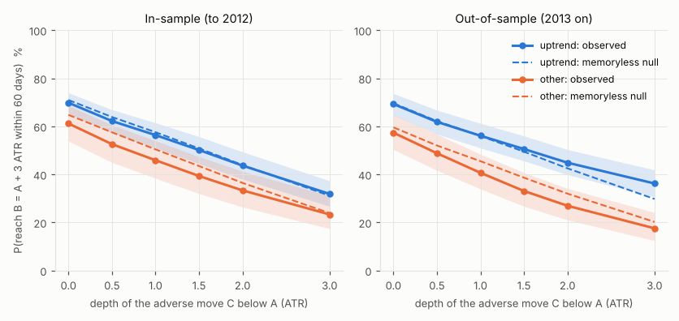
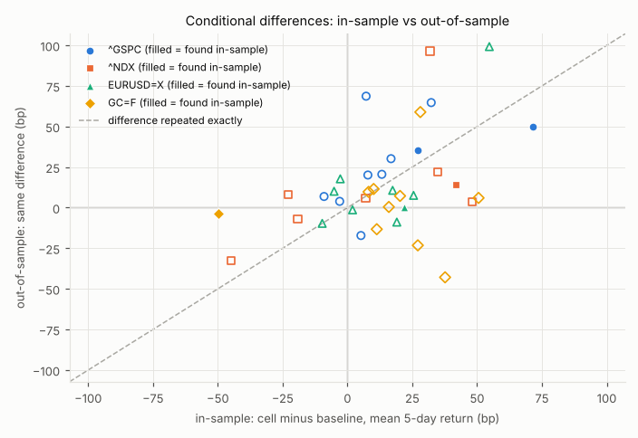
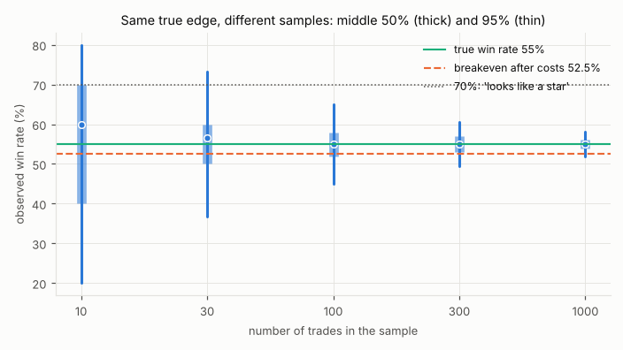
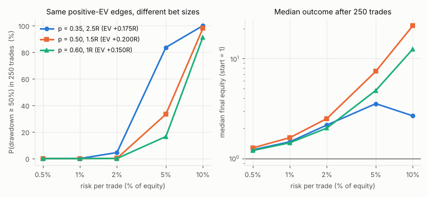
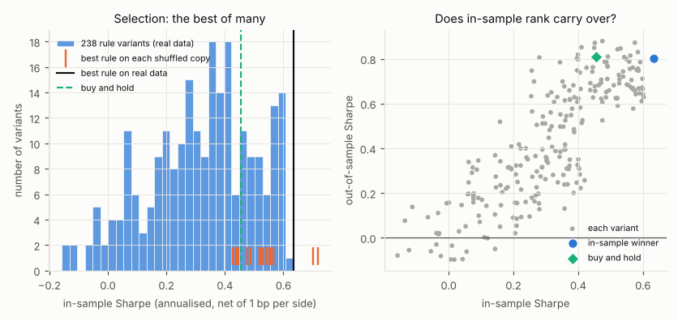
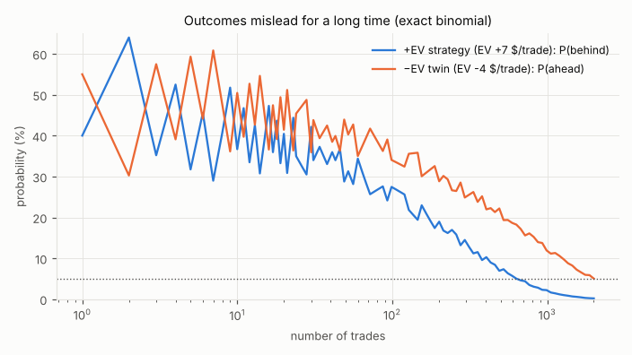
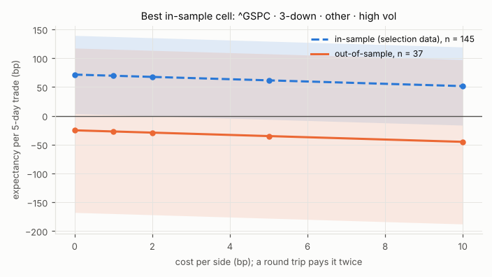

# Evidence Lab — testing the Philosophy of the Relationship on real market data

> **Education, not financial advice. Not a trading signal.** Every number on this page was computed by `tools/philosophy/studies.py` from public daily data, under the definitions stated here, and comes with its uncertainty. None of it is the win rate or P&L of a real strategy, account or trader. The hypothetical strategies in S3, S4 and S6 are labelled as such.

The philosophy ([[philosophy_relationship]]) asks to be tested. Section XVII ([[philo_scientific_method]]) says a theory becomes a method only when its claims meet actual outcomes, and Section XIX ([[philo_open_questions]]) lists what it still has to prove. This page takes seven of its claims to real market data (and, where the claim is about mathematics rather than markets, to exact calculation and simulation), with the rules fixed in advance and an out-of-sample period kept apart. It is layer L8 of the ontology ([[framework_ontology]]): review and validation. The functions used are in `tools/philosophy/edge_lab.py`; the formulas are in [[formula_sheet]].

## How to re-run

```bash
python3 tools/philosophy/market_data.py           # download and cache the daily bars (once)
python3 tools/philosophy/studies.py               # run S1-S7, rewrite this page and figures/
python3 tools/philosophy/studies.py --refresh     # re-download the data first
```

Data are cached in `tools/philosophy/data/` (git-ignored). Seeds are fixed: the same cache gives the same page. This run took 8 s.

## Data and caveats

Daily bars from the public Yahoo Finance chart API, cut at the pre-registered end date. Columns: rows dropped by the loader for a missing price or a non-positive price, and bars kept but suspicious (a high equal to the low, or a high/low inside the open-close range, which the studies widen to the open and close).

| symbol | first | last | rows used | dropped: missing | dropped: ≤ 0 | flat bars | inconsistent bars | studies |
| --- | ---: | ---: | ---: | ---: | ---: | ---: | ---: | ---: |
| `^GSPC` | 1970-01-02 | 2026-09-30 | 14,308 | 0 | 0 | 19 | 0 | S1, S2, S5 |
| `^NDX` | 1985-10-01 | 2026-09-30 | 10,329 | 0 | 0 | 1 | 0 | S1, S2 |
| `CL=F` | 2000-08-23 | 2026-09-30 | 6,552 | 80 | 2 | 0 | 7 | S1 |
| `GC=F` | 2000-08-30 | 2026-09-30 | 6,546 | 83 | 0 | 979 | 441 | S1, S2 |
| `EURUSD=X` | 2003-12-01 | 2026-09-30 | 5,924 | 34 | 0 | 14 | 128 | S1, S2 |

- **Yahoo data quality.** Free daily data has gaps and errors. `GC=F` has many flat or inconsistent bars before 2009 (the range is often missing), which understates intraday excursions there; `EURUSD=X` bars are a 24-hour quote, not an exchange print, and have occasional bad highs/lows.
- **Futures roll gaps.** `GC=F` and `CL=F` are front-month continuous series with no back-adjustment: each roll can add a jump that no position earned. ATR and excursions include them. `CL=F`'s negative settlement of April 2020 and the next day are dropped by the loader (a non-positive price has no return).
- **Index levels.** `^GSPC` and `^NDX` are index levels: they have no survivorship bias of their own (the index is what it was), but they are not tradable instruments, and they exclude dividends, so long-side returns are understated (by roughly the dividend yield).
- **Execution.** Signals and entries use the same close (a market-on-close assumption), which is optimistic. Costs are flat assumptions. No interest is earned when flat.
- **Dependence.** Daily entries with multi-day outcomes overlap. S1 and S2 use every day and report block-bootstrap CIs (non-overlapping calendar blocks resampled with replacement). S3's empirical cell and S7 use non-overlapping trades. S5 uses daily returns.
- **Look-ahead.** Every condition at day t uses data up to and including t; outcomes start at t+1. Volatility terciles are cut on in-sample data only. In-sample outcome windows end by 2012-12-31.

## Pre-registration

The block below is copied from the top of `studies.py`. It was written before any study was run and is the full set of rules and parameters. The verdict rules are in the code next to each study and were also fixed in advance; the prose around the numbers was written after.

```python
# --- PARAMS (pre-registered: fixed before any result was computed) ---
PARAMS = {
    "data_end": "2026-09-30",            # last bar used (complete months only)
    "is_end": "2012-12-31",              # in-sample: every bar up to this date
    "oos_start": "2013-01-01",           # out-of-sample: every bar from this date
    "purge": "an in-sample observation counts only if its whole outcome window ends by is_end",
    "bars": "high = max(open, high, close), low = min(open, low, close); nothing else changed",
    "atr_len": 14,                       # Wilder ATR (exponential, alpha = 1/14) of true range
    "sma_fast": 50,
    "sma_slow": 200,
    "trend_rule": "uptrend at t: close > SMA200 and SMA50 > SMA200 (data up to t); else 'other'",
    "seed": 20261011,
    "n_boot": 2000,                      # block-bootstrap replicates
    "ci": 0.95,
    "S1": {
        "symbols": ["^GSPC", "^NDX", "GC=F", "EURUSD=X", "CL=F"],
        "entries": "every day t with SMA200 and ATR14 defined; A = close[t]",
        "target_atr": 3.0,               # B = A + 3 * ATR14[t]
        "horizon": 60,                   # bars t+1 .. t+60
        "depths_atr": [0.5, 1.0, 1.5, 2.0, 3.0],  # C_k = A - k * ATR14[t]
        "event": "C_k touched before B: first bar with low <= C_k comes no later than first bar with high >= B",
        "tie_rule": "C_k and B on the same bar: adverse move first, and that bar does not count as reaching B",
        "block_calendar_days": 182,      # dependence: non-overlapping calendar blocks, all symbols together
        "null_paths": 20000,             # memoryless null per symbol x regime x period
        "null_model": "i.i.d. resampled days (close, high, low change / previous ATR) from the same symbol, "
                      "period and previous-day regime; same B, C_k and tie rule",
        "structural_change_rule": "depth k behaves like structural change in a regime if the 95% CI of "
                                  "P(B | C_k) lies entirely below the null value in BOTH IS and OOS",
    },
    "S2": {
        "symbols": ["^GSPC", "^NDX", "EURUSD=X", "GC=F"],
        "horizon": 5,                    # outcome: log(close[t+5] / close[t])
        "vol_window": 20,                # realised vol of daily log returns t-19..t
        "vol_terciles": "per symbol, 1/3 and 2/3 quantiles of in-sample realised vol",
        "pattern": "3 consecutive lower closes: close[t] < close[t-1] < close[t-2] < close[t-3]",
        "block_calendar_days": 91,
        "found_rule": "IS 95% CI of (cell - unconditional) excludes 0",
        "held_rule": "held: same sign OOS and OOS CI excludes 0; weakened: same sign, CI includes 0; "
                     "vanished: opposite sign, CI includes 0; reversed: opposite sign, CI excludes 0",
    },
    "S3": {
        "p_win": 0.55, "reward_risk": 1.0, "cost_r": 0.05,
        "n_trades": [10, 30, 100, 300, 1000],
        "n_samples": 100000,
        "looks_like_loser": "observed expectancy after costs <= 0",
        "looks_like_star": "observed win rate >= 0.70",
        "empirical_cell": "the S7 cell (best S2 cell chosen in-sample), non-overlapping 5-day trades",
    },
    "S4": {
        "strategies": [[0.35, 2.5], [0.50, 1.5], [0.60, 1.0]],   # [p_win, reward:risk]
        "cost_r": 0.05,
        "risk_per_trade": [0.005, 0.01, 0.02, 0.05, 0.10],
        "n_trades": 250, "n_paths": 10000, "ruin_drawdown": 0.50,
        "streaks": [6, 10],
        "recovery_losses": [0.10, 0.20, 0.30, 0.50, 0.75, 0.90],
    },
    "S5": {
        "symbol": "^GSPC",
        "cost_bp_per_side": 1.0,
        "position": "decided at close t from closes up to t; earns close-to-close return t -> t+1; flat earns 0",
        "ma_cross_fast": [5, 10, 15, 20, 25, 30, 40, 50, 60, 80, 100],
        "ma_cross_slow": [50, 75, 100, 125, 150, 200, 250, 300],
        "price_vs_ma": [10, 20, 50, 100, 150, 200, 250, 300],
        "momentum_lookback": [10, 20, 40, 60, 90, 120, 180, 250],
        "donchian_entry": [10, 20, 40, 55, 80, 100, 150, 200, 250],   # close > max of prior N closes
        "donchian_exit": [5, 10, 20, 40, 60],                         # close < min of prior M closes (M < N)
        "modes": ["long/flat", "long/short"],   # Donchian: long/flat with exit M; long/short stop-and-reverse on N
        "selection": "highest in-sample annualised Sharpe (252 days), net of costs",
        "n_shuffles": 20,                # in-sample daily returns permuted: no signal left
        "warmup_bars": 301,
    },
    "S6": {
        "p_win": 0.60, "win": 100.0, "loss": 120.0, "cost": 5.0,
        "twin_p_win": 0.55,
        "n_trades": [1, 10, 20, 50, 100, 500],
        "n_sims": 100000,
    },
    "S7": {
        "selection": "largest in-sample mean 5-day log return among the non-baseline S2 cells "
                     "(all symbols) with at least 150 in-sample observations",
        "min_is_obs": 150,
        "trades": "long, enter at close t when the cell holds, exit at close t+5, no overlapping trades",
        "costs_bp_per_side": [0, 1, 2, 5, 10],
    },
    "figures_dpi": 110,
}
# --- end PARAMS ---
```

**Deviations from the pre-registration**, made after results were seen:

- S2: a cell whose observations fall in fewer than 10 distinct bootstrap blocks in either period is reported as 'too few to judge' instead of being classified. Added after the first run, where a cell with 4 out-of-sample observations (all in one or two blocks) received a 95% CI under 6 points wide and a 'reversed' label: with so few blocks the block bootstrap cannot see the uncertainty. The cut-off of 10 blocks was set once, from that reasoning, and not tuned; S7's candidate rule is unchanged.

## S1 — A → C → B: is an adverse move a detour or a breakdown?

**Claim tested.** Section III ([[philo_acb_principle]]) says price may travel from A to C, against the hypothesis, before reaching B; the intermediate move *may* be consistent with the larger hypothesis, yet B is only a hypothesis and not every adverse move is a detour. Principles 2 and 3 ([[principle_02_context_before_movement]], [[principle_03_future_is_uncertain]]) turn this into practice: read a move in its context, and treat the destination as uncertain. Testable form: (a) touching C should lower, not erase, the chance of reaching B; (b) the context at A (here, the trend regime) should shape the curve; and the question the study must answer, (c): at what depth, if any, does the adverse move carry information of its own, i.e. behave like a change in structure rather than a detour?

**Design.** Every trading day t is an entry A = close[t]. B = A + 3 × ATR14[t] (Wilder's ATR, [[person_welles_wilder]]; [[concept_volatility]]); horizon 60 trading days. C_k = A − k × ATR14[t] for k = 0.5, 1, 1.5, 2, 3. The conditional probability is the one a trader can use in real time: *given that price has touched C_k before touching B, how often was B still reached within the original horizon?* If C_k and B fall on the same daily bar, the adverse move is assumed to come first and that bar does not count as reaching B (conservative against the claim). Regime at A ([[concept_market_regimes]]): *uptrend* = close > SMA200 and SMA50 > SMA200, otherwise *other*. Uncertainty: entries overlap heavily, so 95% CIs come from a block bootstrap that resamples 182-day calendar blocks of all five markets together (preserving the overlap and the cross-market correlation).

**The yardstick.** P(B) falls with depth for pure geometry: from C_k the target is (3 + k) ATR away and less time is left. So a falling curve alone says nothing about a change in structure. Each curve is compared with a *memoryless null*: 60-day paths built from the same market's own days (close, high and low changes divided by the prior ATR), drawn at random from the same period and regime. The null keeps each market's drift, volatility and fat tails but has no memory, so in it an adverse move carries no information about what follows. Observed below the null = the detour carried bad news beyond geometry (breakdown-like); at the null = geometry only; above = adverse moves were followed by more recovery than chance (detour-like).

**Data.** Entries per market and period (the IS window ends 60 trading days before 2013 so no in-sample outcome uses 2013 data):

| market | period | entries | n | share in uptrend |
| --- | ---: | ---: | ---: | ---: |
| `^GSPC` | IS | 1970-10-14 → 2012-10-02 | 10,592 | 63% |
| `^GSPC` | OOS | 2013-01-02 → 2026-07-07 | 3,397 | 79% |
| `^NDX` | IS | 1986-07-16 → 2012-10-02 | 6,613 | 65% |
| `^NDX` | OOS | 2013-01-02 → 2026-07-07 | 3,397 | 79% |
| `GC=F` | IS | 2001-06-18 → 2012-10-02 | 2,830 | 81% |
| `GC=F` | OOS | 2013-01-02 → 2026-07-07 | 3,397 | 55% |
| `EURUSD=X` | IS | 2004-09-03 → 2012-10-05 | 2,087 | 54% |
| `EURUSD=X` | OOS | 2013-01-01 → 2026-07-08 | 3,518 | 40% |
| `CL=F` | IS | 2001-06-11 → 2012-10-02 | 2,838 | 61% |
| `CL=F` | OOS | 2013-01-02 → 2026-07-07 | 3,395 | 41% |

**In-sample, five markets pooled** (uptrend n = 16,157; other n = 8,803). *Touched* = share of entries whose path touched C_k before B. P(B | C_k) with 95% block-bootstrap CI, the memoryless null, and the comparison.

| depth | up: touched | up: P(B) [95% CI] | up: null | up: vs null | other: touched | other: P(B) [95% CI] | other: null | other: vs null |
| --- | ---: | ---: | ---: | ---: | ---: | ---: | ---: | ---: |
| unconditional | — | 69.8% [65.3, 73.9] | 71.0% |  | — | 61.2% [53.8, 68.6] | 64.8% |  |
| C at −0.5 ATR | 79.8% | 62.2% [57.2, 66.9] | 63.9% | at null | 81.6% | 52.6% [45.0, 60.6] | 57.5% | at null |
| C at −1 ATR | 68.8% | 56.4% [50.8, 61.5] | 57.6% | at null | 70.9% | 45.9% [38.4, 54.0] | 50.4% | at null |
| C at −1.5 ATR | 59.9% | 50.1% [44.4, 55.7] | 50.8% | at null | 62.5% | 39.3% [32.0, 47.4] | 43.5% | at null |
| C at −2 ATR | 52.0% | 43.7% [38.0, 49.4] | 43.9% | at null | 55.3% | 33.3% [26.4, 41.3] | 36.5% | at null |
| C at −3 ATR | 39.2% | 31.9% [26.7, 37.3] | 31.1% | at null | 42.4% | 23.3% [17.4, 31.0] | 23.9% | at null |

**Out-of-sample, five markets pooled** (uptrend n = 10,011; other n = 7,093). *Touched* = share of entries whose path touched C_k before B. P(B | C_k) with 95% block-bootstrap CI, the memoryless null, and the comparison.

| depth | up: touched | up: P(B) [95% CI] | up: null | up: vs null | other: touched | other: P(B) [95% CI] | other: null | other: vs null |
| --- | ---: | ---: | ---: | ---: | ---: | ---: | ---: | ---: |
| unconditional | — | 69.3% [64.6, 73.7] | 69.6% |  | — | 57.4% [50.3, 64.8] | 59.6% |  |
| C at −0.5 ATR | 80.2% | 61.9% [56.8, 66.7] | 62.2% | at null | 83.2% | 48.8% [41.7, 56.7] | 52.0% | at null |
| C at −1 ATR | 69.3% | 56.1% [51.0, 61.2] | 56.0% | at null | 71.3% | 40.7% [33.9, 48.4] | 45.5% | at null |
| C at −1.5 ATR | 60.4% | 50.6% [45.6, 56.0] | 49.5% | at null | 62.1% | 33.1% [26.7, 40.7] | 38.6% | at null |
| C at −2 ATR | 52.5% | 44.9% [39.9, 50.3] | 42.5% | at null | 55.4% | 27.0% [21.1, 34.1] | 32.0% | at null |
| C at −3 ATR | 40.7% | 36.2% [30.6, 41.9] | 29.8% | above null | 43.7% | 17.6% [12.4, 24.1] | 20.2% | at null |



**The hindsight trap (exclusive bins).** The same entries cut by the *deepest* excursion reached before B (for paths that never reach B, the deepest point of the whole window). Read this way, detours look almost harmless until 2 ATR, but the reading is circular: a path that never reaches B has 60 days to sink, so it almost always lands in the deepest bin, and the shallow bins are left with the winners. The deepest point is known only afterwards. The real-time tables above are the ones a decision can use; this one shows how hindsight flatters a hypothesis.

| deepest excursion before B | IS uptrend | IS other | OOS uptrend | OOS other |
| --- | ---: | ---: | ---: | ---: |
| 0–0.5 ATR | 100% (n 3,262) | 99% (n 1,622) | 99% (n 1,979) | 99% (n 1,192) |
| 0.5–1 ATR | 99% (n 1,779) | 97% (n 943) | 98% (n 1,098) | 97% (n 841) |
| 1–1.5 ATR | 98% (n 1,441) | 95% (n 738) | 94% (n 889) | 92% (n 655) |
| 1.5–2 ATR | 93% (n 1,281) | 85% (n 635) | 88% (n 792) | 84% (n 476) |
| 2–3 ATR | 80% (n 2,056) | 66% (n 1,129) | 75% (n 1,175) | 62% (n 826) |
| ≥ 3 ATR | 32% (n 6,338) | 23% (n 3,736) | 36% (n 4,078) | 18% (n 3,103) |

**Per market (both regimes together).**

| market | period | P(B) [95% CI] | P(B \| C at −1 ATR) [95% CI] | P(B \| C at −2 ATR) [95% CI] |
| --- | ---: | ---: | ---: | ---: |
| `^GSPC` | IS | 64.4% [58.8, 69.8] | 50.5% [44.2, 56.7] (n 7,543) | 38.0% [31.6, 44.4] (n 5,778) |
| `^GSPC` | OOS | 78.3% [70.6, 85.8] | 68.0% [58.8, 77.9] (n 2,272) | 59.5% [49.0, 71.1] (n 1,719) |
| `^NDX` | IS | 68.5% [61.5, 74.7] | 55.1% [47.0, 62.9] (n 4,620) | 43.3% [35.0, 51.9] (n 3,607) |
| `^NDX` | OOS | 79.8% [71.7, 86.7] | 70.0% [59.5, 79.6] (n 2,281) | 59.5% [47.8, 71.3] (n 1,646) |
| `GC=F` | IS | 77.8% [70.5, 84.0] | 64.2% [55.4, 72.8] (n 1,757) | 51.7% [42.4, 61.6] (n 1,293) |
| `GC=F` | OOS | 63.1% [55.7, 70.8] | 47.1% [39.7, 55.2] (n 2,346) | 32.8% [26.0, 40.5] (n 1,781) |
| `EURUSD=X` | IS | 58.8% [44.7, 71.9] | 42.0% [29.6, 56.0] (n 1,450) | 26.8% [17.6, 39.8] (n 1,104) |
| `EURUSD=X` | OOS | 45.2% [35.9, 54.1] | 27.9% [20.0, 36.3] (n 2,655) | 15.9% [10.4, 23.2] (n 2,116) |
| `CL=F` | IS | 66.4% [58.4, 74.5] | 52.2% [43.5, 61.8] (n 1,984) | 38.3% [30.3, 48.2] (n 1,477) |
| `CL=F` | OOS | 56.0% [47.1, 65.0] | 39.3% [31.1, 48.3] (n 2,440) | 25.6% [18.5, 33.9] (n 1,920) |

Same-bar ties (C_k and B on one bar), all depths and markets: 49; they were resolved against the claim as stated above.

**Verdict: Supports** (pre-registered rule: in the *uptrend* regime no tested depth (up to 3 ATR) fell below the memoryless null in both periods; in the *other* regime no tested depth (up to 3 ATR) fell below the memoryless null in both periods). An adverse move weakens the hypothesis without settling it. Out-of-sample, a 1-ATR detour took P(B) from 69.3% to 56.1% in uptrends and from 57.4% to 40.7% otherwise; even after a 3-ATR detour, B was still reached 36.2% of the time in uptrends (17.6% otherwise). **No depth behaved like structural change** in either regime: up to 3 ATR, the observed curve never sat clearly below (in both periods) what a memoryless market with the same drift and volatility produces. The decline of P(B) with depth is, within the precision of these data, geometry: farther to go and less time to get there. Context did more than depth: at every depth and in both periods the uptrend curve sits above the other-regime curve, the gap is 12 points unconditionally and 19 points at 3 ATR out-of-sample. Softer signals, mostly inside the CIs: observed minus null ranged from -5 to -1 points in-sample and from -6 to -3 out-of-sample in the *other* regime (adverse moves there leaned towards bad news), and from 0 to +6 for out-of-sample uptrends; single-period CIs clear of the null: above at OOS uptrend at 3 ATR. For Section III this means the distinction between a detour and a breakdown cannot be read from the size of the adverse move alone; it has to come from the context in which the move happens, which is what Principle 2 asks for.

**What this does NOT show.** It does not show that B = A + 3 ATR is a sensible target, or that buying every day is a strategy (most entries are not trades anyone would take). It uses daily bars, so the order of events within a day is unknown. It conditions on one context variable (trend); the philosophy's *structure* is richer than a moving-average test, and a richer context might find the breakdown signal that depth alone does not carry. The memoryless null removes volatility clustering: after a sharp fall volatility usually rises, so real paths, measured in ATR at entry, swing wider in both directions than the null's. It says nothing about the short side.

## S2 — Recurrence is conditional

**Claim tested.** Sections V and VI ([[philo_recurring_storyline]], [[philo_conditional_probability]]) and Principle 4 ([[principle_04_conditional_probability]]): a recurring tendency is a conditional probability, not a law. The same pattern can mean different things in different conditions, and an estimate holds only while conditions resemble those it was measured in. Testable form: conditional cells should differ from the unconditional baseline, and some of the differences found on one period should fail on the next.

**Design.** Outcome: 5-day forward log return from the close of day t; P(up) = share of positive outcomes. Conditions at t (data up to t only): trend regime (as in S1) × realised-vol tercile (20-day realised volatility; tercile cut-offs estimated per market on in-sample data only, then frozen), and one simple recurring pattern, three consecutive lower closes (*3-down*), alone and inside each of the six contexts. Each cell is compared with the baseline (all days) of the same market and period. Overlapping 5-day windows are handled with a block bootstrap over 91-day calendar blocks; the cell-minus-baseline difference is bootstrapped jointly. A difference is *found* in-sample when its 95% CI excludes zero; out-of-sample it *held* (same sign, CI excludes zero), *weakened* (same sign, CI includes zero), *vanished* (opposite sign, CI includes zero) or *reversed* (opposite sign, CI excludes zero). A cell whose observations fall in fewer than 10 bootstrap blocks in either period is marked *too few to judge* (see the deviation note above) and left out of the scorecard and the chart.

**Data.**

| market | in-sample | IS days | out-of-sample | OOS days | vol tercile cut-offs (annualised) |
| --- | ---: | ---: | ---: | ---: | ---: |
| `^GSPC` | 1970-10-14 → 2012-12-21 | 10,647 | 2013-01-02 → 2026-09-23 | 3,452 | 10.8% / 15.5% |
| `^NDX` | 1986-07-16 → 2012-12-21 | 6,668 | 2013-01-02 → 2026-09-23 | 3,452 | 16.6% / 24.8% |
| `EURUSD=X` | 2004-09-03 → 2012-12-24 | 2,142 | 2013-01-01 → 2026-09-23 | 3,573 | 8.3% / 10.9% |
| `GC=F` | 2001-06-18 → 2012-12-21 | 2,885 | 2013-01-02 → 2026-09-23 | 3,452 | 14.0% / 18.7% |

**`^GSPC`.** Baseline in-sample: P(up) 55.4% [53.5, 57.3], mean +13 bp [+3, +23]. Out-of-sample: P(up) 60.7% [58.0, 63.5], mean +24 bp [+12, +37]. Cells show the difference from that baseline.

| cell | IS n | IS ΔP(up), pp | IS Δmean, bp | OOS n | OOS ΔP(up), pp | OOS Δmean, bp | P(up): fate | mean: fate |
| --- | ---: | ---: | ---: | ---: | ---: | ---: | ---: | ---: |
| uptrend · low vol | 2,813 | +2.6 [-0.5, +5.6] | +5 [-7, +18] | 1,372 | -3.4 [-7.6, +0.2] | -17 [-33, -3] | not found IS | not found IS (sig. OOS) |
| uptrend · mid vol | 2,475 | -1.3 [-4.4, +1.7] | -3 [-17, +13] | 903 | +3.5 [-1.8, +8.4] | +4 [-16, +23] | not found IS | not found IS |
| uptrend · high vol | 1,478 | +1.2 [-2.5, +4.8] | +8 [-16, +30] | 449 | +3.5 [-3.8, +11.2] | +20 [-17, +52] | not found IS | not found IS |
| other · low vol | 736 | -4.3 [-10.3, +1.8] | -11 [-34, +18] | 42 | -5.9 [-12.4, +40.1] | +1 [-20, +121] | too few to judge | too few to judge |
| other · mid vol | 1,074 | +1.6 [-3.6, +6.9] | +7 [-17, +31] | 100 | +8.3 [-4.4, +24.9] | +69 [+4, +165] | not found IS | not found IS (sig. OOS) |
| other · high vol | 2,071 | -2.1 [-5.8, +1.5] | -9 [-37, +17] | 586 | -1.1 [-6.5, +5.5] | +7 [-23, +43] | not found IS | not found IS |
| 3-down (no context) | 1,172 | +1.6 [-1.6, +4.9] | +27 [+9, +44] | 283 | +4.7 [-0.8, +10.4] | +35 [+7, +62] | not found IS | held |
| 3-down · uptrend · low vol | 255 | +1.5 [-5.5, +8.9] | +13 [-12, +39] | 103 | +5.4 [-5.1, +15.1] | +21 [-8, +54] | not found IS | not found IS |
| 3-down · uptrend · mid vol | 227 | +2.8 [-5.8, +11.1] | +17 [-31, +58] | 57 | +9.5 [-6.7, +22.2] | +30 [-30, +84] | not found IS | not found IS |
| 3-down · uptrend · high vol | 145 | +4.6 [-6.5, +15.3] | +47 [-43, +118] | 32 | -1.3 [-21.6, +17.4] | +37 [-65, +111] | too few to judge | too few to judge |
| 3-down · other · low vol | 119 | -15.1 [-23.8, -4.4] | -49 [-85, -7] | 4 | +14.3 [+11.4, +16.9] | +104 [+92, +116] | too few to judge | too few to judge |
| 3-down · other · mid vol | 169 | +3.2 [-7.1, +13.7] | +32 [-11, +73] | 16 | +1.8 [-25.5, +30.2] | +65 [-68, +204] | not found IS | not found IS |
| 3-down · other · high vol | 257 | +5.7 [-1.3, +13.4] | +72 [+13, +131] | 71 | +2.7 [-10.9, +15.0] | +50 [-53, +123] | not found IS | weakened |

**`^NDX`.** Baseline in-sample: P(up) 56.3% [54.0, 58.6], mean +22 bp [+1, +42]. Out-of-sample: P(up) 60.2% [57.5, 63.1], mean +35 bp [+18, +51]. Cells show the difference from that baseline.

| cell | IS n | IS ΔP(up), pp | IS Δmean, bp | OOS n | OOS ΔP(up), pp | OOS Δmean, bp | P(up): fate | mean: fate |
| --- | ---: | ---: | ---: | ---: | ---: | ---: | ---: | ---: |
| uptrend · low vol | 1,694 | -0.4 [-4.8, +3.5] | -19 [-45, +5] | 1,709 | 0.0 [-2.6, +2.6] | -7 [-23, +9] | not found IS | not found IS |
| uptrend · mid vol | 1,622 | +0.9 [-2.4, +4.4] | +7 [-22, +33] | 796 | +1.7 [-3.7, +7.2] | +6 [-24, +36] | not found IS | not found IS |
| uptrend · high vol | 995 | +2.4 [-2.7, +7.3] | +35 [-22, +84] | 238 | -3.1 [-14.2, +7.0] | +22 [-59, +90] | not found IS | not found IS |
| other · low vol | 529 | +5.0 [-2.9, +12.8] | +43 [+7, +82] | 109 | -2.4 [-14.7, +12.5] | +5 [-53, +61] | too few to judge | too few to judge |
| other · mid vol | 600 | +3.0 [-4.3, +10.6] | +32 [-16, +86] | 163 | +15.2 [+4.3, +24.2] | +97 [+23, +155] | not found IS (sig. OOS) | not found IS (sig. OOS) |
| other · high vol | 1,228 | -6.3 [-10.5, -1.9] | -45 [-95, +6] | 437 | -6.5 [-11.3, +0.2] | -33 [-73, +27] | weakened | not found IS |
| 3-down (no context) | 669 | +4.7 [+0.7, +8.8] | +42 [+3, +81] | 257 | +1.3 [-5.1, +7.7] | +14 [-29, +55] | weakened | weakened |
| 3-down · uptrend · low vol | 154 | +1.5 [-7.8, +10.2] | -23 [-92, +42] | 105 | +3.6 [-7.7, +14.9] | +8 [-40, +58] | not found IS | not found IS |
| 3-down · uptrend · mid vol | 162 | +8.5 [+0.7, +16.6] | +48 [-27, +109] | 66 | +0.4 [-11.9, +13.6] | +4 [-80, +78] | weakened | not found IS |
| 3-down · uptrend · high vol | 64 | +4.7 [-5.8, +16.1] | +98 [-36, +228] | 13 | +1.3 [-14.5, +39.5] | +114 [+8, +393] | too few to judge | too few to judge |
| 3-down · other · low vol | 71 | +0.1 [-15.1, +17.8] | +0 [-65, +78] | 11 | +3.4 [-39.3, +41.9] | +33 [-111, +360] | too few to judge | too few to judge |
| 3-down · other · mid vol | 75 | +2.4 [-9.1, +14.8] | +29 [-32, +98] | 16 | +2.3 [-41.0, +27.1] | +21 [-341, +227] | too few to judge | too few to judge |
| 3-down · other · high vol | 143 | +7.4 [-2.0, +18.5] | +107 [-27, +253] | 46 | -3.7 [-19.3, +10.3] | +8 [-229, +157] | too few to judge | too few to judge |

**`EURUSD=X`.** Baseline in-sample: P(up) 52.7% [48.8, 56.8], mean +2 bp [-12, +16]. Out-of-sample: P(up) 48.4% [45.3, 51.5], mean -2 bp [-9, +5]. Cells show the difference from that baseline.

| cell | IS n | IS ΔP(up), pp | IS Δmean, bp | OOS n | OOS ΔP(up), pp | OOS Δmean, bp | P(up): fate | mean: fate |
| --- | ---: | ---: | ---: | ---: | ---: | ---: | ---: | ---: |
| uptrend · low vol | 539 | +9.3 [+3.9, +16.2] | +22 [+6, +41] | 1,150 | +0.1 [-4.3, +3.8] | +0 [-10, +9] | weakened | weakened |
| uptrend · mid vol | 311 | +1.7 [-6.5, +10.1] | -3 [-28, +23] | 225 | +7.6 [-5.9, +19.9] | +18 [-9, +48] | not found IS | not found IS |
| uptrend · high vol | 307 | -3.1 [-10.2, +3.3] | -17 [-54, +9] | 32 | -29.6 [-49.1, +6.8] | -35 [-66, +21] | too few to judge | too few to judge |
| other · low vol | 175 | -2.4 [-17.4, +12.4] | +2 [-42, +38] | 1,442 | -1.7 [-5.0, +1.9] | -1 [-9, +6] | not found IS | not found IS |
| other · mid vol | 403 | -7.5 [-15.8, +2.1] | -10 [-35, +21] | 433 | +0.3 [-7.0, +8.7] | -10 [-31, +13] | not found IS | not found IS |
| other · high vol | 407 | -2.8 [-9.5, +4.9] | -5 [-45, +29] | 291 | +4.5 [-5.1, +15.8] | +10 [-16, +38] | not found IS | not found IS |
| 3-down (no context) | 245 | +3.3 [-1.5, +8.5] | +17 [-1, +38] | 429 | +1.7 [-3.2, +6.9] | +11 [-0, +23] | not found IS | not found IS |
| 3-down · uptrend · low vol | 49 | +12.6 [-0.4, +28.2] | +25 [-0, +60] | 123 | +0.4 [-11.0, +12.1] | +8 [-12, +29] | not found IS | not found IS |
| 3-down · uptrend · mid vol | 42 | +4.5 [-2.7, +14.5] | +15 [-8, +52] | 18 | +12.7 [-25.7, +50.7] | +43 [-21, +145] | too few to judge | too few to judge |
| 3-down · uptrend · high vol | 25 | -4.7 [-30.5, +20.3] | -33 [-152, +64] | 1 | -48.4 [-51.5, -45.3] | -62 [-70, -55] | too few to judge | too few to judge |
| 3-down · other · low vol | 25 | -16.7 [-44.3, +10.1] | -28 [-79, +22] | 201 | -1.1 [-9.5, +7.9] | -1 [-20, +18] | too few to judge | too few to judge |
| 3-down · other · mid vol | 50 | +3.3 [-18.9, +19.7] | +19 [-24, +48] | 50 | -8.4 [-27.0, +9.4] | -9 [-53, +36] | not found IS | not found IS |
| 3-down · other · high vol | 54 | +6.6 [-7.7, +18.9] | +55 [-16, +137] | 36 | +32.2 [+15.8, +45.2] | +99 [+49, +136] | not found IS (sig. OOS) | not found IS (sig. OOS) |

**`GC=F`.** Baseline in-sample: P(up) 57.3% [53.5, 60.8], mean +31 bp [+12, +50]. Out-of-sample: P(up) 54.5% [51.2, 57.8], mean +14 bp [-3, +32]. Cells show the difference from that baseline.

| cell | IS n | IS ΔP(up), pp | IS Δmean, bp | OOS n | OOS ΔP(up), pp | OOS Δmean, bp | P(up): fate | mean: fate |
| --- | ---: | ---: | ---: | ---: | ---: | ---: | ---: | ---: |
| uptrend · low vol | 824 | +0.4 [-5.3, +5.8] | +10 [-17, +35] | 962 | +0.3 [-4.3, +5.3] | +12 [-10, +37] | not found IS | not found IS |
| uptrend · mid vol | 825 | +6.0 [+0.6, +12.3] | +20 [-7, +50] | 470 | +0.6 [-4.6, +6.3] | +7 [-21, +38] | weakened | not found IS |
| uptrend · high vol | 689 | -8.6 [-14.8, -3.0] | -50 [-85, -20] | 438 | -0.7 [-7.7, +6.5] | -4 [-47, +55] | weakened | weakened |
| other · low vol | 138 | +10.1 [-9.5, +23.7] | +27 [-62, +101] | 771 | -3.3 [-9.8, +3.2] | -23 [-52, +8] | not found IS | not found IS |
| other · mid vol | 136 | +0.1 [-9.9, +14.2] | +8 [-36, +63] | 501 | +3.1 [-2.5, +9.1] | +10 [-22, +39] | not found IS | not found IS |
| other · high vol | 273 | -2.7 [-12.4, +7.8] | +16 [-82, +105] | 310 | +2.2 [-4.0, +11.4] | +0 [-33, +48] | not found IS | not found IS |
| 3-down (no context) | 226 | +1.6 [-5.8, +9.1] | +11 [-43, +67] | 343 | -1.2 [-6.2, +3.8] | -13 [-38, +11] | not found IS | not found IS |
| 3-down · uptrend · low vol | 31 | +13.7 [-1.3, +28.3] | +51 [-1, +104] | 79 | -1.4 [-14.8, +11.3] | +6 [-39, +59] | not found IS | not found IS |
| 3-down · uptrend · mid vol | 55 | +0.9 [-17.5, +19.4] | +28 [-59, +112] | 34 | +1.3 [-19.1, +26.8] | +59 [-31, +180] | not found IS | not found IS |
| 3-down · uptrend · high vol | 62 | -2.4 [-15.5, +10.0] | +38 [-57, +139] | 38 | -1.9 [-12.9, +12.4] | -43 [-135, +44] | not found IS | not found IS |
| 3-down · other · low vol | 16 | -1.0 [-23.7, +42.4] | +12 [-110, +224] | 101 | -3.1 [-12.6, +6.6] | -50 [-101, +0] | too few to judge | too few to judge |
| 3-down · other · mid vol | 16 | +17.7 [-11.9, +44.0] | +17 [-105, +144] | 60 | +0.5 [-14.7, +15.5] | -7 [-57, +40] | too few to judge | too few to judge |
| 3-down · other · high vol | 46 | -5.1 [-22.8, +22.5] | -73 [-276, +235] | 31 | +0.3 [-22.3, +20.8] | +3 [-113, +129] | too few to judge | too few to judge |

**Scorecard.** 52 cells per metric (13 × 4 markets); 15 were too few to judge, the rest are counted below.

| metric | cells judged | found IS | held | weakened | vanished | reversed | appeared only OOS |
| --- | ---: | ---: | ---: | ---: | ---: | ---: | ---: |
| P(up) | 37 | 6 | 0 | 6 | 0 | 0 | 2 |
| mean 5-day return | 37 | 5 | 1 | 4 | 0 | 0 | 4 |

With 37 cells per metric, about 1.9 would clear a 95% interval by chance alone even if no condition mattered (and as many again out-of-sample); the cells also overlap (the 3-down cells are subsets of the context cells), so they are not independent tests. In-sample, 6 (P(up)) and 5 (mean) cleared it.



**Verdict: Supports** (pre-registered rule: some in-sample differences held and some did not). The support is mostly for the cautious half of Sections V–VI. Across both metrics, 11 of 74 judged cells differed from their baseline in-sample, where about 4 would by chance; 1 held out-of-sample and 10 weakened, vanished or reversed. Held (mean): `^GSPC` 3-down (no context). Held (P(up)): none. Even the unconditional baselines moved between periods (P(up), in-sample → out-of-sample: `^GSPC` 55.4% → 60.7%; `^NDX` 56.3% → 60.2%; `EURUSD=X` 52.7% → 48.4%; `GC=F` 57.3% → 54.5%), so the 'unconditional' probability was itself conditional on the period. Conditioning can matter, but with these simple conditions most apparent differences were within noise, and a difference that looked real on one period usually did not survive to the next: a conditional estimate has to be re-earned, not assumed.

**What this does NOT show.** These are statistical tendencies of index, gold and EUR/USD closes, not setups. A cell that held is not a trading edge: S7 shows what costs do to the best one. Two periods are a thin test of persistence; a cell can hold across 2013–2026 and still fail later. The regime and volatility definitions are one simple choice among many; other definitions would give other cells. Equity index levels exclude dividends.

## S3 — The law of large numbers: what a sample can and cannot establish

**Claim tested.** Section VI ([[philo_conditional_probability]], *the importance of the law of large numbers*): a few successful trades do not establish an advantage, and observed frequencies approach the underlying probability only as relevant observations accumulate. Open question 3 ([[question_estimate_reliability]]) asks how reliable the estimates are. See also [[concept_probabilistic_thinking]] and [[concept_expectancy]].

**Design.** A hypothetical strategy with a real but small edge: win rate 55%, payoff 1:1, cost 0.05R per trade, so the true expectancy is +0.050R per trade (breakeven win rate 52.5%). For each sample size, 100,000 independent samples are simulated (seeded binomial draws); the exact binomial probability is shown next to each simulated share as a check. *Looks like a loser* = observed expectancy ≤ 0 after costs; *looks like a star* = observed win rate ≥ 70%.

**Results (hypothetical, simulated).**

| trades | median win rate | 95% of samples: win rate | 95% of samples: expectancy | looks like a loser: sim (exact) | looks like a star: sim (exact) |
| --- | ---: | ---: | ---: | ---: | ---: |
| 10 | 60.0% | 20.0% – 80.0% | -0.65R – +0.55R | 49.6% (49.6%) | 26.67% (26.60%) |
| 30 | 56.7% | 36.7% – 73.3% | -0.32R – +0.42R | 35.3% (35.5%) | 6.93% (6.94%) |
| 100 | 55.0% | 45.0% – 65.0% | -0.15R – +0.25R | 30.7% (30.7%) | 0.15% (0.15%) |
| 300 | 55.0% | 49.3% – 60.7% | -0.06R – +0.16R | 19.1% (19.2%) | 0.00% (0.00%) |
| 1000 | 55.0% | 51.9% – 58.1% | -0.01R – +0.11R | 6.0% (6.0%) | 0.00% (0.00%) |

`trades_needed` for the true parameters: per-trade expectancy +0.050R with sd 0.995R, so a 95% interval on expectancy excludes zero on an average sample only after about **1,522 trades**, and with 80% power after about **3,109 trades**; pinning the win rate to ±5 points takes about 381 trades.



**One empirical cell.** The cell chosen in S7 (`^GSPC` · 3-down · other · high vol), as non-overlapping 5-day long trades so that the trades are close to independent, checked with `wilson_interval`, `beta_posterior` (uniform prior) and `expectancy_from_results` from `edge_lab.py`. A *win* is a positive 5-day return before costs.

| period | trades | wins | win rate | Wilson 95% CI | Beta posterior mean [95% CrI] | P(true win rate > 50%) | mean bp [95% CI] | trades for 80% power |
| --- | ---: | ---: | ---: | ---: | ---: | ---: | ---: | ---: |
| IS | 145 | 87 | 60.0% | [51.9, 67.6] | 59.9% [51.9, 67.6] | 99.2% | +72 [+4, +139] | 263 |
| OOS | 37 | 18 | 48.6% | [33.4, 64.1] | 48.7% [33.4, 64.2] | 43.6% | -25 [-168, +117] | ∞ (mean ≤ 0) |

The in-sample row is also the *best of 32 cells*, so its numbers carry selection bias on top of sampling error: the interval describes sampling noise only, not the luck of being picked. Even so, an interval of [51.9, 67.6] on 145 trades is the honest size of what the sample knows.

**Verdict: Supports.** With a genuine edge of +0.05R, 36% of 30-trade samples and 31% of 100-trade samples still look like losing strategies, and about 3,109 trades are needed before the evidence reliably separates the edge from zero.

**What this does NOT show.** The simulated trades are independent and identically distributed; real trades are not (regimes change, S2), which makes the real problem harder, not easier. The empirical row describes one cell of one study, not a strategy anyone trades.

## S4 — Capital preservation: streaks, drawdowns and ruin

**Claim tested.** Section XIV ([[philo_capital_preservation]]) and Principle 9 ([[principle_09_protect_capital]]): even a strategy with a genuine positive expectancy meets unfavourable sequences, losses are asymmetric, and sizing must keep a bad sequence from ending participation. See [[concept_risk_of_ruin_drawdown]], [[concept_position_sizing]], [[concept_kelly_criterion_optimal_f]].

**Design.** Three hypothetical positive-EV strategies after a 0.05R cost per trade, each run at five fixed-fractional risk levels: 250 trades × 10,000 seeded paths (`simulate_equity`), compounding on current equity. Streak probabilities are exact (Markov chain, `prob_losing_streak`). *Ruin* here = a peak-to-trough drawdown of 50% or more at any point.

**The strategies.**

| strategy | EV per trade | full Kelly fraction | P(6+ loss streak in 250) | P(10+ loss streak in 250) |
| --- | ---: | ---: | ---: | ---: |
| p = 0.35, 2.5R | +0.175R | 6.8% | 100.0% | 70.0% |
| p = 0.50, 1.5R | +0.200R | 13.1% | 86.8% | 11.2% |
| p = 0.60, 1R | +0.150R | 15.0% | 45.9% | 1.5% |

**Results (hypothetical, simulated).**

| strategy | risk per trade | median max DD | 95th pct max DD | P(DD ≥ 50%) | median final equity (start 1.00) | P(end below start) |
| --- | ---: | ---: | ---: | ---: | ---: | ---: |
| p = 0.35, 2.5R | 0.5% | 8.3% | 15.0% | 0.0% | 1.22 | 5.8% |
| p = 0.35, 2.5R | 1.0% | 16.0% | 28.3% | 0.0% | 1.47 | 5.3% |
| p = 0.35, 2.5R | 2.0% | 29.9% | 49.2% | 4.5% | 2.16 | 7.2% |
| p = 0.35, 2.5R | 5.0% | 62.1% | 84.6% | 83.6% | 3.54 | 14.5% |
| p = 0.35, 2.5R | 10.0% | 89.8% | 98.9% | 100.0% | 2.67 | 35.2% |
| p = 0.50, 1.5R | 0.5% | 5.3% | 9.4% | 0.0% | 1.28 | 0.6% |
| p = 0.50, 1.5R | 1.0% | 10.5% | 17.9% | 0.0% | 1.62 | 0.7% |
| p = 0.50, 1.5R | 2.0% | 20.2% | 33.6% | 0.1% | 2.51 | 1.0% |
| p = 0.50, 1.5R | 5.0% | 45.1% | 66.4% | 33.3% | 7.45 | 2.1% |
| p = 0.50, 1.5R | 10.0% | 73.4% | 92.0% | 98.0% | 21.31 | 5.9% |
| p = 0.60, 1R | 0.5% | 4.4% | 7.8% | 0.0% | 1.20 | 0.8% |
| p = 0.60, 1R | 1.0% | 8.7% | 15.3% | 0.0% | 1.44 | 0.9% |
| p = 0.60, 1R | 2.0% | 16.8% | 29.0% | 0.0% | 2.02 | 1.3% |
| p = 0.60, 1R | 5.0% | 38.6% | 59.3% | 16.5% | 4.80 | 2.1% |
| p = 0.60, 1R | 10.0% | 66.0% | 87.0% | 91.4% | 12.43 | 5.5% |

**The asymmetry of losses** (`recovery_required`): the gain needed to get back to the start.

| loss | gain required |
| --- | ---: |
| 10% | 11.1% |
| 20% | 25.0% |
| 30% | 42.9% |
| 50% | 100.0% |
| 75% | 300.0% |
| 90% | 900.0% |



**Verdict: Supports.** The same edge (p = 0.35, 2.5R, EV +0.175R) has P(DD ≥ 50%) of 0.0% at 1% risk per trade and 100.0% at 10%. A positive expectancy does not protect an account from its own bet size. The median hides the path: for p = 0.35, 2.5R (full Kelly 6.8%), going from 5% to 10% risk lowered the median final equity from 3.54 to 2.67: past Kelly, more risk is worse even for the typical path; for p = 0.50, 1.5R (Kelly 13.1%) the median kept rising to 21.31 at 10% while P(DD ≥ 50%) reached 98.0%; for p = 0.60, 1R (Kelly 15.0%) the median kept rising to 12.43 at 10% while P(DD ≥ 50%) reached 91.4%. Few people sit through a 50% drawdown with their process intact, which is the practical sense of Principle 9.

**What this does NOT show.** The win rates and payoffs are assumed known and constant; in practice they are estimates (S3), which argues for sizing below these levels. Trades are independent here; correlated losses (several positions in one regime) make streaks and drawdowns worse. No real account or strategy is described.

## S5 — Overfitting: the best of many rules

**Claim tested.** Section XVII ([[philo_scientific_method]]) warns that rules adjusted until they fit the past can learn the noise of the sample; Section XX.4 ([[philo_research_foundations]]) points to the research on backtest overfitting; Principle 5 ([[principle_05_mathematical_justification]]) asks for mathematical justification, not a convincing backtest. See [[concept_overfitting_validation]], [[concept_backtesting]], [[paper_deflated_sharpe_2014]] ([[person_marcos_lopez_de_prado]]).

**Design.** `^GSPC` daily closes. 238 rule variants ([[concept_moving_averages]], [[concept_trend_following]], [[concept_breakout_trading]]): SMA crossovers, close vs SMA, time-series momentum and Donchian breakouts, each long/flat and long/short. Position decided at the close from data up to that close, held to the next close; 1 bp per side on every change of position; flat earns nothing. In-sample 1971-03-11 → 2012-12-31 (10,550 days), out-of-sample 2013-01-02 → 2026-09-30 (3,457 days). The winner is the highest in-sample Sharpe. Its Deflated Sharpe Ratio uses the number of variants tried and the variance of their Sharpe ratios. The whole search is then repeated on 20 copies of the in-sample series whose daily returns were randomly permuted: same returns, same drift, same buy-and-hold Sharpe, no serial structure for any rule to find.

**Results.**

| quantity | value |
| --- | ---: |
| variants searched | 238 |
| in-sample winner | close vs SMA 250, long/flat |
| winner: in-sample Sharpe | 0.63 |
| winner: out-of-sample Sharpe | 0.80 |
| winner: out-of-sample rank | 15 of 238 |
| buy and hold: in-sample / out-of-sample Sharpe | 0.46 / 0.81 |
| median variant: in-sample / out-of-sample Sharpe | 0.34 / 0.41 |
| share of variants beating buy and hold out-of-sample | 4.2% |
| Spearman rank correlation, IS vs OOS Sharpe | 0.82 |
| winner: skew / kurtosis of daily returns (IS) | -0.34 / 8.79 |
| winner: PSR vs 0 (no deflation) | 1.000 |
| expected best Sharpe of the variants by luck alone (SR0, annualised) | 0.51 |
| winner: Deflated Sharpe Ratio | 0.781 |

Top five in-sample variants:

| variant | IS Sharpe | OOS Sharpe |
| --- | ---: | ---: |
| close vs SMA 250, long/flat | 0.63 | 0.80 |
| SMA 30/300 cross, long/flat | 0.60 | 0.63 |
| SMA 60/200 cross, long/flat | 0.60 | 0.64 |
| SMA 15/250 cross, long/flat | 0.60 | 0.67 |
| SMA 15/300 cross, long/flat | 0.60 | 0.71 |

**The same search on 20 no-signal copies.**

| quantity | value |
| --- | ---: |
| best in-sample Sharpe: mean [min, max] | 0.52 [0.43, 0.72] |
| buy and hold Sharpe on the shuffled copies (mean) | 0.46 |
| median variant Sharpe (mean over copies) | 0.23 |
| copies whose best rule beats the real winner's in-sample Sharpe | 2 of 20 |
| permutation p-value of the real winner | 0.143 |
| Deflated Sharpe of the shuffled winners: median [min, max] | 0.703 [0.215, 0.969] |



**Verdict: Supports.** Pre-registered triggers met: its Deflated Sharpe Ratio is below 0.95; the best rule on no-signal copies matched or beat it in 2 of 20 copies (permutation p = 0.14 ≥ 0.05). The winner, close vs SMA 250, long/flat, did not collapse: in-sample Sharpe 0.63, out-of-sample 0.80. But what the search was selecting for, an advantage over simply holding, did not carry over: 0.18 Sharpe over buy and hold in-sample, -0.01 out-of-sample, and only 4.2% of all variants beat buy and hold out-of-sample. On series with no signal at all, the best of 238 rules reached a mean in-sample Sharpe of 0.52 against 0.46 for holding, an advantage of up to 0.25 produced by selection alone; the real winner's in-sample advantage (0.18) sits inside that range. The high IS-OOS rank correlation (0.82) says the rules differ persistently in *how much* market exposure they carry, not that the best one found timing skill.

**What this does NOT show.** It does not show that trend rules never work: one market, one family of rules and one split are tested. The variants are highly correlated, so the effective number of independent trials is smaller than the count, which makes the deflation conservative. The index excludes dividends (understating every long position) and flat periods earn no interest (understating the long/flat rules); the two biases partly offset. The DSR assumes skill-less trials centre on zero Sharpe; with a drifting index, long-biased rules do not, so the shuffled winners' DSR also measures the drift, not timing skill.

## S6 — Decision quality is not the outcome

**Claim tested.** Section XI ([[philo_being_wrong]]): a loss does not prove the decision wrong and a profit does not prove it right. Section XIII ([[philo_decisions_not_money]]): follow the process that has shown an advantage, not the money. Principle 8 ([[principle_08_decision_quality_not_outcome]]). The numbers are the philosophy's own $7 example from Section VII ([[philo_mathematics_sword]]).

**Design.** Exact binomial probabilities (checked against 100,000 seeded simulations) for the Section VII strategy: win rate 60%, average win $100, average loss $120, cost $5 per trade, EV +7 $/trade; and a negative-EV twin with the same payoffs and a 55% win rate (EV -4 $/trade).

**Results (hypothetical).** Exact, with the simulation in brackets.

| trades | +EV strategy (EV +$7): P(behind) | −EV twin (EV −$4): P(ahead) |
| --- | ---: | ---: |
| 1 | 40.0% (39.9%) | 55.0% (54.9%) |
| 10 | 36.7% (37.0%) | 50.4% (50.2%) |
| 20 | 40.4% (40.4%) | 41.4% (41.7%) |
| 50 | 33.0% (33.2%) | 39.0% (39.0%) |
| 100 | 23.7% (23.6%) | 38.3% (38.3%) |
| 500 | 7.9% (8.0%) | 19.7% (19.9%) |

The +EV strategy loses any single trade with probability 40%. Its chance of being behind first drops below 5% after **616 trades**; the −EV twin's chance of being ahead first drops below 5% after **1,973 trades**. (The zigzag at small n in the chart is real: the total moves in whole trades, so the break-even number of wins jumps as n grows.)



**Verdict: Supports.** After 20 trades the sound strategy is behind 40% of the time and the unsound one is ahead 41% of the time. Over the horizon most traders judge themselves on, the result says little about the decision.

**What this does NOT show.** The probabilities assume the win rate and payoffs are known and stable, which is exactly what a real trader does not know (S3). The point is narrower: even when the edge is known, short-run results are a weak verdict.

## S7 — Does the edge survive costs?

**Claim tested.** Open question 4 ([[question_survives_costs]]) and Principle 5 ([[principle_05_mathematical_justification]]): spreads, commissions and slippage can turn an apparent advantage into a loss; question 5 ([[question_survives_regime_change]]) asks whether it survives a change of period. See [[concept_expectancy]].

**Design.** The cell was chosen on in-sample data only: largest in-sample mean 5-day log return among the non-baseline S2 cells (all symbols) with at least 150 in-sample observations. Chosen: **`^GSPC` · 3-down · other · high vol** (in-sample mean +85 bp over 257 overlapping days; 32 candidate cells). Trades: long, enter at close t when the cell holds, exit at close t+5, no overlapping trades. Expectancy per trade is net of the cost per side paid twice; 95% CIs are Student-t on the non-overlapping trades.

**Results.** In-sample 145 trades, out-of-sample 37 trades.

| cost per side (bp) | IS expectancy, bp [95% CI] | IS win rate | OOS expectancy, bp [95% CI] | OOS win rate |
| --- | ---: | ---: | ---: | ---: |
| 0 | +72 [+4, +139] | 60.0% | -25 [-168, +117] | 48.6% |
| 1 | +70 [+2, +137] | 60.0% | -27 [-170, +115] | 48.6% |
| 2 | +68 [-0, +135] | 60.0% | -29 [-172, +113] | 45.9% |
| 5 | +62 [-6, +129] | 58.6% | -35 [-178, +107] | 45.9% |
| 10 | +52 [-16, +119] | 58.6% | -45 [-188, +97] | 45.9% |

Break-even cost per side: **35.8 bp in-sample, none (the gross expectancy is already ≤ 0) out-of-sample**. For comparison, a 5-day long trade taken on every eligible day (non-overlapping) averaged +16 bp [+6, +26] in-sample and +27 bp [+10, +44] out-of-sample before costs: that part of any long cell's return is the market's drift, not the condition.



**Two averages of one cell.** In S2 the cell's out-of-sample mean was +74 bp over 71 overlapping days; the 37 non-overlapping trades a trader could actually take averaged -25 bp. Signals in this cell come in clusters (sell-offs), and a one-position-at-a-time rule takes the first signal of each cluster and skips the rest: out-of-sample the 34 skipped signal days averaged +197 bp (simple return). In-sample the cell mean was +85 bp, the trades +72 bp and the skipped days +123 bp. A conditional frequency and a tradable expectancy are different objects.

**Verdict: Supports.** The cell chosen as best in-sample (+72 bp per trade gross, break-even 35.8 bp per side) earned -25 bp per trade out-of-sample before costs and -29 bp [-172, +113] at 2 bp per side; break-even out-of-sample: none (the gross expectancy is already ≤ 0). Here the out-of-sample period, not the costs, removed the apparent edge; costs only deepened the loss. With 37 trades the interval is wide either way: the evidence cannot say the cell is bad, only that it never earned the confidence its in-sample numbers suggested.

**What this does NOT show.** The costs are flat assumptions, not measured spreads or slippage, and an index cannot be traded directly (futures or ETFs add their own costs and tracking). The trades are long only, so the result mixes the condition with the market's drift. Nothing here is a recommendation to trade the cell.

## Summary

| study | section | verdict | one-line finding |
| --- | --- | --- | --- |
| S1 | III; P2–P3 | supports | OOS, a 1-ATR detour cut P(B) from 69% to 56% (uptrend) and 57% to 41% (other); no depth up to 3 ATR beat a memoryless null as a breakdown signal; the regime at A mattered more than depth. |
| S2 | V, VI; P4 | supports | 11 of 74 conditional cells differed in-sample (≈4 expected by chance); 1 held OOS, 10 weakened, vanished or reversed. |
| S3 | VI (LLN); Q3 | supports | A true +0.05R edge looks like a loser in 36% of 30-trade samples; ≈3,109 trades needed for 80% power. |
| S4 | XIV; P9 | supports | Same +EV edge: P(DD ≥ 50%) 0.0% at 1% risk vs 100.0% at 10% (p = 0.35, 2.5R); a 50% loss needs +100%. |
| S5 | XVII, XX.4; P5 | supports | Best of 238 rules: Sharpe 0.63 IS → 0.80 OOS, but its edge over buy and hold went 0.18 → -0.01; DSR 0.78; no-signal winners averaged 0.52 vs 0.46 for holding. |
| S6 | XI, XIII; P8 | supports | After 20 trades the +$7 strategy is behind 40% of the time; the −$4 twin is ahead 41%. |
| S7 | XIX Q4; P5 | supports | Best IS cell (^GSPC · 3-down · other · high vol): +72 bp/trade IS → -25 bp OOS before costs; break-even OOS: none (the gross expectancy is already ≤ 0). |

*Supports* = the data behave as the section says; *qualifies* = they agree in part, or only under conditions the section does not state; *contradicts* = they behave otherwise. Verdict rules were fixed in advance (see the code). S3, S4 and S6 are mathematics about hypothetical strategies; S1, S2, S5 and S7 use market data.

**What the lab as a whole does not show.** That any strategy is profitable. The studies test the philosophy's claims about evidence and method; they leave open questions 1, 2, 5 and 6 ([[question_repeatable_behaviors]], [[question_define_conditions]], [[question_survives_regime_change]], [[question_consistent_execution]]) mostly open, with two periods and a handful of markets as the only evidence on persistence. Not a trading signal.
