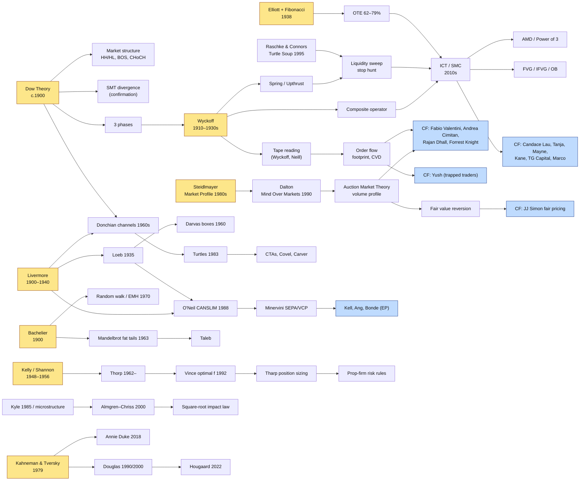

# Idea Lineage Map

**Most "new" strategies on YouTube are re-expressions of 6–8 ideas that are
50–120 years old.** Knowing the lineage tells you (a) the original, fuller
source to study and (b) which claims are genuinely new.

## The eight root ideas

| Root | Original source | Modern descendants (this KB) |
|---|---|---|
| **Trends are defined by swings and need confirmation** | Dow (WSJ, c.1900); Rhea 1932 | Market structure, BOS/CHoCH, SMT divergence, trend following |
| **Large operators accumulate, manipulate, and distribute** | Wyckoff (1910–1930s) | Liquidity sweeps, AMD/Power of 3, "smart money", order blocks |
| **The market is a two-sided auction seeking value** | Steidlmayer (CBOT, 1980s); Dalton 1990 | Volume profile, POC reversion, Fabio's AMT, fair-pricing theory |
| **Read aggression on the tape** | Wyckoff 1910; Neill 1931 | Footprint, delta/CVD, absorption, trapped traders |
| **Buy strength at pivots; cut losses fast; pyramid winners** | Livermore; Loeb; Darvas | CANSLIM, SEPA/VCP, episodic pivots, Donchian, Turtles |
| **Price changes are random-ish, with fat tails** | Bachelier 1900; Mandelbrot 1963 | EMH debate, adaptive markets, Taleb, risk of ruin |
| **Bet in proportion to edge to maximise growth** | Kelly 1956; Thorp | Optimal f, position sizing, R-multiples, prop-firm risk rules |
| **Humans misjudge probabilities and losses** | Kahneman & Tversky 1979 | Douglas, Steenbarger, Duke, Tendler, Hougaard |

## What is genuinely newer

- **Time-of-day precision** (kill zones, 10 AM 4H anchor). Larry Williams and
  Toby Crabel pioneered it; ICT systematised the vocabulary.
- **Cheap order-flow tooling** (footprints, heatmaps) democratised what pit
  traders read by ear.
- **Prop-firm economics** reshaped risk rules (trailing drawdowns,
  consistency rules) and created a large population of NQ/ES scalpers.
  That is most of the Chart Fanatics guest roster.
- **Formal backtest-overfitting statistics** (deflated Sharpe, PBO, 2014+).
